# Noise-aware placement for Nove: v1 results report

Every result in this report holds **under this noise model**: the Pauli-channel model converted from the `qiskit-ibm-runtime` 0.50.0 FakeJakartaV2 and FakeHanoiV2 snapshot files by the SPEC.md conversion rules, simulated with Nove's Stim backend. Nothing here is a hardware measurement or a claim about any real device (X8).

Generated by `python -m noise_aware_compilation.report` from the results files in `results/runs/`. Reproduce everything with the single command in README.md.

## 1. Headline (N2, real converted noise)

Chosen = the noise-aware placement. Fixed = the first valid placement in lexicographic order (R-B1). Average = mean P_L over every valid placement (R-B2). A verdict is *better* or *worse* only when the two 95% intervals do not overlap; overlapping intervals are *indistinguishable* (R-R2). Δ is chosen minus reference (negative means the chosen placement has the lower P_L), with its 95% interval; rel is Δ relative to the reference.

| Device | Circuit | Chosen P_L | Fixed P_L | Average P_L | vs fixed | vs average |
|---|---|---|---|---|---|---|
| FakeJakartaV2 | A (d=3 bit-flip, 1 round) | 8.01e-03 [7.79e-03, 8.24e-03] | 0.0120 [0.0117, 0.0123] | 0.0100 [9.93e-03, 0.0101] | **better**; Δ -3.97e-03 [-4.32e-03, -3.61e-03]; rel -33.1% [-35.5%, -30.6%] | **better**; Δ -2.01e-03 [-2.23e-03, -1.80e-03]; rel -20.1% [-22.2%, -17.9%] |
| FakeJakartaV2 | A (d=3 bit-flip, 3 rounds) | 0.0470 [0.0465, 0.0475] | 0.0626 [0.0620, 0.0632] | 0.0532 [0.0530, 0.0534] | **better**; Δ -0.0156 [-0.0165, -0.0148]; rel -25.0% [-26.1%, -23.8%] | **better**; Δ -6.21e-03 [-6.71e-03, -5.70e-03]; rel -11.7% [-12.6%, -10.7%] |
| FakeJakartaV2 | A (d=3 bit-flip, 5 rounds) | 0.0813 [0.0806, 0.0820] | 0.1061 [0.1053, 0.1069] | 0.0940 [0.0937, 0.0943] | **better**; Δ -0.0248 [-0.0258, -0.0237]; rel -23.3% [-24.2%, -22.5%] | **better**; Δ -0.0127 [-0.0133, -0.0120]; rel -13.5% [-14.2%, -12.8%] |
| FakeJakartaV2 | B (d=3 phase-flip, 3 rounds) | 0.1430 [0.1421, 0.1439] | 0.1430 [0.1421, 0.1439] | 0.1940 [0.1937, 0.1944] | **indistinguishable**; Δ 0 [-1.25e-03, 1.25e-03]; rel +0.0% [-0.9%, +0.9%] | **better**; Δ -0.0511 [-0.0519, -0.0502]; rel -26.3% [-26.8%, -25.9%] |
| FakeJakartaV2 | C (d=2, 3 rounds; M3 only) | 0.1033 [0.1028, 0.1037] | 0.1119 [0.1114, 0.1123] | 0.1294 [0.1293, 0.1296] | **better**; Δ -8.61e-03 [-9.22e-03, -7.99e-03]; rel -7.7% [-8.2%, -7.1%] | **better**; Δ -0.0261 [-0.0266, -0.0257]; rel -20.2% [-20.5%, -19.9%] |
| FakeHanoiV2 | A (d=3 bit-flip, 1 round) | 8.32e-04 [7.62e-04, 9.08e-04] | 9.48e-04 [8.74e-04, 1.03e-03] | 3.64e-03 [3.63e-03, 3.66e-03] | **indistinguishable**; Δ -1.17e-04 [-2.24e-04, -9.92e-06]; rel -12.3% [-22.2%, -1.1%] | **better**; Δ -2.81e-03 [-2.89e-03, -2.74e-03]; rel -77.2% [-79.2%, -75.2%] |
| FakeHanoiV2 | A (d=3 bit-flip, 3 rounds) | 4.40e-03 [4.23e-03, 4.57e-03] | 4.52e-03 [4.36e-03, 4.70e-03] | 8.46e-03 [8.43e-03, 8.48e-03] | **indistinguishable**; Δ -1.25e-04 [-3.64e-04, 1.14e-04]; rel -2.8% [-7.8%, +2.6%] | **better**; Δ -4.06e-03 [-4.22e-03, -3.89e-03]; rel -48.0% [-50.0%, -46.0%] |
| FakeHanoiV2 | A (d=3 bit-flip, 5 rounds) | 6.86e-03 [6.65e-03, 7.07e-03] | 8.09e-03 [7.87e-03, 8.32e-03] | 0.0130 [0.0130, 0.0131] | **better**; Δ -1.23e-03 [-1.54e-03, -9.24e-04]; rel -15.2% [-18.7%, -11.6%] | **better**; Δ -6.17e-03 [-6.38e-03, -5.96e-03]; rel -47.3% [-48.9%, -45.7%] |
| FakeHanoiV2 | B (d=3 phase-flip, 3 rounds) | 3.21e-03 [3.07e-03, 3.35e-03] | 3.11e-03 [2.97e-03, 3.26e-03] | 0.0114 [0.0113, 0.0114] | **indistinguishable**; Δ 9.50e-05 [-1.06e-04, 2.96e-04]; rel +3.1% [-3.3%, +9.8%] | **better**; Δ -8.15e-03 [-8.30e-03, -8.01e-03]; rel -71.8% [-73.0%, -70.5%] |
| FakeHanoiV2 | D (d=5 bit-flip, 3 rounds) | 6.25e-04 [5.82e-04, 6.71e-04] | 9.74e-04 [9.20e-04, 1.03e-03] | 1.11e-03 [1.10e-03, 1.12e-03] | **better**; Δ -3.49e-04 [-4.21e-04, -2.78e-04]; rel -35.8% [-41.5%, -29.7%] | **better**; Δ -4.85e-04 [-5.29e-04, -4.40e-04]; rel -43.7% [-47.7%, -39.6%] |
| FakeHanoiV2 | D (d=7 bit-flip, 3 rounds) | 5.74e-05 [5.42e-05, 6.09e-05] | 7.06e-05 [6.70e-05, 7.45e-05] | 1.35e-04 [1.34e-04, 1.35e-04] | **better**; Δ -1.32e-05 [-1.83e-05, -8.12e-06]; rel -18.7% [-24.9%, -11.9%] | **better**; Δ -7.71e-05 [-8.05e-05, -7.37e-05]; rel -57.3% [-59.8%, -54.8%] |

For circuit C (distance 2) the code detects but cannot correct errors, so its rows compare the detection-event rate M3 instead of P_L; lower M3 is better.

## 2. Method

**Selection score.** Total probability of fault mechanisms in Stim's approximate detector error model (approximate_disjoint_errors=True) of the relabelled circuit lowered with the Nove hardware noise model: the expected number of detector-visible faults per shot. Lower is better. The score is computed from the circuit, the device and the noise model only; no sampler is built and no candidate's logical error rate is estimated (R-P4, tested by T-C8).

**Tie-break.** Scores are rounded to 12 significant digits; the lowest rounded score wins and ties go to the lexicographically smallest mapping (circuit qubit order).

**Decoder (R-R6).** PyMatching 2.4.0, built separately for every placement from that placement's own detector error model: pymatching.Matching.from_detector_error_model on the placement's own Stim DEM, built with approximate_disjoint_errors=True, decompose_errors=True, ignore_decomposition_failures=True; decode_batch on detection events. Default PyMatching settings otherwise (no custom weights or edge merging options). **The decoder's model is approximate**: K1: Nove's Experiment.to_detector_model() raises for calibrated two-qubit Pauli channels with more than one non-zero term, so no exact DEM exists; Stim's approximate_disjoint_errors model is used instead. Every results file records `decoder.decoder_model = "approximate"`.

**Simulation.** Each placement's noiseless circuit is relabelled onto physical qubits, lowered with Nove's calibrated `HardwareNoiseModel` against the converted `DeviceModel`, and sampled with Nove 0.1.0 (commit `485b413dfc0a61683b835c7874507a40cbb687cf`) using `backend="stim"` (Stim 1.16.0). P_L is the fraction of shots in which the decoder's observable prediction is wrong; intervals are Wilson 95%. ε (M2) uses ε = ½[1 − (1 − 2P_L)^(1/r)], applied to the interval ends. M3 is the fraction of detectors that fire, with a normal 95% interval clustered by shot.

**Shots and seeds.** Three base seeds per case (20261011, 20261012, 20261013); every placement of a case gets the same number of shots per seed, starting at 200,000. Under N2 and N3 (and the T-L1 reruns of N2) the case's shots per seed are doubled for all placements together until every placement's Wilson half-width is at most 10% of its P_L, or 25.6 million shots per seed is reached (T-P4). Evaluation chunk seeds are `sha256('eval|<base_seed>|<case_id>|<mapping>|<chunk>')[:8] & (2**63-1)` with chunks of 100,000 shots. Selection uses no seeds at all, so evaluation and selection seeds are disjoint (R-F3).

**Comparisons.** Chosen vs fixed: Newcombe hybrid-score interval for the difference and a Katz log interval for the ratio. Chosen vs average: the exact variance of p_chosen − mean(p) under independent binomials, normal interval; relative difference by the delta method. Headroom: oracle best vs worst P_L with Wilson intervals (R-B3; the oracle is used only here, never for selection). M4: Spearman rank correlation between score and simulated P_L (positive means the score orders placements correctly, since both are lower-is-better). M5: the chosen placement's rank by simulated P_L (1 = best, ties share the average rank) and its regret, P_L(chosen) − P_L(oracle best), with a Newcombe interval. The full list of choices and reasons is in DECISIONS.md.

## 3. All cases: comparisons, headroom, score validity and regret (R-R2, R-R3, R-R4)

Headroom column: oracle best and worst placements with 95% intervals; *placement does not matter* is stated when they overlap. M4 values that are negative are flagged ⚠ (T-P3). N0 has no errors at all, so M4 is undefined there.

### FakeJakartaV2

| Circuit | Condition | Placements | Shots/seed | Chosen | vs fixed | vs average | Headroom: best / worst | M4 Spearman | M5 rank; regret |
|---|---|---|---|---|---|---|---|---|---|
| A1 | N0 zero noise | 8 | 200,000 | (0,1,3,5,4) | **indistinguishable**; Δ 0 [-6.40e-06, 6.40e-06]; rel n/a | **indistinguishable**; Δ 0 [0, 0]; rel n/a | 0 [0, 6.40e-06] / 0 [0, 6.40e-06]; *placement does not matter for this case* | undefined | 4.5 of 8; 0 [-6.40e-06, 6.40e-06] |
| A1 | N1 uniform (device medians) | 8 | 200,000 | (0,1,3,5,4) | **indistinguishable**; Δ 0 [-3.32e-04, 3.32e-04]; rel +0.0% [-3.7%, +3.9%] | **indistinguishable**; Δ 2.67e-05 [-1.93e-04, 2.46e-04]; rel +0.3% [-2.2%, +2.8%] | 8.49e-03 [8.26e-03, 8.72e-03] / 8.88e-03 [8.64e-03, 9.12e-03]; *placement does not matter for this case* | undefined | 7 of 8; 2.02e-04 [-1.29e-04, 5.32e-04] |
| A1 | N2 real (converted snapshot) | 8 | 200,000 | (6,5,3,1,2) | **better**; Δ -3.97e-03 [-4.32e-03, -3.61e-03]; rel -33.1% [-35.5%, -30.6%] | **better**; Δ -2.01e-03 [-2.23e-03, -1.80e-03]; rel -20.1% [-22.2%, -17.9%] | 8.01e-03 [7.79e-03, 8.24e-03] / 0.0121 [0.0118, 0.0124] | +0.786 | 1 of 8; 0 [-3.19e-04, 3.19e-04] |
| A1 | N3 planted readout fault | 8 | 200,000 | (2,1,3,5,4) | **better**; Δ -9.67e-03 [-0.0101, -9.26e-03]; rel -52.9% [-54.4%, -51.3%] | **better**; Δ -4.80e-03 [-5.03e-03, -4.57e-03]; rel -35.8% [-37.4%, -34.1%] | 8.50e-03 [8.27e-03, 8.74e-03] / 0.0184 [0.0180, 0.0187] | +0.720 | 3 of 8; 1.23e-04 [-2.06e-04, 4.53e-04] |
| A1 | N3 planted CX fault | 8 | 200,000 | (2,1,3,5,4) | **better**; Δ -2.38e-03 [-2.74e-03, -2.03e-03]; rel -21.6% [-24.4%, -18.8%] | **better**; Δ -1.68e-03 [-1.90e-03, -1.46e-03]; rel -16.3% [-18.4%, -14.1%] | 8.42e-03 [8.20e-03, 8.66e-03] / 0.0132 [0.0129, 0.0135] | +0.720 | 3 of 8; 2.08e-04 [-1.21e-04, 5.37e-04] |
| A3 | N0 zero noise | 8 | 200,000 | (0,1,3,5,4) | **indistinguishable**; Δ 0 [-6.40e-06, 6.40e-06]; rel n/a | **indistinguishable**; Δ 0 [0, 0]; rel n/a | 0 [0, 6.40e-06] / 0 [0, 6.40e-06]; *placement does not matter for this case* | undefined | 4.5 of 8; 0 [-6.40e-06, 6.40e-06] |
| A3 | N1 uniform (device medians) | 8 | 200,000 | (0,1,3,5,4) | **indistinguishable**; Δ 0 [-7.14e-04, 7.14e-04]; rel +0.0% [-1.7%, +1.7%] | **indistinguishable**; Δ 1.20e-04 [-3.53e-04, 5.92e-04]; rel +0.3% [-0.9%, +1.4%] | 0.0410 [0.0405, 0.0416] / 0.0416 [0.0411, 0.0421]; *placement does not matter for this case* | undefined | 8 of 8; 5.25e-04 [-1.87e-04, 1.24e-03] |
| A3 | N2 real (converted snapshot) | 8 | 200,000 | (6,5,3,1,2) | **better**; Δ -0.0156 [-0.0165, -0.0148]; rel -25.0% [-26.1%, -23.8%] | **better**; Δ -6.21e-03 [-6.71e-03, -5.70e-03]; rel -11.7% [-12.6%, -10.7%] | 0.0461 [0.0456, 0.0466] / 0.0626 [0.0620, 0.0632] | +0.667 | 4 of 8; 8.70e-04 [1.16e-04, 1.62e-03] |
| A3 | N3 planted readout fault | 8 | 200,000 | (2,1,3,5,4) | **better**; Δ -8.57e-03 [-9.31e-03, -7.82e-03]; rel -17.2% [-18.6%, -15.8%] | **better**; Δ -5.52e-03 [-6.00e-03, -5.05e-03]; rel -11.8% [-12.8%, -10.8%] | 0.0412 [0.0407, 0.0417] / 0.0544 [0.0538, 0.0549] | +0.873 | 1 of 8; 0 [-7.11e-04, 7.11e-04] |
| A3 | N3 planted CX fault | 8 | 200,000 | (2,1,3,5,4) | **better**; Δ -0.0156 [-0.0163, -0.0148]; rel -27.3% [-28.5%, -26.1%] | **better**; Δ -7.66e-03 [-8.14e-03, -7.19e-03]; rel -15.6% [-16.6%, -14.6%] | 0.0414 [0.0409, 0.0419] / 0.0569 [0.0564, 0.0575] | +0.926 | 1 of 8; 0 [-7.13e-04, 7.13e-04] |
| A5 | N0 zero noise | 8 | 200,000 | (0,1,3,5,4) | **indistinguishable**; Δ 0 [-6.40e-06, 6.40e-06]; rel n/a | **indistinguishable**; Δ 0 [0, 0]; rel n/a | 0 [0, 6.40e-06] / 0 [0, 6.40e-06]; *placement does not matter for this case* | undefined | 4.5 of 8; 0 [-6.40e-06, 6.40e-06] |
| A5 | N1 uniform (device medians) | 8 | 200,000 | (0,1,3,5,4) | **indistinguishable**; Δ 0 [-9.34e-04, 9.34e-04]; rel +0.0% [-1.3%, +1.3%] | **worse**; Δ 9.48e-04 [3.31e-04, 1.57e-03]; rel +1.3% [+0.5%, +2.2%] | 0.0721 [0.0715, 0.0728] / 0.0735 [0.0729, 0.0742] | undefined | 8 of 8; 1.39e-03 [4.60e-04, 2.32e-03] |
| A5 | N2 real (converted snapshot) | 8 | 200,000 | (2,1,3,5,4) | **better**; Δ -0.0248 [-0.0258, -0.0237]; rel -23.3% [-24.2%, -22.5%] | **better**; Δ -0.0127 [-0.0133, -0.0120]; rel -13.5% [-14.2%, -12.8%] | 0.0813 [0.0806, 0.0820] / 0.1069 [0.1061, 0.1077] | +0.952 | 1 of 8; 0 [-9.78e-04, 9.78e-04] |
| A5 | N3 planted readout fault | 8 | 200,000 | (2,1,3,5,4) | **better**; Δ -7.31e-03 [-8.26e-03, -6.36e-03]; rel -9.1% [-10.3%, -8.0%] | **better**; Δ -4.80e-03 [-5.41e-03, -4.18e-03]; rel -6.2% [-7.0%, -5.4%] | 0.0724 [0.0717, 0.0730] / 0.0854 [0.0847, 0.0861] | +0.873 | 3 of 8; 4.08e-04 [-5.20e-04, 1.34e-03] |
| A5 | N3 planted CX fault | 8 | 200,000 | (2,1,3,5,4) | **better**; Δ -0.0268 [-0.0278, -0.0258]; rel -27.0% [-27.8%, -26.1%] | **better**; Δ -0.0135 [-0.0141, -0.0129]; rel -15.6% [-16.4%, -14.9%] | 0.0722 [0.0715, 0.0728] / 0.1000 [0.0992, 0.1007] | +0.720 | 2 of 8; 4.83e-04 [-4.44e-04, 1.41e-03] |
| B | N0 zero noise | 8 | 200,000 | (0,1,3,5,4) | **indistinguishable**; Δ 0 [-6.40e-06, 6.40e-06]; rel n/a | **indistinguishable**; Δ 0 [0, 0]; rel n/a | 0 [0, 6.40e-06] / 0 [0, 6.40e-06]; *placement does not matter for this case* | undefined | 4.5 of 8; 0 [-6.40e-06, 6.40e-06] |
| B | N1 uniform (device medians) | 8 | 200,000 | (0,1,3,5,4) | **indistinguishable**; Δ 0 [-1.35e-03, 1.35e-03]; rel +0.0% [-0.8%, +0.8%] | **indistinguishable**; Δ -7.68e-04 [-1.66e-03, 1.22e-04]; rel -0.4% [-1.0%, +0.1%] | 0.1704 [0.1694, 0.1713] / 0.1719 [0.1709, 0.1728]; *placement does not matter for this case* | undefined | 1 of 8; 0 [-1.35e-03, 1.35e-03] |
| B | N2 real (converted snapshot) | 8 | 200,000 | (0,1,3,5,4) | **indistinguishable**; Δ 0 [-1.25e-03, 1.25e-03]; rel +0.0% [-0.9%, +0.9%] | **better**; Δ -0.0511 [-0.0519, -0.0502]; rel -26.3% [-26.8%, -25.9%] | 0.1419 [0.1411, 0.1428] / 0.2578 [0.2567, 0.2589] | +0.929 | 2 of 8; 1.03e-03 [-2.24e-04, 2.28e-03] |
| B | N3 planted readout fault | 8 | 200,000 | (2,1,3,5,4) | **better**; Δ -0.0106 [-0.0120, -9.26e-03]; rel -5.8% [-6.5%, -5.1%] | **better**; Δ -5.11e-03 [-6.01e-03, -4.22e-03]; rel -2.9% [-3.4%, -2.4%] | 0.1703 [0.1694, 0.1713] / 0.1831 [0.1821, 0.1841] | +0.873 | 4 of 8; 1.68e-03 [3.34e-04, 3.03e-03] |
| B | N3 planted CX fault | 8 | 200,000 | (2,1,3,5,4) | **better**; Δ -0.0146 [-0.0160, -0.0133]; rel -7.9% [-8.6%, -7.2%] | **better**; Δ -7.98e-03 [-8.87e-03, -7.08e-03]; rel -4.5% [-5.0%, -4.0%] | 0.1705 [0.1695, 0.1714] / 0.1883 [0.1873, 0.1893] | +0.720 | 3 of 8; 3.25e-04 [-1.02e-03, 1.67e-03] |
| C (M3) | N0 zero noise | 14 | 200,000 | (0,1,2) | **indistinguishable**; Δ 0 [0, 0]; rel n/a | **indistinguishable**; Δ 0 [0, 0]; rel n/a | 0 [0, 0] / 0 [0, 0]; *placement does not matter for this case* | undefined | 7.5 of 14; 0 [0, 0] |
| C (M3) | N1 uniform (device medians) | 14 | 200,000 | (0,1,2) | **indistinguishable**; Δ 0 [-6.36e-04, 6.36e-04]; rel +0.0% [-0.6%, +0.6%] | **indistinguishable**; Δ -1.46e-04 [-5.79e-04, 2.87e-04]; rel -0.1% [-0.5%, +0.3%] | 0.1115 [0.1111, 0.1120] / 0.1123 [0.1119, 0.1128]; *placement does not matter for this case* | undefined | 4 of 14; 3.00e-04 [-3.35e-04, 9.35e-04] |
| C (M3) | N2 real (converted snapshot) | 14 | 200,000 | (3,1,2) | **better**; Δ -8.61e-03 [-9.22e-03, -7.99e-03]; rel -7.7% [-8.2%, -7.1%] | **better**; Δ -0.0261 [-0.0266, -0.0257]; rel -20.2% [-20.5%, -19.9%] | 0.1033 [0.1028, 0.1037] / 0.1601 [0.1596, 0.1607] | +0.991 | 1 of 14; 0 [-6.11e-04, 6.11e-04] |
| C (M3) | N3 planted readout fault | 14 | 200,000 | (1,3,5) | **better**; Δ -0.0197 [-0.0204, -0.0191]; rel -15.0% [-15.5%, -14.5%] | **better**; Δ -5.91e-03 [-6.35e-03, -5.48e-03]; rel -5.0% [-5.4%, -4.7%] | 0.1116 [0.1112, 0.1121] / 0.1324 [0.1319, 0.1329] | +0.784 | 3 of 14; 2.13e-04 [-4.23e-04, 8.49e-04] |
| C (M3) | N3 planted CX fault | 14 | 200,000 | (1,3,5) | **better**; Δ -0.0267 [-0.0274, -0.0260]; rel -19.2% [-19.7%, -18.8%] | **better**; Δ -7.78e-03 [-8.22e-03, -7.35e-03]; rel -6.5% [-6.9%, -6.1%] | 0.1118 [0.1113, 0.1122] / 0.1398 [0.1393, 0.1403] | +0.751 | 5 of 14; 2.15e-04 [-4.20e-04, 8.51e-04] |

### FakeHanoiV2

| Circuit | Condition | Placements | Shots/seed | Chosen | vs fixed | vs average | Headroom: best / worst | M4 Spearman | M5 rank; regret |
|---|---|---|---|---|---|---|---|---|---|
| A1 | N1 uniform (device medians) | 80 | 200,000 | (0,1,2,3,5) | **indistinguishable**; Δ 0 [-1.18e-04, 1.18e-04]; rel +0.0% [-10.3%, +11.5%] | **indistinguishable**; Δ -3.22e-05 [-1.15e-04, 5.06e-05]; rel -2.9% [-10.3%, +4.5%] | 1.01e-03 [9.28e-04, 1.09e-03] / 1.21e-03 [1.12e-03, 1.30e-03] | undefined | 16.5 of 80; 8.00e-05 [-3.57e-05, 1.96e-04] |
| A1 | N2 real (converted snapshot) | 80 | 200,000 | (5,3,2,1,4) | **indistinguishable**; Δ -1.17e-04 [-2.24e-04, -9.92e-06]; rel -12.3% [-22.2%, -1.1%] | **better**; Δ -2.81e-03 [-2.89e-03, -2.74e-03]; rel -77.2% [-79.2%, -75.2%] | 7.67e-04 [7.00e-04, 8.40e-04] / 0.0147 [0.0144, 0.0150] | +0.841 | 2 of 80; 6.50e-05 [-3.62e-05, 1.66e-04] |
| A1 | N3 planted readout fault | 80 | 200,000 | (4,7,10,12,13) | **indistinguishable**; Δ -3.83e-05 [-1.58e-04, 8.13e-05]; rel -3.4% [-13.2%, +7.5%] | **indistinguishable**; Δ -8.99e-05 [-1.73e-04, -6.59e-06]; rel -7.6% [-14.6%, -0.6%] | 1.03e-03 [9.49e-04, 1.11e-03] / 2.73e-03 [2.60e-03, 2.87e-03] | +0.050 | 31.5 of 80; 7.00e-05 [-4.66e-05, 1.87e-04] |
| A1 | N3 planted CX fault | 80 | 200,000 | (0,1,4,7,6) | **better**; Δ -6.22e-04 [-7.54e-04, -4.90e-04]; rel -37.2% [-43.2%, -30.6%] | **better**; Δ -1.45e-04 [-2.26e-04, -6.35e-05]; rel -12.1% [-19.0%, -5.3%] | 1.02e-03 [9.39e-04, 1.10e-03] / 2.06e-03 [1.95e-03, 2.18e-03] | +0.570 | 4 of 80; 3.17e-05 [-8.34e-05, 1.47e-04] |
| A3 | N1 uniform (device medians) | 80 | 200,000 | (0,1,2,3,5) | **indistinguishable**; Δ 0 [-2.38e-04, 2.38e-04]; rel +0.0% [-5.2%, +5.5%] | **indistinguishable**; Δ 2.88e-05 [-1.39e-04, 1.96e-04]; rel +0.6% [-3.1%, +4.4%] | 4.19e-03 [4.03e-03, 4.35e-03] / 4.66e-03 [4.49e-03, 4.84e-03] | undefined | 49 of 80; 2.70e-04 [3.52e-05, 5.05e-04] |
| A3 | N2 real (converted snapshot) | 80 | 200,000 | (16,19,22,25,26) | **indistinguishable**; Δ -1.25e-04 [-3.64e-04, 1.14e-04]; rel -2.8% [-7.8%, +2.6%] | **better**; Δ -4.06e-03 [-4.22e-03, -3.89e-03]; rel -48.0% [-50.0%, -46.0%] | 4.01e-03 [3.86e-03, 4.18e-03] / 0.0232 [0.0228, 0.0235] | +0.615 | 10 of 80; 3.85e-04 [1.53e-04, 6.17e-04] |
| A3 | N3 planted readout fault | 80 | 200,000 | (4,7,10,12,13) | **indistinguishable**; Δ 2.40e-04 [2.02e-06, 4.78e-04]; rel +5.6% [+0.0%, +11.4%] | **indistinguishable**; Δ 6.90e-05 [-1.00e-04, 2.38e-04]; rel +1.5% [-2.2%, +5.3%] | 4.25e-03 [4.09e-03, 4.42e-03] / 6.05e-03 [5.86e-03, 6.25e-03] | +0.160 | 69 of 80; 3.10e-04 [7.30e-05, 5.47e-04] |
| A3 | N3 planted CX fault | 80 | 200,000 | (0,1,4,7,6) | **better**; Δ -1.91e-03 [-2.17e-03, -1.65e-03]; rel -30.4% [-33.8%, -26.9%] | **better**; Δ -3.10e-04 [-4.76e-04, -1.44e-04]; rel -6.6% [-10.2%, -3.1%] | 4.23e-03 [4.07e-03, 4.40e-03] / 7.15e-03 [6.94e-03, 7.36e-03] | +0.568 | 15 of 80; 1.38e-04 [-9.59e-05, 3.73e-04] |
| A5 | N1 uniform (device medians) | 80 | 200,000 | (0,1,2,3,5) | **indistinguishable**; Δ 0 [-3.09e-04, 3.09e-04]; rel +0.0% [-4.0%, +4.2%] | **indistinguishable**; Δ 3.19e-05 [-1.85e-04, 2.49e-04]; rel +0.4% [-2.5%, +3.3%] | 7.28e-03 [7.07e-03, 7.50e-03] / 7.81e-03 [7.59e-03, 8.03e-03] | undefined | 50 of 80; 2.42e-04 [-6.50e-05, 5.48e-04] |
| A5 | N2 real (converted snapshot) | 80 | 200,000 | (10,7,4,1,0) | **better**; Δ -1.23e-03 [-1.54e-03, -9.24e-04]; rel -15.2% [-18.7%, -11.6%] | **better**; Δ -6.17e-03 [-6.38e-03, -5.96e-03]; rel -47.3% [-48.9%, -45.7%] | 6.32e-03 [6.12e-03, 6.52e-03] / 0.0294 [0.0290, 0.0299] | +0.626 | 3 of 80; 5.45e-04 [2.56e-04, 8.35e-04] |
| A5 | N3 planted readout fault | 80 | 200,000 | (4,7,10,12,13) | **indistinguishable**; Δ -2.33e-04 [-5.48e-04, 8.12e-05]; rel -3.0% [-6.8%, +1.0%] | **indistinguishable**; Δ 2.29e-05 [-1.96e-04, 2.42e-04]; rel +0.3% [-2.6%, +3.2%] | 7.26e-03 [7.05e-03, 7.48e-03] / 9.23e-03 [8.99e-03, 9.47e-03] | +0.683 | 60 of 80; 4.10e-04 [1.02e-04, 7.18e-04] |
| A5 | N3 planted CX fault | 80 | 200,000 | (0,1,4,7,6) | **better**; Δ -3.10e-03 [-3.44e-03, -2.76e-03]; rel -29.3% [-32.0%, -26.6%] | **better**; Δ -4.96e-04 [-7.12e-04, -2.79e-04]; rel -6.2% [-8.9%, -3.5%] | 7.31e-03 [7.10e-03, 7.53e-03] / 0.0121 [0.0119, 0.0124] | +0.569 | 26 of 80; 1.58e-04 [-1.48e-04, 4.65e-04] |
| B | N1 uniform (device medians) | 80 | 200,000 | (0,1,2,3,5) | **indistinguishable**; Δ 0 [-2.40e-04, 2.40e-04]; rel +0.0% [-5.2%, +5.5%] | **indistinguishable**; Δ -8.10e-05 [-2.50e-04, 8.74e-05]; rel -1.8% [-5.4%, +1.9%] | 4.43e-03 [4.27e-03, 4.60e-03] / 4.84e-03 [4.67e-03, 5.02e-03] | undefined | 15 of 80; 7.67e-05 [-1.62e-04, 3.15e-04] |
| B | N2 real (converted snapshot) | 80 | 200,000 | (5,3,2,1,0) | **indistinguishable**; Δ 9.50e-05 [-1.06e-04, 2.96e-04]; rel +3.1% [-3.3%, +9.8%] | **better**; Δ -8.15e-03 [-8.30e-03, -8.01e-03]; rel -71.8% [-73.0%, -70.5%] | 3.11e-03 [2.97e-03, 3.26e-03] / 0.0325 [0.0321, 0.0330] | +0.773 | 2 of 80; 9.50e-05 [-1.06e-04, 2.96e-04] |
| B | N3 planted readout fault | 80 | 200,000 | (4,7,10,12,13) | **indistinguishable**; Δ -2.73e-04 [-5.16e-04, -3.07e-05]; rel -5.8% [-10.6%, -0.7%] | **indistinguishable**; Δ -1.83e-04 [-3.51e-04, -1.52e-05]; rel -3.9% [-7.5%, -0.3%] | 4.40e-03 [4.24e-03, 4.57e-03] / 6.39e-03 [6.19e-03, 6.60e-03] | +0.129 | 4 of 80; 7.83e-05 [-1.60e-04, 3.16e-04] |
| B | N3 planted CX fault | 80 | 200,000 | (0,1,4,7,6) | **better**; Δ -2.01e-03 [-2.28e-03, -1.75e-03]; rel -30.6% [-33.9%, -27.2%] | **better**; Δ -3.04e-04 [-4.74e-04, -1.35e-04]; rel -6.3% [-9.7%, -2.8%] | 4.36e-03 [4.19e-03, 4.53e-03] / 7.28e-03 [7.06e-03, 7.49e-03] | +0.568 | 26.5 of 80; 2.03e-04 [-3.51e-05, 4.42e-04] |
| D5 | N1 uniform (device medians) | 102 | 200,000 | (0,1,4,7,10,12,13,14,11) | **indistinguishable**; Δ 0 [-7.24e-05, 7.24e-05]; rel +0.0% [-16.3%, +19.4%] | **indistinguishable**; Δ 2.37e-05 [-2.71e-05, 7.44e-05]; rel +6.2% [-7.1%, +19.4%] | 3.23e-04 [2.81e-04, 3.72e-04] / 4.42e-04 [3.92e-04, 4.98e-04] | undefined | 79 of 102; 8.33e-05 [1.49e-05, 1.52e-04] |
| D5 | N2 real (converted snapshot) | 102 | 400,000 | (9,8,11,14,16,19,22,25,26) | **better**; Δ -3.49e-04 [-4.21e-04, -2.78e-04]; rel -35.8% [-41.5%, -29.7%] | **better**; Δ -4.85e-04 [-5.29e-04, -4.40e-04]; rel -43.7% [-47.7%, -39.6%] | 3.98e-04 [3.64e-04, 4.36e-04] / 2.66e-03 [2.57e-03, 2.76e-03] | +0.530 | 10 of 102; 2.27e-04 [1.70e-04, 2.84e-04] |
| D5 | N3 planted readout fault | 102 | 800,000 | (4,7,10,12,13,14,11,8,9) | **indistinguishable**; Δ -3.25e-05 [-6.81e-05, 3.08e-06]; rel -7.9% [-15.8%, +0.8%] | **indistinguishable**; Δ -2.03e-05 [-4.48e-05, 4.22e-06]; rel -5.1% [-11.2%, +1.1%] | 3.45e-04 [3.22e-04, 3.69e-04] / 5.89e-04 [5.59e-04, 6.20e-04] | +0.737 | 29 of 102; 3.42e-05 [1.16e-07, 6.83e-05] |
| D5 | N3 planted CX fault | 102 | 800,000 | (0,1,4,7,10,12,13,14,11) | **indistinguishable**; Δ 0 [-3.58e-05, 3.58e-05]; rel +0.0% [-8.6%, +9.4%] | **indistinguishable**; Δ -1.09e-05 [-3.60e-05, 1.43e-05]; rel -2.7% [-8.8%, +3.5%] | 3.43e-04 [3.20e-04, 3.67e-04] / 5.98e-04 [5.68e-04, 6.30e-04] | +0.625 | 80 of 102; 5.58e-05 [2.14e-05, 9.04e-05] |
| D7 | N1 uniform (device medians) | 74 | 200,000 | (0,1,4,7,10,12,13,14,16,19,22,25,24) | **indistinguishable**; Δ 0 [-2.48e-05, 2.48e-05]; rel +0.0% [-41.3%, +70.5%] | **indistinguishable**; Δ 1.24e-05 [-4.46e-06, 2.92e-05]; rel +37.9% [-13.6%, +89.4%] | 1.83e-05 [1.02e-05, 3.28e-05] / 5.67e-05 [4.06e-05, 7.92e-05] | undefined | 68.5 of 74; 2.67e-05 [6.46e-06, 4.87e-05] |
| D7 | N2 real (converted snapshot) | 74 | 6,400,000 | (0,1,4,7,10,12,13,14,16,19,22,25,26) | **better**; Δ -1.32e-05 [-1.83e-05, -8.12e-06]; rel -18.7% [-24.9%, -11.9%] | **better**; Δ -7.71e-05 [-8.05e-05, -7.37e-05]; rel -57.3% [-59.8%, -54.8%] | 4.47e-05 [4.18e-05, 4.78e-05] / 3.47e-04 [3.39e-04, 3.56e-04] | +0.578 | 3 of 74; 1.28e-05 [8.24e-06, 1.73e-05] |
| D7 | N3 planted readout fault | 74 | 6,400,000 | (4,7,10,12,13,14,16,19,22,25,24,23,21) | **indistinguishable**; Δ -1.61e-06 [-5.31e-06, 2.07e-06]; rel -4.6% [-14.5%, +6.3%] | **indistinguishable**; Δ -1.68e-06 [-4.23e-06, 8.81e-07]; rel -4.8% [-12.2%, +2.5%] | 2.99e-05 [2.75e-05, 3.24e-05] / 4.87e-05 [4.57e-05, 5.20e-05] | +0.683 | 27 of 74; 3.23e-06 [-3.24e-07, 6.79e-06] |
| D7 | N3 planted CX fault | 74 | 6,400,000 | (0,1,4,7,10,12,13,14,16,19,22,25,24) | **indistinguishable**; Δ 0 [-3.80e-06, 3.80e-06]; rel +0.0% [-10.0%, +11.1%] | **indistinguishable**; Δ -3.32e-07 [-3.00e-06, 2.34e-06]; rel -0.9% [-8.2%, +6.4%] | 2.99e-05 [2.76e-05, 3.25e-05] / 5.06e-05 [4.75e-05, 5.39e-05] | +0.730 | 56 of 74; 6.09e-06 [2.46e-06, 9.74e-06] |

## 4. N2: all placements sorted by P_L (R-R5)

**FakeJakartaV2, circuit A (d=3 bit-flip, 1 round).**

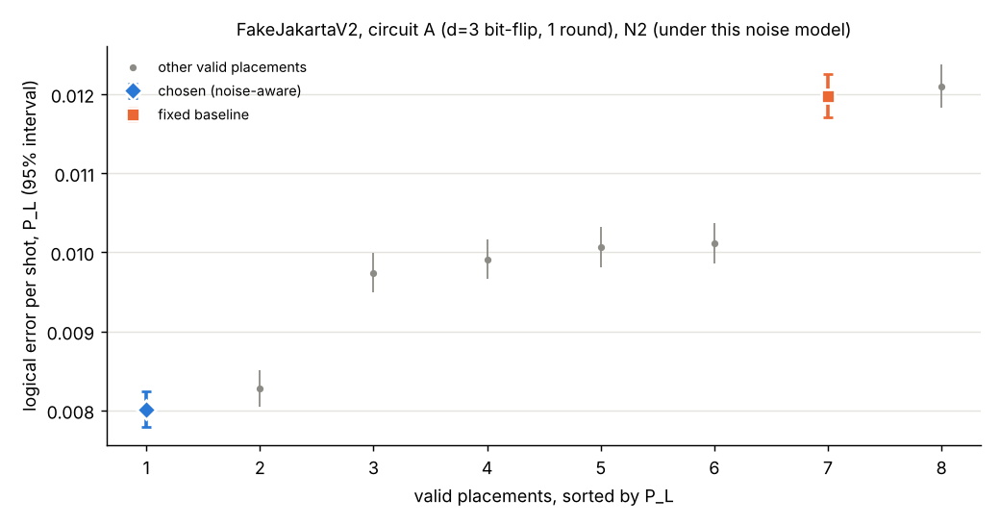

**FakeJakartaV2, circuit A (d=3 bit-flip, 3 rounds).**

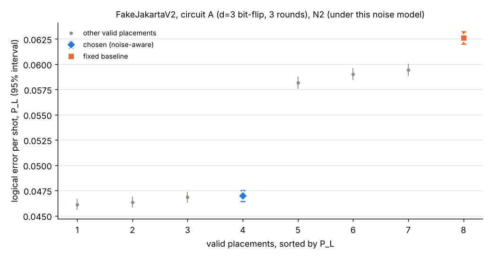

**FakeJakartaV2, circuit A (d=3 bit-flip, 5 rounds).**

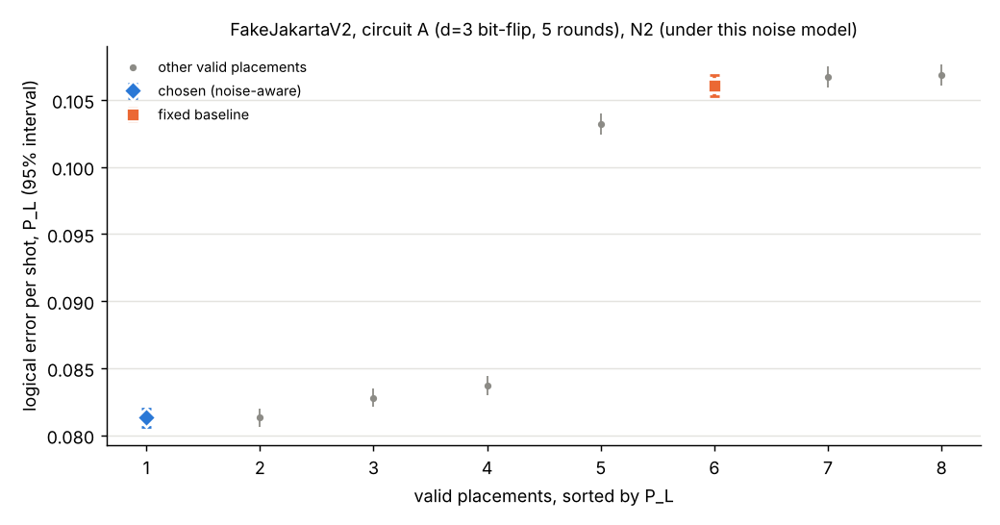

**FakeJakartaV2, circuit B (d=3 phase-flip, 3 rounds).**

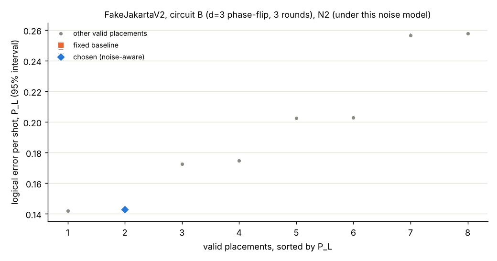

**FakeJakartaV2, circuit C (d=2, 3 rounds; M3 only).**

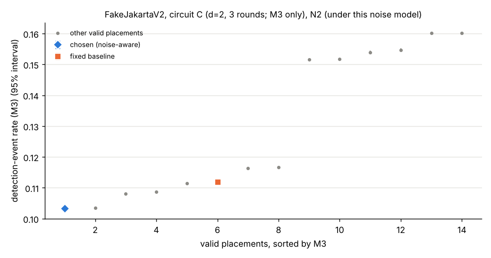

**FakeHanoiV2, circuit A (d=3 bit-flip, 1 round).**

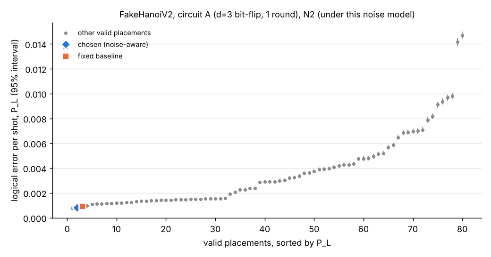

**FakeHanoiV2, circuit A (d=3 bit-flip, 3 rounds).**

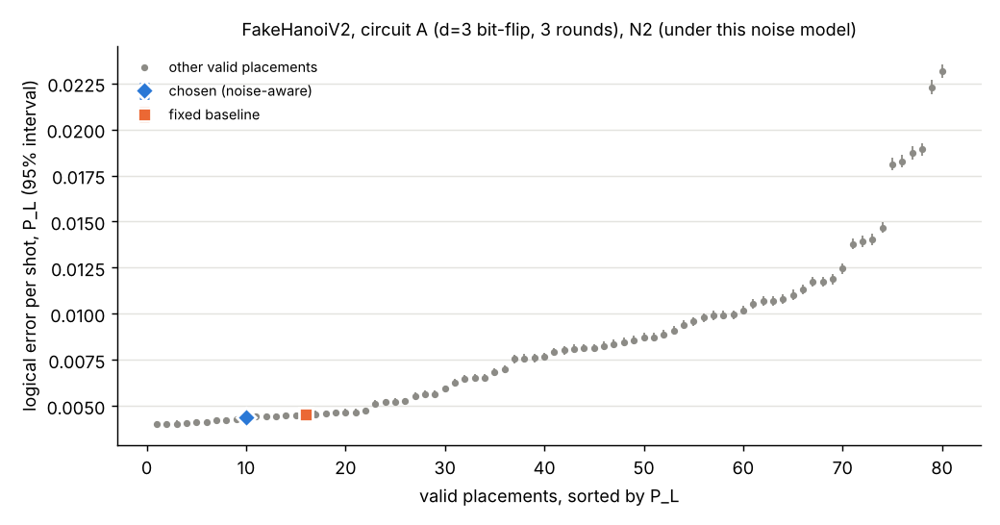

**FakeHanoiV2, circuit A (d=3 bit-flip, 5 rounds).**

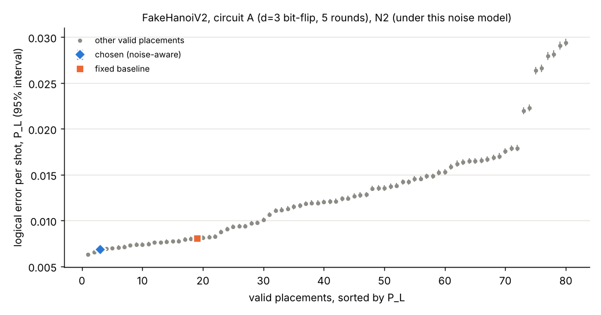

**FakeHanoiV2, circuit B (d=3 phase-flip, 3 rounds).**

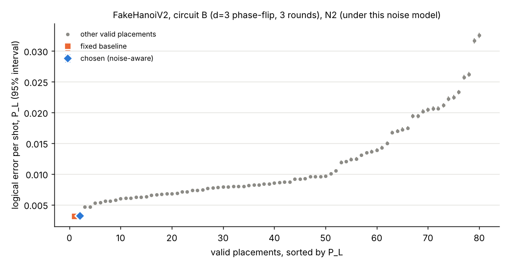

**FakeHanoiV2, circuit D (d=5 bit-flip, 3 rounds).**

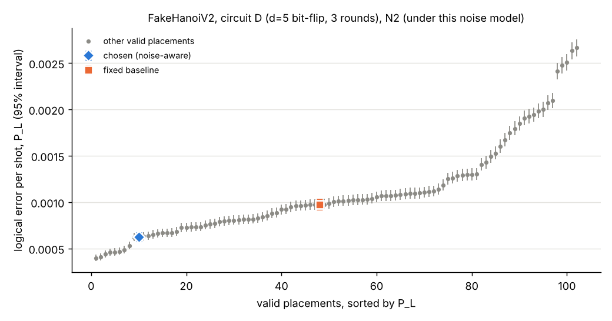

**FakeHanoiV2, circuit D (d=7 bit-flip, 3 rounds).**

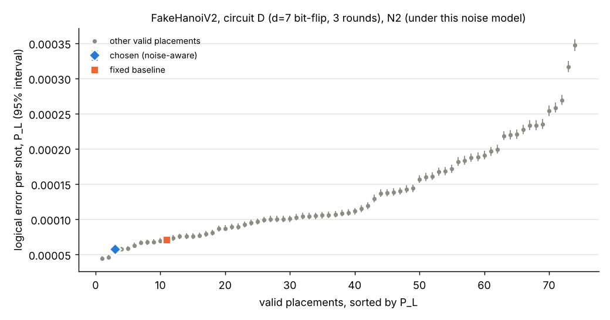

## 5. Per-round logical error ε for circuit A at 1, 3 and 5 rounds (T-P5)

| Device | Rounds | ε chosen | ε fixed | ε average | vs fixed | vs average |
|---|---|---|---|---|---|---|
| FakeJakartaV2 | 1 | 8.01e-03 [7.79e-03, 8.24e-03] | 0.0120 [0.0117, 0.0123] | 0.0100 [9.93e-03, 0.0101] | better | better |
| FakeJakartaV2 | 3 | 0.0162 [0.0160, 0.0164] | 0.0218 [0.0216, 0.0220] | 0.0184 [0.0183, 0.0185] | better | better |
| FakeJakartaV2 | 5 | 0.0174 [0.0173, 0.0176] | 0.0233 [0.0231, 0.0235] | 0.0204 [0.0203, 0.0205] | better | better |
| FakeHanoiV2 | 1 | 8.32e-04 [7.62e-04, 9.08e-04] | 9.48e-04 [8.74e-04, 1.03e-03] | 3.64e-03 [3.63e-03, 3.66e-03] | indistinguishable | better |
| FakeHanoiV2 | 3 | 1.47e-03 [1.42e-03, 1.53e-03] | 1.51e-03 [1.46e-03, 1.57e-03] | 2.83e-03 [2.83e-03, 2.84e-03] | indistinguishable | better |
| FakeHanoiV2 | 5 | 1.38e-03 [1.34e-03, 1.42e-03] | 1.63e-03 [1.58e-03, 1.68e-03] | 2.63e-03 [2.63e-03, 2.64e-03] | better | better |

- FakeJakartaV2: verdicts (vs fixed / vs average) at 1, 3, 5 rounds are better/better, better/better, better/better; the direction is the same for all three.
- FakeHanoiV2: verdicts (vs fixed / vs average) at 1, 3, 5 rounds are indistinguishable/better, indistinguishable/better, better/better; the direction is **not** the same for all three.

## 6. Gain vs code distance on FakeHanoiV2 (T-P6)

| Distance | Circuit | Chosen − average Δ P_L [95%] | Relative | Verdict |
|---|---|---|---|---|
| 3 | A3 | -4.06e-03 [-4.22e-03, -3.89e-03] | -48.0% [-50.0%, -46.0%] | better |
| 5 | D5 | -4.85e-04 [-5.29e-04, -4.40e-04] | -43.7% [-47.7%, -39.6%] | better |
| 7 | D7 | -7.71e-05 [-8.05e-05, -7.37e-05] | -57.3% [-59.8%, -54.8%] | better |

Trend of the chosen-vs-average difference from distance 3 to 7: **shrinks** (rule in DECISIONS.md D10: *flat* when all three intervals overlap each other; otherwise *grows* or *shrinks* by the magnitude at d=7 relative to d=3).

## 7. Uniform-noise null (N1, T-F2)

Pearson chi-square test of homogeneity of P_L across all valid placements (k × 2 table of failures and successes, pooled over seeds). Pass criterion p > 0.01.

| Device | Circuit | χ² | dof | p | vs fixed | vs average | Statement |
|---|---|---|---|---|---|---|---|
| FakeJakartaV2 | A1 | 5.56 | 7 | 0.592 | indistinguishable | indistinguishable | **no gain** under N1 |
| FakeJakartaV2 | A3 | 3.13 | 7 | 0.873 | indistinguishable | indistinguishable | **no gain** under N1 |
| FakeJakartaV2 | A5 | 12.74 | 7 | 0.079 | indistinguishable | worse | **no gain** under N1 |
| FakeJakartaV2 | B | 8.75 | 7 | 0.271 | indistinguishable | indistinguishable | **no gain** under N1 |
| FakeJakartaV2 | C | 4.31 | 13 | 0.987 | indistinguishable | indistinguishable | **no gain** under N1 |
| FakeHanoiV2 | A1 | 75.52 | 79 | 0.590 | indistinguishable | indistinguishable | **no gain** under N1 |
| FakeHanoiV2 | A3 | 69.16 | 79 | 0.778 | indistinguishable | indistinguishable | **no gain** under N1 |
| FakeHanoiV2 | A5 | 61.80 | 79 | 0.923 | indistinguishable | indistinguishable | **no gain** under N1 |
| FakeHanoiV2 | B | 76.20 | 79 | 0.568 | indistinguishable | indistinguishable | **no gain** under N1 |
| FakeHanoiV2 | D5 | 111.58 | 101 | 0.222 | indistinguishable | indistinguishable | **no gain** under N1 |
| FakeHanoiV2 | D7 | 88.66 | 73 | 0.102 | indistinguishable | indistinguishable | **no gain** under N1 |

Under N1 every placement receives identical noise, so all selection scores are equal and the tie-break picks the lexicographically first placement, which is the fixed baseline. The chosen placement therefore has no information advantage, and where the homogeneity test finds no difference between placements (p > 0.01) the report states **no gain** under uniform noise. A pairwise verdict other than *indistinguishable* in this table (chosen vs average) is then a chance fluctuation of that single placement: at 95% confidence about one comparison in twenty is expected to separate by chance, and the placement compared was fixed by the tie-break, not selected for its outcome. These pairwise verdicts are reported as computed and are not claimed as gains or losses (X8).

## 8. Planted faults (N3, T-C4)

A faulty placement uses the planted qubit (readout error × 5), or runs a CX on the planted connection (CX error × 5, both directions). The faults were recorded in `configs/benchmark.json` before running. Pass: the chosen placement avoids the fault, and its P_L interval is not entirely above any faulty placement's interval.

| Device | Circuit | Fault | Faulty placements | Chosen avoids | Chosen P_L | Best faulty P_L | Not higher than any faulty |
|---|---|---|---|---|---|---|---|
| FakeJakartaV2 | A1 | qubit 0 | 4 of 8 | yes | 8.63e-03 [8.39e-03, 8.86e-03] | 0.0181 [0.0177, 0.0184] | yes |
| FakeJakartaV2 | A1 | connection (0, 1) | 4 of 8 | yes | 8.63e-03 [8.40e-03, 8.87e-03] | 0.0110 [0.0108, 0.0113] | yes |
| FakeJakartaV2 | A3 | qubit 0 | 4 of 8 | yes | 0.0412 [0.0407, 0.0417] | 0.0497 [0.0492, 0.0503] | yes |
| FakeJakartaV2 | A3 | connection (0, 1) | 4 of 8 | yes | 0.0414 [0.0409, 0.0419] | 0.0563 [0.0557, 0.0569] | yes |
| FakeJakartaV2 | A5 | qubit 0 | 4 of 8 | yes | 0.0728 [0.0721, 0.0735] | 0.0801 [0.0794, 0.0808] | yes |
| FakeJakartaV2 | A5 | connection (0, 1) | 4 of 8 | yes | 0.0727 [0.0720, 0.0733] | 0.0993 [0.0985, 0.1000] | yes |
| FakeJakartaV2 | B | qubit 0 | 4 of 8 | yes | 0.1720 [0.1710, 0.1730] | 0.1825 [0.1815, 0.1834] | yes |
| FakeJakartaV2 | B | connection (0, 1) | 4 of 8 | yes | 0.1708 [0.1698, 0.1718] | 0.1854 [0.1844, 0.1864] | yes |
| FakeJakartaV2 | C | qubit 0 | 4 of 14 | yes | M3 0.1119 [0.1114, 0.1123] | M3 0.1316 [0.1311, 0.1321] | yes (M3) |
| FakeJakartaV2 | C | connection (0, 1) | 4 of 14 | yes | M3 0.1120 [0.1115, 0.1124] | M3 0.1387 [0.1382, 0.1392] | yes (M3) |
| FakeHanoiV2 | A1 | qubit 1 | 16 of 80 | yes | 1.10e-03 [1.02e-03, 1.18e-03] | 1.05e-03 [9.73e-04, 1.14e-03] | yes |
| FakeHanoiV2 | A1 | connection (1, 2) | 10 of 80 | yes | 1.05e-03 [9.70e-04, 1.13e-03] | 1.40e-03 [1.31e-03, 1.50e-03] | yes |
| FakeHanoiV2 | A3 | qubit 1 | 16 of 80 | yes | 4.56e-03 [4.39e-03, 4.74e-03] | 4.32e-03 [4.16e-03, 4.49e-03] | yes |
| FakeHanoiV2 | A3 | connection (1, 2) | 10 of 80 | yes | 4.37e-03 [4.21e-03, 4.54e-03] | 5.93e-03 [5.74e-03, 6.13e-03] | yes |
| FakeHanoiV2 | A5 | qubit 1 | 16 of 80 | yes | 7.67e-03 [7.45e-03, 7.89e-03] | 7.84e-03 [7.62e-03, 8.07e-03] | yes |
| FakeHanoiV2 | A5 | connection (1, 2) | 10 of 80 | yes | 7.47e-03 [7.25e-03, 7.69e-03] | 0.0106 [0.0103, 0.0108] | yes |
| FakeHanoiV2 | B | qubit 1 | 16 of 80 | yes | 4.48e-03 [4.31e-03, 4.65e-03] | 4.45e-03 [4.28e-03, 4.62e-03] | yes |
| FakeHanoiV2 | B | connection (1, 2) | 10 of 80 | yes | 4.56e-03 [4.39e-03, 4.73e-03] | 6.21e-03 [6.01e-03, 6.41e-03] | yes |
| FakeHanoiV2 | D5 | qubit 1 | 30 of 102 | yes | 3.79e-04 [3.55e-04, 4.05e-04] | 3.95e-04 [3.71e-04, 4.21e-04] | yes |
| FakeHanoiV2 | D5 | connection (1, 2) | 16 of 102 | yes | 3.99e-04 [3.74e-04, 4.25e-04] | 4.87e-04 [4.60e-04, 5.16e-04] | yes |
| FakeHanoiV2 | D7 | qubit 1 | 30 of 74 | yes | 3.31e-05 [3.06e-05, 3.58e-05] | 3.28e-05 [3.03e-05, 3.54e-05] | yes |
| FakeHanoiV2 | D7 | connection (1, 2) | 18 of 74 | yes | 3.60e-05 [3.35e-05, 3.88e-05] | 4.37e-05 [4.09e-05, 4.68e-05] | yes |

## 9. Seed consistency (T-R2) and precision (T-P4)

Verdicts recomputed from each base seed's shots alone (vs fixed / vs average). T-R2 requires the same verdict on all three seeds.

| Case | Seed 1 | Seed 2 | Seed 3 | Same on all seeds |
|---|---|---|---|---|
| jakarta-A1-N2 | better / better | better / better | better / better | yes |
| jakarta-A3-N2 | better / better | better / better | better / better | yes |
| jakarta-A5-N2 | better / better | better / better | better / better | yes |
| jakarta-B-N2 | indistinguishable / better | indistinguishable / better | indistinguishable / better | yes |
| jakarta-C-N2 | better / better | better / better | better / better | yes |
| hanoi-A1-N2 | indistinguishable / better | indistinguishable / better | indistinguishable / better | yes |
| hanoi-A3-N2 | indistinguishable / better | indistinguishable / better | indistinguishable / better | yes |
| hanoi-A5-N2 | better / better | better / better | better / better | yes |
| hanoi-B-N2 | indistinguishable / better | indistinguishable / better | indistinguishable / better | yes |
| hanoi-D5-N2 | better / better | better / better | better / better | yes |
| hanoi-D7-N2 | better / better | indistinguishable / better | better / better | **no** |

Precision (T-P4): for every placement under N2 and N3, the Wilson half-width must be at most 10% of P_L.

| Case | Shots per seed | Placements meeting T-P4 |
|---|---|---|
| jakarta-A1-N2 | 200,000 | 8 of 8 |
| jakarta-A1-N3-qubit | 200,000 | 8 of 8 |
| jakarta-A1-N3-connection | 200,000 | 8 of 8 |
| jakarta-A3-N2 | 200,000 | 8 of 8 |
| jakarta-A3-N3-qubit | 200,000 | 8 of 8 |
| jakarta-A3-N3-connection | 200,000 | 8 of 8 |
| jakarta-A5-N2 | 200,000 | 8 of 8 |
| jakarta-A5-N3-qubit | 200,000 | 8 of 8 |
| jakarta-A5-N3-connection | 200,000 | 8 of 8 |
| jakarta-B-N2 | 200,000 | 8 of 8 |
| jakarta-B-N3-qubit | 200,000 | 8 of 8 |
| jakarta-B-N3-connection | 200,000 | 8 of 8 |
| jakarta-C-N2 | 200,000 | 14 of 14 |
| jakarta-C-N3-qubit | 200,000 | 14 of 14 |
| jakarta-C-N3-connection | 200,000 | 14 of 14 |
| hanoi-A1-N2 | 200,000 | 80 of 80 |
| hanoi-A1-N3-qubit | 200,000 | 80 of 80 |
| hanoi-A1-N3-connection | 200,000 | 80 of 80 |
| hanoi-A3-N2 | 200,000 | 80 of 80 |
| hanoi-A3-N3-qubit | 200,000 | 80 of 80 |
| hanoi-A3-N3-connection | 200,000 | 80 of 80 |
| hanoi-A5-N2 | 200,000 | 80 of 80 |
| hanoi-A5-N3-qubit | 200,000 | 80 of 80 |
| hanoi-A5-N3-connection | 200,000 | 80 of 80 |
| hanoi-B-N2 | 200,000 | 80 of 80 |
| hanoi-B-N3-qubit | 200,000 | 80 of 80 |
| hanoi-B-N3-connection | 200,000 | 80 of 80 |
| hanoi-D5-N2 | 400,000 | 102 of 102 |
| hanoi-D5-N3-qubit | 800,000 | 102 of 102 |
| hanoi-D5-N3-connection | 800,000 | 102 of 102 |
| hanoi-D7-N2 | 6,400,000 | 74 of 74 |
| hanoi-D7-N3-qubit | 6,400,000 | 74 of 74 |
| hanoi-D7-N3-connection | 6,400,000 | 74 of 74 |

## 10. Assumption sensitivity (T-L1, R-R7)

Each N2 case was rerun end to end (selection and evaluation) with the CX duration set to the device minimum, to the device maximum, with reset error equal to each qubit's readout error, and with every coupler the converter removed (SPEC.md rev 2) put back with both directions at the CX rule applied to its better direction's gate_error. That last variant changes the set of valid placements, so its fixed baseline and average are taken over that larger set. On a device with no removed coupler it equals the base run. *Holds* means the verdict equals the N2 verdict.

| Device | Circuit | Variant | Chosen | vs fixed | vs average | Verdicts hold |
|---|---|---|---|---|---|---|
| FakeJakartaV2 | A1 | CX duration = device minimum | (6,5,3,1,2) | **better**; Δ -3.91e-03 [-4.27e-03, -3.55e-03]; rel -32.4% [-34.8%, -29.9%] | **better**; Δ -1.76e-03 [-1.98e-03, -1.54e-03]; rel -17.8% [-19.9%, -15.6%] | yes |
| FakeJakartaV2 | A1 | CX duration = device maximum | (6,5,3,1,2) | **better**; Δ -3.66e-03 [-4.02e-03, -3.30e-03]; rel -30.3% [-32.7%, -27.8%] | **better**; Δ -1.77e-03 [-1.99e-03, -1.55e-03]; rel -17.4% [-19.5%, -15.2%] | yes |
| FakeJakartaV2 | A1 | reset error = readout error | (6,5,3,1,2) | **better**; Δ -7.91e-03 [-8.41e-03, -7.42e-03]; rel -33.6% [-35.3%, -31.9%] | **better**; Δ -3.74e-03 [-4.04e-03, -3.44e-03]; rel -19.3% [-20.8%, -17.8%] | yes |
| FakeJakartaV2 | A1 | removed couplers restored at their better direction's error | (6,5,3,1,2) | **better**; Δ -3.83e-03 [-4.19e-03, -3.47e-03]; rel -31.6% [-34.0%, -29.1%] | **better**; Δ -1.73e-03 [-1.95e-03, -1.52e-03]; rel -17.3% [-19.4%, -15.1%] | yes |
| FakeJakartaV2 | A3 | CX duration = device minimum | (6,5,3,1,2) | **better**; Δ -0.0157 [-0.0165, -0.0149]; rel -25.3% [-26.4%, -24.1%] | **better**; Δ -6.34e-03 [-6.85e-03, -5.84e-03]; rel -12.0% [-13.0%, -11.1%] | yes |
| FakeJakartaV2 | A3 | CX duration = device maximum | (6,5,3,1,2) | **better**; Δ -0.0151 [-0.0159, -0.0143]; rel -24.0% [-25.1%, -22.8%] | **better**; Δ -6.19e-03 [-6.70e-03, -5.68e-03]; rel -11.5% [-12.4%, -10.5%] | yes |
| FakeJakartaV2 | A3 | reset error = readout error | (6,5,3,1,2) | **better**; Δ -0.0183 [-0.0192, -0.0174]; rel -23.8% [-24.9%, -22.8%] | **better**; Δ -7.89e-03 [-8.45e-03, -7.33e-03]; rel -11.9% [-12.7%, -11.0%] | yes |
| FakeJakartaV2 | A3 | removed couplers restored at their better direction's error | (6,5,3,1,2) | **better**; Δ -0.0155 [-0.0163, -0.0147]; rel -24.8% [-25.9%, -23.7%] | **better**; Δ -6.49e-03 [-6.99e-03, -5.98e-03]; rel -12.2% [-13.1%, -11.2%] | yes |
| FakeJakartaV2 | A5 | CX duration = device minimum | (2,1,3,5,4) | **better**; Δ -0.0254 [-0.0264, -0.0244]; rel -24.1% [-24.9%, -23.2%] | **better**; Δ -0.0133 [-0.0140, -0.0127]; rel -14.3% [-15.0%, -13.6%] | yes |
| FakeJakartaV2 | A5 | CX duration = device maximum | (2,1,3,5,4) | **better**; Δ -0.0238 [-0.0249, -0.0228]; rel -22.3% [-23.2%, -21.5%] | **better**; Δ -0.0122 [-0.0128, -0.0115]; rel -12.8% [-13.5%, -12.1%] | yes |
| FakeJakartaV2 | A5 | reset error = readout error | (6,5,3,1,2) | **better**; Δ -0.0231 [-0.0242, -0.0220]; rel -18.9% [-19.7%, -18.0%] | **better**; Δ -0.0105 [-0.0112, -9.78e-03]; rel -9.6% [-10.2%, -8.9%] | yes |
| FakeJakartaV2 | A5 | removed couplers restored at their better direction's error | (2,1,3,5,4) | **better**; Δ -0.0255 [-0.0266, -0.0245]; rel -24.0% [-24.8%, -23.1%] | **better**; Δ -0.0130 [-0.0136, -0.0123]; rel -13.8% [-14.5%, -13.1%] | yes |
| FakeJakartaV2 | B | CX duration = device minimum | (0,1,3,5,4) | **indistinguishable**; Δ 0 [-1.25e-03, 1.25e-03]; rel +0.0% [-0.9%, +0.9%] | **better**; Δ -0.0510 [-0.0518, -0.0501]; rel -26.4% [-26.8%, -26.0%] | yes |
| FakeJakartaV2 | B | CX duration = device maximum | (0,1,3,5,4) | **indistinguishable**; Δ 0 [-1.26e-03, 1.26e-03]; rel +0.0% [-0.9%, +0.9%] | **better**; Δ -0.0521 [-0.0530, -0.0513]; rel -26.6% [-27.0%, -26.2%] | yes |
| FakeJakartaV2 | B | reset error = readout error | (0,1,3,5,4) | **indistinguishable**; Δ 0 [-1.30e-03, 1.30e-03]; rel +0.0% [-0.8%, +0.8%] | **better**; Δ -0.0621 [-0.0630, -0.0612]; rel -28.6% [-29.0%, -28.2%] | yes |
| FakeJakartaV2 | B | removed couplers restored at their better direction's error | (0,1,3,5,4) | **indistinguishable**; Δ 0 [-1.25e-03, 1.25e-03]; rel +0.0% [-0.9%, +0.9%] | **better**; Δ -0.0516 [-0.0525, -0.0508]; rel -26.6% [-27.1%, -26.2%] | yes |
| FakeJakartaV2 | C | CX duration = device minimum | (3,1,2) | **better**; Δ -7.74e-03 [-8.36e-03, -7.12e-03]; rel -7.0% [-7.5%, -6.4%] | **better**; Δ -0.0257 [-0.0261, -0.0253]; rel -20.0% [-20.3%, -19.6%] | yes |
| FakeJakartaV2 | C | CX duration = device maximum | (3,1,2) | **better**; Δ -8.00e-03 [-8.62e-03, -7.38e-03]; rel -7.1% [-7.7%, -6.6%] | **better**; Δ -0.0256 [-0.0261, -0.0252]; rel -19.7% [-20.0%, -19.4%] | yes |
| FakeJakartaV2 | C | reset error = readout error | (3,1,2) | **better**; Δ -5.76e-03 [-6.47e-03, -5.05e-03]; rel -4.1% [-4.6%, -3.6%] | **better**; Δ -0.0414 [-0.0419, -0.0409]; rel -23.3% [-23.6%, -23.0%] | yes |
| FakeJakartaV2 | C | removed couplers restored at their better direction's error | (3,1,2) | **better**; Δ -8.25e-03 [-8.87e-03, -7.63e-03]; rel -7.4% [-7.9%, -6.8%] | **better**; Δ -0.0260 [-0.0264, -0.0256]; rel -20.1% [-20.4%, -19.8%] | yes |
| FakeHanoiV2 | A1 | CX duration = device minimum | (5,3,2,1,4) | **indistinguishable**; Δ -5.17e-05 [-1.59e-04, 5.56e-05]; rel -5.6% [-16.2%, +6.4%] | **better**; Δ -2.69e-03 [-2.76e-03, -2.61e-03]; rel -75.5% [-77.6%, -73.4%] | yes |
| FakeHanoiV2 | A1 | CX duration = device maximum | (5,3,2,1,4) | **indistinguishable**; Δ -5.50e-05 [-1.66e-04, 5.59e-05]; rel -5.6% [-15.9%, +6.0%] | **better**; Δ -2.91e-03 [-2.98e-03, -2.83e-03]; rel -75.7% [-77.7%, -73.7%] | yes |
| FakeHanoiV2 | A1 | reset error = readout error | (5,3,2,1,4) | **indistinguishable**; Δ 5.83e-05 [-9.01e-05, 2.07e-04]; rel +3.4% [-5.1%, +12.8%] | **better**; Δ -6.62e-03 [-6.73e-03, -6.51e-03]; rel -79.1% [-80.4%, -77.8%] | yes |
| FakeHanoiV2 | A1 | removed couplers restored at their better direction's error | (5,3,2,1,4) | **indistinguishable**; Δ -2.50e-05 [-1.33e-04, 8.34e-05]; rel -2.7% [-13.5%, +9.5%] | **better**; Δ -2.45e-03 [-2.53e-03, -2.38e-03]; rel -73.1% [-75.4%, -70.8%] | yes |
| FakeHanoiV2 | A3 | CX duration = device minimum | (16,19,22,25,26) | **indistinguishable**; Δ -2.45e-04 [-4.79e-04, -1.15e-05]; rel -5.6% [-10.6%, -0.3%] | **better**; Δ -3.91e-03 [-4.08e-03, -3.75e-03]; rel -48.5% [-50.5%, -46.5%] | yes |
| FakeHanoiV2 | A3 | CX duration = device maximum | (16,19,22,25,26) | **indistinguishable**; Δ 1.28e-04 [-1.23e-04, 3.79e-04]; rel +2.6% [-2.5%, +8.0%] | **better**; Δ -4.11e-03 [-4.29e-03, -3.93e-03]; rel -45.1% [-47.1%, -43.2%] | yes |
| FakeHanoiV2 | A3 | reset error = readout error | (16,19,22,25,26) | **worse**; Δ 6.43e-04 [3.67e-04, 9.20e-04]; rel +11.4% [+6.3%, +16.6%] | **better**; Δ -7.22e-03 [-7.42e-03, -7.02e-03]; rel -53.4% [-54.8%, -51.9%] | **no** |
| FakeHanoiV2 | A3 | removed couplers restored at their better direction's error | (20,19,22,25,26) | **better**; Δ -9.57e-04 [-1.18e-03, -7.31e-04]; rel -21.3% [-25.7%, -16.7%] | **better**; Δ -4.60e-03 [-4.75e-03, -4.45e-03]; rel -56.6% [-58.4%, -54.7%] | **no** |
| FakeHanoiV2 | A5 | CX duration = device minimum | (16,19,22,25,26) | **better**; Δ -5.73e-04 [-8.82e-04, -2.65e-04]; rel -7.4% [-11.1%, -3.5%] | **better**; Δ -5.12e-03 [-5.34e-03, -4.91e-03]; rel -41.6% [-43.3%, -39.8%] | yes |
| FakeHanoiV2 | A5 | CX duration = device maximum | (10,7,4,1,0) | **better**; Δ -1.59e-03 [-1.91e-03, -1.27e-03]; rel -17.9% [-21.1%, -14.6%] | **better**; Δ -6.83e-03 [-7.05e-03, -6.62e-03]; rel -48.4% [-49.9%, -46.9%] | yes |
| FakeHanoiV2 | A5 | reset error = readout error | (16,19,22,25,26) | **worse**; Δ 5.70e-04 [2.16e-04, 9.24e-04]; rel +6.0% [+2.2%, +9.8%] | **better**; Δ -8.53e-03 [-8.78e-03, -8.28e-03]; rel -45.7% [-47.0%, -44.3%] | **no** |
| FakeHanoiV2 | A5 | removed couplers restored at their better direction's error | (20,19,22,25,26) | **better**; Δ -1.37e-03 [-1.68e-03, -1.06e-03]; rel -16.6% [-20.0%, -13.1%] | **better**; Δ -5.84e-03 [-6.05e-03, -5.63e-03]; rel -45.9% [-47.6%, -44.3%] | yes |
| FakeHanoiV2 | B | CX duration = device minimum | (5,3,2,1,0) | **indistinguishable**; Δ -8.33e-05 [-2.83e-04, 1.16e-04]; rel -2.6% [-8.7%, +3.8%] | **better**; Δ -7.72e-03 [-7.86e-03, -7.58e-03]; rel -71.5% [-72.8%, -70.2%] | yes |
| FakeHanoiV2 | B | CX duration = device maximum | (5,3,2,1,0) | **indistinguishable**; Δ 1.78e-04 [-3.19e-05, 3.89e-04]; rel +5.3% [-0.9%, +11.9%] | **better**; Δ -8.88e-03 [-9.03e-03, -8.73e-03]; rel -71.4% [-72.6%, -70.2%] | yes |
| FakeHanoiV2 | B | reset error = readout error | (5,3,2,1,0) | **indistinguishable**; Δ 2.37e-04 [1.11e-05, 4.62e-04]; rel +6.1% [+0.3%, +12.3%] | **better**; Δ -0.0131 [-0.0133, -0.0129]; rel -76.1% [-77.1%, -75.2%] | yes |
| FakeHanoiV2 | B | removed couplers restored at their better direction's error | (5,3,2,1,0) | **indistinguishable**; Δ 1.37e-04 [-6.67e-05, 3.40e-04]; rel +4.3% [-2.0%, +11.1%] | **better**; Δ -7.36e-03 [-7.51e-03, -7.22e-03]; rel -69.0% [-70.4%, -67.7%] | yes |
| FakeHanoiV2 | D5 | CX duration = device minimum | (9,8,11,14,16,19,22,25,26) | **better**; Δ -3.51e-04 [-4.21e-04, -2.81e-04]; rel -37.2% [-42.8%, -31.0%] | **better**; Δ -4.71e-04 [-5.15e-04, -4.28e-04]; rel -44.3% [-48.4%, -40.3%] | yes |
| FakeHanoiV2 | D5 | CX duration = device maximum | (9,8,11,14,16,19,22,25,26) | **better**; Δ -3.71e-04 [-4.45e-04, -2.97e-04]; rel -35.9% [-41.3%, -29.9%] | **better**; Δ -5.15e-04 [-5.61e-04, -4.69e-04]; rel -43.7% [-47.6%, -39.8%] | yes |
| FakeHanoiV2 | D5 | reset error = readout error | (9,8,11,14,16,19,22,25,26) | **better**; Δ -5.27e-04 [-6.62e-04, -3.92e-04]; rel -31.1% [-37.5%, -24.2%] | **better**; Δ -8.96e-04 [-9.82e-04, -8.10e-04]; rel -43.5% [-47.6%, -39.3%] | yes |
| FakeHanoiV2 | D5 | removed couplers restored at their better direction's error | (9,8,5,3,2,1,4,7,10) | **better**; Δ -5.27e-04 [-5.97e-04, -4.59e-04]; rel -52.1% [-56.6%, -47.1%] | **better**; Δ -5.64e-04 [-6.03e-04, -5.24e-04]; rel -53.7% [-57.5%, -50.0%] | yes |
| FakeHanoiV2 | D7 | CX duration = device minimum | (0,1,4,7,10,12,13,14,16,19,22,25,26) | **better**; Δ -1.84e-05 [-2.56e-05, -1.14e-05]; rel -25.6% [-33.6%, -16.6%] | **better**; Δ -7.74e-05 [-8.20e-05, -7.28e-05]; rel -59.1% [-62.6%, -55.5%] | yes |
| FakeHanoiV2 | D7 | CX duration = device maximum | (26,25,22,19,16,14,13,12,10,7,4,1,0) | **better**; Δ -1.15e-05 [-1.88e-05, -4.13e-06]; rel -15.7% [-24.5%, -6.0%] | **better**; Δ -8.21e-05 [-8.71e-05, -7.71e-05]; rel -57.2% [-60.6%, -53.7%] | yes |
| FakeHanoiV2 | D7 | reset error = readout error | (0,1,4,7,10,12,13,14,16,19,22,25,26) | **better**; Δ -2.83e-05 [-4.28e-05, -1.39e-05]; rel -19.6% [-28.1%, -10.1%] | **better**; Δ -1.85e-04 [-1.95e-04, -1.76e-04]; rel -61.5% [-64.7%, -58.3%] | yes |
| FakeHanoiV2 | D7 | removed couplers restored at their better direction's error | (26,25,22,19,16,14,11,8,5,3,2,1,4) | **better**; Δ -4.07e-05 [-4.62e-05, -3.52e-05]; rel -42.3% [-46.5%, -37.8%] | **better**; Δ -6.84e-05 [-7.18e-05, -6.51e-05]; rel -55.2% [-57.9%, -52.5%] | yes |

## 11. Limitations (R-R8, T-L2)

- **Results hold under this noise model only.** Both devices are `qiskit-ibm-runtime` 0.50.0 fake-backend snapshots converted by fixed rules into a Pauli model; no hardware was run and nothing here is a claim about hardware (X8).
- **K1 – approximate decoder model.** Nove's `Experiment.to_detector_model()` raises a raw Stim `ValueError` when calibrated two-qubit noise has more than one non-zero Pauli term, so no exact detector error model exists for these experiments. The decoder (and the selection score) use Stim's `approximate_disjoint_errors` model, so decoding is not matched exactly to the simulated noise.
- **K2 – CX timing per gate name.** Nove sets durations per gate name, not per qubit pair, so the per-pair CX duration differences (235–540 ns on FakeJakartaV2, 181–729 ns on FakeHanoiV2) are replaced by the device mean. T-L1 brackets this with the device minimum and maximum.
- **K3 – symmetric readout.** Nove's readout error is symmetric; the snapshots' asymmetric readout (prob_meas0_prep1 vs prob_meas1_prep0) is represented by their average, `readout_error`.
- **K4 – directional gate noise.** CX(a,b) and CX(b,a) are separate entries with their own calibrated error. Circuit B uses CX ancilla→data (the reverse of circuit A), so it experiences the opposite-direction entries.
- **K5 – idle noise up to the highest index.** Nove applies idle noise to every qubit index up to the highest one used, including unused qubits; this does not change P_L (unused qubits are never measured) but means the lowered circuits differ in size by placement.
- **K6 – Pauli approximation.** Noise is a stochastic Pauli-channel approximation; coherent errors, crosstalk, leakage and drift are not modelled.
- **K7 – snapshot dates.** The FakeJakartaV2 snapshot is dated 2024-05-27, after ibmq_jakarta's retirement on 2023-09-26; the FakeHanoiV2 snapshot is dated 2025-02-26. Both are realistic noise profiles, not live-device measurements.
- **K8 – no surface code.** Both devices have at most 3 neighbours per qubit, so no surface code fits SWAP-free; v1 covers repetition codes only.
- **Removed couplers (SPEC.md rev 2, DECISIONS.md D3).** The CX rule 1.25·e/15 per term is a Pauli channel only for e ≤ 0.8. On FakeHanoiV2, CX(19,20) and CX(5,8) report `gate_error` = 1 while their reverse directions report 0.0044 and 0.0090 (every other pair reports the same value in both directions), which reads as a failed calibration. Both pairs are removed from the device in both directions, so FakeHanoiV2 has 80, 102 and 74 valid placements at distance 3, 5 and 7 instead of 100, 164 and 178, and its mean CX duration is taken over the remaining pairs. v1 instead capped these entries at 1/15 per term, which left one perfect and one always-failing direction per pair and inflated v1's FakeHanoiV2 gains. T-L1 reruns N2 with the pairs restored at their better direction's error.
- **Negative idle Z rate (DECISIONS.md D4).** Five FakeHanoiV2 qubits (2, 5, 10, 11, 13) have T2 > 2·T1, for which the rule gives a negative Z idle rate that Nove rejects; it is clamped to 0. This is a reported departure from the conversion rules, not a silent change.
- **Reset error is 0 in the main runs** because the snapshots carry no reset error; T-L1 reruns N2 with reset error = readout error.
- **Selection score is a heuristic.** It is the expected number of detector-visible faults per shot, which ignores how faults combine into logical errors; M4 measures how well it orders placements.

## 12. Provenance and compute

- Nove 0.1.0, commit `485b413dfc0a61683b835c7874507a40cbb687cf`; Stim 1.16.0; PyMatching 2.4.0; device files from qiskit-ibm-runtime 0.50.0 (not installed at runtime).
- FakeJakartaV2: source files `conf_jakarta.json` 15b25bc0c7fdf72a…, `props_jakarta.json` 29a90998e66c9558…; calibration snapshot `4345667cf8c9281d…`. Full hashes are in every results file.
- FakeHanoiV2: source files `conf_hanoi.json` 9345ac086f406de1…, `props_hanoi.json` 17db2080056d895f…; calibration snapshot `d77b31ce6f3f9111…`. Full hashes are in every results file.
- Results files: 93 in `results/runs/` (one per run).
- Total compute (sum of per-run wall-clock times): **0.63 hours** (2,278 s) on 4 worker processes.
- Total simulated shots: 12,508,800,000.
- Benchmark config and fixed baseline first committed in `05c98e23d9c51bf79d442c83f3feac9562235f17 2026-10-10T20:15:23+00:00` (R-F4).

## Appendix: M1-M3 for every device, circuit, noise condition and placement (R-R1)

P_L and ε are pooled over the three seeds; intervals are 95%. ★ chosen, ◆ fixed, ✗ contains the planted fault.

### FakeJakartaV2 / A (d=3 bit-flip, 1 round) / N0 zero noise

| Placement | Score | Shots | P_L (M1) | ε (M2) | Detection rate (M3) |
|---|---|---|---|---|---|
| (0,1,3,5,4)★◆ | 0.00000 | 600,000 | 0 [0, 6.40e-06] | 0 [0, 6.40e-06] | 0 [0, 0] |
| (0,1,3,5,6) | 0.00000 | 600,000 | 0 [0, 6.40e-06] | 0 [0, 6.40e-06] | 0 [0, 0] |
| (2,1,3,5,4) | 0.00000 | 600,000 | 0 [0, 6.40e-06] | 0 [0, 6.40e-06] | 0 [0, 0] |
| (2,1,3,5,6) | 0.00000 | 600,000 | 0 [0, 6.40e-06] | 0 [0, 6.40e-06] | 0 [0, 0] |
| (4,5,3,1,0) | 0.00000 | 600,000 | 0 [0, 6.40e-06] | 0 [0, 6.40e-06] | 0 [0, 0] |
| (4,5,3,1,2) | 0.00000 | 600,000 | 0 [0, 6.40e-06] | 0 [0, 6.40e-06] | 0 [0, 0] |
| (6,5,3,1,0) | 0.00000 | 600,000 | 0 [0, 6.40e-06] | 0 [0, 6.40e-06] | 0 [0, 0] |
| (6,5,3,1,2) | 0.00000 | 600,000 | 0 [0, 6.40e-06] | 0 [0, 6.40e-06] | 0 [0, 0] |

### FakeJakartaV2 / A (d=3 bit-flip, 1 round) / N1 uniform (device medians)

| Placement | Score | Shots | P_L (M1) | ε (M2) | Detection rate (M3) |
|---|---|---|---|---|---|
| (0,1,3,5,4)★◆ | 0.23227 | 600,000 | 8.69e-03 [8.46e-03, 8.93e-03] | 8.69e-03 [8.46e-03, 8.93e-03] | 0.0808 [0.0804, 0.0813] |
| (0,1,3,5,6) | 0.23227 | 600,000 | 8.63e-03 [8.40e-03, 8.86e-03] | 8.63e-03 [8.40e-03, 8.86e-03] | 0.0811 [0.0806, 0.0815] |
| (2,1,3,5,4) | 0.23227 | 600,000 | 8.88e-03 [8.64e-03, 9.12e-03] | 8.88e-03 [8.64e-03, 9.12e-03] | 0.0809 [0.0805, 0.0813] |
| (2,1,3,5,6) | 0.23227 | 600,000 | 8.49e-03 [8.26e-03, 8.72e-03] | 8.49e-03 [8.26e-03, 8.72e-03] | 0.0810 [0.0805, 0.0814] |
| (4,5,3,1,0) | 0.23227 | 600,000 | 8.66e-03 [8.43e-03, 8.90e-03] | 8.66e-03 [8.43e-03, 8.90e-03] | 0.0809 [0.0805, 0.0813] |
| (4,5,3,1,2) | 0.23227 | 600,000 | 8.64e-03 [8.41e-03, 8.88e-03] | 8.64e-03 [8.41e-03, 8.88e-03] | 0.0807 [0.0803, 0.0811] |
| (6,5,3,1,0) | 0.23227 | 600,000 | 8.67e-03 [8.43e-03, 8.90e-03] | 8.66e-03 [8.43e-03, 8.90e-03] | 0.0813 [0.0809, 0.0817] |
| (6,5,3,1,2) | 0.23227 | 600,000 | 8.66e-03 [8.43e-03, 8.90e-03] | 8.66e-03 [8.43e-03, 8.90e-03] | 0.0811 [0.0807, 0.0816] |

### FakeJakartaV2 / A (d=3 bit-flip, 1 round) / N2 real (converted snapshot)

| Placement | Score | Shots | P_L (M1) | ε (M2) | Detection rate (M3) |
|---|---|---|---|---|---|
| (0,1,3,5,4)◆ | 0.29088 | 600,000 | 0.0120 [0.0117, 0.0123] | 0.0120 [0.0117, 0.0123] | 0.0979 [0.0974, 0.0984] |
| (0,1,3,5,6) | 0.26991 | 600,000 | 0.0101 [9.86e-03, 0.0104] | 0.0101 [9.86e-03, 0.0104] | 0.0941 [0.0936, 0.0946] |
| (2,1,3,5,4) | 0.27376 | 600,000 | 9.74e-03 [9.50e-03, 9.99e-03] | 9.74e-03 [9.50e-03, 9.99e-03] | 0.0951 [0.0946, 0.0955] |
| (2,1,3,5,6) | 0.25279 | 600,000 | 8.27e-03 [8.05e-03, 8.51e-03] | 8.27e-03 [8.05e-03, 8.51e-03] | 0.0908 [0.0903, 0.0913] |
| (4,5,3,1,0) | 0.29099 | 600,000 | 0.0121 [0.0118, 0.0124] | 0.0121 [0.0118, 0.0124] | 0.0988 [0.0983, 0.0993] |
| (4,5,3,1,2) | 0.27378 | 600,000 | 9.91e-03 [9.66e-03, 0.0102] | 9.91e-03 [9.66e-03, 0.0102] | 0.0954 [0.0949, 0.0959] |
| (6,5,3,1,0) | 0.26996 | 600,000 | 0.0101 [9.81e-03, 0.0103] | 0.0101 [9.81e-03, 0.0103] | 0.0937 [0.0932, 0.0942] |
| (6,5,3,1,2)★ | 0.25275 | 600,000 | 8.01e-03 [7.79e-03, 8.24e-03] | 8.01e-03 [7.79e-03, 8.24e-03] | 0.0909 [0.0904, 0.0913] |

### FakeJakartaV2 / A (d=3 bit-flip, 1 round) / N3 planted readout fault

| Placement | Score | Shots | P_L (M1) | ε (M2) | Detection rate (M3) |
|---|---|---|---|---|---|
| (0,1,3,5,4)◆✗ | 0.33347 | 600,000 | 0.0183 [0.0180, 0.0186] | 0.0183 [0.0180, 0.0186] | 0.1010 [0.1006, 0.1015] |
| (0,1,3,5,6)✗ | 0.33347 | 600,000 | 0.0184 [0.0180, 0.0187] | 0.0184 [0.0180, 0.0187] | 0.1013 [0.1009, 0.1018] |
| (2,1,3,5,4)★ | 0.23227 | 600,000 | 8.63e-03 [8.39e-03, 8.86e-03] | 8.62e-03 [8.39e-03, 8.86e-03] | 0.0811 [0.0806, 0.0815] |
| (2,1,3,5,6) | 0.23227 | 600,000 | 8.50e-03 [8.27e-03, 8.74e-03] | 8.50e-03 [8.27e-03, 8.74e-03] | 0.0811 [0.0807, 0.0815] |
| (4,5,3,1,0)✗ | 0.33347 | 600,000 | 0.0181 [0.0177, 0.0184] | 0.0181 [0.0177, 0.0184] | 0.1010 [0.1006, 0.1014] |
| (4,5,3,1,2) | 0.23227 | 600,000 | 8.81e-03 [8.57e-03, 9.05e-03] | 8.81e-03 [8.57e-03, 9.05e-03] | 0.0811 [0.0806, 0.0815] |
| (6,5,3,1,0)✗ | 0.33347 | 600,000 | 0.0182 [0.0178, 0.0185] | 0.0182 [0.0178, 0.0185] | 0.1010 [0.1006, 0.1015] |
| (6,5,3,1,2) | 0.23227 | 600,000 | 8.59e-03 [8.36e-03, 8.82e-03] | 8.59e-03 [8.36e-03, 8.82e-03] | 0.0811 [0.0807, 0.0815] |

### FakeJakartaV2 / A (d=3 bit-flip, 1 round) / N3 planted CX fault

| Placement | Score | Shots | P_L (M1) | ε (M2) | Detection rate (M3) |
|---|---|---|---|---|---|
| (0,1,3,5,4)◆✗ | 0.26763 | 600,000 | 0.0110 [0.0108, 0.0113] | 0.0110 [0.0108, 0.0113] | 0.0911 [0.0907, 0.0916] |
| (0,1,3,5,6)✗ | 0.26763 | 600,000 | 0.0111 [0.0108, 0.0114] | 0.0111 [0.0108, 0.0114] | 0.0913 [0.0909, 0.0918] |
| (2,1,3,5,4)★ | 0.23227 | 600,000 | 8.63e-03 [8.40e-03, 8.87e-03] | 8.63e-03 [8.40e-03, 8.87e-03] | 0.0810 [0.0806, 0.0814] |
| (2,1,3,5,6) | 0.23227 | 600,000 | 8.77e-03 [8.54e-03, 9.01e-03] | 8.77e-03 [8.54e-03, 9.01e-03] | 0.0807 [0.0802, 0.0811] |
| (4,5,3,1,0)✗ | 0.26763 | 600,000 | 0.0132 [0.0129, 0.0135] | 0.0132 [0.0129, 0.0135] | 0.0916 [0.0912, 0.0921] |
| (4,5,3,1,2) | 0.23227 | 600,000 | 8.56e-03 [8.33e-03, 8.80e-03] | 8.56e-03 [8.33e-03, 8.80e-03] | 0.0811 [0.0807, 0.0816] |
| (6,5,3,1,0)✗ | 0.26763 | 600,000 | 0.0128 [0.0125, 0.0131] | 0.0128 [0.0125, 0.0131] | 0.0913 [0.0909, 0.0918] |
| (6,5,3,1,2) | 0.23227 | 600,000 | 8.42e-03 [8.20e-03, 8.66e-03] | 8.42e-03 [8.20e-03, 8.66e-03] | 0.0810 [0.0805, 0.0814] |

### FakeJakartaV2 / A (d=3 bit-flip, 3 rounds) / N0 zero noise

| Placement | Score | Shots | P_L (M1) | ε (M2) | Detection rate (M3) |
|---|---|---|---|---|---|
| (0,1,3,5,4)★◆ | 0.00000 | 600,000 | 0 [0, 6.40e-06] | 0 [0, 2.13e-06] | 0 [0, 0] |
| (0,1,3,5,6) | 0.00000 | 600,000 | 0 [0, 6.40e-06] | 0 [0, 2.13e-06] | 0 [0, 0] |
| (2,1,3,5,4) | 0.00000 | 600,000 | 0 [0, 6.40e-06] | 0 [0, 2.13e-06] | 0 [0, 0] |
| (2,1,3,5,6) | 0.00000 | 600,000 | 0 [0, 6.40e-06] | 0 [0, 2.13e-06] | 0 [0, 0] |
| (4,5,3,1,0) | 0.00000 | 600,000 | 0 [0, 6.40e-06] | 0 [0, 2.13e-06] | 0 [0, 0] |
| (4,5,3,1,2) | 0.00000 | 600,000 | 0 [0, 6.40e-06] | 0 [0, 2.13e-06] | 0 [0, 0] |
| (6,5,3,1,0) | 0.00000 | 600,000 | 0 [0, 6.40e-06] | 0 [0, 2.13e-06] | 0 [0, 0] |
| (6,5,3,1,2) | 0.00000 | 600,000 | 0 [0, 6.40e-06] | 0 [0, 2.13e-06] | 0 [0, 0] |

### FakeJakartaV2 / A (d=3 bit-flip, 3 rounds) / N1 uniform (device medians)

| Placement | Score | Shots | P_L (M1) | ε (M2) | Detection rate (M3) |
|---|---|---|---|---|---|
| (0,1,3,5,4)★◆ | 0.67147 | 600,000 | 0.0416 [0.0411, 0.0421] | 0.0143 [0.0141, 0.0144] | 0.1147 [0.1143, 0.1150] |
| (0,1,3,5,6) | 0.67147 | 600,000 | 0.0415 [0.0410, 0.0420] | 0.0142 [0.0141, 0.0144] | 0.1143 [0.1140, 0.1147] |
| (2,1,3,5,4) | 0.67147 | 600,000 | 0.0415 [0.0410, 0.0421] | 0.0143 [0.0141, 0.0144] | 0.1148 [0.1145, 0.1152] |
| (2,1,3,5,6) | 0.67147 | 600,000 | 0.0415 [0.0410, 0.0420] | 0.0142 [0.0141, 0.0144] | 0.1146 [0.1143, 0.1150] |
| (4,5,3,1,0) | 0.67147 | 600,000 | 0.0415 [0.0410, 0.0421] | 0.0143 [0.0141, 0.0144] | 0.1146 [0.1143, 0.1150] |
| (4,5,3,1,2) | 0.67147 | 600,000 | 0.0415 [0.0410, 0.0420] | 0.0142 [0.0140, 0.0144] | 0.1147 [0.1144, 0.1151] |
| (6,5,3,1,0) | 0.67147 | 600,000 | 0.0414 [0.0409, 0.0419] | 0.0142 [0.0140, 0.0144] | 0.1144 [0.1141, 0.1148] |
| (6,5,3,1,2) | 0.67147 | 600,000 | 0.0410 [0.0405, 0.0416] | 0.0141 [0.0139, 0.0143] | 0.1145 [0.1142, 0.1149] |

### FakeJakartaV2 / A (d=3 bit-flip, 3 rounds) / N2 real (converted snapshot)

| Placement | Score | Shots | P_L (M1) | ε (M2) | Detection rate (M3) |
|---|---|---|---|---|---|
| (0,1,3,5,4)◆ | 0.82817 | 600,000 | 0.0626 [0.0620, 0.0632] | 0.0218 [0.0216, 0.0220] | 0.1370 [0.1366, 0.1373] |
| (0,1,3,5,6) | 0.82113 | 600,000 | 0.0594 [0.0588, 0.0600] | 0.0206 [0.0204, 0.0209] | 0.1358 [0.1355, 0.1362] |
| (2,1,3,5,4) | 0.76239 | 600,000 | 0.0461 [0.0456, 0.0466] | 0.0159 [0.0157, 0.0161] | 0.1309 [0.1305, 0.1312] |
| (2,1,3,5,6) | 0.75536 | 600,000 | 0.0464 [0.0458, 0.0469] | 0.0160 [0.0158, 0.0161] | 0.1292 [0.1288, 0.1296] |
| (4,5,3,1,0) | 0.82828 | 600,000 | 0.0582 [0.0576, 0.0588] | 0.0202 [0.0200, 0.0204] | 0.1372 [0.1369, 0.1376] |
| (4,5,3,1,2) | 0.76241 | 600,000 | 0.0468 [0.0463, 0.0474] | 0.0161 [0.0159, 0.0163] | 0.1305 [0.1301, 0.1308] |
| (6,5,3,1,0) | 0.82119 | 600,000 | 0.0590 [0.0584, 0.0596] | 0.0205 [0.0203, 0.0207] | 0.1358 [0.1354, 0.1361] |
| (6,5,3,1,2)★ | 0.75532 | 600,000 | 0.0470 [0.0465, 0.0475] | 0.0162 [0.0160, 0.0164] | 0.1301 [0.1297, 0.1304] |

### FakeJakartaV2 / A (d=3 bit-flip, 3 rounds) / N3 planted readout fault

| Placement | Score | Shots | P_L (M1) | ε (M2) | Detection rate (M3) |
|---|---|---|---|---|---|
| (0,1,3,5,4)◆✗ | 0.77267 | 600,000 | 0.0497 [0.0492, 0.0503] | 0.0172 [0.0170, 0.0174] | 0.1246 [0.1242, 0.1249] |
| (0,1,3,5,6)✗ | 0.77267 | 600,000 | 0.0498 [0.0493, 0.0504] | 0.0172 [0.0170, 0.0174] | 0.1249 [0.1246, 0.1253] |
| (2,1,3,5,4)★ | 0.67147 | 600,000 | 0.0412 [0.0407, 0.0417] | 0.0141 [0.0139, 0.0143] | 0.1147 [0.1144, 0.1151] |
| (2,1,3,5,6) | 0.67147 | 600,000 | 0.0413 [0.0408, 0.0418] | 0.0142 [0.0140, 0.0143] | 0.1146 [0.1143, 0.1150] |
| (4,5,3,1,0)✗ | 0.77267 | 600,000 | 0.0540 [0.0535, 0.0546] | 0.0187 [0.0185, 0.0189] | 0.1243 [0.1240, 0.1247] |
| (4,5,3,1,2) | 0.67147 | 600,000 | 0.0415 [0.0410, 0.0420] | 0.0142 [0.0141, 0.0144] | 0.1146 [0.1143, 0.1150] |
| (6,5,3,1,0)✗ | 0.77267 | 600,000 | 0.0544 [0.0538, 0.0549] | 0.0188 [0.0186, 0.0190] | 0.1246 [0.1242, 0.1249] |
| (6,5,3,1,2) | 0.67147 | 600,000 | 0.0417 [0.0412, 0.0422] | 0.0143 [0.0141, 0.0145] | 0.1143 [0.1140, 0.1147] |

### FakeJakartaV2 / A (d=3 bit-flip, 3 rounds) / N3 planted CX fault

| Placement | Score | Shots | P_L (M1) | ε (M2) | Detection rate (M3) |
|---|---|---|---|---|---|
| (0,1,3,5,4)◆✗ | 0.77358 | 600,000 | 0.0569 [0.0564, 0.0575] | 0.0198 [0.0195, 0.0200] | 0.1281 [0.1278, 0.1285] |
| (0,1,3,5,6)✗ | 0.77358 | 600,000 | 0.0566 [0.0560, 0.0572] | 0.0196 [0.0194, 0.0198] | 0.1282 [0.1278, 0.1285] |
| (2,1,3,5,4)★ | 0.67147 | 600,000 | 0.0414 [0.0409, 0.0419] | 0.0142 [0.0140, 0.0144] | 0.1145 [0.1141, 0.1148] |
| (2,1,3,5,6) | 0.67147 | 600,000 | 0.0416 [0.0411, 0.0421] | 0.0143 [0.0141, 0.0144] | 0.1145 [0.1141, 0.1148] |
| (4,5,3,1,0)✗ | 0.77357 | 600,000 | 0.0563 [0.0557, 0.0569] | 0.0195 [0.0193, 0.0197] | 0.1279 [0.1275, 0.1282] |
| (4,5,3,1,2) | 0.67147 | 600,000 | 0.0418 [0.0413, 0.0423] | 0.0143 [0.0142, 0.0145] | 0.1146 [0.1143, 0.1150] |
| (6,5,3,1,0)✗ | 0.77357 | 600,000 | 0.0563 [0.0558, 0.0569] | 0.0195 [0.0193, 0.0197] | 0.1278 [0.1275, 0.1282] |
| (6,5,3,1,2) | 0.67147 | 600,000 | 0.0415 [0.0410, 0.0420] | 0.0142 [0.0141, 0.0144] | 0.1145 [0.1142, 0.1149] |

### FakeJakartaV2 / A (d=3 bit-flip, 5 rounds) / N0 zero noise

| Placement | Score | Shots | P_L (M1) | ε (M2) | Detection rate (M3) |
|---|---|---|---|---|---|
| (0,1,3,5,4)★◆ | 0.00000 | 600,000 | 0 [0, 6.40e-06] | 0 [0, 1.28e-06] | 0 [0, 0] |
| (0,1,3,5,6) | 0.00000 | 600,000 | 0 [0, 6.40e-06] | 0 [0, 1.28e-06] | 0 [0, 0] |
| (2,1,3,5,4) | 0.00000 | 600,000 | 0 [0, 6.40e-06] | 0 [0, 1.28e-06] | 0 [0, 0] |
| (2,1,3,5,6) | 0.00000 | 600,000 | 0 [0, 6.40e-06] | 0 [0, 1.28e-06] | 0 [0, 0] |
| (4,5,3,1,0) | 0.00000 | 600,000 | 0 [0, 6.40e-06] | 0 [0, 1.28e-06] | 0 [0, 0] |
| (4,5,3,1,2) | 0.00000 | 600,000 | 0 [0, 6.40e-06] | 0 [0, 1.28e-06] | 0 [0, 0] |
| (6,5,3,1,0) | 0.00000 | 600,000 | 0 [0, 6.40e-06] | 0 [0, 1.28e-06] | 0 [0, 0] |
| (6,5,3,1,2) | 0.00000 | 600,000 | 0 [0, 6.40e-06] | 0 [0, 1.28e-06] | 0 [0, 0] |

### FakeJakartaV2 / A (d=3 bit-flip, 5 rounds) / N1 uniform (device medians)

| Placement | Score | Shots | P_L (M1) | ε (M2) | Detection rate (M3) |
|---|---|---|---|---|---|
| (0,1,3,5,4)★◆ | 1.11067 | 600,000 | 0.0735 [0.0729, 0.0742] | 0.0157 [0.0155, 0.0158] | 0.1259 [0.1256, 0.1262] |
| (0,1,3,5,6) | 1.11067 | 600,000 | 0.0727 [0.0720, 0.0734] | 0.0155 [0.0153, 0.0156] | 0.1257 [0.1255, 0.1260] |
| (2,1,3,5,4) | 1.11067 | 600,000 | 0.0723 [0.0717, 0.0730] | 0.0154 [0.0152, 0.0155] | 0.1259 [0.1256, 0.1262] |
| (2,1,3,5,6) | 1.11067 | 600,000 | 0.0722 [0.0715, 0.0728] | 0.0153 [0.0152, 0.0155] | 0.1260 [0.1257, 0.1263] |
| (4,5,3,1,0) | 1.11067 | 600,000 | 0.0721 [0.0715, 0.0728] | 0.0153 [0.0152, 0.0155] | 0.1259 [0.1256, 0.1262] |
| (4,5,3,1,2) | 1.11067 | 600,000 | 0.0727 [0.0720, 0.0733] | 0.0155 [0.0153, 0.0156] | 0.1256 [0.1253, 0.1259] |
| (6,5,3,1,0) | 1.11067 | 600,000 | 0.0723 [0.0717, 0.0730] | 0.0154 [0.0152, 0.0155] | 0.1259 [0.1256, 0.1262] |
| (6,5,3,1,2) | 1.11067 | 600,000 | 0.0727 [0.0721, 0.0734] | 0.0155 [0.0153, 0.0156] | 0.1259 [0.1256, 0.1262] |

### FakeJakartaV2 / A (d=3 bit-flip, 5 rounds) / N2 real (converted snapshot)

| Placement | Score | Shots | P_L (M1) | ε (M2) | Detection rate (M3) |
|---|---|---|---|---|---|
| (0,1,3,5,4)◆ | 1.36545 | 600,000 | 0.1061 [0.1053, 0.1069] | 0.0233 [0.0231, 0.0235] | 0.1498 [0.1495, 0.1501] |
| (0,1,3,5,6) | 1.37235 | 600,000 | 0.1067 [0.1059, 0.1075] | 0.0234 [0.0232, 0.0236] | 0.1495 [0.1492, 0.1498] |
| (2,1,3,5,4)★ | 1.25102 | 600,000 | 0.0813 [0.0806, 0.0820] | 0.0174 [0.0173, 0.0176] | 0.1425 [0.1422, 0.1428] |
| (2,1,3,5,6) | 1.25792 | 600,000 | 0.0828 [0.0821, 0.0835] | 0.0178 [0.0176, 0.0179] | 0.1421 [0.1418, 0.1425] |
| (4,5,3,1,0) | 1.36556 | 600,000 | 0.1032 [0.1024, 0.1040] | 0.0226 [0.0224, 0.0228] | 0.1502 [0.1499, 0.1505] |
| (4,5,3,1,2) | 1.25104 | 600,000 | 0.0813 [0.0806, 0.0820] | 0.0174 [0.0173, 0.0176] | 0.1426 [0.1423, 0.1429] |
| (6,5,3,1,0) | 1.37241 | 600,000 | 0.1069 [0.1061, 0.1077] | 0.0235 [0.0233, 0.0237] | 0.1497 [0.1493, 0.1500] |
| (6,5,3,1,2) | 1.25789 | 600,000 | 0.0837 [0.0830, 0.0844] | 0.0180 [0.0178, 0.0182] | 0.1422 [0.1419, 0.1425] |

### FakeJakartaV2 / A (d=3 bit-flip, 5 rounds) / N3 planted readout fault

| Placement | Score | Shots | P_L (M1) | ε (M2) | Detection rate (M3) |
|---|---|---|---|---|---|
| (0,1,3,5,4)◆✗ | 1.21187 | 600,000 | 0.0801 [0.0794, 0.0808] | 0.0172 [0.0170, 0.0173] | 0.1323 [0.1320, 0.1326] |
| (0,1,3,5,6)✗ | 1.21187 | 600,000 | 0.0801 [0.0794, 0.0808] | 0.0172 [0.0170, 0.0173] | 0.1325 [0.1322, 0.1328] |
| (2,1,3,5,4)★ | 1.11067 | 600,000 | 0.0728 [0.0721, 0.0735] | 0.0155 [0.0153, 0.0156] | 0.1256 [0.1253, 0.1259] |
| (2,1,3,5,6) | 1.11067 | 600,000 | 0.0725 [0.0718, 0.0731] | 0.0154 [0.0153, 0.0156] | 0.1257 [0.1254, 0.1260] |
| (4,5,3,1,0)✗ | 1.21187 | 600,000 | 0.0845 [0.0838, 0.0852] | 0.0182 [0.0180, 0.0183] | 0.1327 [0.1324, 0.1330] |
| (4,5,3,1,2) | 1.11067 | 600,000 | 0.0724 [0.0717, 0.0730] | 0.0154 [0.0152, 0.0155] | 0.1260 [0.1257, 0.1263] |
| (6,5,3,1,0)✗ | 1.21187 | 600,000 | 0.0854 [0.0847, 0.0861] | 0.0184 [0.0182, 0.0186] | 0.1324 [0.1321, 0.1327] |
| (6,5,3,1,2) | 1.11067 | 600,000 | 0.0729 [0.0723, 0.0736] | 0.0155 [0.0154, 0.0157] | 0.1258 [0.1255, 0.1261] |

### FakeJakartaV2 / A (d=3 bit-flip, 5 rounds) / N3 planted CX fault

| Placement | Score | Shots | P_L (M1) | ε (M2) | Detection rate (M3) |
|---|---|---|---|---|---|
| (0,1,3,5,4)◆✗ | 1.27952 | 600,000 | 0.0995 [0.0987, 0.1002] | 0.0217 [0.0215, 0.0219] | 0.1403 [0.1400, 0.1406] |
| (0,1,3,5,6)✗ | 1.27952 | 600,000 | 0.0993 [0.0985, 0.1000] | 0.0216 [0.0215, 0.0218] | 0.1401 [0.1398, 0.1404] |
| (2,1,3,5,4)★ | 1.11067 | 600,000 | 0.0727 [0.0720, 0.0733] | 0.0155 [0.0153, 0.0156] | 0.1257 [0.1254, 0.1260] |
| (2,1,3,5,6) | 1.11067 | 600,000 | 0.0728 [0.0721, 0.0734] | 0.0155 [0.0153, 0.0156] | 0.1257 [0.1254, 0.1260] |
| (4,5,3,1,0)✗ | 1.27951 | 600,000 | 0.1000 [0.0992, 0.1007] | 0.0218 [0.0216, 0.0220] | 0.1403 [0.1400, 0.1406] |
| (4,5,3,1,2) | 1.11067 | 600,000 | 0.0722 [0.0715, 0.0728] | 0.0153 [0.0152, 0.0155] | 0.1257 [0.1254, 0.1260] |
| (6,5,3,1,0)✗ | 1.27951 | 600,000 | 0.0996 [0.0989, 0.1004] | 0.0217 [0.0216, 0.0219] | 0.1404 [0.1401, 0.1407] |
| (6,5,3,1,2) | 1.11067 | 600,000 | 0.0731 [0.0724, 0.0737] | 0.0156 [0.0154, 0.0157] | 0.1257 [0.1254, 0.1260] |

### FakeJakartaV2 / B (d=3 phase-flip, 3 rounds) / N0 zero noise

| Placement | Score | Shots | P_L (M1) | ε (M2) | Detection rate (M3) |
|---|---|---|---|---|---|
| (0,1,3,5,4)★◆ | 0.00000 | 600,000 | 0 [0, 6.40e-06] | 0 [0, 2.13e-06] | 0 [0, 0] |
| (0,1,3,5,6) | 0.00000 | 600,000 | 0 [0, 6.40e-06] | 0 [0, 2.13e-06] | 0 [0, 0] |
| (2,1,3,5,4) | 0.00000 | 600,000 | 0 [0, 6.40e-06] | 0 [0, 2.13e-06] | 0 [0, 0] |
| (2,1,3,5,6) | 0.00000 | 600,000 | 0 [0, 6.40e-06] | 0 [0, 2.13e-06] | 0 [0, 0] |
| (4,5,3,1,0) | 0.00000 | 600,000 | 0 [0, 6.40e-06] | 0 [0, 2.13e-06] | 0 [0, 0] |
| (4,5,3,1,2) | 0.00000 | 600,000 | 0 [0, 6.40e-06] | 0 [0, 2.13e-06] | 0 [0, 0] |
| (6,5,3,1,0) | 0.00000 | 600,000 | 0 [0, 6.40e-06] | 0 [0, 2.13e-06] | 0 [0, 0] |
| (6,5,3,1,2) | 0.00000 | 600,000 | 0 [0, 6.40e-06] | 0 [0, 2.13e-06] | 0 [0, 0] |

### FakeJakartaV2 / B (d=3 phase-flip, 3 rounds) / N1 uniform (device medians)

| Placement | Score | Shots | P_L (M1) | ε (M2) | Detection rate (M3) |
|---|---|---|---|---|---|
| (0,1,3,5,4)★◆ | 1.44013 | 600,000 | 0.1704 [0.1694, 0.1713] | 0.0648 [0.0644, 0.0653] | 0.2050 [0.2046, 0.2054] |
| (0,1,3,5,6) | 1.44013 | 600,000 | 0.1715 [0.1705, 0.1724] | 0.0653 [0.0649, 0.0657] | 0.2052 [0.2048, 0.2056] |
| (2,1,3,5,4) | 1.44013 | 600,000 | 0.1713 [0.1703, 0.1723] | 0.0652 [0.0648, 0.0657] | 0.2048 [0.2044, 0.2052] |
| (2,1,3,5,6) | 1.44013 | 600,000 | 0.1708 [0.1699, 0.1718] | 0.0650 [0.0646, 0.0655] | 0.2055 [0.2051, 0.2059] |
| (4,5,3,1,0) | 1.44013 | 600,000 | 0.1710 [0.1700, 0.1719] | 0.0651 [0.0647, 0.0655] | 0.2050 [0.2046, 0.2055] |
| (4,5,3,1,2) | 1.44013 | 600,000 | 0.1718 [0.1709, 0.1728] | 0.0655 [0.0650, 0.0659] | 0.2051 [0.2047, 0.2056] |
| (6,5,3,1,0) | 1.44013 | 600,000 | 0.1719 [0.1709, 0.1728] | 0.0655 [0.0651, 0.0659] | 0.2050 [0.2045, 0.2054] |
| (6,5,3,1,2) | 1.44013 | 600,000 | 0.1706 [0.1697, 0.1716] | 0.0649 [0.0645, 0.0654] | 0.2050 [0.2046, 0.2054] |

### FakeJakartaV2 / B (d=3 phase-flip, 3 rounds) / N2 real (converted snapshot)

| Placement | Score | Shots | P_L (M1) | ε (M2) | Detection rate (M3) |
|---|---|---|---|---|---|
| (0,1,3,5,4)★◆ | 1.29573 | 600,000 | 0.1430 [0.1421, 0.1439] | 0.0531 [0.0527, 0.0535] | 0.1994 [0.1989, 0.1998] |
| (0,1,3,5,6) | 1.67448 | 600,000 | 0.2027 [0.2016, 0.2037] | 0.0795 [0.0791, 0.0800] | 0.2259 [0.2255, 0.2263] |
| (2,1,3,5,4) | 1.56660 | 600,000 | 0.1726 [0.1717, 0.1736] | 0.0658 [0.0654, 0.0662] | 0.2215 [0.2211, 0.2219] |
| (2,1,3,5,6) | 1.94536 | 600,000 | 0.2568 [0.2556, 0.2579] | 0.1068 [0.1062, 0.1074] | 0.2482 [0.2478, 0.2486] |
| (4,5,3,1,0) | 1.29623 | 600,000 | 0.1419 [0.1411, 0.1428] | 0.0527 [0.0523, 0.0530] | 0.1994 [0.1990, 0.1999] |
| (4,5,3,1,2) | 1.56873 | 600,000 | 0.1747 [0.1738, 0.1757] | 0.0668 [0.0663, 0.0672] | 0.2221 [0.2217, 0.2225] |
| (6,5,3,1,0) | 1.67283 | 600,000 | 0.2030 [0.2020, 0.2040] | 0.0797 [0.0792, 0.0802] | 0.2258 [0.2254, 0.2262] |
| (6,5,3,1,2) | 1.94534 | 600,000 | 0.2578 [0.2567, 0.2589] | 0.1073 [0.1067, 0.1079] | 0.2479 [0.2475, 0.2483] |

### FakeJakartaV2 / B (d=3 phase-flip, 3 rounds) / N3 planted readout fault

| Placement | Score | Shots | P_L (M1) | ε (M2) | Detection rate (M3) |
|---|---|---|---|---|---|
| (0,1,3,5,4)◆✗ | 1.54133 | 600,000 | 0.1826 [0.1817, 0.1836] | 0.0703 [0.0699, 0.0707] | 0.2131 [0.2127, 0.2135] |
| (0,1,3,5,6)✗ | 1.54133 | 600,000 | 0.1825 [0.1815, 0.1834] | 0.0702 [0.0698, 0.0707] | 0.2129 [0.2125, 0.2133] |
| (2,1,3,5,4)★ | 1.44013 | 600,000 | 0.1720 [0.1710, 0.1730] | 0.0656 [0.0651, 0.0660] | 0.2054 [0.2050, 0.2058] |
| (2,1,3,5,6) | 1.44013 | 600,000 | 0.1718 [0.1708, 0.1727] | 0.0655 [0.0650, 0.0659] | 0.2052 [0.2048, 0.2056] |
| (4,5,3,1,0)✗ | 1.54133 | 600,000 | 0.1828 [0.1819, 0.1838] | 0.0704 [0.0700, 0.0708] | 0.2129 [0.2125, 0.2133] |
| (4,5,3,1,2) | 1.44013 | 600,000 | 0.1718 [0.1708, 0.1727] | 0.0654 [0.0650, 0.0659] | 0.2049 [0.2045, 0.2054] |
| (6,5,3,1,0)✗ | 1.54133 | 600,000 | 0.1831 [0.1821, 0.1841] | 0.0705 [0.0701, 0.0710] | 0.2132 [0.2128, 0.2136] |
| (6,5,3,1,2) | 1.44013 | 600,000 | 0.1703 [0.1694, 0.1713] | 0.0648 [0.0644, 0.0652] | 0.2052 [0.2048, 0.2056] |

### FakeJakartaV2 / B (d=3 phase-flip, 3 rounds) / N3 planted CX fault

| Placement | Score | Shots | P_L (M1) | ε (M2) | Detection rate (M3) |
|---|---|---|---|---|---|
| (0,1,3,5,4)◆✗ | 1.53129 | 600,000 | 0.1854 [0.1844, 0.1864] | 0.0716 [0.0711, 0.0720] | 0.2148 [0.2144, 0.2152] |
| (0,1,3,5,6)✗ | 1.53129 | 600,000 | 0.1855 [0.1846, 0.1865] | 0.0716 [0.0712, 0.0721] | 0.2148 [0.2144, 0.2152] |
| (2,1,3,5,4)★ | 1.44013 | 600,000 | 0.1708 [0.1698, 0.1718] | 0.0650 [0.0646, 0.0654] | 0.2048 [0.2044, 0.2052] |
| (2,1,3,5,6) | 1.44013 | 600,000 | 0.1708 [0.1698, 0.1717] | 0.0650 [0.0646, 0.0654] | 0.2049 [0.2045, 0.2053] |
| (4,5,3,1,0)✗ | 1.53127 | 600,000 | 0.1883 [0.1873, 0.1893] | 0.0729 [0.0724, 0.0733] | 0.2151 [0.2147, 0.2155] |
| (4,5,3,1,2) | 1.44013 | 600,000 | 0.1705 [0.1695, 0.1714] | 0.0649 [0.0645, 0.0653] | 0.2051 [0.2047, 0.2055] |
| (6,5,3,1,0)✗ | 1.53127 | 600,000 | 0.1880 [0.1870, 0.1890] | 0.0727 [0.0723, 0.0732] | 0.2152 [0.2148, 0.2156] |
| (6,5,3,1,2) | 1.44013 | 600,000 | 0.1709 [0.1699, 0.1718] | 0.0651 [0.0646, 0.0655] | 0.2056 [0.2052, 0.2060] |

### FakeJakartaV2 / C (d=2, 3 rounds; M3 only) / N0 zero noise

| Placement | Score | Shots | P_L (M1) | ε (M2) | Detection rate (M3) |
|---|---|---|---|---|---|
| (0,1,2)★◆ | 0.00000 | 600,000 | 0 [0, 6.40e-06] | 0 [0, 2.13e-06] | 0 [0, 0] |
| (0,1,3) | 0.00000 | 600,000 | 0 [0, 6.40e-06] | 0 [0, 2.13e-06] | 0 [0, 0] |
| (1,3,5) | 0.00000 | 600,000 | 0 [0, 6.40e-06] | 0 [0, 2.13e-06] | 0 [0, 0] |
| (2,1,0) | 0.00000 | 600,000 | 0 [0, 6.40e-06] | 0 [0, 2.13e-06] | 0 [0, 0] |
| (2,1,3) | 0.00000 | 600,000 | 0 [0, 6.40e-06] | 0 [0, 2.13e-06] | 0 [0, 0] |
| (3,1,0) | 0.00000 | 600,000 | 0 [0, 6.40e-06] | 0 [0, 2.13e-06] | 0 [0, 0] |
| (3,1,2) | 0.00000 | 600,000 | 0 [0, 6.40e-06] | 0 [0, 2.13e-06] | 0 [0, 0] |
| (3,5,4) | 0.00000 | 600,000 | 0 [0, 6.40e-06] | 0 [0, 2.13e-06] | 0 [0, 0] |
| (3,5,6) | 0.00000 | 600,000 | 0 [0, 6.40e-06] | 0 [0, 2.13e-06] | 0 [0, 0] |
| (4,5,3) | 0.00000 | 600,000 | 0 [0, 6.40e-06] | 0 [0, 2.13e-06] | 0 [0, 0] |
| (4,5,6) | 0.00000 | 600,000 | 0 [0, 6.40e-06] | 0 [0, 2.13e-06] | 0 [0, 0] |
| (5,3,1) | 0.00000 | 600,000 | 0 [0, 6.40e-06] | 0 [0, 2.13e-06] | 0 [0, 0] |
| (6,5,3) | 0.00000 | 600,000 | 0 [0, 6.40e-06] | 0 [0, 2.13e-06] | 0 [0, 0] |
| (6,5,4) | 0.00000 | 600,000 | 0 [0, 6.40e-06] | 0 [0, 2.13e-06] | 0 [0, 0] |

### FakeJakartaV2 / C (d=2, 3 rounds; M3 only) / N1 uniform (device medians)

| Placement | Score | Shots | P_L (M1) | ε (M2) | Detection rate (M3) |
|---|---|---|---|---|---|
| (0,1,2)★◆ | 0.40716 | 600,000 | 0.1395 [0.1386, 0.1404] | 0.0516 [0.0513, 0.0520] | 0.1118 [0.1114, 0.1123] |
| (0,1,3) | 0.40716 | 600,000 | 0.1394 [0.1385, 0.1403] | 0.0516 [0.0512, 0.0520] | 0.1120 [0.1116, 0.1125] |
| (1,3,5) | 0.40716 | 600,000 | 0.1397 [0.1389, 0.1406] | 0.0517 [0.0514, 0.0521] | 0.1120 [0.1116, 0.1125] |
| (2,1,0) | 0.40716 | 600,000 | 0.1399 [0.1390, 0.1408] | 0.0518 [0.0515, 0.0522] | 0.1119 [0.1115, 0.1124] |
| (2,1,3) | 0.40716 | 600,000 | 0.1397 [0.1388, 0.1406] | 0.0517 [0.0514, 0.0521] | 0.1118 [0.1113, 0.1122] |
| (3,1,0) | 0.40716 | 600,000 | 0.1400 [0.1391, 0.1409] | 0.0518 [0.0515, 0.0522] | 0.1119 [0.1115, 0.1124] |
| (3,1,2) | 0.40716 | 600,000 | 0.1397 [0.1388, 0.1405] | 0.0517 [0.0514, 0.0521] | 0.1115 [0.1111, 0.1120] |
| (3,5,4) | 0.40716 | 600,000 | 0.1393 [0.1385, 0.1402] | 0.0516 [0.0512, 0.0519] | 0.1118 [0.1113, 0.1123] |
| (3,5,6) | 0.40716 | 600,000 | 0.1395 [0.1386, 0.1404] | 0.0517 [0.0513, 0.0520] | 0.1120 [0.1116, 0.1125] |
| (4,5,3) | 0.40716 | 600,000 | 0.1401 [0.1393, 0.1410] | 0.0519 [0.0516, 0.0523] | 0.1122 [0.1117, 0.1126] |
| (4,5,6) | 0.40716 | 600,000 | 0.1400 [0.1391, 0.1409] | 0.0519 [0.0515, 0.0522] | 0.1123 [0.1119, 0.1128] |
| (5,3,1) | 0.40716 | 600,000 | 0.1399 [0.1390, 0.1408] | 0.0518 [0.0514, 0.0522] | 0.1121 [0.1117, 0.1126] |
| (6,5,3) | 0.40716 | 600,000 | 0.1396 [0.1387, 0.1405] | 0.0517 [0.0513, 0.0521] | 0.1121 [0.1117, 0.1126] |
| (6,5,4) | 0.40716 | 600,000 | 0.1394 [0.1385, 0.1403] | 0.0516 [0.0512, 0.0520] | 0.1120 [0.1116, 0.1125] |

### FakeJakartaV2 / C (d=2, 3 rounds; M3 only) / N2 real (converted snapshot)

| Placement | Score | Shots | P_L (M1) | ε (M2) | Detection rate (M3) |
|---|---|---|---|---|---|
| (0,1,2)◆ | 0.41534 | 600,000 | 0.1743 [0.1733, 0.1753] | 0.0666 [0.0661, 0.0670] | 0.1119 [0.1114, 0.1123] |
| (0,1,3) | 0.44191 | 600,000 | 0.1734 [0.1724, 0.1743] | 0.0662 [0.0657, 0.0666] | 0.1164 [0.1159, 0.1168] |
| (1,3,5) | 0.39045 | 600,000 | 0.1245 [0.1237, 0.1253] | 0.0455 [0.0452, 0.0459] | 0.1087 [0.1083, 0.1091] |
| (2,1,0) | 0.41543 | 600,000 | 0.1208 [0.1200, 0.1216] | 0.0440 [0.0437, 0.0444] | 0.1114 [0.1110, 0.1118] |
| (2,1,3) | 0.37614 | 600,000 | 0.1204 [0.1196, 0.1212] | 0.0439 [0.0435, 0.0442] | 0.1035 [0.1031, 0.1040] |
| (3,1,0) | 0.44198 | 600,000 | 0.1440 [0.1431, 0.1449] | 0.0535 [0.0531, 0.0539] | 0.1166 [0.1162, 0.1171] |
| (3,1,2)★ | 0.37611 | 600,000 | 0.1436 [0.1427, 0.1445] | 0.0533 [0.0530, 0.0537] | 0.1033 [0.1028, 0.1037] |
| (3,5,4) | 0.53417 | 600,000 | 0.1396 [0.1388, 0.1405] | 0.0517 [0.0513, 0.0521] | 0.1539 [0.1534, 0.1544] |
| (3,5,6) | 0.52713 | 600,000 | 0.1404 [0.1396, 0.1413] | 0.0520 [0.0517, 0.0524] | 0.1517 [0.1512, 0.1523] |
| (4,5,3) | 0.53417 | 600,000 | 0.1647 [0.1637, 0.1656] | 0.0623 [0.0619, 0.0627] | 0.1547 [0.1541, 0.1552] |
| (4,5,6) | 0.56791 | 600,000 | 0.1650 [0.1640, 0.1659] | 0.0625 [0.0621, 0.0629] | 0.1601 [0.1596, 0.1607] |
| (5,3,1) | 0.39046 | 600,000 | 0.1439 [0.1430, 0.1448] | 0.0535 [0.0531, 0.0539] | 0.1081 [0.1077, 0.1086] |
| (6,5,3) | 0.52708 | 600,000 | 0.1654 [0.1645, 0.1663] | 0.0627 [0.0622, 0.0631] | 0.1515 [0.1510, 0.1520] |
| (6,5,4) | 0.56786 | 600,000 | 0.1663 [0.1654, 0.1673] | 0.0631 [0.0627, 0.0635] | 0.1601 [0.1596, 0.1606] |

### FakeJakartaV2 / C (d=2, 3 rounds; M3 only) / N3 planted readout fault

| Placement | Score | Shots | P_L (M1) | ε (M2) | Detection rate (M3) |
|---|---|---|---|---|---|
| (0,1,2)◆✗ | 0.50836 | 600,000 | 0.2155 [0.2145, 0.2166] | 0.0857 [0.0852, 0.0862] | 0.1316 [0.1311, 0.1321] |
| (0,1,3)✗ | 0.50836 | 600,000 | 0.2168 [0.2158, 0.2179] | 0.0863 [0.0858, 0.0868] | 0.1323 [0.1319, 0.1328] |
| (1,3,5)★ | 0.40716 | 600,000 | 0.1394 [0.1385, 0.1403] | 0.0516 [0.0512, 0.0520] | 0.1119 [0.1114, 0.1123] |
| (2,1,0)✗ | 0.50836 | 600,000 | 0.1394 [0.1385, 0.1403] | 0.0516 [0.0512, 0.0520] | 0.1321 [0.1316, 0.1325] |
| (2,1,3) | 0.40716 | 600,000 | 0.1395 [0.1386, 0.1404] | 0.0517 [0.0513, 0.0520] | 0.1122 [0.1118, 0.1127] |
| (3,1,0)✗ | 0.50836 | 600,000 | 0.1391 [0.1382, 0.1400] | 0.0515 [0.0511, 0.0518] | 0.1324 [0.1319, 0.1329] |
| (3,1,2) | 0.40716 | 600,000 | 0.1392 [0.1383, 0.1401] | 0.0515 [0.0512, 0.0519] | 0.1119 [0.1114, 0.1123] |
| (3,5,4) | 0.40716 | 600,000 | 0.1396 [0.1388, 0.1405] | 0.0517 [0.0514, 0.0521] | 0.1122 [0.1117, 0.1126] |
| (3,5,6) | 0.40716 | 600,000 | 0.1391 [0.1383, 0.1400] | 0.0515 [0.0511, 0.0519] | 0.1120 [0.1116, 0.1125] |
| (4,5,3) | 0.40716 | 600,000 | 0.1393 [0.1384, 0.1402] | 0.0516 [0.0512, 0.0519] | 0.1117 [0.1112, 0.1121] |
| (4,5,6) | 0.40716 | 600,000 | 0.1399 [0.1390, 0.1408] | 0.0518 [0.0515, 0.0522] | 0.1121 [0.1117, 0.1126] |
| (5,3,1) | 0.40716 | 600,000 | 0.1394 [0.1385, 0.1403] | 0.0516 [0.0512, 0.0520] | 0.1116 [0.1112, 0.1121] |
| (6,5,3) | 0.40716 | 600,000 | 0.1397 [0.1389, 0.1406] | 0.0517 [0.0514, 0.0521] | 0.1125 [0.1121, 0.1130] |
| (6,5,4) | 0.40716 | 600,000 | 0.1394 [0.1385, 0.1402] | 0.0516 [0.0512, 0.0520] | 0.1123 [0.1119, 0.1128] |

### FakeJakartaV2 / C (d=2, 3 rounds; M3 only) / N3 planted CX fault

| Placement | Score | Shots | P_L (M1) | ε (M2) | Detection rate (M3) |
|---|---|---|---|---|---|
| (0,1,2)◆✗ | 0.50927 | 600,000 | 0.1898 [0.1888, 0.1908] | 0.0736 [0.0731, 0.0740] | 0.1387 [0.1382, 0.1392] |
| (0,1,3)✗ | 0.50927 | 600,000 | 0.1896 [0.1886, 0.1906] | 0.0735 [0.0730, 0.0739] | 0.1389 [0.1384, 0.1394] |
| (1,3,5)★ | 0.40716 | 600,000 | 0.1399 [0.1390, 0.1408] | 0.0518 [0.0515, 0.0522] | 0.1120 [0.1115, 0.1124] |
| (2,1,0)✗ | 0.50927 | 600,000 | 0.1400 [0.1392, 0.1409] | 0.0519 [0.0515, 0.0522] | 0.1398 [0.1393, 0.1403] |
| (2,1,3) | 0.40716 | 600,000 | 0.1388 [0.1379, 0.1396] | 0.0513 [0.0510, 0.0517] | 0.1118 [0.1113, 0.1122] |
| (3,1,0)✗ | 0.50927 | 600,000 | 0.1398 [0.1389, 0.1407] | 0.0518 [0.0514, 0.0521] | 0.1392 [0.1387, 0.1397] |
| (3,1,2) | 0.40716 | 600,000 | 0.1394 [0.1386, 0.1403] | 0.0516 [0.0513, 0.0520] | 0.1121 [0.1116, 0.1125] |
| (3,5,4) | 0.40716 | 600,000 | 0.1398 [0.1389, 0.1407] | 0.0518 [0.0514, 0.0521] | 0.1121 [0.1117, 0.1126] |
| (3,5,6) | 0.40716 | 600,000 | 0.1390 [0.1381, 0.1399] | 0.0514 [0.0511, 0.0518] | 0.1119 [0.1115, 0.1124] |
| (4,5,3) | 0.40716 | 600,000 | 0.1398 [0.1390, 0.1407] | 0.0518 [0.0514, 0.0522] | 0.1120 [0.1116, 0.1125] |
| (4,5,6) | 0.40716 | 600,000 | 0.1403 [0.1394, 0.1412] | 0.0520 [0.0516, 0.0524] | 0.1124 [0.1119, 0.1128] |
| (5,3,1) | 0.40716 | 600,000 | 0.1394 [0.1386, 0.1403] | 0.0516 [0.0513, 0.0520] | 0.1121 [0.1117, 0.1126] |
| (6,5,3) | 0.40716 | 600,000 | 0.1397 [0.1389, 0.1406] | 0.0517 [0.0514, 0.0521] | 0.1120 [0.1115, 0.1124] |
| (6,5,4) | 0.40716 | 600,000 | 0.1393 [0.1385, 0.1402] | 0.0516 [0.0512, 0.0519] | 0.1120 [0.1115, 0.1124] |

### FakeHanoiV2 / A (d=3 bit-flip, 1 round) / N1 uniform (device medians)

| Placement | Score | Shots | P_L (M1) | ε (M2) | Detection rate (M3) |
|---|---|---|---|---|---|
| (0,1,2,3,5)★◆ | 0.08782 | 600,000 | 1.09e-03 [1.00e-03, 1.17e-03] | 1.09e-03 [1.00e-03, 1.17e-03] | 0.0334 [0.0331, 0.0337] |
| (0,1,4,7,6) | 0.08782 | 600,000 | 1.10e-03 [1.02e-03, 1.18e-03] | 1.10e-03 [1.02e-03, 1.18e-03] | 0.0336 [0.0333, 0.0339] |
| (0,1,4,7,10) | 0.08782 | 600,000 | 1.12e-03 [1.04e-03, 1.20e-03] | 1.12e-03 [1.04e-03, 1.20e-03] | 0.0332 [0.0329, 0.0335] |
| (1,4,7,10,12) | 0.08782 | 600,000 | 1.11e-03 [1.03e-03, 1.20e-03] | 1.11e-03 [1.03e-03, 1.20e-03] | 0.0335 [0.0332, 0.0338] |
| (2,1,4,7,6) | 0.08782 | 600,000 | 1.09e-03 [1.01e-03, 1.18e-03] | 1.09e-03 [1.01e-03, 1.18e-03] | 0.0332 [0.0329, 0.0334] |
| (2,1,4,7,10) | 0.08782 | 600,000 | 1.08e-03 [1.00e-03, 1.17e-03] | 1.08e-03 [1.00e-03, 1.17e-03] | 0.0336 [0.0333, 0.0339] |
| (3,2,1,4,7) | 0.08782 | 600,000 | 1.09e-03 [1.01e-03, 1.18e-03] | 1.09e-03 [1.01e-03, 1.18e-03] | 0.0335 [0.0333, 0.0338] |
| (4,1,2,3,5) | 0.08782 | 600,000 | 1.09e-03 [1.01e-03, 1.18e-03] | 1.09e-03 [1.01e-03, 1.18e-03] | 0.0335 [0.0332, 0.0338] |
| (4,7,10,12,13) | 0.08782 | 600,000 | 1.09e-03 [1.01e-03, 1.17e-03] | 1.09e-03 [1.01e-03, 1.17e-03] | 0.0334 [0.0331, 0.0337] |
| (4,7,10,12,15) | 0.08782 | 600,000 | 1.09e-03 [1.01e-03, 1.18e-03] | 1.09e-03 [1.01e-03, 1.18e-03] | 0.0337 [0.0334, 0.0340] |
| (5,3,2,1,0) | 0.08782 | 600,000 | 1.13e-03 [1.05e-03, 1.22e-03] | 1.13e-03 [1.05e-03, 1.22e-03] | 0.0335 [0.0332, 0.0338] |
| (5,3,2,1,4) | 0.08782 | 600,000 | 1.11e-03 [1.03e-03, 1.19e-03] | 1.11e-03 [1.03e-03, 1.19e-03] | 0.0333 [0.0330, 0.0336] |
| (6,7,4,1,0) | 0.08782 | 600,000 | 1.12e-03 [1.04e-03, 1.21e-03] | 1.12e-03 [1.04e-03, 1.21e-03] | 0.0333 [0.0330, 0.0336] |
| (6,7,4,1,2) | 0.08782 | 600,000 | 1.14e-03 [1.06e-03, 1.23e-03] | 1.14e-03 [1.06e-03, 1.23e-03] | 0.0336 [0.0333, 0.0339] |
| (6,7,10,12,13) | 0.08782 | 600,000 | 1.09e-03 [1.01e-03, 1.18e-03] | 1.09e-03 [1.01e-03, 1.18e-03] | 0.0332 [0.0329, 0.0335] |
| (6,7,10,12,15) | 0.08782 | 600,000 | 1.03e-03 [9.57e-04, 1.12e-03] | 1.04e-03 [9.57e-04, 1.12e-03] | 0.0336 [0.0333, 0.0338] |
| (7,4,1,2,3) | 0.08782 | 600,000 | 1.10e-03 [1.02e-03, 1.19e-03] | 1.10e-03 [1.02e-03, 1.19e-03] | 0.0336 [0.0333, 0.0339] |
| (7,10,12,13,14) | 0.08782 | 600,000 | 1.16e-03 [1.08e-03, 1.25e-03] | 1.16e-03 [1.08e-03, 1.25e-03] | 0.0336 [0.0333, 0.0339] |
| (7,10,12,15,18) | 0.08782 | 600,000 | 1.13e-03 [1.05e-03, 1.22e-03] | 1.13e-03 [1.05e-03, 1.22e-03] | 0.0337 [0.0334, 0.0340] |
| (8,11,14,13,12) | 0.08782 | 600,000 | 1.15e-03 [1.07e-03, 1.24e-03] | 1.16e-03 [1.07e-03, 1.24e-03] | 0.0336 [0.0333, 0.0339] |
| (8,11,14,16,19) | 0.08782 | 600,000 | 1.06e-03 [9.86e-04, 1.15e-03] | 1.06e-03 [9.86e-04, 1.15e-03] | 0.0334 [0.0331, 0.0337] |
| (9,8,11,14,13) | 0.08782 | 600,000 | 1.08e-03 [1.00e-03, 1.17e-03] | 1.08e-03 [1.00e-03, 1.17e-03] | 0.0336 [0.0333, 0.0339] |
| (9,8,11,14,16) | 0.08782 | 600,000 | 1.09e-03 [1.01e-03, 1.18e-03] | 1.09e-03 [1.01e-03, 1.18e-03] | 0.0332 [0.0329, 0.0335] |
| (10,7,4,1,0) | 0.08782 | 600,000 | 1.21e-03 [1.12e-03, 1.30e-03] | 1.21e-03 [1.12e-03, 1.30e-03] | 0.0337 [0.0334, 0.0340] |
| (10,7,4,1,2) | 0.08782 | 600,000 | 1.18e-03 [1.09e-03, 1.27e-03] | 1.18e-03 [1.09e-03, 1.27e-03] | 0.0333 [0.0330, 0.0336] |
| (10,12,13,14,11) | 0.08782 | 600,000 | 1.19e-03 [1.11e-03, 1.28e-03] | 1.19e-03 [1.11e-03, 1.28e-03] | 0.0335 [0.0332, 0.0338] |
| (10,12,13,14,16) | 0.08782 | 600,000 | 1.06e-03 [9.84e-04, 1.15e-03] | 1.06e-03 [9.84e-04, 1.15e-03] | 0.0333 [0.0330, 0.0336] |
| (10,12,15,18,17) | 0.08782 | 600,000 | 1.15e-03 [1.07e-03, 1.24e-03] | 1.16e-03 [1.07e-03, 1.24e-03] | 0.0335 [0.0332, 0.0337] |
| (10,12,15,18,21) | 0.08782 | 600,000 | 1.17e-03 [1.08e-03, 1.26e-03] | 1.17e-03 [1.08e-03, 1.26e-03] | 0.0338 [0.0335, 0.0341] |
| (11,14,13,12,10) | 0.08782 | 600,000 | 1.10e-03 [1.02e-03, 1.19e-03] | 1.10e-03 [1.02e-03, 1.19e-03] | 0.0334 [0.0331, 0.0337] |
| (11,14,13,12,15) | 0.08782 | 600,000 | 1.05e-03 [9.73e-04, 1.14e-03] | 1.05e-03 [9.73e-04, 1.14e-03] | 0.0335 [0.0332, 0.0338] |
| (11,14,16,19,22) | 0.08782 | 600,000 | 1.13e-03 [1.04e-03, 1.21e-03] | 1.13e-03 [1.04e-03, 1.21e-03] | 0.0339 [0.0336, 0.0342] |
| (12,10,7,4,1) | 0.08782 | 600,000 | 1.10e-03 [1.02e-03, 1.18e-03] | 1.10e-03 [1.02e-03, 1.18e-03] | 0.0333 [0.0330, 0.0336] |
| (12,13,14,11,8) | 0.08782 | 600,000 | 1.16e-03 [1.08e-03, 1.25e-03] | 1.16e-03 [1.08e-03, 1.25e-03] | 0.0333 [0.0331, 0.0336] |
| (12,13,14,16,19) | 0.08782 | 600,000 | 1.14e-03 [1.05e-03, 1.23e-03] | 1.14e-03 [1.05e-03, 1.23e-03] | 0.0337 [0.0334, 0.0340] |
| (12,15,18,21,23) | 0.08782 | 600,000 | 1.08e-03 [1.00e-03, 1.17e-03] | 1.08e-03 [1.00e-03, 1.17e-03] | 0.0334 [0.0331, 0.0337] |
| (13,12,10,7,4) | 0.08782 | 600,000 | 1.11e-03 [1.03e-03, 1.20e-03] | 1.11e-03 [1.03e-03, 1.20e-03] | 0.0337 [0.0334, 0.0340] |
| (13,12,10,7,6) | 0.08782 | 600,000 | 1.09e-03 [1.00e-03, 1.17e-03] | 1.09e-03 [1.00e-03, 1.17e-03] | 0.0335 [0.0332, 0.0338] |
| (13,12,15,18,17) | 0.08782 | 600,000 | 1.19e-03 [1.11e-03, 1.28e-03] | 1.19e-03 [1.11e-03, 1.28e-03] | 0.0337 [0.0334, 0.0340] |
| (13,12,15,18,21) | 0.08782 | 600,000 | 1.09e-03 [1.00e-03, 1.17e-03] | 1.09e-03 [1.00e-03, 1.17e-03] | 0.0334 [0.0331, 0.0337] |
| (13,14,11,8,9) | 0.08782 | 600,000 | 1.15e-03 [1.07e-03, 1.24e-03] | 1.15e-03 [1.07e-03, 1.24e-03] | 0.0334 [0.0331, 0.0337] |
| (13,14,16,19,22) | 0.08782 | 600,000 | 1.11e-03 [1.03e-03, 1.20e-03] | 1.11e-03 [1.03e-03, 1.20e-03] | 0.0336 [0.0333, 0.0339] |
| (14,13,12,10,7) | 0.08782 | 600,000 | 1.10e-03 [1.02e-03, 1.18e-03] | 1.10e-03 [1.02e-03, 1.18e-03] | 0.0331 [0.0328, 0.0334] |
| (14,13,12,15,18) | 0.08782 | 600,000 | 1.16e-03 [1.08e-03, 1.25e-03] | 1.16e-03 [1.08e-03, 1.25e-03] | 0.0337 [0.0334, 0.0340] |
| (14,16,19,22,25) | 0.08782 | 600,000 | 1.18e-03 [1.09e-03, 1.27e-03] | 1.18e-03 [1.09e-03, 1.27e-03] | 0.0339 [0.0336, 0.0342] |
| (15,12,10,7,4) | 0.08782 | 600,000 | 1.13e-03 [1.05e-03, 1.22e-03] | 1.13e-03 [1.05e-03, 1.22e-03] | 0.0334 [0.0331, 0.0337] |
| (15,12,10,7,6) | 0.08782 | 600,000 | 1.18e-03 [1.09e-03, 1.26e-03] | 1.17e-03 [1.09e-03, 1.26e-03] | 0.0334 [0.0331, 0.0337] |
| (15,12,13,14,11) | 0.08782 | 600,000 | 1.07e-03 [9.92e-04, 1.16e-03] | 1.07e-03 [9.92e-04, 1.16e-03] | 0.0335 [0.0332, 0.0338] |
| (15,12,13,14,16) | 0.08782 | 600,000 | 1.12e-03 [1.04e-03, 1.21e-03] | 1.12e-03 [1.04e-03, 1.21e-03] | 0.0335 [0.0332, 0.0338] |
| (15,18,21,23,24) | 0.08782 | 600,000 | 1.09e-03 [1.01e-03, 1.18e-03] | 1.09e-03 [1.01e-03, 1.18e-03] | 0.0334 [0.0331, 0.0337] |
| (16,14,11,8,9) | 0.08782 | 600,000 | 1.09e-03 [1.01e-03, 1.18e-03] | 1.09e-03 [1.01e-03, 1.18e-03] | 0.0336 [0.0333, 0.0339] |
| (16,14,13,12,10) | 0.08782 | 600,000 | 1.17e-03 [1.09e-03, 1.26e-03] | 1.17e-03 [1.09e-03, 1.26e-03] | 0.0335 [0.0332, 0.0338] |
| (16,14,13,12,15) | 0.08782 | 600,000 | 1.09e-03 [1.00e-03, 1.17e-03] | 1.09e-03 [1.00e-03, 1.17e-03] | 0.0335 [0.0332, 0.0338] |
| (16,19,22,25,24) | 0.08782 | 600,000 | 1.20e-03 [1.11e-03, 1.29e-03] | 1.20e-03 [1.11e-03, 1.29e-03] | 0.0337 [0.0334, 0.0340] |
| (16,19,22,25,26) | 0.08782 | 600,000 | 1.20e-03 [1.11e-03, 1.29e-03] | 1.20e-03 [1.11e-03, 1.29e-03] | 0.0335 [0.0332, 0.0338] |
| (17,18,15,12,10) | 0.08782 | 600,000 | 1.14e-03 [1.06e-03, 1.23e-03] | 1.14e-03 [1.06e-03, 1.23e-03] | 0.0336 [0.0333, 0.0339] |
| (17,18,15,12,13) | 0.08782 | 600,000 | 1.12e-03 [1.04e-03, 1.20e-03] | 1.12e-03 [1.04e-03, 1.20e-03] | 0.0333 [0.0330, 0.0336] |
| (17,18,21,23,24) | 0.08782 | 600,000 | 1.13e-03 [1.05e-03, 1.22e-03] | 1.13e-03 [1.05e-03, 1.22e-03] | 0.0333 [0.0330, 0.0336] |
| (18,15,12,10,7) | 0.08782 | 600,000 | 1.12e-03 [1.03e-03, 1.20e-03] | 1.11e-03 [1.03e-03, 1.20e-03] | 0.0336 [0.0333, 0.0339] |
| (18,15,12,13,14) | 0.08782 | 600,000 | 1.11e-03 [1.03e-03, 1.19e-03] | 1.11e-03 [1.03e-03, 1.19e-03] | 0.0334 [0.0331, 0.0337] |
| (18,21,23,24,25) | 0.08782 | 600,000 | 1.04e-03 [9.62e-04, 1.12e-03] | 1.04e-03 [9.62e-04, 1.12e-03] | 0.0332 [0.0329, 0.0335] |
| (19,16,14,11,8) | 0.08782 | 600,000 | 1.12e-03 [1.04e-03, 1.21e-03] | 1.12e-03 [1.04e-03, 1.21e-03] | 0.0335 [0.0332, 0.0338] |
| (19,16,14,13,12) | 0.08782 | 600,000 | 1.11e-03 [1.03e-03, 1.20e-03] | 1.11e-03 [1.03e-03, 1.20e-03] | 0.0335 [0.0332, 0.0338] |
| (19,22,25,24,23) | 0.08782 | 600,000 | 1.12e-03 [1.04e-03, 1.21e-03] | 1.12e-03 [1.04e-03, 1.21e-03] | 0.0335 [0.0332, 0.0338] |
| (21,18,15,12,10) | 0.08782 | 600,000 | 1.03e-03 [9.50e-04, 1.11e-03] | 1.03e-03 [9.50e-04, 1.11e-03] | 0.0335 [0.0332, 0.0338] |
| (21,18,15,12,13) | 0.08782 | 600,000 | 1.11e-03 [1.03e-03, 1.20e-03] | 1.11e-03 [1.03e-03, 1.20e-03] | 0.0335 [0.0332, 0.0338] |
| (21,23,24,25,22) | 0.08782 | 600,000 | 1.14e-03 [1.05e-03, 1.23e-03] | 1.14e-03 [1.05e-03, 1.23e-03] | 0.0334 [0.0332, 0.0337] |
| (21,23,24,25,26) | 0.08782 | 600,000 | 1.15e-03 [1.07e-03, 1.24e-03] | 1.15e-03 [1.07e-03, 1.24e-03] | 0.0335 [0.0333, 0.0338] |
| (22,19,16,14,11) | 0.08782 | 600,000 | 1.19e-03 [1.10e-03, 1.28e-03] | 1.19e-03 [1.10e-03, 1.28e-03] | 0.0337 [0.0334, 0.0340] |
| (22,19,16,14,13) | 0.08782 | 600,000 | 1.07e-03 [9.89e-04, 1.15e-03] | 1.07e-03 [9.89e-04, 1.15e-03] | 0.0334 [0.0331, 0.0337] |
| (22,25,24,23,21) | 0.08782 | 600,000 | 1.07e-03 [9.90e-04, 1.16e-03] | 1.07e-03 [9.90e-04, 1.16e-03] | 0.0333 [0.0330, 0.0336] |
| (23,21,18,15,12) | 0.08782 | 600,000 | 1.12e-03 [1.04e-03, 1.21e-03] | 1.12e-03 [1.04e-03, 1.21e-03] | 0.0335 [0.0332, 0.0338] |
| (23,24,25,22,19) | 0.08782 | 600,000 | 1.01e-03 [9.28e-04, 1.09e-03] | 1.00e-03 [9.28e-04, 1.09e-03] | 0.0333 [0.0330, 0.0336] |
| (24,23,21,18,15) | 0.08782 | 600,000 | 1.13e-03 [1.05e-03, 1.22e-03] | 1.13e-03 [1.05e-03, 1.22e-03] | 0.0337 [0.0334, 0.0340] |
| (24,23,21,18,17) | 0.08782 | 600,000 | 1.08e-03 [9.95e-04, 1.16e-03] | 1.07e-03 [9.95e-04, 1.16e-03] | 0.0335 [0.0332, 0.0338] |
| (24,25,22,19,16) | 0.08782 | 600,000 | 1.13e-03 [1.05e-03, 1.22e-03] | 1.13e-03 [1.05e-03, 1.22e-03] | 0.0336 [0.0333, 0.0339] |
| (25,22,19,16,14) | 0.08782 | 600,000 | 1.14e-03 [1.06e-03, 1.23e-03] | 1.15e-03 [1.06e-03, 1.23e-03] | 0.0335 [0.0332, 0.0338] |
| (25,24,23,21,18) | 0.08782 | 600,000 | 1.17e-03 [1.09e-03, 1.26e-03] | 1.17e-03 [1.09e-03, 1.26e-03] | 0.0336 [0.0333, 0.0339] |
| (26,25,22,19,16) | 0.08782 | 600,000 | 1.12e-03 [1.04e-03, 1.21e-03] | 1.12e-03 [1.04e-03, 1.21e-03] | 0.0334 [0.0331, 0.0337] |
| (26,25,24,23,21) | 0.08782 | 600,000 | 1.15e-03 [1.06e-03, 1.24e-03] | 1.15e-03 [1.06e-03, 1.24e-03] | 0.0335 [0.0332, 0.0338] |

### FakeHanoiV2 / A (d=3 bit-flip, 1 round) / N2 real (converted snapshot)

| Placement | Score | Shots | P_L (M1) | ε (M2) | Detection rate (M3) |
|---|---|---|---|---|---|
| (0,1,2,3,5)◆ | 0.08207 | 600,000 | 9.48e-04 [8.74e-04, 1.03e-03] | 9.48e-04 [8.74e-04, 1.03e-03] | 0.0325 [0.0322, 0.0328] |
| (0,1,4,7,6) | 0.09703 | 600,000 | 1.34e-03 [1.25e-03, 1.44e-03] | 1.34e-03 [1.25e-03, 1.44e-03] | 0.0359 [0.0356, 0.0362] |
| (0,1,4,7,10) | 0.09624 | 600,000 | 1.24e-03 [1.15e-03, 1.33e-03] | 1.24e-03 [1.15e-03, 1.33e-03] | 0.0356 [0.0353, 0.0359] |
| (1,4,7,10,12) | 0.10938 | 600,000 | 1.56e-03 [1.46e-03, 1.66e-03] | 1.56e-03 [1.46e-03, 1.66e-03] | 0.0421 [0.0418, 0.0424] |
| (2,1,4,7,6) | 0.09854 | 600,000 | 1.41e-03 [1.32e-03, 1.51e-03] | 1.41e-03 [1.32e-03, 1.51e-03] | 0.0358 [0.0355, 0.0361] |
| (2,1,4,7,10) | 0.09775 | 600,000 | 1.40e-03 [1.31e-03, 1.50e-03] | 1.40e-03 [1.31e-03, 1.50e-03] | 0.0356 [0.0353, 0.0359] |
| (3,2,1,4,7) | 0.08979 | 600,000 | 1.39e-03 [1.30e-03, 1.49e-03] | 1.39e-03 [1.30e-03, 1.49e-03] | 0.0330 [0.0327, 0.0333] |
| (4,1,2,3,5) | 0.08017 | 600,000 | 7.67e-04 [7.00e-04, 8.40e-04] | 7.67e-04 [7.00e-04, 8.40e-04] | 0.0316 [0.0313, 0.0319] |
| (4,7,10,12,13) | 0.15775 | 600,000 | 3.92e-03 [3.77e-03, 4.08e-03] | 3.92e-03 [3.77e-03, 4.08e-03] | 0.0540 [0.0536, 0.0543] |
| (4,7,10,12,15) | 0.14580 | 600,000 | 3.03e-03 [2.90e-03, 3.18e-03] | 3.03e-03 [2.90e-03, 3.18e-03] | 0.0521 [0.0517, 0.0524] |
| (5,3,2,1,0) | 0.08203 | 600,000 | 9.57e-04 [8.82e-04, 1.04e-03] | 9.57e-04 [8.82e-04, 1.04e-03] | 0.0320 [0.0317, 0.0323] |
| (5,3,2,1,4)★ | 0.08014 | 600,000 | 8.32e-04 [7.62e-04, 9.08e-04] | 8.32e-04 [7.62e-04, 9.08e-04] | 0.0313 [0.0311, 0.0316] |
| (6,7,4,1,0) | 0.09700 | 600,000 | 1.53e-03 [1.43e-03, 1.63e-03] | 1.52e-03 [1.43e-03, 1.63e-03] | 0.0358 [0.0355, 0.0361] |
| (6,7,4,1,2) | 0.09853 | 600,000 | 1.48e-03 [1.38e-03, 1.58e-03] | 1.48e-03 [1.38e-03, 1.58e-03] | 0.0356 [0.0353, 0.0359] |
| (6,7,10,12,13) | 0.16719 | 600,000 | 4.75e-03 [4.58e-03, 4.92e-03] | 4.75e-03 [4.58e-03, 4.92e-03] | 0.0553 [0.0549, 0.0556] |
| (6,7,10,12,15) | 0.15524 | 600,000 | 4.09e-03 [3.93e-03, 4.25e-03] | 4.09e-03 [3.93e-03, 4.25e-03] | 0.0535 [0.0532, 0.0539] |
| (7,4,1,2,3) | 0.08978 | 600,000 | 1.45e-03 [1.36e-03, 1.55e-03] | 1.45e-03 [1.36e-03, 1.55e-03] | 0.0327 [0.0324, 0.0329] |
| (7,10,12,13,14) | 0.14373 | 600,000 | 1.13e-03 [1.05e-03, 1.22e-03] | 1.13e-03 [1.05e-03, 1.22e-03] | 0.0609 [0.0605, 0.0614] |
| (7,10,12,15,18) | 0.16470 | 600,000 | 2.38e-03 [2.26e-03, 2.51e-03] | 2.38e-03 [2.26e-03, 2.51e-03] | 0.0650 [0.0646, 0.0654] |
| (8,11,14,13,12) | 0.17107 | 600,000 | 1.44e-03 [1.35e-03, 1.54e-03] | 1.44e-03 [1.35e-03, 1.54e-03] | 0.0711 [0.0707, 0.0715] |
| (8,11,14,16,19) | 0.12697 | 600,000 | 1.13e-03 [1.04e-03, 1.21e-03] | 1.13e-03 [1.04e-03, 1.21e-03] | 0.0530 [0.0527, 0.0534] |
| (9,8,11,14,13) | 0.17784 | 600,000 | 5.85e-03 [5.66e-03, 6.04e-03] | 5.84e-03 [5.66e-03, 6.04e-03] | 0.0624 [0.0620, 0.0628] |
| (9,8,11,14,16) | 0.13750 | 600,000 | 2.91e-03 [2.77e-03, 3.05e-03] | 2.91e-03 [2.77e-03, 3.05e-03] | 0.0546 [0.0542, 0.0550] |
| (10,7,4,1,0) | 0.09622 | 600,000 | 1.54e-03 [1.45e-03, 1.65e-03] | 1.55e-03 [1.45e-03, 1.65e-03] | 0.0354 [0.0351, 0.0357] |
| (10,7,4,1,2) | 0.09775 | 600,000 | 1.46e-03 [1.37e-03, 1.56e-03] | 1.46e-03 [1.37e-03, 1.56e-03] | 0.0356 [0.0353, 0.0359] |
| (10,12,13,14,11) | 0.19340 | 600,000 | 6.96e-03 [6.75e-03, 7.18e-03] | 6.96e-03 [6.75e-03, 7.18e-03] | 0.0693 [0.0689, 0.0697] |
| (10,12,13,14,16) | 0.16300 | 600,000 | 4.26e-03 [4.10e-03, 4.43e-03] | 4.26e-03 [4.10e-03, 4.43e-03] | 0.0632 [0.0628, 0.0636] |
| (10,12,15,18,17) | 0.18497 | 600,000 | 4.79e-03 [4.62e-03, 4.97e-03] | 4.79e-03 [4.62e-03, 4.97e-03] | 0.0708 [0.0704, 0.0712] |
| (10,12,15,18,21) | 0.23886 | 600,000 | 9.11e-03 [8.87e-03, 9.35e-03] | 9.11e-03 [8.87e-03, 9.35e-03] | 0.0819 [0.0815, 0.0823] |
| (11,14,13,12,10) | 0.19337 | 600,000 | 6.90e-03 [6.69e-03, 7.11e-03] | 6.90e-03 [6.69e-03, 7.11e-03] | 0.0693 [0.0689, 0.0697] |
| (11,14,13,12,15) | 0.21857 | 600,000 | 9.81e-03 [9.56e-03, 0.0101] | 9.81e-03 [9.56e-03, 0.0101] | 0.0749 [0.0745, 0.0753] |
| (11,14,16,19,22) | 0.13952 | 600,000 | 3.21e-03 [3.07e-03, 3.36e-03] | 3.22e-03 [3.07e-03, 3.36e-03] | 0.0470 [0.0467, 0.0473] |
| (12,10,7,4,1) | 0.10941 | 600,000 | 1.54e-03 [1.44e-03, 1.64e-03] | 1.54e-03 [1.44e-03, 1.64e-03] | 0.0424 [0.0420, 0.0427] |
| (12,13,14,11,8) | 0.17107 | 600,000 | 1.53e-03 [1.43e-03, 1.63e-03] | 1.53e-03 [1.43e-03, 1.63e-03] | 0.0709 [0.0704, 0.0713] |
| (12,13,14,16,19) | 0.13777 | 600,000 | 1.32e-03 [1.23e-03, 1.42e-03] | 1.32e-03 [1.23e-03, 1.42e-03] | 0.0567 [0.0563, 0.0571] |
| (12,15,18,21,23) | 0.23574 | 600,000 | 2.97e-03 [2.84e-03, 3.11e-03] | 2.97e-03 [2.84e-03, 3.11e-03] | 0.0966 [0.0961, 0.0971] |
| (13,12,10,7,4) | 0.15768 | 600,000 | 3.97e-03 [3.82e-03, 4.13e-03] | 3.97e-03 [3.82e-03, 4.13e-03] | 0.0538 [0.0534, 0.0541] |
| (13,12,10,7,6) | 0.16713 | 600,000 | 5.13e-03 [4.96e-03, 5.32e-03] | 5.13e-03 [4.96e-03, 5.32e-03] | 0.0556 [0.0553, 0.0560] |
| (13,12,15,18,17) | 0.22204 | 600,000 | 7.87e-03 [7.65e-03, 8.09e-03] | 7.87e-03 [7.65e-03, 8.09e-03] | 0.0787 [0.0782, 0.0791] |
| (13,12,15,18,21) | 0.27593 | 600,000 | 0.0142 [0.0139, 0.0145] | 0.0142 [0.0139, 0.0145] | 0.0898 [0.0894, 0.0903] |
| (13,14,11,8,9) | 0.17774 | 600,000 | 5.68e-03 [5.49e-03, 5.87e-03] | 5.68e-03 [5.49e-03, 5.87e-03] | 0.0617 [0.0613, 0.0621] |
| (13,14,16,19,22) | 0.14940 | 600,000 | 3.59e-03 [3.44e-03, 3.74e-03] | 3.59e-03 [3.44e-03, 3.74e-03] | 0.0485 [0.0482, 0.0489] |
| (14,13,12,10,7) | 0.14374 | 600,000 | 1.23e-03 [1.14e-03, 1.32e-03] | 1.23e-03 [1.14e-03, 1.32e-03] | 0.0606 [0.0602, 0.0610] |
| (14,13,12,15,18) | 0.18928 | 600,000 | 2.08e-03 [1.96e-03, 2.19e-03] | 2.07e-03 [1.96e-03, 2.19e-03] | 0.0774 [0.0770, 0.0779] |
| (14,16,19,22,25) | 0.09574 | 600,000 | 1.14e-03 [1.06e-03, 1.23e-03] | 1.14e-03 [1.06e-03, 1.23e-03] | 0.0368 [0.0365, 0.0371] |
| (15,12,10,7,4) | 0.14579 | 600,000 | 3.24e-03 [3.10e-03, 3.39e-03] | 3.24e-03 [3.10e-03, 3.39e-03] | 0.0516 [0.0513, 0.0520] |
| (15,12,10,7,6) | 0.15524 | 600,000 | 4.34e-03 [4.17e-03, 4.51e-03] | 4.34e-03 [4.17e-03, 4.51e-03] | 0.0535 [0.0531, 0.0538] |
| (15,12,13,14,11) | 0.21859 | 600,000 | 9.68e-03 [9.43e-03, 9.93e-03] | 9.68e-03 [9.43e-03, 9.93e-03] | 0.0748 [0.0744, 0.0752] |
| (15,12,13,14,16) | 0.18819 | 600,000 | 7.09e-03 [6.88e-03, 7.31e-03] | 7.09e-03 [6.88e-03, 7.31e-03] | 0.0690 [0.0686, 0.0694] |
| (15,18,21,23,24) | 0.21629 | 600,000 | 6.86e-03 [6.66e-03, 7.08e-03] | 6.86e-03 [6.66e-03, 7.08e-03] | 0.0825 [0.0821, 0.0830] |
| (16,14,11,8,9) | 0.13747 | 600,000 | 2.86e-03 [2.73e-03, 3.00e-03] | 2.86e-03 [2.73e-03, 3.00e-03] | 0.0543 [0.0539, 0.0547] |
| (16,14,13,12,10) | 0.16298 | 600,000 | 4.26e-03 [4.10e-03, 4.43e-03] | 4.26e-03 [4.10e-03, 4.43e-03] | 0.0634 [0.0630, 0.0638] |
| (16,14,13,12,15) | 0.18818 | 600,000 | 6.49e-03 [6.29e-03, 6.69e-03] | 6.49e-03 [6.29e-03, 6.69e-03] | 0.0690 [0.0686, 0.0694] |
| (16,19,22,25,24) | 0.09517 | 600,000 | 1.50e-03 [1.40e-03, 1.60e-03] | 1.50e-03 [1.40e-03, 1.60e-03] | 0.0369 [0.0366, 0.0372] |
| (16,19,22,25,26) | 0.08676 | 600,000 | 1.17e-03 [1.08e-03, 1.25e-03] | 1.17e-03 [1.08e-03, 1.25e-03] | 0.0336 [0.0333, 0.0339] |
| (17,18,15,12,10) | 0.18492 | 600,000 | 5.19e-03 [5.01e-03, 5.38e-03] | 5.19e-03 [5.01e-03, 5.38e-03] | 0.0708 [0.0704, 0.0712] |
| (17,18,15,12,13) | 0.22207 | 600,000 | 8.18e-03 [7.96e-03, 8.41e-03] | 8.18e-03 [7.96e-03, 8.41e-03] | 0.0778 [0.0774, 0.0782] |
| (17,18,21,23,24) | 0.18652 | 600,000 | 4.94e-03 [4.77e-03, 5.12e-03] | 4.94e-03 [4.77e-03, 5.12e-03] | 0.0757 [0.0753, 0.0762] |
| (18,15,12,10,7) | 0.16470 | 600,000 | 2.36e-03 [2.24e-03, 2.49e-03] | 2.36e-03 [2.24e-03, 2.49e-03] | 0.0651 [0.0647, 0.0655] |
| (18,15,12,13,14) | 0.18927 | 600,000 | 2.27e-03 [2.15e-03, 2.40e-03] | 2.27e-03 [2.15e-03, 2.40e-03] | 0.0772 [0.0767, 0.0776] |
| (18,21,23,24,25) | 0.17993 | 600,000 | 2.27e-03 [2.15e-03, 2.39e-03] | 2.27e-03 [2.15e-03, 2.39e-03] | 0.0737 [0.0732, 0.0741] |
| (19,16,14,11,8) | 0.12696 | 600,000 | 1.18e-03 [1.10e-03, 1.27e-03] | 1.18e-03 [1.10e-03, 1.27e-03] | 0.0529 [0.0526, 0.0533] |
| (19,16,14,13,12) | 0.13776 | 600,000 | 1.35e-03 [1.26e-03, 1.45e-03] | 1.35e-03 [1.26e-03, 1.45e-03] | 0.0559 [0.0555, 0.0563] |
| (19,22,25,24,23) | 0.10413 | 600,000 | 1.49e-03 [1.40e-03, 1.59e-03] | 1.49e-03 [1.40e-03, 1.59e-03] | 0.0394 [0.0391, 0.0397] |
| (21,18,15,12,10) | 0.23882 | 600,000 | 9.35e-03 [9.11e-03, 9.60e-03] | 9.35e-03 [9.11e-03, 9.60e-03] | 0.0818 [0.0814, 0.0822] |
| (21,18,15,12,13) | 0.27597 | 600,000 | 0.0147 [0.0144, 0.0150] | 0.0147 [0.0144, 0.0150] | 0.0898 [0.0894, 0.0902] |
| (21,23,24,25,22) | 0.17398 | 600,000 | 3.74e-03 [3.59e-03, 3.90e-03] | 3.74e-03 [3.59e-03, 3.90e-03] | 0.0563 [0.0560, 0.0567] |
| (21,23,24,25,26) | 0.16877 | 600,000 | 2.91e-03 [2.78e-03, 3.05e-03] | 2.91e-03 [2.78e-03, 3.05e-03] | 0.0544 [0.0541, 0.0548] |
| (22,19,16,14,11) | 0.13956 | 600,000 | 3.36e-03 [3.22e-03, 3.51e-03] | 3.36e-03 [3.22e-03, 3.51e-03] | 0.0471 [0.0468, 0.0475] |
| (22,19,16,14,13) | 0.14950 | 600,000 | 3.88e-03 [3.73e-03, 4.04e-03] | 3.88e-03 [3.73e-03, 4.04e-03] | 0.0490 [0.0487, 0.0493] |
| (22,25,24,23,21) | 0.17396 | 600,000 | 4.18e-03 [4.02e-03, 4.34e-03] | 4.18e-03 [4.02e-03, 4.34e-03] | 0.0555 [0.0551, 0.0558] |
| (23,21,18,15,12) | 0.23576 | 600,000 | 2.92e-03 [2.78e-03, 3.05e-03] | 2.92e-03 [2.78e-03, 3.05e-03] | 0.0969 [0.0964, 0.0974] |
| (23,24,25,22,19) | 0.10409 | 600,000 | 1.51e-03 [1.42e-03, 1.61e-03] | 1.51e-03 [1.42e-03, 1.61e-03] | 0.0395 [0.0391, 0.0398] |
| (24,23,21,18,15) | 0.21630 | 600,000 | 7.00e-03 [6.79e-03, 7.21e-03] | 7.00e-03 [6.79e-03, 7.21e-03] | 0.0824 [0.0819, 0.0828] |
| (24,23,21,18,17) | 0.18653 | 600,000 | 4.75e-03 [4.58e-03, 4.93e-03] | 4.76e-03 [4.58e-03, 4.93e-03] | 0.0757 [0.0753, 0.0761] |
| (24,25,22,19,16) | 0.09519 | 600,000 | 1.41e-03 [1.32e-03, 1.51e-03] | 1.41e-03 [1.32e-03, 1.51e-03] | 0.0365 [0.0362, 0.0369] |
| (25,22,19,16,14) | 0.09573 | 600,000 | 1.20e-03 [1.12e-03, 1.30e-03] | 1.21e-03 [1.12e-03, 1.30e-03] | 0.0368 [0.0365, 0.0371] |
| (25,24,23,21,18) | 0.17993 | 600,000 | 1.93e-03 [1.83e-03, 2.05e-03] | 1.93e-03 [1.83e-03, 2.05e-03] | 0.0740 [0.0736, 0.0745] |
| (26,25,22,19,16) | 0.08678 | 600,000 | 1.07e-03 [9.90e-04, 1.16e-03] | 1.07e-03 [9.90e-04, 1.16e-03] | 0.0340 [0.0337, 0.0343] |
| (26,25,24,23,21) | 0.16875 | 600,000 | 3.63e-03 [3.48e-03, 3.78e-03] | 3.63e-03 [3.48e-03, 3.78e-03] | 0.0542 [0.0539, 0.0545] |

### FakeHanoiV2 / A (d=3 bit-flip, 1 round) / N3 planted readout fault

| Placement | Score | Shots | P_L (M1) | ε (M2) | Detection rate (M3) |
|---|---|---|---|---|---|
| (0,1,2,3,5)◆✗ | 0.12862 | 600,000 | 1.13e-03 [1.05e-03, 1.22e-03] | 1.13e-03 [1.05e-03, 1.22e-03] | 0.0533 [0.0530, 0.0537] |
| (0,1,4,7,6)✗ | 0.12862 | 600,000 | 1.07e-03 [9.90e-04, 1.16e-03] | 1.07e-03 [9.90e-04, 1.16e-03] | 0.0528 [0.0525, 0.0532] |
| (0,1,4,7,10)✗ | 0.12862 | 600,000 | 1.06e-03 [9.86e-04, 1.15e-03] | 1.06e-03 [9.86e-04, 1.15e-03] | 0.0530 [0.0526, 0.0533] |
| (1,4,7,10,12)✗ | 0.12862 | 600,000 | 2.52e-03 [2.40e-03, 2.65e-03] | 2.52e-03 [2.40e-03, 2.65e-03] | 0.0429 [0.0426, 0.0433] |
| (2,1,4,7,6)✗ | 0.12862 | 600,000 | 1.12e-03 [1.04e-03, 1.21e-03] | 1.12e-03 [1.04e-03, 1.21e-03] | 0.0526 [0.0522, 0.0530] |
| (2,1,4,7,10)✗ | 0.12862 | 600,000 | 1.08e-03 [9.97e-04, 1.16e-03] | 1.08e-03 [9.97e-04, 1.16e-03] | 0.0528 [0.0524, 0.0531] |
| (3,2,1,4,7)✗ | 0.12862 | 600,000 | 2.73e-03 [2.60e-03, 2.87e-03] | 2.73e-03 [2.60e-03, 2.87e-03] | 0.0523 [0.0519, 0.0526] |
| (4,1,2,3,5)✗ | 0.12862 | 600,000 | 1.20e-03 [1.12e-03, 1.30e-03] | 1.21e-03 [1.12e-03, 1.30e-03] | 0.0527 [0.0524, 0.0531] |
| (4,7,10,12,13)★ | 0.08782 | 600,000 | 1.10e-03 [1.02e-03, 1.18e-03] | 1.10e-03 [1.02e-03, 1.18e-03] | 0.0335 [0.0332, 0.0338] |
| (4,7,10,12,15) | 0.08782 | 600,000 | 1.03e-03 [9.57e-04, 1.12e-03] | 1.04e-03 [9.57e-04, 1.12e-03] | 0.0333 [0.0330, 0.0336] |
| (5,3,2,1,0)✗ | 0.12862 | 600,000 | 1.05e-03 [9.73e-04, 1.14e-03] | 1.05e-03 [9.73e-04, 1.14e-03] | 0.0527 [0.0523, 0.0531] |
| (5,3,2,1,4)✗ | 0.12862 | 600,000 | 1.12e-03 [1.03e-03, 1.20e-03] | 1.11e-03 [1.03e-03, 1.20e-03] | 0.0530 [0.0526, 0.0533] |
| (6,7,4,1,0)✗ | 0.12862 | 600,000 | 1.12e-03 [1.04e-03, 1.21e-03] | 1.12e-03 [1.04e-03, 1.21e-03] | 0.0529 [0.0526, 0.0533] |
| (6,7,4,1,2)✗ | 0.12862 | 600,000 | 1.08e-03 [9.98e-04, 1.16e-03] | 1.08e-03 [9.98e-04, 1.16e-03] | 0.0529 [0.0525, 0.0532] |
| (6,7,10,12,13) | 0.08782 | 600,000 | 1.18e-03 [1.09e-03, 1.27e-03] | 1.18e-03 [1.09e-03, 1.27e-03] | 0.0336 [0.0333, 0.0339] |
| (6,7,10,12,15) | 0.08782 | 600,000 | 1.07e-03 [9.94e-04, 1.16e-03] | 1.07e-03 [9.94e-04, 1.16e-03] | 0.0335 [0.0332, 0.0338] |
| (7,4,1,2,3)✗ | 0.12862 | 600,000 | 2.58e-03 [2.46e-03, 2.71e-03] | 2.58e-03 [2.46e-03, 2.71e-03] | 0.0525 [0.0522, 0.0529] |
| (7,10,12,13,14) | 0.08782 | 600,000 | 1.08e-03 [1.00e-03, 1.17e-03] | 1.08e-03 [1.00e-03, 1.17e-03] | 0.0335 [0.0332, 0.0338] |
| (7,10,12,15,18) | 0.08782 | 600,000 | 1.14e-03 [1.05e-03, 1.23e-03] | 1.14e-03 [1.05e-03, 1.23e-03] | 0.0336 [0.0333, 0.0338] |
| (8,11,14,13,12) | 0.08782 | 600,000 | 1.11e-03 [1.03e-03, 1.20e-03] | 1.11e-03 [1.03e-03, 1.20e-03] | 0.0336 [0.0333, 0.0339] |
| (8,11,14,16,19) | 0.08782 | 600,000 | 1.10e-03 [1.01e-03, 1.18e-03] | 1.10e-03 [1.01e-03, 1.18e-03] | 0.0332 [0.0329, 0.0335] |
| (9,8,11,14,13) | 0.08782 | 600,000 | 1.11e-03 [1.03e-03, 1.20e-03] | 1.11e-03 [1.03e-03, 1.20e-03] | 0.0337 [0.0334, 0.0340] |
| (9,8,11,14,16) | 0.08782 | 600,000 | 1.13e-03 [1.05e-03, 1.22e-03] | 1.13e-03 [1.05e-03, 1.22e-03] | 0.0335 [0.0332, 0.0338] |
| (10,7,4,1,0)✗ | 0.12862 | 600,000 | 1.15e-03 [1.06e-03, 1.24e-03] | 1.15e-03 [1.06e-03, 1.24e-03] | 0.0531 [0.0527, 0.0535] |
| (10,7,4,1,2)✗ | 0.12862 | 600,000 | 1.08e-03 [1.00e-03, 1.17e-03] | 1.08e-03 [1.00e-03, 1.17e-03] | 0.0531 [0.0527, 0.0535] |
| (10,12,13,14,11) | 0.08782 | 600,000 | 1.13e-03 [1.05e-03, 1.22e-03] | 1.13e-03 [1.05e-03, 1.22e-03] | 0.0334 [0.0331, 0.0337] |
| (10,12,13,14,16) | 0.08782 | 600,000 | 1.08e-03 [9.98e-04, 1.16e-03] | 1.08e-03 [9.98e-04, 1.16e-03] | 0.0335 [0.0332, 0.0338] |
| (10,12,15,18,17) | 0.08782 | 600,000 | 1.15e-03 [1.06e-03, 1.24e-03] | 1.15e-03 [1.06e-03, 1.24e-03] | 0.0337 [0.0334, 0.0340] |
| (10,12,15,18,21) | 0.08782 | 600,000 | 1.07e-03 [9.94e-04, 1.16e-03] | 1.07e-03 [9.94e-04, 1.16e-03] | 0.0331 [0.0328, 0.0334] |
| (11,14,13,12,10) | 0.08782 | 600,000 | 1.07e-03 [9.89e-04, 1.15e-03] | 1.07e-03 [9.89e-04, 1.15e-03] | 0.0335 [0.0332, 0.0338] |
| (11,14,13,12,15) | 0.08782 | 600,000 | 1.11e-03 [1.03e-03, 1.20e-03] | 1.11e-03 [1.03e-03, 1.20e-03] | 0.0332 [0.0329, 0.0335] |
| (11,14,16,19,22) | 0.08782 | 600,000 | 1.13e-03 [1.04e-03, 1.21e-03] | 1.13e-03 [1.04e-03, 1.21e-03] | 0.0336 [0.0333, 0.0339] |
| (12,10,7,4,1)✗ | 0.12862 | 600,000 | 2.51e-03 [2.38e-03, 2.64e-03] | 2.51e-03 [2.38e-03, 2.64e-03] | 0.0427 [0.0424, 0.0430] |
| (12,13,14,11,8) | 0.08782 | 600,000 | 1.13e-03 [1.05e-03, 1.22e-03] | 1.13e-03 [1.05e-03, 1.22e-03] | 0.0334 [0.0331, 0.0337] |
| (12,13,14,16,19) | 0.08782 | 600,000 | 1.15e-03 [1.06e-03, 1.24e-03] | 1.15e-03 [1.06e-03, 1.24e-03] | 0.0334 [0.0331, 0.0337] |
| (12,15,18,21,23) | 0.08782 | 600,000 | 1.13e-03 [1.05e-03, 1.22e-03] | 1.13e-03 [1.05e-03, 1.22e-03] | 0.0337 [0.0334, 0.0339] |
| (13,12,10,7,4) | 0.08782 | 600,000 | 1.18e-03 [1.10e-03, 1.27e-03] | 1.18e-03 [1.10e-03, 1.27e-03] | 0.0335 [0.0332, 0.0338] |
| (13,12,10,7,6) | 0.08782 | 600,000 | 1.12e-03 [1.04e-03, 1.21e-03] | 1.12e-03 [1.04e-03, 1.21e-03] | 0.0333 [0.0331, 0.0336] |
| (13,12,15,18,17) | 0.08782 | 600,000 | 1.03e-03 [9.49e-04, 1.11e-03] | 1.03e-03 [9.49e-04, 1.11e-03] | 0.0335 [0.0332, 0.0338] |
| (13,12,15,18,21) | 0.08782 | 600,000 | 1.14e-03 [1.05e-03, 1.23e-03] | 1.14e-03 [1.05e-03, 1.23e-03] | 0.0333 [0.0330, 0.0336] |
| (13,14,11,8,9) | 0.08782 | 600,000 | 1.10e-03 [1.02e-03, 1.19e-03] | 1.10e-03 [1.02e-03, 1.19e-03] | 0.0334 [0.0331, 0.0337] |
| (13,14,16,19,22) | 0.08782 | 600,000 | 1.11e-03 [1.02e-03, 1.19e-03] | 1.11e-03 [1.02e-03, 1.19e-03] | 0.0334 [0.0331, 0.0336] |
| (14,13,12,10,7) | 0.08782 | 600,000 | 1.10e-03 [1.01e-03, 1.18e-03] | 1.10e-03 [1.01e-03, 1.18e-03] | 0.0335 [0.0332, 0.0338] |
| (14,13,12,15,18) | 0.08782 | 600,000 | 1.20e-03 [1.12e-03, 1.29e-03] | 1.20e-03 [1.12e-03, 1.29e-03] | 0.0333 [0.0330, 0.0336] |
| (14,16,19,22,25) | 0.08782 | 600,000 | 1.09e-03 [1.01e-03, 1.18e-03] | 1.09e-03 [1.01e-03, 1.18e-03] | 0.0336 [0.0333, 0.0339] |
| (15,12,10,7,4) | 0.08782 | 600,000 | 1.09e-03 [1.01e-03, 1.17e-03] | 1.09e-03 [1.01e-03, 1.17e-03] | 0.0337 [0.0334, 0.0340] |
| (15,12,10,7,6) | 0.08782 | 600,000 | 1.10e-03 [1.02e-03, 1.18e-03] | 1.10e-03 [1.02e-03, 1.18e-03] | 0.0335 [0.0332, 0.0338] |
| (15,12,13,14,11) | 0.08782 | 600,000 | 1.13e-03 [1.04e-03, 1.21e-03] | 1.13e-03 [1.04e-03, 1.21e-03] | 0.0333 [0.0331, 0.0336] |
| (15,12,13,14,16) | 0.08782 | 600,000 | 1.10e-03 [1.02e-03, 1.19e-03] | 1.10e-03 [1.02e-03, 1.19e-03] | 0.0335 [0.0332, 0.0338] |
| (15,18,21,23,24) | 0.08782 | 600,000 | 1.19e-03 [1.10e-03, 1.28e-03] | 1.19e-03 [1.10e-03, 1.28e-03] | 0.0337 [0.0334, 0.0340] |
| (16,14,11,8,9) | 0.08782 | 600,000 | 1.15e-03 [1.07e-03, 1.24e-03] | 1.16e-03 [1.07e-03, 1.24e-03] | 0.0334 [0.0331, 0.0337] |
| (16,14,13,12,10) | 0.08782 | 600,000 | 1.08e-03 [9.97e-04, 1.16e-03] | 1.08e-03 [9.97e-04, 1.16e-03] | 0.0336 [0.0333, 0.0338] |
| (16,14,13,12,15) | 0.08782 | 600,000 | 1.09e-03 [1.01e-03, 1.18e-03] | 1.09e-03 [1.01e-03, 1.18e-03] | 0.0336 [0.0333, 0.0339] |
| (16,19,22,25,24) | 0.08782 | 600,000 | 1.12e-03 [1.04e-03, 1.21e-03] | 1.12e-03 [1.04e-03, 1.21e-03] | 0.0335 [0.0332, 0.0338] |
| (16,19,22,25,26) | 0.08782 | 600,000 | 1.12e-03 [1.04e-03, 1.21e-03] | 1.12e-03 [1.04e-03, 1.21e-03] | 0.0333 [0.0330, 0.0336] |
| (17,18,15,12,10) | 0.08782 | 600,000 | 1.15e-03 [1.07e-03, 1.24e-03] | 1.15e-03 [1.07e-03, 1.24e-03] | 0.0335 [0.0332, 0.0338] |
| (17,18,15,12,13) | 0.08782 | 600,000 | 1.12e-03 [1.03e-03, 1.20e-03] | 1.11e-03 [1.03e-03, 1.20e-03] | 0.0334 [0.0331, 0.0337] |
| (17,18,21,23,24) | 0.08782 | 600,000 | 1.15e-03 [1.06e-03, 1.24e-03] | 1.15e-03 [1.06e-03, 1.24e-03] | 0.0338 [0.0335, 0.0341] |
| (18,15,12,10,7) | 0.08782 | 600,000 | 1.09e-03 [1.00e-03, 1.17e-03] | 1.09e-03 [1.00e-03, 1.17e-03] | 0.0336 [0.0333, 0.0339] |
| (18,15,12,13,14) | 0.08782 | 600,000 | 1.07e-03 [9.94e-04, 1.16e-03] | 1.07e-03 [9.94e-04, 1.16e-03] | 0.0335 [0.0332, 0.0337] |
| (18,21,23,24,25) | 0.08782 | 600,000 | 1.14e-03 [1.06e-03, 1.23e-03] | 1.14e-03 [1.06e-03, 1.23e-03] | 0.0333 [0.0330, 0.0336] |
| (19,16,14,11,8) | 0.08782 | 600,000 | 1.07e-03 [9.87e-04, 1.15e-03] | 1.07e-03 [9.87e-04, 1.15e-03] | 0.0337 [0.0334, 0.0340] |
| (19,16,14,13,12) | 0.08782 | 600,000 | 1.05e-03 [9.73e-04, 1.14e-03] | 1.05e-03 [9.73e-04, 1.14e-03] | 0.0335 [0.0332, 0.0338] |
| (19,22,25,24,23) | 0.08782 | 600,000 | 1.11e-03 [1.03e-03, 1.19e-03] | 1.11e-03 [1.03e-03, 1.19e-03] | 0.0335 [0.0332, 0.0338] |
| (21,18,15,12,10) | 0.08782 | 600,000 | 1.07e-03 [9.92e-04, 1.16e-03] | 1.07e-03 [9.92e-04, 1.16e-03] | 0.0333 [0.0330, 0.0336] |
| (21,18,15,12,13) | 0.08782 | 600,000 | 1.09e-03 [1.01e-03, 1.18e-03] | 1.09e-03 [1.01e-03, 1.18e-03] | 0.0335 [0.0332, 0.0338] |
| (21,23,24,25,22) | 0.08782 | 600,000 | 1.09e-03 [1.01e-03, 1.18e-03] | 1.09e-03 [1.01e-03, 1.18e-03] | 0.0334 [0.0331, 0.0337] |
| (21,23,24,25,26) | 0.08782 | 600,000 | 1.10e-03 [1.02e-03, 1.19e-03] | 1.10e-03 [1.02e-03, 1.19e-03] | 0.0336 [0.0333, 0.0339] |
| (22,19,16,14,11) | 0.08782 | 600,000 | 1.16e-03 [1.08e-03, 1.25e-03] | 1.16e-03 [1.08e-03, 1.25e-03] | 0.0335 [0.0332, 0.0338] |
| (22,19,16,14,13) | 0.08782 | 600,000 | 1.06e-03 [9.82e-04, 1.15e-03] | 1.06e-03 [9.82e-04, 1.15e-03] | 0.0333 [0.0330, 0.0336] |
| (22,25,24,23,21) | 0.08782 | 600,000 | 1.15e-03 [1.07e-03, 1.24e-03] | 1.15e-03 [1.07e-03, 1.24e-03] | 0.0336 [0.0333, 0.0339] |
| (23,21,18,15,12) | 0.08782 | 600,000 | 1.18e-03 [1.09e-03, 1.27e-03] | 1.18e-03 [1.09e-03, 1.27e-03] | 0.0337 [0.0334, 0.0340] |
| (23,24,25,22,19) | 0.08782 | 600,000 | 1.26e-03 [1.17e-03, 1.35e-03] | 1.26e-03 [1.17e-03, 1.35e-03] | 0.0336 [0.0333, 0.0339] |
| (24,23,21,18,15) | 0.08782 | 600,000 | 1.12e-03 [1.04e-03, 1.20e-03] | 1.12e-03 [1.04e-03, 1.20e-03] | 0.0332 [0.0330, 0.0335] |
| (24,23,21,18,17) | 0.08782 | 600,000 | 1.13e-03 [1.04e-03, 1.21e-03] | 1.13e-03 [1.04e-03, 1.21e-03] | 0.0336 [0.0333, 0.0339] |
| (24,25,22,19,16) | 0.08782 | 600,000 | 1.07e-03 [9.87e-04, 1.15e-03] | 1.07e-03 [9.87e-04, 1.15e-03] | 0.0334 [0.0331, 0.0337] |
| (25,22,19,16,14) | 0.08782 | 600,000 | 1.07e-03 [9.94e-04, 1.16e-03] | 1.07e-03 [9.94e-04, 1.16e-03] | 0.0332 [0.0329, 0.0334] |
| (25,24,23,21,18) | 0.08782 | 600,000 | 1.16e-03 [1.08e-03, 1.25e-03] | 1.16e-03 [1.08e-03, 1.25e-03] | 0.0333 [0.0330, 0.0336] |
| (26,25,22,19,16) | 0.08782 | 600,000 | 1.14e-03 [1.06e-03, 1.23e-03] | 1.14e-03 [1.06e-03, 1.23e-03] | 0.0335 [0.0332, 0.0338] |
| (26,25,24,23,21) | 0.08782 | 600,000 | 1.09e-03 [1.01e-03, 1.18e-03] | 1.09e-03 [1.01e-03, 1.18e-03] | 0.0334 [0.0331, 0.0337] |

### FakeHanoiV2 / A (d=3 bit-flip, 1 round) / N3 planted CX fault

| Placement | Score | Shots | P_L (M1) | ε (M2) | Detection rate (M3) |
|---|---|---|---|---|---|
| (0,1,2,3,5)◆✗ | 0.11297 | 600,000 | 1.67e-03 [1.57e-03, 1.78e-03] | 1.67e-03 [1.57e-03, 1.78e-03] | 0.0456 [0.0452, 0.0459] |
| (0,1,4,7,6)★ | 0.08782 | 600,000 | 1.05e-03 [9.70e-04, 1.13e-03] | 1.05e-03 [9.70e-04, 1.13e-03] | 0.0336 [0.0333, 0.0339] |
| (0,1,4,7,10) | 0.08782 | 600,000 | 1.09e-03 [1.01e-03, 1.18e-03] | 1.09e-03 [1.01e-03, 1.18e-03] | 0.0333 [0.0330, 0.0336] |
| (1,4,7,10,12) | 0.08782 | 600,000 | 1.11e-03 [1.03e-03, 1.19e-03] | 1.11e-03 [1.03e-03, 1.19e-03] | 0.0336 [0.0333, 0.0339] |
| (2,1,4,7,6)✗ | 0.11299 | 600,000 | 1.95e-03 [1.84e-03, 2.06e-03] | 1.95e-03 [1.84e-03, 2.06e-03] | 0.0412 [0.0409, 0.0415] |
| (2,1,4,7,10)✗ | 0.11299 | 600,000 | 1.95e-03 [1.84e-03, 2.07e-03] | 1.95e-03 [1.84e-03, 2.07e-03] | 0.0414 [0.0411, 0.0417] |
| (3,2,1,4,7)✗ | 0.11297 | 600,000 | 1.68e-03 [1.58e-03, 1.79e-03] | 1.68e-03 [1.58e-03, 1.79e-03] | 0.0451 [0.0448, 0.0455] |
| (4,1,2,3,5)✗ | 0.11297 | 600,000 | 1.72e-03 [1.62e-03, 1.83e-03] | 1.72e-03 [1.62e-03, 1.83e-03] | 0.0450 [0.0447, 0.0453] |
| (4,7,10,12,13) | 0.08782 | 600,000 | 1.10e-03 [1.02e-03, 1.19e-03] | 1.10e-03 [1.02e-03, 1.19e-03] | 0.0336 [0.0333, 0.0339] |
| (4,7,10,12,15) | 0.08782 | 600,000 | 1.18e-03 [1.09e-03, 1.27e-03] | 1.18e-03 [1.09e-03, 1.27e-03] | 0.0336 [0.0333, 0.0339] |
| (5,3,2,1,0)✗ | 0.11302 | 600,000 | 1.40e-03 [1.31e-03, 1.50e-03] | 1.40e-03 [1.31e-03, 1.50e-03] | 0.0454 [0.0451, 0.0458] |
| (5,3,2,1,4)✗ | 0.11302 | 600,000 | 1.46e-03 [1.37e-03, 1.56e-03] | 1.46e-03 [1.37e-03, 1.56e-03] | 0.0454 [0.0450, 0.0457] |
| (6,7,4,1,0) | 0.08782 | 600,000 | 1.15e-03 [1.07e-03, 1.24e-03] | 1.16e-03 [1.07e-03, 1.24e-03] | 0.0333 [0.0331, 0.0336] |
| (6,7,4,1,2)✗ | 0.11299 | 600,000 | 2.06e-03 [1.95e-03, 2.18e-03] | 2.06e-03 [1.95e-03, 2.18e-03] | 0.0412 [0.0409, 0.0416] |
| (6,7,10,12,13) | 0.08782 | 600,000 | 1.17e-03 [1.09e-03, 1.26e-03] | 1.17e-03 [1.09e-03, 1.26e-03] | 0.0335 [0.0332, 0.0338] |
| (6,7,10,12,15) | 0.08782 | 600,000 | 1.15e-03 [1.07e-03, 1.24e-03] | 1.15e-03 [1.07e-03, 1.24e-03] | 0.0334 [0.0332, 0.0337] |
| (7,4,1,2,3)✗ | 0.11302 | 600,000 | 1.46e-03 [1.37e-03, 1.57e-03] | 1.46e-03 [1.37e-03, 1.57e-03] | 0.0455 [0.0451, 0.0458] |
| (7,10,12,13,14) | 0.08782 | 600,000 | 1.06e-03 [9.82e-04, 1.15e-03] | 1.06e-03 [9.82e-04, 1.15e-03] | 0.0335 [0.0332, 0.0338] |
| (7,10,12,15,18) | 0.08782 | 600,000 | 1.14e-03 [1.05e-03, 1.23e-03] | 1.14e-03 [1.05e-03, 1.23e-03] | 0.0335 [0.0332, 0.0337] |
| (8,11,14,13,12) | 0.08782 | 600,000 | 1.14e-03 [1.06e-03, 1.23e-03] | 1.14e-03 [1.06e-03, 1.23e-03] | 0.0335 [0.0332, 0.0338] |
| (8,11,14,16,19) | 0.08782 | 600,000 | 1.11e-03 [1.03e-03, 1.20e-03] | 1.11e-03 [1.03e-03, 1.20e-03] | 0.0335 [0.0332, 0.0338] |
| (9,8,11,14,13) | 0.08782 | 600,000 | 1.18e-03 [1.10e-03, 1.27e-03] | 1.18e-03 [1.10e-03, 1.27e-03] | 0.0333 [0.0330, 0.0336] |
| (9,8,11,14,16) | 0.08782 | 600,000 | 1.08e-03 [1.00e-03, 1.17e-03] | 1.08e-03 [1.00e-03, 1.17e-03] | 0.0333 [0.0330, 0.0336] |
| (10,7,4,1,0) | 0.08782 | 600,000 | 1.12e-03 [1.04e-03, 1.21e-03] | 1.12e-03 [1.04e-03, 1.21e-03] | 0.0333 [0.0330, 0.0336] |
| (10,7,4,1,2)✗ | 0.11299 | 600,000 | 2.06e-03 [1.95e-03, 2.17e-03] | 2.06e-03 [1.95e-03, 2.17e-03] | 0.0414 [0.0411, 0.0418] |
| (10,12,13,14,11) | 0.08782 | 600,000 | 1.15e-03 [1.07e-03, 1.24e-03] | 1.15e-03 [1.07e-03, 1.24e-03] | 0.0335 [0.0332, 0.0338] |
| (10,12,13,14,16) | 0.08782 | 600,000 | 1.15e-03 [1.07e-03, 1.24e-03] | 1.15e-03 [1.07e-03, 1.24e-03] | 0.0333 [0.0330, 0.0336] |
| (10,12,15,18,17) | 0.08782 | 600,000 | 1.09e-03 [1.01e-03, 1.18e-03] | 1.09e-03 [1.01e-03, 1.18e-03] | 0.0337 [0.0334, 0.0340] |
| (10,12,15,18,21) | 0.08782 | 600,000 | 1.17e-03 [1.08e-03, 1.26e-03] | 1.17e-03 [1.08e-03, 1.26e-03] | 0.0336 [0.0333, 0.0339] |
| (11,14,13,12,10) | 0.08782 | 600,000 | 1.14e-03 [1.06e-03, 1.23e-03] | 1.14e-03 [1.06e-03, 1.23e-03] | 0.0334 [0.0331, 0.0337] |
| (11,14,13,12,15) | 0.08782 | 600,000 | 1.07e-03 [9.94e-04, 1.16e-03] | 1.07e-03 [9.94e-04, 1.16e-03] | 0.0335 [0.0332, 0.0338] |
| (11,14,16,19,22) | 0.08782 | 600,000 | 1.07e-03 [9.94e-04, 1.16e-03] | 1.07e-03 [9.94e-04, 1.16e-03] | 0.0337 [0.0334, 0.0340] |
| (12,10,7,4,1) | 0.08782 | 600,000 | 1.12e-03 [1.04e-03, 1.20e-03] | 1.12e-03 [1.04e-03, 1.20e-03] | 0.0337 [0.0334, 0.0340] |
| (12,13,14,11,8) | 0.08782 | 600,000 | 1.10e-03 [1.02e-03, 1.18e-03] | 1.10e-03 [1.02e-03, 1.18e-03] | 0.0338 [0.0335, 0.0341] |
| (12,13,14,16,19) | 0.08782 | 600,000 | 1.08e-03 [1.00e-03, 1.17e-03] | 1.08e-03 [1.00e-03, 1.17e-03] | 0.0336 [0.0333, 0.0338] |
| (12,15,18,21,23) | 0.08782 | 600,000 | 1.03e-03 [9.52e-04, 1.11e-03] | 1.03e-03 [9.52e-04, 1.11e-03] | 0.0335 [0.0332, 0.0338] |
| (13,12,10,7,4) | 0.08782 | 600,000 | 1.11e-03 [1.03e-03, 1.20e-03] | 1.11e-03 [1.03e-03, 1.20e-03] | 0.0335 [0.0332, 0.0338] |
| (13,12,10,7,6) | 0.08782 | 600,000 | 1.06e-03 [9.84e-04, 1.15e-03] | 1.06e-03 [9.84e-04, 1.15e-03] | 0.0336 [0.0333, 0.0339] |
| (13,12,15,18,17) | 0.08782 | 600,000 | 1.14e-03 [1.06e-03, 1.23e-03] | 1.14e-03 [1.06e-03, 1.23e-03] | 0.0335 [0.0333, 0.0338] |
| (13,12,15,18,21) | 0.08782 | 600,000 | 1.07e-03 [9.94e-04, 1.16e-03] | 1.07e-03 [9.94e-04, 1.16e-03] | 0.0333 [0.0330, 0.0336] |
| (13,14,11,8,9) | 0.08782 | 600,000 | 1.10e-03 [1.02e-03, 1.19e-03] | 1.10e-03 [1.02e-03, 1.19e-03] | 0.0335 [0.0332, 0.0338] |
| (13,14,16,19,22) | 0.08782 | 600,000 | 1.12e-03 [1.04e-03, 1.20e-03] | 1.12e-03 [1.04e-03, 1.20e-03] | 0.0336 [0.0333, 0.0339] |
| (14,13,12,10,7) | 0.08782 | 600,000 | 1.17e-03 [1.08e-03, 1.26e-03] | 1.17e-03 [1.08e-03, 1.26e-03] | 0.0334 [0.0331, 0.0337] |
| (14,13,12,15,18) | 0.08782 | 600,000 | 1.09e-03 [1.01e-03, 1.18e-03] | 1.09e-03 [1.01e-03, 1.18e-03] | 0.0337 [0.0334, 0.0340] |
| (14,16,19,22,25) | 0.08782 | 600,000 | 1.11e-03 [1.03e-03, 1.20e-03] | 1.11e-03 [1.03e-03, 1.20e-03] | 0.0333 [0.0330, 0.0336] |
| (15,12,10,7,4) | 0.08782 | 600,000 | 1.12e-03 [1.04e-03, 1.21e-03] | 1.12e-03 [1.04e-03, 1.21e-03] | 0.0334 [0.0331, 0.0336] |
| (15,12,10,7,6) | 0.08782 | 600,000 | 1.12e-03 [1.04e-03, 1.21e-03] | 1.12e-03 [1.04e-03, 1.21e-03] | 0.0334 [0.0331, 0.0337] |
| (15,12,13,14,11) | 0.08782 | 600,000 | 1.11e-03 [1.03e-03, 1.20e-03] | 1.11e-03 [1.03e-03, 1.20e-03] | 0.0337 [0.0334, 0.0340] |
| (15,12,13,14,16) | 0.08782 | 600,000 | 1.14e-03 [1.05e-03, 1.23e-03] | 1.14e-03 [1.05e-03, 1.23e-03] | 0.0336 [0.0333, 0.0339] |
| (15,18,21,23,24) | 0.08782 | 600,000 | 1.08e-03 [1.00e-03, 1.17e-03] | 1.08e-03 [1.00e-03, 1.17e-03] | 0.0332 [0.0330, 0.0335] |
| (16,14,11,8,9) | 0.08782 | 600,000 | 1.10e-03 [1.01e-03, 1.18e-03] | 1.10e-03 [1.01e-03, 1.18e-03] | 0.0334 [0.0331, 0.0337] |
| (16,14,13,12,10) | 0.08782 | 600,000 | 1.10e-03 [1.02e-03, 1.18e-03] | 1.10e-03 [1.02e-03, 1.18e-03] | 0.0333 [0.0330, 0.0336] |
| (16,14,13,12,15) | 0.08782 | 600,000 | 1.08e-03 [9.95e-04, 1.16e-03] | 1.07e-03 [9.95e-04, 1.16e-03] | 0.0336 [0.0333, 0.0339] |
| (16,19,22,25,24) | 0.08782 | 600,000 | 1.08e-03 [1.00e-03, 1.17e-03] | 1.08e-03 [1.00e-03, 1.17e-03] | 0.0334 [0.0331, 0.0337] |
| (16,19,22,25,26) | 0.08782 | 600,000 | 1.13e-03 [1.05e-03, 1.22e-03] | 1.13e-03 [1.05e-03, 1.22e-03] | 0.0336 [0.0333, 0.0339] |
| (17,18,15,12,10) | 0.08782 | 600,000 | 1.28e-03 [1.19e-03, 1.37e-03] | 1.28e-03 [1.19e-03, 1.37e-03] | 0.0334 [0.0331, 0.0337] |
| (17,18,15,12,13) | 0.08782 | 600,000 | 1.11e-03 [1.03e-03, 1.20e-03] | 1.11e-03 [1.03e-03, 1.20e-03] | 0.0334 [0.0331, 0.0337] |
| (17,18,21,23,24) | 0.08782 | 600,000 | 1.09e-03 [1.01e-03, 1.17e-03] | 1.09e-03 [1.01e-03, 1.17e-03] | 0.0334 [0.0331, 0.0337] |
| (18,15,12,10,7) | 0.08782 | 600,000 | 1.17e-03 [1.08e-03, 1.26e-03] | 1.17e-03 [1.08e-03, 1.26e-03] | 0.0337 [0.0334, 0.0340] |
| (18,15,12,13,14) | 0.08782 | 600,000 | 1.16e-03 [1.08e-03, 1.25e-03] | 1.16e-03 [1.08e-03, 1.25e-03] | 0.0333 [0.0330, 0.0336] |
| (18,21,23,24,25) | 0.08782 | 600,000 | 1.13e-03 [1.05e-03, 1.22e-03] | 1.13e-03 [1.05e-03, 1.22e-03] | 0.0335 [0.0332, 0.0338] |
| (19,16,14,11,8) | 0.08782 | 600,000 | 1.08e-03 [9.97e-04, 1.16e-03] | 1.08e-03 [9.97e-04, 1.16e-03] | 0.0337 [0.0334, 0.0340] |
| (19,16,14,13,12) | 0.08782 | 600,000 | 1.07e-03 [9.90e-04, 1.16e-03] | 1.07e-03 [9.90e-04, 1.16e-03] | 0.0336 [0.0333, 0.0339] |
| (19,22,25,24,23) | 0.08782 | 600,000 | 1.12e-03 [1.04e-03, 1.21e-03] | 1.12e-03 [1.04e-03, 1.21e-03] | 0.0334 [0.0331, 0.0337] |
| (21,18,15,12,10) | 0.08782 | 600,000 | 1.14e-03 [1.06e-03, 1.23e-03] | 1.15e-03 [1.06e-03, 1.23e-03] | 0.0335 [0.0332, 0.0338] |
| (21,18,15,12,13) | 0.08782 | 600,000 | 1.19e-03 [1.10e-03, 1.28e-03] | 1.19e-03 [1.10e-03, 1.28e-03] | 0.0337 [0.0334, 0.0340] |
| (21,23,24,25,22) | 0.08782 | 600,000 | 1.14e-03 [1.05e-03, 1.23e-03] | 1.14e-03 [1.05e-03, 1.23e-03] | 0.0333 [0.0330, 0.0336] |
| (21,23,24,25,26) | 0.08782 | 600,000 | 1.03e-03 [9.47e-04, 1.11e-03] | 1.02e-03 [9.47e-04, 1.11e-03] | 0.0338 [0.0335, 0.0341] |
| (22,19,16,14,11) | 0.08782 | 600,000 | 1.13e-03 [1.04e-03, 1.21e-03] | 1.13e-03 [1.04e-03, 1.21e-03] | 0.0333 [0.0331, 0.0336] |
| (22,19,16,14,13) | 0.08782 | 600,000 | 1.02e-03 [9.39e-04, 1.10e-03] | 1.02e-03 [9.39e-04, 1.10e-03] | 0.0335 [0.0332, 0.0338] |
| (22,25,24,23,21) | 0.08782 | 600,000 | 1.07e-03 [9.92e-04, 1.16e-03] | 1.07e-03 [9.92e-04, 1.16e-03] | 0.0335 [0.0332, 0.0338] |
| (23,21,18,15,12) | 0.08782 | 600,000 | 1.13e-03 [1.05e-03, 1.22e-03] | 1.13e-03 [1.05e-03, 1.22e-03] | 0.0337 [0.0334, 0.0340] |
| (23,24,25,22,19) | 0.08782 | 600,000 | 1.17e-03 [1.09e-03, 1.26e-03] | 1.17e-03 [1.09e-03, 1.26e-03] | 0.0337 [0.0334, 0.0340] |
| (24,23,21,18,15) | 0.08782 | 600,000 | 1.10e-03 [1.02e-03, 1.19e-03] | 1.10e-03 [1.02e-03, 1.19e-03] | 0.0334 [0.0331, 0.0337] |
| (24,23,21,18,17) | 0.08782 | 600,000 | 1.12e-03 [1.04e-03, 1.20e-03] | 1.12e-03 [1.04e-03, 1.20e-03] | 0.0334 [0.0331, 0.0337] |
| (24,25,22,19,16) | 0.08782 | 600,000 | 1.08e-03 [1.00e-03, 1.17e-03] | 1.08e-03 [1.00e-03, 1.17e-03] | 0.0333 [0.0330, 0.0336] |
| (25,22,19,16,14) | 0.08782 | 600,000 | 1.09e-03 [1.01e-03, 1.18e-03] | 1.09e-03 [1.01e-03, 1.18e-03] | 0.0336 [0.0333, 0.0339] |
| (25,24,23,21,18) | 0.08782 | 600,000 | 1.18e-03 [1.10e-03, 1.27e-03] | 1.18e-03 [1.10e-03, 1.27e-03] | 0.0333 [0.0331, 0.0336] |
| (26,25,22,19,16) | 0.08782 | 600,000 | 1.15e-03 [1.07e-03, 1.24e-03] | 1.15e-03 [1.07e-03, 1.24e-03] | 0.0334 [0.0331, 0.0337] |
| (26,25,24,23,21) | 0.08782 | 600,000 | 1.08e-03 [9.98e-04, 1.16e-03] | 1.08e-03 [9.98e-04, 1.16e-03] | 0.0337 [0.0334, 0.0340] |

### FakeHanoiV2 / A (d=3 bit-flip, 3 rounds) / N1 uniform (device medians)

| Placement | Score | Shots | P_L (M1) | ε (M2) | Detection rate (M3) |
|---|---|---|---|---|---|
| (0,1,2,3,5)★◆ | 0.22030 | 600,000 | 4.46e-03 [4.29e-03, 4.63e-03] | 1.49e-03 [1.44e-03, 1.55e-03] | 0.0428 [0.0426, 0.0431] |
| (0,1,4,7,6) | 0.22030 | 600,000 | 4.39e-03 [4.22e-03, 4.56e-03] | 1.47e-03 [1.41e-03, 1.52e-03] | 0.0426 [0.0424, 0.0429] |
| (0,1,4,7,10) | 0.22030 | 600,000 | 4.47e-03 [4.30e-03, 4.64e-03] | 1.49e-03 [1.44e-03, 1.55e-03] | 0.0431 [0.0429, 0.0433] |
| (1,4,7,10,12) | 0.22030 | 600,000 | 4.40e-03 [4.24e-03, 4.57e-03] | 1.47e-03 [1.42e-03, 1.53e-03] | 0.0429 [0.0427, 0.0432] |
| (2,1,4,7,6) | 0.22030 | 600,000 | 4.37e-03 [4.20e-03, 4.54e-03] | 1.46e-03 [1.40e-03, 1.52e-03] | 0.0428 [0.0426, 0.0431] |
| (2,1,4,7,10) | 0.22030 | 600,000 | 4.49e-03 [4.32e-03, 4.66e-03] | 1.50e-03 [1.44e-03, 1.56e-03] | 0.0429 [0.0427, 0.0432] |
| (3,2,1,4,7) | 0.22030 | 600,000 | 4.40e-03 [4.23e-03, 4.57e-03] | 1.47e-03 [1.41e-03, 1.53e-03] | 0.0429 [0.0426, 0.0431] |
| (4,1,2,3,5) | 0.22030 | 600,000 | 4.34e-03 [4.18e-03, 4.51e-03] | 1.45e-03 [1.40e-03, 1.51e-03] | 0.0428 [0.0426, 0.0430] |
| (4,7,10,12,13) | 0.22030 | 600,000 | 4.63e-03 [4.46e-03, 4.80e-03] | 1.55e-03 [1.49e-03, 1.61e-03] | 0.0431 [0.0429, 0.0433] |
| (4,7,10,12,15) | 0.22030 | 600,000 | 4.45e-03 [4.28e-03, 4.62e-03] | 1.49e-03 [1.43e-03, 1.54e-03] | 0.0431 [0.0428, 0.0433] |
| (5,3,2,1,0) | 0.22030 | 600,000 | 4.38e-03 [4.21e-03, 4.55e-03] | 1.46e-03 [1.41e-03, 1.52e-03] | 0.0429 [0.0426, 0.0431] |
| (5,3,2,1,4) | 0.22030 | 600,000 | 4.38e-03 [4.22e-03, 4.55e-03] | 1.46e-03 [1.41e-03, 1.52e-03] | 0.0428 [0.0426, 0.0430] |
| (6,7,4,1,0) | 0.22030 | 600,000 | 4.41e-03 [4.25e-03, 4.58e-03] | 1.48e-03 [1.42e-03, 1.53e-03] | 0.0429 [0.0426, 0.0431] |
| (6,7,4,1,2) | 0.22030 | 600,000 | 4.49e-03 [4.32e-03, 4.66e-03] | 1.50e-03 [1.45e-03, 1.56e-03] | 0.0430 [0.0428, 0.0432] |
| (6,7,10,12,13) | 0.22030 | 600,000 | 4.52e-03 [4.36e-03, 4.69e-03] | 1.51e-03 [1.46e-03, 1.57e-03] | 0.0430 [0.0428, 0.0433] |
| (6,7,10,12,15) | 0.22030 | 600,000 | 4.34e-03 [4.18e-03, 4.51e-03] | 1.45e-03 [1.40e-03, 1.51e-03] | 0.0428 [0.0426, 0.0431] |
| (7,4,1,2,3) | 0.22030 | 600,000 | 4.43e-03 [4.26e-03, 4.60e-03] | 1.48e-03 [1.42e-03, 1.54e-03] | 0.0430 [0.0428, 0.0433] |
| (7,10,12,13,14) | 0.22030 | 600,000 | 4.48e-03 [4.31e-03, 4.65e-03] | 1.50e-03 [1.44e-03, 1.56e-03] | 0.0433 [0.0431, 0.0435] |
| (7,10,12,15,18) | 0.22030 | 600,000 | 4.49e-03 [4.33e-03, 4.67e-03] | 1.50e-03 [1.45e-03, 1.56e-03] | 0.0428 [0.0426, 0.0431] |
| (8,11,14,13,12) | 0.22030 | 600,000 | 4.51e-03 [4.35e-03, 4.68e-03] | 1.51e-03 [1.45e-03, 1.57e-03] | 0.0427 [0.0425, 0.0429] |
| (8,11,14,16,19) | 0.22030 | 600,000 | 4.42e-03 [4.25e-03, 4.59e-03] | 1.48e-03 [1.42e-03, 1.53e-03] | 0.0429 [0.0427, 0.0432] |
| (9,8,11,14,13) | 0.22030 | 600,000 | 4.40e-03 [4.24e-03, 4.57e-03] | 1.47e-03 [1.42e-03, 1.53e-03] | 0.0427 [0.0425, 0.0430] |
| (9,8,11,14,16) | 0.22030 | 600,000 | 4.42e-03 [4.26e-03, 4.59e-03] | 1.48e-03 [1.42e-03, 1.54e-03] | 0.0428 [0.0426, 0.0431] |
| (10,7,4,1,0) | 0.22030 | 600,000 | 4.46e-03 [4.29e-03, 4.63e-03] | 1.49e-03 [1.44e-03, 1.55e-03] | 0.0429 [0.0426, 0.0431] |
| (10,7,4,1,2) | 0.22030 | 600,000 | 4.39e-03 [4.23e-03, 4.56e-03] | 1.47e-03 [1.41e-03, 1.53e-03] | 0.0429 [0.0427, 0.0431] |
| (10,12,13,14,11) | 0.22030 | 600,000 | 4.29e-03 [4.13e-03, 4.46e-03] | 1.43e-03 [1.38e-03, 1.49e-03] | 0.0428 [0.0426, 0.0431] |
| (10,12,13,14,16) | 0.22030 | 600,000 | 4.31e-03 [4.15e-03, 4.48e-03] | 1.44e-03 [1.39e-03, 1.50e-03] | 0.0430 [0.0428, 0.0433] |
| (10,12,15,18,17) | 0.22030 | 600,000 | 4.37e-03 [4.21e-03, 4.54e-03] | 1.46e-03 [1.41e-03, 1.52e-03] | 0.0429 [0.0427, 0.0431] |
| (10,12,15,18,21) | 0.22030 | 600,000 | 4.50e-03 [4.34e-03, 4.68e-03] | 1.51e-03 [1.45e-03, 1.56e-03] | 0.0428 [0.0426, 0.0430] |
| (11,14,13,12,10) | 0.22030 | 600,000 | 4.38e-03 [4.22e-03, 4.55e-03] | 1.46e-03 [1.41e-03, 1.52e-03] | 0.0430 [0.0427, 0.0432] |
| (11,14,13,12,15) | 0.22030 | 600,000 | 4.51e-03 [4.35e-03, 4.69e-03] | 1.51e-03 [1.45e-03, 1.57e-03] | 0.0431 [0.0429, 0.0434] |
| (11,14,16,19,22) | 0.22030 | 600,000 | 4.49e-03 [4.33e-03, 4.67e-03] | 1.50e-03 [1.45e-03, 1.56e-03] | 0.0427 [0.0425, 0.0429] |
| (12,10,7,4,1) | 0.22030 | 600,000 | 4.51e-03 [4.34e-03, 4.68e-03] | 1.51e-03 [1.45e-03, 1.56e-03] | 0.0428 [0.0425, 0.0430] |
| (12,13,14,11,8) | 0.22030 | 600,000 | 4.55e-03 [4.38e-03, 4.72e-03] | 1.52e-03 [1.46e-03, 1.58e-03] | 0.0430 [0.0428, 0.0433] |
| (12,13,14,16,19) | 0.22030 | 600,000 | 4.43e-03 [4.27e-03, 4.60e-03] | 1.48e-03 [1.43e-03, 1.54e-03] | 0.0430 [0.0428, 0.0432] |
| (12,15,18,21,23) | 0.22030 | 600,000 | 4.47e-03 [4.31e-03, 4.65e-03] | 1.50e-03 [1.44e-03, 1.55e-03] | 0.0429 [0.0426, 0.0431] |
| (13,12,10,7,4) | 0.22030 | 600,000 | 4.34e-03 [4.18e-03, 4.51e-03] | 1.45e-03 [1.40e-03, 1.51e-03] | 0.0425 [0.0423, 0.0428] |
| (13,12,10,7,6) | 0.22030 | 600,000 | 4.36e-03 [4.20e-03, 4.53e-03] | 1.46e-03 [1.40e-03, 1.52e-03] | 0.0429 [0.0427, 0.0431] |
| (13,12,15,18,17) | 0.22030 | 600,000 | 4.66e-03 [4.49e-03, 4.84e-03] | 1.56e-03 [1.50e-03, 1.62e-03] | 0.0429 [0.0427, 0.0431] |
| (13,12,15,18,21) | 0.22030 | 600,000 | 4.29e-03 [4.12e-03, 4.46e-03] | 1.43e-03 [1.38e-03, 1.49e-03] | 0.0431 [0.0428, 0.0433] |
| (13,14,11,8,9) | 0.22030 | 600,000 | 4.34e-03 [4.17e-03, 4.51e-03] | 1.45e-03 [1.40e-03, 1.51e-03] | 0.0428 [0.0426, 0.0431] |
| (13,14,16,19,22) | 0.22030 | 600,000 | 4.46e-03 [4.29e-03, 4.63e-03] | 1.49e-03 [1.44e-03, 1.55e-03] | 0.0430 [0.0428, 0.0433] |
| (14,13,12,10,7) | 0.22030 | 600,000 | 4.37e-03 [4.21e-03, 4.54e-03] | 1.46e-03 [1.41e-03, 1.52e-03] | 0.0431 [0.0428, 0.0433] |
| (14,13,12,15,18) | 0.22030 | 600,000 | 4.53e-03 [4.36e-03, 4.70e-03] | 1.51e-03 [1.46e-03, 1.57e-03] | 0.0428 [0.0426, 0.0431] |
| (14,16,19,22,25) | 0.22030 | 600,000 | 4.40e-03 [4.24e-03, 4.57e-03] | 1.47e-03 [1.42e-03, 1.53e-03] | 0.0429 [0.0427, 0.0431] |
| (15,12,10,7,4) | 0.22030 | 600,000 | 4.43e-03 [4.27e-03, 4.60e-03] | 1.48e-03 [1.43e-03, 1.54e-03] | 0.0430 [0.0428, 0.0433] |
| (15,12,10,7,6) | 0.22030 | 600,000 | 4.50e-03 [4.33e-03, 4.67e-03] | 1.50e-03 [1.45e-03, 1.56e-03] | 0.0427 [0.0425, 0.0430] |
| (15,12,13,14,11) | 0.22030 | 600,000 | 4.49e-03 [4.33e-03, 4.66e-03] | 1.50e-03 [1.45e-03, 1.56e-03] | 0.0430 [0.0427, 0.0432] |
| (15,12,13,14,16) | 0.22030 | 600,000 | 4.36e-03 [4.20e-03, 4.53e-03] | 1.46e-03 [1.40e-03, 1.52e-03] | 0.0430 [0.0428, 0.0433] |
| (15,18,21,23,24) | 0.22030 | 600,000 | 4.39e-03 [4.22e-03, 4.56e-03] | 1.47e-03 [1.41e-03, 1.52e-03] | 0.0427 [0.0425, 0.0430] |
| (16,14,11,8,9) | 0.22030 | 600,000 | 4.19e-03 [4.03e-03, 4.35e-03] | 1.40e-03 [1.35e-03, 1.46e-03] | 0.0428 [0.0425, 0.0430] |
| (16,14,13,12,10) | 0.22030 | 600,000 | 4.46e-03 [4.29e-03, 4.63e-03] | 1.49e-03 [1.43e-03, 1.55e-03] | 0.0430 [0.0427, 0.0432] |
| (16,14,13,12,15) | 0.22030 | 600,000 | 4.49e-03 [4.33e-03, 4.67e-03] | 1.50e-03 [1.45e-03, 1.56e-03] | 0.0429 [0.0426, 0.0431] |
| (16,19,22,25,24) | 0.22030 | 600,000 | 4.39e-03 [4.23e-03, 4.57e-03] | 1.47e-03 [1.41e-03, 1.53e-03] | 0.0430 [0.0428, 0.0432] |
| (16,19,22,25,26) | 0.22030 | 600,000 | 4.47e-03 [4.30e-03, 4.64e-03] | 1.49e-03 [1.44e-03, 1.55e-03] | 0.0430 [0.0428, 0.0433] |
| (17,18,15,12,10) | 0.22030 | 600,000 | 4.32e-03 [4.16e-03, 4.49e-03] | 1.44e-03 [1.39e-03, 1.50e-03] | 0.0428 [0.0426, 0.0431] |
| (17,18,15,12,13) | 0.22030 | 600,000 | 4.56e-03 [4.40e-03, 4.74e-03] | 1.53e-03 [1.47e-03, 1.58e-03] | 0.0430 [0.0428, 0.0433] |
| (17,18,21,23,24) | 0.22030 | 600,000 | 4.41e-03 [4.24e-03, 4.58e-03] | 1.47e-03 [1.42e-03, 1.53e-03] | 0.0430 [0.0428, 0.0433] |
| (18,15,12,10,7) | 0.22030 | 600,000 | 4.33e-03 [4.17e-03, 4.50e-03] | 1.45e-03 [1.39e-03, 1.51e-03] | 0.0430 [0.0428, 0.0433] |
| (18,15,12,13,14) | 0.22030 | 600,000 | 4.48e-03 [4.31e-03, 4.65e-03] | 1.50e-03 [1.44e-03, 1.55e-03] | 0.0429 [0.0427, 0.0432] |
| (18,21,23,24,25) | 0.22030 | 600,000 | 4.39e-03 [4.22e-03, 4.56e-03] | 1.47e-03 [1.41e-03, 1.52e-03] | 0.0429 [0.0426, 0.0431] |
| (19,16,14,11,8) | 0.22030 | 600,000 | 4.40e-03 [4.24e-03, 4.57e-03] | 1.47e-03 [1.42e-03, 1.53e-03] | 0.0429 [0.0427, 0.0432] |
| (19,16,14,13,12) | 0.22030 | 600,000 | 4.32e-03 [4.15e-03, 4.48e-03] | 1.44e-03 [1.39e-03, 1.50e-03] | 0.0430 [0.0428, 0.0433] |
| (19,22,25,24,23) | 0.22030 | 600,000 | 4.48e-03 [4.32e-03, 4.66e-03] | 1.50e-03 [1.44e-03, 1.56e-03] | 0.0429 [0.0427, 0.0432] |
| (21,18,15,12,10) | 0.22030 | 600,000 | 4.37e-03 [4.21e-03, 4.54e-03] | 1.46e-03 [1.41e-03, 1.52e-03] | 0.0429 [0.0426, 0.0431] |
| (21,18,15,12,13) | 0.22030 | 600,000 | 4.55e-03 [4.38e-03, 4.72e-03] | 1.52e-03 [1.47e-03, 1.58e-03] | 0.0430 [0.0428, 0.0432] |
| (21,23,24,25,22) | 0.22030 | 600,000 | 4.43e-03 [4.26e-03, 4.60e-03] | 1.48e-03 [1.43e-03, 1.54e-03] | 0.0429 [0.0427, 0.0432] |
| (21,23,24,25,26) | 0.22030 | 600,000 | 4.36e-03 [4.20e-03, 4.53e-03] | 1.46e-03 [1.40e-03, 1.51e-03] | 0.0429 [0.0427, 0.0431] |
| (22,19,16,14,11) | 0.22030 | 600,000 | 4.57e-03 [4.40e-03, 4.74e-03] | 1.53e-03 [1.47e-03, 1.59e-03] | 0.0428 [0.0426, 0.0431] |
| (22,19,16,14,13) | 0.22030 | 600,000 | 4.39e-03 [4.23e-03, 4.56e-03] | 1.47e-03 [1.41e-03, 1.53e-03] | 0.0430 [0.0428, 0.0432] |
| (22,25,24,23,21) | 0.22030 | 600,000 | 4.47e-03 [4.30e-03, 4.64e-03] | 1.49e-03 [1.44e-03, 1.55e-03] | 0.0427 [0.0425, 0.0429] |
| (23,21,18,15,12) | 0.22030 | 600,000 | 4.46e-03 [4.29e-03, 4.63e-03] | 1.49e-03 [1.43e-03, 1.55e-03] | 0.0431 [0.0428, 0.0433] |
| (23,24,25,22,19) | 0.22030 | 600,000 | 4.48e-03 [4.32e-03, 4.65e-03] | 1.50e-03 [1.44e-03, 1.56e-03] | 0.0427 [0.0425, 0.0429] |
| (24,23,21,18,15) | 0.22030 | 600,000 | 4.48e-03 [4.32e-03, 4.66e-03] | 1.50e-03 [1.44e-03, 1.56e-03] | 0.0430 [0.0428, 0.0432] |
| (24,23,21,18,17) | 0.22030 | 600,000 | 4.35e-03 [4.19e-03, 4.52e-03] | 1.46e-03 [1.40e-03, 1.51e-03] | 0.0428 [0.0426, 0.0431] |
| (24,25,22,19,16) | 0.22030 | 600,000 | 4.43e-03 [4.27e-03, 4.60e-03] | 1.48e-03 [1.43e-03, 1.54e-03] | 0.0430 [0.0428, 0.0432] |
| (25,22,19,16,14) | 0.22030 | 600,000 | 4.40e-03 [4.24e-03, 4.57e-03] | 1.47e-03 [1.42e-03, 1.53e-03] | 0.0429 [0.0427, 0.0432] |
| (25,24,23,21,18) | 0.22030 | 600,000 | 4.53e-03 [4.36e-03, 4.70e-03] | 1.51e-03 [1.46e-03, 1.57e-03] | 0.0431 [0.0428, 0.0433] |
| (26,25,22,19,16) | 0.22030 | 600,000 | 4.33e-03 [4.17e-03, 4.50e-03] | 1.45e-03 [1.39e-03, 1.50e-03] | 0.0431 [0.0428, 0.0433] |
| (26,25,24,23,21) | 0.22030 | 600,000 | 4.40e-03 [4.24e-03, 4.57e-03] | 1.47e-03 [1.42e-03, 1.53e-03] | 0.0430 [0.0428, 0.0432] |

### FakeHanoiV2 / A (d=3 bit-flip, 3 rounds) / N2 real (converted snapshot)

| Placement | Score | Shots | P_L (M1) | ε (M2) | Detection rate (M3) |
|---|---|---|---|---|---|
| (0,1,2,3,5)◆ | 0.22527 | 600,000 | 4.52e-03 [4.36e-03, 4.70e-03] | 1.51e-03 [1.46e-03, 1.57e-03] | 0.0444 [0.0442, 0.0447] |
| (0,1,4,7,6) | 0.23685 | 600,000 | 4.74e-03 [4.57e-03, 4.92e-03] | 1.58e-03 [1.53e-03, 1.64e-03] | 0.0452 [0.0450, 0.0455] |
| (0,1,4,7,10) | 0.22216 | 600,000 | 4.07e-03 [3.92e-03, 4.24e-03] | 1.36e-03 [1.31e-03, 1.42e-03] | 0.0435 [0.0433, 0.0437] |
| (1,4,7,10,12) | 0.26595 | 600,000 | 4.41e-03 [4.24e-03, 4.58e-03] | 1.47e-03 [1.42e-03, 1.53e-03] | 0.0538 [0.0535, 0.0541] |
| (2,1,4,7,6) | 0.24675 | 600,000 | 5.64e-03 [5.46e-03, 5.84e-03] | 1.89e-03 [1.83e-03, 1.95e-03] | 0.0460 [0.0458, 0.0463] |
| (2,1,4,7,10) | 0.23206 | 600,000 | 4.66e-03 [4.50e-03, 4.84e-03] | 1.56e-03 [1.50e-03, 1.62e-03] | 0.0442 [0.0439, 0.0444] |
| (3,2,1,4,7) | 0.23186 | 600,000 | 5.12e-03 [4.94e-03, 5.30e-03] | 1.71e-03 [1.65e-03, 1.77e-03] | 0.0424 [0.0422, 0.0427] |
| (4,1,2,3,5) | 0.21837 | 600,000 | 4.04e-03 [3.88e-03, 4.20e-03] | 1.35e-03 [1.30e-03, 1.40e-03] | 0.0433 [0.0431, 0.0436] |
| (4,7,10,12,13) | 0.33428 | 600,000 | 8.72e-03 [8.49e-03, 8.96e-03] | 2.92e-03 [2.85e-03, 3.00e-03] | 0.0595 [0.0592, 0.0598] |
| (4,7,10,12,15) | 0.31308 | 600,000 | 7.92e-03 [7.70e-03, 8.15e-03] | 2.65e-03 [2.58e-03, 2.73e-03] | 0.0583 [0.0580, 0.0586] |
| (5,3,2,1,0) | 0.22524 | 600,000 | 4.63e-03 [4.46e-03, 4.80e-03] | 1.55e-03 [1.49e-03, 1.61e-03] | 0.0447 [0.0444, 0.0449] |
| (5,3,2,1,4) | 0.21834 | 600,000 | 4.12e-03 [3.96e-03, 4.29e-03] | 1.38e-03 [1.32e-03, 1.43e-03] | 0.0432 [0.0429, 0.0434] |
| (6,7,4,1,0) | 0.23682 | 600,000 | 4.67e-03 [4.50e-03, 4.84e-03] | 1.56e-03 [1.50e-03, 1.62e-03] | 0.0453 [0.0450, 0.0455] |
| (6,7,4,1,2) | 0.24674 | 600,000 | 5.53e-03 [5.35e-03, 5.72e-03] | 1.85e-03 [1.79e-03, 1.91e-03] | 0.0460 [0.0458, 0.0463] |
| (6,7,10,12,13) | 0.34408 | 600,000 | 0.0107 [0.0104, 0.0110] | 3.59e-03 [3.50e-03, 3.68e-03] | 0.0599 [0.0597, 0.0602] |
| (6,7,10,12,15) | 0.32288 | 600,000 | 9.58e-03 [9.33e-03, 9.83e-03] | 3.21e-03 [3.13e-03, 3.30e-03] | 0.0582 [0.0580, 0.0585] |
| (7,4,1,2,3) | 0.23185 | 600,000 | 5.22e-03 [5.04e-03, 5.41e-03] | 1.75e-03 [1.69e-03, 1.81e-03] | 0.0425 [0.0422, 0.0427] |
| (7,10,12,13,14) | 0.37121 | 600,000 | 4.01e-03 [3.86e-03, 4.18e-03] | 1.34e-03 [1.29e-03, 1.40e-03] | 0.0779 [0.0776, 0.0782] |
| (7,10,12,15,18) | 0.41732 | 600,000 | 8.13e-03 [7.91e-03, 8.36e-03] | 2.72e-03 [2.65e-03, 2.80e-03] | 0.0819 [0.0816, 0.0822] |
| (8,11,14,13,12) | 0.44480 | 600,000 | 4.46e-03 [4.30e-03, 4.64e-03] | 1.49e-03 [1.44e-03, 1.55e-03] | 0.0937 [0.0934, 0.0941] |
| (8,11,14,16,19) | 0.34194 | 600,000 | 4.42e-03 [4.26e-03, 4.59e-03] | 1.48e-03 [1.42e-03, 1.54e-03] | 0.0718 [0.0715, 0.0721] |
| (9,8,11,14,13) | 0.35414 | 600,000 | 0.0113 [0.0110, 0.0116] | 3.80e-03 [3.71e-03, 3.89e-03] | 0.0640 [0.0637, 0.0643] |
| (9,8,11,14,16) | 0.30566 | 600,000 | 8.01e-03 [7.79e-03, 8.24e-03] | 2.69e-03 [2.61e-03, 2.76e-03] | 0.0602 [0.0599, 0.0605] |
| (10,7,4,1,0) | 0.22215 | 600,000 | 4.11e-03 [3.95e-03, 4.27e-03] | 1.37e-03 [1.32e-03, 1.43e-03] | 0.0435 [0.0433, 0.0438] |
| (10,7,4,1,2) | 0.23206 | 600,000 | 4.58e-03 [4.41e-03, 4.76e-03] | 1.53e-03 [1.48e-03, 1.59e-03] | 0.0442 [0.0439, 0.0444] |
| (10,12,13,14,11) | 0.37901 | 600,000 | 0.0124 [0.0122, 0.0127] | 4.18e-03 [4.09e-03, 4.28e-03] | 0.0714 [0.0711, 0.0717] |
| (10,12,13,14,16) | 0.35167 | 600,000 | 9.79e-03 [9.54e-03, 0.0100] | 3.28e-03 [3.20e-03, 3.37e-03] | 0.0695 [0.0692, 0.0698] |
| (10,12,15,18,17) | 0.40298 | 600,000 | 0.0107 [0.0104, 0.0110] | 3.59e-03 [3.51e-03, 3.68e-03] | 0.0798 [0.0795, 0.0802] |
| (10,12,15,18,21) | 0.44083 | 600,000 | 0.0140 [0.0137, 0.0143] | 4.72e-03 [4.62e-03, 4.82e-03] | 0.0838 [0.0835, 0.0841] |
| (11,14,13,12,10) | 0.37898 | 600,000 | 0.0117 [0.0115, 0.0120] | 3.94e-03 [3.85e-03, 4.03e-03] | 0.0713 [0.0710, 0.0716] |
| (11,14,13,12,15) | 0.42905 | 600,000 | 0.0187 [0.0184, 0.0191] | 6.32e-03 [6.21e-03, 6.44e-03] | 0.0777 [0.0774, 0.0780] |
| (11,14,16,19,22) | 0.31109 | 600,000 | 8.71e-03 [8.48e-03, 8.95e-03] | 2.92e-03 [2.84e-03, 3.00e-03] | 0.0561 [0.0559, 0.0564] |
| (12,10,7,4,1) | 0.26598 | 600,000 | 4.22e-03 [4.06e-03, 4.39e-03] | 1.41e-03 [1.36e-03, 1.47e-03] | 0.0539 [0.0537, 0.0542] |
| (12,13,14,11,8) | 0.44481 | 600,000 | 4.43e-03 [4.27e-03, 4.60e-03] | 1.48e-03 [1.43e-03, 1.54e-03] | 0.0939 [0.0935, 0.0942] |
| (12,13,14,16,19) | 0.35621 | 600,000 | 4.20e-03 [4.04e-03, 4.37e-03] | 1.40e-03 [1.35e-03, 1.46e-03] | 0.0743 [0.0740, 0.0746] |
| (12,15,18,21,23) | 0.62046 | 600,000 | 9.91e-03 [9.66e-03, 0.0102] | 3.32e-03 [3.24e-03, 3.41e-03] | 0.1261 [0.1258, 0.1265] |
| (13,12,10,7,4) | 0.33420 | 600,000 | 8.10e-03 [7.88e-03, 8.34e-03] | 2.72e-03 [2.64e-03, 2.79e-03] | 0.0595 [0.0592, 0.0597] |
| (13,12,10,7,6) | 0.34403 | 600,000 | 0.0102 [9.94e-03, 0.0104] | 3.42e-03 [3.34e-03, 3.51e-03] | 0.0597 [0.0595, 0.0600] |
| (13,12,15,18,17) | 0.47417 | 600,000 | 0.0181 [0.0178, 0.0184] | 6.11e-03 [5.99e-03, 6.22e-03] | 0.0875 [0.0871, 0.0878] |
| (13,12,15,18,21) | 0.51202 | 600,000 | 0.0232 [0.0228, 0.0235] | 7.84e-03 [7.71e-03, 7.97e-03] | 0.0913 [0.0910, 0.0916] |
| (13,14,11,8,9) | 0.35405 | 600,000 | 0.0110 [0.0108, 0.0113] | 3.70e-03 [3.62e-03, 3.80e-03] | 0.0639 [0.0636, 0.0642] |
| (13,14,16,19,22) | 0.33218 | 600,000 | 9.93e-03 [9.68e-03, 0.0102] | 3.33e-03 [3.25e-03, 3.42e-03] | 0.0579 [0.0576, 0.0581] |
| (14,13,12,10,7) | 0.37122 | 600,000 | 4.02e-03 [3.86e-03, 4.18e-03] | 1.34e-03 [1.29e-03, 1.40e-03] | 0.0780 [0.0777, 0.0783] |
| (14,13,12,15,18) | 0.49015 | 600,000 | 7.65e-03 [7.44e-03, 7.88e-03] | 2.56e-03 [2.49e-03, 2.64e-03] | 0.0998 [0.0995, 0.1002] |
| (14,16,19,22,25) | 0.25464 | 600,000 | 5.19e-03 [5.01e-03, 5.38e-03] | 1.74e-03 [1.68e-03, 1.80e-03] | 0.0496 [0.0494, 0.0499] |
| (15,12,10,7,4) | 0.31306 | 600,000 | 7.59e-03 [7.38e-03, 7.81e-03] | 2.54e-03 [2.47e-03, 2.62e-03] | 0.0578 [0.0576, 0.0581] |
| (15,12,10,7,6) | 0.32288 | 600,000 | 8.89e-03 [8.65e-03, 9.13e-03] | 2.98e-03 [2.90e-03, 3.06e-03] | 0.0582 [0.0579, 0.0584] |
| (15,12,13,14,11) | 0.42906 | 600,000 | 0.0189 [0.0186, 0.0193] | 6.39e-03 [6.27e-03, 6.51e-03] | 0.0776 [0.0773, 0.0779] |
| (15,12,13,14,16) | 0.40173 | 600,000 | 0.0147 [0.0144, 0.0150] | 4.94e-03 [4.84e-03, 5.05e-03] | 0.0754 [0.0751, 0.0757] |
| (15,18,21,23,24) | 0.40803 | 600,000 | 0.0117 [0.0115, 0.0120] | 3.94e-03 [3.85e-03, 4.03e-03] | 0.0782 [0.0779, 0.0785] |
| (16,14,11,8,9) | 0.30563 | 600,000 | 7.59e-03 [7.37e-03, 7.81e-03] | 2.54e-03 [2.47e-03, 2.62e-03] | 0.0602 [0.0599, 0.0605] |
| (16,14,13,12,10) | 0.35165 | 600,000 | 9.09e-03 [8.85e-03, 9.33e-03] | 3.05e-03 [2.97e-03, 3.13e-03] | 0.0693 [0.0690, 0.0696] |
| (16,14,13,12,15) | 0.40172 | 600,000 | 0.0138 [0.0135, 0.0141] | 4.64e-03 [4.54e-03, 4.74e-03] | 0.0753 [0.0750, 0.0756] |
| (16,19,22,25,24) | 0.24477 | 600,000 | 5.64e-03 [5.46e-03, 5.83e-03] | 1.89e-03 [1.83e-03, 1.95e-03] | 0.0468 [0.0466, 0.0470] |
| (16,19,22,25,26)★ | 0.21800 | 600,000 | 4.40e-03 [4.23e-03, 4.57e-03] | 1.47e-03 [1.42e-03, 1.53e-03] | 0.0426 [0.0424, 0.0429] |
| (17,18,15,12,10) | 0.40293 | 600,000 | 0.0108 [0.0106, 0.0111] | 3.63e-03 [3.54e-03, 3.72e-03] | 0.0798 [0.0795, 0.0801] |
| (17,18,15,12,13) | 0.47420 | 600,000 | 0.0183 [0.0179, 0.0186] | 6.16e-03 [6.05e-03, 6.28e-03] | 0.0874 [0.0871, 0.0877] |
| (17,18,21,23,24) | 0.34802 | 600,000 | 8.27e-03 [8.04e-03, 8.50e-03] | 2.77e-03 [2.70e-03, 2.85e-03] | 0.0699 [0.0696, 0.0702] |
| (18,15,12,10,7) | 0.41732 | 600,000 | 8.35e-03 [8.12e-03, 8.58e-03] | 2.80e-03 [2.72e-03, 2.88e-03] | 0.0822 [0.0818, 0.0825] |
| (18,15,12,13,14) | 0.49014 | 600,000 | 7.54e-03 [7.33e-03, 7.77e-03] | 2.53e-03 [2.45e-03, 2.60e-03] | 0.0998 [0.0994, 0.1001] |
| (18,21,23,24,25) | 0.47782 | 600,000 | 6.51e-03 [6.31e-03, 6.72e-03] | 2.18e-03 [2.11e-03, 2.25e-03] | 0.0974 [0.0970, 0.0977] |
| (19,16,14,11,8) | 0.34194 | 600,000 | 4.55e-03 [4.38e-03, 4.72e-03] | 1.52e-03 [1.46e-03, 1.58e-03] | 0.0717 [0.0714, 0.0721] |
| (19,16,14,13,12) | 0.35619 | 600,000 | 4.49e-03 [4.33e-03, 4.67e-03] | 1.50e-03 [1.45e-03, 1.56e-03] | 0.0742 [0.0739, 0.0746] |
| (19,22,25,24,23) | 0.27052 | 600,000 | 6.48e-03 [6.28e-03, 6.69e-03] | 2.17e-03 [2.10e-03, 2.24e-03] | 0.0519 [0.0516, 0.0522] |
| (21,18,15,12,10) | 0.44079 | 600,000 | 0.0139 [0.0136, 0.0142] | 4.69e-03 [4.59e-03, 4.79e-03] | 0.0835 [0.0832, 0.0838] |
| (21,18,15,12,13) | 0.51206 | 600,000 | 0.0223 [0.0219, 0.0227] | 7.54e-03 [7.42e-03, 7.67e-03] | 0.0914 [0.0911, 0.0917] |
| (21,23,24,25,22) | 0.32829 | 600,000 | 6.99e-03 [6.78e-03, 7.21e-03] | 2.34e-03 [2.27e-03, 2.41e-03] | 0.0595 [0.0593, 0.0598] |
| (21,23,24,25,26) | 0.32473 | 600,000 | 6.54e-03 [6.34e-03, 6.75e-03] | 2.19e-03 [2.12e-03, 2.26e-03] | 0.0592 [0.0590, 0.0595] |
| (22,19,16,14,11) | 0.31113 | 600,000 | 9.41e-03 [9.17e-03, 9.65e-03] | 3.16e-03 [3.07e-03, 3.24e-03] | 0.0564 [0.0561, 0.0566] |
| (22,19,16,14,13) | 0.33228 | 600,000 | 0.0105 [0.0103, 0.0108] | 3.53e-03 [3.44e-03, 3.62e-03] | 0.0582 [0.0579, 0.0584] |
| (22,25,24,23,21) | 0.32828 | 600,000 | 8.57e-03 [8.34e-03, 8.81e-03] | 2.87e-03 [2.80e-03, 2.95e-03] | 0.0595 [0.0592, 0.0597] |
| (23,21,18,15,12) | 0.62048 | 600,000 | 9.94e-03 [9.70e-03, 0.0102] | 3.34e-03 [3.25e-03, 3.42e-03] | 0.1259 [0.1255, 0.1263] |
| (23,24,25,22,19) | 0.27049 | 600,000 | 6.24e-03 [6.05e-03, 6.45e-03] | 2.09e-03 [2.02e-03, 2.16e-03] | 0.0519 [0.0516, 0.0522] |
| (24,23,21,18,15) | 0.40804 | 600,000 | 0.0119 [0.0116, 0.0122] | 3.99e-03 [3.90e-03, 4.09e-03] | 0.0776 [0.0773, 0.0779] |
| (24,23,21,18,17) | 0.34803 | 600,000 | 8.46e-03 [8.23e-03, 8.70e-03] | 2.84e-03 [2.76e-03, 2.92e-03] | 0.0698 [0.0695, 0.0701] |
| (24,25,22,19,16) | 0.24478 | 600,000 | 5.93e-03 [5.74e-03, 6.12e-03] | 1.98e-03 [1.92e-03, 2.05e-03] | 0.0470 [0.0467, 0.0472] |
| (25,22,19,16,14) | 0.25462 | 600,000 | 5.25e-03 [5.07e-03, 5.44e-03] | 1.76e-03 [1.70e-03, 1.82e-03] | 0.0497 [0.0494, 0.0500] |
| (25,24,23,21,18) | 0.47782 | 600,000 | 6.85e-03 [6.65e-03, 7.07e-03] | 2.30e-03 [2.23e-03, 2.37e-03] | 0.0971 [0.0968, 0.0975] |
| (26,25,22,19,16) | 0.21801 | 600,000 | 4.29e-03 [4.13e-03, 4.46e-03] | 1.43e-03 [1.38e-03, 1.49e-03] | 0.0429 [0.0426, 0.0431] |
| (26,25,24,23,21) | 0.32471 | 600,000 | 8.13e-03 [7.91e-03, 8.37e-03] | 2.73e-03 [2.65e-03, 2.80e-03] | 0.0589 [0.0587, 0.0592] |

### FakeHanoiV2 / A (d=3 bit-flip, 3 rounds) / N3 planted readout fault

| Placement | Score | Shots | P_L (M1) | ε (M2) | Detection rate (M3) |
|---|---|---|---|---|---|
| (0,1,2,3,5)◆✗ | 0.34270 | 600,000 | 4.32e-03 [4.16e-03, 4.49e-03] | 1.44e-03 [1.39e-03, 1.50e-03] | 0.0706 [0.0703, 0.0709] |
| (0,1,4,7,6)✗ | 0.34270 | 600,000 | 4.47e-03 [4.31e-03, 4.65e-03] | 1.50e-03 [1.44e-03, 1.55e-03] | 0.0707 [0.0704, 0.0710] |
| (0,1,4,7,10)✗ | 0.34270 | 600,000 | 4.53e-03 [4.36e-03, 4.70e-03] | 1.51e-03 [1.46e-03, 1.57e-03] | 0.0704 [0.0701, 0.0707] |
| (1,4,7,10,12)✗ | 0.26110 | 600,000 | 5.60e-03 [5.41e-03, 5.79e-03] | 1.87e-03 [1.81e-03, 1.94e-03] | 0.0477 [0.0475, 0.0480] |
| (2,1,4,7,6)✗ | 0.34270 | 600,000 | 4.40e-03 [4.23e-03, 4.57e-03] | 1.47e-03 [1.42e-03, 1.53e-03] | 0.0705 [0.0702, 0.0708] |
| (2,1,4,7,10)✗ | 0.34270 | 600,000 | 4.56e-03 [4.40e-03, 4.74e-03] | 1.53e-03 [1.47e-03, 1.58e-03] | 0.0704 [0.0701, 0.0707] |
| (3,2,1,4,7)✗ | 0.26110 | 600,000 | 5.34e-03 [5.16e-03, 5.52e-03] | 1.79e-03 [1.72e-03, 1.85e-03] | 0.0523 [0.0520, 0.0526] |
| (4,1,2,3,5)✗ | 0.34270 | 600,000 | 4.39e-03 [4.23e-03, 4.56e-03] | 1.47e-03 [1.41e-03, 1.52e-03] | 0.0704 [0.0701, 0.0707] |
| (4,7,10,12,13)★ | 0.22030 | 600,000 | 4.56e-03 [4.39e-03, 4.74e-03] | 1.53e-03 [1.47e-03, 1.58e-03] | 0.0430 [0.0427, 0.0432] |
| (4,7,10,12,15) | 0.22030 | 600,000 | 4.43e-03 [4.27e-03, 4.60e-03] | 1.48e-03 [1.43e-03, 1.54e-03] | 0.0427 [0.0425, 0.0430] |
| (5,3,2,1,0)✗ | 0.34270 | 600,000 | 4.42e-03 [4.25e-03, 4.59e-03] | 1.48e-03 [1.42e-03, 1.53e-03] | 0.0706 [0.0703, 0.0709] |
| (5,3,2,1,4)✗ | 0.34270 | 600,000 | 4.39e-03 [4.22e-03, 4.56e-03] | 1.47e-03 [1.41e-03, 1.52e-03] | 0.0704 [0.0701, 0.0707] |
| (6,7,4,1,0)✗ | 0.34270 | 600,000 | 4.43e-03 [4.27e-03, 4.60e-03] | 1.48e-03 [1.43e-03, 1.54e-03] | 0.0705 [0.0702, 0.0708] |
| (6,7,4,1,2)✗ | 0.34270 | 600,000 | 4.36e-03 [4.20e-03, 4.53e-03] | 1.46e-03 [1.40e-03, 1.51e-03] | 0.0702 [0.0699, 0.0705] |
| (6,7,10,12,13) | 0.22030 | 600,000 | 4.34e-03 [4.18e-03, 4.51e-03] | 1.45e-03 [1.40e-03, 1.51e-03] | 0.0430 [0.0428, 0.0433] |
| (6,7,10,12,15) | 0.22030 | 600,000 | 4.43e-03 [4.26e-03, 4.60e-03] | 1.48e-03 [1.43e-03, 1.54e-03] | 0.0426 [0.0424, 0.0428] |
| (7,4,1,2,3)✗ | 0.26110 | 600,000 | 5.31e-03 [5.13e-03, 5.50e-03] | 1.78e-03 [1.72e-03, 1.84e-03] | 0.0524 [0.0521, 0.0526] |
| (7,10,12,13,14) | 0.22030 | 600,000 | 4.27e-03 [4.11e-03, 4.44e-03] | 1.43e-03 [1.37e-03, 1.48e-03] | 0.0430 [0.0428, 0.0432] |
| (7,10,12,15,18) | 0.22030 | 600,000 | 4.36e-03 [4.20e-03, 4.53e-03] | 1.46e-03 [1.40e-03, 1.51e-03] | 0.0430 [0.0428, 0.0432] |
| (8,11,14,13,12) | 0.22030 | 600,000 | 4.49e-03 [4.33e-03, 4.66e-03] | 1.50e-03 [1.45e-03, 1.56e-03] | 0.0427 [0.0424, 0.0429] |
| (8,11,14,16,19) | 0.22030 | 600,000 | 4.52e-03 [4.35e-03, 4.69e-03] | 1.51e-03 [1.45e-03, 1.57e-03] | 0.0428 [0.0426, 0.0431] |
| (9,8,11,14,13) | 0.22030 | 600,000 | 4.39e-03 [4.23e-03, 4.57e-03] | 1.47e-03 [1.41e-03, 1.53e-03] | 0.0431 [0.0428, 0.0433] |
| (9,8,11,14,16) | 0.22030 | 600,000 | 4.44e-03 [4.27e-03, 4.61e-03] | 1.48e-03 [1.43e-03, 1.54e-03] | 0.0430 [0.0428, 0.0432] |
| (10,7,4,1,0)✗ | 0.34270 | 600,000 | 4.53e-03 [4.37e-03, 4.71e-03] | 1.52e-03 [1.46e-03, 1.57e-03] | 0.0703 [0.0700, 0.0706] |
| (10,7,4,1,2)✗ | 0.34270 | 600,000 | 4.46e-03 [4.30e-03, 4.63e-03] | 1.49e-03 [1.44e-03, 1.55e-03] | 0.0705 [0.0702, 0.0708] |
| (10,12,13,14,11) | 0.22030 | 600,000 | 4.26e-03 [4.10e-03, 4.43e-03] | 1.43e-03 [1.37e-03, 1.48e-03] | 0.0429 [0.0427, 0.0431] |
| (10,12,13,14,16) | 0.22030 | 600,000 | 4.35e-03 [4.19e-03, 4.52e-03] | 1.45e-03 [1.40e-03, 1.51e-03] | 0.0428 [0.0426, 0.0431] |
| (10,12,15,18,17) | 0.22030 | 600,000 | 4.51e-03 [4.34e-03, 4.68e-03] | 1.51e-03 [1.45e-03, 1.56e-03] | 0.0428 [0.0426, 0.0431] |
| (10,12,15,18,21) | 0.22030 | 600,000 | 4.44e-03 [4.27e-03, 4.61e-03] | 1.48e-03 [1.43e-03, 1.54e-03] | 0.0428 [0.0426, 0.0431] |
| (11,14,13,12,10) | 0.22030 | 600,000 | 4.48e-03 [4.32e-03, 4.65e-03] | 1.50e-03 [1.44e-03, 1.56e-03] | 0.0426 [0.0424, 0.0429] |
| (11,14,13,12,15) | 0.22030 | 600,000 | 4.42e-03 [4.25e-03, 4.59e-03] | 1.48e-03 [1.42e-03, 1.53e-03] | 0.0429 [0.0426, 0.0431] |
| (11,14,16,19,22) | 0.22030 | 600,000 | 4.45e-03 [4.29e-03, 4.62e-03] | 1.49e-03 [1.43e-03, 1.55e-03] | 0.0428 [0.0426, 0.0431] |
| (12,10,7,4,1)✗ | 0.26110 | 600,000 | 6.05e-03 [5.86e-03, 6.25e-03] | 2.03e-03 [1.96e-03, 2.09e-03] | 0.0476 [0.0473, 0.0478] |
| (12,13,14,11,8) | 0.22030 | 600,000 | 4.56e-03 [4.39e-03, 4.73e-03] | 1.52e-03 [1.47e-03, 1.58e-03] | 0.0431 [0.0428, 0.0433] |
| (12,13,14,16,19) | 0.22030 | 600,000 | 4.60e-03 [4.43e-03, 4.77e-03] | 1.54e-03 [1.48e-03, 1.60e-03] | 0.0429 [0.0427, 0.0432] |
| (12,15,18,21,23) | 0.22030 | 600,000 | 4.47e-03 [4.30e-03, 4.64e-03] | 1.49e-03 [1.44e-03, 1.55e-03] | 0.0430 [0.0427, 0.0432] |
| (13,12,10,7,4) | 0.22030 | 600,000 | 4.50e-03 [4.33e-03, 4.67e-03] | 1.50e-03 [1.45e-03, 1.56e-03] | 0.0430 [0.0428, 0.0432] |
| (13,12,10,7,6) | 0.22030 | 600,000 | 4.55e-03 [4.39e-03, 4.73e-03] | 1.52e-03 [1.47e-03, 1.58e-03] | 0.0432 [0.0429, 0.0434] |
| (13,12,15,18,17) | 0.22030 | 600,000 | 4.45e-03 [4.29e-03, 4.62e-03] | 1.49e-03 [1.43e-03, 1.55e-03] | 0.0427 [0.0425, 0.0429] |
| (13,12,15,18,21) | 0.22030 | 600,000 | 4.51e-03 [4.34e-03, 4.68e-03] | 1.51e-03 [1.45e-03, 1.56e-03] | 0.0429 [0.0427, 0.0431] |
| (13,14,11,8,9) | 0.22030 | 600,000 | 4.43e-03 [4.27e-03, 4.60e-03] | 1.48e-03 [1.43e-03, 1.54e-03] | 0.0430 [0.0427, 0.0432] |
| (13,14,16,19,22) | 0.22030 | 600,000 | 4.30e-03 [4.14e-03, 4.47e-03] | 1.44e-03 [1.38e-03, 1.49e-03] | 0.0431 [0.0429, 0.0433] |
| (14,13,12,10,7) | 0.22030 | 600,000 | 4.33e-03 [4.17e-03, 4.50e-03] | 1.45e-03 [1.39e-03, 1.50e-03] | 0.0426 [0.0424, 0.0429] |
| (14,13,12,15,18) | 0.22030 | 600,000 | 4.45e-03 [4.28e-03, 4.62e-03] | 1.49e-03 [1.43e-03, 1.55e-03] | 0.0429 [0.0426, 0.0431] |
| (14,16,19,22,25) | 0.22030 | 600,000 | 4.45e-03 [4.28e-03, 4.62e-03] | 1.49e-03 [1.43e-03, 1.55e-03] | 0.0429 [0.0427, 0.0432] |
| (15,12,10,7,4) | 0.22030 | 600,000 | 4.31e-03 [4.15e-03, 4.48e-03] | 1.44e-03 [1.39e-03, 1.50e-03] | 0.0428 [0.0426, 0.0431] |
| (15,12,10,7,6) | 0.22030 | 600,000 | 4.41e-03 [4.25e-03, 4.58e-03] | 1.48e-03 [1.42e-03, 1.53e-03] | 0.0430 [0.0427, 0.0432] |
| (15,12,13,14,11) | 0.22030 | 600,000 | 4.61e-03 [4.44e-03, 4.78e-03] | 1.54e-03 [1.48e-03, 1.60e-03] | 0.0428 [0.0426, 0.0430] |
| (15,12,13,14,16) | 0.22030 | 600,000 | 4.39e-03 [4.23e-03, 4.56e-03] | 1.47e-03 [1.41e-03, 1.53e-03] | 0.0427 [0.0425, 0.0430] |
| (15,18,21,23,24) | 0.22030 | 600,000 | 4.60e-03 [4.43e-03, 4.77e-03] | 1.54e-03 [1.48e-03, 1.60e-03] | 0.0431 [0.0429, 0.0434] |
| (16,14,11,8,9) | 0.22030 | 600,000 | 4.39e-03 [4.22e-03, 4.56e-03] | 1.47e-03 [1.41e-03, 1.52e-03] | 0.0428 [0.0426, 0.0431] |
| (16,14,13,12,10) | 0.22030 | 600,000 | 4.44e-03 [4.27e-03, 4.61e-03] | 1.48e-03 [1.43e-03, 1.54e-03] | 0.0428 [0.0426, 0.0431] |
| (16,14,13,12,15) | 0.22030 | 600,000 | 4.26e-03 [4.10e-03, 4.42e-03] | 1.42e-03 [1.37e-03, 1.48e-03] | 0.0428 [0.0426, 0.0431] |
| (16,19,22,25,24) | 0.22030 | 600,000 | 4.36e-03 [4.20e-03, 4.54e-03] | 1.46e-03 [1.40e-03, 1.52e-03] | 0.0428 [0.0425, 0.0430] |
| (16,19,22,25,26) | 0.22030 | 600,000 | 4.40e-03 [4.24e-03, 4.57e-03] | 1.47e-03 [1.42e-03, 1.53e-03] | 0.0427 [0.0425, 0.0430] |
| (17,18,15,12,10) | 0.22030 | 600,000 | 4.37e-03 [4.21e-03, 4.54e-03] | 1.46e-03 [1.41e-03, 1.52e-03] | 0.0428 [0.0426, 0.0431] |
| (17,18,15,12,13) | 0.22030 | 600,000 | 4.62e-03 [4.45e-03, 4.79e-03] | 1.54e-03 [1.49e-03, 1.60e-03] | 0.0430 [0.0427, 0.0432] |
| (17,18,21,23,24) | 0.22030 | 600,000 | 4.64e-03 [4.47e-03, 4.81e-03] | 1.55e-03 [1.49e-03, 1.61e-03] | 0.0432 [0.0429, 0.0434] |
| (18,15,12,10,7) | 0.22030 | 600,000 | 4.52e-03 [4.36e-03, 4.70e-03] | 1.51e-03 [1.46e-03, 1.57e-03] | 0.0431 [0.0429, 0.0434] |
| (18,15,12,13,14) | 0.22030 | 600,000 | 4.52e-03 [4.35e-03, 4.69e-03] | 1.51e-03 [1.45e-03, 1.57e-03] | 0.0431 [0.0428, 0.0433] |
| (18,21,23,24,25) | 0.22030 | 600,000 | 4.49e-03 [4.32e-03, 4.66e-03] | 1.50e-03 [1.45e-03, 1.56e-03] | 0.0429 [0.0427, 0.0432] |
| (19,16,14,11,8) | 0.22030 | 600,000 | 4.34e-03 [4.18e-03, 4.51e-03] | 1.45e-03 [1.40e-03, 1.51e-03] | 0.0425 [0.0423, 0.0427] |
| (19,16,14,13,12) | 0.22030 | 600,000 | 4.60e-03 [4.43e-03, 4.77e-03] | 1.54e-03 [1.48e-03, 1.60e-03] | 0.0430 [0.0427, 0.0432] |
| (19,22,25,24,23) | 0.22030 | 600,000 | 4.33e-03 [4.17e-03, 4.50e-03] | 1.45e-03 [1.39e-03, 1.50e-03] | 0.0429 [0.0427, 0.0431] |
| (21,18,15,12,10) | 0.22030 | 600,000 | 4.52e-03 [4.36e-03, 4.70e-03] | 1.51e-03 [1.46e-03, 1.57e-03] | 0.0428 [0.0426, 0.0431] |
| (21,18,15,12,13) | 0.22030 | 600,000 | 4.36e-03 [4.20e-03, 4.53e-03] | 1.46e-03 [1.40e-03, 1.52e-03] | 0.0430 [0.0427, 0.0432] |
| (21,23,24,25,22) | 0.22030 | 600,000 | 4.25e-03 [4.09e-03, 4.42e-03] | 1.42e-03 [1.37e-03, 1.48e-03] | 0.0430 [0.0427, 0.0432] |
| (21,23,24,25,26) | 0.22030 | 600,000 | 4.34e-03 [4.18e-03, 4.51e-03] | 1.45e-03 [1.40e-03, 1.51e-03] | 0.0428 [0.0426, 0.0431] |
| (22,19,16,14,11) | 0.22030 | 600,000 | 4.37e-03 [4.21e-03, 4.54e-03] | 1.46e-03 [1.41e-03, 1.52e-03] | 0.0427 [0.0425, 0.0429] |
| (22,19,16,14,13) | 0.22030 | 600,000 | 4.53e-03 [4.36e-03, 4.70e-03] | 1.52e-03 [1.46e-03, 1.57e-03] | 0.0429 [0.0427, 0.0431] |
| (22,25,24,23,21) | 0.22030 | 600,000 | 4.43e-03 [4.27e-03, 4.61e-03] | 1.48e-03 [1.43e-03, 1.54e-03] | 0.0428 [0.0426, 0.0431] |
| (23,21,18,15,12) | 0.22030 | 600,000 | 4.43e-03 [4.26e-03, 4.60e-03] | 1.48e-03 [1.43e-03, 1.54e-03] | 0.0427 [0.0425, 0.0430] |
| (23,24,25,22,19) | 0.22030 | 600,000 | 4.34e-03 [4.18e-03, 4.51e-03] | 1.45e-03 [1.40e-03, 1.51e-03] | 0.0426 [0.0424, 0.0428] |
| (24,23,21,18,15) | 0.22030 | 600,000 | 4.50e-03 [4.34e-03, 4.67e-03] | 1.51e-03 [1.45e-03, 1.56e-03] | 0.0431 [0.0428, 0.0433] |
| (24,23,21,18,17) | 0.22030 | 600,000 | 4.42e-03 [4.26e-03, 4.59e-03] | 1.48e-03 [1.42e-03, 1.54e-03] | 0.0429 [0.0426, 0.0431] |
| (24,25,22,19,16) | 0.22030 | 600,000 | 4.38e-03 [4.22e-03, 4.55e-03] | 1.46e-03 [1.41e-03, 1.52e-03] | 0.0429 [0.0427, 0.0432] |
| (25,22,19,16,14) | 0.22030 | 600,000 | 4.37e-03 [4.21e-03, 4.54e-03] | 1.46e-03 [1.41e-03, 1.52e-03] | 0.0428 [0.0426, 0.0430] |
| (25,24,23,21,18) | 0.22030 | 600,000 | 4.44e-03 [4.27e-03, 4.61e-03] | 1.48e-03 [1.43e-03, 1.54e-03] | 0.0429 [0.0427, 0.0431] |
| (26,25,22,19,16) | 0.22030 | 600,000 | 4.46e-03 [4.29e-03, 4.63e-03] | 1.49e-03 [1.44e-03, 1.55e-03] | 0.0429 [0.0427, 0.0432] |
| (26,25,24,23,21) | 0.22030 | 600,000 | 4.35e-03 [4.19e-03, 4.52e-03] | 1.45e-03 [1.40e-03, 1.51e-03] | 0.0430 [0.0428, 0.0433] |

### FakeHanoiV2 / A (d=3 bit-flip, 3 rounds) / N3 planted CX fault

| Placement | Score | Shots | P_L (M1) | ε (M2) | Detection rate (M3) |
|---|---|---|---|---|---|
| (0,1,2,3,5)◆✗ | 0.29558 | 600,000 | 6.28e-03 [6.09e-03, 6.49e-03] | 2.10e-03 [2.04e-03, 2.17e-03] | 0.0600 [0.0597, 0.0603] |
| (0,1,4,7,6)★ | 0.22030 | 600,000 | 4.37e-03 [4.21e-03, 4.54e-03] | 1.46e-03 [1.41e-03, 1.52e-03] | 0.0426 [0.0424, 0.0428] |
| (0,1,4,7,10) | 0.22030 | 600,000 | 4.43e-03 [4.27e-03, 4.60e-03] | 1.48e-03 [1.43e-03, 1.54e-03] | 0.0428 [0.0426, 0.0431] |
| (1,4,7,10,12) | 0.22030 | 600,000 | 4.43e-03 [4.27e-03, 4.60e-03] | 1.48e-03 [1.43e-03, 1.54e-03] | 0.0429 [0.0427, 0.0432] |
| (2,1,4,7,6)✗ | 0.29502 | 600,000 | 7.15e-03 [6.94e-03, 7.36e-03] | 2.39e-03 [2.32e-03, 2.47e-03] | 0.0541 [0.0539, 0.0544] |
| (2,1,4,7,10)✗ | 0.29502 | 600,000 | 7.06e-03 [6.85e-03, 7.28e-03] | 2.37e-03 [2.30e-03, 2.44e-03] | 0.0544 [0.0541, 0.0546] |
| (3,2,1,4,7)✗ | 0.29558 | 600,000 | 6.16e-03 [5.96e-03, 6.36e-03] | 2.06e-03 [2.00e-03, 2.13e-03] | 0.0603 [0.0601, 0.0606] |
| (4,1,2,3,5)✗ | 0.29558 | 600,000 | 6.33e-03 [6.14e-03, 6.54e-03] | 2.12e-03 [2.05e-03, 2.19e-03] | 0.0601 [0.0598, 0.0604] |
| (4,7,10,12,13) | 0.22030 | 600,000 | 4.47e-03 [4.31e-03, 4.65e-03] | 1.50e-03 [1.44e-03, 1.55e-03] | 0.0429 [0.0427, 0.0431] |
| (4,7,10,12,15) | 0.22030 | 600,000 | 4.53e-03 [4.36e-03, 4.70e-03] | 1.52e-03 [1.46e-03, 1.57e-03] | 0.0430 [0.0428, 0.0433] |
| (5,3,2,1,0)✗ | 0.29563 | 600,000 | 5.95e-03 [5.76e-03, 6.15e-03] | 1.99e-03 [1.93e-03, 2.06e-03] | 0.0603 [0.0600, 0.0606] |
| (5,3,2,1,4)✗ | 0.29563 | 600,000 | 5.93e-03 [5.74e-03, 6.13e-03] | 1.98e-03 [1.92e-03, 2.05e-03] | 0.0601 [0.0598, 0.0603] |
| (6,7,4,1,0) | 0.22030 | 600,000 | 4.34e-03 [4.17e-03, 4.50e-03] | 1.45e-03 [1.39e-03, 1.51e-03] | 0.0430 [0.0427, 0.0432] |
| (6,7,4,1,2)✗ | 0.29502 | 600,000 | 6.85e-03 [6.65e-03, 7.06e-03] | 2.29e-03 [2.23e-03, 2.37e-03] | 0.0544 [0.0541, 0.0546] |
| (6,7,10,12,13) | 0.22030 | 600,000 | 4.47e-03 [4.30e-03, 4.64e-03] | 1.49e-03 [1.44e-03, 1.55e-03] | 0.0430 [0.0427, 0.0432] |
| (6,7,10,12,15) | 0.22030 | 600,000 | 4.39e-03 [4.23e-03, 4.56e-03] | 1.47e-03 [1.41e-03, 1.52e-03] | 0.0429 [0.0426, 0.0431] |
| (7,4,1,2,3)✗ | 0.29563 | 600,000 | 5.98e-03 [5.79e-03, 6.18e-03] | 2.00e-03 [1.94e-03, 2.07e-03] | 0.0599 [0.0596, 0.0602] |
| (7,10,12,13,14) | 0.22030 | 600,000 | 4.48e-03 [4.31e-03, 4.65e-03] | 1.50e-03 [1.44e-03, 1.55e-03] | 0.0428 [0.0426, 0.0430] |
| (7,10,12,15,18) | 0.22030 | 600,000 | 4.32e-03 [4.16e-03, 4.49e-03] | 1.45e-03 [1.39e-03, 1.50e-03] | 0.0429 [0.0426, 0.0431] |
| (8,11,14,13,12) | 0.22030 | 600,000 | 4.54e-03 [4.37e-03, 4.71e-03] | 1.52e-03 [1.46e-03, 1.57e-03] | 0.0430 [0.0428, 0.0432] |
| (8,11,14,16,19) | 0.22030 | 600,000 | 4.41e-03 [4.25e-03, 4.58e-03] | 1.47e-03 [1.42e-03, 1.53e-03] | 0.0427 [0.0424, 0.0429] |
| (9,8,11,14,13) | 0.22030 | 600,000 | 4.52e-03 [4.35e-03, 4.69e-03] | 1.51e-03 [1.45e-03, 1.57e-03] | 0.0429 [0.0427, 0.0431] |
| (9,8,11,14,16) | 0.22030 | 600,000 | 4.46e-03 [4.30e-03, 4.63e-03] | 1.49e-03 [1.44e-03, 1.55e-03] | 0.0429 [0.0427, 0.0432] |
| (10,7,4,1,0) | 0.22030 | 600,000 | 4.41e-03 [4.25e-03, 4.58e-03] | 1.48e-03 [1.42e-03, 1.53e-03] | 0.0431 [0.0428, 0.0433] |
| (10,7,4,1,2)✗ | 0.29502 | 600,000 | 6.90e-03 [6.69e-03, 7.11e-03] | 2.31e-03 [2.24e-03, 2.38e-03] | 0.0545 [0.0543, 0.0548] |
| (10,12,13,14,11) | 0.22030 | 600,000 | 4.40e-03 [4.23e-03, 4.57e-03] | 1.47e-03 [1.42e-03, 1.53e-03] | 0.0430 [0.0428, 0.0432] |
| (10,12,13,14,16) | 0.22030 | 600,000 | 4.43e-03 [4.27e-03, 4.60e-03] | 1.48e-03 [1.43e-03, 1.54e-03] | 0.0431 [0.0429, 0.0433] |
| (10,12,15,18,17) | 0.22030 | 600,000 | 4.57e-03 [4.40e-03, 4.74e-03] | 1.53e-03 [1.47e-03, 1.59e-03] | 0.0429 [0.0427, 0.0432] |
| (10,12,15,18,21) | 0.22030 | 600,000 | 4.38e-03 [4.22e-03, 4.55e-03] | 1.46e-03 [1.41e-03, 1.52e-03] | 0.0430 [0.0428, 0.0432] |
| (11,14,13,12,10) | 0.22030 | 600,000 | 4.47e-03 [4.30e-03, 4.64e-03] | 1.49e-03 [1.44e-03, 1.55e-03] | 0.0428 [0.0426, 0.0430] |
| (11,14,13,12,15) | 0.22030 | 600,000 | 4.39e-03 [4.22e-03, 4.56e-03] | 1.47e-03 [1.41e-03, 1.52e-03] | 0.0429 [0.0427, 0.0432] |
| (11,14,16,19,22) | 0.22030 | 600,000 | 4.39e-03 [4.23e-03, 4.56e-03] | 1.47e-03 [1.41e-03, 1.53e-03] | 0.0428 [0.0425, 0.0430] |
| (12,10,7,4,1) | 0.22030 | 600,000 | 4.30e-03 [4.14e-03, 4.47e-03] | 1.44e-03 [1.38e-03, 1.49e-03] | 0.0429 [0.0426, 0.0431] |
| (12,13,14,11,8) | 0.22030 | 600,000 | 4.49e-03 [4.32e-03, 4.66e-03] | 1.50e-03 [1.44e-03, 1.56e-03] | 0.0431 [0.0429, 0.0433] |
| (12,13,14,16,19) | 0.22030 | 600,000 | 4.36e-03 [4.20e-03, 4.53e-03] | 1.46e-03 [1.40e-03, 1.52e-03] | 0.0431 [0.0428, 0.0433] |
| (12,15,18,21,23) | 0.22030 | 600,000 | 4.35e-03 [4.19e-03, 4.52e-03] | 1.45e-03 [1.40e-03, 1.51e-03] | 0.0430 [0.0428, 0.0432] |
| (13,12,10,7,4) | 0.22030 | 600,000 | 4.47e-03 [4.31e-03, 4.64e-03] | 1.50e-03 [1.44e-03, 1.55e-03] | 0.0429 [0.0427, 0.0431] |
| (13,12,10,7,6) | 0.22030 | 600,000 | 4.51e-03 [4.34e-03, 4.68e-03] | 1.51e-03 [1.45e-03, 1.56e-03] | 0.0427 [0.0425, 0.0430] |
| (13,12,15,18,17) | 0.22030 | 600,000 | 4.46e-03 [4.30e-03, 4.64e-03] | 1.49e-03 [1.44e-03, 1.55e-03] | 0.0429 [0.0426, 0.0431] |
| (13,12,15,18,21) | 0.22030 | 600,000 | 4.43e-03 [4.27e-03, 4.60e-03] | 1.48e-03 [1.43e-03, 1.54e-03] | 0.0429 [0.0426, 0.0431] |
| (13,14,11,8,9) | 0.22030 | 600,000 | 4.41e-03 [4.24e-03, 4.58e-03] | 1.47e-03 [1.42e-03, 1.53e-03] | 0.0429 [0.0426, 0.0431] |
| (13,14,16,19,22) | 0.22030 | 600,000 | 4.26e-03 [4.10e-03, 4.43e-03] | 1.42e-03 [1.37e-03, 1.48e-03] | 0.0431 [0.0429, 0.0434] |
| (14,13,12,10,7) | 0.22030 | 600,000 | 4.45e-03 [4.28e-03, 4.62e-03] | 1.49e-03 [1.43e-03, 1.54e-03] | 0.0430 [0.0428, 0.0433] |
| (14,13,12,15,18) | 0.22030 | 600,000 | 4.42e-03 [4.26e-03, 4.59e-03] | 1.48e-03 [1.42e-03, 1.54e-03] | 0.0429 [0.0427, 0.0431] |
| (14,16,19,22,25) | 0.22030 | 600,000 | 4.52e-03 [4.36e-03, 4.69e-03] | 1.51e-03 [1.46e-03, 1.57e-03] | 0.0429 [0.0427, 0.0432] |
| (15,12,10,7,4) | 0.22030 | 600,000 | 4.45e-03 [4.28e-03, 4.62e-03] | 1.49e-03 [1.43e-03, 1.55e-03] | 0.0429 [0.0426, 0.0431] |
| (15,12,10,7,6) | 0.22030 | 600,000 | 4.49e-03 [4.32e-03, 4.66e-03] | 1.50e-03 [1.44e-03, 1.56e-03] | 0.0430 [0.0428, 0.0433] |
| (15,12,13,14,11) | 0.22030 | 600,000 | 4.47e-03 [4.30e-03, 4.64e-03] | 1.49e-03 [1.44e-03, 1.55e-03] | 0.0427 [0.0425, 0.0429] |
| (15,12,13,14,16) | 0.22030 | 600,000 | 4.44e-03 [4.27e-03, 4.61e-03] | 1.48e-03 [1.43e-03, 1.54e-03] | 0.0431 [0.0429, 0.0434] |
| (15,18,21,23,24) | 0.22030 | 600,000 | 4.39e-03 [4.23e-03, 4.56e-03] | 1.47e-03 [1.41e-03, 1.53e-03] | 0.0430 [0.0428, 0.0433] |
| (16,14,11,8,9) | 0.22030 | 600,000 | 4.39e-03 [4.23e-03, 4.56e-03] | 1.47e-03 [1.41e-03, 1.52e-03] | 0.0431 [0.0428, 0.0433] |
| (16,14,13,12,10) | 0.22030 | 600,000 | 4.44e-03 [4.27e-03, 4.61e-03] | 1.48e-03 [1.43e-03, 1.54e-03] | 0.0430 [0.0428, 0.0433] |
| (16,14,13,12,15) | 0.22030 | 600,000 | 4.25e-03 [4.09e-03, 4.42e-03] | 1.42e-03 [1.37e-03, 1.48e-03] | 0.0428 [0.0425, 0.0430] |
| (16,19,22,25,24) | 0.22030 | 600,000 | 4.51e-03 [4.35e-03, 4.69e-03] | 1.51e-03 [1.45e-03, 1.57e-03] | 0.0429 [0.0427, 0.0431] |
| (16,19,22,25,26) | 0.22030 | 600,000 | 4.33e-03 [4.17e-03, 4.50e-03] | 1.45e-03 [1.39e-03, 1.50e-03] | 0.0428 [0.0425, 0.0430] |
| (17,18,15,12,10) | 0.22030 | 600,000 | 4.43e-03 [4.26e-03, 4.60e-03] | 1.48e-03 [1.43e-03, 1.54e-03] | 0.0429 [0.0426, 0.0431] |
| (17,18,15,12,13) | 0.22030 | 600,000 | 4.30e-03 [4.14e-03, 4.47e-03] | 1.44e-03 [1.38e-03, 1.50e-03] | 0.0431 [0.0429, 0.0434] |
| (17,18,21,23,24) | 0.22030 | 600,000 | 4.42e-03 [4.25e-03, 4.59e-03] | 1.48e-03 [1.42e-03, 1.53e-03] | 0.0428 [0.0426, 0.0430] |
| (18,15,12,10,7) | 0.22030 | 600,000 | 4.45e-03 [4.29e-03, 4.63e-03] | 1.49e-03 [1.43e-03, 1.55e-03] | 0.0426 [0.0423, 0.0428] |
| (18,15,12,13,14) | 0.22030 | 600,000 | 4.55e-03 [4.38e-03, 4.72e-03] | 1.52e-03 [1.46e-03, 1.58e-03] | 0.0430 [0.0427, 0.0432] |
| (18,21,23,24,25) | 0.22030 | 600,000 | 4.40e-03 [4.24e-03, 4.57e-03] | 1.47e-03 [1.42e-03, 1.53e-03] | 0.0429 [0.0427, 0.0432] |
| (19,16,14,11,8) | 0.22030 | 600,000 | 4.51e-03 [4.35e-03, 4.69e-03] | 1.51e-03 [1.45e-03, 1.57e-03] | 0.0429 [0.0426, 0.0431] |
| (19,16,14,13,12) | 0.22030 | 600,000 | 4.45e-03 [4.28e-03, 4.62e-03] | 1.49e-03 [1.43e-03, 1.54e-03] | 0.0428 [0.0426, 0.0431] |
| (19,22,25,24,23) | 0.22030 | 600,000 | 4.31e-03 [4.15e-03, 4.48e-03] | 1.44e-03 [1.39e-03, 1.50e-03] | 0.0429 [0.0427, 0.0432] |
| (21,18,15,12,10) | 0.22030 | 600,000 | 4.23e-03 [4.07e-03, 4.40e-03] | 1.42e-03 [1.36e-03, 1.47e-03] | 0.0429 [0.0427, 0.0431] |
| (21,18,15,12,13) | 0.22030 | 600,000 | 4.47e-03 [4.30e-03, 4.64e-03] | 1.49e-03 [1.44e-03, 1.55e-03] | 0.0427 [0.0425, 0.0430] |
| (21,23,24,25,22) | 0.22030 | 600,000 | 4.57e-03 [4.40e-03, 4.74e-03] | 1.53e-03 [1.47e-03, 1.59e-03] | 0.0428 [0.0426, 0.0430] |
| (21,23,24,25,26) | 0.22030 | 600,000 | 4.35e-03 [4.19e-03, 4.52e-03] | 1.46e-03 [1.40e-03, 1.51e-03] | 0.0428 [0.0426, 0.0430] |
| (22,19,16,14,11) | 0.22030 | 600,000 | 4.50e-03 [4.33e-03, 4.67e-03] | 1.50e-03 [1.45e-03, 1.56e-03] | 0.0431 [0.0428, 0.0433] |
| (22,19,16,14,13) | 0.22030 | 600,000 | 4.36e-03 [4.20e-03, 4.54e-03] | 1.46e-03 [1.40e-03, 1.52e-03] | 0.0431 [0.0428, 0.0433] |
| (22,25,24,23,21) | 0.22030 | 600,000 | 4.39e-03 [4.22e-03, 4.56e-03] | 1.47e-03 [1.41e-03, 1.52e-03] | 0.0430 [0.0428, 0.0432] |
| (23,21,18,15,12) | 0.22030 | 600,000 | 4.61e-03 [4.44e-03, 4.78e-03] | 1.54e-03 [1.48e-03, 1.60e-03] | 0.0427 [0.0425, 0.0430] |
| (23,24,25,22,19) | 0.22030 | 600,000 | 4.52e-03 [4.36e-03, 4.70e-03] | 1.51e-03 [1.46e-03, 1.57e-03] | 0.0429 [0.0427, 0.0432] |
| (24,23,21,18,15) | 0.22030 | 600,000 | 4.47e-03 [4.30e-03, 4.64e-03] | 1.49e-03 [1.44e-03, 1.55e-03] | 0.0429 [0.0427, 0.0432] |
| (24,23,21,18,17) | 0.22030 | 600,000 | 4.50e-03 [4.33e-03, 4.67e-03] | 1.50e-03 [1.45e-03, 1.56e-03] | 0.0428 [0.0425, 0.0430] |
| (24,25,22,19,16) | 0.22030 | 600,000 | 4.44e-03 [4.28e-03, 4.61e-03] | 1.48e-03 [1.43e-03, 1.54e-03] | 0.0431 [0.0429, 0.0433] |
| (25,22,19,16,14) | 0.22030 | 600,000 | 4.39e-03 [4.22e-03, 4.56e-03] | 1.47e-03 [1.41e-03, 1.52e-03] | 0.0429 [0.0426, 0.0431] |
| (25,24,23,21,18) | 0.22030 | 600,000 | 4.42e-03 [4.26e-03, 4.59e-03] | 1.48e-03 [1.42e-03, 1.54e-03] | 0.0431 [0.0428, 0.0433] |
| (26,25,22,19,16) | 0.22030 | 600,000 | 4.46e-03 [4.30e-03, 4.63e-03] | 1.49e-03 [1.44e-03, 1.55e-03] | 0.0429 [0.0427, 0.0432] |
| (26,25,24,23,21) | 0.22030 | 600,000 | 4.28e-03 [4.12e-03, 4.45e-03] | 1.43e-03 [1.38e-03, 1.49e-03] | 0.0428 [0.0426, 0.0431] |

### FakeHanoiV2 / A (d=3 bit-flip, 5 rounds) / N1 uniform (device medians)

| Placement | Score | Shots | P_L (M1) | ε (M2) | Detection rate (M3) |
|---|---|---|---|---|---|
| (0,1,2,3,5)★◆ | 0.35278 | 600,000 | 7.52e-03 [7.30e-03, 7.74e-03] | 1.51e-03 [1.47e-03, 1.56e-03] | 0.0461 [0.0459, 0.0463] |
| (0,1,4,7,6) | 0.35278 | 600,000 | 7.41e-03 [7.20e-03, 7.64e-03] | 1.49e-03 [1.45e-03, 1.54e-03] | 0.0462 [0.0460, 0.0464] |
| (0,1,4,7,10) | 0.35278 | 600,000 | 7.36e-03 [7.15e-03, 7.58e-03] | 1.48e-03 [1.44e-03, 1.52e-03] | 0.0461 [0.0459, 0.0463] |
| (1,4,7,10,12) | 0.35278 | 600,000 | 7.45e-03 [7.24e-03, 7.67e-03] | 1.50e-03 [1.46e-03, 1.54e-03] | 0.0458 [0.0456, 0.0460] |
| (2,1,4,7,6) | 0.35278 | 600,000 | 7.59e-03 [7.37e-03, 7.81e-03] | 1.53e-03 [1.48e-03, 1.57e-03] | 0.0461 [0.0459, 0.0463] |
| (2,1,4,7,10) | 0.35278 | 600,000 | 7.42e-03 [7.21e-03, 7.64e-03] | 1.49e-03 [1.45e-03, 1.54e-03] | 0.0459 [0.0457, 0.0461] |
| (3,2,1,4,7) | 0.35278 | 600,000 | 7.50e-03 [7.28e-03, 7.72e-03] | 1.51e-03 [1.47e-03, 1.55e-03] | 0.0460 [0.0458, 0.0462] |
| (4,1,2,3,5) | 0.35278 | 600,000 | 7.57e-03 [7.35e-03, 7.79e-03] | 1.52e-03 [1.48e-03, 1.57e-03] | 0.0461 [0.0459, 0.0463] |
| (4,7,10,12,13) | 0.35278 | 600,000 | 7.47e-03 [7.25e-03, 7.69e-03] | 1.50e-03 [1.46e-03, 1.55e-03] | 0.0460 [0.0458, 0.0462] |
| (4,7,10,12,15) | 0.35278 | 600,000 | 7.67e-03 [7.45e-03, 7.89e-03] | 1.54e-03 [1.50e-03, 1.59e-03] | 0.0461 [0.0459, 0.0463] |
| (5,3,2,1,0) | 0.35278 | 600,000 | 7.54e-03 [7.32e-03, 7.76e-03] | 1.52e-03 [1.47e-03, 1.56e-03] | 0.0462 [0.0460, 0.0464] |
| (5,3,2,1,4) | 0.35278 | 600,000 | 7.60e-03 [7.39e-03, 7.83e-03] | 1.53e-03 [1.49e-03, 1.58e-03] | 0.0462 [0.0460, 0.0464] |
| (6,7,4,1,0) | 0.35278 | 600,000 | 7.61e-03 [7.40e-03, 7.84e-03] | 1.53e-03 [1.49e-03, 1.58e-03] | 0.0460 [0.0458, 0.0462] |
| (6,7,4,1,2) | 0.35278 | 600,000 | 7.53e-03 [7.31e-03, 7.75e-03] | 1.51e-03 [1.47e-03, 1.56e-03] | 0.0461 [0.0459, 0.0463] |
| (6,7,10,12,13) | 0.35278 | 600,000 | 7.49e-03 [7.27e-03, 7.71e-03] | 1.51e-03 [1.46e-03, 1.55e-03] | 0.0459 [0.0457, 0.0461] |
| (6,7,10,12,15) | 0.35278 | 600,000 | 7.47e-03 [7.26e-03, 7.70e-03] | 1.50e-03 [1.46e-03, 1.55e-03] | 0.0460 [0.0458, 0.0462] |
| (7,4,1,2,3) | 0.35278 | 600,000 | 7.53e-03 [7.31e-03, 7.75e-03] | 1.52e-03 [1.47e-03, 1.56e-03] | 0.0462 [0.0460, 0.0464] |
| (7,10,12,13,14) | 0.35278 | 600,000 | 7.62e-03 [7.40e-03, 7.84e-03] | 1.53e-03 [1.49e-03, 1.58e-03] | 0.0460 [0.0458, 0.0462] |
| (7,10,12,15,18) | 0.35278 | 600,000 | 7.28e-03 [7.07e-03, 7.50e-03] | 1.47e-03 [1.42e-03, 1.51e-03] | 0.0461 [0.0459, 0.0463] |
| (8,11,14,13,12) | 0.35278 | 600,000 | 7.49e-03 [7.28e-03, 7.72e-03] | 1.51e-03 [1.46e-03, 1.55e-03] | 0.0460 [0.0458, 0.0462] |
| (8,11,14,16,19) | 0.35278 | 600,000 | 7.47e-03 [7.26e-03, 7.69e-03] | 1.50e-03 [1.46e-03, 1.55e-03] | 0.0460 [0.0458, 0.0462] |
| (9,8,11,14,13) | 0.35278 | 600,000 | 7.34e-03 [7.13e-03, 7.56e-03] | 1.48e-03 [1.43e-03, 1.52e-03] | 0.0460 [0.0458, 0.0462] |
| (9,8,11,14,16) | 0.35278 | 600,000 | 7.45e-03 [7.24e-03, 7.68e-03] | 1.50e-03 [1.46e-03, 1.54e-03] | 0.0461 [0.0459, 0.0463] |
| (10,7,4,1,0) | 0.35278 | 600,000 | 7.36e-03 [7.15e-03, 7.58e-03] | 1.48e-03 [1.44e-03, 1.52e-03] | 0.0459 [0.0457, 0.0461] |
| (10,7,4,1,2) | 0.35278 | 600,000 | 7.42e-03 [7.21e-03, 7.64e-03] | 1.49e-03 [1.45e-03, 1.54e-03] | 0.0460 [0.0458, 0.0462] |
| (10,12,13,14,11) | 0.35278 | 600,000 | 7.52e-03 [7.31e-03, 7.75e-03] | 1.51e-03 [1.47e-03, 1.56e-03] | 0.0460 [0.0458, 0.0462] |
| (10,12,13,14,16) | 0.35278 | 600,000 | 7.38e-03 [7.17e-03, 7.60e-03] | 1.49e-03 [1.44e-03, 1.53e-03] | 0.0460 [0.0458, 0.0462] |
| (10,12,15,18,17) | 0.35278 | 600,000 | 7.49e-03 [7.28e-03, 7.72e-03] | 1.51e-03 [1.46e-03, 1.55e-03] | 0.0462 [0.0460, 0.0464] |
| (10,12,15,18,21) | 0.35278 | 600,000 | 7.46e-03 [7.25e-03, 7.68e-03] | 1.50e-03 [1.46e-03, 1.55e-03] | 0.0461 [0.0459, 0.0463] |
| (11,14,13,12,10) | 0.35278 | 600,000 | 7.28e-03 [7.07e-03, 7.50e-03] | 1.46e-03 [1.42e-03, 1.51e-03] | 0.0460 [0.0458, 0.0462] |
| (11,14,13,12,15) | 0.35278 | 600,000 | 7.47e-03 [7.26e-03, 7.69e-03] | 1.50e-03 [1.46e-03, 1.55e-03] | 0.0461 [0.0459, 0.0463] |
| (11,14,16,19,22) | 0.35278 | 600,000 | 7.57e-03 [7.35e-03, 7.79e-03] | 1.52e-03 [1.48e-03, 1.57e-03] | 0.0460 [0.0458, 0.0462] |
| (12,10,7,4,1) | 0.35278 | 600,000 | 7.39e-03 [7.17e-03, 7.61e-03] | 1.49e-03 [1.44e-03, 1.53e-03] | 0.0460 [0.0458, 0.0462] |
| (12,13,14,11,8) | 0.35278 | 600,000 | 7.50e-03 [7.28e-03, 7.72e-03] | 1.51e-03 [1.47e-03, 1.55e-03] | 0.0461 [0.0459, 0.0463] |
| (12,13,14,16,19) | 0.35278 | 600,000 | 7.44e-03 [7.23e-03, 7.66e-03] | 1.50e-03 [1.45e-03, 1.54e-03] | 0.0460 [0.0458, 0.0462] |
| (12,15,18,21,23) | 0.35278 | 600,000 | 7.43e-03 [7.22e-03, 7.66e-03] | 1.50e-03 [1.45e-03, 1.54e-03] | 0.0459 [0.0457, 0.0461] |
| (13,12,10,7,4) | 0.35278 | 600,000 | 7.56e-03 [7.34e-03, 7.78e-03] | 1.52e-03 [1.48e-03, 1.57e-03] | 0.0460 [0.0458, 0.0462] |
| (13,12,10,7,6) | 0.35278 | 600,000 | 7.55e-03 [7.33e-03, 7.77e-03] | 1.52e-03 [1.47e-03, 1.56e-03] | 0.0460 [0.0458, 0.0462] |
| (13,12,15,18,17) | 0.35278 | 600,000 | 7.44e-03 [7.22e-03, 7.66e-03] | 1.50e-03 [1.45e-03, 1.54e-03] | 0.0459 [0.0457, 0.0461] |
| (13,12,15,18,21) | 0.35278 | 600,000 | 7.37e-03 [7.16e-03, 7.59e-03] | 1.48e-03 [1.44e-03, 1.53e-03] | 0.0461 [0.0459, 0.0463] |
| (13,14,11,8,9) | 0.35278 | 600,000 | 7.49e-03 [7.28e-03, 7.72e-03] | 1.51e-03 [1.46e-03, 1.55e-03] | 0.0460 [0.0458, 0.0462] |
| (13,14,16,19,22) | 0.35278 | 600,000 | 7.61e-03 [7.39e-03, 7.83e-03] | 1.53e-03 [1.49e-03, 1.58e-03] | 0.0461 [0.0459, 0.0463] |
| (14,13,12,10,7) | 0.35278 | 600,000 | 7.51e-03 [7.30e-03, 7.74e-03] | 1.51e-03 [1.47e-03, 1.56e-03] | 0.0460 [0.0458, 0.0462] |
| (14,13,12,15,18) | 0.35278 | 600,000 | 7.47e-03 [7.26e-03, 7.69e-03] | 1.50e-03 [1.46e-03, 1.55e-03] | 0.0459 [0.0457, 0.0461] |
| (14,16,19,22,25) | 0.35278 | 600,000 | 7.51e-03 [7.29e-03, 7.73e-03] | 1.51e-03 [1.47e-03, 1.55e-03] | 0.0462 [0.0460, 0.0464] |
| (15,12,10,7,4) | 0.35278 | 600,000 | 7.39e-03 [7.17e-03, 7.61e-03] | 1.49e-03 [1.44e-03, 1.53e-03] | 0.0461 [0.0459, 0.0463] |
| (15,12,10,7,6) | 0.35278 | 600,000 | 7.49e-03 [7.28e-03, 7.71e-03] | 1.51e-03 [1.46e-03, 1.55e-03] | 0.0460 [0.0458, 0.0462] |
| (15,12,13,14,11) | 0.35278 | 600,000 | 7.48e-03 [7.27e-03, 7.70e-03] | 1.51e-03 [1.46e-03, 1.55e-03] | 0.0460 [0.0458, 0.0462] |
| (15,12,13,14,16) | 0.35278 | 600,000 | 7.52e-03 [7.31e-03, 7.75e-03] | 1.51e-03 [1.47e-03, 1.56e-03] | 0.0462 [0.0460, 0.0464] |
| (15,18,21,23,24) | 0.35278 | 600,000 | 7.61e-03 [7.39e-03, 7.83e-03] | 1.53e-03 [1.49e-03, 1.58e-03] | 0.0461 [0.0459, 0.0463] |
| (16,14,11,8,9) | 0.35278 | 600,000 | 7.34e-03 [7.13e-03, 7.56e-03] | 1.48e-03 [1.43e-03, 1.52e-03] | 0.0460 [0.0458, 0.0462] |
| (16,14,13,12,10) | 0.35278 | 600,000 | 7.43e-03 [7.22e-03, 7.65e-03] | 1.50e-03 [1.45e-03, 1.54e-03] | 0.0460 [0.0458, 0.0462] |
| (16,14,13,12,15) | 0.35278 | 600,000 | 7.52e-03 [7.30e-03, 7.74e-03] | 1.51e-03 [1.47e-03, 1.56e-03] | 0.0461 [0.0459, 0.0463] |
| (16,19,22,25,24) | 0.35278 | 600,000 | 7.68e-03 [7.46e-03, 7.90e-03] | 1.55e-03 [1.50e-03, 1.59e-03] | 0.0460 [0.0458, 0.0462] |
| (16,19,22,25,26) | 0.35278 | 600,000 | 7.64e-03 [7.42e-03, 7.86e-03] | 1.54e-03 [1.49e-03, 1.58e-03] | 0.0459 [0.0457, 0.0461] |
| (17,18,15,12,10) | 0.35278 | 600,000 | 7.44e-03 [7.23e-03, 7.66e-03] | 1.50e-03 [1.45e-03, 1.54e-03] | 0.0460 [0.0458, 0.0462] |
| (17,18,15,12,13) | 0.35278 | 600,000 | 7.53e-03 [7.31e-03, 7.75e-03] | 1.51e-03 [1.47e-03, 1.56e-03] | 0.0461 [0.0459, 0.0463] |
| (17,18,21,23,24) | 0.35278 | 600,000 | 7.46e-03 [7.24e-03, 7.68e-03] | 1.50e-03 [1.46e-03, 1.55e-03] | 0.0461 [0.0459, 0.0463] |
| (18,15,12,10,7) | 0.35278 | 600,000 | 7.51e-03 [7.29e-03, 7.73e-03] | 1.51e-03 [1.47e-03, 1.56e-03] | 0.0462 [0.0460, 0.0464] |
| (18,15,12,13,14) | 0.35278 | 600,000 | 7.39e-03 [7.18e-03, 7.61e-03] | 1.49e-03 [1.44e-03, 1.53e-03] | 0.0459 [0.0457, 0.0461] |
| (18,21,23,24,25) | 0.35278 | 600,000 | 7.28e-03 [7.07e-03, 7.50e-03] | 1.46e-03 [1.42e-03, 1.51e-03] | 0.0460 [0.0458, 0.0462] |
| (19,16,14,11,8) | 0.35278 | 600,000 | 7.46e-03 [7.25e-03, 7.68e-03] | 1.50e-03 [1.46e-03, 1.55e-03] | 0.0459 [0.0457, 0.0461] |
| (19,16,14,13,12) | 0.35278 | 600,000 | 7.28e-03 [7.07e-03, 7.50e-03] | 1.47e-03 [1.42e-03, 1.51e-03] | 0.0460 [0.0458, 0.0462] |
| (19,22,25,24,23) | 0.35278 | 600,000 | 7.53e-03 [7.31e-03, 7.75e-03] | 1.51e-03 [1.47e-03, 1.56e-03] | 0.0461 [0.0459, 0.0463] |
| (21,18,15,12,10) | 0.35278 | 600,000 | 7.59e-03 [7.38e-03, 7.81e-03] | 1.53e-03 [1.48e-03, 1.57e-03] | 0.0461 [0.0459, 0.0463] |
| (21,18,15,12,13) | 0.35278 | 600,000 | 7.61e-03 [7.39e-03, 7.83e-03] | 1.53e-03 [1.49e-03, 1.58e-03] | 0.0460 [0.0458, 0.0462] |
| (21,23,24,25,22) | 0.35278 | 600,000 | 7.37e-03 [7.16e-03, 7.59e-03] | 1.48e-03 [1.44e-03, 1.53e-03] | 0.0461 [0.0459, 0.0463] |
| (21,23,24,25,26) | 0.35278 | 600,000 | 7.39e-03 [7.18e-03, 7.61e-03] | 1.49e-03 [1.44e-03, 1.53e-03] | 0.0459 [0.0457, 0.0461] |
| (22,19,16,14,11) | 0.35278 | 600,000 | 7.44e-03 [7.23e-03, 7.66e-03] | 1.50e-03 [1.45e-03, 1.54e-03] | 0.0462 [0.0460, 0.0464] |
| (22,19,16,14,13) | 0.35278 | 600,000 | 7.62e-03 [7.40e-03, 7.84e-03] | 1.53e-03 [1.49e-03, 1.58e-03] | 0.0459 [0.0457, 0.0461] |
| (22,25,24,23,21) | 0.35278 | 600,000 | 7.43e-03 [7.22e-03, 7.66e-03] | 1.50e-03 [1.45e-03, 1.54e-03] | 0.0458 [0.0456, 0.0460] |
| (23,21,18,15,12) | 0.35278 | 600,000 | 7.57e-03 [7.35e-03, 7.79e-03] | 1.52e-03 [1.48e-03, 1.57e-03] | 0.0460 [0.0458, 0.0462] |
| (23,24,25,22,19) | 0.35278 | 600,000 | 7.81e-03 [7.59e-03, 8.03e-03] | 1.57e-03 [1.53e-03, 1.62e-03] | 0.0461 [0.0458, 0.0463] |
| (24,23,21,18,15) | 0.35278 | 600,000 | 7.57e-03 [7.35e-03, 7.79e-03] | 1.52e-03 [1.48e-03, 1.57e-03] | 0.0461 [0.0459, 0.0463] |
| (24,23,21,18,17) | 0.35278 | 600,000 | 7.57e-03 [7.35e-03, 7.79e-03] | 1.52e-03 [1.48e-03, 1.57e-03] | 0.0459 [0.0457, 0.0461] |
| (24,25,22,19,16) | 0.35278 | 600,000 | 7.54e-03 [7.33e-03, 7.76e-03] | 1.52e-03 [1.47e-03, 1.56e-03] | 0.0461 [0.0459, 0.0463] |
| (25,22,19,16,14) | 0.35278 | 600,000 | 7.58e-03 [7.36e-03, 7.80e-03] | 1.52e-03 [1.48e-03, 1.57e-03] | 0.0461 [0.0459, 0.0463] |
| (25,24,23,21,18) | 0.35278 | 600,000 | 7.42e-03 [7.21e-03, 7.64e-03] | 1.49e-03 [1.45e-03, 1.54e-03] | 0.0460 [0.0458, 0.0462] |
| (26,25,22,19,16) | 0.35278 | 600,000 | 7.41e-03 [7.19e-03, 7.63e-03] | 1.49e-03 [1.45e-03, 1.53e-03] | 0.0460 [0.0458, 0.0462] |
| (26,25,24,23,21) | 0.35278 | 600,000 | 7.54e-03 [7.32e-03, 7.76e-03] | 1.52e-03 [1.47e-03, 1.56e-03] | 0.0462 [0.0460, 0.0464] |

### FakeHanoiV2 / A (d=3 bit-flip, 5 rounds) / N2 real (converted snapshot)

| Placement | Score | Shots | P_L (M1) | ε (M2) | Detection rate (M3) |
|---|---|---|---|---|---|
| (0,1,2,3,5)◆ | 0.36847 | 600,000 | 8.09e-03 [7.87e-03, 8.32e-03] | 1.63e-03 [1.58e-03, 1.68e-03] | 0.0486 [0.0484, 0.0489] |
| (0,1,4,7,6) | 0.37667 | 600,000 | 8.26e-03 [8.03e-03, 8.49e-03] | 1.66e-03 [1.62e-03, 1.71e-03] | 0.0483 [0.0481, 0.0485] |
| (0,1,4,7,10) | 0.34809 | 600,000 | 7.00e-03 [6.79e-03, 7.22e-03] | 1.41e-03 [1.37e-03, 1.45e-03] | 0.0458 [0.0456, 0.0460] |
| (1,4,7,10,12) | 0.42252 | 600,000 | 7.07e-03 [6.86e-03, 7.29e-03] | 1.42e-03 [1.38e-03, 1.47e-03] | 0.0574 [0.0572, 0.0576] |
| (2,1,4,7,6) | 0.39496 | 600,000 | 9.70e-03 [9.45e-03, 9.95e-03] | 1.95e-03 [1.90e-03, 2.01e-03] | 0.0493 [0.0491, 0.0495] |
| (2,1,4,7,10) | 0.36638 | 600,000 | 7.96e-03 [7.73e-03, 8.18e-03] | 1.60e-03 [1.56e-03, 1.65e-03] | 0.0471 [0.0469, 0.0473] |
| (3,2,1,4,7) | 0.37392 | 600,000 | 9.08e-03 [8.85e-03, 9.33e-03] | 1.83e-03 [1.78e-03, 1.88e-03] | 0.0459 [0.0457, 0.0461] |
| (4,1,2,3,5) | 0.35657 | 600,000 | 7.38e-03 [7.17e-03, 7.60e-03] | 1.49e-03 [1.44e-03, 1.53e-03] | 0.0474 [0.0472, 0.0476] |
| (4,7,10,12,13) | 0.51081 | 600,000 | 0.0128 [0.0125, 0.0131] | 2.58e-03 [2.53e-03, 2.64e-03] | 0.0615 [0.0613, 0.0617] |
| (4,7,10,12,15) | 0.48035 | 600,000 | 0.0115 [0.0112, 0.0118] | 2.32e-03 [2.27e-03, 2.38e-03] | 0.0599 [0.0597, 0.0601] |
| (5,3,2,1,0) | 0.36844 | 600,000 | 8.22e-03 [8.00e-03, 8.45e-03] | 1.66e-03 [1.61e-03, 1.70e-03] | 0.0485 [0.0483, 0.0487] |
| (5,3,2,1,4) | 0.35654 | 600,000 | 7.15e-03 [6.94e-03, 7.36e-03] | 1.44e-03 [1.39e-03, 1.48e-03] | 0.0473 [0.0471, 0.0475] |
| (6,7,4,1,0) | 0.37664 | 600,000 | 8.13e-03 [7.90e-03, 8.36e-03] | 1.64e-03 [1.59e-03, 1.68e-03] | 0.0482 [0.0480, 0.0484] |
| (6,7,4,1,2) | 0.39495 | 600,000 | 9.41e-03 [9.17e-03, 9.66e-03] | 1.90e-03 [1.85e-03, 1.95e-03] | 0.0492 [0.0490, 0.0494] |
| (6,7,10,12,13) | 0.52098 | 600,000 | 0.0153 [0.0149, 0.0156] | 3.09e-03 [3.03e-03, 3.15e-03] | 0.0613 [0.0610, 0.0615] |
| (6,7,10,12,15) | 0.49052 | 600,000 | 0.0135 [0.0133, 0.0138] | 2.74e-03 [2.68e-03, 2.80e-03] | 0.0598 [0.0595, 0.0600] |
| (7,4,1,2,3) | 0.37392 | 600,000 | 8.75e-03 [8.51e-03, 8.99e-03] | 1.76e-03 [1.71e-03, 1.81e-03] | 0.0456 [0.0454, 0.0458] |
| (7,10,12,13,14) | 0.59868 | 600,000 | 6.58e-03 [6.38e-03, 6.79e-03] | 1.32e-03 [1.28e-03, 1.36e-03] | 0.0836 [0.0833, 0.0839] |
| (7,10,12,15,18) | 0.66994 | 600,000 | 0.0142 [0.0139, 0.0145] | 2.87e-03 [2.81e-03, 2.94e-03] | 0.0879 [0.0877, 0.0882] |
| (8,11,14,13,12) | 0.71854 | 600,000 | 7.41e-03 [7.20e-03, 7.63e-03] | 1.49e-03 [1.45e-03, 1.54e-03] | 0.1016 [0.1013, 0.1019] |
| (8,11,14,16,19) | 0.55692 | 600,000 | 7.61e-03 [7.39e-03, 7.83e-03] | 1.53e-03 [1.49e-03, 1.58e-03] | 0.0777 [0.0774, 0.0780] |
| (9,8,11,14,13) | 0.53045 | 600,000 | 0.0164 [0.0160, 0.0167] | 3.32e-03 [3.25e-03, 3.38e-03] | 0.0648 [0.0645, 0.0650] |
| (9,8,11,14,16) | 0.47381 | 600,000 | 0.0127 [0.0124, 0.0130] | 2.56e-03 [2.51e-03, 2.62e-03] | 0.0619 [0.0617, 0.0621] |
| (10,7,4,1,0)★ | 0.34807 | 600,000 | 6.86e-03 [6.65e-03, 7.07e-03] | 1.38e-03 [1.34e-03, 1.42e-03] | 0.0461 [0.0459, 0.0463] |
| (10,7,4,1,2) | 0.36638 | 600,000 | 7.62e-03 [7.41e-03, 7.85e-03] | 1.53e-03 [1.49e-03, 1.58e-03] | 0.0471 [0.0469, 0.0473] |
| (10,12,13,14,11) | 0.56461 | 600,000 | 0.0166 [0.0163, 0.0169] | 3.36e-03 [3.29e-03, 3.43e-03] | 0.0723 [0.0720, 0.0725] |
| (10,12,13,14,16) | 0.54035 | 600,000 | 0.0137 [0.0134, 0.0140] | 2.78e-03 [2.72e-03, 2.84e-03] | 0.0713 [0.0711, 0.0716] |
| (10,12,15,18,17) | 0.62099 | 600,000 | 0.0148 [0.0145, 0.0151] | 3.00e-03 [2.94e-03, 3.07e-03] | 0.0832 [0.0830, 0.0835] |
| (10,12,15,18,21) | 0.64280 | 600,000 | 0.0179 [0.0176, 0.0183] | 3.64e-03 [3.57e-03, 3.71e-03] | 0.0843 [0.0841, 0.0846] |
| (11,14,13,12,10) | 0.56458 | 600,000 | 0.0162 [0.0159, 0.0165] | 3.29e-03 [3.22e-03, 3.35e-03] | 0.0723 [0.0721, 0.0726] |
| (11,14,13,12,15) | 0.63952 | 600,000 | 0.0264 [0.0260, 0.0268] | 5.39e-03 [5.30e-03, 5.47e-03] | 0.0785 [0.0783, 0.0788] |
| (11,14,16,19,22) | 0.48266 | 600,000 | 0.0145 [0.0142, 0.0148] | 2.94e-03 [2.88e-03, 3.01e-03] | 0.0593 [0.0591, 0.0596] |
| (12,10,7,4,1) | 0.42255 | 600,000 | 6.32e-03 [6.12e-03, 6.52e-03] | 1.27e-03 [1.23e-03, 1.31e-03] | 0.0574 [0.0572, 0.0576] |
| (12,13,14,11,8) | 0.71854 | 600,000 | 7.32e-03 [7.10e-03, 7.53e-03] | 1.47e-03 [1.43e-03, 1.52e-03] | 0.1016 [0.1013, 0.1019] |
| (12,13,14,16,19) | 0.57464 | 600,000 | 7.47e-03 [7.25e-03, 7.69e-03] | 1.50e-03 [1.46e-03, 1.55e-03] | 0.0804 [0.0801, 0.0806] |
| (12,15,18,21,23) | 1.00518 | 600,000 | 0.0176 [0.0172, 0.0179] | 3.57e-03 [3.50e-03, 3.64e-03] | 0.1355 [0.1352, 0.1359] |
| (13,12,10,7,4) | 0.51073 | 600,000 | 0.0124 [0.0121, 0.0127] | 2.50e-03 [2.45e-03, 2.56e-03] | 0.0612 [0.0609, 0.0614] |
| (13,12,10,7,6) | 0.52092 | 600,000 | 0.0146 [0.0143, 0.0149] | 2.95e-03 [2.89e-03, 3.01e-03] | 0.0612 [0.0610, 0.0614] |
| (13,12,15,18,17) | 0.72631 | 600,000 | 0.0279 [0.0275, 0.0284] | 5.72e-03 [5.63e-03, 5.81e-03] | 0.0906 [0.0903, 0.0908] |
| (13,12,15,18,21) | 0.74812 | 600,000 | 0.0294 [0.0290, 0.0299] | 6.03e-03 [5.94e-03, 6.12e-03] | 0.0919 [0.0916, 0.0922] |
| (13,14,11,8,9) | 0.53035 | 600,000 | 0.0159 [0.0156, 0.0162] | 3.22e-03 [3.15e-03, 3.28e-03] | 0.0645 [0.0643, 0.0648] |
| (13,14,16,19,22) | 0.51496 | 600,000 | 0.0165 [0.0162, 0.0168] | 3.34e-03 [3.28e-03, 3.41e-03] | 0.0609 [0.0607, 0.0612] |
| (14,13,12,10,7) | 0.59869 | 600,000 | 6.93e-03 [6.72e-03, 7.14e-03] | 1.39e-03 [1.35e-03, 1.44e-03] | 0.0836 [0.0833, 0.0838] |
| (14,13,12,15,18) | 0.79102 | 600,000 | 0.0138 [0.0135, 0.0141] | 2.80e-03 [2.74e-03, 2.86e-03] | 0.1071 [0.1068, 0.1074] |
| (14,16,19,22,25) | 0.41353 | 600,000 | 9.37e-03 [9.13e-03, 9.62e-03] | 1.89e-03 [1.84e-03, 1.94e-03] | 0.0540 [0.0538, 0.0542] |
| (15,12,10,7,4) | 0.48034 | 600,000 | 0.0113 [0.0110, 0.0116] | 2.28e-03 [2.23e-03, 2.33e-03] | 0.0600 [0.0598, 0.0602] |
| (15,12,10,7,6) | 0.49053 | 600,000 | 0.0128 [0.0125, 0.0131] | 2.59e-03 [2.53e-03, 2.65e-03] | 0.0599 [0.0597, 0.0601] |
| (15,12,13,14,11) | 0.63954 | 600,000 | 0.0266 [0.0262, 0.0270] | 5.44e-03 [5.35e-03, 5.52e-03] | 0.0785 [0.0782, 0.0787] |
| (15,12,13,14,16) | 0.61527 | 600,000 | 0.0223 [0.0219, 0.0226] | 4.53e-03 [4.46e-03, 4.61e-03] | 0.0772 [0.0769, 0.0774] |
| (15,18,21,23,24) | 0.59977 | 600,000 | 0.0169 [0.0165, 0.0172] | 3.42e-03 [3.35e-03, 3.49e-03] | 0.0762 [0.0759, 0.0764] |
| (16,14,11,8,9) | 0.47378 | 600,000 | 0.0119 [0.0117, 0.0122] | 2.41e-03 [2.36e-03, 2.47e-03] | 0.0617 [0.0615, 0.0620] |
| (16,14,13,12,10) | 0.54032 | 600,000 | 0.0135 [0.0133, 0.0138] | 2.74e-03 [2.68e-03, 2.80e-03] | 0.0712 [0.0710, 0.0715] |
| (16,14,13,12,15) | 0.61526 | 600,000 | 0.0220 [0.0216, 0.0223] | 4.47e-03 [4.39e-03, 4.55e-03] | 0.0771 [0.0768, 0.0773] |
| (16,19,22,25,24) | 0.39437 | 600,000 | 9.77e-03 [9.53e-03, 0.0100] | 1.97e-03 [1.92e-03, 2.02e-03] | 0.0502 [0.0500, 0.0504] |
| (16,19,22,25,26) | 0.34923 | 600,000 | 7.76e-03 [7.54e-03, 7.98e-03] | 1.56e-03 [1.52e-03, 1.61e-03] | 0.0456 [0.0454, 0.0458] |
| (17,18,15,12,10) | 0.62094 | 600,000 | 0.0153 [0.0150, 0.0156] | 3.10e-03 [3.03e-03, 3.16e-03] | 0.0830 [0.0827, 0.0832] |
| (17,18,15,12,13) | 0.72633 | 600,000 | 0.0282 [0.0277, 0.0286] | 5.76e-03 [5.68e-03, 5.85e-03] | 0.0907 [0.0904, 0.0909] |
| (17,18,21,23,24) | 0.50952 | 600,000 | 0.0119 [0.0117, 0.0122] | 2.41e-03 [2.35e-03, 2.46e-03] | 0.0678 [0.0676, 0.0681] |
| (18,15,12,10,7) | 0.66993 | 600,000 | 0.0142 [0.0139, 0.0145] | 2.88e-03 [2.82e-03, 2.94e-03] | 0.0879 [0.0876, 0.0882] |
| (18,15,12,13,14) | 0.79100 | 600,000 | 0.0135 [0.0132, 0.0138] | 2.73e-03 [2.67e-03, 2.79e-03] | 0.1069 [0.1066, 0.1072] |
| (18,21,23,24,25) | 0.77571 | 600,000 | 0.0118 [0.0116, 0.0121] | 2.39e-03 [2.34e-03, 2.45e-03] | 0.1049 [0.1046, 0.1052] |
| (19,16,14,11,8) | 0.55691 | 600,000 | 8.00e-03 [7.78e-03, 8.23e-03] | 1.61e-03 [1.57e-03, 1.66e-03] | 0.0779 [0.0776, 0.0782] |
| (19,16,14,13,12) | 0.57463 | 600,000 | 7.69e-03 [7.47e-03, 7.92e-03] | 1.55e-03 [1.50e-03, 1.59e-03] | 0.0799 [0.0796, 0.0801] |
| (19,22,25,24,23) | 0.43692 | 600,000 | 0.0116 [0.0114, 0.0119] | 2.35e-03 [2.29e-03, 2.40e-03] | 0.0561 [0.0558, 0.0563] |
| (21,18,15,12,10) | 0.64277 | 600,000 | 0.0179 [0.0175, 0.0182] | 3.63e-03 [3.56e-03, 3.70e-03] | 0.0843 [0.0841, 0.0846] |
| (21,18,15,12,13) | 0.74816 | 600,000 | 0.0291 [0.0286, 0.0295] | 5.95e-03 [5.87e-03, 6.04e-03] | 0.0916 [0.0914, 0.0919] |
| (21,23,24,25,22) | 0.48261 | 600,000 | 0.0112 [0.0109, 0.0114] | 2.26e-03 [2.20e-03, 2.31e-03] | 0.0611 [0.0608, 0.0613] |
| (21,23,24,25,26) | 0.48068 | 600,000 | 0.0106 [0.0104, 0.0109] | 2.15e-03 [2.09e-03, 2.20e-03] | 0.0606 [0.0604, 0.0609] |
| (22,19,16,14,11) | 0.48270 | 600,000 | 0.0148 [0.0145, 0.0152] | 3.00e-03 [2.94e-03, 3.07e-03] | 0.0595 [0.0593, 0.0597] |
| (22,19,16,14,13) | 0.51506 | 600,000 | 0.0165 [0.0162, 0.0168] | 3.35e-03 [3.28e-03, 3.42e-03] | 0.0610 [0.0608, 0.0612] |
| (22,25,24,23,21) | 0.48259 | 600,000 | 0.0124 [0.0121, 0.0127] | 2.51e-03 [2.45e-03, 2.57e-03] | 0.0605 [0.0603, 0.0608] |
| (23,21,18,15,12) | 1.00520 | 600,000 | 0.0170 [0.0167, 0.0174] | 3.45e-03 [3.39e-03, 3.52e-03] | 0.1357 [0.1354, 0.1361] |
| (23,24,25,22,19) | 0.43688 | 600,000 | 0.0111 [0.0108, 0.0114] | 2.24e-03 [2.19e-03, 2.30e-03] | 0.0561 [0.0559, 0.0563] |
| (24,23,21,18,15) | 0.59978 | 600,000 | 0.0167 [0.0164, 0.0170] | 3.39e-03 [3.32e-03, 3.45e-03] | 0.0760 [0.0758, 0.0763] |
| (24,23,21,18,17) | 0.50953 | 600,000 | 0.0120 [0.0118, 0.0123] | 2.43e-03 [2.37e-03, 2.49e-03] | 0.0679 [0.0676, 0.0681] |
| (24,25,22,19,16) | 0.39438 | 600,000 | 0.0101 [9.86e-03, 0.0104] | 2.04e-03 [1.99e-03, 2.09e-03] | 0.0502 [0.0500, 0.0504] |
| (25,22,19,16,14) | 0.41352 | 600,000 | 9.32e-03 [9.08e-03, 9.57e-03] | 1.88e-03 [1.83e-03, 1.93e-03] | 0.0539 [0.0536, 0.0541] |
| (25,24,23,21,18) | 0.77571 | 600,000 | 0.0121 [0.0118, 0.0124] | 2.44e-03 [2.38e-03, 2.50e-03] | 0.1051 [0.1048, 0.1054] |
| (26,25,22,19,16) | 0.34924 | 600,000 | 7.74e-03 [7.52e-03, 7.97e-03] | 1.56e-03 [1.51e-03, 1.60e-03] | 0.0454 [0.0452, 0.0456] |
| (26,25,24,23,21) | 0.48066 | 600,000 | 0.0121 [0.0118, 0.0124] | 2.45e-03 [2.39e-03, 2.50e-03] | 0.0601 [0.0599, 0.0603] |

### FakeHanoiV2 / A (d=3 bit-flip, 5 rounds) / N3 planted readout fault

| Placement | Score | Shots | P_L (M1) | ε (M2) | Detection rate (M3) |
|---|---|---|---|---|---|
| (0,1,2,3,5)◆✗ | 0.55678 | 600,000 | 7.90e-03 [7.68e-03, 8.13e-03] | 1.59e-03 [1.55e-03, 1.64e-03] | 0.0765 [0.0763, 0.0768] |
| (0,1,4,7,6)✗ | 0.55678 | 600,000 | 8.03e-03 [7.81e-03, 8.26e-03] | 1.62e-03 [1.57e-03, 1.66e-03] | 0.0763 [0.0761, 0.0766] |
| (0,1,4,7,10)✗ | 0.55678 | 600,000 | 7.98e-03 [7.76e-03, 8.21e-03] | 1.61e-03 [1.56e-03, 1.65e-03] | 0.0764 [0.0761, 0.0767] |
| (1,4,7,10,12)✗ | 0.39358 | 600,000 | 8.59e-03 [8.36e-03, 8.83e-03] | 1.73e-03 [1.68e-03, 1.78e-03] | 0.0492 [0.0490, 0.0494] |
| (2,1,4,7,6)✗ | 0.55678 | 600,000 | 8.07e-03 [7.85e-03, 8.30e-03] | 1.62e-03 [1.58e-03, 1.67e-03] | 0.0762 [0.0760, 0.0765] |
| (2,1,4,7,10)✗ | 0.55678 | 600,000 | 7.90e-03 [7.68e-03, 8.13e-03] | 1.59e-03 [1.55e-03, 1.64e-03] | 0.0764 [0.0762, 0.0767] |
| (3,2,1,4,7)✗ | 0.39358 | 600,000 | 8.45e-03 [8.22e-03, 8.69e-03] | 1.70e-03 [1.66e-03, 1.75e-03] | 0.0523 [0.0521, 0.0525] |
| (4,1,2,3,5)✗ | 0.55678 | 600,000 | 8.20e-03 [7.97e-03, 8.43e-03] | 1.65e-03 [1.60e-03, 1.70e-03] | 0.0765 [0.0762, 0.0767] |
| (4,7,10,12,13)★ | 0.35278 | 600,000 | 7.67e-03 [7.45e-03, 7.89e-03] | 1.54e-03 [1.50e-03, 1.59e-03] | 0.0459 [0.0457, 0.0461] |
| (4,7,10,12,15) | 0.35278 | 600,000 | 7.30e-03 [7.08e-03, 7.52e-03] | 1.47e-03 [1.42e-03, 1.51e-03] | 0.0462 [0.0460, 0.0464] |
| (5,3,2,1,0)✗ | 0.55678 | 600,000 | 8.06e-03 [7.84e-03, 8.29e-03] | 1.62e-03 [1.58e-03, 1.67e-03] | 0.0764 [0.0762, 0.0767] |
| (5,3,2,1,4)✗ | 0.55678 | 600,000 | 7.96e-03 [7.74e-03, 8.19e-03] | 1.60e-03 [1.56e-03, 1.65e-03] | 0.0764 [0.0761, 0.0766] |
| (6,7,4,1,0)✗ | 0.55678 | 600,000 | 7.93e-03 [7.71e-03, 8.16e-03] | 1.60e-03 [1.55e-03, 1.64e-03] | 0.0763 [0.0761, 0.0766] |
| (6,7,4,1,2)✗ | 0.55678 | 600,000 | 7.84e-03 [7.62e-03, 8.07e-03] | 1.58e-03 [1.53e-03, 1.62e-03] | 0.0764 [0.0762, 0.0767] |
| (6,7,10,12,13) | 0.35278 | 600,000 | 7.56e-03 [7.34e-03, 7.78e-03] | 1.52e-03 [1.48e-03, 1.57e-03] | 0.0460 [0.0458, 0.0462] |
| (6,7,10,12,15) | 0.35278 | 600,000 | 7.49e-03 [7.27e-03, 7.71e-03] | 1.51e-03 [1.46e-03, 1.55e-03] | 0.0459 [0.0457, 0.0461] |
| (7,4,1,2,3)✗ | 0.39358 | 600,000 | 8.53e-03 [8.30e-03, 8.77e-03] | 1.72e-03 [1.67e-03, 1.77e-03] | 0.0523 [0.0520, 0.0525] |
| (7,10,12,13,14) | 0.35278 | 600,000 | 7.57e-03 [7.35e-03, 7.79e-03] | 1.52e-03 [1.48e-03, 1.57e-03] | 0.0461 [0.0459, 0.0463] |
| (7,10,12,15,18) | 0.35278 | 600,000 | 7.41e-03 [7.19e-03, 7.63e-03] | 1.49e-03 [1.45e-03, 1.53e-03] | 0.0458 [0.0456, 0.0460] |
| (8,11,14,13,12) | 0.35278 | 600,000 | 7.45e-03 [7.23e-03, 7.67e-03] | 1.50e-03 [1.45e-03, 1.54e-03] | 0.0460 [0.0458, 0.0462] |
| (8,11,14,16,19) | 0.35278 | 600,000 | 7.53e-03 [7.31e-03, 7.75e-03] | 1.51e-03 [1.47e-03, 1.56e-03] | 0.0461 [0.0459, 0.0463] |
| (9,8,11,14,13) | 0.35278 | 600,000 | 7.26e-03 [7.05e-03, 7.48e-03] | 1.46e-03 [1.42e-03, 1.50e-03] | 0.0461 [0.0459, 0.0463] |
| (9,8,11,14,16) | 0.35278 | 600,000 | 7.64e-03 [7.43e-03, 7.87e-03] | 1.54e-03 [1.49e-03, 1.58e-03] | 0.0462 [0.0460, 0.0464] |
| (10,7,4,1,0)✗ | 0.55678 | 600,000 | 7.96e-03 [7.73e-03, 8.18e-03] | 1.60e-03 [1.56e-03, 1.65e-03] | 0.0763 [0.0761, 0.0766] |
| (10,7,4,1,2)✗ | 0.55678 | 600,000 | 8.07e-03 [7.85e-03, 8.30e-03] | 1.62e-03 [1.58e-03, 1.67e-03] | 0.0764 [0.0761, 0.0766] |
| (10,12,13,14,11) | 0.35278 | 600,000 | 7.43e-03 [7.22e-03, 7.65e-03] | 1.50e-03 [1.45e-03, 1.54e-03] | 0.0459 [0.0457, 0.0461] |
| (10,12,13,14,16) | 0.35278 | 600,000 | 7.52e-03 [7.31e-03, 7.75e-03] | 1.51e-03 [1.47e-03, 1.56e-03] | 0.0461 [0.0459, 0.0463] |
| (10,12,15,18,17) | 0.35278 | 600,000 | 7.27e-03 [7.06e-03, 7.49e-03] | 1.46e-03 [1.42e-03, 1.51e-03] | 0.0461 [0.0459, 0.0463] |
| (10,12,15,18,21) | 0.35278 | 600,000 | 7.37e-03 [7.15e-03, 7.59e-03] | 1.48e-03 [1.44e-03, 1.53e-03] | 0.0460 [0.0458, 0.0462] |
| (11,14,13,12,10) | 0.35278 | 600,000 | 7.67e-03 [7.45e-03, 7.90e-03] | 1.54e-03 [1.50e-03, 1.59e-03] | 0.0462 [0.0460, 0.0464] |
| (11,14,13,12,15) | 0.35278 | 600,000 | 7.57e-03 [7.35e-03, 7.79e-03] | 1.52e-03 [1.48e-03, 1.57e-03] | 0.0461 [0.0459, 0.0463] |
| (11,14,16,19,22) | 0.35278 | 600,000 | 7.51e-03 [7.30e-03, 7.74e-03] | 1.51e-03 [1.47e-03, 1.56e-03] | 0.0461 [0.0459, 0.0463] |
| (12,10,7,4,1)✗ | 0.39358 | 600,000 | 9.23e-03 [8.99e-03, 9.47e-03] | 1.86e-03 [1.81e-03, 1.91e-03] | 0.0492 [0.0490, 0.0494] |
| (12,13,14,11,8) | 0.35278 | 600,000 | 7.59e-03 [7.37e-03, 7.81e-03] | 1.53e-03 [1.48e-03, 1.57e-03] | 0.0461 [0.0459, 0.0463] |
| (12,13,14,16,19) | 0.35278 | 600,000 | 7.58e-03 [7.36e-03, 7.80e-03] | 1.53e-03 [1.48e-03, 1.57e-03] | 0.0460 [0.0458, 0.0462] |
| (12,15,18,21,23) | 0.35278 | 600,000 | 7.39e-03 [7.18e-03, 7.61e-03] | 1.49e-03 [1.44e-03, 1.53e-03] | 0.0461 [0.0459, 0.0463] |
| (13,12,10,7,4) | 0.35278 | 600,000 | 7.71e-03 [7.49e-03, 7.94e-03] | 1.55e-03 [1.51e-03, 1.60e-03] | 0.0459 [0.0457, 0.0461] |
| (13,12,10,7,6) | 0.35278 | 600,000 | 7.46e-03 [7.24e-03, 7.68e-03] | 1.50e-03 [1.46e-03, 1.55e-03] | 0.0462 [0.0460, 0.0464] |
| (13,12,15,18,17) | 0.35278 | 600,000 | 7.34e-03 [7.13e-03, 7.56e-03] | 1.48e-03 [1.43e-03, 1.52e-03] | 0.0458 [0.0456, 0.0460] |
| (13,12,15,18,21) | 0.35278 | 600,000 | 7.43e-03 [7.21e-03, 7.65e-03] | 1.49e-03 [1.45e-03, 1.54e-03] | 0.0461 [0.0459, 0.0463] |
| (13,14,11,8,9) | 0.35278 | 600,000 | 7.50e-03 [7.28e-03, 7.72e-03] | 1.51e-03 [1.47e-03, 1.55e-03] | 0.0460 [0.0458, 0.0462] |
| (13,14,16,19,22) | 0.35278 | 600,000 | 7.49e-03 [7.28e-03, 7.71e-03] | 1.51e-03 [1.46e-03, 1.55e-03] | 0.0461 [0.0459, 0.0463] |
| (14,13,12,10,7) | 0.35278 | 600,000 | 7.53e-03 [7.31e-03, 7.75e-03] | 1.52e-03 [1.47e-03, 1.56e-03] | 0.0460 [0.0458, 0.0462] |
| (14,13,12,15,18) | 0.35278 | 600,000 | 7.42e-03 [7.20e-03, 7.64e-03] | 1.49e-03 [1.45e-03, 1.54e-03] | 0.0460 [0.0458, 0.0462] |
| (14,16,19,22,25) | 0.35278 | 600,000 | 7.48e-03 [7.27e-03, 7.70e-03] | 1.51e-03 [1.46e-03, 1.55e-03] | 0.0461 [0.0459, 0.0463] |
| (15,12,10,7,4) | 0.35278 | 600,000 | 7.58e-03 [7.36e-03, 7.80e-03] | 1.52e-03 [1.48e-03, 1.57e-03] | 0.0462 [0.0460, 0.0464] |
| (15,12,10,7,6) | 0.35278 | 600,000 | 7.52e-03 [7.31e-03, 7.75e-03] | 1.51e-03 [1.47e-03, 1.56e-03] | 0.0461 [0.0459, 0.0463] |
| (15,12,13,14,11) | 0.35278 | 600,000 | 7.40e-03 [7.19e-03, 7.62e-03] | 1.49e-03 [1.45e-03, 1.53e-03] | 0.0460 [0.0458, 0.0462] |
| (15,12,13,14,16) | 0.35278 | 600,000 | 7.58e-03 [7.36e-03, 7.80e-03] | 1.52e-03 [1.48e-03, 1.57e-03] | 0.0459 [0.0457, 0.0461] |
| (15,18,21,23,24) | 0.35278 | 600,000 | 7.48e-03 [7.26e-03, 7.70e-03] | 1.50e-03 [1.46e-03, 1.55e-03] | 0.0461 [0.0459, 0.0463] |
| (16,14,11,8,9) | 0.35278 | 600,000 | 7.65e-03 [7.44e-03, 7.88e-03] | 1.54e-03 [1.50e-03, 1.59e-03] | 0.0459 [0.0457, 0.0461] |
| (16,14,13,12,10) | 0.35278 | 600,000 | 7.53e-03 [7.32e-03, 7.76e-03] | 1.52e-03 [1.47e-03, 1.56e-03] | 0.0461 [0.0459, 0.0463] |
| (16,14,13,12,15) | 0.35278 | 600,000 | 7.41e-03 [7.20e-03, 7.64e-03] | 1.49e-03 [1.45e-03, 1.54e-03] | 0.0459 [0.0457, 0.0461] |
| (16,19,22,25,24) | 0.35278 | 600,000 | 7.64e-03 [7.42e-03, 7.86e-03] | 1.54e-03 [1.49e-03, 1.58e-03] | 0.0462 [0.0460, 0.0464] |
| (16,19,22,25,26) | 0.35278 | 600,000 | 7.44e-03 [7.23e-03, 7.66e-03] | 1.50e-03 [1.45e-03, 1.54e-03] | 0.0462 [0.0460, 0.0464] |
| (17,18,15,12,10) | 0.35278 | 600,000 | 7.39e-03 [7.18e-03, 7.61e-03] | 1.49e-03 [1.44e-03, 1.53e-03] | 0.0462 [0.0460, 0.0464] |
| (17,18,15,12,13) | 0.35278 | 600,000 | 7.45e-03 [7.23e-03, 7.67e-03] | 1.50e-03 [1.45e-03, 1.54e-03] | 0.0462 [0.0460, 0.0464] |
| (17,18,21,23,24) | 0.35278 | 600,000 | 7.43e-03 [7.22e-03, 7.66e-03] | 1.50e-03 [1.45e-03, 1.54e-03] | 0.0462 [0.0460, 0.0464] |
| (18,15,12,10,7) | 0.35278 | 600,000 | 7.69e-03 [7.47e-03, 7.91e-03] | 1.55e-03 [1.50e-03, 1.59e-03] | 0.0461 [0.0459, 0.0463] |
| (18,15,12,13,14) | 0.35278 | 600,000 | 7.52e-03 [7.31e-03, 7.74e-03] | 1.51e-03 [1.47e-03, 1.56e-03] | 0.0462 [0.0460, 0.0464] |
| (18,21,23,24,25) | 0.35278 | 600,000 | 7.52e-03 [7.31e-03, 7.74e-03] | 1.51e-03 [1.47e-03, 1.56e-03] | 0.0462 [0.0460, 0.0464] |
| (19,16,14,11,8) | 0.35278 | 600,000 | 7.60e-03 [7.39e-03, 7.83e-03] | 1.53e-03 [1.49e-03, 1.58e-03] | 0.0461 [0.0459, 0.0463] |
| (19,16,14,13,12) | 0.35278 | 600,000 | 7.51e-03 [7.30e-03, 7.74e-03] | 1.51e-03 [1.47e-03, 1.56e-03] | 0.0461 [0.0459, 0.0463] |
| (19,22,25,24,23) | 0.35278 | 600,000 | 7.53e-03 [7.32e-03, 7.76e-03] | 1.52e-03 [1.47e-03, 1.56e-03] | 0.0461 [0.0459, 0.0463] |
| (21,18,15,12,10) | 0.35278 | 600,000 | 7.53e-03 [7.32e-03, 7.76e-03] | 1.52e-03 [1.47e-03, 1.56e-03] | 0.0458 [0.0456, 0.0460] |
| (21,18,15,12,13) | 0.35278 | 600,000 | 7.64e-03 [7.43e-03, 7.87e-03] | 1.54e-03 [1.49e-03, 1.58e-03] | 0.0461 [0.0459, 0.0463] |
| (21,23,24,25,22) | 0.35278 | 600,000 | 7.63e-03 [7.41e-03, 7.85e-03] | 1.54e-03 [1.49e-03, 1.58e-03] | 0.0461 [0.0459, 0.0463] |
| (21,23,24,25,26) | 0.35278 | 600,000 | 7.35e-03 [7.14e-03, 7.57e-03] | 1.48e-03 [1.44e-03, 1.52e-03] | 0.0461 [0.0459, 0.0463] |
| (22,19,16,14,11) | 0.35278 | 600,000 | 7.54e-03 [7.33e-03, 7.77e-03] | 1.52e-03 [1.47e-03, 1.56e-03] | 0.0460 [0.0458, 0.0462] |
| (22,19,16,14,13) | 0.35278 | 600,000 | 7.50e-03 [7.29e-03, 7.72e-03] | 1.51e-03 [1.47e-03, 1.55e-03] | 0.0459 [0.0457, 0.0461] |
| (22,25,24,23,21) | 0.35278 | 600,000 | 7.63e-03 [7.41e-03, 7.86e-03] | 1.54e-03 [1.49e-03, 1.58e-03] | 0.0461 [0.0459, 0.0463] |
| (23,21,18,15,12) | 0.35278 | 600,000 | 7.69e-03 [7.47e-03, 7.92e-03] | 1.55e-03 [1.50e-03, 1.59e-03] | 0.0459 [0.0457, 0.0461] |
| (23,24,25,22,19) | 0.35278 | 600,000 | 7.57e-03 [7.35e-03, 7.79e-03] | 1.52e-03 [1.48e-03, 1.57e-03] | 0.0460 [0.0458, 0.0462] |
| (24,23,21,18,15) | 0.35278 | 600,000 | 7.45e-03 [7.24e-03, 7.67e-03] | 1.50e-03 [1.46e-03, 1.54e-03] | 0.0459 [0.0457, 0.0461] |
| (24,23,21,18,17) | 0.35278 | 600,000 | 7.62e-03 [7.40e-03, 7.84e-03] | 1.53e-03 [1.49e-03, 1.58e-03] | 0.0459 [0.0457, 0.0461] |
| (24,25,22,19,16) | 0.35278 | 600,000 | 7.62e-03 [7.40e-03, 7.84e-03] | 1.53e-03 [1.49e-03, 1.58e-03] | 0.0461 [0.0459, 0.0463] |
| (25,22,19,16,14) | 0.35278 | 600,000 | 7.54e-03 [7.33e-03, 7.77e-03] | 1.52e-03 [1.47e-03, 1.56e-03] | 0.0461 [0.0459, 0.0463] |
| (25,24,23,21,18) | 0.35278 | 600,000 | 7.62e-03 [7.40e-03, 7.84e-03] | 1.53e-03 [1.49e-03, 1.58e-03] | 0.0459 [0.0457, 0.0461] |
| (26,25,22,19,16) | 0.35278 | 600,000 | 7.62e-03 [7.41e-03, 7.85e-03] | 1.53e-03 [1.49e-03, 1.58e-03] | 0.0461 [0.0459, 0.0463] |
| (26,25,24,23,21) | 0.35278 | 600,000 | 7.46e-03 [7.25e-03, 7.68e-03] | 1.50e-03 [1.46e-03, 1.55e-03] | 0.0459 [0.0457, 0.0461] |

### FakeHanoiV2 / A (d=3 bit-flip, 5 rounds) / N3 planted CX fault

| Placement | Score | Shots | P_L (M1) | ε (M2) | Detection rate (M3) |
|---|---|---|---|---|---|
| (0,1,2,3,5)◆✗ | 0.47818 | 600,000 | 0.0106 [0.0103, 0.0108] | 2.13e-03 [2.08e-03, 2.19e-03] | 0.0650 [0.0647, 0.0652] |
| (0,1,4,7,6)★ | 0.35278 | 600,000 | 7.47e-03 [7.25e-03, 7.69e-03] | 1.50e-03 [1.46e-03, 1.55e-03] | 0.0461 [0.0459, 0.0463] |
| (0,1,4,7,10) | 0.35278 | 600,000 | 7.43e-03 [7.22e-03, 7.65e-03] | 1.50e-03 [1.45e-03, 1.54e-03] | 0.0459 [0.0457, 0.0461] |
| (1,4,7,10,12) | 0.35278 | 600,000 | 7.44e-03 [7.22e-03, 7.66e-03] | 1.50e-03 [1.45e-03, 1.54e-03] | 0.0462 [0.0460, 0.0464] |
| (2,1,4,7,6)✗ | 0.47705 | 600,000 | 0.0119 [0.0117, 0.0122] | 2.41e-03 [2.35e-03, 2.47e-03] | 0.0588 [0.0585, 0.0590] |
| (2,1,4,7,10)✗ | 0.47705 | 600,000 | 0.0121 [0.0119, 0.0124] | 2.45e-03 [2.40e-03, 2.51e-03] | 0.0587 [0.0584, 0.0589] |
| (3,2,1,4,7)✗ | 0.47818 | 600,000 | 0.0106 [0.0103, 0.0108] | 2.13e-03 [2.08e-03, 2.18e-03] | 0.0649 [0.0646, 0.0651] |
| (4,1,2,3,5)✗ | 0.47818 | 600,000 | 0.0106 [0.0104, 0.0109] | 2.14e-03 [2.09e-03, 2.19e-03] | 0.0649 [0.0647, 0.0652] |
| (4,7,10,12,13) | 0.35278 | 600,000 | 7.68e-03 [7.46e-03, 7.90e-03] | 1.55e-03 [1.50e-03, 1.59e-03] | 0.0460 [0.0458, 0.0462] |
| (4,7,10,12,15) | 0.35278 | 600,000 | 7.57e-03 [7.35e-03, 7.79e-03] | 1.52e-03 [1.48e-03, 1.57e-03] | 0.0461 [0.0459, 0.0463] |
| (5,3,2,1,0)✗ | 0.47823 | 600,000 | 0.0108 [0.0105, 0.0110] | 2.17e-03 [2.12e-03, 2.23e-03] | 0.0653 [0.0651, 0.0655] |
| (5,3,2,1,4)✗ | 0.47823 | 600,000 | 0.0107 [0.0105, 0.0110] | 2.16e-03 [2.11e-03, 2.22e-03] | 0.0652 [0.0649, 0.0654] |
| (6,7,4,1,0) | 0.35278 | 600,000 | 7.41e-03 [7.20e-03, 7.63e-03] | 1.49e-03 [1.45e-03, 1.54e-03] | 0.0458 [0.0456, 0.0460] |
| (6,7,4,1,2)✗ | 0.47705 | 600,000 | 0.0121 [0.0118, 0.0123] | 2.43e-03 [2.38e-03, 2.49e-03] | 0.0587 [0.0585, 0.0589] |
| (6,7,10,12,13) | 0.35278 | 600,000 | 7.56e-03 [7.35e-03, 7.79e-03] | 1.52e-03 [1.48e-03, 1.57e-03] | 0.0461 [0.0459, 0.0463] |
| (6,7,10,12,15) | 0.35278 | 600,000 | 7.58e-03 [7.37e-03, 7.80e-03] | 1.53e-03 [1.48e-03, 1.57e-03] | 0.0460 [0.0458, 0.0462] |
| (7,4,1,2,3)✗ | 0.47823 | 600,000 | 0.0106 [0.0103, 0.0108] | 2.13e-03 [2.08e-03, 2.19e-03] | 0.0654 [0.0651, 0.0656] |
| (7,10,12,13,14) | 0.35278 | 600,000 | 7.56e-03 [7.34e-03, 7.78e-03] | 1.52e-03 [1.48e-03, 1.57e-03] | 0.0461 [0.0459, 0.0463] |
| (7,10,12,15,18) | 0.35278 | 600,000 | 7.55e-03 [7.33e-03, 7.77e-03] | 1.52e-03 [1.48e-03, 1.56e-03] | 0.0458 [0.0456, 0.0460] |
| (8,11,14,13,12) | 0.35278 | 600,000 | 7.47e-03 [7.26e-03, 7.69e-03] | 1.50e-03 [1.46e-03, 1.55e-03] | 0.0460 [0.0458, 0.0462] |
| (8,11,14,16,19) | 0.35278 | 600,000 | 7.63e-03 [7.42e-03, 7.86e-03] | 1.54e-03 [1.49e-03, 1.58e-03] | 0.0460 [0.0458, 0.0462] |
| (9,8,11,14,13) | 0.35278 | 600,000 | 7.53e-03 [7.31e-03, 7.75e-03] | 1.51e-03 [1.47e-03, 1.56e-03] | 0.0461 [0.0459, 0.0463] |
| (9,8,11,14,16) | 0.35278 | 600,000 | 7.57e-03 [7.36e-03, 7.79e-03] | 1.52e-03 [1.48e-03, 1.57e-03] | 0.0460 [0.0458, 0.0462] |
| (10,7,4,1,0) | 0.35278 | 600,000 | 7.39e-03 [7.18e-03, 7.61e-03] | 1.49e-03 [1.44e-03, 1.53e-03] | 0.0461 [0.0459, 0.0463] |
| (10,7,4,1,2)✗ | 0.47705 | 600,000 | 0.0119 [0.0117, 0.0122] | 2.41e-03 [2.36e-03, 2.47e-03] | 0.0586 [0.0584, 0.0588] |
| (10,12,13,14,11) | 0.35278 | 600,000 | 7.38e-03 [7.17e-03, 7.60e-03] | 1.48e-03 [1.44e-03, 1.53e-03] | 0.0459 [0.0457, 0.0461] |
| (10,12,13,14,16) | 0.35278 | 600,000 | 7.41e-03 [7.19e-03, 7.63e-03] | 1.49e-03 [1.45e-03, 1.53e-03] | 0.0460 [0.0458, 0.0462] |
| (10,12,15,18,17) | 0.35278 | 600,000 | 7.40e-03 [7.18e-03, 7.62e-03] | 1.49e-03 [1.45e-03, 1.53e-03] | 0.0459 [0.0457, 0.0461] |
| (10,12,15,18,21) | 0.35278 | 600,000 | 7.36e-03 [7.15e-03, 7.58e-03] | 1.48e-03 [1.44e-03, 1.53e-03] | 0.0460 [0.0458, 0.0462] |
| (11,14,13,12,10) | 0.35278 | 600,000 | 7.60e-03 [7.39e-03, 7.83e-03] | 1.53e-03 [1.49e-03, 1.58e-03] | 0.0461 [0.0459, 0.0463] |
| (11,14,13,12,15) | 0.35278 | 600,000 | 7.51e-03 [7.29e-03, 7.73e-03] | 1.51e-03 [1.47e-03, 1.55e-03] | 0.0459 [0.0457, 0.0461] |
| (11,14,16,19,22) | 0.35278 | 600,000 | 7.39e-03 [7.18e-03, 7.61e-03] | 1.49e-03 [1.44e-03, 1.53e-03] | 0.0460 [0.0458, 0.0462] |
| (12,10,7,4,1) | 0.35278 | 600,000 | 7.52e-03 [7.31e-03, 7.74e-03] | 1.51e-03 [1.47e-03, 1.56e-03] | 0.0461 [0.0459, 0.0463] |
| (12,13,14,11,8) | 0.35278 | 600,000 | 7.45e-03 [7.23e-03, 7.67e-03] | 1.50e-03 [1.45e-03, 1.54e-03] | 0.0460 [0.0458, 0.0462] |
| (12,13,14,16,19) | 0.35278 | 600,000 | 7.43e-03 [7.21e-03, 7.65e-03] | 1.49e-03 [1.45e-03, 1.54e-03] | 0.0461 [0.0459, 0.0463] |
| (12,15,18,21,23) | 0.35278 | 600,000 | 7.75e-03 [7.53e-03, 7.98e-03] | 1.56e-03 [1.52e-03, 1.61e-03] | 0.0461 [0.0459, 0.0463] |
| (13,12,10,7,4) | 0.35278 | 600,000 | 7.51e-03 [7.30e-03, 7.74e-03] | 1.51e-03 [1.47e-03, 1.56e-03] | 0.0460 [0.0458, 0.0462] |
| (13,12,10,7,6) | 0.35278 | 600,000 | 7.49e-03 [7.27e-03, 7.71e-03] | 1.51e-03 [1.46e-03, 1.55e-03] | 0.0459 [0.0457, 0.0461] |
| (13,12,15,18,17) | 0.35278 | 600,000 | 7.31e-03 [7.10e-03, 7.53e-03] | 1.47e-03 [1.43e-03, 1.51e-03] | 0.0459 [0.0457, 0.0461] |
| (13,12,15,18,21) | 0.35278 | 600,000 | 7.36e-03 [7.15e-03, 7.58e-03] | 1.48e-03 [1.44e-03, 1.52e-03] | 0.0462 [0.0460, 0.0464] |
| (13,14,11,8,9) | 0.35278 | 600,000 | 7.38e-03 [7.17e-03, 7.60e-03] | 1.49e-03 [1.44e-03, 1.53e-03] | 0.0460 [0.0458, 0.0462] |
| (13,14,16,19,22) | 0.35278 | 600,000 | 7.66e-03 [7.45e-03, 7.89e-03] | 1.54e-03 [1.50e-03, 1.59e-03] | 0.0461 [0.0459, 0.0463] |
| (14,13,12,10,7) | 0.35278 | 600,000 | 7.55e-03 [7.33e-03, 7.77e-03] | 1.52e-03 [1.47e-03, 1.56e-03] | 0.0461 [0.0459, 0.0463] |
| (14,13,12,15,18) | 0.35278 | 600,000 | 7.41e-03 [7.20e-03, 7.63e-03] | 1.49e-03 [1.45e-03, 1.54e-03] | 0.0462 [0.0460, 0.0464] |
| (14,16,19,22,25) | 0.35278 | 600,000 | 7.37e-03 [7.15e-03, 7.59e-03] | 1.48e-03 [1.44e-03, 1.53e-03] | 0.0462 [0.0460, 0.0464] |
| (15,12,10,7,4) | 0.35278 | 600,000 | 7.55e-03 [7.33e-03, 7.77e-03] | 1.52e-03 [1.48e-03, 1.56e-03] | 0.0462 [0.0460, 0.0464] |
| (15,12,10,7,6) | 0.35278 | 600,000 | 7.63e-03 [7.42e-03, 7.86e-03] | 1.54e-03 [1.49e-03, 1.58e-03] | 0.0461 [0.0459, 0.0463] |
| (15,12,13,14,11) | 0.35278 | 600,000 | 7.65e-03 [7.44e-03, 7.88e-03] | 1.54e-03 [1.50e-03, 1.59e-03] | 0.0462 [0.0460, 0.0464] |
| (15,12,13,14,16) | 0.35278 | 600,000 | 7.47e-03 [7.26e-03, 7.70e-03] | 1.50e-03 [1.46e-03, 1.55e-03] | 0.0457 [0.0455, 0.0459] |
| (15,18,21,23,24) | 0.35278 | 600,000 | 7.55e-03 [7.33e-03, 7.77e-03] | 1.52e-03 [1.48e-03, 1.56e-03] | 0.0461 [0.0459, 0.0463] |
| (16,14,11,8,9) | 0.35278 | 600,000 | 7.46e-03 [7.25e-03, 7.68e-03] | 1.50e-03 [1.46e-03, 1.55e-03] | 0.0461 [0.0459, 0.0463] |
| (16,14,13,12,10) | 0.35278 | 600,000 | 7.61e-03 [7.39e-03, 7.83e-03] | 1.53e-03 [1.49e-03, 1.58e-03] | 0.0459 [0.0457, 0.0461] |
| (16,14,13,12,15) | 0.35278 | 600,000 | 7.54e-03 [7.32e-03, 7.76e-03] | 1.52e-03 [1.47e-03, 1.56e-03] | 0.0461 [0.0459, 0.0463] |
| (16,19,22,25,24) | 0.35278 | 600,000 | 7.35e-03 [7.14e-03, 7.57e-03] | 1.48e-03 [1.44e-03, 1.52e-03] | 0.0460 [0.0458, 0.0462] |
| (16,19,22,25,26) | 0.35278 | 600,000 | 7.75e-03 [7.53e-03, 7.97e-03] | 1.56e-03 [1.51e-03, 1.60e-03] | 0.0462 [0.0460, 0.0464] |
| (17,18,15,12,10) | 0.35278 | 600,000 | 7.47e-03 [7.25e-03, 7.69e-03] | 1.50e-03 [1.46e-03, 1.55e-03] | 0.0460 [0.0458, 0.0462] |
| (17,18,15,12,13) | 0.35278 | 600,000 | 7.53e-03 [7.32e-03, 7.75e-03] | 1.52e-03 [1.47e-03, 1.56e-03] | 0.0459 [0.0457, 0.0461] |
| (17,18,21,23,24) | 0.35278 | 600,000 | 7.40e-03 [7.19e-03, 7.62e-03] | 1.49e-03 [1.45e-03, 1.53e-03] | 0.0461 [0.0459, 0.0463] |
| (18,15,12,10,7) | 0.35278 | 600,000 | 7.54e-03 [7.32e-03, 7.76e-03] | 1.52e-03 [1.47e-03, 1.56e-03] | 0.0461 [0.0459, 0.0463] |
| (18,15,12,13,14) | 0.35278 | 600,000 | 7.45e-03 [7.24e-03, 7.67e-03] | 1.50e-03 [1.46e-03, 1.54e-03] | 0.0461 [0.0459, 0.0463] |
| (18,21,23,24,25) | 0.35278 | 600,000 | 7.57e-03 [7.36e-03, 7.80e-03] | 1.52e-03 [1.48e-03, 1.57e-03] | 0.0462 [0.0460, 0.0464] |
| (19,16,14,11,8) | 0.35278 | 600,000 | 7.53e-03 [7.31e-03, 7.75e-03] | 1.52e-03 [1.47e-03, 1.56e-03] | 0.0460 [0.0458, 0.0462] |
| (19,16,14,13,12) | 0.35278 | 600,000 | 7.47e-03 [7.25e-03, 7.69e-03] | 1.50e-03 [1.46e-03, 1.55e-03] | 0.0460 [0.0458, 0.0462] |
| (19,22,25,24,23) | 0.35278 | 600,000 | 7.44e-03 [7.23e-03, 7.66e-03] | 1.50e-03 [1.45e-03, 1.54e-03] | 0.0461 [0.0459, 0.0463] |
| (21,18,15,12,10) | 0.35278 | 600,000 | 7.54e-03 [7.32e-03, 7.76e-03] | 1.52e-03 [1.47e-03, 1.56e-03] | 0.0462 [0.0460, 0.0464] |
| (21,18,15,12,13) | 0.35278 | 600,000 | 7.49e-03 [7.28e-03, 7.72e-03] | 1.51e-03 [1.46e-03, 1.55e-03] | 0.0460 [0.0458, 0.0462] |
| (21,23,24,25,22) | 0.35278 | 600,000 | 7.49e-03 [7.27e-03, 7.71e-03] | 1.51e-03 [1.46e-03, 1.55e-03] | 0.0461 [0.0459, 0.0463] |
| (21,23,24,25,26) | 0.35278 | 600,000 | 7.54e-03 [7.33e-03, 7.77e-03] | 1.52e-03 [1.47e-03, 1.56e-03] | 0.0460 [0.0458, 0.0462] |
| (22,19,16,14,11) | 0.35278 | 600,000 | 7.58e-03 [7.36e-03, 7.80e-03] | 1.53e-03 [1.48e-03, 1.57e-03] | 0.0462 [0.0460, 0.0464] |
| (22,19,16,14,13) | 0.35278 | 600,000 | 7.60e-03 [7.39e-03, 7.82e-03] | 1.53e-03 [1.49e-03, 1.57e-03] | 0.0461 [0.0459, 0.0463] |
| (22,25,24,23,21) | 0.35278 | 600,000 | 7.39e-03 [7.17e-03, 7.61e-03] | 1.49e-03 [1.44e-03, 1.53e-03] | 0.0461 [0.0459, 0.0463] |
| (23,21,18,15,12) | 0.35278 | 600,000 | 7.51e-03 [7.29e-03, 7.73e-03] | 1.51e-03 [1.47e-03, 1.56e-03] | 0.0460 [0.0458, 0.0462] |
| (23,24,25,22,19) | 0.35278 | 600,000 | 7.54e-03 [7.32e-03, 7.76e-03] | 1.52e-03 [1.47e-03, 1.56e-03] | 0.0461 [0.0459, 0.0463] |
| (24,23,21,18,15) | 0.35278 | 600,000 | 7.43e-03 [7.22e-03, 7.65e-03] | 1.50e-03 [1.45e-03, 1.54e-03] | 0.0460 [0.0458, 0.0462] |
| (24,23,21,18,17) | 0.35278 | 600,000 | 7.53e-03 [7.32e-03, 7.75e-03] | 1.52e-03 [1.47e-03, 1.56e-03] | 0.0458 [0.0456, 0.0460] |
| (24,25,22,19,16) | 0.35278 | 600,000 | 7.47e-03 [7.26e-03, 7.70e-03] | 1.50e-03 [1.46e-03, 1.55e-03] | 0.0460 [0.0458, 0.0462] |
| (25,22,19,16,14) | 0.35278 | 600,000 | 7.39e-03 [7.17e-03, 7.61e-03] | 1.49e-03 [1.44e-03, 1.53e-03] | 0.0461 [0.0459, 0.0463] |
| (25,24,23,21,18) | 0.35278 | 600,000 | 7.38e-03 [7.16e-03, 7.60e-03] | 1.48e-03 [1.44e-03, 1.53e-03] | 0.0462 [0.0460, 0.0464] |
| (26,25,22,19,16) | 0.35278 | 600,000 | 7.66e-03 [7.44e-03, 7.88e-03] | 1.54e-03 [1.50e-03, 1.59e-03] | 0.0463 [0.0461, 0.0465] |
| (26,25,24,23,21) | 0.35278 | 600,000 | 7.54e-03 [7.32e-03, 7.76e-03] | 1.52e-03 [1.47e-03, 1.56e-03] | 0.0460 [0.0458, 0.0462] |

### FakeHanoiV2 / B (d=3 phase-flip, 3 rounds) / N1 uniform (device medians)

| Placement | Score | Shots | P_L (M1) | ε (M2) | Detection rate (M3) |
|---|---|---|---|---|---|
| (0,1,2,3,5)★◆ | 0.22555 | 600,000 | 4.51e-03 [4.34e-03, 4.68e-03] | 1.51e-03 [1.45e-03, 1.57e-03] | 0.0440 [0.0437, 0.0442] |
| (0,1,4,7,6) | 0.22555 | 600,000 | 4.58e-03 [4.41e-03, 4.75e-03] | 1.53e-03 [1.47e-03, 1.59e-03] | 0.0440 [0.0437, 0.0442] |
| (0,1,4,7,10) | 0.22555 | 600,000 | 4.67e-03 [4.50e-03, 4.85e-03] | 1.56e-03 [1.51e-03, 1.62e-03] | 0.0442 [0.0439, 0.0444] |
| (1,4,7,10,12) | 0.22555 | 600,000 | 4.50e-03 [4.34e-03, 4.68e-03] | 1.51e-03 [1.45e-03, 1.56e-03] | 0.0439 [0.0437, 0.0442] |
| (2,1,4,7,6) | 0.22555 | 600,000 | 4.64e-03 [4.47e-03, 4.82e-03] | 1.55e-03 [1.50e-03, 1.61e-03] | 0.0440 [0.0437, 0.0442] |
| (2,1,4,7,10) | 0.22555 | 600,000 | 4.56e-03 [4.40e-03, 4.74e-03] | 1.53e-03 [1.47e-03, 1.58e-03] | 0.0439 [0.0436, 0.0441] |
| (3,2,1,4,7) | 0.22555 | 600,000 | 4.73e-03 [4.56e-03, 4.91e-03] | 1.58e-03 [1.52e-03, 1.64e-03] | 0.0438 [0.0436, 0.0441] |
| (4,1,2,3,5) | 0.22555 | 600,000 | 4.55e-03 [4.38e-03, 4.72e-03] | 1.52e-03 [1.47e-03, 1.58e-03] | 0.0439 [0.0436, 0.0441] |
| (4,7,10,12,13) | 0.22555 | 600,000 | 4.56e-03 [4.40e-03, 4.74e-03] | 1.53e-03 [1.47e-03, 1.58e-03] | 0.0438 [0.0436, 0.0441] |
| (4,7,10,12,15) | 0.22555 | 600,000 | 4.70e-03 [4.53e-03, 4.88e-03] | 1.57e-03 [1.52e-03, 1.63e-03] | 0.0438 [0.0436, 0.0441] |
| (5,3,2,1,0) | 0.22555 | 600,000 | 4.43e-03 [4.27e-03, 4.60e-03] | 1.48e-03 [1.43e-03, 1.54e-03] | 0.0439 [0.0436, 0.0441] |
| (5,3,2,1,4) | 0.22555 | 600,000 | 4.55e-03 [4.38e-03, 4.72e-03] | 1.52e-03 [1.46e-03, 1.58e-03] | 0.0438 [0.0435, 0.0440] |
| (6,7,4,1,0) | 0.22555 | 600,000 | 4.55e-03 [4.38e-03, 4.73e-03] | 1.52e-03 [1.47e-03, 1.58e-03] | 0.0440 [0.0437, 0.0442] |
| (6,7,4,1,2) | 0.22555 | 600,000 | 4.66e-03 [4.50e-03, 4.84e-03] | 1.56e-03 [1.50e-03, 1.62e-03] | 0.0439 [0.0437, 0.0442] |
| (6,7,10,12,13) | 0.22555 | 600,000 | 4.54e-03 [4.37e-03, 4.72e-03] | 1.52e-03 [1.46e-03, 1.58e-03] | 0.0439 [0.0436, 0.0441] |
| (6,7,10,12,15) | 0.22555 | 600,000 | 4.58e-03 [4.41e-03, 4.75e-03] | 1.53e-03 [1.47e-03, 1.59e-03] | 0.0439 [0.0437, 0.0442] |
| (7,4,1,2,3) | 0.22555 | 600,000 | 4.61e-03 [4.44e-03, 4.78e-03] | 1.54e-03 [1.48e-03, 1.60e-03] | 0.0439 [0.0437, 0.0441] |
| (7,10,12,13,14) | 0.22555 | 600,000 | 4.59e-03 [4.42e-03, 4.77e-03] | 1.54e-03 [1.48e-03, 1.59e-03] | 0.0440 [0.0437, 0.0442] |
| (7,10,12,15,18) | 0.22555 | 600,000 | 4.70e-03 [4.53e-03, 4.87e-03] | 1.57e-03 [1.51e-03, 1.63e-03] | 0.0440 [0.0438, 0.0442] |
| (8,11,14,13,12) | 0.22555 | 600,000 | 4.62e-03 [4.46e-03, 4.80e-03] | 1.55e-03 [1.49e-03, 1.61e-03] | 0.0437 [0.0435, 0.0440] |
| (8,11,14,16,19) | 0.22555 | 600,000 | 4.49e-03 [4.32e-03, 4.66e-03] | 1.50e-03 [1.44e-03, 1.56e-03] | 0.0438 [0.0436, 0.0441] |
| (9,8,11,14,13) | 0.22555 | 600,000 | 4.61e-03 [4.44e-03, 4.78e-03] | 1.54e-03 [1.48e-03, 1.60e-03] | 0.0440 [0.0437, 0.0442] |
| (9,8,11,14,16) | 0.22555 | 600,000 | 4.54e-03 [4.37e-03, 4.72e-03] | 1.52e-03 [1.46e-03, 1.58e-03] | 0.0440 [0.0438, 0.0442] |
| (10,7,4,1,0) | 0.22555 | 600,000 | 4.63e-03 [4.46e-03, 4.80e-03] | 1.55e-03 [1.49e-03, 1.61e-03] | 0.0440 [0.0438, 0.0443] |
| (10,7,4,1,2) | 0.22555 | 600,000 | 4.65e-03 [4.48e-03, 4.82e-03] | 1.55e-03 [1.50e-03, 1.61e-03] | 0.0439 [0.0436, 0.0441] |
| (10,12,13,14,11) | 0.22555 | 600,000 | 4.79e-03 [4.62e-03, 4.97e-03] | 1.60e-03 [1.55e-03, 1.66e-03] | 0.0439 [0.0437, 0.0442] |
| (10,12,13,14,16) | 0.22555 | 600,000 | 4.52e-03 [4.35e-03, 4.69e-03] | 1.51e-03 [1.46e-03, 1.57e-03] | 0.0438 [0.0436, 0.0441] |
| (10,12,15,18,17) | 0.22555 | 600,000 | 4.65e-03 [4.48e-03, 4.83e-03] | 1.56e-03 [1.50e-03, 1.61e-03] | 0.0439 [0.0436, 0.0441] |
| (10,12,15,18,21) | 0.22555 | 600,000 | 4.59e-03 [4.42e-03, 4.77e-03] | 1.54e-03 [1.48e-03, 1.59e-03] | 0.0438 [0.0436, 0.0440] |
| (11,14,13,12,10) | 0.22555 | 600,000 | 4.44e-03 [4.27e-03, 4.61e-03] | 1.48e-03 [1.43e-03, 1.54e-03] | 0.0439 [0.0437, 0.0441] |
| (11,14,13,12,15) | 0.22555 | 600,000 | 4.71e-03 [4.54e-03, 4.89e-03] | 1.58e-03 [1.52e-03, 1.63e-03] | 0.0440 [0.0437, 0.0442] |
| (11,14,16,19,22) | 0.22555 | 600,000 | 4.78e-03 [4.61e-03, 4.95e-03] | 1.60e-03 [1.54e-03, 1.66e-03] | 0.0443 [0.0440, 0.0445] |
| (12,10,7,4,1) | 0.22555 | 600,000 | 4.70e-03 [4.53e-03, 4.87e-03] | 1.57e-03 [1.51e-03, 1.63e-03] | 0.0440 [0.0437, 0.0442] |
| (12,13,14,11,8) | 0.22555 | 600,000 | 4.57e-03 [4.40e-03, 4.74e-03] | 1.53e-03 [1.47e-03, 1.59e-03] | 0.0439 [0.0436, 0.0441] |
| (12,13,14,16,19) | 0.22555 | 600,000 | 4.47e-03 [4.30e-03, 4.64e-03] | 1.49e-03 [1.44e-03, 1.55e-03] | 0.0437 [0.0435, 0.0440] |
| (12,15,18,21,23) | 0.22555 | 600,000 | 4.56e-03 [4.39e-03, 4.73e-03] | 1.52e-03 [1.47e-03, 1.58e-03] | 0.0439 [0.0437, 0.0442] |
| (13,12,10,7,4) | 0.22555 | 600,000 | 4.63e-03 [4.46e-03, 4.80e-03] | 1.55e-03 [1.49e-03, 1.61e-03] | 0.0439 [0.0437, 0.0442] |
| (13,12,10,7,6) | 0.22555 | 600,000 | 4.58e-03 [4.41e-03, 4.75e-03] | 1.53e-03 [1.47e-03, 1.59e-03] | 0.0441 [0.0439, 0.0444] |
| (13,12,15,18,17) | 0.22555 | 600,000 | 4.60e-03 [4.43e-03, 4.77e-03] | 1.54e-03 [1.48e-03, 1.60e-03] | 0.0441 [0.0438, 0.0443] |
| (13,12,15,18,21) | 0.22555 | 600,000 | 4.50e-03 [4.33e-03, 4.67e-03] | 1.50e-03 [1.45e-03, 1.56e-03] | 0.0441 [0.0438, 0.0443] |
| (13,14,11,8,9) | 0.22555 | 600,000 | 4.56e-03 [4.39e-03, 4.73e-03] | 1.52e-03 [1.47e-03, 1.58e-03] | 0.0439 [0.0437, 0.0441] |
| (13,14,16,19,22) | 0.22555 | 600,000 | 4.65e-03 [4.48e-03, 4.83e-03] | 1.56e-03 [1.50e-03, 1.61e-03] | 0.0440 [0.0438, 0.0443] |
| (14,13,12,10,7) | 0.22555 | 600,000 | 4.60e-03 [4.43e-03, 4.77e-03] | 1.54e-03 [1.48e-03, 1.59e-03] | 0.0439 [0.0436, 0.0441] |
| (14,13,12,15,18) | 0.22555 | 600,000 | 4.50e-03 [4.33e-03, 4.67e-03] | 1.50e-03 [1.45e-03, 1.56e-03] | 0.0438 [0.0436, 0.0441] |
| (14,16,19,22,25) | 0.22555 | 600,000 | 4.48e-03 [4.31e-03, 4.65e-03] | 1.50e-03 [1.44e-03, 1.55e-03] | 0.0439 [0.0437, 0.0442] |
| (15,12,10,7,4) | 0.22555 | 600,000 | 4.70e-03 [4.53e-03, 4.88e-03] | 1.57e-03 [1.51e-03, 1.63e-03] | 0.0440 [0.0438, 0.0442] |
| (15,12,10,7,6) | 0.22555 | 600,000 | 4.84e-03 [4.67e-03, 5.02e-03] | 1.62e-03 [1.56e-03, 1.68e-03] | 0.0440 [0.0437, 0.0442] |
| (15,12,13,14,11) | 0.22555 | 600,000 | 4.66e-03 [4.49e-03, 4.84e-03] | 1.56e-03 [1.50e-03, 1.62e-03] | 0.0440 [0.0438, 0.0442] |
| (15,12,13,14,16) | 0.22555 | 600,000 | 4.49e-03 [4.32e-03, 4.66e-03] | 1.50e-03 [1.45e-03, 1.56e-03] | 0.0438 [0.0436, 0.0441] |
| (15,18,21,23,24) | 0.22555 | 600,000 | 4.55e-03 [4.38e-03, 4.72e-03] | 1.52e-03 [1.47e-03, 1.58e-03] | 0.0438 [0.0436, 0.0440] |
| (16,14,11,8,9) | 0.22555 | 600,000 | 4.65e-03 [4.48e-03, 4.83e-03] | 1.56e-03 [1.50e-03, 1.61e-03] | 0.0438 [0.0436, 0.0440] |
| (16,14,13,12,10) | 0.22555 | 600,000 | 4.46e-03 [4.30e-03, 4.63e-03] | 1.49e-03 [1.44e-03, 1.55e-03] | 0.0438 [0.0436, 0.0440] |
| (16,14,13,12,15) | 0.22555 | 600,000 | 4.56e-03 [4.39e-03, 4.73e-03] | 1.52e-03 [1.47e-03, 1.58e-03] | 0.0438 [0.0436, 0.0441] |
| (16,19,22,25,24) | 0.22555 | 600,000 | 4.56e-03 [4.40e-03, 4.74e-03] | 1.53e-03 [1.47e-03, 1.58e-03] | 0.0440 [0.0438, 0.0443] |
| (16,19,22,25,26) | 0.22555 | 600,000 | 4.65e-03 [4.48e-03, 4.83e-03] | 1.55e-03 [1.50e-03, 1.61e-03] | 0.0440 [0.0438, 0.0443] |
| (17,18,15,12,10) | 0.22555 | 600,000 | 4.53e-03 [4.36e-03, 4.70e-03] | 1.51e-03 [1.46e-03, 1.57e-03] | 0.0439 [0.0437, 0.0442] |
| (17,18,15,12,13) | 0.22555 | 600,000 | 4.56e-03 [4.39e-03, 4.74e-03] | 1.53e-03 [1.47e-03, 1.58e-03] | 0.0437 [0.0434, 0.0439] |
| (17,18,21,23,24) | 0.22555 | 600,000 | 4.58e-03 [4.41e-03, 4.75e-03] | 1.53e-03 [1.48e-03, 1.59e-03] | 0.0441 [0.0439, 0.0443] |
| (18,15,12,10,7) | 0.22555 | 600,000 | 4.59e-03 [4.42e-03, 4.76e-03] | 1.53e-03 [1.48e-03, 1.59e-03] | 0.0441 [0.0438, 0.0443] |
| (18,15,12,13,14) | 0.22555 | 600,000 | 4.49e-03 [4.32e-03, 4.66e-03] | 1.50e-03 [1.45e-03, 1.56e-03] | 0.0437 [0.0435, 0.0440] |
| (18,21,23,24,25) | 0.22555 | 600,000 | 4.64e-03 [4.47e-03, 4.81e-03] | 1.55e-03 [1.49e-03, 1.61e-03] | 0.0439 [0.0437, 0.0441] |
| (19,16,14,11,8) | 0.22555 | 600,000 | 4.56e-03 [4.39e-03, 4.73e-03] | 1.52e-03 [1.47e-03, 1.58e-03] | 0.0437 [0.0435, 0.0440] |
| (19,16,14,13,12) | 0.22555 | 600,000 | 4.58e-03 [4.41e-03, 4.75e-03] | 1.53e-03 [1.48e-03, 1.59e-03] | 0.0439 [0.0437, 0.0442] |
| (19,22,25,24,23) | 0.22555 | 600,000 | 4.56e-03 [4.39e-03, 4.73e-03] | 1.52e-03 [1.47e-03, 1.58e-03] | 0.0439 [0.0437, 0.0442] |
| (21,18,15,12,10) | 0.22555 | 600,000 | 4.56e-03 [4.39e-03, 4.73e-03] | 1.52e-03 [1.47e-03, 1.58e-03] | 0.0438 [0.0436, 0.0441] |
| (21,18,15,12,13) | 0.22555 | 600,000 | 4.59e-03 [4.42e-03, 4.76e-03] | 1.53e-03 [1.48e-03, 1.59e-03] | 0.0439 [0.0437, 0.0442] |
| (21,23,24,25,22) | 0.22555 | 600,000 | 4.65e-03 [4.48e-03, 4.83e-03] | 1.56e-03 [1.50e-03, 1.61e-03] | 0.0438 [0.0436, 0.0441] |
| (21,23,24,25,26) | 0.22555 | 600,000 | 4.44e-03 [4.28e-03, 4.61e-03] | 1.49e-03 [1.43e-03, 1.54e-03] | 0.0438 [0.0436, 0.0440] |
| (22,19,16,14,11) | 0.22555 | 600,000 | 4.58e-03 [4.41e-03, 4.75e-03] | 1.53e-03 [1.47e-03, 1.59e-03] | 0.0438 [0.0436, 0.0440] |
| (22,19,16,14,13) | 0.22555 | 600,000 | 4.53e-03 [4.36e-03, 4.70e-03] | 1.52e-03 [1.46e-03, 1.57e-03] | 0.0438 [0.0436, 0.0441] |
| (22,25,24,23,21) | 0.22555 | 600,000 | 4.64e-03 [4.48e-03, 4.82e-03] | 1.55e-03 [1.50e-03, 1.61e-03] | 0.0438 [0.0436, 0.0441] |
| (23,21,18,15,12) | 0.22555 | 600,000 | 4.83e-03 [4.65e-03, 5.00e-03] | 1.61e-03 [1.56e-03, 1.67e-03] | 0.0440 [0.0438, 0.0442] |
| (23,24,25,22,19) | 0.22555 | 600,000 | 4.49e-03 [4.33e-03, 4.66e-03] | 1.50e-03 [1.45e-03, 1.56e-03] | 0.0438 [0.0436, 0.0440] |
| (24,23,21,18,15) | 0.22555 | 600,000 | 4.61e-03 [4.45e-03, 4.79e-03] | 1.54e-03 [1.49e-03, 1.60e-03] | 0.0438 [0.0436, 0.0440] |
| (24,23,21,18,17) | 0.22555 | 600,000 | 4.59e-03 [4.42e-03, 4.76e-03] | 1.53e-03 [1.48e-03, 1.59e-03] | 0.0437 [0.0435, 0.0439] |
| (24,25,22,19,16) | 0.22555 | 600,000 | 4.60e-03 [4.44e-03, 4.78e-03] | 1.54e-03 [1.48e-03, 1.60e-03] | 0.0439 [0.0437, 0.0442] |
| (25,22,19,16,14) | 0.22555 | 600,000 | 4.52e-03 [4.35e-03, 4.69e-03] | 1.51e-03 [1.46e-03, 1.57e-03] | 0.0439 [0.0436, 0.0441] |
| (25,24,23,21,18) | 0.22555 | 600,000 | 4.61e-03 [4.44e-03, 4.79e-03] | 1.54e-03 [1.49e-03, 1.60e-03] | 0.0438 [0.0436, 0.0441] |
| (26,25,22,19,16) | 0.22555 | 600,000 | 4.43e-03 [4.27e-03, 4.60e-03] | 1.48e-03 [1.43e-03, 1.54e-03] | 0.0440 [0.0437, 0.0442] |
| (26,25,24,23,21) | 0.22555 | 600,000 | 4.64e-03 [4.48e-03, 4.82e-03] | 1.55e-03 [1.50e-03, 1.61e-03] | 0.0438 [0.0436, 0.0440] |

### FakeHanoiV2 / B (d=3 phase-flip, 3 rounds) / N2 real (converted snapshot)

| Placement | Score | Shots | P_L (M1) | ε (M2) | Detection rate (M3) |
|---|---|---|---|---|---|
| (0,1,2,3,5)◆ | 0.19872 | 600,000 | 3.11e-03 [2.97e-03, 3.26e-03] | 1.04e-03 [9.93e-04, 1.09e-03] | 0.0404 [0.0402, 0.0407] |
| (0,1,4,7,6) | 0.34213 | 600,000 | 8.01e-03 [7.79e-03, 8.24e-03] | 2.68e-03 [2.61e-03, 2.76e-03] | 0.0682 [0.0679, 0.0685] |
| (0,1,4,7,10) | 0.30962 | 600,000 | 5.37e-03 [5.19e-03, 5.56e-03] | 1.80e-03 [1.74e-03, 1.86e-03] | 0.0647 [0.0644, 0.0650] |
| (1,4,7,10,12) | 0.27062 | 600,000 | 4.67e-03 [4.50e-03, 4.85e-03] | 1.56e-03 [1.51e-03, 1.62e-03] | 0.0538 [0.0536, 0.0541] |
| (2,1,4,7,6) | 0.34192 | 600,000 | 8.41e-03 [8.18e-03, 8.65e-03] | 2.82e-03 [2.74e-03, 2.90e-03] | 0.0678 [0.0676, 0.0681] |
| (2,1,4,7,10) | 0.30941 | 600,000 | 5.57e-03 [5.38e-03, 5.76e-03] | 1.86e-03 [1.80e-03, 1.93e-03] | 0.0646 [0.0643, 0.0648] |
| (3,2,1,4,7) | 0.32084 | 600,000 | 8.72e-03 [8.48e-03, 8.95e-03] | 2.92e-03 [2.84e-03, 3.00e-03] | 0.0534 [0.0532, 0.0537] |
| (4,1,2,3,5) | 0.31768 | 600,000 | 6.84e-03 [6.63e-03, 7.05e-03] | 2.29e-03 [2.22e-03, 2.36e-03] | 0.0538 [0.0536, 0.0541] |
| (4,7,10,12,13) | 0.42347 | 600,000 | 0.0150 [0.0147, 0.0153] | 5.04e-03 [4.93e-03, 5.14e-03] | 0.0695 [0.0692, 0.0698] |
| (4,7,10,12,15) | 0.52151 | 600,000 | 0.0224 [0.0221, 0.0228] | 7.60e-03 [7.47e-03, 7.73e-03] | 0.0810 [0.0807, 0.0813] |
| (5,3,2,1,0)★ | 0.19871 | 600,000 | 3.21e-03 [3.07e-03, 3.35e-03] | 1.07e-03 [1.02e-03, 1.12e-03] | 0.0404 [0.0402, 0.0407] |
| (5,3,2,1,4) | 0.31807 | 600,000 | 6.82e-03 [6.61e-03, 7.03e-03] | 2.28e-03 [2.21e-03, 2.35e-03] | 0.0538 [0.0536, 0.0541] |
| (6,7,4,1,0) | 0.34198 | 600,000 | 7.97e-03 [7.75e-03, 8.20e-03] | 2.67e-03 [2.60e-03, 2.75e-03] | 0.0682 [0.0679, 0.0685] |
| (6,7,4,1,2) | 0.34177 | 600,000 | 7.89e-03 [7.67e-03, 8.12e-03] | 2.64e-03 [2.57e-03, 2.72e-03] | 0.0680 [0.0677, 0.0683] |
| (6,7,10,12,13) | 0.32306 | 600,000 | 9.56e-03 [9.31e-03, 9.81e-03] | 3.21e-03 [3.12e-03, 3.29e-03] | 0.0573 [0.0570, 0.0575] |
| (6,7,10,12,15) | 0.42111 | 600,000 | 0.0134 [0.0132, 0.0137] | 4.52e-03 [4.42e-03, 4.62e-03] | 0.0687 [0.0684, 0.0690] |
| (7,4,1,2,3) | 0.32109 | 600,000 | 8.54e-03 [8.31e-03, 8.78e-03] | 2.86e-03 [2.79e-03, 2.94e-03] | 0.0536 [0.0534, 0.0539] |
| (7,10,12,13,14) | 0.46931 | 600,000 | 9.15e-03 [8.91e-03, 9.40e-03] | 3.07e-03 [2.99e-03, 3.15e-03] | 0.0882 [0.0879, 0.0885] |
| (7,10,12,15,18) | 0.42256 | 600,000 | 8.02e-03 [7.80e-03, 8.25e-03] | 2.69e-03 [2.61e-03, 2.77e-03] | 0.0836 [0.0833, 0.0839] |
| (8,11,14,13,12) | 0.52584 | 600,000 | 7.76e-03 [7.54e-03, 7.99e-03] | 2.60e-03 [2.53e-03, 2.68e-03] | 0.1103 [0.1099, 0.1107] |
| (8,11,14,16,19) | 0.41825 | 600,000 | 6.22e-03 [6.02e-03, 6.42e-03] | 2.08e-03 [2.02e-03, 2.15e-03] | 0.0887 [0.0883, 0.0890] |
| (9,8,11,14,13) | 0.31247 | 600,000 | 8.21e-03 [7.98e-03, 8.44e-03] | 2.75e-03 [2.68e-03, 2.83e-03] | 0.0586 [0.0583, 0.0589] |
| (9,8,11,14,16) | 0.28238 | 600,000 | 5.72e-03 [5.54e-03, 5.92e-03] | 1.92e-03 [1.85e-03, 1.98e-03] | 0.0567 [0.0564, 0.0570] |
| (10,7,4,1,0) | 0.30951 | 600,000 | 5.25e-03 [5.07e-03, 5.44e-03] | 1.76e-03 [1.70e-03, 1.82e-03] | 0.0649 [0.0646, 0.0652] |
| (10,7,4,1,2) | 0.30930 | 600,000 | 5.64e-03 [5.45e-03, 5.83e-03] | 1.89e-03 [1.82e-03, 1.95e-03] | 0.0644 [0.0641, 0.0647] |
| (10,12,13,14,11) | 0.33869 | 600,000 | 9.58e-03 [9.33e-03, 9.83e-03] | 3.21e-03 [3.13e-03, 3.30e-03] | 0.0652 [0.0649, 0.0655] |
| (10,12,13,14,16) | 0.31582 | 600,000 | 7.35e-03 [7.14e-03, 7.57e-03] | 2.46e-03 [2.39e-03, 2.54e-03] | 0.0632 [0.0629, 0.0635] |
| (10,12,15,18,17) | 0.48104 | 600,000 | 0.0124 [0.0121, 0.0127] | 4.16e-03 [4.07e-03, 4.26e-03] | 0.0970 [0.0966, 0.0973] |
| (10,12,15,18,21) | 0.57715 | 600,000 | 0.0202 [0.0198, 0.0205] | 6.82e-03 [6.70e-03, 6.94e-03] | 0.1058 [0.1054, 0.1061] |
| (11,14,13,12,10) | 0.33868 | 600,000 | 9.24e-03 [9.00e-03, 9.48e-03] | 3.10e-03 [3.02e-03, 3.18e-03] | 0.0650 [0.0647, 0.0653] |
| (11,14,13,12,15) | 0.48785 | 600,000 | 0.0211 [0.0208, 0.0215] | 7.15e-03 [7.03e-03, 7.28e-03] | 0.0818 [0.0815, 0.0821] |
| (11,14,16,19,22) | 0.29584 | 600,000 | 7.79e-03 [7.57e-03, 8.02e-03] | 2.61e-03 [2.54e-03, 2.69e-03] | 0.0541 [0.0538, 0.0543] |
| (12,10,7,4,1) | 0.27065 | 600,000 | 4.69e-03 [4.52e-03, 4.86e-03] | 1.57e-03 [1.51e-03, 1.63e-03] | 0.0541 [0.0538, 0.0543] |
| (12,13,14,11,8) | 0.52591 | 600,000 | 7.46e-03 [7.25e-03, 7.68e-03] | 2.50e-03 [2.43e-03, 2.57e-03] | 0.1100 [0.1096, 0.1104] |
| (12,13,14,16,19) | 0.44012 | 600,000 | 7.15e-03 [6.94e-03, 7.36e-03] | 2.39e-03 [2.32e-03, 2.47e-03] | 0.0917 [0.0914, 0.0921] |
| (12,15,18,21,23) | 0.62294 | 600,000 | 9.62e-03 [9.38e-03, 9.88e-03] | 3.23e-03 [3.15e-03, 3.31e-03] | 0.1270 [0.1266, 0.1274] |
| (13,12,10,7,4) | 0.42385 | 600,000 | 0.0120 [0.0118, 0.0123] | 4.04e-03 [3.95e-03, 4.14e-03] | 0.0696 [0.0693, 0.0699] |
| (13,12,10,7,6) | 0.32308 | 600,000 | 8.60e-03 [8.36e-03, 8.83e-03] | 2.88e-03 [2.80e-03, 2.96e-03] | 0.0571 [0.0569, 0.0574] |
| (13,12,15,18,17) | 0.53214 | 600,000 | 0.0194 [0.0191, 0.0198] | 6.55e-03 [6.44e-03, 6.67e-03] | 0.1019 [0.1015, 0.1022] |
| (13,12,15,18,21) | 0.62825 | 600,000 | 0.0317 [0.0312, 0.0321] | 0.0108 [0.0106, 0.0109] | 0.1109 [0.1105, 0.1112] |
| (13,14,11,8,9) | 0.31244 | 600,000 | 8.23e-03 [8.00e-03, 8.46e-03] | 2.76e-03 [2.68e-03, 2.84e-03] | 0.0585 [0.0582, 0.0587] |
| (13,14,16,19,22) | 0.30304 | 600,000 | 8.14e-03 [7.92e-03, 8.37e-03] | 2.73e-03 [2.65e-03, 2.81e-03] | 0.0542 [0.0540, 0.0545] |
| (14,13,12,10,7) | 0.46905 | 600,000 | 9.20e-03 [8.96e-03, 9.45e-03] | 3.09e-03 [3.01e-03, 3.17e-03] | 0.0878 [0.0875, 0.0882] |
| (14,13,12,15,18) | 0.60157 | 600,000 | 0.0170 [0.0167, 0.0173] | 5.72e-03 [5.61e-03, 5.84e-03] | 0.1113 [0.1109, 0.1117] |
| (14,16,19,22,25) | 0.36819 | 600,000 | 0.0105 [0.0103, 0.0108] | 3.54e-03 [3.45e-03, 3.62e-03] | 0.0631 [0.0628, 0.0633] |
| (15,12,10,7,4) | 0.52160 | 600,000 | 0.0206 [0.0203, 0.0210] | 6.97e-03 [6.85e-03, 7.10e-03] | 0.0809 [0.0806, 0.0812] |
| (15,12,10,7,6) | 0.42083 | 600,000 | 0.0136 [0.0134, 0.0139] | 4.59e-03 [4.49e-03, 4.69e-03] | 0.0687 [0.0684, 0.0689] |
| (15,12,13,14,11) | 0.48754 | 600,000 | 0.0222 [0.0219, 0.0226] | 7.52e-03 [7.39e-03, 7.65e-03] | 0.0816 [0.0813, 0.0819] |
| (15,12,13,14,16) | 0.46467 | 600,000 | 0.0167 [0.0164, 0.0171] | 5.64e-03 [5.53e-03, 5.75e-03] | 0.0801 [0.0798, 0.0804] |
| (15,18,21,23,24) | 0.58030 | 600,000 | 0.0262 [0.0258, 0.0266] | 8.88e-03 [8.74e-03, 9.02e-03] | 0.1014 [0.1011, 0.1018] |
| (16,14,11,8,9) | 0.28237 | 600,000 | 6.08e-03 [5.89e-03, 6.28e-03] | 2.03e-03 [1.97e-03, 2.10e-03] | 0.0565 [0.0562, 0.0567] |
| (16,14,13,12,10) | 0.31581 | 600,000 | 6.78e-03 [6.57e-03, 6.99e-03] | 2.27e-03 [2.20e-03, 2.34e-03] | 0.0631 [0.0628, 0.0634] |
| (16,14,13,12,15) | 0.46497 | 600,000 | 0.0174 [0.0171, 0.0178] | 5.88e-03 [5.77e-03, 5.99e-03] | 0.0801 [0.0798, 0.0804] |
| (16,19,22,25,24) | 0.26524 | 600,000 | 5.99e-03 [5.80e-03, 6.19e-03] | 2.00e-03 [1.94e-03, 2.07e-03] | 0.0500 [0.0498, 0.0503] |
| (16,19,22,25,26) | 0.28029 | 600,000 | 6.55e-03 [6.35e-03, 6.76e-03] | 2.19e-03 [2.12e-03, 2.26e-03] | 0.0502 [0.0499, 0.0504] |
| (17,18,15,12,10) | 0.48088 | 600,000 | 0.0125 [0.0122, 0.0128] | 4.19e-03 [4.10e-03, 4.29e-03] | 0.0965 [0.0962, 0.0969] |
| (17,18,15,12,13) | 0.53200 | 600,000 | 0.0205 [0.0201, 0.0208] | 6.91e-03 [6.79e-03, 7.04e-03] | 0.1018 [0.1015, 0.1022] |
| (17,18,21,23,24) | 0.43842 | 600,000 | 0.0139 [0.0136, 0.0142] | 4.66e-03 [4.56e-03, 4.76e-03] | 0.0858 [0.0855, 0.0862] |
| (18,15,12,10,7) | 0.42255 | 600,000 | 7.92e-03 [7.70e-03, 8.15e-03] | 2.65e-03 [2.58e-03, 2.73e-03] | 0.0836 [0.0833, 0.0840] |
| (18,15,12,13,14) | 0.60182 | 600,000 | 0.0172 [0.0169, 0.0176] | 5.81e-03 [5.70e-03, 5.93e-03] | 0.1115 [0.1111, 0.1119] |
| (18,21,23,24,25) | 0.48878 | 600,000 | 7.15e-03 [6.94e-03, 7.36e-03] | 2.39e-03 [2.32e-03, 2.47e-03] | 0.0983 [0.0979, 0.0986] |
| (19,16,14,11,8) | 0.41819 | 600,000 | 6.26e-03 [6.06e-03, 6.46e-03] | 2.09e-03 [2.03e-03, 2.16e-03] | 0.0884 [0.0881, 0.0887] |
| (19,16,14,13,12) | 0.44001 | 600,000 | 7.37e-03 [7.16e-03, 7.59e-03] | 2.47e-03 [2.40e-03, 2.54e-03] | 0.0915 [0.0911, 0.0918] |
| (19,22,25,24,23) | 0.27406 | 600,000 | 6.73e-03 [6.53e-03, 6.94e-03] | 2.25e-03 [2.19e-03, 2.33e-03] | 0.0539 [0.0536, 0.0541] |
| (21,18,15,12,10) | 0.57687 | 600,000 | 0.0206 [0.0203, 0.0210] | 6.97e-03 [6.85e-03, 7.10e-03] | 0.1055 [0.1051, 0.1058] |
| (21,18,15,12,13) | 0.62799 | 600,000 | 0.0325 [0.0321, 0.0330] | 0.0111 [0.0109, 0.0112] | 0.1111 [0.1107, 0.1114] |
| (21,23,24,25,22) | 0.42023 | 600,000 | 0.0119 [0.0116, 0.0122] | 4.00e-03 [3.91e-03, 4.09e-03] | 0.0721 [0.0718, 0.0724] |
| (21,23,24,25,26) | 0.47965 | 600,000 | 0.0194 [0.0191, 0.0198] | 6.55e-03 [6.43e-03, 6.67e-03] | 0.0787 [0.0784, 0.0789] |
| (22,19,16,14,11) | 0.29585 | 600,000 | 8.41e-03 [8.18e-03, 8.64e-03] | 2.82e-03 [2.74e-03, 2.90e-03] | 0.0542 [0.0539, 0.0544] |
| (22,19,16,14,13) | 0.30306 | 600,000 | 8.73e-03 [8.50e-03, 8.97e-03] | 2.93e-03 [2.85e-03, 3.01e-03] | 0.0543 [0.0540, 0.0545] |
| (22,25,24,23,21) | 0.42032 | 600,000 | 0.0131 [0.0128, 0.0133] | 4.39e-03 [4.29e-03, 4.49e-03] | 0.0717 [0.0714, 0.0719] |
| (23,21,18,15,12) | 0.62298 | 600,000 | 9.58e-03 [9.34e-03, 9.83e-03] | 3.21e-03 [3.13e-03, 3.30e-03] | 0.1274 [0.1270, 0.1278] |
| (23,24,25,22,19) | 0.27402 | 600,000 | 6.32e-03 [6.12e-03, 6.53e-03] | 2.12e-03 [2.05e-03, 2.18e-03] | 0.0541 [0.0538, 0.0544] |
| (24,23,21,18,15) | 0.58055 | 600,000 | 0.0257 [0.0253, 0.0261] | 8.72e-03 [8.59e-03, 8.86e-03] | 0.1017 [0.1014, 0.1020] |
| (24,23,21,18,17) | 0.43838 | 600,000 | 0.0143 [0.0140, 0.0146] | 4.80e-03 [4.70e-03, 4.90e-03] | 0.0857 [0.0854, 0.0860] |
| (24,25,22,19,16) | 0.26522 | 600,000 | 6.04e-03 [5.85e-03, 6.24e-03] | 2.02e-03 [1.96e-03, 2.09e-03] | 0.0496 [0.0493, 0.0498] |
| (25,22,19,16,14) | 0.36842 | 600,000 | 0.0100 [9.79e-03, 0.0103] | 3.37e-03 [3.28e-03, 3.45e-03] | 0.0632 [0.0629, 0.0634] |
| (25,24,23,21,18) | 0.48877 | 600,000 | 7.64e-03 [7.42e-03, 7.86e-03] | 2.56e-03 [2.49e-03, 2.64e-03] | 0.0981 [0.0978, 0.0985] |
| (26,25,22,19,16) | 0.28014 | 600,000 | 6.62e-03 [6.42e-03, 6.83e-03] | 2.22e-03 [2.15e-03, 2.29e-03] | 0.0503 [0.0501, 0.0506] |
| (26,25,24,23,21) | 0.47959 | 600,000 | 0.0233 [0.0229, 0.0237] | 7.89e-03 [7.76e-03, 8.02e-03] | 0.0782 [0.0779, 0.0784] |

### FakeHanoiV2 / B (d=3 phase-flip, 3 rounds) / N3 planted readout fault

| Placement | Score | Shots | P_L (M1) | ε (M2) | Detection rate (M3) |
|---|---|---|---|---|---|
| (0,1,2,3,5)◆✗ | 0.34795 | 600,000 | 4.75e-03 [4.58e-03, 4.93e-03] | 1.59e-03 [1.53e-03, 1.65e-03] | 0.0715 [0.0712, 0.0718] |
| (0,1,4,7,6)✗ | 0.34795 | 600,000 | 4.60e-03 [4.44e-03, 4.78e-03] | 1.54e-03 [1.48e-03, 1.60e-03] | 0.0715 [0.0712, 0.0718] |
| (0,1,4,7,10)✗ | 0.34795 | 600,000 | 4.74e-03 [4.57e-03, 4.92e-03] | 1.58e-03 [1.53e-03, 1.64e-03] | 0.0713 [0.0709, 0.0716] |
| (1,4,7,10,12)✗ | 0.26635 | 600,000 | 5.73e-03 [5.55e-03, 5.93e-03] | 1.92e-03 [1.86e-03, 1.98e-03] | 0.0487 [0.0484, 0.0489] |
| (2,1,4,7,6)✗ | 0.34795 | 600,000 | 4.50e-03 [4.33e-03, 4.67e-03] | 1.50e-03 [1.45e-03, 1.56e-03] | 0.0713 [0.0710, 0.0716] |
| (2,1,4,7,10)✗ | 0.34795 | 600,000 | 4.71e-03 [4.54e-03, 4.89e-03] | 1.58e-03 [1.52e-03, 1.64e-03] | 0.0714 [0.0711, 0.0717] |
| (3,2,1,4,7)✗ | 0.26635 | 600,000 | 5.67e-03 [5.48e-03, 5.86e-03] | 1.90e-03 [1.83e-03, 1.96e-03] | 0.0531 [0.0529, 0.0534] |
| (4,1,2,3,5)✗ | 0.34795 | 600,000 | 4.60e-03 [4.43e-03, 4.77e-03] | 1.54e-03 [1.48e-03, 1.60e-03] | 0.0715 [0.0711, 0.0718] |
| (4,7,10,12,13)★ | 0.22555 | 600,000 | 4.48e-03 [4.31e-03, 4.65e-03] | 1.50e-03 [1.44e-03, 1.56e-03] | 0.0438 [0.0436, 0.0441] |
| (4,7,10,12,15) | 0.22555 | 600,000 | 4.69e-03 [4.52e-03, 4.86e-03] | 1.57e-03 [1.51e-03, 1.63e-03] | 0.0439 [0.0436, 0.0441] |
| (5,3,2,1,0)✗ | 0.34795 | 600,000 | 4.51e-03 [4.35e-03, 4.69e-03] | 1.51e-03 [1.45e-03, 1.57e-03] | 0.0714 [0.0711, 0.0717] |
| (5,3,2,1,4)✗ | 0.34795 | 600,000 | 4.56e-03 [4.39e-03, 4.74e-03] | 1.53e-03 [1.47e-03, 1.58e-03] | 0.0713 [0.0710, 0.0716] |
| (6,7,4,1,0)✗ | 0.34795 | 600,000 | 4.60e-03 [4.43e-03, 4.77e-03] | 1.54e-03 [1.48e-03, 1.59e-03] | 0.0714 [0.0711, 0.0717] |
| (6,7,4,1,2)✗ | 0.34795 | 600,000 | 4.45e-03 [4.28e-03, 4.62e-03] | 1.49e-03 [1.43e-03, 1.54e-03] | 0.0711 [0.0708, 0.0714] |
| (6,7,10,12,13) | 0.22555 | 600,000 | 4.59e-03 [4.43e-03, 4.77e-03] | 1.54e-03 [1.48e-03, 1.59e-03] | 0.0439 [0.0436, 0.0441] |
| (6,7,10,12,15) | 0.22555 | 600,000 | 4.66e-03 [4.49e-03, 4.84e-03] | 1.56e-03 [1.50e-03, 1.62e-03] | 0.0439 [0.0436, 0.0441] |
| (7,4,1,2,3)✗ | 0.26635 | 600,000 | 5.61e-03 [5.42e-03, 5.80e-03] | 1.88e-03 [1.81e-03, 1.94e-03] | 0.0536 [0.0533, 0.0538] |
| (7,10,12,13,14) | 0.22555 | 600,000 | 4.62e-03 [4.45e-03, 4.80e-03] | 1.55e-03 [1.49e-03, 1.60e-03] | 0.0439 [0.0436, 0.0441] |
| (7,10,12,15,18) | 0.22555 | 600,000 | 4.68e-03 [4.52e-03, 4.86e-03] | 1.57e-03 [1.51e-03, 1.63e-03] | 0.0440 [0.0437, 0.0442] |
| (8,11,14,13,12) | 0.22555 | 600,000 | 4.55e-03 [4.38e-03, 4.72e-03] | 1.52e-03 [1.46e-03, 1.58e-03] | 0.0439 [0.0436, 0.0441] |
| (8,11,14,16,19) | 0.22555 | 600,000 | 4.49e-03 [4.32e-03, 4.66e-03] | 1.50e-03 [1.44e-03, 1.56e-03] | 0.0441 [0.0438, 0.0443] |
| (9,8,11,14,13) | 0.22555 | 600,000 | 4.49e-03 [4.33e-03, 4.67e-03] | 1.50e-03 [1.45e-03, 1.56e-03] | 0.0437 [0.0435, 0.0440] |
| (9,8,11,14,16) | 0.22555 | 600,000 | 4.74e-03 [4.57e-03, 4.92e-03] | 1.59e-03 [1.53e-03, 1.64e-03] | 0.0440 [0.0437, 0.0442] |
| (10,7,4,1,0)✗ | 0.34795 | 600,000 | 4.64e-03 [4.47e-03, 4.81e-03] | 1.55e-03 [1.49e-03, 1.61e-03] | 0.0713 [0.0710, 0.0716] |
| (10,7,4,1,2)✗ | 0.34795 | 600,000 | 4.55e-03 [4.38e-03, 4.72e-03] | 1.52e-03 [1.46e-03, 1.58e-03] | 0.0717 [0.0714, 0.0720] |
| (10,12,13,14,11) | 0.22555 | 600,000 | 4.60e-03 [4.43e-03, 4.77e-03] | 1.54e-03 [1.48e-03, 1.59e-03] | 0.0440 [0.0437, 0.0442] |
| (10,12,13,14,16) | 0.22555 | 600,000 | 4.68e-03 [4.51e-03, 4.86e-03] | 1.57e-03 [1.51e-03, 1.62e-03] | 0.0440 [0.0438, 0.0442] |
| (10,12,15,18,17) | 0.22555 | 600,000 | 4.56e-03 [4.39e-03, 4.73e-03] | 1.52e-03 [1.47e-03, 1.58e-03] | 0.0440 [0.0437, 0.0442] |
| (10,12,15,18,21) | 0.22555 | 600,000 | 4.49e-03 [4.32e-03, 4.66e-03] | 1.50e-03 [1.44e-03, 1.56e-03] | 0.0439 [0.0436, 0.0441] |
| (11,14,13,12,10) | 0.22555 | 600,000 | 4.61e-03 [4.44e-03, 4.78e-03] | 1.54e-03 [1.48e-03, 1.60e-03] | 0.0439 [0.0436, 0.0441] |
| (11,14,13,12,15) | 0.22555 | 600,000 | 4.50e-03 [4.33e-03, 4.67e-03] | 1.50e-03 [1.45e-03, 1.56e-03] | 0.0437 [0.0434, 0.0439] |
| (11,14,16,19,22) | 0.22555 | 600,000 | 4.62e-03 [4.45e-03, 4.80e-03] | 1.55e-03 [1.49e-03, 1.60e-03] | 0.0439 [0.0437, 0.0441] |
| (12,10,7,4,1)✗ | 0.26635 | 600,000 | 6.39e-03 [6.19e-03, 6.60e-03] | 2.14e-03 [2.07e-03, 2.21e-03] | 0.0485 [0.0483, 0.0488] |
| (12,13,14,11,8) | 0.22555 | 600,000 | 4.68e-03 [4.51e-03, 4.86e-03] | 1.57e-03 [1.51e-03, 1.63e-03] | 0.0439 [0.0436, 0.0441] |
| (12,13,14,16,19) | 0.22555 | 600,000 | 4.53e-03 [4.37e-03, 4.71e-03] | 1.52e-03 [1.46e-03, 1.57e-03] | 0.0441 [0.0439, 0.0444] |
| (12,15,18,21,23) | 0.22555 | 600,000 | 4.58e-03 [4.41e-03, 4.75e-03] | 1.53e-03 [1.47e-03, 1.59e-03] | 0.0440 [0.0437, 0.0442] |
| (13,12,10,7,4) | 0.22555 | 600,000 | 4.61e-03 [4.44e-03, 4.78e-03] | 1.54e-03 [1.48e-03, 1.60e-03] | 0.0440 [0.0437, 0.0442] |
| (13,12,10,7,6) | 0.22555 | 600,000 | 4.58e-03 [4.41e-03, 4.75e-03] | 1.53e-03 [1.47e-03, 1.59e-03] | 0.0440 [0.0438, 0.0443] |
| (13,12,15,18,17) | 0.22555 | 600,000 | 4.49e-03 [4.32e-03, 4.66e-03] | 1.50e-03 [1.45e-03, 1.56e-03] | 0.0437 [0.0434, 0.0439] |
| (13,12,15,18,21) | 0.22555 | 600,000 | 4.52e-03 [4.35e-03, 4.69e-03] | 1.51e-03 [1.45e-03, 1.57e-03] | 0.0438 [0.0435, 0.0440] |
| (13,14,11,8,9) | 0.22555 | 600,000 | 4.60e-03 [4.44e-03, 4.78e-03] | 1.54e-03 [1.48e-03, 1.60e-03] | 0.0441 [0.0438, 0.0443] |
| (13,14,16,19,22) | 0.22555 | 600,000 | 4.61e-03 [4.44e-03, 4.78e-03] | 1.54e-03 [1.48e-03, 1.60e-03] | 0.0439 [0.0437, 0.0441] |
| (14,13,12,10,7) | 0.22555 | 600,000 | 4.66e-03 [4.49e-03, 4.84e-03] | 1.56e-03 [1.50e-03, 1.62e-03] | 0.0441 [0.0438, 0.0443] |
| (14,13,12,15,18) | 0.22555 | 600,000 | 4.56e-03 [4.39e-03, 4.73e-03] | 1.52e-03 [1.47e-03, 1.58e-03] | 0.0437 [0.0435, 0.0440] |
| (14,16,19,22,25) | 0.22555 | 600,000 | 4.51e-03 [4.35e-03, 4.69e-03] | 1.51e-03 [1.45e-03, 1.57e-03] | 0.0439 [0.0436, 0.0441] |
| (15,12,10,7,4) | 0.22555 | 600,000 | 4.61e-03 [4.44e-03, 4.78e-03] | 1.54e-03 [1.48e-03, 1.60e-03] | 0.0437 [0.0435, 0.0439] |
| (15,12,10,7,6) | 0.22555 | 600,000 | 4.60e-03 [4.44e-03, 4.78e-03] | 1.54e-03 [1.48e-03, 1.60e-03] | 0.0439 [0.0437, 0.0442] |
| (15,12,13,14,11) | 0.22555 | 600,000 | 4.47e-03 [4.31e-03, 4.64e-03] | 1.50e-03 [1.44e-03, 1.55e-03] | 0.0439 [0.0437, 0.0442] |
| (15,12,13,14,16) | 0.22555 | 600,000 | 4.53e-03 [4.36e-03, 4.70e-03] | 1.51e-03 [1.46e-03, 1.57e-03] | 0.0439 [0.0436, 0.0441] |
| (15,18,21,23,24) | 0.22555 | 600,000 | 4.79e-03 [4.62e-03, 4.96e-03] | 1.60e-03 [1.54e-03, 1.66e-03] | 0.0439 [0.0437, 0.0442] |
| (16,14,11,8,9) | 0.22555 | 600,000 | 4.63e-03 [4.46e-03, 4.81e-03] | 1.55e-03 [1.49e-03, 1.61e-03] | 0.0438 [0.0436, 0.0440] |
| (16,14,13,12,10) | 0.22555 | 600,000 | 4.40e-03 [4.24e-03, 4.57e-03] | 1.47e-03 [1.42e-03, 1.53e-03] | 0.0438 [0.0435, 0.0440] |
| (16,14,13,12,15) | 0.22555 | 600,000 | 4.56e-03 [4.39e-03, 4.73e-03] | 1.52e-03 [1.47e-03, 1.58e-03] | 0.0441 [0.0438, 0.0443] |
| (16,19,22,25,24) | 0.22555 | 600,000 | 4.63e-03 [4.46e-03, 4.80e-03] | 1.55e-03 [1.49e-03, 1.61e-03] | 0.0441 [0.0438, 0.0443] |
| (16,19,22,25,26) | 0.22555 | 600,000 | 4.77e-03 [4.60e-03, 4.95e-03] | 1.60e-03 [1.54e-03, 1.66e-03] | 0.0438 [0.0436, 0.0441] |
| (17,18,15,12,10) | 0.22555 | 600,000 | 4.68e-03 [4.51e-03, 4.86e-03] | 1.57e-03 [1.51e-03, 1.62e-03] | 0.0440 [0.0438, 0.0443] |
| (17,18,15,12,13) | 0.22555 | 600,000 | 4.57e-03 [4.41e-03, 4.75e-03] | 1.53e-03 [1.47e-03, 1.59e-03] | 0.0438 [0.0436, 0.0441] |
| (17,18,21,23,24) | 0.22555 | 600,000 | 4.53e-03 [4.36e-03, 4.70e-03] | 1.51e-03 [1.46e-03, 1.57e-03] | 0.0437 [0.0435, 0.0440] |
| (18,15,12,10,7) | 0.22555 | 600,000 | 4.50e-03 [4.34e-03, 4.67e-03] | 1.51e-03 [1.45e-03, 1.56e-03] | 0.0438 [0.0435, 0.0440] |
| (18,15,12,13,14) | 0.22555 | 600,000 | 4.65e-03 [4.48e-03, 4.82e-03] | 1.55e-03 [1.50e-03, 1.61e-03] | 0.0439 [0.0437, 0.0442] |
| (18,21,23,24,25) | 0.22555 | 600,000 | 4.67e-03 [4.50e-03, 4.85e-03] | 1.56e-03 [1.51e-03, 1.62e-03] | 0.0440 [0.0438, 0.0443] |
| (19,16,14,11,8) | 0.22555 | 600,000 | 4.55e-03 [4.38e-03, 4.72e-03] | 1.52e-03 [1.46e-03, 1.58e-03] | 0.0439 [0.0436, 0.0441] |
| (19,16,14,13,12) | 0.22555 | 600,000 | 4.61e-03 [4.44e-03, 4.78e-03] | 1.54e-03 [1.48e-03, 1.60e-03] | 0.0439 [0.0436, 0.0441] |
| (19,22,25,24,23) | 0.22555 | 600,000 | 4.60e-03 [4.44e-03, 4.78e-03] | 1.54e-03 [1.48e-03, 1.60e-03] | 0.0437 [0.0434, 0.0439] |
| (21,18,15,12,10) | 0.22555 | 600,000 | 4.49e-03 [4.32e-03, 4.66e-03] | 1.50e-03 [1.44e-03, 1.56e-03] | 0.0439 [0.0436, 0.0441] |
| (21,18,15,12,13) | 0.22555 | 600,000 | 4.63e-03 [4.46e-03, 4.80e-03] | 1.55e-03 [1.49e-03, 1.61e-03] | 0.0439 [0.0436, 0.0441] |
| (21,23,24,25,22) | 0.22555 | 600,000 | 4.69e-03 [4.52e-03, 4.86e-03] | 1.57e-03 [1.51e-03, 1.63e-03] | 0.0438 [0.0436, 0.0441] |
| (21,23,24,25,26) | 0.22555 | 600,000 | 4.68e-03 [4.51e-03, 4.86e-03] | 1.57e-03 [1.51e-03, 1.63e-03] | 0.0438 [0.0436, 0.0440] |
| (22,19,16,14,11) | 0.22555 | 600,000 | 4.61e-03 [4.44e-03, 4.78e-03] | 1.54e-03 [1.48e-03, 1.60e-03] | 0.0439 [0.0437, 0.0442] |
| (22,19,16,14,13) | 0.22555 | 600,000 | 4.57e-03 [4.41e-03, 4.75e-03] | 1.53e-03 [1.47e-03, 1.59e-03] | 0.0436 [0.0434, 0.0438] |
| (22,25,24,23,21) | 0.22555 | 600,000 | 4.67e-03 [4.50e-03, 4.84e-03] | 1.56e-03 [1.50e-03, 1.62e-03] | 0.0439 [0.0437, 0.0441] |
| (23,21,18,15,12) | 0.22555 | 600,000 | 4.52e-03 [4.35e-03, 4.69e-03] | 1.51e-03 [1.45e-03, 1.57e-03] | 0.0440 [0.0437, 0.0442] |
| (23,24,25,22,19) | 0.22555 | 600,000 | 4.54e-03 [4.37e-03, 4.71e-03] | 1.52e-03 [1.46e-03, 1.58e-03] | 0.0438 [0.0436, 0.0441] |
| (24,23,21,18,15) | 0.22555 | 600,000 | 4.66e-03 [4.49e-03, 4.84e-03] | 1.56e-03 [1.50e-03, 1.62e-03] | 0.0438 [0.0436, 0.0441] |
| (24,23,21,18,17) | 0.22555 | 600,000 | 4.55e-03 [4.38e-03, 4.72e-03] | 1.52e-03 [1.46e-03, 1.58e-03] | 0.0439 [0.0436, 0.0441] |
| (24,25,22,19,16) | 0.22555 | 600,000 | 4.69e-03 [4.52e-03, 4.87e-03] | 1.57e-03 [1.51e-03, 1.63e-03] | 0.0438 [0.0436, 0.0440] |
| (25,22,19,16,14) | 0.22555 | 600,000 | 4.67e-03 [4.50e-03, 4.84e-03] | 1.56e-03 [1.50e-03, 1.62e-03] | 0.0438 [0.0436, 0.0441] |
| (25,24,23,21,18) | 0.22555 | 600,000 | 4.55e-03 [4.38e-03, 4.73e-03] | 1.52e-03 [1.47e-03, 1.58e-03] | 0.0439 [0.0437, 0.0441] |
| (26,25,22,19,16) | 0.22555 | 600,000 | 4.80e-03 [4.63e-03, 4.98e-03] | 1.60e-03 [1.55e-03, 1.66e-03] | 0.0440 [0.0437, 0.0442] |
| (26,25,24,23,21) | 0.22555 | 600,000 | 4.78e-03 [4.61e-03, 4.96e-03] | 1.60e-03 [1.54e-03, 1.66e-03] | 0.0438 [0.0436, 0.0441] |

### FakeHanoiV2 / B (d=3 phase-flip, 3 rounds) / N3 planted CX fault

| Placement | Score | Shots | P_L (M1) | ε (M2) | Detection rate (M3) |
|---|---|---|---|---|---|
| (0,1,2,3,5)◆✗ | 0.30080 | 600,000 | 6.57e-03 [6.37e-03, 6.78e-03] | 2.20e-03 [2.13e-03, 2.27e-03] | 0.0611 [0.0608, 0.0614] |
| (0,1,4,7,6)★ | 0.22555 | 600,000 | 4.56e-03 [4.39e-03, 4.73e-03] | 1.52e-03 [1.47e-03, 1.58e-03] | 0.0438 [0.0436, 0.0440] |
| (0,1,4,7,10) | 0.22555 | 600,000 | 4.68e-03 [4.51e-03, 4.86e-03] | 1.57e-03 [1.51e-03, 1.62e-03] | 0.0440 [0.0438, 0.0443] |
| (1,4,7,10,12) | 0.22555 | 600,000 | 4.52e-03 [4.35e-03, 4.69e-03] | 1.51e-03 [1.45e-03, 1.57e-03] | 0.0436 [0.0434, 0.0439] |
| (2,1,4,7,6)✗ | 0.30023 | 600,000 | 7.22e-03 [7.01e-03, 7.44e-03] | 2.42e-03 [2.35e-03, 2.49e-03] | 0.0554 [0.0551, 0.0556] |
| (2,1,4,7,10)✗ | 0.30023 | 600,000 | 7.25e-03 [7.04e-03, 7.47e-03] | 2.43e-03 [2.36e-03, 2.50e-03] | 0.0553 [0.0550, 0.0555] |
| (3,2,1,4,7)✗ | 0.30080 | 600,000 | 6.41e-03 [6.21e-03, 6.62e-03] | 2.15e-03 [2.08e-03, 2.21e-03] | 0.0611 [0.0608, 0.0614] |
| (4,1,2,3,5)✗ | 0.30080 | 600,000 | 6.34e-03 [6.15e-03, 6.55e-03] | 2.12e-03 [2.06e-03, 2.19e-03] | 0.0610 [0.0607, 0.0612] |
| (4,7,10,12,13) | 0.22555 | 600,000 | 4.71e-03 [4.54e-03, 4.89e-03] | 1.58e-03 [1.52e-03, 1.64e-03] | 0.0441 [0.0439, 0.0444] |
| (4,7,10,12,15) | 0.22555 | 600,000 | 4.49e-03 [4.33e-03, 4.67e-03] | 1.50e-03 [1.45e-03, 1.56e-03] | 0.0437 [0.0435, 0.0440] |
| (5,3,2,1,0)✗ | 0.30085 | 600,000 | 6.34e-03 [6.14e-03, 6.54e-03] | 2.12e-03 [2.06e-03, 2.19e-03] | 0.0614 [0.0611, 0.0617] |
| (5,3,2,1,4)✗ | 0.30085 | 600,000 | 6.32e-03 [6.13e-03, 6.53e-03] | 2.12e-03 [2.05e-03, 2.19e-03] | 0.0615 [0.0612, 0.0617] |
| (6,7,4,1,0) | 0.22555 | 600,000 | 4.60e-03 [4.43e-03, 4.77e-03] | 1.54e-03 [1.48e-03, 1.60e-03] | 0.0439 [0.0437, 0.0441] |
| (6,7,4,1,2)✗ | 0.30023 | 600,000 | 7.05e-03 [6.84e-03, 7.26e-03] | 2.36e-03 [2.29e-03, 2.43e-03] | 0.0555 [0.0553, 0.0558] |
| (6,7,10,12,13) | 0.22555 | 600,000 | 4.70e-03 [4.53e-03, 4.87e-03] | 1.57e-03 [1.51e-03, 1.63e-03] | 0.0438 [0.0435, 0.0440] |
| (6,7,10,12,15) | 0.22555 | 600,000 | 4.57e-03 [4.40e-03, 4.74e-03] | 1.53e-03 [1.47e-03, 1.59e-03] | 0.0439 [0.0436, 0.0441] |
| (7,4,1,2,3)✗ | 0.30085 | 600,000 | 6.21e-03 [6.01e-03, 6.41e-03] | 2.08e-03 [2.01e-03, 2.15e-03] | 0.0611 [0.0608, 0.0614] |
| (7,10,12,13,14) | 0.22555 | 600,000 | 4.60e-03 [4.43e-03, 4.77e-03] | 1.54e-03 [1.48e-03, 1.60e-03] | 0.0438 [0.0436, 0.0441] |
| (7,10,12,15,18) | 0.22555 | 600,000 | 4.57e-03 [4.40e-03, 4.75e-03] | 1.53e-03 [1.47e-03, 1.59e-03] | 0.0440 [0.0437, 0.0442] |
| (8,11,14,13,12) | 0.22555 | 600,000 | 4.55e-03 [4.38e-03, 4.72e-03] | 1.52e-03 [1.46e-03, 1.58e-03] | 0.0439 [0.0437, 0.0442] |
| (8,11,14,16,19) | 0.22555 | 600,000 | 4.65e-03 [4.48e-03, 4.83e-03] | 1.56e-03 [1.50e-03, 1.61e-03] | 0.0439 [0.0437, 0.0442] |
| (9,8,11,14,13) | 0.22555 | 600,000 | 4.59e-03 [4.42e-03, 4.76e-03] | 1.53e-03 [1.48e-03, 1.59e-03] | 0.0438 [0.0435, 0.0440] |
| (9,8,11,14,16) | 0.22555 | 600,000 | 4.62e-03 [4.45e-03, 4.79e-03] | 1.54e-03 [1.49e-03, 1.60e-03] | 0.0438 [0.0436, 0.0440] |
| (10,7,4,1,0) | 0.22555 | 600,000 | 4.50e-03 [4.33e-03, 4.67e-03] | 1.50e-03 [1.45e-03, 1.56e-03] | 0.0438 [0.0436, 0.0441] |
| (10,7,4,1,2)✗ | 0.30023 | 600,000 | 7.28e-03 [7.06e-03, 7.49e-03] | 2.44e-03 [2.37e-03, 2.51e-03] | 0.0552 [0.0550, 0.0555] |
| (10,12,13,14,11) | 0.22555 | 600,000 | 4.58e-03 [4.42e-03, 4.76e-03] | 1.53e-03 [1.48e-03, 1.59e-03] | 0.0441 [0.0438, 0.0443] |
| (10,12,13,14,16) | 0.22555 | 600,000 | 4.48e-03 [4.32e-03, 4.66e-03] | 1.50e-03 [1.44e-03, 1.56e-03] | 0.0438 [0.0436, 0.0441] |
| (10,12,15,18,17) | 0.22555 | 600,000 | 4.56e-03 [4.39e-03, 4.73e-03] | 1.52e-03 [1.47e-03, 1.58e-03] | 0.0439 [0.0437, 0.0442] |
| (10,12,15,18,21) | 0.22555 | 600,000 | 4.53e-03 [4.36e-03, 4.70e-03] | 1.52e-03 [1.46e-03, 1.57e-03] | 0.0439 [0.0436, 0.0441] |
| (11,14,13,12,10) | 0.22555 | 600,000 | 4.43e-03 [4.26e-03, 4.60e-03] | 1.48e-03 [1.42e-03, 1.54e-03] | 0.0439 [0.0436, 0.0441] |
| (11,14,13,12,15) | 0.22555 | 600,000 | 4.51e-03 [4.35e-03, 4.68e-03] | 1.51e-03 [1.45e-03, 1.57e-03] | 0.0439 [0.0437, 0.0441] |
| (11,14,16,19,22) | 0.22555 | 600,000 | 4.79e-03 [4.61e-03, 4.96e-03] | 1.60e-03 [1.54e-03, 1.66e-03] | 0.0441 [0.0439, 0.0443] |
| (12,10,7,4,1) | 0.22555 | 600,000 | 4.83e-03 [4.65e-03, 5.01e-03] | 1.61e-03 [1.56e-03, 1.67e-03] | 0.0440 [0.0438, 0.0443] |
| (12,13,14,11,8) | 0.22555 | 600,000 | 4.63e-03 [4.46e-03, 4.80e-03] | 1.55e-03 [1.49e-03, 1.61e-03] | 0.0439 [0.0436, 0.0441] |
| (12,13,14,16,19) | 0.22555 | 600,000 | 4.75e-03 [4.58e-03, 4.92e-03] | 1.59e-03 [1.53e-03, 1.65e-03] | 0.0439 [0.0437, 0.0442] |
| (12,15,18,21,23) | 0.22555 | 600,000 | 4.55e-03 [4.38e-03, 4.72e-03] | 1.52e-03 [1.46e-03, 1.58e-03] | 0.0439 [0.0437, 0.0441] |
| (13,12,10,7,4) | 0.22555 | 600,000 | 4.65e-03 [4.48e-03, 4.82e-03] | 1.55e-03 [1.50e-03, 1.61e-03] | 0.0438 [0.0436, 0.0440] |
| (13,12,10,7,6) | 0.22555 | 600,000 | 4.55e-03 [4.39e-03, 4.73e-03] | 1.52e-03 [1.47e-03, 1.58e-03] | 0.0440 [0.0438, 0.0442] |
| (13,12,15,18,17) | 0.22555 | 600,000 | 4.54e-03 [4.37e-03, 4.71e-03] | 1.52e-03 [1.46e-03, 1.58e-03] | 0.0440 [0.0437, 0.0442] |
| (13,12,15,18,21) | 0.22555 | 600,000 | 4.59e-03 [4.42e-03, 4.76e-03] | 1.53e-03 [1.48e-03, 1.59e-03] | 0.0442 [0.0440, 0.0445] |
| (13,14,11,8,9) | 0.22555 | 600,000 | 4.67e-03 [4.50e-03, 4.85e-03] | 1.56e-03 [1.50e-03, 1.62e-03] | 0.0440 [0.0438, 0.0442] |
| (13,14,16,19,22) | 0.22555 | 600,000 | 4.73e-03 [4.56e-03, 4.91e-03] | 1.58e-03 [1.52e-03, 1.64e-03] | 0.0440 [0.0438, 0.0442] |
| (14,13,12,10,7) | 0.22555 | 600,000 | 4.65e-03 [4.48e-03, 4.83e-03] | 1.56e-03 [1.50e-03, 1.61e-03] | 0.0439 [0.0436, 0.0441] |
| (14,13,12,15,18) | 0.22555 | 600,000 | 4.54e-03 [4.37e-03, 4.72e-03] | 1.52e-03 [1.46e-03, 1.58e-03] | 0.0439 [0.0436, 0.0441] |
| (14,16,19,22,25) | 0.22555 | 600,000 | 4.41e-03 [4.25e-03, 4.59e-03] | 1.48e-03 [1.42e-03, 1.53e-03] | 0.0439 [0.0437, 0.0442] |
| (15,12,10,7,4) | 0.22555 | 600,000 | 4.59e-03 [4.42e-03, 4.76e-03] | 1.53e-03 [1.48e-03, 1.59e-03] | 0.0438 [0.0436, 0.0441] |
| (15,12,10,7,6) | 0.22555 | 600,000 | 4.49e-03 [4.32e-03, 4.66e-03] | 1.50e-03 [1.45e-03, 1.56e-03] | 0.0437 [0.0435, 0.0440] |
| (15,12,13,14,11) | 0.22555 | 600,000 | 4.50e-03 [4.33e-03, 4.67e-03] | 1.50e-03 [1.45e-03, 1.56e-03] | 0.0438 [0.0436, 0.0440] |
| (15,12,13,14,16) | 0.22555 | 600,000 | 4.68e-03 [4.51e-03, 4.85e-03] | 1.56e-03 [1.51e-03, 1.62e-03] | 0.0439 [0.0437, 0.0442] |
| (15,18,21,23,24) | 0.22555 | 600,000 | 4.55e-03 [4.38e-03, 4.72e-03] | 1.52e-03 [1.46e-03, 1.58e-03] | 0.0438 [0.0436, 0.0441] |
| (16,14,11,8,9) | 0.22555 | 600,000 | 4.74e-03 [4.57e-03, 4.91e-03] | 1.58e-03 [1.53e-03, 1.64e-03] | 0.0439 [0.0437, 0.0442] |
| (16,14,13,12,10) | 0.22555 | 600,000 | 4.70e-03 [4.53e-03, 4.88e-03] | 1.57e-03 [1.52e-03, 1.63e-03] | 0.0439 [0.0437, 0.0441] |
| (16,14,13,12,15) | 0.22555 | 600,000 | 4.72e-03 [4.55e-03, 4.89e-03] | 1.58e-03 [1.52e-03, 1.64e-03] | 0.0439 [0.0436, 0.0441] |
| (16,19,22,25,24) | 0.22555 | 600,000 | 4.49e-03 [4.32e-03, 4.66e-03] | 1.50e-03 [1.44e-03, 1.56e-03] | 0.0440 [0.0437, 0.0442] |
| (16,19,22,25,26) | 0.22555 | 600,000 | 4.69e-03 [4.52e-03, 4.87e-03] | 1.57e-03 [1.51e-03, 1.63e-03] | 0.0439 [0.0437, 0.0442] |
| (17,18,15,12,10) | 0.22555 | 600,000 | 4.58e-03 [4.42e-03, 4.76e-03] | 1.53e-03 [1.48e-03, 1.59e-03] | 0.0436 [0.0434, 0.0439] |
| (17,18,15,12,13) | 0.22555 | 600,000 | 4.58e-03 [4.42e-03, 4.76e-03] | 1.53e-03 [1.48e-03, 1.59e-03] | 0.0440 [0.0438, 0.0442] |
| (17,18,21,23,24) | 0.22555 | 600,000 | 4.54e-03 [4.37e-03, 4.72e-03] | 1.52e-03 [1.46e-03, 1.58e-03] | 0.0440 [0.0437, 0.0442] |
| (18,15,12,10,7) | 0.22555 | 600,000 | 4.62e-03 [4.45e-03, 4.79e-03] | 1.54e-03 [1.49e-03, 1.60e-03] | 0.0438 [0.0436, 0.0440] |
| (18,15,12,13,14) | 0.22555 | 600,000 | 4.54e-03 [4.38e-03, 4.72e-03] | 1.52e-03 [1.46e-03, 1.58e-03] | 0.0439 [0.0436, 0.0441] |
| (18,21,23,24,25) | 0.22555 | 600,000 | 4.75e-03 [4.58e-03, 4.93e-03] | 1.59e-03 [1.53e-03, 1.65e-03] | 0.0443 [0.0441, 0.0446] |
| (19,16,14,11,8) | 0.22555 | 600,000 | 4.63e-03 [4.46e-03, 4.80e-03] | 1.55e-03 [1.49e-03, 1.61e-03] | 0.0440 [0.0437, 0.0442] |
| (19,16,14,13,12) | 0.22555 | 600,000 | 4.62e-03 [4.45e-03, 4.79e-03] | 1.54e-03 [1.49e-03, 1.60e-03] | 0.0439 [0.0436, 0.0441] |
| (19,22,25,24,23) | 0.22555 | 600,000 | 4.64e-03 [4.48e-03, 4.82e-03] | 1.55e-03 [1.50e-03, 1.61e-03] | 0.0439 [0.0437, 0.0442] |
| (21,18,15,12,10) | 0.22555 | 600,000 | 4.67e-03 [4.50e-03, 4.85e-03] | 1.56e-03 [1.50e-03, 1.62e-03] | 0.0438 [0.0436, 0.0440] |
| (21,18,15,12,13) | 0.22555 | 600,000 | 4.52e-03 [4.35e-03, 4.69e-03] | 1.51e-03 [1.45e-03, 1.57e-03] | 0.0440 [0.0437, 0.0442] |
| (21,23,24,25,22) | 0.22555 | 600,000 | 4.66e-03 [4.49e-03, 4.83e-03] | 1.56e-03 [1.50e-03, 1.62e-03] | 0.0439 [0.0437, 0.0442] |
| (21,23,24,25,26) | 0.22555 | 600,000 | 4.65e-03 [4.48e-03, 4.83e-03] | 1.56e-03 [1.50e-03, 1.61e-03] | 0.0438 [0.0436, 0.0441] |
| (22,19,16,14,11) | 0.22555 | 600,000 | 4.63e-03 [4.46e-03, 4.80e-03] | 1.55e-03 [1.49e-03, 1.61e-03] | 0.0439 [0.0436, 0.0441] |
| (22,19,16,14,13) | 0.22555 | 600,000 | 4.36e-03 [4.19e-03, 4.53e-03] | 1.46e-03 [1.40e-03, 1.51e-03] | 0.0438 [0.0436, 0.0441] |
| (22,25,24,23,21) | 0.22555 | 600,000 | 4.57e-03 [4.40e-03, 4.75e-03] | 1.53e-03 [1.47e-03, 1.59e-03] | 0.0439 [0.0437, 0.0441] |
| (23,21,18,15,12) | 0.22555 | 600,000 | 4.54e-03 [4.37e-03, 4.71e-03] | 1.52e-03 [1.46e-03, 1.58e-03] | 0.0439 [0.0437, 0.0442] |
| (23,24,25,22,19) | 0.22555 | 600,000 | 4.66e-03 [4.49e-03, 4.84e-03] | 1.56e-03 [1.50e-03, 1.62e-03] | 0.0441 [0.0438, 0.0443] |
| (24,23,21,18,15) | 0.22555 | 600,000 | 4.69e-03 [4.52e-03, 4.86e-03] | 1.57e-03 [1.51e-03, 1.63e-03] | 0.0439 [0.0437, 0.0441] |
| (24,23,21,18,17) | 0.22555 | 600,000 | 4.70e-03 [4.53e-03, 4.88e-03] | 1.57e-03 [1.52e-03, 1.63e-03] | 0.0440 [0.0438, 0.0443] |
| (24,25,22,19,16) | 0.22555 | 600,000 | 4.81e-03 [4.64e-03, 4.99e-03] | 1.61e-03 [1.55e-03, 1.67e-03] | 0.0438 [0.0435, 0.0440] |
| (25,22,19,16,14) | 0.22555 | 600,000 | 4.54e-03 [4.37e-03, 4.72e-03] | 1.52e-03 [1.46e-03, 1.58e-03] | 0.0439 [0.0437, 0.0441] |
| (25,24,23,21,18) | 0.22555 | 600,000 | 4.56e-03 [4.39e-03, 4.73e-03] | 1.52e-03 [1.47e-03, 1.58e-03] | 0.0438 [0.0436, 0.0441] |
| (26,25,22,19,16) | 0.22555 | 600,000 | 4.56e-03 [4.39e-03, 4.74e-03] | 1.53e-03 [1.47e-03, 1.58e-03] | 0.0439 [0.0436, 0.0441] |
| (26,25,24,23,21) | 0.22555 | 600,000 | 4.52e-03 [4.35e-03, 4.69e-03] | 1.51e-03 [1.46e-03, 1.57e-03] | 0.0440 [0.0438, 0.0443] |

### FakeHanoiV2 / D (d=5 bit-flip, 3 rounds) / N1 uniform (device medians)

| Placement | Score | Shots | P_L (M1) | ε (M2) | Detection rate (M3) |
|---|---|---|---|---|---|
| (0,1,4,7,10,12,13,14,11)★◆ | 0.40740 | 600,000 | 4.07e-04 [3.59e-04, 4.61e-04] | 1.36e-04 [1.20e-04, 1.54e-04] | 0.0439 [0.0437, 0.0441] |
| (0,1,4,7,10,12,13,14,16) | 0.40740 | 600,000 | 3.77e-04 [3.31e-04, 4.29e-04] | 1.26e-04 [1.10e-04, 1.43e-04] | 0.0438 [0.0436, 0.0439] |
| (0,1,4,7,10,12,15,18,17) | 0.40740 | 600,000 | 3.63e-04 [3.18e-04, 4.15e-04] | 1.21e-04 [1.06e-04, 1.38e-04] | 0.0438 [0.0436, 0.0440] |
| (0,1,4,7,10,12,15,18,21) | 0.40740 | 600,000 | 3.42e-04 [2.98e-04, 3.92e-04] | 1.14e-04 [9.94e-05, 1.31e-04] | 0.0438 [0.0436, 0.0439] |
| (1,4,7,10,12,13,14,11,8) | 0.40740 | 600,000 | 4.42e-04 [3.92e-04, 4.98e-04] | 1.47e-04 [1.31e-04, 1.66e-04] | 0.0439 [0.0438, 0.0441] |
| (1,4,7,10,12,13,14,16,19) | 0.40740 | 600,000 | 3.37e-04 [2.93e-04, 3.86e-04] | 1.12e-04 [9.78e-05, 1.29e-04] | 0.0440 [0.0438, 0.0441] |
| (1,4,7,10,12,15,18,21,23) | 0.40740 | 600,000 | 3.80e-04 [3.34e-04, 4.33e-04] | 1.27e-04 [1.11e-04, 1.44e-04] | 0.0438 [0.0436, 0.0440] |
| (2,1,4,7,10,12,13,14,11) | 0.40740 | 600,000 | 3.30e-04 [2.87e-04, 3.79e-04] | 1.10e-04 [9.57e-05, 1.26e-04] | 0.0438 [0.0437, 0.0440] |
| (2,1,4,7,10,12,13,14,16) | 0.40740 | 600,000 | 3.60e-04 [3.15e-04, 4.11e-04] | 1.20e-04 [1.05e-04, 1.37e-04] | 0.0439 [0.0437, 0.0440] |
| (2,1,4,7,10,12,15,18,17) | 0.40740 | 600,000 | 3.77e-04 [3.31e-04, 4.29e-04] | 1.26e-04 [1.10e-04, 1.43e-04] | 0.0437 [0.0435, 0.0439] |
| (2,1,4,7,10,12,15,18,21) | 0.40740 | 600,000 | 3.83e-04 [3.37e-04, 4.36e-04] | 1.28e-04 [1.12e-04, 1.45e-04] | 0.0439 [0.0437, 0.0440] |
| (3,2,1,4,7,10,12,13,14) | 0.40740 | 600,000 | 4.17e-04 [3.68e-04, 4.72e-04] | 1.39e-04 [1.23e-04, 1.57e-04] | 0.0440 [0.0438, 0.0441] |
| (3,2,1,4,7,10,12,15,18) | 0.40740 | 600,000 | 4.25e-04 [3.76e-04, 4.80e-04] | 1.42e-04 [1.25e-04, 1.60e-04] | 0.0437 [0.0436, 0.0439] |
| (4,7,10,12,13,14,11,8,9) | 0.40740 | 600,000 | 3.75e-04 [3.29e-04, 4.27e-04] | 1.25e-04 [1.10e-04, 1.42e-04] | 0.0438 [0.0437, 0.0440] |
| (4,7,10,12,13,14,16,19,22) | 0.40740 | 600,000 | 3.88e-04 [3.42e-04, 4.41e-04] | 1.29e-04 [1.14e-04, 1.47e-04] | 0.0438 [0.0437, 0.0440] |
| (4,7,10,12,15,18,21,23,24) | 0.40740 | 600,000 | 3.58e-04 [3.14e-04, 4.10e-04] | 1.19e-04 [1.05e-04, 1.37e-04] | 0.0439 [0.0437, 0.0440] |
| (5,3,2,1,4,7,10,12,13) | 0.40740 | 600,000 | 4.23e-04 [3.74e-04, 4.79e-04] | 1.41e-04 [1.25e-04, 1.60e-04] | 0.0439 [0.0438, 0.0441] |
| (5,3,2,1,4,7,10,12,15) | 0.40740 | 600,000 | 3.80e-04 [3.34e-04, 4.33e-04] | 1.27e-04 [1.11e-04, 1.44e-04] | 0.0438 [0.0436, 0.0440] |
| (6,7,10,12,13,14,11,8,9) | 0.40740 | 600,000 | 3.62e-04 [3.17e-04, 4.13e-04] | 1.21e-04 [1.06e-04, 1.38e-04] | 0.0440 [0.0438, 0.0441] |
| (6,7,10,12,13,14,16,19,22) | 0.40740 | 600,000 | 3.57e-04 [3.12e-04, 4.08e-04] | 1.19e-04 [1.04e-04, 1.36e-04] | 0.0441 [0.0439, 0.0442] |
| (6,7,10,12,15,18,21,23,24) | 0.40740 | 600,000 | 3.92e-04 [3.45e-04, 4.45e-04] | 1.31e-04 [1.15e-04, 1.48e-04] | 0.0440 [0.0438, 0.0441] |
| (7,10,12,13,14,16,19,22,25) | 0.40740 | 600,000 | 4.08e-04 [3.60e-04, 4.63e-04] | 1.36e-04 [1.20e-04, 1.54e-04] | 0.0438 [0.0437, 0.0440] |
| (7,10,12,15,18,21,23,24,25) | 0.40740 | 600,000 | 3.77e-04 [3.31e-04, 4.29e-04] | 1.26e-04 [1.10e-04, 1.43e-04] | 0.0438 [0.0436, 0.0440] |
| (8,11,14,13,12,10,7,4,1) | 0.40740 | 600,000 | 3.80e-04 [3.34e-04, 4.33e-04] | 1.27e-04 [1.11e-04, 1.44e-04] | 0.0438 [0.0437, 0.0440] |
| (8,11,14,13,12,15,18,21,23) | 0.40740 | 600,000 | 3.55e-04 [3.10e-04, 4.06e-04] | 1.18e-04 [1.03e-04, 1.35e-04] | 0.0438 [0.0436, 0.0440] |
| (8,11,14,16,19,22,25,24,23) | 0.40740 | 600,000 | 4.22e-04 [3.73e-04, 4.77e-04] | 1.41e-04 [1.24e-04, 1.59e-04] | 0.0440 [0.0438, 0.0442] |
| (9,8,11,14,13,12,10,7,4) | 0.40740 | 600,000 | 3.63e-04 [3.18e-04, 4.15e-04] | 1.21e-04 [1.06e-04, 1.38e-04] | 0.0438 [0.0436, 0.0439] |
| (9,8,11,14,13,12,10,7,6) | 0.40740 | 600,000 | 3.73e-04 [3.28e-04, 4.26e-04] | 1.24e-04 [1.09e-04, 1.42e-04] | 0.0437 [0.0436, 0.0439] |
| (9,8,11,14,13,12,15,18,17) | 0.40740 | 600,000 | 4.08e-04 [3.60e-04, 4.63e-04] | 1.36e-04 [1.20e-04, 1.54e-04] | 0.0437 [0.0435, 0.0439] |
| (9,8,11,14,13,12,15,18,21) | 0.40740 | 600,000 | 3.88e-04 [3.42e-04, 4.41e-04] | 1.29e-04 [1.14e-04, 1.47e-04] | 0.0440 [0.0438, 0.0441] |
| (9,8,11,14,16,19,22,25,24) | 0.40740 | 600,000 | 3.47e-04 [3.03e-04, 3.97e-04] | 1.16e-04 [1.01e-04, 1.32e-04] | 0.0440 [0.0438, 0.0442] |
| (9,8,11,14,16,19,22,25,26) | 0.40740 | 600,000 | 4.12e-04 [3.63e-04, 4.66e-04] | 1.37e-04 [1.21e-04, 1.55e-04] | 0.0438 [0.0436, 0.0440] |
| (10,12,13,14,16,19,22,25,24) | 0.40740 | 600,000 | 4.15e-04 [3.67e-04, 4.70e-04] | 1.38e-04 [1.22e-04, 1.57e-04] | 0.0440 [0.0438, 0.0442] |
| (10,12,13,14,16,19,22,25,26) | 0.40740 | 600,000 | 3.85e-04 [3.38e-04, 4.38e-04] | 1.28e-04 [1.13e-04, 1.46e-04] | 0.0437 [0.0436, 0.0439] |
| (10,12,15,18,21,23,24,25,22) | 0.40740 | 600,000 | 4.13e-04 [3.65e-04, 4.68e-04] | 1.38e-04 [1.22e-04, 1.56e-04] | 0.0439 [0.0437, 0.0441] |
| (10,12,15,18,21,23,24,25,26) | 0.40740 | 600,000 | 4.33e-04 [3.84e-04, 4.89e-04] | 1.44e-04 [1.28e-04, 1.63e-04] | 0.0439 [0.0437, 0.0441] |
| (11,14,13,12,10,7,4,1,0) | 0.40740 | 600,000 | 3.70e-04 [3.24e-04, 4.22e-04] | 1.23e-04 [1.08e-04, 1.41e-04] | 0.0439 [0.0437, 0.0440] |
| (11,14,13,12,10,7,4,1,2) | 0.40740 | 600,000 | 3.50e-04 [3.06e-04, 4.01e-04] | 1.17e-04 [1.02e-04, 1.34e-04] | 0.0438 [0.0436, 0.0440] |
| (11,14,13,12,15,18,21,23,24) | 0.40740 | 600,000 | 4.38e-04 [3.88e-04, 4.95e-04] | 1.46e-04 [1.30e-04, 1.65e-04] | 0.0439 [0.0438, 0.0441] |
| (11,14,16,19,22,25,24,23,21) | 0.40740 | 600,000 | 3.83e-04 [3.37e-04, 4.36e-04] | 1.28e-04 [1.12e-04, 1.45e-04] | 0.0439 [0.0437, 0.0440] |
| (12,13,14,16,19,22,25,24,23) | 0.40740 | 600,000 | 3.68e-04 [3.23e-04, 4.20e-04] | 1.23e-04 [1.08e-04, 1.40e-04] | 0.0440 [0.0438, 0.0442] |
| (12,15,18,21,23,24,25,22,19) | 0.40740 | 600,000 | 3.83e-04 [3.37e-04, 4.36e-04] | 1.28e-04 [1.12e-04, 1.45e-04] | 0.0438 [0.0436, 0.0440] |
| (13,12,10,7,4,1,2,3,5) | 0.40740 | 600,000 | 3.72e-04 [3.26e-04, 4.24e-04] | 1.24e-04 [1.09e-04, 1.41e-04] | 0.0440 [0.0438, 0.0442] |
| (13,12,15,18,21,23,24,25,22) | 0.40740 | 600,000 | 3.63e-04 [3.18e-04, 4.15e-04] | 1.21e-04 [1.06e-04, 1.38e-04] | 0.0440 [0.0438, 0.0442] |
| (13,12,15,18,21,23,24,25,26) | 0.40740 | 600,000 | 3.80e-04 [3.34e-04, 4.33e-04] | 1.27e-04 [1.11e-04, 1.44e-04] | 0.0439 [0.0437, 0.0440] |
| (13,14,16,19,22,25,24,23,21) | 0.40740 | 600,000 | 3.90e-04 [3.43e-04, 4.43e-04] | 1.30e-04 [1.14e-04, 1.48e-04] | 0.0441 [0.0439, 0.0443] |
| (14,13,12,10,7,4,1,2,3) | 0.40740 | 600,000 | 3.67e-04 [3.21e-04, 4.18e-04] | 1.22e-04 [1.07e-04, 1.40e-04] | 0.0440 [0.0439, 0.0442] |
| (14,13,12,15,18,21,23,24,25) | 0.40740 | 600,000 | 4.12e-04 [3.63e-04, 4.66e-04] | 1.37e-04 [1.21e-04, 1.55e-04] | 0.0437 [0.0435, 0.0438] |
| (14,16,19,22,25,24,23,21,18) | 0.40740 | 600,000 | 3.32e-04 [2.89e-04, 3.81e-04] | 1.11e-04 [9.62e-05, 1.27e-04] | 0.0439 [0.0437, 0.0440] |
| (15,12,10,7,4,1,2,3,5) | 0.40740 | 600,000 | 3.53e-04 [3.09e-04, 4.04e-04] | 1.18e-04 [1.03e-04, 1.35e-04] | 0.0440 [0.0438, 0.0442] |
| (15,12,13,14,16,19,22,25,24) | 0.40740 | 600,000 | 3.88e-04 [3.42e-04, 4.41e-04] | 1.29e-04 [1.14e-04, 1.47e-04] | 0.0439 [0.0437, 0.0440] |
| (15,12,13,14,16,19,22,25,26) | 0.40740 | 600,000 | 4.13e-04 [3.65e-04, 4.68e-04] | 1.38e-04 [1.22e-04, 1.56e-04] | 0.0439 [0.0437, 0.0440] |
| (15,18,21,23,24,25,22,19,16) | 0.40740 | 600,000 | 3.90e-04 [3.43e-04, 4.43e-04] | 1.30e-04 [1.14e-04, 1.48e-04] | 0.0439 [0.0438, 0.0441] |
| (16,14,13,12,10,7,4,1,0) | 0.40740 | 600,000 | 3.72e-04 [3.26e-04, 4.24e-04] | 1.24e-04 [1.09e-04, 1.41e-04] | 0.0440 [0.0438, 0.0441] |
| (16,14,13,12,10,7,4,1,2) | 0.40740 | 600,000 | 3.92e-04 [3.45e-04, 4.45e-04] | 1.31e-04 [1.15e-04, 1.48e-04] | 0.0440 [0.0438, 0.0442] |
| (16,14,13,12,15,18,21,23,24) | 0.40740 | 600,000 | 4.10e-04 [3.62e-04, 4.65e-04] | 1.37e-04 [1.21e-04, 1.55e-04] | 0.0439 [0.0437, 0.0440] |
| (16,19,22,25,24,23,21,18,15) | 0.40740 | 600,000 | 3.48e-04 [3.04e-04, 3.99e-04] | 1.16e-04 [1.01e-04, 1.33e-04] | 0.0438 [0.0436, 0.0439] |
| (16,19,22,25,24,23,21,18,17) | 0.40740 | 600,000 | 3.97e-04 [3.49e-04, 4.50e-04] | 1.32e-04 [1.16e-04, 1.50e-04] | 0.0439 [0.0438, 0.0441] |
| (17,18,15,12,10,7,4,1,0) | 0.40740 | 600,000 | 4.13e-04 [3.65e-04, 4.68e-04] | 1.38e-04 [1.22e-04, 1.56e-04] | 0.0440 [0.0438, 0.0441] |
| (17,18,15,12,10,7,4,1,2) | 0.40740 | 600,000 | 3.78e-04 [3.32e-04, 4.31e-04] | 1.26e-04 [1.11e-04, 1.44e-04] | 0.0438 [0.0436, 0.0440] |
| (17,18,15,12,13,14,11,8,9) | 0.40740 | 600,000 | 3.82e-04 [3.35e-04, 4.34e-04] | 1.27e-04 [1.12e-04, 1.45e-04] | 0.0438 [0.0437, 0.0440] |
| (17,18,15,12,13,14,16,19,22) | 0.40740 | 600,000 | 3.63e-04 [3.18e-04, 4.15e-04] | 1.21e-04 [1.06e-04, 1.38e-04] | 0.0439 [0.0437, 0.0441] |
| (17,18,21,23,24,25,22,19,16) | 0.40740 | 600,000 | 4.17e-04 [3.68e-04, 4.72e-04] | 1.39e-04 [1.23e-04, 1.57e-04] | 0.0440 [0.0438, 0.0442] |
| (18,15,12,10,7,4,1,2,3) | 0.40740 | 600,000 | 3.75e-04 [3.29e-04, 4.27e-04] | 1.25e-04 [1.10e-04, 1.42e-04] | 0.0438 [0.0436, 0.0440] |
| (18,15,12,13,14,16,19,22,25) | 0.40740 | 600,000 | 3.77e-04 [3.31e-04, 4.29e-04] | 1.26e-04 [1.10e-04, 1.43e-04] | 0.0439 [0.0437, 0.0441] |
| (18,21,23,24,25,22,19,16,14) | 0.40740 | 600,000 | 3.98e-04 [3.51e-04, 4.52e-04] | 1.33e-04 [1.17e-04, 1.51e-04] | 0.0439 [0.0437, 0.0441] |
| (19,16,14,13,12,10,7,4,1) | 0.40740 | 600,000 | 4.15e-04 [3.67e-04, 4.70e-04] | 1.38e-04 [1.22e-04, 1.57e-04] | 0.0440 [0.0438, 0.0442] |
| (19,16,14,13,12,15,18,21,23) | 0.40740 | 600,000 | 3.85e-04 [3.38e-04, 4.38e-04] | 1.28e-04 [1.13e-04, 1.46e-04] | 0.0438 [0.0436, 0.0440] |
| (19,22,25,24,23,21,18,15,12) | 0.40740 | 600,000 | 3.55e-04 [3.10e-04, 4.06e-04] | 1.18e-04 [1.03e-04, 1.35e-04] | 0.0439 [0.0437, 0.0441] |
| (21,18,15,12,10,7,4,1,0) | 0.40740 | 600,000 | 3.73e-04 [3.28e-04, 4.26e-04] | 1.24e-04 [1.09e-04, 1.42e-04] | 0.0438 [0.0436, 0.0440] |
| (21,18,15,12,10,7,4,1,2) | 0.40740 | 600,000 | 4.02e-04 [3.54e-04, 4.56e-04] | 1.34e-04 [1.18e-04, 1.52e-04] | 0.0437 [0.0435, 0.0439] |
| (21,18,15,12,13,14,11,8,9) | 0.40740 | 600,000 | 3.73e-04 [3.28e-04, 4.26e-04] | 1.24e-04 [1.09e-04, 1.42e-04] | 0.0440 [0.0438, 0.0442] |
| (21,18,15,12,13,14,16,19,22) | 0.40740 | 600,000 | 3.35e-04 [2.92e-04, 3.85e-04] | 1.12e-04 [9.73e-05, 1.28e-04] | 0.0440 [0.0438, 0.0442] |
| (21,23,24,25,22,19,16,14,11) | 0.40740 | 600,000 | 3.90e-04 [3.43e-04, 4.43e-04] | 1.30e-04 [1.14e-04, 1.48e-04] | 0.0439 [0.0438, 0.0441] |
| (21,23,24,25,22,19,16,14,13) | 0.40740 | 600,000 | 3.62e-04 [3.17e-04, 4.13e-04] | 1.21e-04 [1.06e-04, 1.38e-04] | 0.0439 [0.0437, 0.0440] |
| (22,19,16,14,13,12,10,7,4) | 0.40740 | 600,000 | 3.87e-04 [3.40e-04, 4.40e-04] | 1.29e-04 [1.13e-04, 1.47e-04] | 0.0439 [0.0437, 0.0441] |
| (22,19,16,14,13,12,10,7,6) | 0.40740 | 600,000 | 4.22e-04 [3.73e-04, 4.77e-04] | 1.41e-04 [1.24e-04, 1.59e-04] | 0.0439 [0.0437, 0.0441] |
| (22,19,16,14,13,12,15,18,17) | 0.40740 | 600,000 | 3.97e-04 [3.49e-04, 4.50e-04] | 1.32e-04 [1.16e-04, 1.50e-04] | 0.0438 [0.0437, 0.0440] |
| (22,19,16,14,13,12,15,18,21) | 0.40740 | 600,000 | 3.52e-04 [3.07e-04, 4.02e-04] | 1.17e-04 [1.02e-04, 1.34e-04] | 0.0438 [0.0436, 0.0439] |
| (22,25,24,23,21,18,15,12,10) | 0.40740 | 600,000 | 3.83e-04 [3.37e-04, 4.36e-04] | 1.28e-04 [1.12e-04, 1.45e-04] | 0.0438 [0.0437, 0.0440] |
| (22,25,24,23,21,18,15,12,13) | 0.40740 | 600,000 | 3.70e-04 [3.24e-04, 4.22e-04] | 1.23e-04 [1.08e-04, 1.41e-04] | 0.0440 [0.0438, 0.0441] |
| (23,21,18,15,12,10,7,4,1) | 0.40740 | 600,000 | 3.98e-04 [3.51e-04, 4.52e-04] | 1.33e-04 [1.17e-04, 1.51e-04] | 0.0438 [0.0437, 0.0440] |
| (23,21,18,15,12,13,14,11,8) | 0.40740 | 600,000 | 3.93e-04 [3.46e-04, 4.47e-04] | 1.31e-04 [1.15e-04, 1.49e-04] | 0.0439 [0.0437, 0.0440] |
| (23,21,18,15,12,13,14,16,19) | 0.40740 | 600,000 | 3.98e-04 [3.51e-04, 4.52e-04] | 1.33e-04 [1.17e-04, 1.51e-04] | 0.0439 [0.0438, 0.0441] |
| (23,24,25,22,19,16,14,11,8) | 0.40740 | 600,000 | 3.40e-04 [2.96e-04, 3.90e-04] | 1.13e-04 [9.88e-05, 1.30e-04] | 0.0439 [0.0437, 0.0441] |
| (23,24,25,22,19,16,14,13,12) | 0.40740 | 600,000 | 4.02e-04 [3.54e-04, 4.56e-04] | 1.34e-04 [1.18e-04, 1.52e-04] | 0.0437 [0.0435, 0.0439] |
| (24,23,21,18,15,12,10,7,4) | 0.40740 | 600,000 | 3.97e-04 [3.49e-04, 4.50e-04] | 1.32e-04 [1.16e-04, 1.50e-04] | 0.0440 [0.0438, 0.0442] |
| (24,23,21,18,15,12,10,7,6) | 0.40740 | 600,000 | 3.65e-04 [3.20e-04, 4.17e-04] | 1.22e-04 [1.07e-04, 1.39e-04] | 0.0438 [0.0436, 0.0440] |
| (24,23,21,18,15,12,13,14,11) | 0.40740 | 600,000 | 3.42e-04 [2.98e-04, 3.92e-04] | 1.14e-04 [9.94e-05, 1.31e-04] | 0.0439 [0.0437, 0.0441] |
| (24,23,21,18,15,12,13,14,16) | 0.40740 | 600,000 | 4.17e-04 [3.68e-04, 4.72e-04] | 1.39e-04 [1.23e-04, 1.57e-04] | 0.0440 [0.0438, 0.0442] |
| (24,25,22,19,16,14,11,8,9) | 0.40740 | 600,000 | 3.58e-04 [3.14e-04, 4.10e-04] | 1.19e-04 [1.05e-04, 1.37e-04] | 0.0438 [0.0436, 0.0440] |
| (24,25,22,19,16,14,13,12,10) | 0.40740 | 600,000 | 3.67e-04 [3.21e-04, 4.18e-04] | 1.22e-04 [1.07e-04, 1.40e-04] | 0.0437 [0.0435, 0.0439] |
| (24,25,22,19,16,14,13,12,15) | 0.40740 | 600,000 | 4.03e-04 [3.56e-04, 4.57e-04] | 1.34e-04 [1.19e-04, 1.53e-04] | 0.0438 [0.0436, 0.0439] |
| (25,22,19,16,14,13,12,10,7) | 0.40740 | 600,000 | 3.62e-04 [3.17e-04, 4.13e-04] | 1.21e-04 [1.06e-04, 1.38e-04] | 0.0439 [0.0437, 0.0440] |
| (25,22,19,16,14,13,12,15,18) | 0.40740 | 600,000 | 4.25e-04 [3.76e-04, 4.80e-04] | 1.42e-04 [1.25e-04, 1.60e-04] | 0.0439 [0.0438, 0.0441] |
| (25,24,23,21,18,15,12,10,7) | 0.40740 | 600,000 | 3.82e-04 [3.35e-04, 4.34e-04] | 1.27e-04 [1.12e-04, 1.45e-04] | 0.0439 [0.0437, 0.0440] |
| (25,24,23,21,18,15,12,13,14) | 0.40740 | 600,000 | 3.93e-04 [3.46e-04, 4.47e-04] | 1.31e-04 [1.15e-04, 1.49e-04] | 0.0437 [0.0435, 0.0438] |
| (26,25,22,19,16,14,11,8,9) | 0.40740 | 600,000 | 4.08e-04 [3.60e-04, 4.63e-04] | 1.36e-04 [1.20e-04, 1.54e-04] | 0.0438 [0.0436, 0.0439] |
| (26,25,22,19,16,14,13,12,10) | 0.40740 | 600,000 | 3.37e-04 [2.93e-04, 3.86e-04] | 1.12e-04 [9.78e-05, 1.29e-04] | 0.0438 [0.0436, 0.0440] |
| (26,25,22,19,16,14,13,12,15) | 0.40740 | 600,000 | 4.30e-04 [3.81e-04, 4.86e-04] | 1.43e-04 [1.27e-04, 1.62e-04] | 0.0437 [0.0436, 0.0439] |
| (26,25,24,23,21,18,15,12,10) | 0.40740 | 600,000 | 3.97e-04 [3.49e-04, 4.50e-04] | 1.32e-04 [1.16e-04, 1.50e-04] | 0.0438 [0.0436, 0.0439] |
| (26,25,24,23,21,18,15,12,13) | 0.40740 | 600,000 | 3.23e-04 [2.81e-04, 3.72e-04] | 1.08e-04 [9.37e-05, 1.24e-04] | 0.0437 [0.0435, 0.0439] |

### FakeHanoiV2 / D (d=5 bit-flip, 3 rounds) / N2 real (converted snapshot)

| Placement | Score | Shots | P_L (M1) | ε (M2) | Detection rate (M3) |
|---|---|---|---|---|---|
| (0,1,4,7,10,12,13,14,11)◆ | 0.55722 | 1,200,000 | 9.74e-04 [9.20e-04, 1.03e-03] | 3.25e-04 [3.07e-04, 3.44e-04] | 0.0580 [0.0578, 0.0581] |
| (0,1,4,7,10,12,13,14,16) | 0.52989 | 1,200,000 | 7.34e-04 [6.87e-04, 7.84e-04] | 2.45e-04 [2.29e-04, 2.62e-04] | 0.0569 [0.0568, 0.0570] |
| (0,1,4,7,10,12,15,18,17) | 0.58119 | 1,200,000 | 7.67e-04 [7.20e-04, 8.19e-04] | 2.56e-04 [2.40e-04, 2.73e-04] | 0.0623 [0.0621, 0.0624] |
| (0,1,4,7,10,12,15,18,21) | 0.61904 | 1,200,000 | 1.10e-03 [1.04e-03, 1.16e-03] | 3.66e-04 [3.46e-04, 3.86e-04] | 0.0640 [0.0638, 0.0641] |
| (1,4,7,10,12,13,14,11,8) | 0.67403 | 1,200,000 | 4.62e-04 [4.25e-04, 5.02e-04] | 1.54e-04 [1.42e-04, 1.67e-04] | 0.0745 [0.0743, 0.0746] |
| (1,4,7,10,12,13,14,16,19) | 0.58542 | 1,200,000 | 4.08e-04 [3.74e-04, 4.46e-04] | 1.36e-04 [1.25e-04, 1.49e-04] | 0.0648 [0.0647, 0.0650] |
| (1,4,7,10,12,15,18,21,23) | 0.84976 | 1,200,000 | 9.67e-04 [9.13e-04, 1.02e-03] | 3.22e-04 [3.04e-04, 3.42e-04] | 0.0911 [0.0909, 0.0913] |
| (2,1,4,7,10,12,13,14,11) | 0.56712 | 1,200,000 | 1.09e-03 [1.04e-03, 1.15e-03] | 3.65e-04 [3.46e-04, 3.85e-04] | 0.0584 [0.0582, 0.0585] |
| (2,1,4,7,10,12,13,14,16) | 0.53979 | 1,200,000 | 8.41e-04 [7.91e-04, 8.94e-04] | 2.80e-04 [2.64e-04, 2.98e-04] | 0.0572 [0.0570, 0.0573] |
| (2,1,4,7,10,12,15,18,17) | 0.59109 | 1,200,000 | 9.25e-04 [8.72e-04, 9.81e-04] | 3.09e-04 [2.91e-04, 3.27e-04] | 0.0626 [0.0624, 0.0627] |
| (2,1,4,7,10,12,15,18,21) | 0.62894 | 1,200,000 | 1.30e-03 [1.24e-03, 1.37e-03] | 4.34e-04 [4.13e-04, 4.56e-04] | 0.0644 [0.0642, 0.0645] |
| (3,2,1,4,7,10,12,13,14) | 0.56079 | 1,200,000 | 4.41e-04 [4.05e-04, 4.80e-04] | 1.47e-04 [1.35e-04, 1.60e-04] | 0.0614 [0.0612, 0.0615] |
| (3,2,1,4,7,10,12,15,18) | 0.60691 | 1,200,000 | 7.32e-04 [6.85e-04, 7.82e-04] | 2.44e-04 [2.28e-04, 2.61e-04] | 0.0635 [0.0634, 0.0637] |
| (4,7,10,12,13,14,11,8,9) | 0.56614 | 1,200,000 | 1.01e-03 [9.59e-04, 1.07e-03] | 3.38e-04 [3.20e-04, 3.58e-04] | 0.0616 [0.0614, 0.0617] |
| (4,7,10,12,13,14,16,19,22) | 0.54428 | 1,200,000 | 8.26e-04 [7.76e-04, 8.79e-04] | 2.75e-04 [2.59e-04, 2.93e-04] | 0.0586 [0.0584, 0.0587] |
| (4,7,10,12,15,18,21,23,24) | 0.64636 | 1,200,000 | 1.04e-03 [9.84e-04, 1.10e-03] | 3.47e-04 [3.28e-04, 3.67e-04] | 0.0707 [0.0705, 0.0708] |
| (5,3,2,1,4,7,10,12,13) | 0.52776 | 1,200,000 | 8.53e-04 [8.03e-04, 9.07e-04] | 2.85e-04 [2.68e-04, 3.03e-04] | 0.0530 [0.0528, 0.0531] |
| (5,3,2,1,4,7,10,12,15) | 0.50656 | 1,200,000 | 7.24e-04 [6.78e-04, 7.74e-04] | 2.42e-04 [2.26e-04, 2.58e-04] | 0.0521 [0.0520, 0.0523] |
| (6,7,10,12,13,14,11,8,9) | 0.57595 | 1,200,000 | 1.18e-03 [1.12e-03, 1.25e-03] | 3.95e-04 [3.75e-04, 4.16e-04] | 0.0618 [0.0617, 0.0619] |
| (6,7,10,12,13,14,16,19,22) | 0.55408 | 1,200,000 | 1.01e-03 [9.58e-04, 1.07e-03] | 3.38e-04 [3.20e-04, 3.58e-04] | 0.0587 [0.0585, 0.0588] |
| (6,7,10,12,15,18,21,23,24) | 0.65617 | 1,200,000 | 1.30e-03 [1.23e-03, 1.36e-03] | 4.32e-04 [4.11e-04, 4.54e-04] | 0.0709 [0.0708, 0.0711] |
| (7,10,12,13,14,16,19,22,25) | 0.60419 | 1,200,000 | 4.69e-04 [4.32e-04, 5.10e-04] | 1.56e-04 [1.44e-04, 1.70e-04] | 0.0661 [0.0660, 0.0663] |
| (7,10,12,15,18,21,23,24,25) | 0.85567 | 1,200,000 | 1.07e-03 [1.01e-03, 1.13e-03] | 3.57e-04 [3.38e-04, 3.78e-04] | 0.0917 [0.0916, 0.0919] |
| (8,11,14,13,12,10,7,4,1) | 0.67404 | 1,200,000 | 4.87e-04 [4.49e-04, 5.28e-04] | 1.62e-04 [1.50e-04, 1.76e-04] | 0.0744 [0.0742, 0.0745] |
| (8,11,14,13,12,15,18,21,23) | 1.02861 | 1,200,000 | 1.02e-03 [9.62e-04, 1.08e-03] | 3.39e-04 [3.21e-04, 3.59e-04] | 0.1111 [0.1110, 0.1113] |
| (8,11,14,16,19,22,25,24,23) | 0.58812 | 1,200,000 | 6.52e-04 [6.08e-04, 6.99e-04] | 2.17e-04 [2.03e-04, 2.33e-04] | 0.0634 [0.0633, 0.0636] |
| (9,8,11,14,13,12,10,7,4) | 0.56615 | 1,200,000 | 1.00e-03 [9.47e-04, 1.06e-03] | 3.34e-04 [3.16e-04, 3.54e-04] | 0.0616 [0.0615, 0.0618] |
| (9,8,11,14,13,12,10,7,6) | 0.57597 | 1,200,000 | 1.11e-03 [1.06e-03, 1.17e-03] | 3.71e-04 [3.52e-04, 3.92e-04] | 0.0619 [0.0617, 0.0620] |
| (9,8,11,14,13,12,15,18,17) | 0.70612 | 1,200,000 | 1.94e-03 [1.87e-03, 2.02e-03] | 6.48e-04 [6.23e-04, 6.75e-04] | 0.0758 [0.0756, 0.0760] |
| (9,8,11,14,13,12,15,18,21) | 0.74397 | 1,200,000 | 2.63e-03 [2.54e-03, 2.73e-03] | 8.79e-04 [8.49e-04, 9.10e-04] | 0.0775 [0.0774, 0.0777] |
| (9,8,11,14,16,19,22,25,24) | 0.51445 | 1,200,000 | 7.27e-04 [6.80e-04, 7.77e-04] | 2.42e-04 [2.27e-04, 2.59e-04] | 0.0555 [0.0554, 0.0557] |
| (9,8,11,14,16,19,22,25,26)★ | 0.48767 | 1,200,000 | 6.25e-04 [5.82e-04, 6.71e-04] | 2.08e-04 [1.94e-04, 2.24e-04] | 0.0535 [0.0534, 0.0536] |
| (10,12,13,14,16,19,22,25,24) | 0.56046 | 1,200,000 | 9.47e-04 [8.93e-04, 1.00e-03] | 3.16e-04 [2.98e-04, 3.35e-04] | 0.0600 [0.0599, 0.0601] |
| (10,12,13,14,16,19,22,25,26) | 0.53369 | 1,200,000 | 7.34e-04 [6.87e-04, 7.84e-04] | 2.45e-04 [2.29e-04, 2.62e-04] | 0.0581 [0.0580, 0.0583] |
| (10,12,15,18,21,23,24,25,22) | 0.66603 | 1,200,000 | 1.08e-03 [1.03e-03, 1.14e-03] | 3.62e-04 [3.43e-04, 3.82e-04] | 0.0726 [0.0724, 0.0727] |
| (10,12,15,18,21,23,24,25,26) | 0.66247 | 1,200,000 | 9.77e-04 [9.22e-04, 1.03e-03] | 3.26e-04 [3.08e-04, 3.45e-04] | 0.0723 [0.0721, 0.0724] |
| (11,14,13,12,10,7,4,1,0) | 0.55718 | 1,200,000 | 8.86e-04 [8.34e-04, 9.41e-04] | 2.95e-04 [2.78e-04, 3.14e-04] | 0.0579 [0.0578, 0.0581] |
| (11,14,13,12,10,7,4,1,2) | 0.56710 | 1,200,000 | 9.62e-04 [9.08e-04, 1.02e-03] | 3.21e-04 [3.03e-04, 3.40e-04] | 0.0584 [0.0582, 0.0585] |
| (11,14,13,12,15,18,21,23,24) | 0.76233 | 1,200,000 | 2.48e-03 [2.39e-03, 2.57e-03] | 8.27e-04 [7.98e-04, 8.57e-04] | 0.0805 [0.0803, 0.0807] |
| (11,14,16,19,22,25,24,23,21) | 0.60870 | 1,200,000 | 1.53e-03 [1.46e-03, 1.60e-03] | 5.10e-04 [4.87e-04, 5.34e-04] | 0.0595 [0.0594, 0.0596] |
| (12,13,14,16,19,22,25,24,23) | 0.60238 | 1,200,000 | 6.30e-04 [5.87e-04, 6.77e-04] | 2.10e-04 [1.96e-04, 2.26e-04] | 0.0649 [0.0648, 0.0651] |
| (12,15,18,21,23,24,25,22,19) | 0.83551 | 1,200,000 | 1.03e-03 [9.73e-04, 1.09e-03] | 3.43e-04 [3.25e-04, 3.63e-04] | 0.0897 [0.0895, 0.0898] |
| (13,12,10,7,4,1,2,3,5) | 0.52771 | 1,200,000 | 6.67e-04 [6.22e-04, 7.14e-04] | 2.22e-04 [2.07e-04, 2.38e-04] | 0.0529 [0.0527, 0.0530] |
| (13,12,15,18,21,23,24,25,22) | 0.73723 | 1,200,000 | 1.67e-03 [1.60e-03, 1.75e-03] | 5.58e-04 [5.34e-04, 5.83e-04] | 0.0763 [0.0761, 0.0765] |
| (13,12,15,18,21,23,24,25,26) | 0.73366 | 1,200,000 | 1.49e-03 [1.42e-03, 1.56e-03] | 4.97e-04 [4.75e-04, 5.21e-04] | 0.0760 [0.0758, 0.0762] |
| (13,14,16,19,22,25,24,23,21) | 0.62979 | 1,200,000 | 1.75e-03 [1.67e-03, 1.82e-03] | 5.83e-04 [5.58e-04, 6.08e-04] | 0.0603 [0.0602, 0.0605] |
| (14,13,12,10,7,4,1,2,3) | 0.56082 | 1,200,000 | 3.98e-04 [3.64e-04, 4.36e-04] | 1.33e-04 [1.21e-04, 1.45e-04] | 0.0614 [0.0612, 0.0615] |
| (14,13,12,15,18,21,23,24,25) | 0.92850 | 1,200,000 | 9.85e-04 [9.30e-04, 1.04e-03] | 3.29e-04 [3.10e-04, 3.48e-04] | 0.1007 [0.1006, 0.1009] |
| (14,16,19,22,25,24,23,21,18) | 0.70171 | 1,200,000 | 7.63e-04 [7.15e-04, 8.14e-04] | 2.54e-04 [2.38e-04, 2.71e-04] | 0.0756 [0.0754, 0.0758] |
| (15,12,10,7,4,1,2,3,5) | 0.50657 | 1,200,000 | 6.35e-04 [5.91e-04, 6.82e-04] | 2.12e-04 [1.97e-04, 2.27e-04] | 0.0521 [0.0520, 0.0523] |
| (15,12,13,14,16,19,22,25,24) | 0.61052 | 1,200,000 | 1.28e-03 [1.22e-03, 1.35e-03] | 4.28e-04 [4.08e-04, 4.50e-04] | 0.0632 [0.0630, 0.0633] |
| (15,12,13,14,16,19,22,25,26) | 0.58375 | 1,200,000 | 1.12e-03 [1.06e-03, 1.18e-03] | 3.73e-04 [3.54e-04, 3.94e-04] | 0.0611 [0.0609, 0.0612] |
| (15,18,21,23,24,25,22,19,16) | 0.62563 | 1,200,000 | 1.07e-03 [1.01e-03, 1.13e-03] | 3.56e-04 [3.37e-04, 3.76e-04] | 0.0644 [0.0642, 0.0645] |
| (16,14,13,12,10,7,4,1,0) | 0.52986 | 1,200,000 | 6.60e-04 [6.16e-04, 7.08e-04] | 2.20e-04 [2.05e-04, 2.36e-04] | 0.0568 [0.0567, 0.0570] |
| (16,14,13,12,10,7,4,1,2) | 0.53977 | 1,200,000 | 7.88e-04 [7.40e-04, 8.40e-04] | 2.63e-04 [2.47e-04, 2.80e-04] | 0.0572 [0.0570, 0.0573] |
| (16,14,13,12,15,18,21,23,24) | 0.73501 | 1,200,000 | 1.93e-03 [1.85e-03, 2.01e-03] | 6.43e-04 [6.17e-04, 6.70e-04] | 0.0795 [0.0794, 0.0797] |
| (16,19,22,25,24,23,21,18,15) | 0.62561 | 1,200,000 | 1.43e-03 [1.36e-03, 1.50e-03] | 4.77e-04 [4.55e-04, 5.00e-04] | 0.0641 [0.0640, 0.0643] |
| (16,19,22,25,24,23,21,18,17) | 0.56560 | 1,200,000 | 1.03e-03 [9.72e-04, 1.09e-03] | 3.43e-04 [3.24e-04, 3.62e-04] | 0.0602 [0.0600, 0.0603] |
| (17,18,15,12,10,7,4,1,0) | 0.58114 | 1,200,000 | 8.06e-04 [7.57e-04, 8.58e-04] | 2.69e-04 [2.52e-04, 2.86e-04] | 0.0622 [0.0621, 0.0623] |
| (17,18,15,12,10,7,4,1,2) | 0.59105 | 1,200,000 | 8.78e-04 [8.27e-04, 9.33e-04] | 2.93e-04 [2.76e-04, 3.11e-04] | 0.0625 [0.0624, 0.0627] |
| (17,18,15,12,13,14,11,8,9) | 0.70607 | 1,200,000 | 1.98e-03 [1.91e-03, 2.06e-03] | 6.62e-04 [6.36e-04, 6.89e-04] | 0.0757 [0.0756, 0.0759] |
| (17,18,15,12,13,14,16,19,22) | 0.68420 | 1,200,000 | 1.79e-03 [1.72e-03, 1.87e-03] | 5.99e-04 [5.74e-04, 6.25e-04] | 0.0726 [0.0725, 0.0728] |
| (17,18,21,23,24,25,22,19,16) | 0.56562 | 1,200,000 | 8.13e-04 [7.64e-04, 8.66e-04] | 2.71e-04 [2.55e-04, 2.89e-04] | 0.0603 [0.0602, 0.0605] |
| (18,15,12,10,7,4,1,2,3) | 0.60692 | 1,200,000 | 7.52e-04 [7.04e-04, 8.02e-04] | 2.51e-04 [2.35e-04, 2.68e-04] | 0.0636 [0.0634, 0.0637] |
| (18,15,12,13,14,16,19,22,25) | 0.72312 | 1,200,000 | 7.96e-04 [7.47e-04, 8.48e-04] | 2.65e-04 [2.49e-04, 2.83e-04] | 0.0770 [0.0769, 0.0772] |
| (18,21,23,24,25,22,19,16,14) | 0.70167 | 1,200,000 | 6.68e-04 [6.23e-04, 7.15e-04] | 2.23e-04 [2.08e-04, 2.39e-04] | 0.0754 [0.0753, 0.0756] |
| (19,16,14,13,12,10,7,4,1) | 0.58544 | 1,200,000 | 4.57e-04 [4.20e-04, 4.97e-04] | 1.52e-04 [1.40e-04, 1.66e-04] | 0.0645 [0.0643, 0.0646] |
| (19,16,14,13,12,15,18,21,23) | 0.94001 | 1,200,000 | 1.05e-03 [9.97e-04, 1.11e-03] | 3.51e-04 [3.33e-04, 3.71e-04] | 0.1013 [0.1011, 0.1015] |
| (19,22,25,24,23,21,18,15,12) | 0.83557 | 1,200,000 | 1.11e-03 [1.05e-03, 1.17e-03] | 3.69e-04 [3.49e-04, 3.89e-04] | 0.0896 [0.0895, 0.0898] |
| (21,18,15,12,10,7,4,1,0) | 0.61900 | 1,200,000 | 9.61e-04 [9.07e-04, 1.02e-03] | 3.20e-04 [3.03e-04, 3.40e-04] | 0.0640 [0.0639, 0.0641] |
| (21,18,15,12,10,7,4,1,2) | 0.62891 | 1,200,000 | 1.10e-03 [1.04e-03, 1.16e-03] | 3.66e-04 [3.47e-04, 3.86e-04] | 0.0644 [0.0642, 0.0645] |
| (21,18,15,12,13,14,11,8,9) | 0.74393 | 1,200,000 | 2.51e-03 [2.42e-03, 2.60e-03] | 8.37e-04 [8.08e-04, 8.67e-04] | 0.0774 [0.0772, 0.0775] |
| (21,18,15,12,13,14,16,19,22) | 0.72206 | 1,200,000 | 2.10e-03 [2.02e-03, 2.18e-03] | 7.00e-04 [6.73e-04, 7.28e-04] | 0.0745 [0.0743, 0.0747] |
| (21,23,24,25,22,19,16,14,11) | 0.60876 | 1,200,000 | 1.14e-03 [1.08e-03, 1.20e-03] | 3.80e-04 [3.61e-04, 4.01e-04] | 0.0597 [0.0596, 0.0599] |
| (21,23,24,25,22,19,16,14,13) | 0.62991 | 1,200,000 | 1.29e-03 [1.23e-03, 1.36e-03] | 4.31e-04 [4.10e-04, 4.53e-04] | 0.0605 [0.0604, 0.0607] |
| (22,19,16,14,13,12,10,7,4) | 0.54429 | 1,200,000 | 8.04e-04 [7.55e-04, 8.57e-04] | 2.68e-04 [2.52e-04, 2.86e-04] | 0.0586 [0.0584, 0.0587] |
| (22,19,16,14,13,12,10,7,6) | 0.55411 | 1,200,000 | 1.07e-03 [1.02e-03, 1.13e-03] | 3.58e-04 [3.39e-04, 3.78e-04] | 0.0588 [0.0586, 0.0589] |
| (22,19,16,14,13,12,15,18,17) | 0.68426 | 1,200,000 | 1.85e-03 [1.77e-03, 1.93e-03] | 6.17e-04 [5.92e-04, 6.43e-04] | 0.0727 [0.0725, 0.0728] |
| (22,19,16,14,13,12,15,18,21) | 0.72211 | 1,200,000 | 2.41e-03 [2.33e-03, 2.50e-03] | 8.06e-04 [7.77e-04, 8.36e-04] | 0.0745 [0.0743, 0.0746] |
| (22,25,24,23,21,18,15,12,10) | 0.66598 | 1,200,000 | 1.41e-03 [1.34e-03, 1.48e-03] | 4.70e-04 [4.48e-04, 4.93e-04] | 0.0724 [0.0722, 0.0725] |
| (22,25,24,23,21,18,15,12,13) | 0.73725 | 1,200,000 | 2.07e-03 [1.99e-03, 2.16e-03] | 6.92e-04 [6.65e-04, 7.20e-04] | 0.0761 [0.0759, 0.0762] |
| (23,21,18,15,12,10,7,4,1) | 0.84980 | 1,200,000 | 9.21e-04 [8.68e-04, 9.77e-04] | 3.07e-04 [2.90e-04, 3.26e-04] | 0.0912 [0.0910, 0.0914] |
| (23,21,18,15,12,13,14,11,8) | 1.02863 | 1,200,000 | 1.03e-03 [9.70e-04, 1.08e-03] | 3.42e-04 [3.24e-04, 3.62e-04] | 0.1113 [0.1111, 0.1115] |
| (23,21,18,15,12,13,14,16,19) | 0.94002 | 1,200,000 | 9.71e-04 [9.17e-04, 1.03e-03] | 3.24e-04 [3.06e-04, 3.43e-04] | 0.1012 [0.1011, 0.1014] |
| (23,24,25,22,19,16,14,11,8) | 0.58807 | 1,200,000 | 6.72e-04 [6.27e-04, 7.20e-04] | 2.24e-04 [2.09e-04, 2.40e-04] | 0.0634 [0.0632, 0.0635] |
| (23,24,25,22,19,16,14,13,12) | 0.60233 | 1,200,000 | 6.82e-04 [6.37e-04, 7.31e-04] | 2.28e-04 [2.13e-04, 2.44e-04] | 0.0647 [0.0645, 0.0648] |
| (24,23,21,18,15,12,10,7,4) | 0.64632 | 1,200,000 | 1.03e-03 [9.69e-04, 1.08e-03] | 3.42e-04 [3.23e-04, 3.62e-04] | 0.0707 [0.0706, 0.0709] |
| (24,23,21,18,15,12,10,7,6) | 0.65614 | 1,200,000 | 1.25e-03 [1.19e-03, 1.32e-03] | 4.18e-04 [3.97e-04, 4.40e-04] | 0.0708 [0.0707, 0.0710] |
| (24,23,21,18,15,12,13,14,11) | 0.76232 | 1,200,000 | 2.66e-03 [2.57e-03, 2.76e-03] | 8.90e-04 [8.59e-04, 9.21e-04] | 0.0803 [0.0802, 0.0805] |
| (24,23,21,18,15,12,13,14,16) | 0.73499 | 1,200,000 | 1.91e-03 [1.83e-03, 1.99e-03] | 6.37e-04 [6.12e-04, 6.64e-04] | 0.0792 [0.0791, 0.0794] |
| (24,25,22,19,16,14,11,8,9) | 0.51446 | 1,200,000 | 8.03e-04 [7.53e-04, 8.55e-04] | 2.68e-04 [2.51e-04, 2.85e-04] | 0.0554 [0.0552, 0.0555] |
| (24,25,22,19,16,14,13,12,10) | 0.56048 | 1,200,000 | 1.07e-03 [1.01e-03, 1.13e-03] | 3.57e-04 [3.38e-04, 3.77e-04] | 0.0602 [0.0600, 0.0603] |
| (24,25,22,19,16,14,13,12,15) | 0.61055 | 1,200,000 | 1.60e-03 [1.53e-03, 1.68e-03] | 5.35e-04 [5.12e-04, 5.60e-04] | 0.0633 [0.0632, 0.0635] |
| (25,22,19,16,14,13,12,10,7) | 0.60418 | 1,200,000 | 5.30e-04 [4.90e-04, 5.73e-04] | 1.77e-04 [1.64e-04, 1.91e-04] | 0.0660 [0.0658, 0.0661] |
| (25,22,19,16,14,13,12,15,18) | 0.72311 | 1,200,000 | 8.15e-04 [7.66e-04, 8.68e-04] | 2.72e-04 [2.55e-04, 2.89e-04] | 0.0769 [0.0767, 0.0770] |
| (25,24,23,21,18,15,12,10,7) | 0.85571 | 1,200,000 | 1.09e-03 [1.03e-03, 1.15e-03] | 3.64e-04 [3.44e-04, 3.84e-04] | 0.0918 [0.0916, 0.0920] |
| (25,24,23,21,18,15,12,13,14) | 0.92853 | 1,200,000 | 9.73e-04 [9.19e-04, 1.03e-03] | 3.25e-04 [3.07e-04, 3.44e-04] | 0.1006 [0.1004, 0.1008] |
| (26,25,22,19,16,14,11,8,9) | 0.48768 | 1,200,000 | 6.21e-04 [5.78e-04, 6.67e-04] | 2.07e-04 [1.93e-04, 2.22e-04] | 0.0533 [0.0532, 0.0534] |
| (26,25,22,19,16,14,13,12,10) | 0.53371 | 1,200,000 | 8.17e-04 [7.68e-04, 8.70e-04] | 2.73e-04 [2.56e-04, 2.90e-04] | 0.0580 [0.0578, 0.0581] |
| (26,25,22,19,16,14,13,12,15) | 0.58377 | 1,200,000 | 1.26e-03 [1.20e-03, 1.33e-03] | 4.21e-04 [4.00e-04, 4.42e-04] | 0.0611 [0.0609, 0.0612] |
| (26,25,24,23,21,18,15,12,10) | 0.66241 | 1,200,000 | 1.30e-03 [1.24e-03, 1.37e-03] | 4.33e-04 [4.12e-04, 4.55e-04] | 0.0723 [0.0721, 0.0724] |
| (26,25,24,23,21,18,15,12,13) | 0.73367 | 1,200,000 | 2.00e-03 [1.92e-03, 2.08e-03] | 6.68e-04 [6.41e-04, 6.95e-04] | 0.0759 [0.0758, 0.0761] |

### FakeHanoiV2 / D (d=5 bit-flip, 3 rounds) / N3 planted readout fault

| Placement | Score | Shots | P_L (M1) | ε (M2) | Detection rate (M3) |
|---|---|---|---|---|---|
| (0,1,4,7,10,12,13,14,11)◆✗ | 0.52980 | 2,400,000 | 4.12e-04 [3.87e-04, 4.38e-04] | 1.37e-04 [1.29e-04, 1.46e-04] | 0.0577 [0.0576, 0.0578] |
| (0,1,4,7,10,12,13,14,16)✗ | 0.52980 | 2,400,000 | 4.24e-04 [3.98e-04, 4.51e-04] | 1.41e-04 [1.33e-04, 1.50e-04] | 0.0578 [0.0577, 0.0579] |
| (0,1,4,7,10,12,15,18,17)✗ | 0.52980 | 2,400,000 | 4.20e-04 [3.95e-04, 4.47e-04] | 1.40e-04 [1.32e-04, 1.49e-04] | 0.0576 [0.0575, 0.0577] |
| (0,1,4,7,10,12,15,18,21)✗ | 0.52980 | 2,400,000 | 4.24e-04 [3.99e-04, 4.51e-04] | 1.41e-04 [1.33e-04, 1.50e-04] | 0.0576 [0.0575, 0.0577] |
| (1,4,7,10,12,13,14,11,8)✗ | 0.44820 | 2,400,000 | 4.47e-04 [4.21e-04, 4.75e-04] | 1.49e-04 [1.40e-04, 1.58e-04] | 0.0462 [0.0461, 0.0463] |
| (1,4,7,10,12,13,14,16,19)✗ | 0.44820 | 2,400,000 | 4.59e-04 [4.32e-04, 4.87e-04] | 1.53e-04 [1.44e-04, 1.62e-04] | 0.0463 [0.0462, 0.0464] |
| (1,4,7,10,12,15,18,21,23)✗ | 0.44820 | 2,400,000 | 4.53e-04 [4.27e-04, 4.81e-04] | 1.51e-04 [1.42e-04, 1.60e-04] | 0.0463 [0.0463, 0.0464] |
| (2,1,4,7,10,12,13,14,11)✗ | 0.52980 | 2,400,000 | 4.10e-04 [3.85e-04, 4.36e-04] | 1.37e-04 [1.28e-04, 1.46e-04] | 0.0577 [0.0576, 0.0578] |
| (2,1,4,7,10,12,13,14,16)✗ | 0.52980 | 2,400,000 | 4.15e-04 [3.90e-04, 4.42e-04] | 1.39e-04 [1.30e-04, 1.47e-04] | 0.0577 [0.0576, 0.0578] |
| (2,1,4,7,10,12,15,18,17)✗ | 0.52980 | 2,400,000 | 4.18e-04 [3.93e-04, 4.45e-04] | 1.39e-04 [1.31e-04, 1.48e-04] | 0.0577 [0.0576, 0.0578] |
| (2,1,4,7,10,12,15,18,21)✗ | 0.52980 | 2,400,000 | 4.14e-04 [3.89e-04, 4.41e-04] | 1.38e-04 [1.30e-04, 1.47e-04] | 0.0576 [0.0575, 0.0577] |
| (3,2,1,4,7,10,12,13,14)✗ | 0.44820 | 2,400,000 | 4.56e-04 [4.30e-04, 4.84e-04] | 1.52e-04 [1.43e-04, 1.61e-04] | 0.0486 [0.0485, 0.0487] |
| (3,2,1,4,7,10,12,15,18)✗ | 0.44820 | 2,400,000 | 4.45e-04 [4.19e-04, 4.72e-04] | 1.48e-04 [1.40e-04, 1.57e-04] | 0.0487 [0.0486, 0.0488] |
| (4,7,10,12,13,14,11,8,9)★ | 0.40740 | 2,400,000 | 3.79e-04 [3.55e-04, 4.05e-04] | 1.26e-04 [1.18e-04, 1.35e-04] | 0.0439 [0.0438, 0.0440] |
| (4,7,10,12,13,14,16,19,22) | 0.40740 | 2,400,000 | 3.67e-04 [3.43e-04, 3.92e-04] | 1.22e-04 [1.14e-04, 1.31e-04] | 0.0439 [0.0438, 0.0440] |
| (4,7,10,12,15,18,21,23,24) | 0.40740 | 2,400,000 | 3.72e-04 [3.48e-04, 3.97e-04] | 1.24e-04 [1.16e-04, 1.32e-04] | 0.0438 [0.0437, 0.0439] |
| (5,3,2,1,4,7,10,12,13)✗ | 0.52980 | 2,400,000 | 4.16e-04 [3.91e-04, 4.43e-04] | 1.39e-04 [1.30e-04, 1.48e-04] | 0.0577 [0.0576, 0.0578] |
| (5,3,2,1,4,7,10,12,15)✗ | 0.52980 | 2,400,000 | 4.13e-04 [3.88e-04, 4.39e-04] | 1.38e-04 [1.29e-04, 1.47e-04] | 0.0575 [0.0574, 0.0576] |
| (6,7,10,12,13,14,11,8,9) | 0.40740 | 2,400,000 | 3.88e-04 [3.64e-04, 4.14e-04] | 1.29e-04 [1.21e-04, 1.38e-04] | 0.0439 [0.0438, 0.0439] |
| (6,7,10,12,13,14,16,19,22) | 0.40740 | 2,400,000 | 3.73e-04 [3.50e-04, 3.99e-04] | 1.24e-04 [1.17e-04, 1.33e-04] | 0.0439 [0.0438, 0.0439] |
| (6,7,10,12,15,18,21,23,24) | 0.40740 | 2,400,000 | 3.95e-04 [3.71e-04, 4.21e-04] | 1.32e-04 [1.24e-04, 1.40e-04] | 0.0438 [0.0437, 0.0439] |
| (7,10,12,13,14,16,19,22,25) | 0.40740 | 2,400,000 | 3.45e-04 [3.22e-04, 3.69e-04] | 1.15e-04 [1.07e-04, 1.23e-04] | 0.0438 [0.0437, 0.0439] |
| (7,10,12,15,18,21,23,24,25) | 0.40740 | 2,400,000 | 3.81e-04 [3.57e-04, 4.06e-04] | 1.27e-04 [1.19e-04, 1.35e-04] | 0.0438 [0.0437, 0.0439] |
| (8,11,14,13,12,10,7,4,1)✗ | 0.44820 | 2,400,000 | 5.11e-04 [4.83e-04, 5.41e-04] | 1.70e-04 [1.61e-04, 1.80e-04] | 0.0462 [0.0462, 0.0463] |
| (8,11,14,13,12,15,18,21,23) | 0.40740 | 2,400,000 | 4.00e-04 [3.76e-04, 4.27e-04] | 1.34e-04 [1.25e-04, 1.42e-04] | 0.0439 [0.0438, 0.0440] |
| (8,11,14,16,19,22,25,24,23) | 0.40740 | 2,400,000 | 4.07e-04 [3.82e-04, 4.33e-04] | 1.36e-04 [1.27e-04, 1.44e-04] | 0.0439 [0.0438, 0.0440] |
| (9,8,11,14,13,12,10,7,4) | 0.40740 | 2,400,000 | 3.74e-04 [3.50e-04, 3.99e-04] | 1.25e-04 [1.17e-04, 1.33e-04] | 0.0439 [0.0438, 0.0440] |
| (9,8,11,14,13,12,10,7,6) | 0.40740 | 2,400,000 | 3.57e-04 [3.34e-04, 3.82e-04] | 1.19e-04 [1.11e-04, 1.27e-04] | 0.0440 [0.0439, 0.0441] |
| (9,8,11,14,13,12,15,18,17) | 0.40740 | 2,400,000 | 3.91e-04 [3.67e-04, 4.17e-04] | 1.30e-04 [1.22e-04, 1.39e-04] | 0.0440 [0.0439, 0.0441] |
| (9,8,11,14,13,12,15,18,21) | 0.40740 | 2,400,000 | 3.77e-04 [3.53e-04, 4.02e-04] | 1.26e-04 [1.18e-04, 1.34e-04] | 0.0438 [0.0437, 0.0439] |
| (9,8,11,14,16,19,22,25,24) | 0.40740 | 2,400,000 | 3.85e-04 [3.61e-04, 4.10e-04] | 1.28e-04 [1.20e-04, 1.37e-04] | 0.0438 [0.0437, 0.0439] |
| (9,8,11,14,16,19,22,25,26) | 0.40740 | 2,400,000 | 3.79e-04 [3.55e-04, 4.04e-04] | 1.26e-04 [1.18e-04, 1.35e-04] | 0.0439 [0.0438, 0.0440] |
| (10,12,13,14,16,19,22,25,24) | 0.40740 | 2,400,000 | 3.64e-04 [3.40e-04, 3.89e-04] | 1.21e-04 [1.13e-04, 1.30e-04] | 0.0439 [0.0438, 0.0440] |
| (10,12,13,14,16,19,22,25,26) | 0.40740 | 2,400,000 | 3.91e-04 [3.67e-04, 4.17e-04] | 1.30e-04 [1.22e-04, 1.39e-04] | 0.0439 [0.0438, 0.0439] |
| (10,12,15,18,21,23,24,25,22) | 0.40740 | 2,400,000 | 3.78e-04 [3.55e-04, 4.04e-04] | 1.26e-04 [1.18e-04, 1.35e-04] | 0.0439 [0.0438, 0.0440] |
| (10,12,15,18,21,23,24,25,26) | 0.40740 | 2,400,000 | 3.83e-04 [3.59e-04, 4.08e-04] | 1.28e-04 [1.20e-04, 1.36e-04] | 0.0439 [0.0438, 0.0440] |
| (11,14,13,12,10,7,4,1,0)✗ | 0.52980 | 2,400,000 | 4.35e-04 [4.09e-04, 4.62e-04] | 1.45e-04 [1.36e-04, 1.54e-04] | 0.0577 [0.0576, 0.0578] |
| (11,14,13,12,10,7,4,1,2)✗ | 0.52980 | 2,400,000 | 4.16e-04 [3.91e-04, 4.43e-04] | 1.39e-04 [1.30e-04, 1.48e-04] | 0.0577 [0.0576, 0.0578] |
| (11,14,13,12,15,18,21,23,24) | 0.40740 | 2,400,000 | 4.10e-04 [3.85e-04, 4.36e-04] | 1.37e-04 [1.28e-04, 1.46e-04] | 0.0439 [0.0438, 0.0440] |
| (11,14,16,19,22,25,24,23,21) | 0.40740 | 2,400,000 | 3.71e-04 [3.47e-04, 3.96e-04] | 1.24e-04 [1.16e-04, 1.32e-04] | 0.0439 [0.0438, 0.0440] |
| (12,13,14,16,19,22,25,24,23) | 0.40740 | 2,400,000 | 3.86e-04 [3.62e-04, 4.12e-04] | 1.29e-04 [1.21e-04, 1.37e-04] | 0.0439 [0.0438, 0.0440] |
| (12,15,18,21,23,24,25,22,19) | 0.40740 | 2,400,000 | 3.74e-04 [3.50e-04, 3.99e-04] | 1.25e-04 [1.17e-04, 1.33e-04] | 0.0438 [0.0437, 0.0438] |
| (13,12,10,7,4,1,2,3,5)✗ | 0.52980 | 2,400,000 | 4.16e-04 [3.91e-04, 4.42e-04] | 1.39e-04 [1.30e-04, 1.48e-04] | 0.0576 [0.0575, 0.0577] |
| (13,12,15,18,21,23,24,25,22) | 0.40740 | 2,400,000 | 3.68e-04 [3.45e-04, 3.93e-04] | 1.23e-04 [1.15e-04, 1.31e-04] | 0.0440 [0.0439, 0.0440] |
| (13,12,15,18,21,23,24,25,26) | 0.40740 | 2,400,000 | 3.65e-04 [3.41e-04, 3.90e-04] | 1.22e-04 [1.14e-04, 1.30e-04] | 0.0439 [0.0438, 0.0440] |
| (13,14,16,19,22,25,24,23,21) | 0.40740 | 2,400,000 | 3.91e-04 [3.67e-04, 4.17e-04] | 1.30e-04 [1.22e-04, 1.39e-04] | 0.0439 [0.0439, 0.0440] |
| (14,13,12,10,7,4,1,2,3)✗ | 0.44820 | 2,400,000 | 5.33e-04 [5.05e-04, 5.63e-04] | 1.78e-04 [1.68e-04, 1.88e-04] | 0.0485 [0.0484, 0.0486] |
| (14,13,12,15,18,21,23,24,25) | 0.40740 | 2,400,000 | 3.85e-04 [3.61e-04, 4.10e-04] | 1.28e-04 [1.20e-04, 1.37e-04] | 0.0439 [0.0438, 0.0440] |
| (14,16,19,22,25,24,23,21,18) | 0.40740 | 2,400,000 | 3.96e-04 [3.72e-04, 4.22e-04] | 1.32e-04 [1.24e-04, 1.41e-04] | 0.0439 [0.0438, 0.0440] |
| (15,12,10,7,4,1,2,3,5)✗ | 0.52980 | 2,400,000 | 3.98e-04 [3.73e-04, 4.24e-04] | 1.33e-04 [1.25e-04, 1.41e-04] | 0.0576 [0.0575, 0.0577] |
| (15,12,13,14,16,19,22,25,24) | 0.40740 | 2,400,000 | 3.75e-04 [3.52e-04, 4.01e-04] | 1.25e-04 [1.17e-04, 1.34e-04] | 0.0439 [0.0438, 0.0440] |
| (15,12,13,14,16,19,22,25,26) | 0.40740 | 2,400,000 | 3.72e-04 [3.48e-04, 3.97e-04] | 1.24e-04 [1.16e-04, 1.32e-04] | 0.0439 [0.0438, 0.0440] |
| (15,18,21,23,24,25,22,19,16) | 0.40740 | 2,400,000 | 3.75e-04 [3.52e-04, 4.01e-04] | 1.25e-04 [1.17e-04, 1.34e-04] | 0.0438 [0.0438, 0.0439] |
| (16,14,13,12,10,7,4,1,0)✗ | 0.52980 | 2,400,000 | 3.95e-04 [3.71e-04, 4.21e-04] | 1.32e-04 [1.24e-04, 1.41e-04] | 0.0576 [0.0575, 0.0577] |
| (16,14,13,12,10,7,4,1,2)✗ | 0.52980 | 2,400,000 | 4.02e-04 [3.78e-04, 4.28e-04] | 1.34e-04 [1.26e-04, 1.43e-04] | 0.0576 [0.0575, 0.0577] |
| (16,14,13,12,15,18,21,23,24) | 0.40740 | 2,400,000 | 3.99e-04 [3.75e-04, 4.25e-04] | 1.33e-04 [1.25e-04, 1.42e-04] | 0.0439 [0.0438, 0.0440] |
| (16,19,22,25,24,23,21,18,15) | 0.40740 | 2,400,000 | 3.82e-04 [3.58e-04, 4.07e-04] | 1.27e-04 [1.19e-04, 1.36e-04] | 0.0439 [0.0438, 0.0440] |
| (16,19,22,25,24,23,21,18,17) | 0.40740 | 2,400,000 | 3.92e-04 [3.68e-04, 4.18e-04] | 1.31e-04 [1.23e-04, 1.39e-04] | 0.0438 [0.0437, 0.0439] |
| (17,18,15,12,10,7,4,1,0)✗ | 0.52980 | 2,400,000 | 4.19e-04 [3.94e-04, 4.45e-04] | 1.40e-04 [1.31e-04, 1.49e-04] | 0.0577 [0.0576, 0.0578] |
| (17,18,15,12,10,7,4,1,2)✗ | 0.52980 | 2,400,000 | 3.99e-04 [3.75e-04, 4.25e-04] | 1.33e-04 [1.25e-04, 1.42e-04] | 0.0577 [0.0576, 0.0578] |
| (17,18,15,12,13,14,11,8,9) | 0.40740 | 2,400,000 | 3.73e-04 [3.50e-04, 3.99e-04] | 1.24e-04 [1.17e-04, 1.33e-04] | 0.0439 [0.0438, 0.0440] |
| (17,18,15,12,13,14,16,19,22) | 0.40740 | 2,400,000 | 3.92e-04 [3.68e-04, 4.18e-04] | 1.31e-04 [1.23e-04, 1.39e-04] | 0.0438 [0.0437, 0.0439] |
| (17,18,21,23,24,25,22,19,16) | 0.40740 | 2,400,000 | 3.78e-04 [3.55e-04, 4.04e-04] | 1.26e-04 [1.18e-04, 1.35e-04] | 0.0439 [0.0438, 0.0440] |
| (18,15,12,10,7,4,1,2,3)✗ | 0.44820 | 2,400,000 | 5.08e-04 [4.80e-04, 5.37e-04] | 1.69e-04 [1.60e-04, 1.79e-04] | 0.0486 [0.0485, 0.0487] |
| (18,15,12,13,14,16,19,22,25) | 0.40740 | 2,400,000 | 3.93e-04 [3.69e-04, 4.19e-04] | 1.31e-04 [1.23e-04, 1.40e-04] | 0.0438 [0.0437, 0.0439] |
| (18,21,23,24,25,22,19,16,14) | 0.40740 | 2,400,000 | 3.84e-04 [3.60e-04, 4.09e-04] | 1.28e-04 [1.20e-04, 1.36e-04] | 0.0439 [0.0438, 0.0440] |
| (19,16,14,13,12,10,7,4,1)✗ | 0.44820 | 2,400,000 | 5.36e-04 [5.07e-04, 5.66e-04] | 1.79e-04 [1.69e-04, 1.89e-04] | 0.0462 [0.0461, 0.0463] |
| (19,16,14,13,12,15,18,21,23) | 0.40740 | 2,400,000 | 3.80e-04 [3.56e-04, 4.05e-04] | 1.27e-04 [1.19e-04, 1.35e-04] | 0.0440 [0.0439, 0.0440] |
| (19,22,25,24,23,21,18,15,12) | 0.40740 | 2,400,000 | 3.93e-04 [3.69e-04, 4.19e-04] | 1.31e-04 [1.23e-04, 1.40e-04] | 0.0438 [0.0437, 0.0439] |
| (21,18,15,12,10,7,4,1,0)✗ | 0.52980 | 2,400,000 | 4.12e-04 [3.87e-04, 4.39e-04] | 1.37e-04 [1.29e-04, 1.46e-04] | 0.0577 [0.0576, 0.0578] |
| (21,18,15,12,10,7,4,1,2)✗ | 0.52980 | 2,400,000 | 4.07e-04 [3.82e-04, 4.33e-04] | 1.36e-04 [1.27e-04, 1.44e-04] | 0.0577 [0.0576, 0.0578] |
| (21,18,15,12,13,14,11,8,9) | 0.40740 | 2,400,000 | 3.86e-04 [3.62e-04, 4.11e-04] | 1.29e-04 [1.21e-04, 1.37e-04] | 0.0438 [0.0437, 0.0439] |
| (21,18,15,12,13,14,16,19,22) | 0.40740 | 2,400,000 | 3.91e-04 [3.67e-04, 4.17e-04] | 1.30e-04 [1.22e-04, 1.39e-04] | 0.0439 [0.0438, 0.0440] |
| (21,23,24,25,22,19,16,14,11) | 0.40740 | 2,400,000 | 3.83e-04 [3.59e-04, 4.09e-04] | 1.28e-04 [1.20e-04, 1.36e-04] | 0.0439 [0.0438, 0.0440] |
| (21,23,24,25,22,19,16,14,13) | 0.40740 | 2,400,000 | 3.64e-04 [3.40e-04, 3.89e-04] | 1.21e-04 [1.13e-04, 1.30e-04] | 0.0438 [0.0438, 0.0439] |
| (22,19,16,14,13,12,10,7,4) | 0.40740 | 2,400,000 | 3.91e-04 [3.67e-04, 4.17e-04] | 1.30e-04 [1.22e-04, 1.39e-04] | 0.0438 [0.0437, 0.0439] |
| (22,19,16,14,13,12,10,7,6) | 0.40740 | 2,400,000 | 3.60e-04 [3.37e-04, 3.85e-04] | 1.20e-04 [1.12e-04, 1.28e-04] | 0.0439 [0.0438, 0.0439] |
| (22,19,16,14,13,12,15,18,17) | 0.40740 | 2,400,000 | 3.68e-04 [3.45e-04, 3.93e-04] | 1.23e-04 [1.15e-04, 1.31e-04] | 0.0439 [0.0438, 0.0440] |
| (22,19,16,14,13,12,15,18,21) | 0.40740 | 2,400,000 | 3.87e-04 [3.63e-04, 4.13e-04] | 1.29e-04 [1.21e-04, 1.38e-04] | 0.0439 [0.0438, 0.0440] |
| (22,25,24,23,21,18,15,12,10) | 0.40740 | 2,400,000 | 3.74e-04 [3.50e-04, 3.99e-04] | 1.25e-04 [1.17e-04, 1.33e-04] | 0.0439 [0.0438, 0.0440] |
| (22,25,24,23,21,18,15,12,13) | 0.40740 | 2,400,000 | 3.71e-04 [3.47e-04, 3.96e-04] | 1.24e-04 [1.16e-04, 1.32e-04] | 0.0438 [0.0437, 0.0439] |
| (23,21,18,15,12,10,7,4,1)✗ | 0.44820 | 2,400,000 | 5.89e-04 [5.59e-04, 6.20e-04] | 1.96e-04 [1.86e-04, 2.07e-04] | 0.0462 [0.0462, 0.0463] |
| (23,21,18,15,12,13,14,11,8) | 0.40740 | 2,400,000 | 3.91e-04 [3.67e-04, 4.17e-04] | 1.30e-04 [1.22e-04, 1.39e-04] | 0.0439 [0.0438, 0.0439] |
| (23,21,18,15,12,13,14,16,19) | 0.40740 | 2,400,000 | 3.94e-04 [3.69e-04, 4.20e-04] | 1.31e-04 [1.23e-04, 1.40e-04] | 0.0439 [0.0438, 0.0440] |
| (23,24,25,22,19,16,14,11,8) | 0.40740 | 2,400,000 | 3.94e-04 [3.70e-04, 4.20e-04] | 1.31e-04 [1.23e-04, 1.40e-04] | 0.0439 [0.0438, 0.0440] |
| (23,24,25,22,19,16,14,13,12) | 0.40740 | 2,400,000 | 3.83e-04 [3.59e-04, 4.09e-04] | 1.28e-04 [1.20e-04, 1.36e-04] | 0.0439 [0.0438, 0.0440] |
| (24,23,21,18,15,12,10,7,4) | 0.40740 | 2,400,000 | 3.84e-04 [3.60e-04, 4.10e-04] | 1.28e-04 [1.20e-04, 1.37e-04] | 0.0439 [0.0438, 0.0439] |
| (24,23,21,18,15,12,10,7,6) | 0.40740 | 2,400,000 | 3.83e-04 [3.59e-04, 4.09e-04] | 1.28e-04 [1.20e-04, 1.36e-04] | 0.0439 [0.0438, 0.0440] |
| (24,23,21,18,15,12,13,14,11) | 0.40740 | 2,400,000 | 3.81e-04 [3.57e-04, 4.07e-04] | 1.27e-04 [1.19e-04, 1.36e-04] | 0.0439 [0.0438, 0.0440] |
| (24,23,21,18,15,12,13,14,16) | 0.40740 | 2,400,000 | 3.76e-04 [3.53e-04, 4.02e-04] | 1.25e-04 [1.18e-04, 1.34e-04] | 0.0439 [0.0438, 0.0440] |
| (24,25,22,19,16,14,11,8,9) | 0.40740 | 2,400,000 | 3.97e-04 [3.73e-04, 4.23e-04] | 1.32e-04 [1.24e-04, 1.41e-04] | 0.0439 [0.0438, 0.0440] |
| (24,25,22,19,16,14,13,12,10) | 0.40740 | 2,400,000 | 3.76e-04 [3.52e-04, 4.01e-04] | 1.25e-04 [1.17e-04, 1.34e-04] | 0.0439 [0.0438, 0.0440] |
| (24,25,22,19,16,14,13,12,15) | 0.40740 | 2,400,000 | 4.06e-04 [3.81e-04, 4.32e-04] | 1.35e-04 [1.27e-04, 1.44e-04] | 0.0439 [0.0438, 0.0440] |
| (25,22,19,16,14,13,12,10,7) | 0.40740 | 2,400,000 | 3.93e-04 [3.69e-04, 4.19e-04] | 1.31e-04 [1.23e-04, 1.40e-04] | 0.0439 [0.0439, 0.0440] |
| (25,22,19,16,14,13,12,15,18) | 0.40740 | 2,400,000 | 3.92e-04 [3.67e-04, 4.18e-04] | 1.31e-04 [1.23e-04, 1.39e-04] | 0.0439 [0.0438, 0.0440] |
| (25,24,23,21,18,15,12,10,7) | 0.40740 | 2,400,000 | 3.95e-04 [3.71e-04, 4.21e-04] | 1.32e-04 [1.24e-04, 1.41e-04] | 0.0439 [0.0438, 0.0440] |
| (25,24,23,21,18,15,12,13,14) | 0.40740 | 2,400,000 | 3.87e-04 [3.63e-04, 4.13e-04] | 1.29e-04 [1.21e-04, 1.38e-04] | 0.0439 [0.0438, 0.0440] |
| (26,25,22,19,16,14,11,8,9) | 0.40740 | 2,400,000 | 4.03e-04 [3.78e-04, 4.29e-04] | 1.34e-04 [1.26e-04, 1.43e-04] | 0.0439 [0.0438, 0.0439] |
| (26,25,22,19,16,14,13,12,10) | 0.40740 | 2,400,000 | 3.69e-04 [3.46e-04, 3.94e-04] | 1.23e-04 [1.15e-04, 1.31e-04] | 0.0439 [0.0438, 0.0440] |
| (26,25,22,19,16,14,13,12,15) | 0.40740 | 2,400,000 | 3.86e-04 [3.62e-04, 4.11e-04] | 1.29e-04 [1.21e-04, 1.37e-04] | 0.0439 [0.0438, 0.0440] |
| (26,25,24,23,21,18,15,12,10) | 0.40740 | 2,400,000 | 3.81e-04 [3.57e-04, 4.06e-04] | 1.27e-04 [1.19e-04, 1.35e-04] | 0.0439 [0.0438, 0.0440] |
| (26,25,24,23,21,18,15,12,13) | 0.40740 | 2,400,000 | 3.74e-04 [3.50e-04, 3.99e-04] | 1.25e-04 [1.17e-04, 1.33e-04] | 0.0439 [0.0438, 0.0440] |

### FakeHanoiV2 / D (d=5 bit-flip, 3 rounds) / N3 planted CX fault

| Placement | Score | Shots | P_L (M1) | ε (M2) | Detection rate (M3) |
|---|---|---|---|---|---|
| (0,1,4,7,10,12,13,14,11)★◆ | 0.40740 | 2,400,000 | 3.99e-04 [3.74e-04, 4.25e-04] | 1.33e-04 [1.25e-04, 1.42e-04] | 0.0438 [0.0437, 0.0439] |
| (0,1,4,7,10,12,13,14,16) | 0.40740 | 2,400,000 | 3.97e-04 [3.72e-04, 4.23e-04] | 1.32e-04 [1.24e-04, 1.41e-04] | 0.0440 [0.0439, 0.0440] |
| (0,1,4,7,10,12,15,18,17) | 0.40740 | 2,400,000 | 3.75e-04 [3.51e-04, 4.00e-04] | 1.25e-04 [1.17e-04, 1.33e-04] | 0.0438 [0.0437, 0.0439] |
| (0,1,4,7,10,12,15,18,21) | 0.40740 | 2,400,000 | 3.87e-04 [3.63e-04, 4.12e-04] | 1.29e-04 [1.21e-04, 1.37e-04] | 0.0439 [0.0438, 0.0440] |
| (1,4,7,10,12,13,14,11,8) | 0.40740 | 2,400,000 | 3.76e-04 [3.53e-04, 4.02e-04] | 1.25e-04 [1.18e-04, 1.34e-04] | 0.0439 [0.0438, 0.0439] |
| (1,4,7,10,12,13,14,16,19) | 0.40740 | 2,400,000 | 3.78e-04 [3.54e-04, 4.03e-04] | 1.26e-04 [1.18e-04, 1.34e-04] | 0.0438 [0.0437, 0.0439] |
| (1,4,7,10,12,15,18,21,23) | 0.40740 | 2,400,000 | 3.79e-04 [3.55e-04, 4.04e-04] | 1.26e-04 [1.18e-04, 1.35e-04] | 0.0439 [0.0438, 0.0440] |
| (2,1,4,7,10,12,13,14,11)✗ | 0.48211 | 2,400,000 | 5.98e-04 [5.68e-04, 6.30e-04] | 1.99e-04 [1.89e-04, 2.10e-04] | 0.0496 [0.0495, 0.0497] |
| (2,1,4,7,10,12,13,14,16)✗ | 0.48211 | 2,400,000 | 5.84e-04 [5.54e-04, 6.16e-04] | 1.95e-04 [1.85e-04, 2.05e-04] | 0.0496 [0.0495, 0.0497] |
| (2,1,4,7,10,12,15,18,17)✗ | 0.48211 | 2,400,000 | 5.88e-04 [5.58e-04, 6.19e-04] | 1.96e-04 [1.86e-04, 2.06e-04] | 0.0496 [0.0495, 0.0497] |
| (2,1,4,7,10,12,15,18,21)✗ | 0.48211 | 2,400,000 | 5.89e-04 [5.59e-04, 6.20e-04] | 1.96e-04 [1.86e-04, 2.07e-04] | 0.0496 [0.0495, 0.0497] |
| (3,2,1,4,7,10,12,13,14)✗ | 0.48267 | 2,400,000 | 5.62e-04 [5.33e-04, 5.93e-04] | 1.87e-04 [1.78e-04, 1.98e-04] | 0.0524 [0.0523, 0.0525] |
| (3,2,1,4,7,10,12,15,18)✗ | 0.48267 | 2,400,000 | 5.50e-04 [5.22e-04, 5.81e-04] | 1.84e-04 [1.74e-04, 1.94e-04] | 0.0525 [0.0524, 0.0526] |
| (4,7,10,12,13,14,11,8,9) | 0.40740 | 2,400,000 | 3.85e-04 [3.61e-04, 4.10e-04] | 1.28e-04 [1.20e-04, 1.37e-04] | 0.0440 [0.0439, 0.0440] |
| (4,7,10,12,13,14,16,19,22) | 0.40740 | 2,400,000 | 3.65e-04 [3.42e-04, 3.90e-04] | 1.22e-04 [1.14e-04, 1.30e-04] | 0.0438 [0.0437, 0.0439] |
| (4,7,10,12,15,18,21,23,24) | 0.40740 | 2,400,000 | 3.84e-04 [3.60e-04, 4.09e-04] | 1.28e-04 [1.20e-04, 1.36e-04] | 0.0439 [0.0438, 0.0440] |
| (5,3,2,1,4,7,10,12,13)✗ | 0.48272 | 2,400,000 | 5.65e-04 [5.36e-04, 5.96e-04] | 1.88e-04 [1.79e-04, 1.99e-04] | 0.0525 [0.0524, 0.0526] |
| (5,3,2,1,4,7,10,12,15)✗ | 0.48272 | 2,400,000 | 5.54e-04 [5.25e-04, 5.85e-04] | 1.85e-04 [1.75e-04, 1.95e-04] | 0.0525 [0.0524, 0.0526] |
| (6,7,10,12,13,14,11,8,9) | 0.40740 | 2,400,000 | 4.04e-04 [3.80e-04, 4.30e-04] | 1.35e-04 [1.27e-04, 1.44e-04] | 0.0439 [0.0439, 0.0440] |
| (6,7,10,12,13,14,16,19,22) | 0.40740 | 2,400,000 | 4.03e-04 [3.78e-04, 4.29e-04] | 1.34e-04 [1.26e-04, 1.43e-04] | 0.0440 [0.0439, 0.0441] |
| (6,7,10,12,15,18,21,23,24) | 0.40740 | 2,400,000 | 3.66e-04 [3.42e-04, 3.91e-04] | 1.22e-04 [1.14e-04, 1.30e-04] | 0.0438 [0.0437, 0.0438] |
| (7,10,12,13,14,16,19,22,25) | 0.40740 | 2,400,000 | 3.71e-04 [3.47e-04, 3.96e-04] | 1.24e-04 [1.16e-04, 1.32e-04] | 0.0439 [0.0438, 0.0439] |
| (7,10,12,15,18,21,23,24,25) | 0.40740 | 2,400,000 | 4.13e-04 [3.88e-04, 4.39e-04] | 1.38e-04 [1.29e-04, 1.47e-04] | 0.0439 [0.0438, 0.0440] |
| (8,11,14,13,12,10,7,4,1) | 0.40740 | 2,400,000 | 3.70e-04 [3.46e-04, 3.95e-04] | 1.23e-04 [1.15e-04, 1.32e-04] | 0.0439 [0.0438, 0.0440] |
| (8,11,14,13,12,15,18,21,23) | 0.40740 | 2,400,000 | 3.85e-04 [3.61e-04, 4.10e-04] | 1.28e-04 [1.20e-04, 1.37e-04] | 0.0439 [0.0438, 0.0440] |
| (8,11,14,16,19,22,25,24,23) | 0.40740 | 2,400,000 | 3.76e-04 [3.53e-04, 4.02e-04] | 1.25e-04 [1.18e-04, 1.34e-04] | 0.0438 [0.0437, 0.0439] |
| (9,8,11,14,13,12,10,7,4) | 0.40740 | 2,400,000 | 3.88e-04 [3.64e-04, 4.14e-04] | 1.29e-04 [1.21e-04, 1.38e-04] | 0.0438 [0.0438, 0.0439] |
| (9,8,11,14,13,12,10,7,6) | 0.40740 | 2,400,000 | 3.59e-04 [3.36e-04, 3.84e-04] | 1.20e-04 [1.12e-04, 1.28e-04] | 0.0439 [0.0438, 0.0440] |
| (9,8,11,14,13,12,15,18,17) | 0.40740 | 2,400,000 | 3.88e-04 [3.64e-04, 4.14e-04] | 1.29e-04 [1.21e-04, 1.38e-04] | 0.0439 [0.0438, 0.0440] |
| (9,8,11,14,13,12,15,18,21) | 0.40740 | 2,400,000 | 3.85e-04 [3.61e-04, 4.10e-04] | 1.28e-04 [1.20e-04, 1.37e-04] | 0.0439 [0.0438, 0.0439] |
| (9,8,11,14,16,19,22,25,24) | 0.40740 | 2,400,000 | 3.69e-04 [3.46e-04, 3.94e-04] | 1.23e-04 [1.15e-04, 1.31e-04] | 0.0439 [0.0438, 0.0440] |
| (9,8,11,14,16,19,22,25,26) | 0.40740 | 2,400,000 | 3.85e-04 [3.61e-04, 4.10e-04] | 1.28e-04 [1.20e-04, 1.37e-04] | 0.0438 [0.0437, 0.0439] |
| (10,12,13,14,16,19,22,25,24) | 0.40740 | 2,400,000 | 3.69e-04 [3.45e-04, 3.94e-04] | 1.23e-04 [1.15e-04, 1.31e-04] | 0.0439 [0.0438, 0.0440] |
| (10,12,13,14,16,19,22,25,26) | 0.40740 | 2,400,000 | 3.77e-04 [3.53e-04, 4.02e-04] | 1.26e-04 [1.18e-04, 1.34e-04] | 0.0439 [0.0438, 0.0440] |
| (10,12,15,18,21,23,24,25,22) | 0.40740 | 2,400,000 | 3.82e-04 [3.58e-04, 4.08e-04] | 1.27e-04 [1.19e-04, 1.36e-04] | 0.0439 [0.0438, 0.0439] |
| (10,12,15,18,21,23,24,25,26) | 0.40740 | 2,400,000 | 3.77e-04 [3.53e-04, 4.02e-04] | 1.26e-04 [1.18e-04, 1.34e-04] | 0.0439 [0.0438, 0.0440] |
| (11,14,13,12,10,7,4,1,0) | 0.40740 | 2,400,000 | 3.62e-04 [3.39e-04, 3.87e-04] | 1.21e-04 [1.13e-04, 1.29e-04] | 0.0439 [0.0438, 0.0440] |
| (11,14,13,12,10,7,4,1,2)✗ | 0.48211 | 2,400,000 | 5.44e-04 [5.15e-04, 5.74e-04] | 1.81e-04 [1.72e-04, 1.92e-04] | 0.0496 [0.0495, 0.0497] |
| (11,14,13,12,15,18,21,23,24) | 0.40740 | 2,400,000 | 3.82e-04 [3.59e-04, 4.08e-04] | 1.28e-04 [1.20e-04, 1.36e-04] | 0.0438 [0.0437, 0.0439] |
| (11,14,16,19,22,25,24,23,21) | 0.40740 | 2,400,000 | 3.96e-04 [3.71e-04, 4.22e-04] | 1.32e-04 [1.24e-04, 1.41e-04] | 0.0439 [0.0438, 0.0440] |
| (12,13,14,16,19,22,25,24,23) | 0.40740 | 2,400,000 | 3.85e-04 [3.61e-04, 4.11e-04] | 1.29e-04 [1.20e-04, 1.37e-04] | 0.0439 [0.0438, 0.0440] |
| (12,15,18,21,23,24,25,22,19) | 0.40740 | 2,400,000 | 3.88e-04 [3.64e-04, 4.14e-04] | 1.29e-04 [1.21e-04, 1.38e-04] | 0.0439 [0.0438, 0.0440] |
| (13,12,10,7,4,1,2,3,5)✗ | 0.48267 | 2,400,000 | 5.56e-04 [5.27e-04, 5.86e-04] | 1.85e-04 [1.76e-04, 1.96e-04] | 0.0525 [0.0524, 0.0526] |
| (13,12,15,18,21,23,24,25,22) | 0.40740 | 2,400,000 | 3.81e-04 [3.57e-04, 4.06e-04] | 1.27e-04 [1.19e-04, 1.35e-04] | 0.0438 [0.0437, 0.0439] |
| (13,12,15,18,21,23,24,25,26) | 0.40740 | 2,400,000 | 3.86e-04 [3.62e-04, 4.11e-04] | 1.29e-04 [1.21e-04, 1.37e-04] | 0.0438 [0.0438, 0.0439] |
| (13,14,16,19,22,25,24,23,21) | 0.40740 | 2,400,000 | 3.93e-04 [3.69e-04, 4.19e-04] | 1.31e-04 [1.23e-04, 1.40e-04] | 0.0439 [0.0439, 0.0440] |
| (14,13,12,10,7,4,1,2,3)✗ | 0.48272 | 2,400,000 | 4.87e-04 [4.60e-04, 5.16e-04] | 1.62e-04 [1.53e-04, 1.72e-04] | 0.0525 [0.0524, 0.0526] |
| (14,13,12,15,18,21,23,24,25) | 0.40740 | 2,400,000 | 3.61e-04 [3.38e-04, 3.86e-04] | 1.20e-04 [1.13e-04, 1.29e-04] | 0.0439 [0.0438, 0.0440] |
| (14,16,19,22,25,24,23,21,18) | 0.40740 | 2,400,000 | 3.81e-04 [3.57e-04, 4.06e-04] | 1.27e-04 [1.19e-04, 1.35e-04] | 0.0439 [0.0438, 0.0440] |
| (15,12,10,7,4,1,2,3,5)✗ | 0.48267 | 2,400,000 | 5.31e-04 [5.02e-04, 5.61e-04] | 1.77e-04 [1.68e-04, 1.87e-04] | 0.0524 [0.0523, 0.0525] |
| (15,12,13,14,16,19,22,25,24) | 0.40740 | 2,400,000 | 3.82e-04 [3.59e-04, 4.08e-04] | 1.28e-04 [1.20e-04, 1.36e-04] | 0.0439 [0.0438, 0.0440] |
| (15,12,13,14,16,19,22,25,26) | 0.40740 | 2,400,000 | 4.04e-04 [3.79e-04, 4.30e-04] | 1.35e-04 [1.26e-04, 1.43e-04] | 0.0439 [0.0438, 0.0440] |
| (15,18,21,23,24,25,22,19,16) | 0.40740 | 2,400,000 | 3.90e-04 [3.66e-04, 4.16e-04] | 1.30e-04 [1.22e-04, 1.39e-04] | 0.0438 [0.0438, 0.0439] |
| (16,14,13,12,10,7,4,1,0) | 0.40740 | 2,400,000 | 3.69e-04 [3.46e-04, 3.94e-04] | 1.23e-04 [1.15e-04, 1.31e-04] | 0.0439 [0.0438, 0.0440] |
| (16,14,13,12,10,7,4,1,2)✗ | 0.48211 | 2,400,000 | 5.65e-04 [5.36e-04, 5.96e-04] | 1.89e-04 [1.79e-04, 1.99e-04] | 0.0496 [0.0495, 0.0497] |
| (16,14,13,12,15,18,21,23,24) | 0.40740 | 2,400,000 | 3.67e-04 [3.44e-04, 3.93e-04] | 1.23e-04 [1.15e-04, 1.31e-04] | 0.0438 [0.0437, 0.0439] |
| (16,19,22,25,24,23,21,18,15) | 0.40740 | 2,400,000 | 3.91e-04 [3.67e-04, 4.17e-04] | 1.30e-04 [1.22e-04, 1.39e-04] | 0.0439 [0.0438, 0.0440] |
| (16,19,22,25,24,23,21,18,17) | 0.40740 | 2,400,000 | 3.90e-04 [3.66e-04, 4.16e-04] | 1.30e-04 [1.22e-04, 1.39e-04] | 0.0439 [0.0438, 0.0440] |
| (17,18,15,12,10,7,4,1,0) | 0.40740 | 2,400,000 | 3.79e-04 [3.55e-04, 4.04e-04] | 1.26e-04 [1.18e-04, 1.35e-04] | 0.0439 [0.0438, 0.0440] |
| (17,18,15,12,10,7,4,1,2)✗ | 0.48211 | 2,400,000 | 5.55e-04 [5.26e-04, 5.85e-04] | 1.85e-04 [1.75e-04, 1.95e-04] | 0.0496 [0.0495, 0.0497] |
| (17,18,15,12,13,14,11,8,9) | 0.40740 | 2,400,000 | 3.43e-04 [3.20e-04, 3.67e-04] | 1.14e-04 [1.07e-04, 1.22e-04] | 0.0439 [0.0438, 0.0440] |
| (17,18,15,12,13,14,16,19,22) | 0.40740 | 2,400,000 | 3.67e-04 [3.43e-04, 3.92e-04] | 1.22e-04 [1.14e-04, 1.31e-04] | 0.0438 [0.0437, 0.0439] |
| (17,18,21,23,24,25,22,19,16) | 0.40740 | 2,400,000 | 3.80e-04 [3.56e-04, 4.05e-04] | 1.27e-04 [1.19e-04, 1.35e-04] | 0.0440 [0.0439, 0.0441] |
| (18,15,12,10,7,4,1,2,3)✗ | 0.48272 | 2,400,000 | 5.18e-04 [4.90e-04, 5.48e-04] | 1.73e-04 [1.63e-04, 1.83e-04] | 0.0525 [0.0524, 0.0526] |
| (18,15,12,13,14,16,19,22,25) | 0.40740 | 2,400,000 | 3.96e-04 [3.71e-04, 4.22e-04] | 1.32e-04 [1.24e-04, 1.41e-04] | 0.0439 [0.0438, 0.0440] |
| (18,21,23,24,25,22,19,16,14) | 0.40740 | 2,400,000 | 3.90e-04 [3.66e-04, 4.16e-04] | 1.30e-04 [1.22e-04, 1.39e-04] | 0.0439 [0.0438, 0.0440] |
| (19,16,14,13,12,10,7,4,1) | 0.40740 | 2,400,000 | 3.87e-04 [3.63e-04, 4.12e-04] | 1.29e-04 [1.21e-04, 1.37e-04] | 0.0438 [0.0438, 0.0439] |
| (19,16,14,13,12,15,18,21,23) | 0.40740 | 2,400,000 | 3.92e-04 [3.67e-04, 4.18e-04] | 1.31e-04 [1.23e-04, 1.39e-04] | 0.0439 [0.0438, 0.0440] |
| (19,22,25,24,23,21,18,15,12) | 0.40740 | 2,400,000 | 3.97e-04 [3.73e-04, 4.23e-04] | 1.32e-04 [1.24e-04, 1.41e-04] | 0.0439 [0.0438, 0.0440] |
| (21,18,15,12,10,7,4,1,0) | 0.40740 | 2,400,000 | 3.84e-04 [3.60e-04, 4.10e-04] | 1.28e-04 [1.20e-04, 1.37e-04] | 0.0438 [0.0438, 0.0439] |
| (21,18,15,12,10,7,4,1,2)✗ | 0.48211 | 2,400,000 | 5.74e-04 [5.45e-04, 6.05e-04] | 1.91e-04 [1.82e-04, 2.02e-04] | 0.0496 [0.0495, 0.0497] |
| (21,18,15,12,13,14,11,8,9) | 0.40740 | 2,400,000 | 3.76e-04 [3.52e-04, 4.01e-04] | 1.25e-04 [1.17e-04, 1.34e-04] | 0.0438 [0.0437, 0.0439] |
| (21,18,15,12,13,14,16,19,22) | 0.40740 | 2,400,000 | 3.70e-04 [3.47e-04, 3.96e-04] | 1.24e-04 [1.16e-04, 1.32e-04] | 0.0438 [0.0437, 0.0439] |
| (21,23,24,25,22,19,16,14,11) | 0.40740 | 2,400,000 | 3.91e-04 [3.67e-04, 4.17e-04] | 1.30e-04 [1.22e-04, 1.39e-04] | 0.0438 [0.0438, 0.0439] |
| (21,23,24,25,22,19,16,14,13) | 0.40740 | 2,400,000 | 3.78e-04 [3.54e-04, 4.03e-04] | 1.26e-04 [1.18e-04, 1.34e-04] | 0.0439 [0.0438, 0.0440] |
| (22,19,16,14,13,12,10,7,4) | 0.40740 | 2,400,000 | 3.75e-04 [3.51e-04, 4.00e-04] | 1.25e-04 [1.17e-04, 1.33e-04] | 0.0439 [0.0438, 0.0440] |
| (22,19,16,14,13,12,10,7,6) | 0.40740 | 2,400,000 | 3.86e-04 [3.62e-04, 4.11e-04] | 1.29e-04 [1.21e-04, 1.37e-04] | 0.0438 [0.0437, 0.0439] |
| (22,19,16,14,13,12,15,18,17) | 0.40740 | 2,400,000 | 3.86e-04 [3.62e-04, 4.11e-04] | 1.29e-04 [1.21e-04, 1.37e-04] | 0.0439 [0.0438, 0.0440] |
| (22,19,16,14,13,12,15,18,21) | 0.40740 | 2,400,000 | 3.94e-04 [3.70e-04, 4.20e-04] | 1.31e-04 [1.23e-04, 1.40e-04] | 0.0438 [0.0437, 0.0439] |
| (22,25,24,23,21,18,15,12,10) | 0.40740 | 2,400,000 | 3.81e-04 [3.57e-04, 4.06e-04] | 1.27e-04 [1.19e-04, 1.35e-04] | 0.0440 [0.0439, 0.0441] |
| (22,25,24,23,21,18,15,12,13) | 0.40740 | 2,400,000 | 3.92e-04 [3.68e-04, 4.18e-04] | 1.31e-04 [1.23e-04, 1.39e-04] | 0.0439 [0.0438, 0.0440] |
| (23,21,18,15,12,10,7,4,1) | 0.40740 | 2,400,000 | 3.98e-04 [3.73e-04, 4.24e-04] | 1.33e-04 [1.24e-04, 1.41e-04] | 0.0438 [0.0438, 0.0439] |
| (23,21,18,15,12,13,14,11,8) | 0.40740 | 2,400,000 | 3.72e-04 [3.48e-04, 3.97e-04] | 1.24e-04 [1.16e-04, 1.32e-04] | 0.0439 [0.0438, 0.0440] |
| (23,21,18,15,12,13,14,16,19) | 0.40740 | 2,400,000 | 3.63e-04 [3.40e-04, 3.88e-04] | 1.21e-04 [1.13e-04, 1.29e-04] | 0.0439 [0.0438, 0.0440] |
| (23,24,25,22,19,16,14,11,8) | 0.40740 | 2,400,000 | 3.88e-04 [3.64e-04, 4.14e-04] | 1.29e-04 [1.21e-04, 1.38e-04] | 0.0438 [0.0438, 0.0439] |
| (23,24,25,22,19,16,14,13,12) | 0.40740 | 2,400,000 | 3.67e-04 [3.43e-04, 3.92e-04] | 1.22e-04 [1.14e-04, 1.31e-04] | 0.0438 [0.0438, 0.0439] |
| (24,23,21,18,15,12,10,7,4) | 0.40740 | 2,400,000 | 4.00e-04 [3.76e-04, 4.27e-04] | 1.34e-04 [1.25e-04, 1.42e-04] | 0.0439 [0.0438, 0.0440] |
| (24,23,21,18,15,12,10,7,6) | 0.40740 | 2,400,000 | 3.80e-04 [3.56e-04, 4.05e-04] | 1.27e-04 [1.19e-04, 1.35e-04] | 0.0438 [0.0438, 0.0439] |
| (24,23,21,18,15,12,13,14,11) | 0.40740 | 2,400,000 | 3.82e-04 [3.58e-04, 4.07e-04] | 1.27e-04 [1.19e-04, 1.36e-04] | 0.0440 [0.0439, 0.0440] |
| (24,23,21,18,15,12,13,14,16) | 0.40740 | 2,400,000 | 3.60e-04 [3.37e-04, 3.85e-04] | 1.20e-04 [1.12e-04, 1.28e-04] | 0.0439 [0.0438, 0.0440] |
| (24,25,22,19,16,14,11,8,9) | 0.40740 | 2,400,000 | 3.79e-04 [3.55e-04, 4.04e-04] | 1.26e-04 [1.18e-04, 1.35e-04] | 0.0438 [0.0437, 0.0439] |
| (24,25,22,19,16,14,13,12,10) | 0.40740 | 2,400,000 | 3.95e-04 [3.71e-04, 4.21e-04] | 1.32e-04 [1.24e-04, 1.40e-04] | 0.0438 [0.0437, 0.0439] |
| (24,25,22,19,16,14,13,12,15) | 0.40740 | 2,400,000 | 3.85e-04 [3.61e-04, 4.11e-04] | 1.29e-04 [1.20e-04, 1.37e-04] | 0.0439 [0.0438, 0.0440] |
| (25,22,19,16,14,13,12,10,7) | 0.40740 | 2,400,000 | 3.92e-04 [3.68e-04, 4.18e-04] | 1.31e-04 [1.23e-04, 1.39e-04] | 0.0438 [0.0437, 0.0439] |
| (25,22,19,16,14,13,12,15,18) | 0.40740 | 2,400,000 | 3.74e-04 [3.50e-04, 3.99e-04] | 1.25e-04 [1.17e-04, 1.33e-04] | 0.0439 [0.0438, 0.0439] |
| (25,24,23,21,18,15,12,10,7) | 0.40740 | 2,400,000 | 3.67e-04 [3.44e-04, 3.92e-04] | 1.22e-04 [1.15e-04, 1.31e-04] | 0.0439 [0.0438, 0.0440] |
| (25,24,23,21,18,15,12,13,14) | 0.40740 | 2,400,000 | 3.91e-04 [3.67e-04, 4.17e-04] | 1.30e-04 [1.22e-04, 1.39e-04] | 0.0439 [0.0438, 0.0440] |
| (26,25,22,19,16,14,11,8,9) | 0.40740 | 2,400,000 | 4.00e-04 [3.75e-04, 4.26e-04] | 1.33e-04 [1.25e-04, 1.42e-04] | 0.0439 [0.0438, 0.0440] |
| (26,25,22,19,16,14,13,12,10) | 0.40740 | 2,400,000 | 3.90e-04 [3.65e-04, 4.15e-04] | 1.30e-04 [1.22e-04, 1.38e-04] | 0.0438 [0.0438, 0.0439] |
| (26,25,22,19,16,14,13,12,15) | 0.40740 | 2,400,000 | 3.82e-04 [3.58e-04, 4.07e-04] | 1.27e-04 [1.19e-04, 1.36e-04] | 0.0439 [0.0438, 0.0440] |
| (26,25,24,23,21,18,15,12,10) | 0.40740 | 2,400,000 | 3.85e-04 [3.61e-04, 4.10e-04] | 1.28e-04 [1.20e-04, 1.37e-04] | 0.0440 [0.0439, 0.0441] |
| (26,25,24,23,21,18,15,12,13) | 0.40740 | 2,400,000 | 3.74e-04 [3.50e-04, 3.99e-04] | 1.25e-04 [1.17e-04, 1.33e-04] | 0.0438 [0.0438, 0.0439] |

### FakeHanoiV2 / D (d=7 bit-flip, 3 rounds) / N1 uniform (device medians)

| Placement | Score | Shots | P_L (M1) | ε (M2) | Detection rate (M3) |
|---|---|---|---|---|---|
| (0,1,4,7,10,12,13,14,16,19,22,25,24)★◆ | 0.59449 | 600,000 | 4.50e-05 [3.09e-05, 6.55e-05] | 1.50e-05 [1.03e-05, 2.18e-05] | 0.0442 [0.0440, 0.0443] |
| (0,1,4,7,10,12,13,14,16,19,22,25,26) | 0.59449 | 600,000 | 3.00e-05 [1.90e-05, 4.74e-05] | 1.00e-05 [6.33e-06, 1.58e-05] | 0.0442 [0.0440, 0.0443] |
| (0,1,4,7,10,12,15,18,21,23,24,25,22) | 0.59449 | 600,000 | 2.00e-05 [1.14e-05, 3.50e-05] | 6.67e-06 [3.81e-06, 1.17e-05] | 0.0442 [0.0441, 0.0444] |
| (0,1,4,7,10,12,15,18,21,23,24,25,26) | 0.59449 | 600,000 | 2.00e-05 [1.14e-05, 3.50e-05] | 6.67e-06 [3.81e-06, 1.17e-05] | 0.0440 [0.0439, 0.0442] |
| (1,4,7,10,12,13,14,16,19,22,25,24,23) | 0.59449 | 600,000 | 3.83e-05 [2.55e-05, 5.75e-05] | 1.28e-05 [8.52e-06, 1.92e-05] | 0.0443 [0.0442, 0.0445] |
| (1,4,7,10,12,15,18,21,23,24,25,22,19) | 0.59449 | 600,000 | 4.17e-05 [2.82e-05, 6.15e-05] | 1.39e-05 [9.41e-06, 2.05e-05] | 0.0441 [0.0440, 0.0442] |
| (2,1,4,7,10,12,13,14,16,19,22,25,24) | 0.59449 | 600,000 | 3.00e-05 [1.90e-05, 4.74e-05] | 1.00e-05 [6.33e-06, 1.58e-05] | 0.0443 [0.0442, 0.0445] |
| (2,1,4,7,10,12,13,14,16,19,22,25,26) | 0.59449 | 600,000 | 3.83e-05 [2.55e-05, 5.75e-05] | 1.28e-05 [8.52e-06, 1.92e-05] | 0.0443 [0.0441, 0.0444] |
| (2,1,4,7,10,12,15,18,21,23,24,25,22) | 0.59449 | 600,000 | 3.33e-05 [2.16e-05, 5.15e-05] | 1.11e-05 [7.19e-06, 1.72e-05] | 0.0442 [0.0440, 0.0443] |
| (2,1,4,7,10,12,15,18,21,23,24,25,26) | 0.59449 | 600,000 | 3.00e-05 [1.90e-05, 4.74e-05] | 1.00e-05 [6.33e-06, 1.58e-05] | 0.0442 [0.0440, 0.0443] |
| (3,2,1,4,7,10,12,13,14,16,19,22,25) | 0.59449 | 600,000 | 2.33e-05 [1.39e-05, 3.92e-05] | 7.78e-06 [4.63e-06, 1.31e-05] | 0.0443 [0.0441, 0.0444] |
| (3,2,1,4,7,10,12,15,18,21,23,24,25) | 0.59449 | 600,000 | 3.33e-05 [2.16e-05, 5.15e-05] | 1.11e-05 [7.19e-06, 1.72e-05] | 0.0442 [0.0440, 0.0443] |
| (4,7,10,12,13,14,16,19,22,25,24,23,21) | 0.59449 | 600,000 | 5.00e-05 [3.50e-05, 7.14e-05] | 1.67e-05 [1.17e-05, 2.38e-05] | 0.0442 [0.0440, 0.0443] |
| (4,7,10,12,15,18,21,23,24,25,22,19,16) | 0.59449 | 600,000 | 4.00e-05 [2.69e-05, 5.95e-05] | 1.33e-05 [8.96e-06, 1.98e-05] | 0.0444 [0.0443, 0.0446] |
| (5,3,2,1,4,7,10,12,13,14,11,8,9) | 0.59449 | 600,000 | 3.83e-05 [2.55e-05, 5.75e-05] | 1.28e-05 [8.52e-06, 1.92e-05] | 0.0443 [0.0442, 0.0444] |
| (5,3,2,1,4,7,10,12,13,14,16,19,22) | 0.59449 | 600,000 | 3.17e-05 [2.03e-05, 4.95e-05] | 1.06e-05 [6.76e-06, 1.65e-05] | 0.0442 [0.0440, 0.0443] |
| (5,3,2,1,4,7,10,12,15,18,21,23,24) | 0.59449 | 600,000 | 3.00e-05 [1.90e-05, 4.74e-05] | 1.00e-05 [6.33e-06, 1.58e-05] | 0.0442 [0.0440, 0.0443] |
| (6,7,10,12,13,14,16,19,22,25,24,23,21) | 0.59449 | 600,000 | 3.50e-05 [2.29e-05, 5.35e-05] | 1.17e-05 [7.63e-06, 1.78e-05] | 0.0442 [0.0441, 0.0443] |
| (6,7,10,12,15,18,21,23,24,25,22,19,16) | 0.59449 | 600,000 | 3.83e-05 [2.55e-05, 5.75e-05] | 1.28e-05 [8.52e-06, 1.92e-05] | 0.0442 [0.0441, 0.0443] |
| (7,10,12,13,14,16,19,22,25,24,23,21,18) | 0.59449 | 600,000 | 2.50e-05 [1.52e-05, 4.13e-05] | 8.33e-06 [5.05e-06, 1.38e-05] | 0.0443 [0.0441, 0.0444] |
| (7,10,12,15,18,21,23,24,25,22,19,16,14) | 0.59449 | 600,000 | 3.33e-05 [2.16e-05, 5.15e-05] | 1.11e-05 [7.19e-06, 1.72e-05] | 0.0442 [0.0440, 0.0443] |
| (8,11,14,13,12,15,18,21,23,24,25,22,19) | 0.59449 | 600,000 | 2.50e-05 [1.52e-05, 4.13e-05] | 8.33e-06 [5.05e-06, 1.38e-05] | 0.0442 [0.0441, 0.0444] |
| (8,11,14,16,19,22,25,24,23,21,18,15,12) | 0.59449 | 600,000 | 3.33e-05 [2.16e-05, 5.15e-05] | 1.11e-05 [7.19e-06, 1.72e-05] | 0.0441 [0.0440, 0.0443] |
| (9,8,11,14,13,12,10,7,4,1,2,3,5) | 0.59449 | 600,000 | 5.67e-05 [4.06e-05, 7.92e-05] | 1.89e-05 [1.35e-05, 2.64e-05] | 0.0442 [0.0440, 0.0443] |
| (9,8,11,14,13,12,15,18,21,23,24,25,22) | 0.59449 | 600,000 | 4.33e-05 [2.96e-05, 6.35e-05] | 1.44e-05 [9.86e-06, 2.12e-05] | 0.0443 [0.0441, 0.0444] |
| (9,8,11,14,13,12,15,18,21,23,24,25,26) | 0.59449 | 600,000 | 4.00e-05 [2.69e-05, 5.95e-05] | 1.33e-05 [8.96e-06, 1.98e-05] | 0.0442 [0.0441, 0.0444] |
| (9,8,11,14,16,19,22,25,24,23,21,18,15) | 0.59449 | 600,000 | 2.83e-05 [1.77e-05, 4.54e-05] | 9.44e-06 [5.90e-06, 1.51e-05] | 0.0441 [0.0440, 0.0443] |
| (9,8,11,14,16,19,22,25,24,23,21,18,17) | 0.59449 | 600,000 | 2.50e-05 [1.52e-05, 4.13e-05] | 8.33e-06 [5.05e-06, 1.38e-05] | 0.0442 [0.0441, 0.0443] |
| (10,12,13,14,16,19,22,25,24,23,21,18,15) | 0.59449 | 600,000 | 2.67e-05 [1.64e-05, 4.33e-05] | 8.89e-06 [5.47e-06, 1.44e-05] | 0.0442 [0.0441, 0.0443] |
| (10,12,13,14,16,19,22,25,24,23,21,18,17) | 0.59449 | 600,000 | 3.00e-05 [1.90e-05, 4.74e-05] | 1.00e-05 [6.33e-06, 1.58e-05] | 0.0443 [0.0441, 0.0444] |
| (10,12,15,18,21,23,24,25,22,19,16,14,11) | 0.59449 | 600,000 | 3.33e-05 [2.16e-05, 5.15e-05] | 1.11e-05 [7.19e-06, 1.72e-05] | 0.0442 [0.0440, 0.0443] |
| (10,12,15,18,21,23,24,25,22,19,16,14,13) | 0.59449 | 600,000 | 3.17e-05 [2.03e-05, 4.95e-05] | 1.06e-05 [6.76e-06, 1.65e-05] | 0.0442 [0.0440, 0.0443] |
| (11,14,13,12,15,18,21,23,24,25,22,19,16) | 0.59449 | 600,000 | 3.50e-05 [2.29e-05, 5.35e-05] | 1.17e-05 [7.63e-06, 1.78e-05] | 0.0442 [0.0440, 0.0443] |
| (11,14,16,19,22,25,24,23,21,18,15,12,10) | 0.59449 | 600,000 | 4.17e-05 [2.82e-05, 6.15e-05] | 1.39e-05 [9.41e-06, 2.05e-05] | 0.0442 [0.0440, 0.0443] |
| (11,14,16,19,22,25,24,23,21,18,15,12,13) | 0.59449 | 600,000 | 4.50e-05 [3.09e-05, 6.55e-05] | 1.50e-05 [1.03e-05, 2.18e-05] | 0.0442 [0.0441, 0.0444] |
| (12,15,18,21,23,24,25,22,19,16,14,11,8) | 0.59449 | 600,000 | 2.67e-05 [1.64e-05, 4.33e-05] | 8.89e-06 [5.47e-06, 1.44e-05] | 0.0442 [0.0440, 0.0443] |
| (13,12,15,18,21,23,24,25,22,19,16,14,11) | 0.59449 | 600,000 | 2.67e-05 [1.64e-05, 4.33e-05] | 8.89e-06 [5.47e-06, 1.44e-05] | 0.0442 [0.0441, 0.0443] |
| (13,14,16,19,22,25,24,23,21,18,15,12,10) | 0.59449 | 600,000 | 2.83e-05 [1.77e-05, 4.54e-05] | 9.44e-06 [5.90e-06, 1.51e-05] | 0.0442 [0.0440, 0.0443] |
| (14,16,19,22,25,24,23,21,18,15,12,10,7) | 0.59449 | 600,000 | 4.83e-05 [3.37e-05, 6.94e-05] | 1.61e-05 [1.12e-05, 2.31e-05] | 0.0442 [0.0440, 0.0443] |
| (15,12,13,14,16,19,22,25,24,23,21,18,17) | 0.59449 | 600,000 | 3.00e-05 [1.90e-05, 4.74e-05] | 1.00e-05 [6.33e-06, 1.58e-05] | 0.0443 [0.0441, 0.0444] |
| (15,18,21,23,24,25,22,19,16,14,11,8,9) | 0.59449 | 600,000 | 2.00e-05 [1.14e-05, 3.50e-05] | 6.67e-06 [3.81e-06, 1.17e-05] | 0.0442 [0.0440, 0.0443] |
| (15,18,21,23,24,25,22,19,16,14,13,12,10) | 0.59449 | 600,000 | 3.33e-05 [2.16e-05, 5.15e-05] | 1.11e-05 [7.19e-06, 1.72e-05] | 0.0441 [0.0440, 0.0443] |
| (16,19,22,25,24,23,21,18,15,12,10,7,4) | 0.59449 | 600,000 | 3.17e-05 [2.03e-05, 4.95e-05] | 1.06e-05 [6.76e-06, 1.65e-05] | 0.0442 [0.0441, 0.0444] |
| (16,19,22,25,24,23,21,18,15,12,10,7,6) | 0.59449 | 600,000 | 2.17e-05 [1.27e-05, 3.71e-05] | 7.22e-06 [4.22e-06, 1.24e-05] | 0.0442 [0.0440, 0.0443] |
| (16,19,22,25,24,23,21,18,15,12,13,14,11) | 0.59449 | 600,000 | 2.00e-05 [1.14e-05, 3.50e-05] | 6.67e-06 [3.81e-06, 1.17e-05] | 0.0443 [0.0441, 0.0444] |
| (17,18,15,12,13,14,16,19,22,25,24,23,21) | 0.59449 | 600,000 | 2.50e-05 [1.52e-05, 4.13e-05] | 8.33e-06 [5.05e-06, 1.38e-05] | 0.0442 [0.0441, 0.0443] |
| (17,18,21,23,24,25,22,19,16,14,11,8,9) | 0.59449 | 600,000 | 2.17e-05 [1.27e-05, 3.71e-05] | 7.22e-06 [4.22e-06, 1.24e-05] | 0.0442 [0.0440, 0.0443] |
| (17,18,21,23,24,25,22,19,16,14,13,12,10) | 0.59449 | 600,000 | 3.17e-05 [2.03e-05, 4.95e-05] | 1.06e-05 [6.76e-06, 1.65e-05] | 0.0441 [0.0440, 0.0443] |
| (17,18,21,23,24,25,22,19,16,14,13,12,15) | 0.59449 | 600,000 | 3.00e-05 [1.90e-05, 4.74e-05] | 1.00e-05 [6.33e-06, 1.58e-05] | 0.0444 [0.0443, 0.0446] |
| (18,21,23,24,25,22,19,16,14,13,12,10,7) | 0.59449 | 600,000 | 3.83e-05 [2.55e-05, 5.75e-05] | 1.28e-05 [8.52e-06, 1.92e-05] | 0.0442 [0.0441, 0.0444] |
| (19,22,25,24,23,21,18,15,12,10,7,4,1) | 0.59449 | 600,000 | 3.00e-05 [1.90e-05, 4.74e-05] | 1.00e-05 [6.33e-06, 1.58e-05] | 0.0442 [0.0440, 0.0443] |
| (19,22,25,24,23,21,18,15,12,13,14,11,8) | 0.59449 | 600,000 | 4.00e-05 [2.69e-05, 5.95e-05] | 1.33e-05 [8.96e-06, 1.98e-05] | 0.0443 [0.0441, 0.0444] |
| (21,23,24,25,22,19,16,14,13,12,10,7,4) | 0.59449 | 600,000 | 3.33e-05 [2.16e-05, 5.15e-05] | 1.11e-05 [7.19e-06, 1.72e-05] | 0.0441 [0.0440, 0.0443] |
| (21,23,24,25,22,19,16,14,13,12,10,7,6) | 0.59449 | 600,000 | 3.67e-05 [2.42e-05, 5.55e-05] | 1.22e-05 [8.07e-06, 1.85e-05] | 0.0442 [0.0441, 0.0443] |
| (21,23,24,25,22,19,16,14,13,12,15,18,17) | 0.59449 | 600,000 | 3.33e-05 [2.16e-05, 5.15e-05] | 1.11e-05 [7.19e-06, 1.72e-05] | 0.0442 [0.0440, 0.0443] |
| (22,19,16,14,13,12,10,7,4,1,2,3,5) | 0.59449 | 600,000 | 4.17e-05 [2.82e-05, 6.15e-05] | 1.39e-05 [9.41e-06, 2.05e-05] | 0.0443 [0.0441, 0.0444] |
| (22,19,16,14,13,12,15,18,21,23,24,25,26) | 0.59449 | 600,000 | 3.17e-05 [2.03e-05, 4.95e-05] | 1.06e-05 [6.76e-06, 1.65e-05] | 0.0442 [0.0440, 0.0443] |
| (22,25,24,23,21,18,15,12,10,7,4,1,0) | 0.59449 | 600,000 | 3.00e-05 [1.90e-05, 4.74e-05] | 1.00e-05 [6.33e-06, 1.58e-05] | 0.0442 [0.0441, 0.0444] |
| (22,25,24,23,21,18,15,12,10,7,4,1,2) | 0.59449 | 600,000 | 4.33e-05 [2.96e-05, 6.35e-05] | 1.44e-05 [9.86e-06, 2.12e-05] | 0.0442 [0.0440, 0.0443] |
| (22,25,24,23,21,18,15,12,13,14,11,8,9) | 0.59449 | 600,000 | 2.33e-05 [1.39e-05, 3.92e-05] | 7.78e-06 [4.63e-06, 1.31e-05] | 0.0442 [0.0440, 0.0443] |
| (23,24,25,22,19,16,14,13,12,10,7,4,1) | 0.59449 | 600,000 | 3.50e-05 [2.29e-05, 5.35e-05] | 1.17e-05 [7.63e-06, 1.78e-05] | 0.0442 [0.0441, 0.0444] |
| (24,23,21,18,15,12,10,7,4,1,2,3,5) | 0.59449 | 600,000 | 2.17e-05 [1.27e-05, 3.71e-05] | 7.22e-06 [4.22e-06, 1.24e-05] | 0.0441 [0.0440, 0.0443] |
| (24,23,21,18,15,12,13,14,16,19,22,25,26) | 0.59449 | 600,000 | 3.33e-05 [2.16e-05, 5.15e-05] | 1.11e-05 [7.19e-06, 1.72e-05] | 0.0441 [0.0440, 0.0443] |
| (24,25,22,19,16,14,13,12,10,7,4,1,0) | 0.59449 | 600,000 | 4.67e-05 [3.23e-05, 6.74e-05] | 1.56e-05 [1.08e-05, 2.25e-05] | 0.0442 [0.0441, 0.0444] |
| (24,25,22,19,16,14,13,12,10,7,4,1,2) | 0.59449 | 600,000 | 3.00e-05 [1.90e-05, 4.74e-05] | 1.00e-05 [6.33e-06, 1.58e-05] | 0.0442 [0.0440, 0.0443] |
| (25,22,19,16,14,13,12,10,7,4,1,2,3) | 0.59449 | 600,000 | 5.17e-05 [3.64e-05, 7.33e-05] | 1.72e-05 [1.21e-05, 2.44e-05] | 0.0442 [0.0440, 0.0443] |
| (25,24,23,21,18,15,12,10,7,4,1,2,3) | 0.59449 | 600,000 | 3.50e-05 [2.29e-05, 5.35e-05] | 1.17e-05 [7.63e-06, 1.78e-05] | 0.0442 [0.0441, 0.0444] |
| (26,25,22,19,16,14,13,12,10,7,4,1,0) | 0.59449 | 600,000 | 1.83e-05 [1.02e-05, 3.28e-05] | 6.11e-06 [3.41e-06, 1.09e-05] | 0.0442 [0.0441, 0.0444] |
| (26,25,22,19,16,14,13,12,10,7,4,1,2) | 0.59449 | 600,000 | 2.50e-05 [1.52e-05, 4.13e-05] | 8.33e-06 [5.05e-06, 1.38e-05] | 0.0442 [0.0441, 0.0444] |
| (26,25,22,19,16,14,13,12,15,18,21,23,24) | 0.59449 | 600,000 | 3.00e-05 [1.90e-05, 4.74e-05] | 1.00e-05 [6.33e-06, 1.58e-05] | 0.0441 [0.0440, 0.0443] |
| (26,25,24,23,21,18,15,12,10,7,4,1,0) | 0.59449 | 600,000 | 2.83e-05 [1.77e-05, 4.54e-05] | 9.44e-06 [5.90e-06, 1.51e-05] | 0.0443 [0.0442, 0.0444] |
| (26,25,24,23,21,18,15,12,10,7,4,1,2) | 0.59449 | 600,000 | 3.00e-05 [1.90e-05, 4.74e-05] | 1.00e-05 [6.33e-06, 1.58e-05] | 0.0442 [0.0440, 0.0443] |
| (26,25,24,23,21,18,15,12,13,14,11,8,9) | 0.59449 | 600,000 | 2.67e-05 [1.64e-05, 4.33e-05] | 8.89e-06 [5.47e-06, 1.44e-05] | 0.0441 [0.0439, 0.0442] |
| (26,25,24,23,21,18,15,12,13,14,16,19,22) | 0.59449 | 600,000 | 2.67e-05 [1.64e-05, 4.33e-05] | 8.89e-06 [5.47e-06, 1.44e-05] | 0.0440 [0.0438, 0.0441] |

### FakeHanoiV2 / D (d=7 bit-flip, 3 rounds) / N2 real (converted snapshot)

| Placement | Score | Shots | P_L (M1) | ε (M2) | Detection rate (M3) |
|---|---|---|---|---|---|
| (0,1,4,7,10,12,13,14,16,19,22,25,24)◆ | 0.73868 | 19,200,000 | 7.06e-05 [6.70e-05, 7.45e-05] | 2.35e-05 [2.23e-05, 2.48e-05] | 0.0549 [0.0549, 0.0549] |
| (0,1,4,7,10,12,13,14,16,19,22,25,26)★ | 0.71191 | 19,200,000 | 5.74e-05 [5.42e-05, 6.09e-05] | 1.92e-05 [1.81e-05, 2.03e-05] | 0.0535 [0.0534, 0.0535] |
| (0,1,4,7,10,12,15,18,21,23,24,25,22) | 0.84425 | 19,200,000 | 8.96e-05 [8.55e-05, 9.40e-05] | 2.99e-05 [2.85e-05, 3.13e-05] | 0.0632 [0.0632, 0.0632] |
| (0,1,4,7,10,12,15,18,21,23,24,25,26) | 0.84068 | 19,200,000 | 7.92e-05 [7.53e-05, 8.33e-05] | 2.64e-05 [2.51e-05, 2.78e-05] | 0.0630 [0.0630, 0.0630] |
| (1,4,7,10,12,13,14,16,19,22,25,24,23) | 0.83160 | 19,200,000 | 5.84e-05 [5.51e-05, 6.20e-05] | 1.95e-05 [1.84e-05, 2.07e-05] | 0.0615 [0.0615, 0.0615] |
| (1,4,7,10,12,15,18,21,23,24,25,22,19) | 1.06481 | 19,200,000 | 1.00e-04 [9.60e-05, 1.05e-04] | 3.35e-05 [3.20e-05, 3.50e-05] | 0.0784 [0.0784, 0.0785] |
| (2,1,4,7,10,12,13,14,16,19,22,25,24) | 0.74858 | 19,200,000 | 7.34e-05 [6.97e-05, 7.74e-05] | 2.45e-05 [2.32e-05, 2.58e-05] | 0.0552 [0.0551, 0.0552] |
| (2,1,4,7,10,12,13,14,16,19,22,25,26) | 0.72181 | 19,200,000 | 6.96e-05 [6.60e-05, 7.34e-05] | 2.32e-05 [2.20e-05, 2.45e-05] | 0.0538 [0.0537, 0.0538] |
| (2,1,4,7,10,12,15,18,21,23,24,25,22) | 0.85415 | 19,200,000 | 9.91e-05 [9.48e-05, 1.04e-04] | 3.30e-05 [3.16e-05, 3.46e-05] | 0.0634 [0.0634, 0.0635] |
| (2,1,4,7,10,12,15,18,21,23,24,25,26) | 0.85058 | 19,200,000 | 9.28e-05 [8.86e-05, 9.72e-05] | 3.09e-05 [2.95e-05, 3.24e-05] | 0.0633 [0.0632, 0.0633] |
| (3,2,1,4,7,10,12,13,14,16,19,22,25) | 0.79378 | 19,200,000 | 4.47e-05 [4.18e-05, 4.78e-05] | 1.49e-05 [1.39e-05, 1.59e-05] | 0.0590 [0.0590, 0.0590] |
| (3,2,1,4,7,10,12,15,18,21,23,24,25) | 1.04526 | 19,200,000 | 1.04e-04 [9.99e-05, 1.09e-04] | 3.48e-05 [3.33e-05, 3.64e-05] | 0.0761 [0.0761, 0.0761] |
| (4,7,10,12,13,14,16,19,22,25,24,23,21) | 0.84189 | 19,200,000 | 1.43e-04 [1.38e-04, 1.48e-04] | 4.76e-05 [4.59e-05, 4.94e-05] | 0.0600 [0.0599, 0.0600] |
| (4,7,10,12,15,18,21,23,24,25,22,19,16) | 0.86396 | 19,200,000 | 1.01e-04 [9.63e-05, 1.05e-04] | 3.36e-05 [3.21e-05, 3.51e-05] | 0.0641 [0.0640, 0.0641] |
| (5,3,2,1,4,7,10,12,13,14,11,8,9) | 0.75962 | 19,200,000 | 9.66e-05 [9.23e-05, 1.01e-04] | 3.22e-05 [3.08e-05, 3.37e-05] | 0.0565 [0.0565, 0.0566] |
| (5,3,2,1,4,7,10,12,13,14,16,19,22) | 0.73776 | 19,200,000 | 8.07e-05 [7.68e-05, 8.48e-05] | 2.69e-05 [2.56e-05, 2.83e-05] | 0.0545 [0.0545, 0.0545] |
| (5,3,2,1,4,7,10,12,15,18,21,23,24) | 0.83984 | 19,200,000 | 1.06e-04 [1.01e-04, 1.11e-04] | 3.53e-05 [3.38e-05, 3.69e-05] | 0.0626 [0.0626, 0.0626] |
| (6,7,10,12,13,14,16,19,22,25,24,23,21) | 0.85169 | 19,200,000 | 1.61e-04 [1.56e-04, 1.67e-04] | 5.37e-05 [5.18e-05, 5.56e-05] | 0.0601 [0.0601, 0.0601] |
| (6,7,10,12,15,18,21,23,24,25,22,19,16) | 0.87377 | 19,200,000 | 1.19e-04 [1.14e-04, 1.24e-04] | 3.97e-05 [3.81e-05, 4.13e-05] | 0.0642 [0.0641, 0.0642] |
| (7,10,12,13,14,16,19,22,25,24,23,21,18) | 1.05126 | 19,200,000 | 6.73e-05 [6.38e-05, 7.11e-05] | 2.24e-05 [2.13e-05, 2.37e-05] | 0.0778 [0.0778, 0.0779] |
| (7,10,12,15,18,21,23,24,25,22,19,16,14) | 1.07953 | 19,200,000 | 1.06e-04 [1.01e-04, 1.10e-04] | 3.52e-05 [3.37e-05, 3.68e-05] | 0.0791 [0.0790, 0.0791] |
| (8,11,14,13,12,15,18,21,23,24,25,22,19) | 1.24366 | 19,200,000 | 1.04e-04 [9.99e-05, 1.09e-04] | 3.48e-05 [3.33e-05, 3.64e-05] | 0.0919 [0.0919, 0.0919] |
| (8,11,14,16,19,22,25,24,23,21,18,15,12) | 1.15316 | 19,200,000 | 1.09e-04 [1.04e-04, 1.14e-04] | 3.63e-05 [3.47e-05, 3.79e-05] | 0.0847 [0.0847, 0.0848] |
| (9,8,11,14,13,12,10,7,4,1,2,3,5) | 0.75965 | 19,200,000 | 7.58e-05 [7.20e-05, 7.98e-05] | 2.53e-05 [2.40e-05, 2.66e-05] | 0.0566 [0.0565, 0.0566] |
| (9,8,11,14,13,12,15,18,21,23,24,25,22) | 0.96917 | 19,200,000 | 1.99e-04 [1.93e-04, 2.06e-04] | 6.65e-05 [6.44e-05, 6.86e-05] | 0.0722 [0.0721, 0.0722] |
| (9,8,11,14,13,12,15,18,21,23,24,25,26) | 0.96561 | 19,200,000 | 1.83e-04 [1.78e-04, 1.90e-04] | 6.12e-05 [5.92e-05, 6.32e-05] | 0.0720 [0.0719, 0.0720] |
| (9,8,11,14,16,19,22,25,24,23,21,18,15) | 0.89528 | 19,200,000 | 1.87e-04 [1.81e-04, 1.94e-04] | 6.24e-05 [6.04e-05, 6.45e-05] | 0.0642 [0.0642, 0.0642] |
| (9,8,11,14,16,19,22,25,24,23,21,18,17) | 0.83527 | 19,200,000 | 1.39e-04 [1.34e-04, 1.44e-04] | 4.62e-05 [4.45e-05, 4.80e-05] | 0.0616 [0.0615, 0.0616] |
| (10,12,13,14,16,19,22,25,24,23,21,18,15) | 0.94130 | 19,200,000 | 2.21e-04 [2.14e-04, 2.27e-04] | 7.36e-05 [7.14e-05, 7.58e-05] | 0.0672 [0.0672, 0.0673] |
| (10,12,13,14,16,19,22,25,24,23,21,18,17) | 0.88129 | 19,200,000 | 1.71e-04 [1.66e-04, 1.77e-04] | 5.71e-05 [5.52e-05, 5.91e-05] | 0.0646 [0.0646, 0.0647] |
| (10,12,15,18,21,23,24,25,22,19,16,14,11) | 0.94650 | 19,200,000 | 1.67e-04 [1.61e-04, 1.73e-04] | 5.57e-05 [5.38e-05, 5.77e-05] | 0.0683 [0.0683, 0.0683] |
| (10,12,15,18,21,23,24,25,22,19,16,14,13) | 0.96765 | 19,200,000 | 1.82e-04 [1.76e-04, 1.88e-04] | 6.07e-05 [5.87e-05, 6.27e-05] | 0.0688 [0.0688, 0.0689] |
| (11,14,13,12,15,18,21,23,24,25,22,19,16) | 0.97993 | 19,200,000 | 2.20e-04 [2.13e-04, 2.26e-04] | 7.32e-05 [7.10e-05, 7.55e-05] | 0.0706 [0.0706, 0.0707] |
| (11,14,16,19,22,25,24,23,21,18,15,12,10) | 0.94640 | 19,200,000 | 2.34e-04 [2.27e-04, 2.41e-04] | 7.79e-05 [7.56e-05, 8.02e-05] | 0.0682 [0.0681, 0.0682] |
| (11,14,16,19,22,25,24,23,21,18,15,12,13) | 1.01767 | 19,200,000 | 3.47e-04 [3.39e-04, 3.56e-04] | 1.16e-04 [1.13e-04, 1.19e-04] | 0.0706 [0.0706, 0.0707] |
| (12,15,18,21,23,24,25,22,19,16,14,11,8) | 1.15309 | 19,200,000 | 1.07e-04 [1.03e-04, 1.12e-04] | 3.57e-05 [3.42e-05, 3.73e-05] | 0.0847 [0.0847, 0.0848] |
| (13,12,15,18,21,23,24,25,22,19,16,14,11) | 1.01770 | 19,200,000 | 2.54e-04 [2.47e-04, 2.61e-04] | 8.47e-05 [8.23e-05, 8.71e-05] | 0.0708 [0.0708, 0.0708] |
| (13,14,16,19,22,25,24,23,21,18,15,12,10) | 0.96749 | 19,200,000 | 2.59e-04 [2.52e-04, 2.66e-04] | 8.62e-05 [8.38e-05, 8.86e-05] | 0.0687 [0.0687, 0.0688] |
| (14,16,19,22,25,24,23,21,18,15,12,10,7) | 1.07960 | 19,200,000 | 1.11e-04 [1.07e-04, 1.16e-04] | 3.72e-05 [3.56e-05, 3.88e-05] | 0.0791 [0.0791, 0.0791] |
| (15,12,13,14,16,19,22,25,24,23,21,18,17) | 0.93135 | 19,200,000 | 2.34e-04 [2.27e-04, 2.41e-04] | 7.79e-05 [7.56e-05, 8.02e-05] | 0.0667 [0.0666, 0.0667] |
| (15,18,21,23,24,25,22,19,16,14,11,8,9) | 0.89530 | 19,200,000 | 1.44e-04 [1.39e-04, 1.49e-04] | 4.80e-05 [4.62e-05, 4.98e-05] | 0.0643 [0.0642, 0.0643] |
| (15,18,21,23,24,25,22,19,16,14,13,12,10) | 0.94133 | 19,200,000 | 1.89e-04 [1.83e-04, 1.95e-04] | 6.29e-05 [6.09e-05, 6.50e-05] | 0.0673 [0.0673, 0.0674] |
| (16,19,22,25,24,23,21,18,15,12,10,7,4) | 0.86389 | 19,200,000 | 1.30e-04 [1.25e-04, 1.35e-04] | 4.32e-05 [4.15e-05, 4.49e-05] | 0.0640 [0.0639, 0.0640] |
| (16,19,22,25,24,23,21,18,15,12,10,7,6) | 0.87371 | 19,200,000 | 1.57e-04 [1.52e-04, 1.63e-04] | 5.23e-05 [5.05e-05, 5.43e-05] | 0.0641 [0.0641, 0.0641] |
| (16,19,22,25,24,23,21,18,15,12,13,14,11) | 0.97989 | 19,200,000 | 3.17e-04 [3.09e-04, 3.25e-04] | 1.06e-04 [1.03e-04, 1.08e-04] | 0.0705 [0.0705, 0.0705] |
| (17,18,15,12,13,14,16,19,22,25,24,23,21) | 0.98181 | 19,200,000 | 2.69e-04 [2.62e-04, 2.77e-04] | 8.98e-05 [8.74e-05, 9.23e-05] | 0.0693 [0.0693, 0.0694] |
| (17,18,21,23,24,25,22,19,16,14,11,8,9) | 0.83529 | 19,200,000 | 1.09e-04 [1.05e-04, 1.14e-04] | 3.65e-05 [3.50e-05, 3.81e-05] | 0.0616 [0.0616, 0.0617] |
| (17,18,21,23,24,25,22,19,16,14,13,12,10) | 0.88132 | 19,200,000 | 1.40e-04 [1.35e-04, 1.45e-04] | 4.67e-05 [4.49e-05, 4.85e-05] | 0.0647 [0.0647, 0.0648] |
| (17,18,21,23,24,25,22,19,16,14,13,12,15) | 0.93139 | 19,200,000 | 1.96e-04 [1.90e-04, 2.03e-04] | 6.55e-05 [6.34e-05, 6.76e-05] | 0.0667 [0.0667, 0.0667] |
| (18,21,23,24,25,22,19,16,14,13,12,10,7) | 1.05123 | 19,200,000 | 6.78e-05 [6.42e-05, 7.15e-05] | 2.26e-05 [2.14e-05, 2.38e-05] | 0.0778 [0.0778, 0.0778] |
| (19,22,25,24,23,21,18,15,12,10,7,4,1) | 1.06489 | 19,200,000 | 1.00e-04 [9.58e-05, 1.05e-04] | 3.34e-05 [3.19e-05, 3.49e-05] | 0.0785 [0.0785, 0.0786] |
| (19,22,25,24,23,21,18,15,12,13,14,11,8) | 1.24372 | 19,200,000 | 1.05e-04 [1.00e-04, 1.09e-04] | 3.49e-05 [3.34e-05, 3.65e-05] | 0.0919 [0.0919, 0.0919] |
| (21,23,24,25,22,19,16,14,13,12,10,7,4) | 0.84192 | 19,200,000 | 1.15e-04 [1.10e-04, 1.20e-04] | 3.83e-05 [3.68e-05, 4.00e-05] | 0.0601 [0.0600, 0.0601] |
| (21,23,24,25,22,19,16,14,13,12,10,7,6) | 0.85174 | 19,200,000 | 1.37e-04 [1.32e-04, 1.43e-04] | 4.58e-05 [4.41e-05, 4.76e-05] | 0.0602 [0.0601, 0.0602] |
| (21,23,24,25,22,19,16,14,13,12,15,18,17) | 0.98189 | 19,200,000 | 2.19e-04 [2.12e-04, 2.25e-04] | 7.29e-05 [7.07e-05, 7.51e-05] | 0.0694 [0.0694, 0.0695] |
| (22,19,16,14,13,12,10,7,4,1,2,3,5) | 0.73779 | 19,200,000 | 7.56e-05 [7.18e-05, 7.96e-05] | 2.52e-05 [2.39e-05, 2.65e-05] | 0.0545 [0.0545, 0.0546] |
| (22,19,16,14,13,12,15,18,21,23,24,25,26) | 0.94375 | 19,200,000 | 1.68e-04 [1.63e-04, 1.74e-04] | 5.62e-05 [5.43e-05, 5.81e-05] | 0.0700 [0.0699, 0.0700] |
| (22,25,24,23,21,18,15,12,10,7,4,1,0) | 0.84418 | 19,200,000 | 8.72e-05 [8.31e-05, 9.15e-05] | 2.91e-05 [2.77e-05, 3.05e-05] | 0.0631 [0.0630, 0.0631] |
| (22,25,24,23,21,18,15,12,10,7,4,1,2) | 0.85410 | 19,200,000 | 1.00e-04 [9.58e-05, 1.05e-04] | 3.34e-05 [3.19e-05, 3.49e-05] | 0.0634 [0.0633, 0.0634] |
| (22,25,24,23,21,18,15,12,13,14,11,8,9) | 0.96911 | 19,200,000 | 2.35e-04 [2.28e-04, 2.42e-04] | 7.84e-05 [7.61e-05, 8.07e-05] | 0.0720 [0.0720, 0.0721] |
| (23,24,25,22,19,16,14,13,12,10,7,4,1) | 0.83157 | 19,200,000 | 6.30e-05 [5.95e-05, 6.66e-05] | 2.10e-05 [1.98e-05, 2.22e-05] | 0.0615 [0.0615, 0.0615] |
| (24,23,21,18,15,12,10,7,4,1,2,3,5) | 0.83982 | 19,200,000 | 7.71e-05 [7.33e-05, 8.12e-05] | 2.57e-05 [2.44e-05, 2.71e-05] | 0.0626 [0.0625, 0.0626] |
| (24,23,21,18,15,12,13,14,16,19,22,25,26) | 0.91700 | 19,200,000 | 1.37e-04 [1.32e-04, 1.42e-04] | 4.56e-05 [4.39e-05, 4.74e-05] | 0.0684 [0.0684, 0.0684] |
| (24,25,22,19,16,14,13,12,10,7,4,1,0) | 0.73868 | 19,200,000 | 7.59e-05 [7.21e-05, 7.99e-05] | 2.53e-05 [2.40e-05, 2.66e-05] | 0.0549 [0.0549, 0.0549] |
| (24,25,22,19,16,14,13,12,10,7,4,1,2) | 0.74860 | 19,200,000 | 8.64e-05 [8.23e-05, 9.07e-05] | 2.88e-05 [2.75e-05, 3.02e-05] | 0.0552 [0.0552, 0.0552] |
| (25,22,19,16,14,13,12,10,7,4,1,2,3) | 0.79378 | 19,200,000 | 4.60e-05 [4.31e-05, 4.92e-05] | 1.53e-05 [1.44e-05, 1.64e-05] | 0.0590 [0.0590, 0.0590] |
| (25,24,23,21,18,15,12,10,7,4,1,2,3) | 1.04532 | 19,200,000 | 1.03e-04 [9.84e-05, 1.07e-04] | 3.43e-05 [3.28e-05, 3.58e-05] | 0.0762 [0.0761, 0.0762] |
| (26,25,22,19,16,14,13,12,10,7,4,1,0) | 0.71191 | 19,200,000 | 5.77e-05 [5.44e-05, 6.12e-05] | 1.92e-05 [1.81e-05, 2.04e-05] | 0.0535 [0.0534, 0.0535] |
| (26,25,22,19,16,14,13,12,10,7,4,1,2) | 0.72183 | 19,200,000 | 6.68e-05 [6.32e-05, 7.05e-05] | 2.23e-05 [2.11e-05, 2.35e-05] | 0.0538 [0.0538, 0.0538] |
| (26,25,22,19,16,14,13,12,15,18,21,23,24) | 0.91706 | 19,200,000 | 1.60e-04 [1.54e-04, 1.66e-04] | 5.33e-05 [5.14e-05, 5.52e-05] | 0.0685 [0.0685, 0.0685] |
| (26,25,24,23,21,18,15,12,10,7,4,1,0) | 0.84061 | 19,200,000 | 8.90e-05 [8.48e-05, 9.33e-05] | 2.97e-05 [2.83e-05, 3.11e-05] | 0.0629 [0.0629, 0.0629] |
| (26,25,24,23,21,18,15,12,10,7,4,1,2) | 0.85053 | 19,200,000 | 9.51e-05 [9.08e-05, 9.95e-05] | 3.17e-05 [3.03e-05, 3.32e-05] | 0.0632 [0.0631, 0.0632] |
| (26,25,24,23,21,18,15,12,13,14,11,8,9) | 0.96554 | 19,200,000 | 2.27e-04 [2.20e-04, 2.34e-04] | 7.57e-05 [7.35e-05, 7.80e-05] | 0.0718 [0.0718, 0.0719] |
| (26,25,24,23,21,18,15,12,13,14,16,19,22) | 0.94368 | 19,200,000 | 1.91e-04 [1.85e-04, 1.97e-04] | 6.37e-05 [6.16e-05, 6.57e-05] | 0.0698 [0.0698, 0.0699] |

### FakeHanoiV2 / D (d=7 bit-flip, 3 rounds) / N3 planted readout fault

| Placement | Score | Shots | P_L (M1) | ε (M2) | Detection rate (M3) |
|---|---|---|---|---|---|
| (0,1,4,7,10,12,13,14,16,19,22,25,24)◆✗ | 0.71689 | 19,200,000 | 3.47e-05 [3.22e-05, 3.75e-05] | 1.16e-05 [1.07e-05, 1.25e-05] | 0.0534 [0.0534, 0.0534] |
| (0,1,4,7,10,12,13,14,16,19,22,25,26)✗ | 0.71689 | 19,200,000 | 3.85e-05 [3.58e-05, 4.14e-05] | 1.28e-05 [1.19e-05, 1.38e-05] | 0.0534 [0.0534, 0.0534] |
| (0,1,4,7,10,12,15,18,21,23,24,25,22)✗ | 0.71689 | 19,200,000 | 3.46e-05 [3.21e-05, 3.74e-05] | 1.15e-05 [1.07e-05, 1.25e-05] | 0.0534 [0.0534, 0.0534] |
| (0,1,4,7,10,12,15,18,21,23,24,25,26)✗ | 0.71689 | 19,200,000 | 3.77e-05 [3.51e-05, 4.06e-05] | 1.26e-05 [1.17e-05, 1.35e-05] | 0.0534 [0.0533, 0.0534] |
| (1,4,7,10,12,13,14,16,19,22,25,24,23)✗ | 0.63529 | 19,200,000 | 4.02e-05 [3.74e-05, 4.31e-05] | 1.34e-05 [1.25e-05, 1.44e-05] | 0.0458 [0.0458, 0.0458] |
| (1,4,7,10,12,15,18,21,23,24,25,22,19)✗ | 0.63529 | 19,200,000 | 3.68e-05 [3.42e-05, 3.96e-05] | 1.23e-05 [1.14e-05, 1.32e-05] | 0.0458 [0.0457, 0.0458] |
| (2,1,4,7,10,12,13,14,16,19,22,25,24)✗ | 0.71689 | 19,200,000 | 3.51e-05 [3.25e-05, 3.78e-05] | 1.17e-05 [1.08e-05, 1.26e-05] | 0.0534 [0.0534, 0.0534] |
| (2,1,4,7,10,12,13,14,16,19,22,25,26)✗ | 0.71689 | 19,200,000 | 3.79e-05 [3.52e-05, 4.07e-05] | 1.26e-05 [1.17e-05, 1.36e-05] | 0.0534 [0.0534, 0.0534] |
| (2,1,4,7,10,12,15,18,21,23,24,25,22)✗ | 0.71689 | 19,200,000 | 3.28e-05 [3.03e-05, 3.54e-05] | 1.09e-05 [1.01e-05, 1.18e-05] | 0.0534 [0.0534, 0.0534] |
| (2,1,4,7,10,12,15,18,21,23,24,25,26)✗ | 0.71689 | 19,200,000 | 3.63e-05 [3.37e-05, 3.91e-05] | 1.21e-05 [1.12e-05, 1.30e-05] | 0.0534 [0.0534, 0.0534] |
| (3,2,1,4,7,10,12,13,14,16,19,22,25)✗ | 0.63529 | 19,200,000 | 3.94e-05 [3.67e-05, 4.23e-05] | 1.31e-05 [1.22e-05, 1.41e-05] | 0.0474 [0.0474, 0.0474] |
| (3,2,1,4,7,10,12,15,18,21,23,24,25)✗ | 0.63529 | 19,200,000 | 3.98e-05 [3.71e-05, 4.28e-05] | 1.33e-05 [1.24e-05, 1.43e-05] | 0.0474 [0.0473, 0.0474] |
| (4,7,10,12,13,14,16,19,22,25,24,23,21)★ | 0.59449 | 19,200,000 | 3.31e-05 [3.06e-05, 3.58e-05] | 1.10e-05 [1.02e-05, 1.19e-05] | 0.0442 [0.0442, 0.0442] |
| (4,7,10,12,15,18,21,23,24,25,22,19,16) | 0.59449 | 19,200,000 | 3.40e-05 [3.14e-05, 3.67e-05] | 1.13e-05 [1.05e-05, 1.22e-05] | 0.0442 [0.0442, 0.0442] |
| (5,3,2,1,4,7,10,12,13,14,11,8,9)✗ | 0.71689 | 19,200,000 | 3.58e-05 [3.32e-05, 3.86e-05] | 1.19e-05 [1.11e-05, 1.29e-05] | 0.0533 [0.0533, 0.0534] |
| (5,3,2,1,4,7,10,12,13,14,16,19,22)✗ | 0.71689 | 19,200,000 | 3.57e-05 [3.31e-05, 3.85e-05] | 1.19e-05 [1.10e-05, 1.28e-05] | 0.0533 [0.0533, 0.0534] |
| (5,3,2,1,4,7,10,12,15,18,21,23,24)✗ | 0.71689 | 19,200,000 | 3.57e-05 [3.31e-05, 3.85e-05] | 1.19e-05 [1.10e-05, 1.28e-05] | 0.0533 [0.0533, 0.0534] |
| (6,7,10,12,13,14,16,19,22,25,24,23,21) | 0.59449 | 19,200,000 | 3.36e-05 [3.11e-05, 3.63e-05] | 1.12e-05 [1.04e-05, 1.21e-05] | 0.0442 [0.0442, 0.0442] |
| (6,7,10,12,15,18,21,23,24,25,22,19,16) | 0.59449 | 19,200,000 | 3.27e-05 [3.02e-05, 3.54e-05] | 1.09e-05 [1.01e-05, 1.18e-05] | 0.0442 [0.0442, 0.0442] |
| (7,10,12,13,14,16,19,22,25,24,23,21,18) | 0.59449 | 19,200,000 | 3.26e-05 [3.01e-05, 3.53e-05] | 1.09e-05 [1.00e-05, 1.18e-05] | 0.0442 [0.0442, 0.0442] |
| (7,10,12,15,18,21,23,24,25,22,19,16,14) | 0.59449 | 19,200,000 | 3.28e-05 [3.03e-05, 3.54e-05] | 1.09e-05 [1.01e-05, 1.18e-05] | 0.0442 [0.0442, 0.0442] |
| (8,11,14,13,12,15,18,21,23,24,25,22,19) | 0.59449 | 19,200,000 | 3.06e-05 [2.82e-05, 3.31e-05] | 1.02e-05 [9.40e-06, 1.10e-05] | 0.0442 [0.0442, 0.0442] |
| (8,11,14,16,19,22,25,24,23,21,18,15,12) | 0.59449 | 19,200,000 | 3.04e-05 [2.80e-05, 3.30e-05] | 1.01e-05 [9.35e-06, 1.10e-05] | 0.0442 [0.0442, 0.0442] |
| (9,8,11,14,13,12,10,7,4,1,2,3,5)✗ | 0.71689 | 19,200,000 | 3.70e-05 [3.44e-05, 3.98e-05] | 1.23e-05 [1.15e-05, 1.33e-05] | 0.0534 [0.0534, 0.0534] |
| (9,8,11,14,13,12,15,18,21,23,24,25,22) | 0.59449 | 19,200,000 | 3.04e-05 [2.80e-05, 3.30e-05] | 1.01e-05 [9.35e-06, 1.10e-05] | 0.0442 [0.0442, 0.0442] |
| (9,8,11,14,13,12,15,18,21,23,24,25,26) | 0.59449 | 19,200,000 | 3.50e-05 [3.25e-05, 3.77e-05] | 1.17e-05 [1.08e-05, 1.26e-05] | 0.0442 [0.0442, 0.0442] |
| (9,8,11,14,16,19,22,25,24,23,21,18,15) | 0.59449 | 19,200,000 | 3.41e-05 [3.16e-05, 3.68e-05] | 1.14e-05 [1.05e-05, 1.23e-05] | 0.0442 [0.0442, 0.0442] |
| (9,8,11,14,16,19,22,25,24,23,21,18,17) | 0.59449 | 19,200,000 | 3.22e-05 [2.98e-05, 3.49e-05] | 1.07e-05 [9.93e-06, 1.16e-05] | 0.0442 [0.0442, 0.0442] |
| (10,12,13,14,16,19,22,25,24,23,21,18,15) | 0.59449 | 19,200,000 | 3.13e-05 [2.89e-05, 3.39e-05] | 1.04e-05 [9.63e-06, 1.13e-05] | 0.0442 [0.0442, 0.0442] |
| (10,12,13,14,16,19,22,25,24,23,21,18,17) | 0.59449 | 19,200,000 | 3.47e-05 [3.22e-05, 3.74e-05] | 1.16e-05 [1.07e-05, 1.25e-05] | 0.0442 [0.0442, 0.0442] |
| (10,12,15,18,21,23,24,25,22,19,16,14,11) | 0.59449 | 19,200,000 | 3.28e-05 [3.03e-05, 3.55e-05] | 1.09e-05 [1.01e-05, 1.18e-05] | 0.0442 [0.0442, 0.0442] |
| (10,12,15,18,21,23,24,25,22,19,16,14,13) | 0.59449 | 19,200,000 | 3.25e-05 [3.00e-05, 3.52e-05] | 1.08e-05 [1.00e-05, 1.17e-05] | 0.0442 [0.0442, 0.0442] |
| (11,14,13,12,15,18,21,23,24,25,22,19,16) | 0.59449 | 19,200,000 | 3.35e-05 [3.10e-05, 3.62e-05] | 1.12e-05 [1.03e-05, 1.21e-05] | 0.0442 [0.0442, 0.0442] |
| (11,14,16,19,22,25,24,23,21,18,15,12,10) | 0.59449 | 19,200,000 | 3.43e-05 [3.18e-05, 3.70e-05] | 1.14e-05 [1.06e-05, 1.23e-05] | 0.0442 [0.0442, 0.0442] |
| (11,14,16,19,22,25,24,23,21,18,15,12,13) | 0.59449 | 19,200,000 | 3.54e-05 [3.29e-05, 3.82e-05] | 1.18e-05 [1.10e-05, 1.27e-05] | 0.0442 [0.0442, 0.0442] |
| (12,15,18,21,23,24,25,22,19,16,14,11,8) | 0.59449 | 19,200,000 | 2.99e-05 [2.76e-05, 3.25e-05] | 9.98e-06 [9.20e-06, 1.08e-05] | 0.0442 [0.0442, 0.0442] |
| (13,12,15,18,21,23,24,25,22,19,16,14,11) | 0.59449 | 19,200,000 | 3.34e-05 [3.09e-05, 3.61e-05] | 1.11e-05 [1.03e-05, 1.20e-05] | 0.0442 [0.0442, 0.0442] |
| (13,14,16,19,22,25,24,23,21,18,15,12,10) | 0.59449 | 19,200,000 | 3.08e-05 [2.84e-05, 3.34e-05] | 1.03e-05 [9.47e-06, 1.11e-05] | 0.0442 [0.0442, 0.0442] |
| (14,16,19,22,25,24,23,21,18,15,12,10,7) | 0.59449 | 19,200,000 | 2.99e-05 [2.75e-05, 3.24e-05] | 9.97e-06 [9.18e-06, 1.08e-05] | 0.0442 [0.0442, 0.0442] |
| (15,12,13,14,16,19,22,25,24,23,21,18,17) | 0.59449 | 19,200,000 | 3.48e-05 [3.23e-05, 3.76e-05] | 1.16e-05 [1.08e-05, 1.25e-05] | 0.0442 [0.0442, 0.0442] |
| (15,18,21,23,24,25,22,19,16,14,11,8,9) | 0.59449 | 19,200,000 | 3.41e-05 [3.16e-05, 3.68e-05] | 1.14e-05 [1.05e-05, 1.23e-05] | 0.0442 [0.0442, 0.0442] |
| (15,18,21,23,24,25,22,19,16,14,13,12,10) | 0.59449 | 19,200,000 | 3.28e-05 [3.03e-05, 3.54e-05] | 1.09e-05 [1.01e-05, 1.18e-05] | 0.0442 [0.0442, 0.0442] |
| (16,19,22,25,24,23,21,18,15,12,10,7,4) | 0.59449 | 19,200,000 | 3.43e-05 [3.18e-05, 3.70e-05] | 1.14e-05 [1.06e-05, 1.23e-05] | 0.0442 [0.0442, 0.0442] |
| (16,19,22,25,24,23,21,18,15,12,10,7,6) | 0.59449 | 19,200,000 | 3.17e-05 [2.93e-05, 3.43e-05] | 1.06e-05 [9.77e-06, 1.14e-05] | 0.0442 [0.0442, 0.0442] |
| (16,19,22,25,24,23,21,18,15,12,13,14,11) | 0.59449 | 19,200,000 | 3.24e-05 [3.00e-05, 3.51e-05] | 1.08e-05 [1.00e-05, 1.17e-05] | 0.0442 [0.0442, 0.0442] |
| (17,18,15,12,13,14,16,19,22,25,24,23,21) | 0.59449 | 19,200,000 | 3.40e-05 [3.15e-05, 3.67e-05] | 1.13e-05 [1.05e-05, 1.22e-05] | 0.0442 [0.0442, 0.0442] |
| (17,18,21,23,24,25,22,19,16,14,11,8,9) | 0.59449 | 19,200,000 | 3.12e-05 [2.88e-05, 3.38e-05] | 1.04e-05 [9.60e-06, 1.13e-05] | 0.0442 [0.0442, 0.0442] |
| (17,18,21,23,24,25,22,19,16,14,13,12,10) | 0.59449 | 19,200,000 | 3.08e-05 [2.84e-05, 3.34e-05] | 1.03e-05 [9.48e-06, 1.11e-05] | 0.0442 [0.0442, 0.0442] |
| (17,18,21,23,24,25,22,19,16,14,13,12,15) | 0.59449 | 19,200,000 | 3.46e-05 [3.21e-05, 3.74e-05] | 1.15e-05 [1.07e-05, 1.25e-05] | 0.0442 [0.0442, 0.0442] |
| (18,21,23,24,25,22,19,16,14,13,12,10,7) | 0.59449 | 19,200,000 | 3.47e-05 [3.22e-05, 3.75e-05] | 1.16e-05 [1.07e-05, 1.25e-05] | 0.0442 [0.0442, 0.0442] |
| (19,22,25,24,23,21,18,15,12,10,7,4,1)✗ | 0.63529 | 19,200,000 | 4.87e-05 [4.57e-05, 5.20e-05] | 1.63e-05 [1.52e-05, 1.73e-05] | 0.0458 [0.0458, 0.0458] |
| (19,22,25,24,23,21,18,15,12,13,14,11,8) | 0.59449 | 19,200,000 | 3.55e-05 [3.29e-05, 3.82e-05] | 1.18e-05 [1.10e-05, 1.27e-05] | 0.0442 [0.0442, 0.0442] |
| (21,23,24,25,22,19,16,14,13,12,10,7,4) | 0.59449 | 19,200,000 | 3.15e-05 [2.90e-05, 3.41e-05] | 1.05e-05 [9.68e-06, 1.14e-05] | 0.0442 [0.0442, 0.0442] |
| (21,23,24,25,22,19,16,14,13,12,10,7,6) | 0.59449 | 19,200,000 | 3.06e-05 [2.82e-05, 3.32e-05] | 1.02e-05 [9.42e-06, 1.11e-05] | 0.0442 [0.0442, 0.0442] |
| (21,23,24,25,22,19,16,14,13,12,15,18,17) | 0.59449 | 19,200,000 | 3.28e-05 [3.03e-05, 3.55e-05] | 1.09e-05 [1.01e-05, 1.18e-05] | 0.0442 [0.0442, 0.0442] |
| (22,19,16,14,13,12,10,7,4,1,2,3,5)✗ | 0.71689 | 19,200,000 | 3.52e-05 [3.26e-05, 3.79e-05] | 1.17e-05 [1.09e-05, 1.26e-05] | 0.0534 [0.0533, 0.0534] |
| (22,19,16,14,13,12,15,18,21,23,24,25,26) | 0.59449 | 19,200,000 | 3.18e-05 [2.94e-05, 3.44e-05] | 1.06e-05 [9.80e-06, 1.15e-05] | 0.0442 [0.0442, 0.0442] |
| (22,25,24,23,21,18,15,12,10,7,4,1,0)✗ | 0.71689 | 19,200,000 | 3.53e-05 [3.27e-05, 3.80e-05] | 1.18e-05 [1.09e-05, 1.27e-05] | 0.0534 [0.0534, 0.0534] |
| (22,25,24,23,21,18,15,12,10,7,4,1,2)✗ | 0.71689 | 19,200,000 | 3.46e-05 [3.21e-05, 3.73e-05] | 1.15e-05 [1.07e-05, 1.24e-05] | 0.0534 [0.0534, 0.0534] |
| (22,25,24,23,21,18,15,12,13,14,11,8,9) | 0.59449 | 19,200,000 | 3.35e-05 [3.10e-05, 3.62e-05] | 1.12e-05 [1.03e-05, 1.21e-05] | 0.0442 [0.0442, 0.0442] |
| (23,24,25,22,19,16,14,13,12,10,7,4,1)✗ | 0.63529 | 19,200,000 | 4.62e-05 [4.33e-05, 4.94e-05] | 1.54e-05 [1.44e-05, 1.65e-05] | 0.0458 [0.0457, 0.0458] |
| (24,23,21,18,15,12,10,7,4,1,2,3,5)✗ | 0.71689 | 19,200,000 | 3.76e-05 [3.49e-05, 4.04e-05] | 1.25e-05 [1.16e-05, 1.35e-05] | 0.0533 [0.0533, 0.0534] |
| (24,23,21,18,15,12,13,14,16,19,22,25,26) | 0.59449 | 19,200,000 | 3.24e-05 [3.00e-05, 3.51e-05] | 1.08e-05 [1.00e-05, 1.17e-05] | 0.0442 [0.0442, 0.0442] |
| (24,25,22,19,16,14,13,12,10,7,4,1,0)✗ | 0.71689 | 19,200,000 | 3.76e-05 [3.50e-05, 4.04e-05] | 1.25e-05 [1.17e-05, 1.35e-05] | 0.0534 [0.0534, 0.0534] |
| (24,25,22,19,16,14,13,12,10,7,4,1,2)✗ | 0.71689 | 19,200,000 | 3.52e-05 [3.27e-05, 3.80e-05] | 1.17e-05 [1.09e-05, 1.27e-05] | 0.0534 [0.0534, 0.0534] |
| (25,22,19,16,14,13,12,10,7,4,1,2,3)✗ | 0.63529 | 19,200,000 | 4.62e-05 [4.33e-05, 4.93e-05] | 1.54e-05 [1.44e-05, 1.64e-05] | 0.0473 [0.0473, 0.0474] |
| (25,24,23,21,18,15,12,10,7,4,1,2,3)✗ | 0.63529 | 19,200,000 | 4.46e-05 [4.17e-05, 4.77e-05] | 1.49e-05 [1.39e-05, 1.59e-05] | 0.0473 [0.0473, 0.0474] |
| (26,25,22,19,16,14,13,12,10,7,4,1,0)✗ | 0.71689 | 19,200,000 | 3.33e-05 [3.08e-05, 3.60e-05] | 1.11e-05 [1.03e-05, 1.20e-05] | 0.0534 [0.0534, 0.0534] |
| (26,25,22,19,16,14,13,12,10,7,4,1,2)✗ | 0.71689 | 19,200,000 | 3.63e-05 [3.37e-05, 3.91e-05] | 1.21e-05 [1.12e-05, 1.30e-05] | 0.0534 [0.0534, 0.0534] |
| (26,25,22,19,16,14,13,12,15,18,21,23,24) | 0.59449 | 19,200,000 | 3.20e-05 [2.95e-05, 3.46e-05] | 1.07e-05 [9.85e-06, 1.15e-05] | 0.0442 [0.0442, 0.0442] |
| (26,25,24,23,21,18,15,12,10,7,4,1,0)✗ | 0.71689 | 19,200,000 | 4.07e-05 [3.80e-05, 4.37e-05] | 1.36e-05 [1.27e-05, 1.46e-05] | 0.0534 [0.0534, 0.0535] |
| (26,25,24,23,21,18,15,12,10,7,4,1,2)✗ | 0.71689 | 19,200,000 | 3.47e-05 [3.22e-05, 3.75e-05] | 1.16e-05 [1.07e-05, 1.25e-05] | 0.0534 [0.0534, 0.0534] |
| (26,25,24,23,21,18,15,12,13,14,11,8,9) | 0.59449 | 19,200,000 | 3.11e-05 [2.87e-05, 3.37e-05] | 1.04e-05 [9.57e-06, 1.12e-05] | 0.0442 [0.0442, 0.0442] |
| (26,25,24,23,21,18,15,12,13,14,16,19,22) | 0.59449 | 19,200,000 | 3.41e-05 [3.16e-05, 3.68e-05] | 1.14e-05 [1.05e-05, 1.23e-05] | 0.0442 [0.0442, 0.0442] |

### FakeHanoiV2 / D (d=7 bit-flip, 3 rounds) / N3 planted CX fault

| Placement | Score | Shots | P_L (M1) | ε (M2) | Detection rate (M3) |
|---|---|---|---|---|---|
| (0,1,4,7,10,12,13,14,16,19,22,25,24)★◆ | 0.59449 | 19,200,000 | 3.60e-05 [3.35e-05, 3.88e-05] | 1.20e-05 [1.12e-05, 1.29e-05] | 0.0442 [0.0442, 0.0442] |
| (0,1,4,7,10,12,13,14,16,19,22,25,26) | 0.59449 | 19,200,000 | 3.19e-05 [2.94e-05, 3.45e-05] | 1.06e-05 [9.82e-06, 1.15e-05] | 0.0442 [0.0442, 0.0442] |
| (0,1,4,7,10,12,15,18,21,23,24,25,22) | 0.59449 | 19,200,000 | 3.32e-05 [3.07e-05, 3.59e-05] | 1.11e-05 [1.02e-05, 1.20e-05] | 0.0442 [0.0442, 0.0442] |
| (0,1,4,7,10,12,15,18,21,23,24,25,26) | 0.59449 | 19,200,000 | 3.41e-05 [3.16e-05, 3.68e-05] | 1.14e-05 [1.05e-05, 1.23e-05] | 0.0442 [0.0442, 0.0442] |
| (1,4,7,10,12,13,14,16,19,22,25,24,23) | 0.59449 | 19,200,000 | 3.14e-05 [2.90e-05, 3.40e-05] | 1.05e-05 [9.67e-06, 1.13e-05] | 0.0442 [0.0441, 0.0442] |
| (1,4,7,10,12,15,18,21,23,24,25,22,19) | 0.59449 | 19,200,000 | 3.27e-05 [3.02e-05, 3.54e-05] | 1.09e-05 [1.01e-05, 1.18e-05] | 0.0442 [0.0442, 0.0442] |
| (2,1,4,7,10,12,13,14,16,19,22,25,24)✗ | 0.66921 | 19,200,000 | 4.99e-05 [4.68e-05, 5.32e-05] | 1.66e-05 [1.56e-05, 1.77e-05] | 0.0480 [0.0480, 0.0480] |
| (2,1,4,7,10,12,13,14,16,19,22,25,26)✗ | 0.66921 | 19,200,000 | 5.05e-05 [4.74e-05, 5.37e-05] | 1.68e-05 [1.58e-05, 1.79e-05] | 0.0480 [0.0480, 0.0480] |
| (2,1,4,7,10,12,15,18,21,23,24,25,22)✗ | 0.66921 | 19,200,000 | 5.06e-05 [4.75e-05, 5.39e-05] | 1.69e-05 [1.58e-05, 1.80e-05] | 0.0480 [0.0480, 0.0480] |
| (2,1,4,7,10,12,15,18,21,23,24,25,26)✗ | 0.66921 | 19,200,000 | 4.93e-05 [4.63e-05, 5.26e-05] | 1.64e-05 [1.54e-05, 1.75e-05] | 0.0480 [0.0480, 0.0480] |
| (3,2,1,4,7,10,12,13,14,16,19,22,25)✗ | 0.66977 | 19,200,000 | 4.68e-05 [4.38e-05, 4.99e-05] | 1.56e-05 [1.46e-05, 1.66e-05] | 0.0499 [0.0499, 0.0500] |
| (3,2,1,4,7,10,12,15,18,21,23,24,25)✗ | 0.66977 | 19,200,000 | 4.80e-05 [4.50e-05, 5.12e-05] | 1.60e-05 [1.50e-05, 1.71e-05] | 0.0499 [0.0499, 0.0499] |
| (4,7,10,12,13,14,16,19,22,25,24,23,21) | 0.59449 | 19,200,000 | 3.16e-05 [2.92e-05, 3.42e-05] | 1.05e-05 [9.73e-06, 1.14e-05] | 0.0442 [0.0442, 0.0442] |
| (4,7,10,12,15,18,21,23,24,25,22,19,16) | 0.59449 | 19,200,000 | 3.08e-05 [2.84e-05, 3.34e-05] | 1.03e-05 [9.48e-06, 1.11e-05] | 0.0442 [0.0442, 0.0442] |
| (5,3,2,1,4,7,10,12,13,14,11,8,9)✗ | 0.66982 | 19,200,000 | 4.85e-05 [4.55e-05, 5.17e-05] | 1.62e-05 [1.52e-05, 1.72e-05] | 0.0499 [0.0499, 0.0500] |
| (5,3,2,1,4,7,10,12,13,14,16,19,22)✗ | 0.66982 | 19,200,000 | 4.88e-05 [4.58e-05, 5.20e-05] | 1.63e-05 [1.53e-05, 1.73e-05] | 0.0499 [0.0499, 0.0500] |
| (5,3,2,1,4,7,10,12,15,18,21,23,24)✗ | 0.66982 | 19,200,000 | 4.87e-05 [4.57e-05, 5.19e-05] | 1.62e-05 [1.52e-05, 1.73e-05] | 0.0499 [0.0499, 0.0499] |
| (6,7,10,12,13,14,16,19,22,25,24,23,21) | 0.59449 | 19,200,000 | 3.15e-05 [2.91e-05, 3.41e-05] | 1.05e-05 [9.70e-06, 1.14e-05] | 0.0442 [0.0442, 0.0442] |
| (6,7,10,12,15,18,21,23,24,25,22,19,16) | 0.59449 | 19,200,000 | 3.05e-05 [2.81e-05, 3.31e-05] | 1.02e-05 [9.38e-06, 1.10e-05] | 0.0442 [0.0442, 0.0443] |
| (7,10,12,13,14,16,19,22,25,24,23,21,18) | 0.59449 | 19,200,000 | 2.99e-05 [2.76e-05, 3.25e-05] | 9.98e-06 [9.20e-06, 1.08e-05] | 0.0442 [0.0442, 0.0442] |
| (7,10,12,15,18,21,23,24,25,22,19,16,14) | 0.59449 | 19,200,000 | 3.36e-05 [3.11e-05, 3.63e-05] | 1.12e-05 [1.04e-05, 1.21e-05] | 0.0442 [0.0442, 0.0442] |
| (8,11,14,13,12,15,18,21,23,24,25,22,19) | 0.59449 | 19,200,000 | 3.44e-05 [3.19e-05, 3.71e-05] | 1.15e-05 [1.06e-05, 1.24e-05] | 0.0442 [0.0442, 0.0442] |
| (8,11,14,16,19,22,25,24,23,21,18,15,12) | 0.59449 | 19,200,000 | 3.04e-05 [2.80e-05, 3.30e-05] | 1.01e-05 [9.35e-06, 1.10e-05] | 0.0442 [0.0442, 0.0442] |
| (9,8,11,14,13,12,10,7,4,1,2,3,5)✗ | 0.66977 | 19,200,000 | 4.76e-05 [4.46e-05, 5.08e-05] | 1.59e-05 [1.49e-05, 1.69e-05] | 0.0499 [0.0499, 0.0499] |
| (9,8,11,14,13,12,15,18,21,23,24,25,22) | 0.59449 | 19,200,000 | 3.28e-05 [3.03e-05, 3.54e-05] | 1.09e-05 [1.01e-05, 1.18e-05] | 0.0442 [0.0442, 0.0442] |
| (9,8,11,14,13,12,15,18,21,23,24,25,26) | 0.59449 | 19,200,000 | 3.44e-05 [3.19e-05, 3.72e-05] | 1.15e-05 [1.06e-05, 1.24e-05] | 0.0442 [0.0442, 0.0442] |
| (9,8,11,14,16,19,22,25,24,23,21,18,15) | 0.59449 | 19,200,000 | 3.27e-05 [3.02e-05, 3.54e-05] | 1.09e-05 [1.01e-05, 1.18e-05] | 0.0442 [0.0442, 0.0442] |
| (9,8,11,14,16,19,22,25,24,23,21,18,17) | 0.59449 | 19,200,000 | 3.18e-05 [2.93e-05, 3.44e-05] | 1.06e-05 [9.78e-06, 1.15e-05] | 0.0442 [0.0442, 0.0442] |
| (10,12,13,14,16,19,22,25,24,23,21,18,15) | 0.59449 | 19,200,000 | 3.35e-05 [3.10e-05, 3.62e-05] | 1.12e-05 [1.03e-05, 1.21e-05] | 0.0442 [0.0442, 0.0442] |
| (10,12,13,14,16,19,22,25,24,23,21,18,17) | 0.59449 | 19,200,000 | 3.26e-05 [3.01e-05, 3.53e-05] | 1.09e-05 [1.00e-05, 1.18e-05] | 0.0442 [0.0442, 0.0442] |
| (10,12,15,18,21,23,24,25,22,19,16,14,11) | 0.59449 | 19,200,000 | 3.22e-05 [2.98e-05, 3.49e-05] | 1.07e-05 [9.93e-06, 1.16e-05] | 0.0442 [0.0442, 0.0442] |
| (10,12,15,18,21,23,24,25,22,19,16,14,13) | 0.59449 | 19,200,000 | 3.24e-05 [3.00e-05, 3.51e-05] | 1.08e-05 [1.00e-05, 1.17e-05] | 0.0442 [0.0442, 0.0442] |
| (11,14,13,12,15,18,21,23,24,25,22,19,16) | 0.59449 | 19,200,000 | 3.30e-05 [3.05e-05, 3.56e-05] | 1.10e-05 [1.02e-05, 1.19e-05] | 0.0442 [0.0442, 0.0442] |
| (11,14,16,19,22,25,24,23,21,18,15,12,10) | 0.59449 | 19,200,000 | 3.03e-05 [2.79e-05, 3.28e-05] | 1.01e-05 [9.30e-06, 1.09e-05] | 0.0442 [0.0442, 0.0442] |
| (11,14,16,19,22,25,24,23,21,18,15,12,13) | 0.59449 | 19,200,000 | 3.46e-05 [3.21e-05, 3.74e-05] | 1.15e-05 [1.07e-05, 1.25e-05] | 0.0442 [0.0442, 0.0442] |
| (12,15,18,21,23,24,25,22,19,16,14,11,8) | 0.59449 | 19,200,000 | 3.39e-05 [3.13e-05, 3.66e-05] | 1.13e-05 [1.05e-05, 1.22e-05] | 0.0442 [0.0442, 0.0442] |
| (13,12,15,18,21,23,24,25,22,19,16,14,11) | 0.59449 | 19,200,000 | 3.26e-05 [3.01e-05, 3.52e-05] | 1.09e-05 [1.00e-05, 1.17e-05] | 0.0442 [0.0442, 0.0442] |
| (13,14,16,19,22,25,24,23,21,18,15,12,10) | 0.59449 | 19,200,000 | 3.04e-05 [2.80e-05, 3.29e-05] | 1.01e-05 [9.33e-06, 1.10e-05] | 0.0442 [0.0442, 0.0442] |
| (14,16,19,22,25,24,23,21,18,15,12,10,7) | 0.59449 | 19,200,000 | 3.30e-05 [3.05e-05, 3.57e-05] | 1.10e-05 [1.02e-05, 1.19e-05] | 0.0442 [0.0442, 0.0443] |
| (15,12,13,14,16,19,22,25,24,23,21,18,17) | 0.59449 | 19,200,000 | 3.17e-05 [2.93e-05, 3.43e-05] | 1.06e-05 [9.77e-06, 1.14e-05] | 0.0442 [0.0442, 0.0443] |
| (15,18,21,23,24,25,22,19,16,14,11,8,9) | 0.59449 | 19,200,000 | 3.14e-05 [2.89e-05, 3.40e-05] | 1.05e-05 [9.65e-06, 1.13e-05] | 0.0442 [0.0442, 0.0442] |
| (15,18,21,23,24,25,22,19,16,14,13,12,10) | 0.59449 | 19,200,000 | 3.16e-05 [2.92e-05, 3.42e-05] | 1.05e-05 [9.73e-06, 1.14e-05] | 0.0442 [0.0442, 0.0442] |
| (16,19,22,25,24,23,21,18,15,12,10,7,4) | 0.59449 | 19,200,000 | 3.55e-05 [3.30e-05, 3.83e-05] | 1.18e-05 [1.10e-05, 1.28e-05] | 0.0442 [0.0442, 0.0442] |
| (16,19,22,25,24,23,21,18,15,12,10,7,6) | 0.59449 | 19,200,000 | 3.26e-05 [3.01e-05, 3.52e-05] | 1.09e-05 [1.00e-05, 1.17e-05] | 0.0442 [0.0442, 0.0442] |
| (16,19,22,25,24,23,21,18,15,12,13,14,11) | 0.59449 | 19,200,000 | 3.32e-05 [3.07e-05, 3.59e-05] | 1.11e-05 [1.02e-05, 1.20e-05] | 0.0442 [0.0442, 0.0442] |
| (17,18,15,12,13,14,16,19,22,25,24,23,21) | 0.59449 | 19,200,000 | 3.52e-05 [3.26e-05, 3.79e-05] | 1.17e-05 [1.09e-05, 1.26e-05] | 0.0442 [0.0442, 0.0442] |
| (17,18,21,23,24,25,22,19,16,14,11,8,9) | 0.59449 | 19,200,000 | 3.14e-05 [2.89e-05, 3.40e-05] | 1.05e-05 [9.65e-06, 1.13e-05] | 0.0442 [0.0442, 0.0442] |
| (17,18,21,23,24,25,22,19,16,14,13,12,10) | 0.59449 | 19,200,000 | 3.03e-05 [2.79e-05, 3.29e-05] | 1.01e-05 [9.32e-06, 1.10e-05] | 0.0442 [0.0442, 0.0442] |
| (17,18,21,23,24,25,22,19,16,14,13,12,15) | 0.59449 | 19,200,000 | 3.11e-05 [2.87e-05, 3.37e-05] | 1.04e-05 [9.58e-06, 1.12e-05] | 0.0442 [0.0442, 0.0442] |
| (18,21,23,24,25,22,19,16,14,13,12,10,7) | 0.59449 | 19,200,000 | 3.33e-05 [3.08e-05, 3.60e-05] | 1.11e-05 [1.03e-05, 1.20e-05] | 0.0442 [0.0442, 0.0442] |
| (19,22,25,24,23,21,18,15,12,10,7,4,1) | 0.59449 | 19,200,000 | 3.35e-05 [3.10e-05, 3.62e-05] | 1.12e-05 [1.03e-05, 1.21e-05] | 0.0442 [0.0442, 0.0443] |
| (19,22,25,24,23,21,18,15,12,13,14,11,8) | 0.59449 | 19,200,000 | 3.43e-05 [3.18e-05, 3.70e-05] | 1.14e-05 [1.06e-05, 1.23e-05] | 0.0442 [0.0442, 0.0442] |
| (21,23,24,25,22,19,16,14,13,12,10,7,4) | 0.59449 | 19,200,000 | 3.34e-05 [3.09e-05, 3.61e-05] | 1.11e-05 [1.03e-05, 1.20e-05] | 0.0442 [0.0442, 0.0442] |
| (21,23,24,25,22,19,16,14,13,12,10,7,6) | 0.59449 | 19,200,000 | 3.35e-05 [3.10e-05, 3.62e-05] | 1.12e-05 [1.03e-05, 1.21e-05] | 0.0442 [0.0442, 0.0442] |
| (21,23,24,25,22,19,16,14,13,12,15,18,17) | 0.59449 | 19,200,000 | 3.22e-05 [2.98e-05, 3.49e-05] | 1.07e-05 [9.93e-06, 1.16e-05] | 0.0442 [0.0442, 0.0442] |
| (22,19,16,14,13,12,10,7,4,1,2,3,5)✗ | 0.66977 | 19,200,000 | 4.64e-05 [4.34e-05, 4.95e-05] | 1.55e-05 [1.45e-05, 1.65e-05] | 0.0499 [0.0499, 0.0499] |
| (22,19,16,14,13,12,15,18,21,23,24,25,26) | 0.59449 | 19,200,000 | 3.32e-05 [3.07e-05, 3.59e-05] | 1.11e-05 [1.02e-05, 1.20e-05] | 0.0442 [0.0442, 0.0442] |
| (22,25,24,23,21,18,15,12,10,7,4,1,0) | 0.59449 | 19,200,000 | 3.09e-05 [2.85e-05, 3.35e-05] | 1.03e-05 [9.52e-06, 1.12e-05] | 0.0442 [0.0442, 0.0442] |
| (22,25,24,23,21,18,15,12,10,7,4,1,2)✗ | 0.66921 | 19,200,000 | 5.06e-05 [4.75e-05, 5.39e-05] | 1.69e-05 [1.58e-05, 1.80e-05] | 0.0480 [0.0480, 0.0480] |
| (22,25,24,23,21,18,15,12,13,14,11,8,9) | 0.59449 | 19,200,000 | 3.44e-05 [3.19e-05, 3.72e-05] | 1.15e-05 [1.06e-05, 1.24e-05] | 0.0442 [0.0442, 0.0442] |
| (23,24,25,22,19,16,14,13,12,10,7,4,1) | 0.59449 | 19,200,000 | 3.27e-05 [3.02e-05, 3.54e-05] | 1.09e-05 [1.01e-05, 1.18e-05] | 0.0442 [0.0442, 0.0442] |
| (24,23,21,18,15,12,10,7,4,1,2,3,5)✗ | 0.66977 | 19,200,000 | 4.82e-05 [4.52e-05, 5.14e-05] | 1.61e-05 [1.51e-05, 1.71e-05] | 0.0499 [0.0499, 0.0499] |
| (24,23,21,18,15,12,13,14,16,19,22,25,26) | 0.59449 | 19,200,000 | 3.28e-05 [3.03e-05, 3.55e-05] | 1.09e-05 [1.01e-05, 1.18e-05] | 0.0442 [0.0442, 0.0442] |
| (24,25,22,19,16,14,13,12,10,7,4,1,0) | 0.59449 | 19,200,000 | 3.27e-05 [3.02e-05, 3.53e-05] | 1.09e-05 [1.01e-05, 1.18e-05] | 0.0442 [0.0442, 0.0442] |
| (24,25,22,19,16,14,13,12,10,7,4,1,2)✗ | 0.66921 | 19,200,000 | 4.82e-05 [4.52e-05, 5.14e-05] | 1.61e-05 [1.51e-05, 1.71e-05] | 0.0480 [0.0480, 0.0480] |
| (25,22,19,16,14,13,12,10,7,4,1,2,3)✗ | 0.66982 | 19,200,000 | 4.45e-05 [4.16e-05, 4.76e-05] | 1.48e-05 [1.39e-05, 1.59e-05] | 0.0500 [0.0499, 0.0500] |
| (25,24,23,21,18,15,12,10,7,4,1,2,3)✗ | 0.66982 | 19,200,000 | 4.37e-05 [4.09e-05, 4.68e-05] | 1.46e-05 [1.36e-05, 1.56e-05] | 0.0499 [0.0499, 0.0500] |
| (26,25,22,19,16,14,13,12,10,7,4,1,0) | 0.59449 | 19,200,000 | 3.20e-05 [2.95e-05, 3.46e-05] | 1.07e-05 [9.85e-06, 1.15e-05] | 0.0442 [0.0442, 0.0442] |
| (26,25,22,19,16,14,13,12,10,7,4,1,2)✗ | 0.66921 | 19,200,000 | 4.74e-05 [4.44e-05, 5.06e-05] | 1.58e-05 [1.48e-05, 1.69e-05] | 0.0480 [0.0480, 0.0481] |
| (26,25,22,19,16,14,13,12,15,18,21,23,24) | 0.59449 | 19,200,000 | 3.23e-05 [2.99e-05, 3.50e-05] | 1.08e-05 [9.97e-06, 1.17e-05] | 0.0442 [0.0442, 0.0442] |
| (26,25,24,23,21,18,15,12,10,7,4,1,0) | 0.59449 | 19,200,000 | 3.28e-05 [3.03e-05, 3.55e-05] | 1.09e-05 [1.01e-05, 1.18e-05] | 0.0442 [0.0442, 0.0442] |
| (26,25,24,23,21,18,15,12,10,7,4,1,2)✗ | 0.66921 | 19,200,000 | 4.64e-05 [4.34e-05, 4.95e-05] | 1.55e-05 [1.45e-05, 1.65e-05] | 0.0480 [0.0480, 0.0481] |
| (26,25,24,23,21,18,15,12,13,14,11,8,9) | 0.59449 | 19,200,000 | 3.43e-05 [3.18e-05, 3.70e-05] | 1.14e-05 [1.06e-05, 1.23e-05] | 0.0442 [0.0442, 0.0442] |
| (26,25,24,23,21,18,15,12,13,14,16,19,22) | 0.59449 | 19,200,000 | 3.30e-05 [3.05e-05, 3.56e-05] | 1.10e-05 [1.02e-05, 1.19e-05] | 0.0442 [0.0442, 0.0442] |

