# Noise-Aware Placement for Nove: v2 Report

Generated by `python -m nac_bench.report_v2` from `results_v2/runs/*.json` (code commit `797e798`). Spec: [SPEC_V2.md](SPEC_V2.md) (rev 1); open choices: [DECISIONS_V2.md](DECISIONS_V2.md). v1's report ([REPORT.md](REPORT.md)) and results are unchanged (X14).

**Every result here holds under this noise model only** (the converted calibration snapshots with Nove's Pauli-channel noise, decoded by PyMatching); none is a claim about hardware. **FakeJakartaV2 and FakeHanoiV2 results are development-device results** (R2-R7): the decoder-graph score was developed on those devices, so fresh seeds do not make them an independent test. **Only FakeAlgiers is the real test.**

Verdicts follow v1's rules: *better*/*worse* only when 95% intervals do not overlap, computed from all three seeds' shots pooled, with the per-seed tally next to it. A gain is claimed only for a pooled *better*, labelled *weak evidence* when not every seed shows it (R2-R3).

## 1. Answers to the three questions (R2-R5)

**1. Does noise-aware placement still help when it chooses with stale calibration data?** (Part A, section 3; development devices.)

- **v1 score:** where its δ = 0 choice beat fixed (2 of 6 cases), the mean retained gain M6 at δ = 0.5 was FakeJakartaV2 A 0.9574 [0.8237, 1.06]; FakeHanoiV2 D5 0.8587 [0.6801, 1.04]. Draws whose choice is worse than fixed (M7) at δ = 0.5, with δ = 0 in brackets: FakeJakartaV2 A 0/20 (0/20), FakeJakartaV2 B 6/20 (0/20), FakeHanoiV2 A 5/20 (0/20), FakeHanoiV2 B 10/20 (0/20), FakeHanoiV2 D5 0/20 (0/20), FakeHanoiV2 D7 4/20 (0/20).
- **decoder-graph score:** where its δ = 0 choice beat fixed (4 of 6 cases), the mean retained gain M6 at δ = 0.5 was FakeJakartaV2 A 0.9322 [0.8014, 1.03]; FakeHanoiV2 A 0.3514 [-6.75e-03, 0.6454]; FakeHanoiV2 D5 0.7491 [0.5523, 0.9083]; FakeHanoiV2 D7 0.1659 [-0.4645, 0.5719]. Draws whose choice is worse than fixed (M7) at δ = 0.5, with δ = 0 in brackets: FakeJakartaV2 A 0/20 (0/20), FakeJakartaV2 B 6/20 (0/20), FakeHanoiV2 A 1/20 (0/20), FakeHanoiV2 B 8/20 (0/20), FakeHanoiV2 D5 2/20 (0/20), FakeHanoiV2 D7 3/20 (0/20).
- **lowest summed error:** where its δ = 0 choice beat fixed (3 of 6 cases), the mean retained gain M6 at δ = 0.5 was FakeJakartaV2 A 3.05 [1.91, 4.85]; FakeHanoiV2 A 0.0739 [-0.4426, 0.4219]; FakeHanoiV2 D5 1.63 [0.7956, 3.61]. Draws whose choice is worse than fixed (M7) at δ = 0.5, with δ = 0 in brackets: FakeJakartaV2 A 0/20 (0/20), FakeJakartaV2 B 20/20 (20/20), FakeHanoiV2 A 3/20 (0/20), FakeHanoiV2 B 19/20 (20/20), FakeHanoiV2 D5 2/20 (0/20), FakeHanoiV2 D7 8/20 (0/20).
- **Qiskit VF2Layout:** where its δ = 0 choice beat fixed (3 of 6 cases), the mean retained gain M6 at δ = 0.5 was FakeJakartaV2 A 2.76 [1.74, 4.39]; FakeHanoiV2 A 0.1126 [-0.3977, 0.4715]; FakeHanoiV2 D5 0.6892 [0.2411, 1.15]. Draws whose choice is worse than fixed (M7) at δ = 0.5, with δ = 0 in brackets: FakeJakartaV2 A 0/20 (0/20), FakeJakartaV2 B 20/20 (20/20), FakeHanoiV2 A 4/20 (0/20), FakeHanoiV2 B 19/20 (20/20), FakeHanoiV2 D5 4/20 (0/20), FakeHanoiV2 D7 9/20 (0/20).

M6 above 1 means the seen-model choices were on average better than the method's own true-model choice, which happens when that choice is far from the best placement.

**2. Does it beat placement methods people already use?** (Part B, section 2; pooled verdicts of each score's choice, development devices and FakeAlgiers.)

- **v1 score**, development devices (6 cases): vs fixed: better 2, indistinguishable 4, worse 0; vs all-placement average: better 6, indistinguishable 0, worse 0; vs lowest summed error: better 4, indistinguishable 1, worse 1; vs Qiskit VF2Layout: better 3, indistinguishable 2, worse 1.
- **v1 score**, FakeAlgiers (4 cases): vs fixed: better 4, indistinguishable 0, worse 0; vs all-placement average: better 4, indistinguishable 0, worse 0; vs lowest summed error: better 0, indistinguishable 4, worse 0; vs Qiskit VF2Layout: better 0, indistinguishable 4, worse 0.
- **decoder-graph score**, development devices (6 cases): vs fixed: better 4, indistinguishable 2, worse 0; vs all-placement average: better 6, indistinguishable 0, worse 0; vs lowest summed error: better 5, indistinguishable 1, worse 0; vs Qiskit VF2Layout: better 5, indistinguishable 1, worse 0.
- **decoder-graph score**, FakeAlgiers (4 cases): vs fixed: better 4, indistinguishable 0, worse 0; vs all-placement average: better 4, indistinguishable 0, worse 0; vs lowest summed error: better 2, indistinguishable 2, worse 0; vs Qiskit VF2Layout: better 2, indistinguishable 2, worse 0.

**3. Does the decoder-graph score choose better than the v1 score on a device it was never developed on?** (Part C, section 4.)

- On FakeAlgiers, yes: its mean relative regret is lower and the 95% interval of the difference excludes zero (difference decoder-graph minus v1 = -0.0594 [-0.1054, -0.0133]). By R-G7 the default score is **decoder-graph**. This verdict covers only these four cases (A, B, D5, D7 on FakeAlgiers).

## 2. Part B: each score's choice vs every baseline (R-B9, R2-R2, R2-R3, T2-P3)

Δ = chosen − reference P_L (negative: the score's choice has the lower P_L), with its 95% interval; rel is Δ relative to the reference. *Same placement* means both picked the same mapping.

### FakeJakartaV2 A (d=3 bit-flip, 3 rounds) (development device)

| Score | Reference | Verdict | Claim; difference |
| --- | --- | --- | --- |
| v1 score | fixed | better (3/3 seeds), pooled: better | *gain*; Δ -0.0146 [-0.0154, -0.0138]; rel -23.7% [-24.8%, -22.5%] |
| v1 score | all-placement average | better (3/3 seeds), pooled: better | *gain*; Δ -5.96e-03 [-6.46e-03, -5.45e-03]; rel -11.2% [-12.2%, -10.3%] |
| v1 score | lowest summed error | better (3/3 seeds), pooled: better | *gain*; Δ -0.0120 [-0.0128, -0.0112]; rel -20.3% [-21.5%, -19.1%] |
| v1 score | Qiskit VF2Layout | better (3/3 seeds), pooled: better | *gain*; Δ -0.0120 [-0.0128, -0.0112]; rel -20.3% [-21.5%, -19.1%] |
| decoder-graph score (default) | fixed | better (3/3 seeds), pooled: better | *gain*; Δ -0.0146 [-0.0154, -0.0138]; rel -23.7% [-24.8%, -22.5%] |
| decoder-graph score (default) | all-placement average | better (3/3 seeds), pooled: better | *gain*; Δ -5.96e-03 [-6.46e-03, -5.45e-03]; rel -11.2% [-12.2%, -10.3%] |
| decoder-graph score (default) | lowest summed error | better (3/3 seeds), pooled: better | *gain*; Δ -0.0120 [-0.0128, -0.0112]; rel -20.3% [-21.5%, -19.1%] |
| decoder-graph score (default) | Qiskit VF2Layout | better (3/3 seeds), pooled: better | *gain*; Δ -0.0120 [-0.0128, -0.0112]; rel -20.3% [-21.5%, -19.1%] |

### FakeJakartaV2 B (d=3 phase-flip, 3 rounds) (development device)

| Score | Reference | Verdict | Claim; difference |
| --- | --- | --- | --- |
| v1 score | fixed (same placement) | indistinguishable (3/3 seeds), pooled: indistinguishable | *no gain shown*; Δ 0 [0, 0]; rel +0.0% [+0.0%, +0.0%] |
| v1 score | all-placement average | better (3/3 seeds), pooled: better | *gain*; Δ -0.0513 [-0.0522, -0.0505]; rel -26.5% [-26.9%, -26.0%] |
| v1 score | lowest summed error | better (3/3 seeds), pooled: better | *gain*; Δ -0.0594 [-0.0607, -0.0580]; rel -29.4% [-29.9%, -28.8%] |
| v1 score | Qiskit VF2Layout | better (3/3 seeds), pooled: better | *gain*; Δ -0.0594 [-0.0607, -0.0580]; rel -29.4% [-29.9%, -28.8%] |
| decoder-graph score (default) | fixed (same placement) | indistinguishable (3/3 seeds), pooled: indistinguishable | *no gain shown*; Δ 0 [0, 0]; rel +0.0% [+0.0%, +0.0%] |
| decoder-graph score (default) | all-placement average | better (3/3 seeds), pooled: better | *gain*; Δ -0.0513 [-0.0522, -0.0505]; rel -26.5% [-26.9%, -26.0%] |
| decoder-graph score (default) | lowest summed error | better (3/3 seeds), pooled: better | *gain*; Δ -0.0594 [-0.0607, -0.0580]; rel -29.4% [-29.9%, -28.8%] |
| decoder-graph score (default) | Qiskit VF2Layout | better (3/3 seeds), pooled: better | *gain*; Δ -0.0594 [-0.0607, -0.0580]; rel -29.4% [-29.9%, -28.8%] |

### FakeHanoiV2 A (d=3 bit-flip, 3 rounds) (development device)

| Score | Reference | Verdict | Claim; difference |
| --- | --- | --- | --- |
| v1 score | fixed | indistinguishable (3/3 seeds), pooled: indistinguishable | *no gain shown*; Δ 4.50e-05 [-1.98e-04, 2.88e-04]; rel +1.0% [-4.2%, +6.4%] |
| v1 score | all-placement average | better (3/3 seeds), pooled: better | *gain*; Δ -3.84e-03 [-4.01e-03, -3.67e-03]; rel -45.3% [-47.3%, -43.2%] |
| v1 score | lowest summed error | worse (2/3 seeds), pooled: worse | *loss, weak evidence*; Δ 7.38e-04 [5.05e-04, 9.72e-04]; rel +18.9% [+12.6%, +25.6%] |
| v1 score | Qiskit VF2Layout | worse (2/3 seeds), pooled: worse | *loss, weak evidence*; Δ 7.38e-04 [5.05e-04, 9.72e-04]; rel +18.9% [+12.6%, +25.6%] |
| decoder-graph score (default) | fixed | better (1/3 seeds), pooled: better | *gain, weak evidence*; Δ -6.93e-04 [-9.26e-04, -4.61e-04]; rel -15.1% [-19.6%, -10.3%] |
| decoder-graph score (default) | all-placement average | better (3/3 seeds), pooled: better | *gain*; Δ -4.58e-03 [-4.73e-03, -4.42e-03]; rel -54.0% [-55.8%, -52.1%] |
| decoder-graph score (default) | lowest summed error (same placement) | indistinguishable (3/3 seeds), pooled: indistinguishable | *no gain shown*; Δ 0 [0, 0]; rel +0.0% [+0.0%, +0.0%] |
| decoder-graph score (default) | Qiskit VF2Layout (same placement) | indistinguishable (3/3 seeds), pooled: indistinguishable | *no gain shown*; Δ 0 [0, 0]; rel +0.0% [+0.0%, +0.0%] |

### FakeHanoiV2 B (d=3 phase-flip, 3 rounds) (development device)

| Score | Reference | Verdict | Claim; difference |
| --- | --- | --- | --- |
| v1 score | fixed | indistinguishable (3/3 seeds), pooled: indistinguishable | *no gain shown*; Δ -3.67e-05 [-2.41e-04, 1.67e-04]; rel -1.1% [-7.1%, +5.3%] |
| v1 score | all-placement average | better (3/3 seeds), pooled: better | *gain*; Δ -8.15e-03 [-8.30e-03, -8.01e-03]; rel -71.6% [-72.8%, -70.3%] |
| v1 score | lowest summed error | better (3/3 seeds), pooled: better | *gain*; Δ -3.50e-03 [-3.75e-03, -3.25e-03]; rel -51.9% [-54.4%, -49.2%] |
| v1 score | Qiskit VF2Layout | better (3/3 seeds), pooled: better | *gain*; Δ -3.50e-03 [-3.75e-03, -3.25e-03]; rel -51.9% [-54.4%, -49.2%] |
| decoder-graph score (default) | fixed (same placement) | indistinguishable (3/3 seeds), pooled: indistinguishable | *no gain shown*; Δ 0 [0, 0]; rel +0.0% [+0.0%, +0.0%] |
| decoder-graph score (default) | all-placement average | better (3/3 seeds), pooled: better | *gain*; Δ -8.11e-03 [-8.26e-03, -7.97e-03]; rel -71.2% [-72.5%, -70.0%] |
| decoder-graph score (default) | lowest summed error | better (3/3 seeds), pooled: better | *gain*; Δ -3.46e-03 [-3.71e-03, -3.21e-03]; rel -51.4% [-53.9%, -48.7%] |
| decoder-graph score (default) | Qiskit VF2Layout | better (3/3 seeds), pooled: better | *gain*; Δ -3.46e-03 [-3.71e-03, -3.21e-03]; rel -51.4% [-53.9%, -48.7%] |

### FakeHanoiV2 D (d=5 bit-flip, 3 rounds) (development device)

| Score | Reference | Verdict | Claim; difference |
| --- | --- | --- | --- |
| v1 score | fixed | better (3/3 seeds), pooled: better | *gain*; Δ -3.03e-04 [-3.73e-04, -2.32e-04]; rel -32.6% [-38.5%, -26.0%] |
| v1 score | all-placement average | better (3/3 seeds), pooled: better | *gain*; Δ -4.83e-04 [-5.28e-04, -4.38e-04]; rel -43.5% [-47.5%, -39.5%] |
| v1 score | lowest summed error | better (2/3 seeds), pooled: better | *gain, weak evidence*; Δ -1.81e-04 [-2.49e-04, -1.13e-04]; rel -22.4% [-29.4%, -14.6%] |
| v1 score | Qiskit VF2Layout | indistinguishable (3/3 seeds), pooled: indistinguishable | *no gain shown*; Δ -5.50e-05 [-1.20e-04, 9.73e-06]; rel -8.1% [-16.7%, +1.5%] |
| decoder-graph score (default) | fixed | better (3/3 seeds), pooled: better | *gain*; Δ -5.01e-04 [-5.67e-04, -4.35e-04]; rel -53.9% [-58.5%, -48.8%] |
| decoder-graph score (default) | all-placement average | better (3/3 seeds), pooled: better | *gain*; Δ -6.81e-04 [-7.18e-04, -6.44e-04]; rel -61.4% [-64.7%, -58.1%] |
| decoder-graph score (default) | lowest summed error | better (3/3 seeds), pooled: better | *gain*; Δ -3.79e-04 [-4.42e-04, -3.17e-04]; rel -47.0% [-52.3%, -41.0%] |
| decoder-graph score (default) | Qiskit VF2Layout | better (3/3 seeds), pooled: better | *gain*; Δ -2.53e-04 [-3.13e-04, -1.94e-04]; rel -37.2% [-43.7%, -29.8%] |

### FakeHanoiV2 D (d=7 bit-flip, 3 rounds) (development device)

| Score | Reference | Verdict | Claim; difference |
| --- | --- | --- | --- |
| v1 score | fixed | indistinguishable (3/3 seeds), pooled: indistinguishable | *no gain shown*; Δ -9.17e-06 [-1.64e-05, -1.98e-06]; rel -13.3% [-22.4%, -3.0%] |
| v1 score | all-placement average | better (3/3 seeds), pooled: better | *gain*; Δ -7.57e-05 [-8.06e-05, -7.07e-05]; rel -55.8% [-59.4%, -52.2%] |
| v1 score | lowest summed error | indistinguishable (3/3 seeds), pooled: indistinguishable | *no gain shown*; Δ -3.96e-06 [-1.10e-05, 3.09e-06]; rel -6.2% [-16.3%, +5.1%] |
| v1 score | Qiskit VF2Layout | indistinguishable (3/3 seeds), pooled: indistinguishable | *no gain shown*; Δ -3.96e-06 [-1.10e-05, 3.09e-06]; rel -6.2% [-16.3%, +5.1%] |
| decoder-graph score (default) | fixed | better (2/3 seeds), pooled: better | *gain, weak evidence*; Δ -1.90e-05 [-2.59e-05, -1.21e-05]; rel -27.5% [-35.5%, -18.4%] |
| decoder-graph score (default) | all-placement average | better (3/3 seeds), pooled: better | *gain*; Δ -8.54e-05 [-8.99e-05, -8.09e-05]; rel -63.0% [-66.3%, -59.7%] |
| decoder-graph score (default) | lowest summed error | better (1/3 seeds), pooled: better | *gain, weak evidence*; Δ -1.37e-05 [-2.05e-05, -7.00e-06]; rel -21.5% [-30.4%, -11.6%] |
| decoder-graph score (default) | Qiskit VF2Layout | better (1/3 seeds), pooled: better | *gain, weak evidence*; Δ -1.37e-05 [-2.05e-05, -7.00e-06]; rel -21.5% [-30.4%, -11.6%] |

### FakeAlgiers A (d=3 bit-flip, 3 rounds) (held-out device)

| Score | Reference | Verdict | Claim; difference |
| --- | --- | --- | --- |
| v1 score | fixed | better (3/3 seeds), pooled: better | *gain*; Δ -1.06e-03 [-1.30e-03, -8.22e-04]; rel -21.5% [-25.6%, -17.1%] |
| v1 score | all-placement average | better (3/3 seeds), pooled: better | *gain*; Δ -5.71e-03 [-5.86e-03, -5.55e-03]; rel -59.6% [-61.2%, -57.9%] |
| v1 score | lowest summed error | better (1/3 seeds), pooled: indistinguishable | *no gain shown, seeds mixed*; Δ -3.15e-04 [-5.42e-04, -8.82e-05]; rel -7.5% [-12.6%, -2.2%] |
| v1 score | Qiskit VF2Layout | better (1/3 seeds), pooled: indistinguishable | *no gain shown, seeds mixed*; Δ -3.15e-04 [-5.42e-04, -8.82e-05]; rel -7.5% [-12.6%, -2.2%] |
| decoder-graph score (default) | fixed | better (3/3 seeds), pooled: better | *gain*; Δ -1.23e-03 [-1.47e-03, -9.97e-04]; rel -25.0% [-29.0%, -20.7%] |
| decoder-graph score (default) | all-placement average | better (3/3 seeds), pooled: better | *gain*; Δ -5.88e-03 [-6.03e-03, -5.72e-03]; rel -61.4% [-63.0%, -59.8%] |
| decoder-graph score (default) | lowest summed error | better (1/3 seeds), pooled: better | *gain, weak evidence*; Δ -4.88e-04 [-7.13e-04, -2.64e-04]; rel -11.7% [-16.5%, -6.5%] |
| decoder-graph score (default) | Qiskit VF2Layout | better (1/3 seeds), pooled: better | *gain, weak evidence*; Δ -4.88e-04 [-7.13e-04, -2.64e-04]; rel -11.7% [-16.5%, -6.5%] |

### FakeAlgiers B (d=3 phase-flip, 3 rounds) (held-out device)

| Score | Reference | Verdict | Claim; difference |
| --- | --- | --- | --- |
| v1 score | fixed | better (0/3 seeds), pooled: better | *gain, weak evidence*; Δ -5.07e-04 [-7.29e-04, -2.85e-04]; rel -12.3% [-17.2%, -7.1%] |
| v1 score | all-placement average | better (3/3 seeds), pooled: better | *gain*; Δ -0.0159 [-0.0161, -0.0158]; rel -81.5% [-82.3%, -80.7%] |
| v1 score | lowest summed error | indistinguishable (3/3 seeds), pooled: indistinguishable | *no gain shown*; Δ 7.00e-05 [-1.44e-04, 2.84e-04]; rel +2.0% [-3.9%, +8.2%] |
| v1 score | Qiskit VF2Layout | indistinguishable (3/3 seeds), pooled: indistinguishable | *no gain shown*; Δ 7.00e-05 [-1.44e-04, 2.84e-04]; rel +2.0% [-3.9%, +8.2%] |
| decoder-graph score (default) | fixed | better (0/3 seeds), pooled: better | *gain, weak evidence*; Δ -5.07e-04 [-7.29e-04, -2.85e-04]; rel -12.3% [-17.2%, -7.1%] |
| decoder-graph score (default) | all-placement average | better (3/3 seeds), pooled: better | *gain*; Δ -0.0159 [-0.0161, -0.0158]; rel -81.5% [-82.3%, -80.7%] |
| decoder-graph score (default) | lowest summed error | indistinguishable (3/3 seeds), pooled: indistinguishable | *no gain shown*; Δ 7.00e-05 [-1.44e-04, 2.84e-04]; rel +2.0% [-3.9%, +8.2%] |
| decoder-graph score (default) | Qiskit VF2Layout | indistinguishable (3/3 seeds), pooled: indistinguishable | *no gain shown*; Δ 7.00e-05 [-1.44e-04, 2.84e-04]; rel +2.0% [-3.9%, +8.2%] |

### FakeAlgiers D (d=5 bit-flip, 3 rounds) (held-out device)

| Score | Reference | Verdict | Claim; difference |
| --- | --- | --- | --- |
| v1 score | fixed | better (0/3 seeds), pooled: better | *gain, weak evidence*; Δ -9.42e-05 [-1.53e-04, -3.58e-05]; rel -16.3% [-25.0%, -6.5%] |
| v1 score | all-placement average | better (3/3 seeds), pooled: better | *gain*; Δ -8.07e-04 [-8.46e-04, -7.67e-04]; rel -62.5% [-65.5%, -59.4%] |
| v1 score | lowest summed error | indistinguishable (3/3 seeds), pooled: indistinguishable | *no gain shown*; Δ 3.33e-06 [-5.24e-05, 5.90e-05]; rel +0.7% [-10.3%, +13.0%] |
| v1 score | Qiskit VF2Layout | indistinguishable (3/3 seeds), pooled: indistinguishable | *no gain shown*; Δ 3.33e-06 [-5.24e-05, 5.90e-05]; rel +0.7% [-10.3%, +13.0%] |
| decoder-graph score (default) | fixed | better (0/3 seeds), pooled: better | *gain, weak evidence*; Δ -9.50e-05 [-1.54e-04, -3.67e-05]; rel -16.4% [-25.1%, -6.7%] |
| decoder-graph score (default) | all-placement average | better (3/3 seeds), pooled: better | *gain*; Δ -8.08e-04 [-8.47e-04, -7.68e-04]; rel -62.5% [-65.6%, -59.5%] |
| decoder-graph score (default) | lowest summed error | indistinguishable (3/3 seeds), pooled: indistinguishable | *no gain shown*; Δ 2.50e-06 [-5.32e-05, 5.82e-05]; rel +0.5% [-10.4%, +12.8%] |
| decoder-graph score (default) | Qiskit VF2Layout | indistinguishable (3/3 seeds), pooled: indistinguishable | *no gain shown*; Δ 2.50e-06 [-5.32e-05, 5.82e-05]; rel +0.5% [-10.4%, +12.8%] |

### FakeAlgiers D (d=7 bit-flip, 3 rounds) (held-out device)

| Score | Reference | Verdict | Claim; difference |
| --- | --- | --- | --- |
| v1 score | fixed | better (3/3 seeds), pooled: better | *gain*; Δ -3.04e-05 [-3.89e-05, -2.20e-05]; rel -29.3% [-35.8%, -22.1%] |
| v1 score | all-placement average | better (3/3 seeds), pooled: better | *gain*; Δ -9.16e-05 [-9.70e-05, -8.61e-05]; rel -55.5% [-58.8%, -52.2%] |
| v1 score | lowest summed error (same placement) | indistinguishable (3/3 seeds), pooled: indistinguishable | *no gain shown*; Δ 0 [0, 0]; rel +0.0% [+0.0%, +0.0%] |
| v1 score | Qiskit VF2Layout (same placement) | indistinguishable (3/3 seeds), pooled: indistinguishable | *no gain shown*; Δ 0 [0, 0]; rel +0.0% [+0.0%, +0.0%] |
| decoder-graph score (default) | fixed | better (3/3 seeds), pooled: better | *gain*; Δ -4.21e-05 [-5.03e-05, -3.40e-05]; rel -40.5% [-46.3%, -34.2%] |
| decoder-graph score (default) | all-placement average | better (3/3 seeds), pooled: better | *gain*; Δ -1.03e-04 [-1.08e-04, -9.82e-05]; rel -62.6% [-65.6%, -59.6%] |
| decoder-graph score (default) | lowest summed error | better (0/3 seeds), pooled: better | *gain, weak evidence*; Δ -1.17e-05 [-1.90e-05, -4.31e-06]; rel -15.9% [-24.6%, -6.2%] |
| decoder-graph score (default) | Qiskit VF2Layout | better (0/3 seeds), pooled: better | *gain, weak evidence*; Δ -1.17e-05 [-1.90e-05, -4.31e-06]; rel -15.9% [-24.6%, -6.2%] |

Claims (pooled *better* or *worse*):

- FakeJakartaV2 A (d=3 bit-flip, 3 rounds), v1 score vs fixed: **gain**, rel -23.7% [-24.8%, -22.5%] (better (3/3 seeds), pooled: better)
- FakeJakartaV2 A (d=3 bit-flip, 3 rounds), v1 score vs all-placement average: **gain**, rel -11.2% [-12.2%, -10.3%] (better (3/3 seeds), pooled: better)
- FakeJakartaV2 A (d=3 bit-flip, 3 rounds), v1 score vs lowest summed error: **gain**, rel -20.3% [-21.5%, -19.1%] (better (3/3 seeds), pooled: better)
- FakeJakartaV2 A (d=3 bit-flip, 3 rounds), v1 score vs Qiskit VF2Layout: **gain**, rel -20.3% [-21.5%, -19.1%] (better (3/3 seeds), pooled: better)
- FakeJakartaV2 A (d=3 bit-flip, 3 rounds), decoder-graph score vs fixed: **gain**, rel -23.7% [-24.8%, -22.5%] (better (3/3 seeds), pooled: better)
- FakeJakartaV2 A (d=3 bit-flip, 3 rounds), decoder-graph score vs all-placement average: **gain**, rel -11.2% [-12.2%, -10.3%] (better (3/3 seeds), pooled: better)
- FakeJakartaV2 A (d=3 bit-flip, 3 rounds), decoder-graph score vs lowest summed error: **gain**, rel -20.3% [-21.5%, -19.1%] (better (3/3 seeds), pooled: better)
- FakeJakartaV2 A (d=3 bit-flip, 3 rounds), decoder-graph score vs Qiskit VF2Layout: **gain**, rel -20.3% [-21.5%, -19.1%] (better (3/3 seeds), pooled: better)
- FakeJakartaV2 B (d=3 phase-flip, 3 rounds), v1 score vs all-placement average: **gain**, rel -26.5% [-26.9%, -26.0%] (better (3/3 seeds), pooled: better)
- FakeJakartaV2 B (d=3 phase-flip, 3 rounds), v1 score vs lowest summed error: **gain**, rel -29.4% [-29.9%, -28.8%] (better (3/3 seeds), pooled: better)
- FakeJakartaV2 B (d=3 phase-flip, 3 rounds), v1 score vs Qiskit VF2Layout: **gain**, rel -29.4% [-29.9%, -28.8%] (better (3/3 seeds), pooled: better)
- FakeJakartaV2 B (d=3 phase-flip, 3 rounds), decoder-graph score vs all-placement average: **gain**, rel -26.5% [-26.9%, -26.0%] (better (3/3 seeds), pooled: better)
- FakeJakartaV2 B (d=3 phase-flip, 3 rounds), decoder-graph score vs lowest summed error: **gain**, rel -29.4% [-29.9%, -28.8%] (better (3/3 seeds), pooled: better)
- FakeJakartaV2 B (d=3 phase-flip, 3 rounds), decoder-graph score vs Qiskit VF2Layout: **gain**, rel -29.4% [-29.9%, -28.8%] (better (3/3 seeds), pooled: better)
- FakeHanoiV2 A (d=3 bit-flip, 3 rounds), v1 score vs all-placement average: **gain**, rel -45.3% [-47.3%, -43.2%] (better (3/3 seeds), pooled: better)
- FakeHanoiV2 A (d=3 bit-flip, 3 rounds), v1 score vs lowest summed error: **loss** (weak evidence), rel +18.9% [+12.6%, +25.6%] (worse (2/3 seeds), pooled: worse)
- FakeHanoiV2 A (d=3 bit-flip, 3 rounds), v1 score vs Qiskit VF2Layout: **loss** (weak evidence), rel +18.9% [+12.6%, +25.6%] (worse (2/3 seeds), pooled: worse)
- FakeHanoiV2 A (d=3 bit-flip, 3 rounds), decoder-graph score vs fixed: **gain** (weak evidence), rel -15.1% [-19.6%, -10.3%] (better (1/3 seeds), pooled: better)
- FakeHanoiV2 A (d=3 bit-flip, 3 rounds), decoder-graph score vs all-placement average: **gain**, rel -54.0% [-55.8%, -52.1%] (better (3/3 seeds), pooled: better)
- FakeHanoiV2 B (d=3 phase-flip, 3 rounds), v1 score vs all-placement average: **gain**, rel -71.6% [-72.8%, -70.3%] (better (3/3 seeds), pooled: better)
- FakeHanoiV2 B (d=3 phase-flip, 3 rounds), v1 score vs lowest summed error: **gain**, rel -51.9% [-54.4%, -49.2%] (better (3/3 seeds), pooled: better)
- FakeHanoiV2 B (d=3 phase-flip, 3 rounds), v1 score vs Qiskit VF2Layout: **gain**, rel -51.9% [-54.4%, -49.2%] (better (3/3 seeds), pooled: better)
- FakeHanoiV2 B (d=3 phase-flip, 3 rounds), decoder-graph score vs all-placement average: **gain**, rel -71.2% [-72.5%, -70.0%] (better (3/3 seeds), pooled: better)
- FakeHanoiV2 B (d=3 phase-flip, 3 rounds), decoder-graph score vs lowest summed error: **gain**, rel -51.4% [-53.9%, -48.7%] (better (3/3 seeds), pooled: better)
- FakeHanoiV2 B (d=3 phase-flip, 3 rounds), decoder-graph score vs Qiskit VF2Layout: **gain**, rel -51.4% [-53.9%, -48.7%] (better (3/3 seeds), pooled: better)
- FakeHanoiV2 D (d=5 bit-flip, 3 rounds), v1 score vs fixed: **gain**, rel -32.6% [-38.5%, -26.0%] (better (3/3 seeds), pooled: better)
- FakeHanoiV2 D (d=5 bit-flip, 3 rounds), v1 score vs all-placement average: **gain**, rel -43.5% [-47.5%, -39.5%] (better (3/3 seeds), pooled: better)
- FakeHanoiV2 D (d=5 bit-flip, 3 rounds), v1 score vs lowest summed error: **gain** (weak evidence), rel -22.4% [-29.4%, -14.6%] (better (2/3 seeds), pooled: better)
- FakeHanoiV2 D (d=5 bit-flip, 3 rounds), decoder-graph score vs fixed: **gain**, rel -53.9% [-58.5%, -48.8%] (better (3/3 seeds), pooled: better)
- FakeHanoiV2 D (d=5 bit-flip, 3 rounds), decoder-graph score vs all-placement average: **gain**, rel -61.4% [-64.7%, -58.1%] (better (3/3 seeds), pooled: better)
- FakeHanoiV2 D (d=5 bit-flip, 3 rounds), decoder-graph score vs lowest summed error: **gain**, rel -47.0% [-52.3%, -41.0%] (better (3/3 seeds), pooled: better)
- FakeHanoiV2 D (d=5 bit-flip, 3 rounds), decoder-graph score vs Qiskit VF2Layout: **gain**, rel -37.2% [-43.7%, -29.8%] (better (3/3 seeds), pooled: better)
- FakeHanoiV2 D (d=7 bit-flip, 3 rounds), v1 score vs all-placement average: **gain**, rel -55.8% [-59.4%, -52.2%] (better (3/3 seeds), pooled: better)
- FakeHanoiV2 D (d=7 bit-flip, 3 rounds), decoder-graph score vs fixed: **gain** (weak evidence), rel -27.5% [-35.5%, -18.4%] (better (2/3 seeds), pooled: better)
- FakeHanoiV2 D (d=7 bit-flip, 3 rounds), decoder-graph score vs all-placement average: **gain**, rel -63.0% [-66.3%, -59.7%] (better (3/3 seeds), pooled: better)
- FakeHanoiV2 D (d=7 bit-flip, 3 rounds), decoder-graph score vs lowest summed error: **gain** (weak evidence), rel -21.5% [-30.4%, -11.6%] (better (1/3 seeds), pooled: better)
- FakeHanoiV2 D (d=7 bit-flip, 3 rounds), decoder-graph score vs Qiskit VF2Layout: **gain** (weak evidence), rel -21.5% [-30.4%, -11.6%] (better (1/3 seeds), pooled: better)
- FakeAlgiers A (d=3 bit-flip, 3 rounds), v1 score vs fixed: **gain**, rel -21.5% [-25.6%, -17.1%] (better (3/3 seeds), pooled: better)
- FakeAlgiers A (d=3 bit-flip, 3 rounds), v1 score vs all-placement average: **gain**, rel -59.6% [-61.2%, -57.9%] (better (3/3 seeds), pooled: better)
- FakeAlgiers A (d=3 bit-flip, 3 rounds), decoder-graph score vs fixed: **gain**, rel -25.0% [-29.0%, -20.7%] (better (3/3 seeds), pooled: better)
- FakeAlgiers A (d=3 bit-flip, 3 rounds), decoder-graph score vs all-placement average: **gain**, rel -61.4% [-63.0%, -59.8%] (better (3/3 seeds), pooled: better)
- FakeAlgiers A (d=3 bit-flip, 3 rounds), decoder-graph score vs lowest summed error: **gain** (weak evidence), rel -11.7% [-16.5%, -6.5%] (better (1/3 seeds), pooled: better)
- FakeAlgiers A (d=3 bit-flip, 3 rounds), decoder-graph score vs Qiskit VF2Layout: **gain** (weak evidence), rel -11.7% [-16.5%, -6.5%] (better (1/3 seeds), pooled: better)
- FakeAlgiers B (d=3 phase-flip, 3 rounds), v1 score vs fixed: **gain** (weak evidence), rel -12.3% [-17.2%, -7.1%] (better (0/3 seeds), pooled: better)
- FakeAlgiers B (d=3 phase-flip, 3 rounds), v1 score vs all-placement average: **gain**, rel -81.5% [-82.3%, -80.7%] (better (3/3 seeds), pooled: better)
- FakeAlgiers B (d=3 phase-flip, 3 rounds), decoder-graph score vs fixed: **gain** (weak evidence), rel -12.3% [-17.2%, -7.1%] (better (0/3 seeds), pooled: better)
- FakeAlgiers B (d=3 phase-flip, 3 rounds), decoder-graph score vs all-placement average: **gain**, rel -81.5% [-82.3%, -80.7%] (better (3/3 seeds), pooled: better)
- FakeAlgiers D (d=5 bit-flip, 3 rounds), v1 score vs fixed: **gain** (weak evidence), rel -16.3% [-25.0%, -6.5%] (better (0/3 seeds), pooled: better)
- FakeAlgiers D (d=5 bit-flip, 3 rounds), v1 score vs all-placement average: **gain**, rel -62.5% [-65.5%, -59.4%] (better (3/3 seeds), pooled: better)
- FakeAlgiers D (d=5 bit-flip, 3 rounds), decoder-graph score vs fixed: **gain** (weak evidence), rel -16.4% [-25.1%, -6.7%] (better (0/3 seeds), pooled: better)
- FakeAlgiers D (d=5 bit-flip, 3 rounds), decoder-graph score vs all-placement average: **gain**, rel -62.5% [-65.6%, -59.5%] (better (3/3 seeds), pooled: better)
- FakeAlgiers D (d=7 bit-flip, 3 rounds), v1 score vs fixed: **gain**, rel -29.3% [-35.8%, -22.1%] (better (3/3 seeds), pooled: better)
- FakeAlgiers D (d=7 bit-flip, 3 rounds), v1 score vs all-placement average: **gain**, rel -55.5% [-58.8%, -52.2%] (better (3/3 seeds), pooled: better)
- FakeAlgiers D (d=7 bit-flip, 3 rounds), decoder-graph score vs fixed: **gain**, rel -40.5% [-46.3%, -34.2%] (better (3/3 seeds), pooled: better)
- FakeAlgiers D (d=7 bit-flip, 3 rounds), decoder-graph score vs all-placement average: **gain**, rel -62.6% [-65.6%, -59.6%] (better (3/3 seeds), pooled: better)
- FakeAlgiers D (d=7 bit-flip, 3 rounds), decoder-graph score vs lowest summed error: **gain** (weak evidence), rel -15.9% [-24.6%, -6.2%] (better (0/3 seeds), pooled: better)
- FakeAlgiers D (d=7 bit-flip, 3 rounds), decoder-graph score vs Qiskit VF2Layout: **gain** (weak evidence), rel -15.9% [-24.6%, -6.2%] (better (0/3 seeds), pooled: better)

No two verdicts for one comparison are opposite across seeds: **yes**.

## 3. Part A: robustness to stale calibration (R2-R1, T2-P1, T2-P2; development devices)

Drift strengths [0.0, 0.1, 0.25, 0.5], 20 seen models per strength, each method given the identical seen model per draw; every choice graded with the true-model measurements. M6 = (P_L fixed − P_L of the seen-model choice) ÷ (P_L fixed − P_L of the true-model choice), averaged over draws, 95% bootstrap interval over draws and shot noise (4000 replicates); reported only where that method's δ = 0 choice is pooled *better* than fixed. M7 = draws whose choice is pooled *worse* than fixed, Wilson 95% interval over draws.

### FakeJakartaV2 A (d=3 bit-flip, 3 rounds)

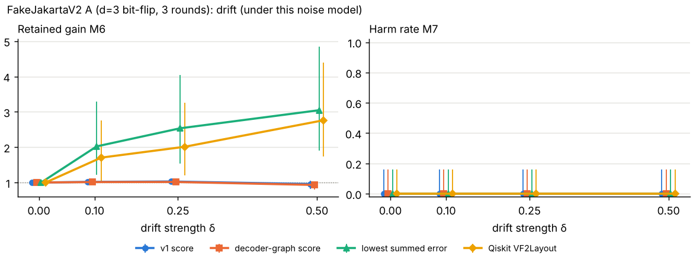

| Method | δ | M6 retained gain | M7 harm (draws) | distinct choices | failures |
| --- | --- | --- | --- | --- | --- |
| v1 score | 0 | 1 [1, 1] | 0/20 = 0 [0, 0.1611] | 1 | 0 |
| v1 score | 0.1 | 1.02 [1, 1.04] | 0/20 = 0 [0, 0.1611] | 4 | 0 |
| v1 score | 0.25 | 1.03 [1.01, 1.06] | 0/20 = 0 [0, 0.1611] | 4 | 0 |
| v1 score | 0.5 | 0.9574 [0.8237, 1.06] | 0/20 = 0 [0, 0.1611] | 6 | 0 |
| decoder-graph score | 0 | 1 [1, 1] | 0/20 = 0 [0, 0.1611] | 1 | 0 |
| decoder-graph score | 0.1 | 1.01 [0.9989, 1.04] | 0/20 = 0 [0, 0.1611] | 2 | 0 |
| decoder-graph score | 0.25 | 1.02 [0.9990, 1.04] | 0/20 = 0 [0, 0.1611] | 2 | 0 |
| decoder-graph score | 0.5 | 0.9322 [0.8014, 1.03] | 0/20 = 0 [0, 0.1611] | 4 | 0 |
| lowest summed error | 0 | 1 [1, 1] | 0/20 = 0 [0, 0.1611] | 1 | 0 |
| lowest summed error | 0.1 | 2.02 [1.23, 3.3] | 0/20 = 0 [0, 0.1611] | 2 | 0 |
| lowest summed error | 0.25 | 2.53 [1.53, 4.04] | 0/20 = 0 [0, 0.1611] | 2 | 0 |
| lowest summed error | 0.5 | 3.05 [1.91, 4.85] | 0/20 = 0 [0, 0.1611] | 2 | 0 |
| Qiskit VF2Layout | 0 | 1 [1, 1] | 0/20 = 0 [0, 0.1611] | 1 | 0 |
| Qiskit VF2Layout | 0.1 | 1.7 [0.9868, 2.76] | 0/20 = 0 [0, 0.1611] | 4 | 0 |
| Qiskit VF2Layout | 0.25 | 2.01 [1.21, 3.26] | 0/20 = 0 [0, 0.1611] | 3 | 0 |
| Qiskit VF2Layout | 0.5 | 2.76 [1.74, 4.39] | 0/20 = 0 [0, 0.1611] | 4 | 0 |

### FakeJakartaV2 B (d=3 phase-flip, 3 rounds)

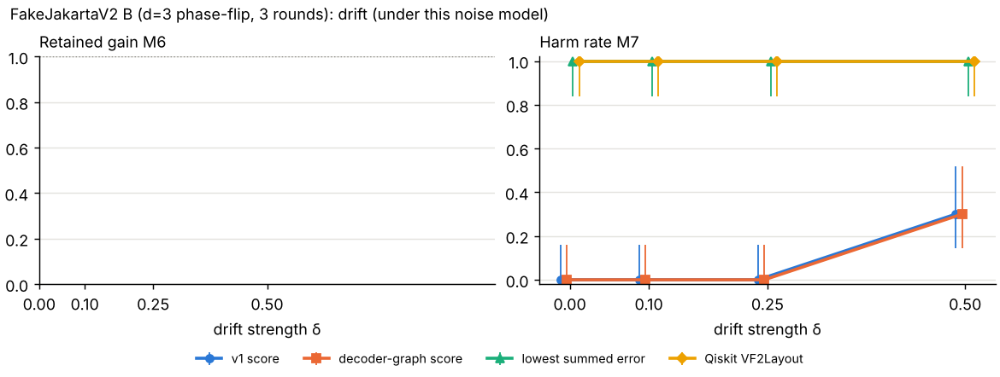

| Method | δ | M6 retained gain | M7 harm (draws) | distinct choices | failures |
| --- | --- | --- | --- | --- | --- |
| v1 score | 0 | no gain to retain | 0/20 = 0 [0, 0.1611] | 1 | 0 |
| v1 score | 0.1 | no gain to retain | 0/20 = 0 [0, 0.1611] | 1 | 0 |
| v1 score | 0.25 | no gain to retain | 0/20 = 0 [0, 0.1611] | 2 | 0 |
| v1 score | 0.5 | no gain to retain | 6/20 = 0.3000 [0.1455, 0.5190] | 3 | 0 |
| decoder-graph score | 0 | no gain to retain | 0/20 = 0 [0, 0.1611] | 1 | 0 |
| decoder-graph score | 0.1 | no gain to retain | 0/20 = 0 [0, 0.1611] | 1 | 0 |
| decoder-graph score | 0.25 | no gain to retain | 0/20 = 0 [0, 0.1611] | 2 | 0 |
| decoder-graph score | 0.5 | no gain to retain | 6/20 = 0.3000 [0.1455, 0.5190] | 4 | 0 |
| lowest summed error | 0 | no gain to retain | 20/20 = 1 [0.8389, 1] | 1 | 0 |
| lowest summed error | 0.1 | no gain to retain | 20/20 = 1 [0.8389, 1] | 2 | 0 |
| lowest summed error | 0.25 | no gain to retain | 20/20 = 1 [0.8389, 1] | 2 | 0 |
| lowest summed error | 0.5 | no gain to retain | 20/20 = 1 [0.8389, 1] | 2 | 0 |
| Qiskit VF2Layout | 0 | no gain to retain | 20/20 = 1 [0.8389, 1] | 1 | 0 |
| Qiskit VF2Layout | 0.1 | no gain to retain | 20/20 = 1 [0.8389, 1] | 4 | 0 |
| Qiskit VF2Layout | 0.25 | no gain to retain | 20/20 = 1 [0.8389, 1] | 4 | 0 |
| Qiskit VF2Layout | 0.5 | no gain to retain | 20/20 = 1 [0.8389, 1] | 4 | 0 |

### FakeHanoiV2 A (d=3 bit-flip, 3 rounds)

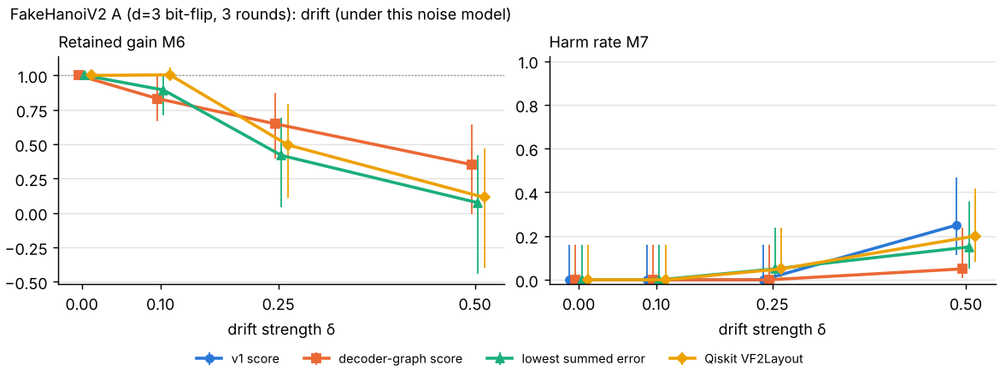

| Method | δ | M6 retained gain | M7 harm (draws) | distinct choices | failures |
| --- | --- | --- | --- | --- | --- |
| v1 score | 0 | no gain to retain | 0/20 = 0 [0, 0.1611] | 1 | 0 |
| v1 score | 0.1 | no gain to retain | 0/20 = 0 [0, 0.1611] | 3 | 0 |
| v1 score | 0.25 | no gain to retain | 0/20 = 0 [0, 0.1611] | 6 | 0 |
| v1 score | 0.5 | no gain to retain | 5/20 = 0.2500 [0.1119, 0.4687] | 13 | 0 |
| decoder-graph score | 0 | 1 [1, 1] | 0/20 = 0 [0, 0.1611] | 1 | 0 |
| decoder-graph score | 0.1 | 0.8315 [0.6668, 1] | 0/20 = 0 [0, 0.1611] | 6 | 0 |
| decoder-graph score | 0.25 | 0.6482 [0.3933, 0.8714] | 0/20 = 0 [0, 0.1611] | 9 | 0 |
| decoder-graph score | 0.5 | 0.3514 [-6.75e-03, 0.6454] | 1/20 = 0.0500 [8.88e-03, 0.2361] | 14 | 0 |
| lowest summed error | 0 | 1 [1, 1] | 0/20 = 0 [0, 0.1611] | 1 | 0 |
| lowest summed error | 0.1 | 0.8935 [0.7121, 1] | 0/20 = 0 [0, 0.1611] | 2 | 0 |
| lowest summed error | 0.25 | 0.4183 [0.0406, 0.6949] | 1/20 = 0.0500 [8.88e-03, 0.2361] | 5 | 0 |
| lowest summed error | 0.5 | 0.0739 [-0.4426, 0.4219] | 3/20 = 0.1500 [0.0524, 0.3604] | 8 | 0 |
| Qiskit VF2Layout | 0 | 1 [1, 1] | 0/20 = 0 [0, 0.1611] | 1 | 0 |
| Qiskit VF2Layout | 0.1 | 1 [0.9671, 1.06] | 0/20 = 0 [0, 0.1611] | 2 | 0 |
| Qiskit VF2Layout | 0.25 | 0.4947 [0.1089, 0.7925] | 1/20 = 0.0500 [8.88e-03, 0.2361] | 7 | 0 |
| Qiskit VF2Layout | 0.5 | 0.1126 [-0.3977, 0.4715] | 4/20 = 0.2000 [0.0807, 0.4160] | 13 | 0 |

### FakeHanoiV2 B (d=3 phase-flip, 3 rounds)

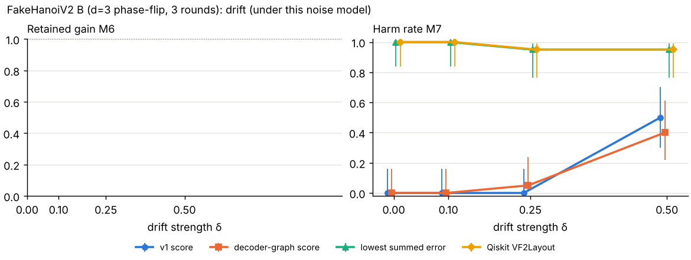

| Method | δ | M6 retained gain | M7 harm (draws) | distinct choices | failures |
| --- | --- | --- | --- | --- | --- |
| v1 score | 0 | no gain to retain | 0/20 = 0 [0, 0.1611] | 1 | 0 |
| v1 score | 0.1 | no gain to retain | 0/20 = 0 [0, 0.1611] | 1 | 0 |
| v1 score | 0.25 | no gain to retain | 0/20 = 0 [0, 0.1611] | 1 | 0 |
| v1 score | 0.5 | no gain to retain | 10/20 = 0.5000 [0.2993, 0.7007] | 9 | 0 |
| decoder-graph score | 0 | no gain to retain | 0/20 = 0 [0, 0.1611] | 1 | 0 |
| decoder-graph score | 0.1 | no gain to retain | 0/20 = 0 [0, 0.1611] | 1 | 0 |
| decoder-graph score | 0.25 | no gain to retain | 1/20 = 0.0500 [8.88e-03, 0.2361] | 3 | 0 |
| decoder-graph score | 0.5 | no gain to retain | 8/20 = 0.4000 [0.2188, 0.6134] | 9 | 0 |
| lowest summed error | 0 | no gain to retain | 20/20 = 1 [0.8389, 1] | 1 | 0 |
| lowest summed error | 0.1 | no gain to retain | 20/20 = 1 [0.8389, 1] | 2 | 0 |
| lowest summed error | 0.25 | no gain to retain | 19/20 = 0.9500 [0.7639, 0.9911] | 7 | 0 |
| lowest summed error | 0.5 | no gain to retain | 19/20 = 0.9500 [0.7639, 0.9911] | 9 | 0 |
| Qiskit VF2Layout | 0 | no gain to retain | 20/20 = 1 [0.8389, 1] | 1 | 0 |
| Qiskit VF2Layout | 0.1 | no gain to retain | 20/20 = 1 [0.8389, 1] | 3 | 0 |
| Qiskit VF2Layout | 0.25 | no gain to retain | 19/20 = 0.9500 [0.7639, 0.9911] | 9 | 0 |
| Qiskit VF2Layout | 0.5 | no gain to retain | 19/20 = 0.9500 [0.7639, 0.9911] | 11 | 0 |

### FakeHanoiV2 D (d=5 bit-flip, 3 rounds)

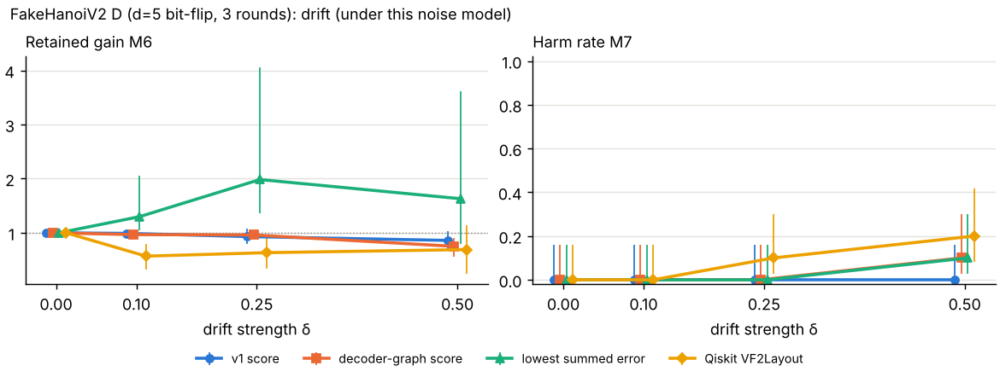

| Method | δ | M6 retained gain | M7 harm (draws) | distinct choices | failures |
| --- | --- | --- | --- | --- | --- |
| v1 score | 0 | 1 [1, 1] | 0/20 = 0 [0, 0.1611] | 1 | 0 |
| v1 score | 0.1 | 0.9883 [0.9291, 1.05] | 0/20 = 0 [0, 0.1611] | 3 | 0 |
| v1 score | 0.25 | 0.9299 [0.7981, 1.07] | 0/20 = 0 [0, 0.1611] | 3 | 0 |
| v1 score | 0.5 | 0.8587 [0.6801, 1.04] | 0/20 = 0 [0, 0.1611] | 7 | 0 |
| decoder-graph score | 0 | 1 [1, 1] | 0/20 = 0 [0, 0.1611] | 1 | 0 |
| decoder-graph score | 0.1 | 0.9655 [0.9099, 1.02] | 0/20 = 0 [0, 0.1611] | 4 | 0 |
| decoder-graph score | 0.25 | 0.9599 [0.9005, 1.02] | 0/20 = 0 [0, 0.1611] | 4 | 0 |
| decoder-graph score | 0.5 | 0.7491 [0.5523, 0.9083] | 2/20 = 0.1000 [0.0279, 0.3010] | 8 | 0 |
| lowest summed error | 0 | 1 [1, 1] | 0/20 = 0 [0, 0.1611] | 1 | 0 |
| lowest summed error | 0.1 | 1.3 [1.05, 2.06] | 0/20 = 0 [0, 0.1611] | 2 | 0 |
| lowest summed error | 0.25 | 1.98 [1.35, 4.06] | 0/20 = 0 [0, 0.1611] | 4 | 0 |
| lowest summed error | 0.5 | 1.63 [0.7956, 3.61] | 2/20 = 0.1000 [0.0279, 0.3010] | 9 | 0 |
| Qiskit VF2Layout | 0 | 1 [1, 1] | 0/20 = 0 [0, 0.1611] | 1 | 0 |
| Qiskit VF2Layout | 0.1 | 0.5678 [0.3141, 0.7946] | 0/20 = 0 [0, 0.1611] | 2 | 0 |
| Qiskit VF2Layout | 0.25 | 0.6322 [0.3353, 0.9082] | 2/20 = 0.1000 [0.0279, 0.3010] | 10 | 0 |
| Qiskit VF2Layout | 0.5 | 0.6892 [0.2411, 1.15] | 4/20 = 0.2000 [0.0807, 0.4160] | 16 | 0 |

### FakeHanoiV2 D (d=7 bit-flip, 3 rounds)

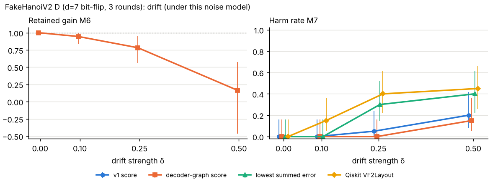

| Method | δ | M6 retained gain | M7 harm (draws) | distinct choices | failures |
| --- | --- | --- | --- | --- | --- |
| v1 score | 0 | no gain to retain | 0/20 = 0 [0, 0.1611] | 1 | 0 |
| v1 score | 0.1 | no gain to retain | 0/20 = 0 [0, 0.1611] | 2 | 0 |
| v1 score | 0.25 | no gain to retain | 1/20 = 0.0500 [8.88e-03, 0.2361] | 4 | 0 |
| v1 score | 0.5 | no gain to retain | 4/20 = 0.2000 [0.0807, 0.4160] | 10 | 0 |
| decoder-graph score | 0 | 1 [1, 1] | 0/20 = 0 [0, 0.1611] | 1 | 0 |
| decoder-graph score | 0.1 | 0.9451 [0.8411, 1] | 0/20 = 0 [0, 0.1611] | 2 | 0 |
| decoder-graph score | 0.25 | 0.7819 [0.5546, 0.9530] | 0/20 = 0 [0, 0.1611] | 5 | 0 |
| decoder-graph score | 0.5 | 0.1659 [-0.4645, 0.5719] | 3/20 = 0.1500 [0.0524, 0.3604] | 11 | 0 |
| lowest summed error | 0 | no gain to retain | 0/20 = 0 [0, 0.1611] | 1 | 0 |
| lowest summed error | 0.1 | no gain to retain | 0/20 = 0 [0, 0.1611] | 1 | 0 |
| lowest summed error | 0.25 | no gain to retain | 6/20 = 0.3000 [0.1455, 0.5190] | 3 | 0 |
| lowest summed error | 0.5 | no gain to retain | 8/20 = 0.4000 [0.2188, 0.6134] | 8 | 0 |
| Qiskit VF2Layout | 0 | no gain to retain | 0/20 = 0 [0, 0.1611] | 1 | 0 |
| Qiskit VF2Layout | 0.1 | no gain to retain | 3/20 = 0.1500 [0.0524, 0.3604] | 4 | 0 |
| Qiskit VF2Layout | 0.25 | no gain to retain | 8/20 = 0.4000 [0.2188, 0.6134] | 6 | 0 |
| Qiskit VF2Layout | 0.5 | no gain to retain | 9/20 = 0.4500 [0.2582, 0.6579] | 11 | 0 |

## 4. Part C: held-out evaluation on FakeAlgiers (R2-R4, T2-P4)

The decoder-graph score was frozen (commit recorded in `configs_v2/freeze.json`) before FakeAlgiers was converted or any FakeAlgiers result existed. Relative regret = (P_L of the choice − oracle-best P_L) ÷ oracle-best P_L.

| Case | Score | Choice | P_L | M4 | Rank (1 = best) | Regret (M5) | Relative regret |
| --- | --- | --- | --- | --- | --- | --- | --- |
| A (d=3 bit-flip, 3 rounds) | v1 score | (8,5,3,2,1) | 3.87e-03 [3.72e-03, 4.04e-03] | 0.9279 | 2 of 84 | 1.73e-04 [-4.65e-05, 3.93e-04] | 0.0468 |
| A (d=3 bit-flip, 3 rounds) | decoder-graph score | (1,2,3,5,8) | 3.70e-03 [3.55e-03, 3.86e-03] | 0.9651 | 1 of 84 | 0 [-2.17e-04, 2.17e-04] | 0 |
| B (d=3 phase-flip, 3 rounds) | v1 score | (5,3,2,1,4) | 3.62e-03 [3.47e-03, 3.77e-03] | 0.9661 | 2 of 84 | 7.00e-05 [-1.44e-04, 2.84e-04] | 0.0197 |
| B (d=3 phase-flip, 3 rounds) | decoder-graph score | (5,3,2,1,4) | 3.62e-03 [3.47e-03, 3.77e-03] | 0.9834 | 2 of 84 | 7.00e-05 [-1.44e-04, 2.84e-04] | 0.0197 |
| D (d=5 bit-flip, 3 rounds) | v1 score | (13,14,11,8,5,3,2,1,4) | 4.85e-04 [4.47e-04, 5.26e-04] | 0.8900 | 4 of 102 | 3.33e-06 [-5.24e-05, 5.90e-05] | 6.92e-03 |
| D (d=5 bit-flip, 3 rounds) | decoder-graph score | (12,13,14,11,8,5,3,2,1) | 4.84e-04 [4.46e-04, 5.25e-04] | 0.9526 | 3 of 102 | 2.50e-06 [-5.32e-05, 5.82e-05] | 5.19e-03 |
| D (d=7 bit-flip, 3 rounds) | v1 score | (6,7,4,1,2,3,5,8,11,14,13,12,15) | 7.34e-05 [6.82e-05, 7.91e-05] | 0.9173 | 3 of 86 | 1.17e-05 [4.31e-06, 1.90e-05] | 0.1889 |
| D (d=7 bit-flip, 3 rounds) | decoder-graph score | (15,12,13,14,11,8,5,3,2,1,4,7,6) | 6.18e-05 [5.70e-05, 6.69e-05] | 0.9159 | 1 of 86 | 0 [-7.04e-06, 7.04e-06] | 0 |

**R-G7 calculation.** Per case, difference in relative regret (decoder-graph − v1) = (P_L graph choice − P_L v1 choice) ÷ oracle-best P_L:

| Case | Relative regret, v1 | Relative regret, decoder-graph | Difference |
| --- | --- | --- | --- |
| v2-algiers-A | 0.0468 | 0 | -0.0468 |
| v2-algiers-B | 0.0197 | 0.0197 | 0 |
| v2-algiers-D5 | 6.92e-03 | 5.19e-03 | -1.73e-03 |
| v2-algiers-D7 | 0.1889 | 0 | -0.1889 |

Mean difference over the four cases = -0.0594 [-0.1054, -0.0133] (95% delta-method interval from shot noise only; the cases are fixed). The decoder-graph score becomes the default only if this interval lies wholly below zero. **Outcome: it does; the default score is `decoder-graph`** (the package's current default: `decoder-graph`). This verdict covers only these four cases.

The oracle-best placement is the one with the lowest measured P_L, so a score that picks it gets a relative regret of exactly 0, while a score one rank away is charged for any shot-noise gap. The interval accounts for that gap's noise, but not for which placement came out best. Cases where the two scores chose different placements whose own P_L intervals overlap: FakeAlgiers A, FakeAlgiers D5; there the per-case difference is within the noise of the ranking.

## 5. Every case: headroom, choices and score validity (R-R1, R-R3, R-R4, R-R5)

| Case | Valid placements | Shots per seed | Best P_L | Worst P_L | Headroom | Fixed P_L | Average P_L | M4 v1 / graph / summed |
| --- | --- | --- | --- | --- | --- | --- | --- | --- |
| FakeJakartaV2 A (d=3 bit-flip, 3 rounds) | 8 | 200,000 | 0.0459 [0.0454, 0.0465] | 0.0617 [0.0611, 0.0623] | placement matters | 0.0617 [0.0611, 0.0623] | 0.0530 [0.0528, 0.0532] | 0.6905 / 0.7619 / -0.3904 |
| FakeJakartaV2 B (d=3 phase-flip, 3 rounds) | 8 | 200,000 | 0.1427 [0.1418, 0.1436] | 0.2579 [0.2568, 0.2590] | placement matters | 0.1427 [0.1419, 0.1436] | 0.1941 [0.1937, 0.1944] | 0.9524 / 0.9524 / -0.5855 |
| FakeHanoiV2 A (d=3 bit-flip, 3 rounds) | 80 | 200,000 | 3.87e-03 [3.72e-03, 4.03e-03] | 0.0233 [0.0229, 0.0236] | placement matters | 4.60e-03 [4.43e-03, 4.77e-03] | 8.48e-03 [8.45e-03, 8.50e-03] | 0.6153 / 0.9808 / 0.5039 |
| FakeHanoiV2 B (d=3 phase-flip, 3 rounds) | 80 | 200,000 | 3.24e-03 [3.10e-03, 3.39e-03] | 0.0329 [0.0324, 0.0333] | placement matters | 3.28e-03 [3.14e-03, 3.42e-03] | 0.0114 [0.0114, 0.0114] | 0.7724 / 0.9584 / 0.5571 |
| FakeHanoiV2 D (d=5 bit-flip, 3 rounds) | 102 | 400,000 | 3.97e-04 [3.63e-04, 4.34e-04] | 2.76e-03 [2.67e-03, 2.85e-03] | placement matters | 9.29e-04 [8.76e-04, 9.85e-04] | 1.11e-03 [1.10e-03, 1.12e-03] | 0.5493 / 0.8911 / 0.4389 |
| FakeHanoiV2 D (d=7 bit-flip, 3 rounds) | 74 | 3,200,000 | 4.47e-05 [4.07e-05, 4.91e-05] | 3.60e-04 [3.48e-04, 3.72e-04] | placement matters | 6.91e-05 [6.40e-05, 7.45e-05] | 1.36e-04 [1.35e-04, 1.36e-04] | 0.5916 / 0.9015 / 0.5509 |
| FakeAlgiers A (d=3 bit-flip, 3 rounds) | 84 | 200,000 | 3.70e-03 [3.55e-03, 3.86e-03] | 0.0221 [0.0217, 0.0224] | placement matters | 4.93e-03 [4.76e-03, 5.11e-03] | 9.58e-03 [9.55e-03, 9.61e-03] | 0.9279 / 0.9651 / 0.8743 |
| FakeAlgiers B (d=3 phase-flip, 3 rounds) | 84 | 200,000 | 3.55e-03 [3.40e-03, 3.70e-03] | 0.0577 [0.0571, 0.0583] | placement matters | 4.12e-03 [3.96e-03, 4.29e-03] | 0.0196 [0.0195, 0.0196] | 0.9661 / 0.9834 / 0.7530 |
| FakeAlgiers D (d=5 bit-flip, 3 rounds) | 102 | 400,000 | 4.82e-04 [4.44e-04, 5.23e-04] | 2.81e-03 [2.72e-03, 2.91e-03] | placement matters | 5.79e-04 [5.38e-04, 6.24e-04] | 1.29e-03 [1.29e-03, 1.30e-03] | 0.8900 / 0.9526 / 0.8756 |
| FakeAlgiers D (d=7 bit-flip, 3 rounds) | 86 | 3,200,000 | 6.18e-05 [5.70e-05, 6.69e-05] | 4.26e-04 [4.13e-04, 4.39e-04] | placement matters | 1.04e-04 [9.76e-05, 1.11e-04] | 1.65e-04 [1.64e-04, 1.66e-04] | 0.9173 / 0.9159 / 0.8955 |

A negative M4 would mean the score ranks placements backwards; it is flagged as **negative** below.

| Case | Method | Choice | P_L | Rank | Regret (M5) |
| --- | --- | --- | --- | --- | --- |
| FakeJakartaV2 A (d=3 bit-flip, 3 rounds) | v1 score | (6,5,3,1,2) | 0.0471 [0.0466, 0.0476] | 4 | 1.17e-03 [4.15e-04, 1.92e-03] |
| FakeJakartaV2 A (d=3 bit-flip, 3 rounds) | decoder-graph score | (6,5,3,1,2) | 0.0471 [0.0466, 0.0476] | 4 | 1.17e-03 [4.15e-04, 1.92e-03] |
| FakeJakartaV2 A (d=3 bit-flip, 3 rounds) | lowest summed error **negative M4** | (0,1,3,5,6) | 0.0591 [0.0585, 0.0597] | 6 | 0.0132 [0.0124, 0.0140] |
| FakeJakartaV2 A (d=3 bit-flip, 3 rounds) | Qiskit VF2Layout | (0,1,3,5,6) | 0.0591 [0.0585, 0.0597] | 6 | 0.0132 [0.0124, 0.0140] |
| FakeJakartaV2 B (d=3 phase-flip, 3 rounds) | v1 score | (0,1,3,5,4) | 0.1427 [0.1419, 0.1436] | 2 | 3.50e-05 [-1.22e-03, 1.29e-03] |
| FakeJakartaV2 B (d=3 phase-flip, 3 rounds) | decoder-graph score | (0,1,3,5,4) | 0.1427 [0.1419, 0.1436] | 2 | 3.50e-05 [-1.22e-03, 1.29e-03] |
| FakeJakartaV2 B (d=3 phase-flip, 3 rounds) | lowest summed error **negative M4** | (0,1,3,5,6) | 0.2021 [0.2011, 0.2031] | 5 | 0.0594 [0.0581, 0.0608] |
| FakeJakartaV2 B (d=3 phase-flip, 3 rounds) | Qiskit VF2Layout | (0,1,3,5,6) | 0.2021 [0.2011, 0.2031] | 5 | 0.0594 [0.0581, 0.0608] |
| FakeHanoiV2 A (d=3 bit-flip, 3 rounds) | v1 score | (16,19,22,25,26) | 4.64e-03 [4.47e-03, 4.82e-03] | 18 | 7.67e-04 [5.34e-04, 1.00e-03] |
| FakeHanoiV2 A (d=3 bit-flip, 3 rounds) | decoder-graph score | (4,1,2,3,5) | 3.90e-03 [3.75e-03, 4.06e-03] | 2 | 2.83e-05 [-1.94e-04, 2.51e-04] |
| FakeHanoiV2 A (d=3 bit-flip, 3 rounds) | lowest summed error | (4,1,2,3,5) | 3.90e-03 [3.75e-03, 4.06e-03] | 2 | 2.83e-05 [-1.94e-04, 2.51e-04] |
| FakeHanoiV2 A (d=3 bit-flip, 3 rounds) | Qiskit VF2Layout | (4,1,2,3,5) | 3.90e-03 [3.75e-03, 4.06e-03] | 2 | 2.83e-05 [-1.94e-04, 2.51e-04] |
| FakeHanoiV2 B (d=3 phase-flip, 3 rounds) | v1 score | (5,3,2,1,0) | 3.24e-03 [3.10e-03, 3.39e-03] | 1 | 0 [-2.03e-04, 2.03e-04] |
| FakeHanoiV2 B (d=3 phase-flip, 3 rounds) | decoder-graph score | (0,1,2,3,5) | 3.28e-03 [3.14e-03, 3.42e-03] | 2 | 3.67e-05 [-1.67e-04, 2.41e-04] |
| FakeHanoiV2 B (d=3 phase-flip, 3 rounds) | lowest summed error | (4,1,2,3,5) | 6.74e-03 [6.53e-03, 6.95e-03] | 19 | 3.50e-03 [3.25e-03, 3.75e-03] |
| FakeHanoiV2 B (d=3 phase-flip, 3 rounds) | Qiskit VF2Layout | (4,1,2,3,5) | 6.74e-03 [6.53e-03, 6.95e-03] | 19 | 3.50e-03 [3.25e-03, 3.75e-03] |
| FakeHanoiV2 D (d=5 bit-flip, 3 rounds) | v1 score | (9,8,11,14,16,19,22,25,26) | 6.27e-04 [5.83e-04, 6.73e-04] | 12 | 2.30e-04 [1.73e-04, 2.88e-04] |
| FakeHanoiV2 D (d=5 bit-flip, 3 rounds) | decoder-graph score | (1,4,7,10,12,13,14,16,19) | 4.28e-04 [3.93e-04, 4.67e-04] | 3 | 3.17e-05 [-1.98e-05, 8.32e-05] |
| FakeHanoiV2 D (d=5 bit-flip, 3 rounds) | lowest summed error | (5,3,2,1,4,7,10,12,13) | 8.07e-04 [7.58e-04, 8.60e-04] | 30 | 4.11e-04 [3.49e-04, 4.73e-04] |
| FakeHanoiV2 D (d=5 bit-flip, 3 rounds) | Qiskit VF2Layout | (13,12,10,7,4,1,2,3,5) | 6.82e-04 [6.37e-04, 7.30e-04] | 17 | 2.85e-04 [2.26e-04, 3.44e-04] |
| FakeHanoiV2 D (d=7 bit-flip, 3 rounds) | v1 score | (0,1,4,7,10,12,13,14,16,19,22,25,26) | 5.99e-05 [5.52e-05, 6.50e-05] | 4 | 1.52e-05 [8.75e-06, 2.17e-05] |
| FakeHanoiV2 D (d=7 bit-flip, 3 rounds) | decoder-graph score | (3,2,1,4,7,10,12,13,14,16,19,22,25) | 5.01e-05 [4.58e-05, 5.48e-05] | 2 | 5.42e-06 [-7.47e-07, 1.16e-05] |
| FakeHanoiV2 D (d=7 bit-flip, 3 rounds) | lowest summed error | (2,1,4,7,10,12,13,14,16,19,22,25,26) | 6.39e-05 [5.90e-05, 6.91e-05] | 7 | 1.92e-05 [1.26e-05, 2.58e-05] |
| FakeHanoiV2 D (d=7 bit-flip, 3 rounds) | Qiskit VF2Layout | (2,1,4,7,10,12,13,14,16,19,22,25,26) | 6.39e-05 [5.90e-05, 6.91e-05] | 7 | 1.92e-05 [1.26e-05, 2.58e-05] |
| FakeAlgiers A (d=3 bit-flip, 3 rounds) | v1 score | (8,5,3,2,1) | 3.87e-03 [3.72e-03, 4.04e-03] | 2 | 1.73e-04 [-4.65e-05, 3.93e-04] |
| FakeAlgiers A (d=3 bit-flip, 3 rounds) | decoder-graph score | (1,2,3,5,8) | 3.70e-03 [3.55e-03, 3.86e-03] | 1 | 0 [-2.17e-04, 2.17e-04] |
| FakeAlgiers A (d=3 bit-flip, 3 rounds) | lowest summed error | (4,1,2,3,5) | 4.19e-03 [4.03e-03, 4.36e-03] | 3 | 4.88e-04 [2.64e-04, 7.13e-04] |
| FakeAlgiers A (d=3 bit-flip, 3 rounds) | Qiskit VF2Layout | (4,1,2,3,5) | 4.19e-03 [4.03e-03, 4.36e-03] | 3 | 4.88e-04 [2.64e-04, 7.13e-04] |
| FakeAlgiers B (d=3 phase-flip, 3 rounds) | v1 score | (5,3,2,1,4) | 3.62e-03 [3.47e-03, 3.77e-03] | 2 | 7.00e-05 [-1.44e-04, 2.84e-04] |
| FakeAlgiers B (d=3 phase-flip, 3 rounds) | decoder-graph score | (5,3,2,1,4) | 3.62e-03 [3.47e-03, 3.77e-03] | 2 | 7.00e-05 [-1.44e-04, 2.84e-04] |
| FakeAlgiers B (d=3 phase-flip, 3 rounds) | lowest summed error | (4,1,2,3,5) | 3.55e-03 [3.40e-03, 3.70e-03] | 1 | 0 [-2.13e-04, 2.13e-04] |
| FakeAlgiers B (d=3 phase-flip, 3 rounds) | Qiskit VF2Layout | (4,1,2,3,5) | 3.55e-03 [3.40e-03, 3.70e-03] | 1 | 0 [-2.13e-04, 2.13e-04] |
| FakeAlgiers D (d=5 bit-flip, 3 rounds) | v1 score | (13,14,11,8,5,3,2,1,4) | 4.85e-04 [4.47e-04, 5.26e-04] | 4 | 3.33e-06 [-5.24e-05, 5.90e-05] |
| FakeAlgiers D (d=5 bit-flip, 3 rounds) | decoder-graph score | (12,13,14,11,8,5,3,2,1) | 4.84e-04 [4.46e-04, 5.25e-04] | 3 | 2.50e-06 [-5.32e-05, 5.82e-05] |
| FakeAlgiers D (d=5 bit-flip, 3 rounds) | lowest summed error | (4,1,2,3,5,8,11,14,13) | 4.82e-04 [4.44e-04, 5.23e-04] | 1 | 0 [-5.56e-05, 5.56e-05] |
| FakeAlgiers D (d=5 bit-flip, 3 rounds) | Qiskit VF2Layout | (4,1,2,3,5,8,11,14,13) | 4.82e-04 [4.44e-04, 5.23e-04] | 1 | 0 [-5.56e-05, 5.56e-05] |
| FakeAlgiers D (d=7 bit-flip, 3 rounds) | v1 score | (6,7,4,1,2,3,5,8,11,14,13,12,15) | 7.34e-05 [6.82e-05, 7.91e-05] | 3 | 1.17e-05 [4.31e-06, 1.90e-05] |
| FakeAlgiers D (d=7 bit-flip, 3 rounds) | decoder-graph score | (15,12,13,14,11,8,5,3,2,1,4,7,6) | 6.18e-05 [5.70e-05, 6.69e-05] | 1 | 0 [-7.04e-06, 7.04e-06] |
| FakeAlgiers D (d=7 bit-flip, 3 rounds) | lowest summed error | (6,7,4,1,2,3,5,8,11,14,13,12,15) | 7.34e-05 [6.82e-05, 7.91e-05] | 3 | 1.17e-05 [4.31e-06, 1.90e-05] |
| FakeAlgiers D (d=7 bit-flip, 3 rounds) | Qiskit VF2Layout | (6,7,4,1,2,3,5,8,11,14,13,12,15) | 7.34e-05 [6.82e-05, 7.91e-05] | 3 | 1.17e-05 [4.31e-06, 1.90e-05] |

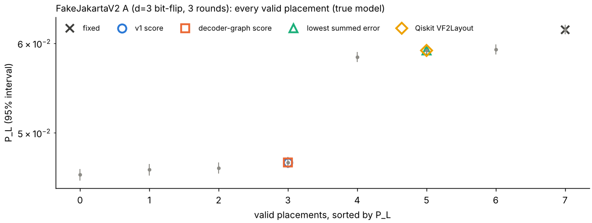

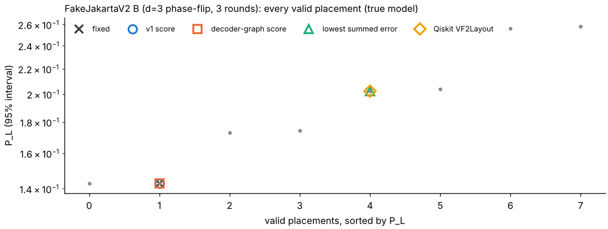

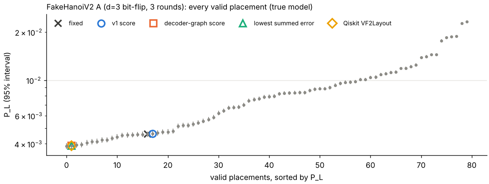

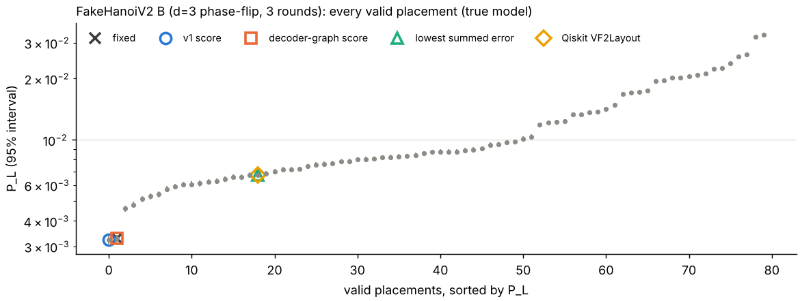

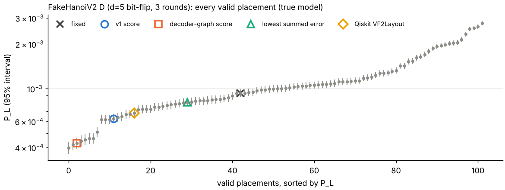

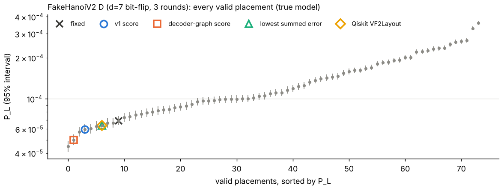

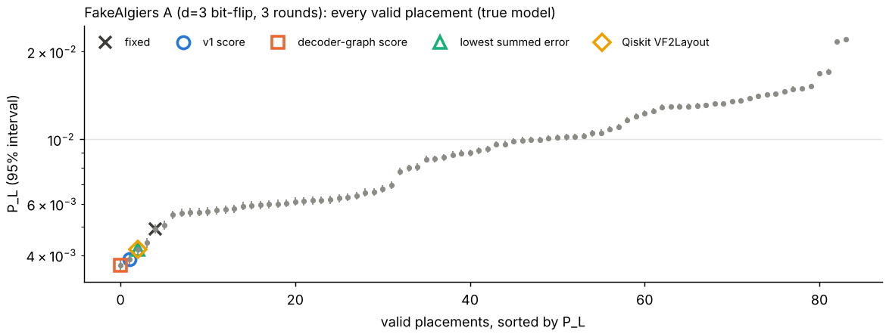

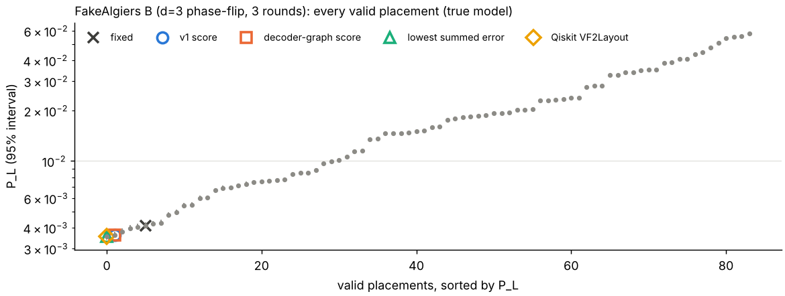

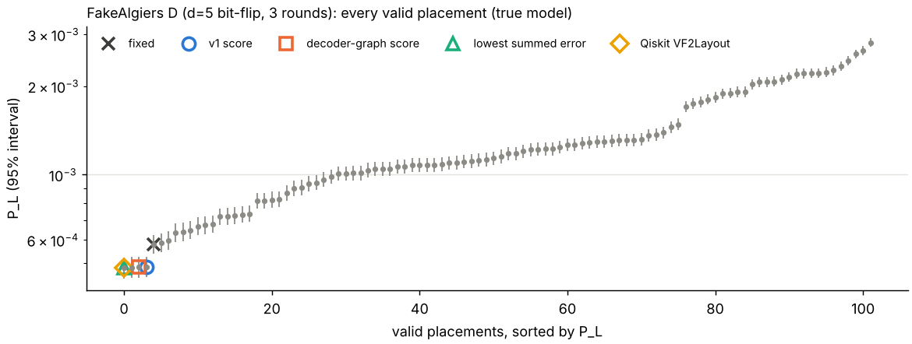

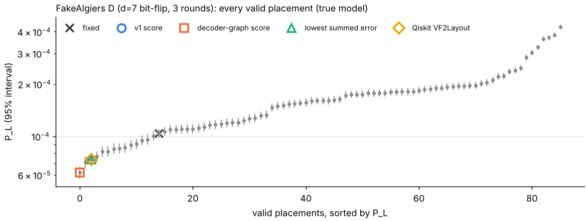

## 6. Decoder (R-R6)

PyMatching, built separately for each placement from that placement's own Stim detector error model (`approximate_disjoint_errors=True`, `decompose_errors=True`) under the true model. **The decoder model is approximate** (K1), and every results file records this.

## 7. Sensitivity (R-R7)

The T-L1 sensitivity reruns are v1's and are reported in REPORT.md section 10; the v2 spec adds no sensitivity variants, so none were run for v2.

## 8. Limitations (R-R8)

- **K1.** Nove's `to_detector_model()` raises for calibrated two-qubit noise with more than one non-zero Pauli term, so the decoder (and both scores) use Stim's approximate detector error model.
- **K2.** CX durations are set per gate name, not per pair.
- **K3.** Readout error is symmetric (asymmetric readout averaged).
- **K4.** Gate noise is directional; CX(a,b) and CX(b,a) are separate channels.
- **K5.** Nove applies idle noise to every qubit index up to the highest one used.
- **K6.** Noise is a Pauli-channel approximation; coherent errors, crosstalk, leakage and real drift are not modelled.
- **K7.** The snapshots are realistic noise profiles, not live-device measurements (FakeJakartaV2 is dated after ibmq_jakarta's retirement).
- **K8.** At most 3 neighbours per qubit, so no surface code fits SWAP-free.
- **K9.** Random jitter is synthetic: real drift is correlated across qubits and over time, so Part A measures sensitivity to calibration error, not any device's drift. Every choice is decoded with true-model weights, whereas a real decoder would also use the stale calibration.
- **K10.** The Qiskit baseline's behaviour depends on the Qiskit version; its results apply to the pinned version only.
- **K11.** FakeAlgiers has FakeHanoiV2's raw coupling map, so it is held out mainly for noise values, not layout; after conversion the layouts differ only in the removed dead couplers ((15,18) on FakeAlgiers; (5,8) and (19,20) on FakeHanoiV2).
- **Development devices.** FakeJakartaV2 and FakeHanoiV2 results are not an independent test of the decoder-graph score (R2-R7).
- **R-G7 scope.** The held-out verdict rests on four cases on one device.

## 9. Changes to the spec (R2-R6)

SPEC_V2.md revision 1 (Oct 11, 2026) was made **before any v2 result existed**, after the pre-implementation review; its note lists every change and reason. No change was made after results were seen.

## 10. Appendix: every placement (R-R1)

### FakeJakartaV2 A (d=3 bit-flip, 3 rounds)

| Mapping | P_L (95%) | Detection-event rate M3 | Chosen by |
| --- | --- | --- | --- |
| (2,1,3,5,6) | 0.0459 [0.0454, 0.0465] | 0.1294 [0.1291, 0.1298] |  |
| (4,5,3,1,2) | 0.0464 [0.0459, 0.0469] | 0.1307 [0.1303, 0.1311] |  |
| (2,1,3,5,4) | 0.0465 [0.0460, 0.0471] | 0.1308 [0.1304, 0.1312] |  |
| (6,5,3,1,2) | 0.0471 [0.0466, 0.0476] | 0.1293 [0.1290, 0.1297] | v1 score, decoder-graph score |
| (4,5,3,1,0) | 0.0583 [0.0578, 0.0589] | 0.1369 [0.1365, 0.1373] |  |
| (0,1,3,5,6) | 0.0591 [0.0585, 0.0597] | 0.1356 [0.1353, 0.1360] | lowest summed error, Qiskit VF2Layout |
| (6,5,3,1,0) | 0.0593 [0.0587, 0.0599] | 0.1356 [0.1352, 0.1359] |  |
| (0,1,3,5,4) | 0.0617 [0.0611, 0.0623] | 0.1369 [0.1365, 0.1373] | fixed |

### FakeJakartaV2 B (d=3 phase-flip, 3 rounds)

| Mapping | P_L (95%) | Detection-event rate M3 | Chosen by |
| --- | --- | --- | --- |
| (4,5,3,1,0) | 0.1427 [0.1418, 0.1436] | 0.1998 [0.1994, 0.2003] |  |
| (0,1,3,5,4) | 0.1427 [0.1419, 0.1436] | 0.1999 [0.1994, 0.2003] | v1 score, decoder-graph score, fixed |
| (2,1,3,5,4) | 0.1731 [0.1721, 0.1741] | 0.2216 [0.2212, 0.2220] |  |
| (4,5,3,1,2) | 0.1742 [0.1732, 0.1752] | 0.2222 [0.2218, 0.2226] |  |
| (0,1,3,5,6) | 0.2021 [0.2011, 0.2031] | 0.2259 [0.2255, 0.2263] | lowest summed error, Qiskit VF2Layout |
| (6,5,3,1,0) | 0.2038 [0.2028, 0.2048] | 0.2257 [0.2253, 0.2261] |  |
| (6,5,3,1,2) | 0.2561 [0.2550, 0.2572] | 0.2480 [0.2476, 0.2485] |  |
| (2,1,3,5,6) | 0.2579 [0.2568, 0.2590] | 0.2485 [0.2481, 0.2489] |  |

### FakeHanoiV2 A (d=3 bit-flip, 3 rounds)

| Mapping | P_L (95%) | Detection-event rate M3 | Chosen by |
| --- | --- | --- | --- |
| (5,3,2,1,4) | 3.87e-03 [3.72e-03, 4.03e-03] | 0.0432 [0.0429, 0.0434] |  |
| (4,1,2,3,5) | 3.90e-03 [3.75e-03, 4.06e-03] | 0.0435 [0.0432, 0.0437] | decoder-graph score, lowest summed error, Qiskit VF2Layout |
| (7,10,12,13,14) | 3.94e-03 [3.79e-03, 4.10e-03] | 0.0779 [0.0776, 0.0782] |  |
| (14,13,12,10,7) | 3.96e-03 [3.80e-03, 4.12e-03] | 0.0779 [0.0775, 0.0782] |  |
| (10,7,4,1,0) | 4.06e-03 [3.90e-03, 4.22e-03] | 0.0436 [0.0433, 0.0438] |  |
| (0,1,4,7,10) | 4.13e-03 [3.97e-03, 4.29e-03] | 0.0435 [0.0433, 0.0438] |  |
| (12,10,7,4,1) | 4.14e-03 [3.98e-03, 4.31e-03] | 0.0537 [0.0535, 0.0540] |  |
| (12,13,14,11,8) | 4.22e-03 [4.06e-03, 4.39e-03] | 0.0942 [0.0938, 0.0945] |  |
| (12,13,14,16,19) | 4.23e-03 [4.07e-03, 4.40e-03] | 0.0744 [0.0741, 0.0747] |  |
| (8,11,14,16,19) | 4.34e-03 [4.17e-03, 4.51e-03] | 0.0717 [0.0714, 0.0720] |  |
| (26,25,22,19,16) | 4.43e-03 [4.26e-03, 4.60e-03] | 0.0426 [0.0423, 0.0428] |  |
| (19,16,14,11,8) | 4.52e-03 [4.36e-03, 4.70e-03] | 0.0714 [0.0711, 0.0717] |  |
| (1,4,7,10,12) | 4.54e-03 [4.37e-03, 4.71e-03] | 0.0538 [0.0535, 0.0540] |  |
| (5,3,2,1,0) | 4.55e-03 [4.38e-03, 4.72e-03] | 0.0442 [0.0440, 0.0444] |  |
| (6,7,4,1,0) | 4.58e-03 [4.42e-03, 4.76e-03] | 0.0452 [0.0449, 0.0454] |  |
| (19,16,14,13,12) | 4.59e-03 [4.42e-03, 4.76e-03] | 0.0743 [0.0740, 0.0746] |  |
| (0,1,2,3,5) | 4.60e-03 [4.43e-03, 4.77e-03] | 0.0445 [0.0443, 0.0448] | fixed |
| (16,19,22,25,26) | 4.64e-03 [4.47e-03, 4.82e-03] | 0.0427 [0.0424, 0.0429] | v1 score |
| (10,7,4,1,2) | 4.68e-03 [4.51e-03, 4.85e-03] | 0.0443 [0.0440, 0.0445] |  |
| (2,1,4,7,10) | 4.75e-03 [4.58e-03, 4.92e-03] | 0.0442 [0.0439, 0.0444] |  |
| (8,11,14,13,12) | 4.76e-03 [4.59e-03, 4.94e-03] | 0.0940 [0.0937, 0.0944] |  |
| (0,1,4,7,6) | 4.79e-03 [4.62e-03, 4.97e-03] | 0.0451 [0.0449, 0.0454] |  |
| (3,2,1,4,7) | 5.15e-03 [4.98e-03, 5.34e-03] | 0.0425 [0.0423, 0.0427] |  |
| (14,16,19,22,25) | 5.22e-03 [5.04e-03, 5.40e-03] | 0.0498 [0.0496, 0.0501] |  |
| (7,4,1,2,3) | 5.22e-03 [5.04e-03, 5.41e-03] | 0.0424 [0.0421, 0.0426] |  |
| (25,22,19,16,14) | 5.32e-03 [5.13e-03, 5.50e-03] | 0.0496 [0.0494, 0.0499] |  |
| (6,7,4,1,2) | 5.43e-03 [5.24e-03, 5.61e-03] | 0.0459 [0.0457, 0.0461] |  |
| (2,1,4,7,6) | 5.56e-03 [5.37e-03, 5.75e-03] | 0.0462 [0.0459, 0.0464] |  |
| (16,19,22,25,24) | 5.69e-03 [5.50e-03, 5.88e-03] | 0.0466 [0.0463, 0.0468] |  |
| (24,25,22,19,16) | 5.85e-03 [5.66e-03, 6.05e-03] | 0.0470 [0.0468, 0.0473] |  |
| (23,24,25,22,19) | 6.23e-03 [6.03e-03, 6.43e-03] | 0.0520 [0.0518, 0.0523] |  |
| (18,21,23,24,25) | 6.45e-03 [6.25e-03, 6.66e-03] | 0.0976 [0.0973, 0.0980] |  |
| (21,23,24,25,26) | 6.73e-03 [6.53e-03, 6.94e-03] | 0.0591 [0.0589, 0.0594] |  |
| (25,24,23,21,18) | 6.74e-03 [6.54e-03, 6.95e-03] | 0.0971 [0.0968, 0.0974] |  |
| (19,22,25,24,23) | 6.79e-03 [6.59e-03, 7.00e-03] | 0.0520 [0.0518, 0.0523] |  |
| (21,23,24,25,22) | 7.01e-03 [6.80e-03, 7.23e-03] | 0.0595 [0.0593, 0.0598] |  |
| (18,15,12,13,14) | 7.43e-03 [7.21e-03, 7.65e-03] | 0.0996 [0.0993, 0.1000] |  |
| (16,14,11,8,9) | 7.57e-03 [7.35e-03, 7.79e-03] | 0.0601 [0.0598, 0.0604] |  |
| (15,12,10,7,4) | 7.67e-03 [7.45e-03, 7.89e-03] | 0.0581 [0.0578, 0.0583] |  |
| (9,8,11,14,16) | 7.85e-03 [7.63e-03, 8.08e-03] | 0.0602 [0.0599, 0.0605] |  |
| (14,13,12,15,18) | 7.90e-03 [7.68e-03, 8.13e-03] | 0.1000 [0.0997, 0.1004] |  |
| (4,7,10,12,15) | 7.94e-03 [7.72e-03, 8.17e-03] | 0.0577 [0.0575, 0.0580] |  |
| (26,25,24,23,21) | 8.22e-03 [8.00e-03, 8.46e-03] | 0.0588 [0.0586, 0.0591] |  |
| (18,15,12,10,7) | 8.30e-03 [8.08e-03, 8.54e-03] | 0.0822 [0.0818, 0.0825] |  |
| (13,12,10,7,4) | 8.33e-03 [8.10e-03, 8.56e-03] | 0.0595 [0.0592, 0.0598] |  |
| (7,10,12,15,18) | 8.34e-03 [8.12e-03, 8.58e-03] | 0.0822 [0.0819, 0.0826] |  |
| (17,18,21,23,24) | 8.36e-03 [8.14e-03, 8.60e-03] | 0.0696 [0.0693, 0.0699] |  |
| (24,23,21,18,17) | 8.38e-03 [8.15e-03, 8.61e-03] | 0.0699 [0.0696, 0.0702] |  |
| (22,25,24,23,21) | 8.62e-03 [8.39e-03, 8.85e-03] | 0.0595 [0.0592, 0.0598] |  |
| (4,7,10,12,13) | 8.78e-03 [8.55e-03, 9.02e-03] | 0.0594 [0.0591, 0.0597] |  |
| (15,12,10,7,6) | 8.85e-03 [8.62e-03, 9.09e-03] | 0.0584 [0.0581, 0.0587] |  |
| (11,14,16,19,22) | 8.85e-03 [8.62e-03, 9.09e-03] | 0.0563 [0.0560, 0.0565] |  |
| (16,14,13,12,10) | 8.99e-03 [8.76e-03, 9.24e-03] | 0.0693 [0.0690, 0.0696] |  |
| (22,19,16,14,11) | 9.31e-03 [9.07e-03, 9.55e-03] | 0.0564 [0.0562, 0.0567] |  |
| (10,12,13,14,16) | 9.55e-03 [9.31e-03, 9.80e-03] | 0.0690 [0.0687, 0.0693] |  |
| (13,14,16,19,22) | 9.70e-03 [9.46e-03, 9.95e-03] | 0.0581 [0.0578, 0.0584] |  |
| (12,15,18,21,23) | 9.72e-03 [9.48e-03, 9.98e-03] | 0.1256 [0.1252, 0.1260] |  |
| (6,7,10,12,15) | 9.80e-03 [9.56e-03, 0.0101] | 0.0584 [0.0581, 0.0586] |  |
| (23,21,18,15,12) | 0.0101 [9.86e-03, 0.0104] | 0.1258 [0.1254, 0.1262] |  |
| (13,12,10,7,6) | 0.0101 [9.86e-03, 0.0104] | 0.0599 [0.0596, 0.0602] |  |
| (22,19,16,14,13) | 0.0104 [0.0101, 0.0107] | 0.0579 [0.0577, 0.0582] |  |
| (10,12,15,18,17) | 0.0104 [0.0102, 0.0107] | 0.0799 [0.0796, 0.0802] |  |
| (17,18,15,12,10) | 0.0108 [0.0106, 0.0111] | 0.0802 [0.0799, 0.0805] |  |
| (6,7,10,12,13) | 0.0110 [0.0107, 0.0113] | 0.0595 [0.0593, 0.0598] |  |
| (13,14,11,8,9) | 0.0112 [0.0109, 0.0114] | 0.0640 [0.0637, 0.0642] |  |
| (9,8,11,14,13) | 0.0113 [0.0110, 0.0115] | 0.0641 [0.0639, 0.0644] |  |
| (11,14,13,12,10) | 0.0118 [0.0116, 0.0121] | 0.0716 [0.0713, 0.0719] |  |
| (15,18,21,23,24) | 0.0119 [0.0116, 0.0121] | 0.0776 [0.0773, 0.0779] |  |
| (24,23,21,18,15) | 0.0122 [0.0119, 0.0124] | 0.0777 [0.0774, 0.0780] |  |
| (10,12,13,14,11) | 0.0125 [0.0122, 0.0128] | 0.0714 [0.0711, 0.0717] |  |
| (21,18,15,12,10) | 0.0139 [0.0136, 0.0142] | 0.0834 [0.0830, 0.0837] |  |
| (16,14,13,12,15) | 0.0141 [0.0138, 0.0144] | 0.0754 [0.0751, 0.0757] |  |
| (10,12,15,18,21) | 0.0145 [0.0142, 0.0148] | 0.0838 [0.0835, 0.0841] |  |
| (15,12,13,14,16) | 0.0145 [0.0142, 0.0148] | 0.0753 [0.0750, 0.0756] |  |
| (13,12,15,18,17) | 0.0177 [0.0173, 0.0180] | 0.0877 [0.0873, 0.0880] |  |
| (17,18,15,12,13) | 0.0185 [0.0181, 0.0188] | 0.0879 [0.0876, 0.0882] |  |
| (11,14,13,12,15) | 0.0187 [0.0184, 0.0191] | 0.0775 [0.0772, 0.0778] |  |
| (15,12,13,14,11) | 0.0188 [0.0185, 0.0191] | 0.0777 [0.0774, 0.0780] |  |
| (21,18,15,12,13) | 0.0226 [0.0223, 0.0230] | 0.0909 [0.0906, 0.0912] |  |
| (13,12,15,18,21) | 0.0233 [0.0229, 0.0236] | 0.0911 [0.0908, 0.0914] |  |

### FakeHanoiV2 B (d=3 phase-flip, 3 rounds)

| Mapping | P_L (95%) | Detection-event rate M3 | Chosen by |
| --- | --- | --- | --- |
| (5,3,2,1,0) | 3.24e-03 [3.10e-03, 3.39e-03] | 0.0403 [0.0400, 0.0405] | v1 score |
| (0,1,2,3,5) | 3.28e-03 [3.14e-03, 3.42e-03] | 0.0403 [0.0401, 0.0405] | decoder-graph score, fixed |
| (12,10,7,4,1) | 4.60e-03 [4.43e-03, 4.77e-03] | 0.0540 [0.0537, 0.0542] |  |
| (1,4,7,10,12) | 4.80e-03 [4.63e-03, 4.98e-03] | 0.0540 [0.0537, 0.0543] |  |
| (10,7,4,1,0) | 5.13e-03 [4.95e-03, 5.32e-03] | 0.0646 [0.0644, 0.0649] |  |
| (10,7,4,1,2) | 5.29e-03 [5.11e-03, 5.48e-03] | 0.0643 [0.0640, 0.0645] |  |
| (0,1,4,7,10) | 5.41e-03 [5.22e-03, 5.59e-03] | 0.0649 [0.0646, 0.0652] |  |
| (2,1,4,7,10) | 5.73e-03 [5.55e-03, 5.93e-03] | 0.0645 [0.0642, 0.0647] |  |
| (9,8,11,14,16) | 5.91e-03 [5.72e-03, 6.11e-03] | 0.0567 [0.0565, 0.0570] |  |
| (16,19,22,25,24) | 6.02e-03 [5.83e-03, 6.22e-03] | 0.0496 [0.0494, 0.0499] |  |
| (16,14,11,8,9) | 6.06e-03 [5.87e-03, 6.26e-03] | 0.0566 [0.0563, 0.0569] |  |
| (24,25,22,19,16) | 6.11e-03 [5.92e-03, 6.32e-03] | 0.0497 [0.0494, 0.0499] |  |
| (19,16,14,11,8) | 6.21e-03 [6.02e-03, 6.42e-03] | 0.0884 [0.0881, 0.0888] |  |
| (8,11,14,16,19) | 6.26e-03 [6.07e-03, 6.46e-03] | 0.0881 [0.0878, 0.0885] |  |
| (23,24,25,22,19) | 6.43e-03 [6.24e-03, 6.64e-03] | 0.0540 [0.0537, 0.0542] |  |
| (16,19,22,25,26) | 6.56e-03 [6.35e-03, 6.76e-03] | 0.0502 [0.0499, 0.0504] |  |
| (26,25,22,19,16) | 6.57e-03 [6.37e-03, 6.78e-03] | 0.0505 [0.0502, 0.0507] |  |
| (5,3,2,1,4) | 6.72e-03 [6.51e-03, 6.93e-03] | 0.0536 [0.0533, 0.0538] |  |
| (4,1,2,3,5) | 6.74e-03 [6.53e-03, 6.95e-03] | 0.0537 [0.0534, 0.0539] | lowest summed error, Qiskit VF2Layout |
| (19,22,25,24,23) | 6.84e-03 [6.63e-03, 7.05e-03] | 0.0539 [0.0536, 0.0541] |  |
| (16,14,13,12,10) | 6.97e-03 [6.76e-03, 7.18e-03] | 0.0633 [0.0630, 0.0636] |  |
| (18,21,23,24,25) | 7.14e-03 [6.93e-03, 7.35e-03] | 0.0978 [0.0975, 0.0982] |  |
| (10,12,13,14,16) | 7.17e-03 [6.96e-03, 7.38e-03] | 0.0635 [0.0632, 0.0638] |  |
| (12,13,14,16,19) | 7.19e-03 [6.97e-03, 7.40e-03] | 0.0917 [0.0914, 0.0921] |  |
| (19,16,14,13,12) | 7.41e-03 [7.20e-03, 7.63e-03] | 0.0916 [0.0912, 0.0919] |  |
| (12,13,14,11,8) | 7.56e-03 [7.34e-03, 7.78e-03] | 0.1105 [0.1102, 0.1109] |  |
| (11,14,16,19,22) | 7.61e-03 [7.39e-03, 7.83e-03] | 0.0541 [0.0539, 0.0544] |  |
| (8,11,14,13,12) | 7.66e-03 [7.44e-03, 7.88e-03] | 0.1101 [0.1098, 0.1105] |  |
| (25,24,23,21,18) | 7.83e-03 [7.61e-03, 8.06e-03] | 0.0983 [0.0980, 0.0987] |  |
| (18,15,12,10,7) | 7.84e-03 [7.62e-03, 8.06e-03] | 0.0833 [0.0830, 0.0836] |  |
| (6,7,4,1,0) | 8.00e-03 [7.78e-03, 8.23e-03] | 0.0682 [0.0679, 0.0685] |  |
| (2,1,4,7,6) | 8.03e-03 [7.81e-03, 8.26e-03] | 0.0681 [0.0678, 0.0684] |  |
| (7,10,12,15,18) | 8.06e-03 [7.84e-03, 8.29e-03] | 0.0834 [0.0831, 0.0837] |  |
| (6,7,4,1,2) | 8.20e-03 [7.98e-03, 8.43e-03] | 0.0679 [0.0676, 0.0682] |  |
| (13,14,16,19,22) | 8.22e-03 [8.00e-03, 8.46e-03] | 0.0543 [0.0540, 0.0545] |  |
| (13,14,11,8,9) | 8.30e-03 [8.08e-03, 8.54e-03] | 0.0588 [0.0585, 0.0590] |  |
| (0,1,4,7,6) | 8.34e-03 [8.11e-03, 8.57e-03] | 0.0685 [0.0682, 0.0688] |  |
| (9,8,11,14,13) | 8.43e-03 [8.21e-03, 8.67e-03] | 0.0588 [0.0586, 0.0591] |  |
| (22,19,16,14,11) | 8.60e-03 [8.37e-03, 8.84e-03] | 0.0541 [0.0538, 0.0544] |  |
| (13,12,10,7,6) | 8.71e-03 [8.47e-03, 8.94e-03] | 0.0573 [0.0570, 0.0576] |  |
| (3,2,1,4,7) | 8.74e-03 [8.51e-03, 8.98e-03] | 0.0535 [0.0533, 0.0538] |  |
| (7,4,1,2,3) | 8.75e-03 [8.52e-03, 8.99e-03] | 0.0535 [0.0533, 0.0538] |  |
| (22,19,16,14,13) | 8.76e-03 [8.52e-03, 8.99e-03] | 0.0545 [0.0542, 0.0547] |  |
| (14,13,12,10,7) | 8.89e-03 [8.65e-03, 9.13e-03] | 0.0879 [0.0876, 0.0882] |  |
| (11,14,13,12,10) | 8.95e-03 [8.71e-03, 9.19e-03] | 0.0649 [0.0646, 0.0652] |  |
| (7,10,12,13,14) | 9.06e-03 [8.83e-03, 9.30e-03] | 0.0880 [0.0876, 0.0883] |  |
| (6,7,10,12,13) | 9.47e-03 [9.22e-03, 9.71e-03] | 0.0572 [0.0569, 0.0574] |  |
| (23,21,18,15,12) | 9.54e-03 [9.29e-03, 9.79e-03] | 0.1272 [0.1268, 0.1276] |  |
| (12,15,18,21,23) | 9.74e-03 [9.49e-03, 9.99e-03] | 0.1270 [0.1266, 0.1274] |  |
| (10,12,13,14,11) | 9.80e-03 [9.56e-03, 0.0101] | 0.0649 [0.0646, 0.0652] |  |
| (25,22,19,16,14) | 0.0101 [9.89e-03, 0.0104] | 0.0630 [0.0627, 0.0633] |  |
| (14,16,19,22,25) | 0.0104 [0.0101, 0.0106] | 0.0628 [0.0625, 0.0630] |  |
| (21,23,24,25,22) | 0.0119 [0.0116, 0.0121] | 0.0719 [0.0716, 0.0722] |  |
| (13,12,10,7,4) | 0.0122 [0.0119, 0.0125] | 0.0698 [0.0695, 0.0701] |  |
| (10,12,15,18,17) | 0.0123 [0.0120, 0.0126] | 0.0966 [0.0963, 0.0969] |  |
| (17,18,15,12,10) | 0.0124 [0.0121, 0.0126] | 0.0963 [0.0959, 0.0966] |  |
| (22,25,24,23,21) | 0.0133 [0.0130, 0.0136] | 0.0716 [0.0713, 0.0719] |  |
| (15,12,10,7,6) | 0.0134 [0.0131, 0.0137] | 0.0687 [0.0684, 0.0690] |  |
| (6,7,10,12,15) | 0.0137 [0.0134, 0.0140] | 0.0689 [0.0686, 0.0692] |  |
| (17,18,21,23,24) | 0.0138 [0.0135, 0.0141] | 0.0856 [0.0853, 0.0859] |  |
| (24,23,21,18,17) | 0.0142 [0.0139, 0.0145] | 0.0858 [0.0855, 0.0862] |  |
| (4,7,10,12,13) | 0.0149 [0.0146, 0.0152] | 0.0694 [0.0691, 0.0696] |  |
| (15,12,13,14,16) | 0.0168 [0.0165, 0.0171] | 0.0797 [0.0794, 0.0800] |  |
| (18,15,12,13,14) | 0.0171 [0.0168, 0.0174] | 0.1113 [0.1109, 0.1116] |  |
| (14,13,12,15,18) | 0.0172 [0.0169, 0.0175] | 0.1119 [0.1116, 0.1123] |  |
| (16,14,13,12,15) | 0.0174 [0.0171, 0.0177] | 0.0799 [0.0796, 0.0802] |  |
| (13,12,15,18,17) | 0.0194 [0.0191, 0.0198] | 0.1017 [0.1013, 0.1020] |  |
| (21,23,24,25,26) | 0.0195 [0.0192, 0.0199] | 0.0783 [0.0780, 0.0786] |  |
| (10,12,15,18,21) | 0.0202 [0.0198, 0.0206] | 0.1059 [0.1056, 0.1063] |  |
| (17,18,15,12,13) | 0.0203 [0.0199, 0.0206] | 0.1015 [0.1012, 0.1019] |  |
| (21,18,15,12,10) | 0.0205 [0.0202, 0.0209] | 0.1057 [0.1053, 0.1060] |  |
| (15,12,10,7,4) | 0.0209 [0.0205, 0.0212] | 0.0810 [0.0808, 0.0813] |  |
| (11,14,13,12,15) | 0.0212 [0.0209, 0.0216] | 0.0821 [0.0818, 0.0824] |  |
| (15,12,13,14,11) | 0.0224 [0.0220, 0.0227] | 0.0818 [0.0815, 0.0821] |  |
| (4,7,10,12,15) | 0.0225 [0.0222, 0.0229] | 0.0812 [0.0809, 0.0815] |  |
| (26,25,24,23,21) | 0.0238 [0.0234, 0.0242] | 0.0785 [0.0782, 0.0788] |  |
| (24,23,21,18,15) | 0.0256 [0.0252, 0.0260] | 0.1021 [0.1017, 0.1024] |  |
| (15,18,21,23,24) | 0.0263 [0.0259, 0.0267] | 0.1013 [0.1010, 0.1017] |  |
| (13,12,15,18,21) | 0.0320 [0.0316, 0.0324] | 0.1109 [0.1106, 0.1113] |  |
| (21,18,15,12,13) | 0.0329 [0.0324, 0.0333] | 0.1107 [0.1104, 0.1111] |  |

### FakeHanoiV2 D (d=5 bit-flip, 3 rounds)

| Mapping | P_L (95%) | Detection-event rate M3 | Chosen by |
| --- | --- | --- | --- |
| (14,13,12,10,7,4,1,2,3) | 3.97e-04 [3.63e-04, 4.34e-04] | 0.0613 [0.0612, 0.0615] |  |
| (3,2,1,4,7,10,12,13,14) | 4.20e-04 [3.85e-04, 4.58e-04] | 0.0614 [0.0613, 0.0615] |  |
| (1,4,7,10,12,13,14,16,19) | 4.28e-04 [3.93e-04, 4.67e-04] | 0.0647 [0.0646, 0.0649] | decoder-graph score |
| (19,16,14,13,12,10,7,4,1) | 4.43e-04 [4.06e-04, 4.82e-04] | 0.0646 [0.0644, 0.0647] |  |
| (1,4,7,10,12,13,14,11,8) | 4.52e-04 [4.15e-04, 4.91e-04] | 0.0745 [0.0743, 0.0747] |  |
| (8,11,14,13,12,10,7,4,1) | 4.60e-04 [4.23e-04, 5.00e-04] | 0.0744 [0.0742, 0.0746] |  |
| (7,10,12,13,14,16,19,22,25) | 4.61e-04 [4.24e-04, 5.01e-04] | 0.0661 [0.0659, 0.0662] |  |
| (25,22,19,16,14,13,12,10,7) | 5.09e-04 [4.70e-04, 5.51e-04] | 0.0661 [0.0659, 0.0662] |  |
| (15,12,10,7,4,1,2,3,5) | 6.16e-04 [5.73e-04, 6.62e-04] | 0.0522 [0.0520, 0.0523] |  |
| (12,13,14,16,19,22,25,24,23) | 6.17e-04 [5.74e-04, 6.63e-04] | 0.0647 [0.0645, 0.0648] |  |
| (26,25,22,19,16,14,11,8,9) | 6.17e-04 [5.74e-04, 6.63e-04] | 0.0534 [0.0533, 0.0535] |  |
| (9,8,11,14,16,19,22,25,26) | 6.27e-04 [5.83e-04, 6.73e-04] | 0.0535 [0.0533, 0.0536] | v1 score |
| (23,24,25,22,19,16,14,11,8) | 6.37e-04 [5.93e-04, 6.83e-04] | 0.0634 [0.0633, 0.0636] |  |
| (8,11,14,16,19,22,25,24,23) | 6.48e-04 [6.04e-04, 6.96e-04] | 0.0635 [0.0633, 0.0636] |  |
| (23,24,25,22,19,16,14,13,12) | 6.69e-04 [6.24e-04, 7.17e-04] | 0.0649 [0.0647, 0.0650] |  |
| (16,14,13,12,10,7,4,1,0) | 6.73e-04 [6.28e-04, 7.21e-04] | 0.0569 [0.0568, 0.0570] |  |
| (13,12,10,7,4,1,2,3,5) | 6.82e-04 [6.37e-04, 7.30e-04] | 0.0530 [0.0529, 0.0531] | Qiskit VF2Layout |
| (0,1,4,7,10,12,13,14,16) | 7.23e-04 [6.76e-04, 7.72e-04] | 0.0570 [0.0569, 0.0572] |  |
| (18,21,23,24,25,22,19,16,14) | 7.24e-04 [6.78e-04, 7.74e-04] | 0.0755 [0.0753, 0.0756] |  |
| (5,3,2,1,4,7,10,12,15) | 7.27e-04 [6.81e-04, 7.77e-04] | 0.0520 [0.0519, 0.0522] |  |
| (9,8,11,14,16,19,22,25,24) | 7.27e-04 [6.81e-04, 7.77e-04] | 0.0556 [0.0555, 0.0558] |  |
| (16,14,13,12,10,7,4,1,2) | 7.48e-04 [7.01e-04, 7.99e-04] | 0.0571 [0.0570, 0.0573] |  |
| (17,18,15,12,10,7,4,1,0) | 7.52e-04 [7.04e-04, 8.02e-04] | 0.0622 [0.0620, 0.0623] |  |
| (10,12,13,14,16,19,22,25,26) | 7.62e-04 [7.14e-04, 8.13e-04] | 0.0580 [0.0579, 0.0582] |  |
| (14,16,19,22,25,24,23,21,18) | 7.68e-04 [7.20e-04, 8.20e-04] | 0.0755 [0.0754, 0.0757] |  |
| (18,15,12,10,7,4,1,2,3) | 7.78e-04 [7.30e-04, 8.30e-04] | 0.0635 [0.0633, 0.0636] |  |
| (18,15,12,13,14,16,19,22,25) | 7.88e-04 [7.40e-04, 8.40e-04] | 0.0770 [0.0768, 0.0771] |  |
| (0,1,4,7,10,12,15,18,17) | 7.92e-04 [7.43e-04, 8.44e-04] | 0.0623 [0.0622, 0.0625] |  |
| (3,2,1,4,7,10,12,15,18) | 8.03e-04 [7.53e-04, 8.55e-04] | 0.0635 [0.0634, 0.0637] |  |
| (5,3,2,1,4,7,10,12,13) | 8.07e-04 [7.58e-04, 8.60e-04] | 0.0529 [0.0528, 0.0531] | lowest summed error |
| (22,19,16,14,13,12,10,7,4) | 8.13e-04 [7.64e-04, 8.66e-04] | 0.0586 [0.0584, 0.0587] |  |
| (26,25,22,19,16,14,13,12,10) | 8.21e-04 [7.71e-04, 8.74e-04] | 0.0579 [0.0578, 0.0581] |  |
| (2,1,4,7,10,12,13,14,16) | 8.27e-04 [7.77e-04, 8.80e-04] | 0.0572 [0.0571, 0.0574] |  |
| (17,18,21,23,24,25,22,19,16) | 8.28e-04 [7.78e-04, 8.81e-04] | 0.0604 [0.0602, 0.0605] |  |
| (25,22,19,16,14,13,12,15,18) | 8.32e-04 [7.82e-04, 8.85e-04] | 0.0770 [0.0769, 0.0772] |  |
| (4,7,10,12,13,14,16,19,22) | 8.43e-04 [7.92e-04, 8.96e-04] | 0.0586 [0.0585, 0.0588] |  |
| (11,14,13,12,10,7,4,1,0) | 8.43e-04 [7.93e-04, 8.97e-04] | 0.0580 [0.0578, 0.0581] |  |
| (24,25,22,19,16,14,11,8,9) | 8.48e-04 [7.98e-04, 9.02e-04] | 0.0555 [0.0554, 0.0556] |  |
| (17,18,15,12,10,7,4,1,2) | 8.58e-04 [8.08e-04, 9.12e-04] | 0.0627 [0.0625, 0.0628] |  |
| (21,18,15,12,10,7,4,1,0) | 8.66e-04 [8.15e-04, 9.20e-04] | 0.0640 [0.0638, 0.0641] |  |
| (10,12,13,14,16,19,22,25,24) | 8.94e-04 [8.42e-04, 9.49e-04] | 0.0601 [0.0599, 0.0602] |  |
| (23,21,18,15,12,10,7,4,1) | 9.28e-04 [8.75e-04, 9.84e-04] | 0.0913 [0.0912, 0.0915] |  |
| (0,1,4,7,10,12,13,14,11) | 9.29e-04 [8.76e-04, 9.85e-04] | 0.0579 [0.0578, 0.0581] | fixed |
| (2,1,4,7,10,12,15,18,17) | 9.30e-04 [8.77e-04, 9.86e-04] | 0.0625 [0.0624, 0.0626] |  |
| (1,4,7,10,12,15,18,21,23) | 9.40e-04 [8.87e-04, 9.96e-04] | 0.0912 [0.0910, 0.0914] |  |
| (23,21,18,15,12,13,14,16,19) | 9.46e-04 [8.92e-04, 1.00e-03] | 0.1014 [0.1012, 0.1016] |  |
| (4,7,10,12,13,14,11,8,9) | 9.69e-04 [9.15e-04, 1.03e-03] | 0.0616 [0.0614, 0.0617] |  |
| (14,13,12,15,18,21,23,24,25) | 9.78e-04 [9.24e-04, 1.04e-03] | 0.1007 [0.1005, 0.1008] |  |
| (22,19,16,14,13,12,10,7,6) | 9.82e-04 [9.27e-04, 1.04e-03] | 0.0586 [0.0585, 0.0587] |  |
| (24,23,21,18,15,12,10,7,4) | 9.90e-04 [9.35e-04, 1.05e-03] | 0.0707 [0.0706, 0.0709] |  |
| (16,19,22,25,24,23,21,18,17) | 9.96e-04 [9.41e-04, 1.05e-03] | 0.0602 [0.0601, 0.0604] |  |
| (11,14,13,12,10,7,4,1,2) | 9.97e-04 [9.43e-04, 1.06e-03] | 0.0582 [0.0581, 0.0584] |  |
| (9,8,11,14,13,12,10,7,4) | 1.00e-03 [9.46e-04, 1.06e-03] | 0.0615 [0.0614, 0.0617] |  |
| (25,24,23,21,18,15,12,13,14) | 1.01e-03 [9.51e-04, 1.06e-03] | 0.1006 [0.1004, 0.1008] |  |
| (12,15,18,21,23,24,25,22,19) | 1.01e-03 [9.58e-04, 1.07e-03] | 0.0896 [0.0894, 0.0897] |  |
| (15,18,21,23,24,25,22,19,16) | 1.03e-03 [9.74e-04, 1.09e-03] | 0.0644 [0.0642, 0.0645] |  |
| (19,16,14,13,12,15,18,21,23) | 1.03e-03 [9.77e-04, 1.09e-03] | 0.1013 [0.1011, 0.1015] |  |
| (8,11,14,13,12,15,18,21,23) | 1.04e-03 [9.83e-04, 1.10e-03] | 0.1112 [0.1110, 0.1114] |  |
| (10,12,15,18,21,23,24,25,26) | 1.04e-03 [9.87e-04, 1.10e-03] | 0.0722 [0.0721, 0.0724] |  |
| (6,7,10,12,13,14,16,19,22) | 1.05e-03 [9.96e-04, 1.11e-03] | 0.0587 [0.0586, 0.0588] |  |
| (24,25,22,19,16,14,13,12,10) | 1.06e-03 [9.99e-04, 1.12e-03] | 0.0601 [0.0600, 0.0603] |  |
| (23,21,18,15,12,13,14,11,8) | 1.06e-03 [1.00e-03, 1.12e-03] | 0.1112 [0.1110, 0.1114] |  |
| (7,10,12,15,18,21,23,24,25) | 1.07e-03 [1.01e-03, 1.13e-03] | 0.0917 [0.0916, 0.0919] |  |
| (21,18,15,12,10,7,4,1,2) | 1.07e-03 [1.01e-03, 1.13e-03] | 0.0644 [0.0642, 0.0645] |  |
| (4,7,10,12,15,18,21,23,24) | 1.08e-03 [1.02e-03, 1.14e-03] | 0.0707 [0.0705, 0.0708] |  |
| (10,12,15,18,21,23,24,25,22) | 1.09e-03 [1.03e-03, 1.15e-03] | 0.0725 [0.0724, 0.0727] |  |
| (2,1,4,7,10,12,13,14,11) | 1.11e-03 [1.05e-03, 1.17e-03] | 0.0584 [0.0582, 0.0585] |  |
| (9,8,11,14,13,12,10,7,6) | 1.11e-03 [1.06e-03, 1.18e-03] | 0.0618 [0.0616, 0.0619] |  |
| (19,22,25,24,23,21,18,15,12) | 1.12e-03 [1.06e-03, 1.18e-03] | 0.0897 [0.0895, 0.0898] |  |
| (25,24,23,21,18,15,12,10,7) | 1.12e-03 [1.06e-03, 1.18e-03] | 0.0919 [0.0917, 0.0920] |  |
| (15,12,13,14,16,19,22,25,26) | 1.12e-03 [1.07e-03, 1.19e-03] | 0.0611 [0.0609, 0.0612] |  |
| (0,1,4,7,10,12,15,18,21) | 1.13e-03 [1.07e-03, 1.19e-03] | 0.0640 [0.0639, 0.0642] |  |
| (21,23,24,25,22,19,16,14,11) | 1.18e-03 [1.12e-03, 1.24e-03] | 0.0596 [0.0595, 0.0598] |  |
| (26,25,22,19,16,14,13,12,15) | 1.18e-03 [1.12e-03, 1.25e-03] | 0.0611 [0.0609, 0.0612] |  |
| (6,7,10,12,13,14,11,8,9) | 1.20e-03 [1.14e-03, 1.26e-03] | 0.0617 [0.0616, 0.0619] |  |
| (26,25,24,23,21,18,15,12,10) | 1.23e-03 [1.17e-03, 1.30e-03] | 0.0722 [0.0720, 0.0723] |  |
| (6,7,10,12,15,18,21,23,24) | 1.27e-03 [1.21e-03, 1.34e-03] | 0.0708 [0.0707, 0.0710] |  |
| (21,23,24,25,22,19,16,14,13) | 1.27e-03 [1.21e-03, 1.34e-03] | 0.0604 [0.0603, 0.0606] |  |
| (15,12,13,14,16,19,22,25,24) | 1.28e-03 [1.22e-03, 1.34e-03] | 0.0632 [0.0631, 0.0634] |  |
| (2,1,4,7,10,12,15,18,21) | 1.31e-03 [1.24e-03, 1.37e-03] | 0.0646 [0.0644, 0.0647] |  |
| (24,23,21,18,15,12,10,7,6) | 1.33e-03 [1.26e-03, 1.39e-03] | 0.0708 [0.0707, 0.0710] |  |
| (22,25,24,23,21,18,15,12,10) | 1.43e-03 [1.36e-03, 1.50e-03] | 0.0725 [0.0724, 0.0727] |  |
| (11,14,16,19,22,25,24,23,21) | 1.43e-03 [1.36e-03, 1.50e-03] | 0.0596 [0.0594, 0.0597] |  |
| (16,19,22,25,24,23,21,18,15) | 1.52e-03 [1.45e-03, 1.59e-03] | 0.0642 [0.0641, 0.0644] |  |
| (24,25,22,19,16,14,13,12,15) | 1.53e-03 [1.47e-03, 1.61e-03] | 0.0631 [0.0630, 0.0633] |  |
| (13,12,15,18,21,23,24,25,26) | 1.61e-03 [1.54e-03, 1.69e-03] | 0.0762 [0.0760, 0.0763] |  |
| (13,12,15,18,21,23,24,25,22) | 1.64e-03 [1.57e-03, 1.72e-03] | 0.0762 [0.0761, 0.0764] |  |
| (13,14,16,19,22,25,24,23,21) | 1.70e-03 [1.63e-03, 1.78e-03] | 0.0604 [0.0602, 0.0605] |  |
| (17,18,15,12,13,14,16,19,22) | 1.78e-03 [1.71e-03, 1.86e-03] | 0.0725 [0.0724, 0.0727] |  |
| (22,19,16,14,13,12,15,18,17) | 1.88e-03 [1.80e-03, 1.96e-03] | 0.0728 [0.0726, 0.0729] |  |
| (9,8,11,14,13,12,15,18,17) | 1.93e-03 [1.85e-03, 2.01e-03] | 0.0758 [0.0756, 0.0759] |  |
| (24,23,21,18,15,12,13,14,16) | 1.96e-03 [1.88e-03, 2.04e-03] | 0.0794 [0.0792, 0.0796] |  |
| (16,14,13,12,15,18,21,23,24) | 1.97e-03 [1.90e-03, 2.05e-03] | 0.0794 [0.0792, 0.0795] |  |
| (26,25,24,23,21,18,15,12,13) | 2.02e-03 [1.94e-03, 2.10e-03] | 0.0758 [0.0757, 0.0760] |  |
| (17,18,15,12,13,14,11,8,9) | 2.03e-03 [1.95e-03, 2.12e-03] | 0.0757 [0.0755, 0.0758] |  |
| (21,18,15,12,13,14,16,19,22) | 2.05e-03 [1.97e-03, 2.13e-03] | 0.0745 [0.0743, 0.0746] |  |
| (22,25,24,23,21,18,15,12,13) | 2.15e-03 [2.07e-03, 2.23e-03] | 0.0761 [0.0760, 0.0763] |  |
| (22,19,16,14,13,12,15,18,21) | 2.34e-03 [2.25e-03, 2.42e-03] | 0.0745 [0.0743, 0.0746] |  |
| (11,14,13,12,15,18,21,23,24) | 2.53e-03 [2.44e-03, 2.62e-03] | 0.0805 [0.0804, 0.0807] |  |
| (21,18,15,12,13,14,11,8,9) | 2.57e-03 [2.48e-03, 2.66e-03] | 0.0774 [0.0773, 0.0776] |  |
| (9,8,11,14,13,12,15,18,21) | 2.62e-03 [2.53e-03, 2.72e-03] | 0.0775 [0.0773, 0.0776] |  |
| (24,23,21,18,15,12,13,14,11) | 2.76e-03 [2.67e-03, 2.85e-03] | 0.0805 [0.0803, 0.0806] |  |

### FakeHanoiV2 D (d=7 bit-flip, 3 rounds)

| Mapping | P_L (95%) | Detection-event rate M3 | Chosen by |
| --- | --- | --- | --- |
| (25,22,19,16,14,13,12,10,7,4,1,2,3) | 4.47e-05 [4.07e-05, 4.91e-05] | 0.0590 [0.0590, 0.0591] |  |
| (3,2,1,4,7,10,12,13,14,16,19,22,25) | 5.01e-05 [4.58e-05, 5.48e-05] | 0.0590 [0.0590, 0.0591] | decoder-graph score |
| (26,25,22,19,16,14,13,12,10,7,4,1,0) | 5.73e-05 [5.27e-05, 6.23e-05] | 0.0535 [0.0535, 0.0535] |  |
| (0,1,4,7,10,12,13,14,16,19,22,25,26) | 5.99e-05 [5.52e-05, 6.50e-05] | 0.0535 [0.0534, 0.0535] | v1 score |
| (1,4,7,10,12,13,14,16,19,22,25,24,23) | 6.05e-05 [5.58e-05, 6.56e-05] | 0.0615 [0.0615, 0.0616] |  |
| (26,25,22,19,16,14,13,12,10,7,4,1,2) | 6.30e-05 [5.82e-05, 6.82e-05] | 0.0538 [0.0537, 0.0538] |  |
| (2,1,4,7,10,12,13,14,16,19,22,25,26) | 6.39e-05 [5.90e-05, 6.91e-05] | 0.0538 [0.0538, 0.0538] | lowest summed error, Qiskit VF2Layout |
| (7,10,12,13,14,16,19,22,25,24,23,21,18) | 6.65e-05 [6.15e-05, 7.18e-05] | 0.0778 [0.0778, 0.0779] |  |
| (23,24,25,22,19,16,14,13,12,10,7,4,1) | 6.66e-05 [6.16e-05, 7.19e-05] | 0.0615 [0.0614, 0.0615] |  |
| (0,1,4,7,10,12,13,14,16,19,22,25,24) | 6.91e-05 [6.40e-05, 7.45e-05] | 0.0549 [0.0548, 0.0549] | fixed |
| (18,21,23,24,25,22,19,16,14,13,12,10,7) | 7.28e-05 [6.76e-05, 7.84e-05] | 0.0778 [0.0778, 0.0779] |  |
| (24,25,22,19,16,14,13,12,10,7,4,1,0) | 7.43e-05 [6.90e-05, 7.99e-05] | 0.0549 [0.0549, 0.0550] |  |
| (9,8,11,14,13,12,10,7,4,1,2,3,5) | 7.60e-05 [7.07e-05, 8.18e-05] | 0.0566 [0.0565, 0.0566] |  |
| (22,19,16,14,13,12,10,7,4,1,2,3,5) | 7.76e-05 [7.22e-05, 8.34e-05] | 0.0546 [0.0545, 0.0546] |  |
| (2,1,4,7,10,12,13,14,16,19,22,25,24) | 7.91e-05 [7.36e-05, 8.49e-05] | 0.0552 [0.0551, 0.0552] |  |
| (24,23,21,18,15,12,10,7,4,1,2,3,5) | 8.00e-05 [7.45e-05, 8.59e-05] | 0.0625 [0.0625, 0.0626] |  |
| (0,1,4,7,10,12,15,18,21,23,24,25,26) | 8.19e-05 [7.63e-05, 8.78e-05] | 0.0630 [0.0629, 0.0630] |  |
| (5,3,2,1,4,7,10,12,13,14,16,19,22) | 8.29e-05 [7.74e-05, 8.89e-05] | 0.0545 [0.0545, 0.0546] |  |
| (26,25,24,23,21,18,15,12,10,7,4,1,0) | 8.36e-05 [7.81e-05, 8.96e-05] | 0.0629 [0.0629, 0.0629] |  |
| (24,25,22,19,16,14,13,12,10,7,4,1,2) | 8.60e-05 [8.04e-05, 9.21e-05] | 0.0552 [0.0551, 0.0552] |  |
| (0,1,4,7,10,12,15,18,21,23,24,25,22) | 8.74e-05 [8.17e-05, 9.35e-05] | 0.0632 [0.0631, 0.0632] |  |
| (22,25,24,23,21,18,15,12,10,7,4,1,0) | 8.89e-05 [8.31e-05, 9.50e-05] | 0.0631 [0.0630, 0.0631] |  |
| (2,1,4,7,10,12,15,18,21,23,24,25,26) | 9.15e-05 [8.56e-05, 9.77e-05] | 0.0633 [0.0632, 0.0633] |  |
| (4,7,10,12,15,18,21,23,24,25,22,19,16) | 9.51e-05 [8.91e-05, 1.01e-04] | 0.0641 [0.0641, 0.0642] |  |
| (26,25,24,23,21,18,15,12,10,7,4,1,2) | 9.66e-05 [9.05e-05, 1.03e-04] | 0.0632 [0.0631, 0.0632] |  |
| (5,3,2,1,4,7,10,12,15,18,21,23,24) | 9.68e-05 [9.07e-05, 1.03e-04] | 0.0626 [0.0626, 0.0626] |  |
| (5,3,2,1,4,7,10,12,13,14,11,8,9) | 9.71e-05 [9.10e-05, 1.04e-04] | 0.0565 [0.0565, 0.0566] |  |
| (12,15,18,21,23,24,25,22,19,16,14,11,8) | 9.91e-05 [9.30e-05, 1.06e-04] | 0.0847 [0.0847, 0.0847] |  |
| (2,1,4,7,10,12,15,18,21,23,24,25,22) | 9.92e-05 [9.31e-05, 1.06e-04] | 0.0635 [0.0634, 0.0635] |  |
| (1,4,7,10,12,15,18,21,23,24,25,22,19) | 9.93e-05 [9.32e-05, 1.06e-04] | 0.0785 [0.0785, 0.0786] |  |
| (25,24,23,21,18,15,12,10,7,4,1,2,3) | 9.97e-05 [9.36e-05, 1.06e-04] | 0.0761 [0.0761, 0.0762] |  |
| (7,10,12,15,18,21,23,24,25,22,19,16,14) | 1.00e-04 [9.43e-05, 1.07e-04] | 0.0791 [0.0790, 0.0791] |  |
| (3,2,1,4,7,10,12,15,18,21,23,24,25) | 1.01e-04 [9.44e-05, 1.07e-04] | 0.0761 [0.0760, 0.0761] |  |
| (8,11,14,13,12,15,18,21,23,24,25,22,19) | 1.02e-04 [9.58e-05, 1.09e-04] | 0.0919 [0.0918, 0.0919] |  |
| (19,22,25,24,23,21,18,15,12,10,7,4,1) | 1.04e-04 [9.82e-05, 1.11e-04] | 0.0785 [0.0785, 0.0786] |  |
| (22,25,24,23,21,18,15,12,10,7,4,1,2) | 1.05e-04 [9.88e-05, 1.12e-04] | 0.0634 [0.0633, 0.0634] |  |
| (17,18,21,23,24,25,22,19,16,14,11,8,9) | 1.10e-04 [1.03e-04, 1.16e-04] | 0.0616 [0.0616, 0.0617] |  |
| (8,11,14,16,19,22,25,24,23,21,18,15,12) | 1.11e-04 [1.05e-04, 1.18e-04] | 0.0848 [0.0847, 0.0848] |  |
| (19,22,25,24,23,21,18,15,12,13,14,11,8) | 1.11e-04 [1.05e-04, 1.18e-04] | 0.0920 [0.0919, 0.0920] |  |
| (21,23,24,25,22,19,16,14,13,12,10,7,4) | 1.16e-04 [1.09e-04, 1.23e-04] | 0.0600 [0.0600, 0.0600] |  |
| (14,16,19,22,25,24,23,21,18,15,12,10,7) | 1.19e-04 [1.12e-04, 1.26e-04] | 0.0791 [0.0790, 0.0791] |  |
| (16,19,22,25,24,23,21,18,15,12,10,7,4) | 1.23e-04 [1.17e-04, 1.31e-04] | 0.0640 [0.0640, 0.0640] |  |
| (6,7,10,12,15,18,21,23,24,25,22,19,16) | 1.25e-04 [1.18e-04, 1.32e-04] | 0.0642 [0.0641, 0.0642] |  |
| (21,23,24,25,22,19,16,14,13,12,10,7,6) | 1.32e-04 [1.25e-04, 1.40e-04] | 0.0601 [0.0601, 0.0602] |  |
| (4,7,10,12,13,14,16,19,22,25,24,23,21) | 1.37e-04 [1.30e-04, 1.44e-04] | 0.0600 [0.0599, 0.0600] |  |
| (9,8,11,14,16,19,22,25,24,23,21,18,17) | 1.40e-04 [1.33e-04, 1.48e-04] | 0.0616 [0.0615, 0.0616] |  |
| (24,23,21,18,15,12,13,14,16,19,22,25,26) | 1.43e-04 [1.36e-04, 1.51e-04] | 0.0684 [0.0684, 0.0685] |  |
| (17,18,21,23,24,25,22,19,16,14,13,12,10) | 1.45e-04 [1.38e-04, 1.53e-04] | 0.0647 [0.0646, 0.0647] |  |
| (15,18,21,23,24,25,22,19,16,14,11,8,9) | 1.46e-04 [1.39e-04, 1.54e-04] | 0.0642 [0.0642, 0.0643] |  |
| (26,25,22,19,16,14,13,12,15,18,21,23,24) | 1.54e-04 [1.46e-04, 1.62e-04] | 0.0685 [0.0685, 0.0685] |  |
| (16,19,22,25,24,23,21,18,15,12,10,7,6) | 1.59e-04 [1.51e-04, 1.67e-04] | 0.0641 [0.0641, 0.0641] |  |
| (6,7,10,12,13,14,16,19,22,25,24,23,21) | 1.62e-04 [1.54e-04, 1.70e-04] | 0.0601 [0.0601, 0.0601] |  |
| (22,19,16,14,13,12,15,18,21,23,24,25,26) | 1.62e-04 [1.54e-04, 1.70e-04] | 0.0699 [0.0699, 0.0700] |  |
| (10,12,13,14,16,19,22,25,24,23,21,18,17) | 1.67e-04 [1.59e-04, 1.76e-04] | 0.0646 [0.0646, 0.0646] |  |
| (10,12,15,18,21,23,24,25,22,19,16,14,11) | 1.70e-04 [1.62e-04, 1.78e-04] | 0.0683 [0.0682, 0.0683] |  |
| (9,8,11,14,13,12,15,18,21,23,24,25,26) | 1.81e-04 [1.73e-04, 1.90e-04] | 0.0720 [0.0719, 0.0720] |  |
| (15,18,21,23,24,25,22,19,16,14,13,12,10) | 1.84e-04 [1.76e-04, 1.93e-04] | 0.0673 [0.0673, 0.0674] |  |
| (26,25,24,23,21,18,15,12,13,14,16,19,22) | 1.86e-04 [1.77e-04, 1.95e-04] | 0.0698 [0.0698, 0.0699] |  |
| (9,8,11,14,16,19,22,25,24,23,21,18,15) | 1.91e-04 [1.83e-04, 2.00e-04] | 0.0642 [0.0642, 0.0643] |  |
| (10,12,15,18,21,23,24,25,22,19,16,14,13) | 1.92e-04 [1.84e-04, 2.01e-04] | 0.0688 [0.0688, 0.0689] |  |
| (17,18,21,23,24,25,22,19,16,14,13,12,15) | 2.01e-04 [1.92e-04, 2.10e-04] | 0.0668 [0.0667, 0.0668] |  |
| (9,8,11,14,13,12,15,18,21,23,24,25,22) | 2.01e-04 [1.93e-04, 2.11e-04] | 0.0722 [0.0721, 0.0722] |  |
| (21,23,24,25,22,19,16,14,13,12,15,18,17) | 2.21e-04 [2.12e-04, 2.30e-04] | 0.0694 [0.0694, 0.0695] |  |
| (11,14,13,12,15,18,21,23,24,25,22,19,16) | 2.22e-04 [2.13e-04, 2.32e-04] | 0.0706 [0.0705, 0.0706] |  |
| (10,12,13,14,16,19,22,25,24,23,21,18,15) | 2.26e-04 [2.17e-04, 2.36e-04] | 0.0673 [0.0672, 0.0673] |  |
| (11,14,16,19,22,25,24,23,21,18,15,12,10) | 2.32e-04 [2.22e-04, 2.42e-04] | 0.0682 [0.0681, 0.0682] |  |
| (15,12,13,14,16,19,22,25,24,23,21,18,17) | 2.35e-04 [2.25e-04, 2.45e-04] | 0.0666 [0.0666, 0.0667] |  |
| (26,25,24,23,21,18,15,12,13,14,11,8,9) | 2.36e-04 [2.27e-04, 2.46e-04] | 0.0718 [0.0718, 0.0719] |  |
| (22,25,24,23,21,18,15,12,13,14,11,8,9) | 2.50e-04 [2.41e-04, 2.61e-04] | 0.0720 [0.0720, 0.0721] |  |
| (13,12,15,18,21,23,24,25,22,19,16,14,11) | 2.61e-04 [2.51e-04, 2.71e-04] | 0.0708 [0.0708, 0.0709] |  |
| (13,14,16,19,22,25,24,23,21,18,15,12,10) | 2.64e-04 [2.54e-04, 2.74e-04] | 0.0688 [0.0687, 0.0688] |  |
| (17,18,15,12,13,14,16,19,22,25,24,23,21) | 2.68e-04 [2.58e-04, 2.79e-04] | 0.0693 [0.0693, 0.0694] |  |
| (16,19,22,25,24,23,21,18,15,12,13,14,11) | 3.29e-04 [3.17e-04, 3.40e-04] | 0.0705 [0.0704, 0.0705] |  |
| (11,14,16,19,22,25,24,23,21,18,15,12,13) | 3.60e-04 [3.48e-04, 3.72e-04] | 0.0707 [0.0706, 0.0707] |  |

### FakeAlgiers A (d=3 bit-flip, 3 rounds)

| Mapping | P_L (95%) | Detection-event rate M3 | Chosen by |
| --- | --- | --- | --- |
| (1,2,3,5,8) | 3.70e-03 [3.55e-03, 3.86e-03] | 0.0411 [0.0408, 0.0413] | decoder-graph score |
| (8,5,3,2,1) | 3.87e-03 [3.72e-03, 4.04e-03] | 0.0408 [0.0406, 0.0411] | v1 score |
| (4,1,2,3,5) | 4.19e-03 [4.03e-03, 4.36e-03] | 0.0408 [0.0406, 0.0411] | lowest summed error, Qiskit VF2Layout |
| (5,3,2,1,4) | 4.41e-03 [4.25e-03, 4.59e-03] | 0.0410 [0.0408, 0.0412] |  |
| (0,1,2,3,5) | 4.93e-03 [4.76e-03, 5.11e-03] | 0.0423 [0.0421, 0.0426] | fixed |
| (5,3,2,1,0) | 5.06e-03 [4.89e-03, 5.25e-03] | 0.0424 [0.0421, 0.0426] |  |
| (21,23,24,25,22) | 5.50e-03 [5.32e-03, 5.69e-03] | 0.0492 [0.0489, 0.0494] |  |
| (3,2,1,4,7) | 5.59e-03 [5.40e-03, 5.78e-03] | 0.0452 [0.0450, 0.0454] |  |
| (9,8,11,14,13) | 5.61e-03 [5.43e-03, 5.80e-03] | 0.0492 [0.0489, 0.0494] |  |
| (13,14,11,8,9) | 5.63e-03 [5.44e-03, 5.82e-03] | 0.0493 [0.0490, 0.0495] |  |
| (12,13,14,11,8) | 5.64e-03 [5.46e-03, 5.84e-03] | 0.0567 [0.0565, 0.0570] |  |
| (2,3,5,8,9) | 5.70e-03 [5.52e-03, 5.90e-03] | 0.0459 [0.0456, 0.0461] |  |
| (9,8,5,3,2) | 5.73e-03 [5.54e-03, 5.93e-03] | 0.0459 [0.0456, 0.0461] |  |
| (22,25,24,23,21) | 5.78e-03 [5.59e-03, 5.97e-03] | 0.0494 [0.0491, 0.0496] |  |
| (8,11,14,13,12) | 5.90e-03 [5.71e-03, 6.10e-03] | 0.0568 [0.0565, 0.0571] |  |
| (3,5,8,11,14) | 5.93e-03 [5.74e-03, 6.12e-03] | 0.0455 [0.0453, 0.0457] |  |
| (0,1,4,7,6) | 5.95e-03 [5.76e-03, 6.15e-03] | 0.0506 [0.0504, 0.0509] |  |
| (2,1,4,7,6) | 5.98e-03 [5.79e-03, 6.18e-03] | 0.0504 [0.0501, 0.0506] |  |
| (13,14,11,8,5) | 6.00e-03 [5.81e-03, 6.20e-03] | 0.0492 [0.0490, 0.0495] |  |
| (7,4,1,2,3) | 6.03e-03 [5.84e-03, 6.23e-03] | 0.0453 [0.0451, 0.0455] |  |
| (14,11,8,5,3) | 6.12e-03 [5.92e-03, 6.32e-03] | 0.0459 [0.0457, 0.0461] |  |
| (6,7,4,1,2) | 6.13e-03 [5.94e-03, 6.33e-03] | 0.0504 [0.0501, 0.0506] |  |
| (6,7,4,1,0) | 6.16e-03 [5.96e-03, 6.36e-03] | 0.0508 [0.0505, 0.0510] |  |
| (19,22,25,24,23) | 6.17e-03 [5.98e-03, 6.37e-03] | 0.0447 [0.0445, 0.0449] |  |
| (20,19,22,25,24) | 6.21e-03 [6.01e-03, 6.41e-03] | 0.0586 [0.0584, 0.0589] |  |
| (24,25,22,19,20) | 6.28e-03 [6.08e-03, 6.48e-03] | 0.0588 [0.0585, 0.0590] |  |
| (23,24,25,22,19) | 6.32e-03 [6.12e-03, 6.52e-03] | 0.0446 [0.0444, 0.0448] |  |
| (5,8,11,14,13) | 6.41e-03 [6.21e-03, 6.61e-03] | 0.0494 [0.0491, 0.0496] |  |
| (11,14,13,12,15) | 6.57e-03 [6.37e-03, 6.78e-03] | 0.0504 [0.0502, 0.0507] |  |
| (15,12,13,14,11) | 6.60e-03 [6.40e-03, 6.81e-03] | 0.0507 [0.0504, 0.0509] |  |
| (2,3,5,8,11) | 6.75e-03 [6.54e-03, 6.96e-03] | 0.0480 [0.0477, 0.0482] |  |
| (11,8,5,3,2) | 6.96e-03 [6.76e-03, 7.18e-03] | 0.0482 [0.0479, 0.0484] |  |
| (16,14,13,12,15) | 7.75e-03 [7.54e-03, 7.98e-03] | 0.0546 [0.0543, 0.0549] |  |
| (10,12,13,14,11) | 7.97e-03 [7.75e-03, 8.20e-03] | 0.0536 [0.0533, 0.0538] |  |
| (16,14,11,8,9) | 8.02e-03 [7.80e-03, 8.25e-03] | 0.0559 [0.0556, 0.0561] |  |
| (16,14,11,8,5) | 8.55e-03 [8.32e-03, 8.79e-03] | 0.0563 [0.0560, 0.0565] |  |
| (9,8,11,14,16) | 8.56e-03 [8.33e-03, 8.79e-03] | 0.0557 [0.0554, 0.0559] |  |
| (15,12,13,14,16) | 8.67e-03 [8.44e-03, 8.91e-03] | 0.0549 [0.0547, 0.0552] |  |
| (5,8,11,14,16) | 8.85e-03 [8.61e-03, 9.09e-03] | 0.0559 [0.0556, 0.0561] |  |
| (13,12,10,7,6) | 8.96e-03 [8.73e-03, 9.20e-03] | 0.0843 [0.0840, 0.0846] |  |
| (11,14,13,12,10) | 8.98e-03 [8.74e-03, 9.22e-03] | 0.0535 [0.0532, 0.0537] |  |
| (26,25,24,23,21) | 9.15e-03 [8.91e-03, 9.39e-03] | 0.0634 [0.0632, 0.0637] |  |
| (24,23,21,18,17) | 9.24e-03 [9.00e-03, 9.49e-03] | 0.0818 [0.0815, 0.0821] |  |
| (17,18,21,23,24) | 9.61e-03 [9.37e-03, 9.86e-03] | 0.0816 [0.0813, 0.0819] |  |
| (21,23,24,25,26) | 9.63e-03 [9.39e-03, 9.88e-03] | 0.0637 [0.0635, 0.0640] |  |
| (12,10,7,4,1) | 9.83e-03 [9.58e-03, 0.0101] | 0.1011 [0.1007, 0.1014] |  |
| (16,19,22,25,24) | 9.92e-03 [9.67e-03, 0.0102] | 0.0703 [0.0701, 0.0706] |  |
| (6,7,10,12,13) | 9.96e-03 [9.71e-03, 0.0102] | 0.0835 [0.0832, 0.0839] |  |
| (24,25,22,19,16) | 9.96e-03 [9.71e-03, 0.0102] | 0.0706 [0.0703, 0.0709] |  |
| (15,12,10,7,6) | 0.0101 [9.82e-03, 0.0103] | 0.0851 [0.0847, 0.0854] |  |
| (6,7,10,12,15) | 0.0101 [9.89e-03, 0.0104] | 0.0846 [0.0842, 0.0849] |  |
| (18,21,23,24,25) | 0.0102 [9.93e-03, 0.0104] | 0.0656 [0.0654, 0.0659] |  |
| (25,24,23,21,18) | 0.0102 [9.93e-03, 0.0104] | 0.0657 [0.0654, 0.0659] |  |
| (1,4,7,10,12) | 0.0103 [0.0100, 0.0105] | 0.1014 [0.1011, 0.1018] |  |
| (10,12,13,14,16) | 0.0105 [0.0102, 0.0107] | 0.0579 [0.0577, 0.0582] |  |
| (16,14,13,12,10) | 0.0105 [0.0103, 0.0108] | 0.0577 [0.0574, 0.0580] |  |
| (13,12,10,7,4) | 0.0108 [0.0105, 0.0111] | 0.0895 [0.0892, 0.0898] |  |
| (13,14,16,19,22) | 0.0110 [0.0107, 0.0113] | 0.0845 [0.0842, 0.0848] |  |
| (22,19,16,14,13) | 0.0117 [0.0114, 0.0119] | 0.0844 [0.0840, 0.0847] |  |
| (8,11,14,16,19) | 0.0120 [0.0117, 0.0123] | 0.0876 [0.0872, 0.0879] |  |
| (13,14,16,19,20) | 0.0123 [0.0120, 0.0126] | 0.0855 [0.0852, 0.0859] |  |
| (19,16,14,11,8) | 0.0125 [0.0122, 0.0128] | 0.0871 [0.0868, 0.0875] |  |
| (15,12,10,7,4) | 0.0129 [0.0126, 0.0132] | 0.0901 [0.0898, 0.0904] |  |
| (25,22,19,16,14) | 0.0129 [0.0126, 0.0132] | 0.0923 [0.0920, 0.0926] |  |
| (4,7,10,12,13) | 0.0130 [0.0127, 0.0133] | 0.0893 [0.0889, 0.0896] |  |
| (20,19,16,14,13) | 0.0130 [0.0127, 0.0133] | 0.0854 [0.0851, 0.0857] |  |
| (10,7,4,1,0) | 0.0130 [0.0128, 0.0133] | 0.0727 [0.0724, 0.0730] |  |
| (0,1,4,7,10) | 0.0131 [0.0128, 0.0134] | 0.0728 [0.0725, 0.0731] |  |
| (10,7,4,1,2) | 0.0132 [0.0129, 0.0135] | 0.0725 [0.0722, 0.0728] |  |
| (2,1,4,7,10) | 0.0132 [0.0130, 0.0135] | 0.0724 [0.0721, 0.0727] |  |
| (19,16,14,13,12) | 0.0135 [0.0132, 0.0138] | 0.0962 [0.0959, 0.0965] |  |
| (12,13,14,16,19) | 0.0136 [0.0133, 0.0139] | 0.0965 [0.0961, 0.0968] |  |
| (22,19,16,14,11) | 0.0138 [0.0135, 0.0141] | 0.0867 [0.0864, 0.0870] |  |
| (14,16,19,22,25) | 0.0140 [0.0137, 0.0143] | 0.0921 [0.0918, 0.0924] |  |
| (11,14,16,19,22) | 0.0142 [0.0139, 0.0145] | 0.0870 [0.0867, 0.0873] |  |
| (20,19,16,14,11) | 0.0143 [0.0140, 0.0146] | 0.0880 [0.0877, 0.0883] |  |
| (4,7,10,12,15) | 0.0146 [0.0143, 0.0149] | 0.0898 [0.0895, 0.0902] |  |
| (11,14,16,19,20) | 0.0149 [0.0146, 0.0152] | 0.0879 [0.0876, 0.0883] |  |
| (26,25,22,19,20) | 0.0149 [0.0146, 0.0152] | 0.0763 [0.0760, 0.0766] |  |
| (20,19,22,25,26) | 0.0152 [0.0149, 0.0155] | 0.0763 [0.0760, 0.0765] |  |
| (14,13,12,10,7) | 0.0169 [0.0165, 0.0172] | 0.0964 [0.0961, 0.0967] |  |
| (7,10,12,13,14) | 0.0171 [0.0168, 0.0174] | 0.0961 [0.0957, 0.0964] |  |
| (26,25,22,19,16) | 0.0217 [0.0213, 0.0221] | 0.0878 [0.0875, 0.0882] |  |
| (16,19,22,25,26) | 0.0221 [0.0217, 0.0224] | 0.0880 [0.0877, 0.0883] |  |

### FakeAlgiers B (d=3 phase-flip, 3 rounds)

| Mapping | P_L (95%) | Detection-event rate M3 | Chosen by |
| --- | --- | --- | --- |
| (4,1,2,3,5) | 3.55e-03 [3.40e-03, 3.70e-03] | 0.0388 [0.0386, 0.0391] | lowest summed error, Qiskit VF2Layout |
| (5,3,2,1,4) | 3.62e-03 [3.47e-03, 3.77e-03] | 0.0384 [0.0382, 0.0386] | v1 score, decoder-graph score |
| (1,2,3,5,8) | 3.80e-03 [3.65e-03, 3.96e-03] | 0.0489 [0.0487, 0.0492] |  |
| (8,5,3,2,1) | 3.97e-03 [3.81e-03, 4.13e-03] | 0.0491 [0.0489, 0.0494] |  |
| (2,1,4,7,6) | 4.05e-03 [3.89e-03, 4.22e-03] | 0.0486 [0.0483, 0.0489] |  |
| (0,1,2,3,5) | 4.12e-03 [3.96e-03, 4.29e-03] | 0.0407 [0.0404, 0.0409] | fixed |
| (5,3,2,1,0) | 4.22e-03 [4.06e-03, 4.38e-03] | 0.0408 [0.0406, 0.0410] |  |
| (6,7,4,1,2) | 4.28e-03 [4.11e-03, 4.44e-03] | 0.0485 [0.0483, 0.0488] |  |
| (9,8,5,3,2) | 4.77e-03 [4.60e-03, 4.95e-03] | 0.0454 [0.0452, 0.0457] |  |
| (2,3,5,8,9) | 4.94e-03 [4.76e-03, 5.12e-03] | 0.0454 [0.0451, 0.0456] |  |
| (6,7,4,1,0) | 5.41e-03 [5.23e-03, 5.60e-03] | 0.0509 [0.0506, 0.0512] |  |
| (0,1,4,7,6) | 5.49e-03 [5.30e-03, 5.68e-03] | 0.0506 [0.0503, 0.0508] |  |
| (8,11,14,13,12) | 6.02e-03 [5.82e-03, 6.22e-03] | 0.0576 [0.0574, 0.0579] |  |
| (12,13,14,11,8) | 6.02e-03 [5.83e-03, 6.22e-03] | 0.0580 [0.0577, 0.0583] |  |
| (5,8,11,14,13) | 6.69e-03 [6.48e-03, 6.90e-03] | 0.0609 [0.0606, 0.0612] |  |
| (21,23,24,25,22) | 6.91e-03 [6.70e-03, 7.12e-03] | 0.0544 [0.0541, 0.0546] |  |
| (13,14,11,8,5) | 6.94e-03 [6.73e-03, 7.15e-03] | 0.0608 [0.0605, 0.0611] |  |
| (22,25,24,23,21) | 7.11e-03 [6.90e-03, 7.33e-03] | 0.0545 [0.0542, 0.0547] |  |
| (2,3,5,8,11) | 7.30e-03 [7.09e-03, 7.52e-03] | 0.0536 [0.0533, 0.0538] |  |
| (9,8,11,14,13) | 7.47e-03 [7.25e-03, 7.69e-03] | 0.0615 [0.0612, 0.0618] |  |
| (14,11,8,5,3) | 7.56e-03 [7.35e-03, 7.79e-03] | 0.0482 [0.0479, 0.0484] |  |
| (13,14,11,8,9) | 7.59e-03 [7.38e-03, 7.81e-03] | 0.0614 [0.0611, 0.0617] |  |
| (3,5,8,11,14) | 7.68e-03 [7.46e-03, 7.90e-03] | 0.0480 [0.0478, 0.0483] |  |
| (11,8,5,3,2) | 7.73e-03 [7.52e-03, 7.96e-03] | 0.0536 [0.0534, 0.0539] |  |
| (15,12,13,14,11) | 8.35e-03 [8.12e-03, 8.58e-03] | 0.0581 [0.0578, 0.0583] |  |
| (7,4,1,2,3) | 8.50e-03 [8.27e-03, 8.74e-03] | 0.0501 [0.0498, 0.0503] |  |
| (3,2,1,4,7) | 8.54e-03 [8.31e-03, 8.78e-03] | 0.0498 [0.0495, 0.0500] |  |
| (11,14,13,12,15) | 8.86e-03 [8.62e-03, 9.10e-03] | 0.0579 [0.0577, 0.0582] |  |
| (20,19,22,25,24) | 9.64e-03 [9.40e-03, 9.89e-03] | 0.0629 [0.0626, 0.0631] |  |
| (8,11,14,16,19) | 9.99e-03 [9.74e-03, 0.0102] | 0.0868 [0.0865, 0.0871] |  |
| (24,25,22,19,20) | 0.0101 [9.87e-03, 0.0104] | 0.0627 [0.0625, 0.0630] |  |
| (19,16,14,11,8) | 0.0106 [0.0103, 0.0109] | 0.0870 [0.0867, 0.0873] |  |
| (23,24,25,22,19) | 0.0114 [0.0111, 0.0116] | 0.0564 [0.0561, 0.0566] |  |
| (19,22,25,24,23) | 0.0116 [0.0113, 0.0119] | 0.0566 [0.0563, 0.0568] |  |
| (21,23,24,25,26) | 0.0134 [0.0132, 0.0137] | 0.0742 [0.0739, 0.0745] |  |
| (26,25,24,23,21) | 0.0136 [0.0133, 0.0139] | 0.0744 [0.0741, 0.0747] |  |
| (15,12,13,14,16) | 0.0146 [0.0143, 0.0149] | 0.0811 [0.0808, 0.0814] |  |
| (12,10,7,4,1) | 0.0146 [0.0143, 0.0149] | 0.1148 [0.1144, 0.1151] |  |
| (1,4,7,10,12) | 0.0147 [0.0144, 0.0150] | 0.1150 [0.1146, 0.1154] |  |
| (13,14,16,19,22) | 0.0147 [0.0144, 0.0150] | 0.1241 [0.1237, 0.1245] |  |
| (16,14,13,12,15) | 0.0150 [0.0147, 0.0153] | 0.0810 [0.0807, 0.0813] |  |
| (25,22,19,16,14) | 0.0152 [0.0149, 0.0155] | 0.0984 [0.0981, 0.0987] |  |
| (14,16,19,22,25) | 0.0159 [0.0155, 0.0162] | 0.0979 [0.0976, 0.0982] |  |
| (22,19,16,14,13) | 0.0161 [0.0158, 0.0164] | 0.1238 [0.1235, 0.1242] |  |
| (24,23,21,18,17) | 0.0177 [0.0173, 0.0180] | 0.0898 [0.0895, 0.0902] |  |
| (17,18,21,23,24) | 0.0180 [0.0177, 0.0184] | 0.0893 [0.0890, 0.0897] |  |
| (20,19,22,25,26) | 0.0183 [0.0179, 0.0186] | 0.0817 [0.0814, 0.0820] |  |
| (12,13,14,16,19) | 0.0185 [0.0182, 0.0189] | 0.1009 [0.1005, 0.1012] |  |
| (26,25,22,19,20) | 0.0186 [0.0183, 0.0190] | 0.0817 [0.0814, 0.0820] |  |
| (18,21,23,24,25) | 0.0187 [0.0184, 0.0191] | 0.0801 [0.0798, 0.0804] |  |
| (25,24,23,21,18) | 0.0193 [0.0189, 0.0196] | 0.0802 [0.0799, 0.0805] |  |
| (7,10,12,13,14) | 0.0193 [0.0190, 0.0197] | 0.1116 [0.1113, 0.1120] |  |
| (19,16,14,13,12) | 0.0195 [0.0192, 0.0199] | 0.1007 [0.1004, 0.1011] |  |
| (13,14,16,19,20) | 0.0202 [0.0199, 0.0206] | 0.1275 [0.1271, 0.1279] |  |
| (14,13,12,10,7) | 0.0203 [0.0199, 0.0207] | 0.1121 [0.1117, 0.1125] |  |
| (20,19,16,14,13) | 0.0204 [0.0201, 0.0208] | 0.1270 [0.1266, 0.1274] |  |
| (5,8,11,14,16) | 0.0230 [0.0227, 0.0234] | 0.0920 [0.0917, 0.0923] |  |
| (24,25,22,19,16) | 0.0231 [0.0227, 0.0235] | 0.0964 [0.0961, 0.0968] |  |
| (16,19,22,25,24) | 0.0232 [0.0228, 0.0236] | 0.0965 [0.0962, 0.0968] |  |
| (16,14,11,8,5) | 0.0235 [0.0231, 0.0239] | 0.0916 [0.0913, 0.0919] |  |
| (16,14,11,8,9) | 0.0238 [0.0234, 0.0242] | 0.0923 [0.0920, 0.0926] |  |
| (9,8,11,14,16) | 0.0239 [0.0235, 0.0243] | 0.0926 [0.0923, 0.0929] |  |
| (22,19,16,14,11) | 0.0277 [0.0273, 0.0281] | 0.1313 [0.1309, 0.1317] |  |
| (2,1,4,7,10) | 0.0282 [0.0278, 0.0286] | 0.2182 [0.2179, 0.2185] |  |
| (11,14,16,19,22) | 0.0282 [0.0278, 0.0286] | 0.1314 [0.1310, 0.1318] |  |
| (6,7,10,12,15) | 0.0325 [0.0321, 0.0330] | 0.3522 [0.3516, 0.3527] |  |
| (15,12,10,7,6) | 0.0327 [0.0322, 0.0331] | 0.3543 [0.3538, 0.3549] |  |
| (20,19,16,14,11) | 0.0338 [0.0333, 0.0342] | 0.1349 [0.1345, 0.1353] |  |
| (13,12,10,7,6) | 0.0339 [0.0335, 0.0344] | 0.3548 [0.3543, 0.3553] |  |
| (11,14,16,19,20) | 0.0349 [0.0344, 0.0354] | 0.1349 [0.1345, 0.1352] |  |
| (10,7,4,1,2) | 0.0351 [0.0346, 0.0356] | 0.2058 [0.2054, 0.2061] |  |
| (6,7,10,12,13) | 0.0351 [0.0347, 0.0356] | 0.3521 [0.3516, 0.3526] |  |
| (13,12,10,7,4) | 0.0385 [0.0381, 0.0390] | 0.3562 [0.3556, 0.3567] |  |
| (4,7,10,12,13) | 0.0388 [0.0383, 0.0393] | 0.3535 [0.3529, 0.3540] |  |
| (15,12,10,7,4) | 0.0407 [0.0403, 0.0413] | 0.3560 [0.3555, 0.3565] |  |
| (4,7,10,12,15) | 0.0408 [0.0403, 0.0413] | 0.3535 [0.3530, 0.3540] |  |
| (16,19,22,25,26) | 0.0435 [0.0430, 0.0440] | 0.1152 [0.1149, 0.1155] |  |
| (26,25,22,19,16) | 0.0447 [0.0442, 0.0453] | 0.1156 [0.1153, 0.1159] |  |
| (10,12,13,14,11) | 0.0478 [0.0473, 0.0484] | 0.2142 [0.2139, 0.2146] |  |
| (11,14,13,12,10) | 0.0508 [0.0502, 0.0513] | 0.2279 [0.2276, 0.2283] |  |
| (10,12,13,14,16) | 0.0543 [0.0537, 0.0548] | 0.2374 [0.2370, 0.2377] |  |
| (16,14,13,12,10) | 0.0554 [0.0548, 0.0560] | 0.2506 [0.2502, 0.2509] |  |
| (10,7,4,1,0) | 0.0557 [0.0551, 0.0563] | 0.2080 [0.2077, 0.2083] |  |
| (0,1,4,7,10) | 0.0577 [0.0571, 0.0583] | 0.2205 [0.2202, 0.2209] |  |

### FakeAlgiers D (d=5 bit-flip, 3 rounds)

| Mapping | P_L (95%) | Detection-event rate M3 | Chosen by |
| --- | --- | --- | --- |
| (4,1,2,3,5,8,11,14,13) | 4.82e-04 [4.44e-04, 5.23e-04] | 0.0464 [0.0463, 0.0465] | lowest summed error, Qiskit VF2Layout |
| (1,2,3,5,8,11,14,13,12) | 4.83e-04 [4.46e-04, 5.24e-04] | 0.0499 [0.0498, 0.0500] |  |
| (12,13,14,11,8,5,3,2,1) | 4.84e-04 [4.46e-04, 5.25e-04] | 0.0498 [0.0497, 0.0499] | decoder-graph score |
| (13,14,11,8,5,3,2,1,4) | 4.85e-04 [4.47e-04, 5.26e-04] | 0.0462 [0.0461, 0.0464] | v1 score |
| (0,1,2,3,5,8,11,14,13) | 5.79e-04 [5.38e-04, 6.24e-04] | 0.0470 [0.0468, 0.0471] | fixed |
| (13,14,11,8,5,3,2,1,0) | 5.87e-04 [5.45e-04, 6.32e-04] | 0.0470 [0.0469, 0.0471] |  |
| (9,8,5,3,2,1,4,7,6) | 5.98e-04 [5.55e-04, 6.43e-04] | 0.0489 [0.0487, 0.0490] |  |
| (6,7,4,1,2,3,5,8,9) | 6.35e-04 [5.91e-04, 6.82e-04] | 0.0490 [0.0488, 0.0491] |  |
| (15,12,13,14,11,8,5,3,2) | 6.38e-04 [5.95e-04, 6.85e-04] | 0.0497 [0.0496, 0.0498] |  |
| (14,11,8,5,3,2,1,4,7) | 6.47e-04 [6.04e-04, 6.95e-04] | 0.0466 [0.0465, 0.0468] |  |
| (16,14,11,8,5,3,2,1,4) | 6.68e-04 [6.23e-04, 7.15e-04] | 0.0497 [0.0496, 0.0498] |  |
| (2,3,5,8,11,14,13,12,15) | 6.73e-04 [6.28e-04, 7.21e-04] | 0.0497 [0.0496, 0.0498] |  |
| (11,8,5,3,2,1,4,7,6) | 6.78e-04 [6.33e-04, 7.27e-04] | 0.0499 [0.0497, 0.0500] |  |
| (6,7,4,1,2,3,5,8,11) | 7.19e-04 [6.73e-04, 7.69e-04] | 0.0499 [0.0498, 0.0501] |  |
| (16,14,11,8,5,3,2,1,0) | 7.22e-04 [6.75e-04, 7.71e-04] | 0.0502 [0.0501, 0.0504] |  |
| (4,1,2,3,5,8,11,14,16) | 7.27e-04 [6.80e-04, 7.77e-04] | 0.0496 [0.0495, 0.0498] |  |
| (7,4,1,2,3,5,8,11,14) | 7.32e-04 [6.85e-04, 7.82e-04] | 0.0468 [0.0466, 0.0469] |  |
| (10,12,13,14,11,8,5,3,2) | 7.37e-04 [6.90e-04, 7.87e-04] | 0.0512 [0.0510, 0.0513] |  |
| (0,1,2,3,5,8,11,14,16) | 8.14e-04 [7.65e-04, 8.67e-04] | 0.0503 [0.0502, 0.0505] |  |
| (8,5,3,2,1,4,7,10,12) | 8.15e-04 [7.66e-04, 8.68e-04] | 0.0723 [0.0721, 0.0724] |  |
| (2,3,5,8,11,14,13,12,10) | 8.22e-04 [7.72e-04, 8.75e-04] | 0.0511 [0.0510, 0.0513] |  |
| (1,2,3,5,8,11,14,16,19) | 8.26e-04 [7.76e-04, 8.79e-04] | 0.0652 [0.0650, 0.0653] |  |
| (19,16,14,11,8,5,3,2,1) | 8.64e-04 [8.13e-04, 9.18e-04] | 0.0651 [0.0649, 0.0652] |  |
| (12,10,7,4,1,2,3,5,8) | 8.97e-04 [8.45e-04, 9.52e-04] | 0.0722 [0.0721, 0.0724] |  |
| (15,12,13,14,16,19,22,25,24) | 9.03e-04 [8.51e-04, 9.59e-04] | 0.0672 [0.0671, 0.0674] |  |
| (13,14,16,19,22,25,24,23,21) | 9.31e-04 [8.78e-04, 9.87e-04] | 0.0677 [0.0676, 0.0679] |  |
| (24,25,22,19,16,14,13,12,15) | 9.40e-04 [8.87e-04, 9.96e-04] | 0.0671 [0.0670, 0.0672] |  |
| (24,25,22,19,16,14,11,8,9) | 9.62e-04 [9.08e-04, 1.02e-03] | 0.0676 [0.0674, 0.0677] |  |
| (9,8,11,14,16,19,22,25,24) | 9.84e-04 [9.30e-04, 1.04e-03] | 0.0676 [0.0674, 0.0677] |  |
| (13,12,10,7,4,1,2,3,5) | 1.01e-03 [9.54e-04, 1.07e-03] | 0.0682 [0.0680, 0.0683] |  |
| (25,22,19,16,14,11,8,5,3) | 1.01e-03 [9.54e-04, 1.07e-03] | 0.0701 [0.0700, 0.0703] |  |
| (6,7,10,12,13,14,11,8,9) | 1.01e-03 [9.57e-04, 1.07e-03] | 0.0674 [0.0672, 0.0675] |  |
| (10,12,13,14,16,19,22,25,24) | 1.01e-03 [9.57e-04, 1.07e-03] | 0.0685 [0.0684, 0.0687] |  |
| (1,4,7,10,12,13,14,11,8) | 1.04e-03 [9.80e-04, 1.10e-03] | 0.0802 [0.0800, 0.0804] |  |
| (24,25,22,19,16,14,11,8,5) | 1.04e-03 [9.88e-04, 1.10e-03] | 0.0676 [0.0674, 0.0677] |  |
| (3,5,8,11,14,16,19,22,25) | 1.04e-03 [9.89e-04, 1.10e-03] | 0.0701 [0.0699, 0.0702] |  |
| (9,8,11,14,13,12,10,7,6) | 1.05e-03 [9.92e-04, 1.11e-03] | 0.0675 [0.0674, 0.0677] |  |
| (5,8,11,14,16,19,22,25,24) | 1.07e-03 [1.01e-03, 1.13e-03] | 0.0678 [0.0677, 0.0680] |  |
| (5,8,11,14,13,12,10,7,6) | 1.07e-03 [1.01e-03, 1.13e-03] | 0.0676 [0.0674, 0.0677] |  |
| (23,24,25,22,19,16,14,11,8) | 1.08e-03 [1.02e-03, 1.14e-03] | 0.0700 [0.0699, 0.0702] |  |
| (21,23,24,25,22,19,16,14,13) | 1.08e-03 [1.02e-03, 1.14e-03] | 0.0677 [0.0676, 0.0679] |  |
| (8,11,14,13,12,10,7,4,1) | 1.08e-03 [1.02e-03, 1.14e-03] | 0.0802 [0.0800, 0.0803] |  |
| (15,12,10,7,4,1,2,3,5) | 1.08e-03 [1.02e-03, 1.14e-03] | 0.0686 [0.0684, 0.0687] |  |
| (9,8,5,3,2,1,4,7,10) | 1.09e-03 [1.03e-03, 1.15e-03] | 0.0600 [0.0598, 0.0601] |  |
| (21,23,24,25,22,19,16,14,11) | 1.10e-03 [1.04e-03, 1.16e-03] | 0.0688 [0.0686, 0.0689] |  |
| (5,3,2,1,4,7,10,12,13) | 1.10e-03 [1.04e-03, 1.16e-03] | 0.0679 [0.0678, 0.0681] |  |
| (11,14,16,19,22,25,24,23,21) | 1.11e-03 [1.05e-03, 1.17e-03] | 0.0690 [0.0688, 0.0691] |  |
| (5,3,2,1,4,7,10,12,15) | 1.11e-03 [1.05e-03, 1.17e-03] | 0.0687 [0.0686, 0.0689] |  |
| (10,7,4,1,2,3,5,8,9) | 1.12e-03 [1.06e-03, 1.18e-03] | 0.0600 [0.0599, 0.0601] |  |
| (6,7,10,12,13,14,11,8,5) | 1.12e-03 [1.07e-03, 1.19e-03] | 0.0675 [0.0674, 0.0677] |  |
| (5,8,11,14,13,12,10,7,4) | 1.14e-03 [1.08e-03, 1.20e-03] | 0.0703 [0.0702, 0.0705] |  |
| (8,11,14,16,19,22,25,24,23) | 1.15e-03 [1.09e-03, 1.22e-03] | 0.0701 [0.0699, 0.0702] |  |
| (20,19,22,25,24,23,21,18,17) | 1.18e-03 [1.12e-03, 1.24e-03] | 0.0709 [0.0707, 0.0710] |  |
| (23,24,25,22,19,16,14,13,12) | 1.18e-03 [1.12e-03, 1.24e-03] | 0.0744 [0.0742, 0.0745] |  |
| (3,2,1,4,7,10,12,13,14) | 1.20e-03 [1.14e-03, 1.27e-03] | 0.0784 [0.0782, 0.0785] |  |
| (14,13,12,10,7,4,1,2,3) | 1.22e-03 [1.16e-03, 1.28e-03] | 0.0783 [0.0781, 0.0784] |  |
| (9,8,11,14,13,12,10,7,4) | 1.22e-03 [1.16e-03, 1.28e-03] | 0.0701 [0.0699, 0.0702] |  |
| (24,25,22,19,16,14,13,12,10) | 1.22e-03 [1.16e-03, 1.29e-03] | 0.0684 [0.0683, 0.0686] |  |
| (11,14,13,12,10,7,4,1,2) | 1.22e-03 [1.16e-03, 1.29e-03] | 0.0698 [0.0696, 0.0699] |  |
| (22,19,16,14,11,8,5,3,2) | 1.24e-03 [1.18e-03, 1.30e-03] | 0.0679 [0.0678, 0.0681] |  |
| (2,3,5,8,11,14,16,19,22) | 1.26e-03 [1.20e-03, 1.33e-03] | 0.0678 [0.0677, 0.0680] |  |
| (7,10,12,13,14,11,8,5,3) | 1.26e-03 [1.20e-03, 1.33e-03] | 0.0713 [0.0711, 0.0714] |  |
| (3,5,8,11,14,13,12,10,7) | 1.28e-03 [1.22e-03, 1.35e-03] | 0.0713 [0.0711, 0.0714] |  |
| (12,13,14,16,19,22,25,24,23) | 1.29e-03 [1.23e-03, 1.35e-03] | 0.0744 [0.0743, 0.0746] |  |
| (4,7,10,12,13,14,11,8,9) | 1.29e-03 [1.23e-03, 1.36e-03] | 0.0699 [0.0698, 0.0701] |  |
| (20,19,16,14,11,8,5,3,2) | 1.30e-03 [1.23e-03, 1.36e-03] | 0.0683 [0.0681, 0.0684] |  |
| (11,8,5,3,2,1,4,7,10) | 1.30e-03 [1.24e-03, 1.37e-03] | 0.0609 [0.0607, 0.0610] |  |
| (4,7,10,12,13,14,11,8,5) | 1.31e-03 [1.25e-03, 1.38e-03] | 0.0699 [0.0698, 0.0701] |  |
| (0,1,4,7,10,12,13,14,11) | 1.31e-03 [1.25e-03, 1.38e-03] | 0.0698 [0.0696, 0.0699] |  |
| (2,1,4,7,10,12,13,14,11) | 1.31e-03 [1.25e-03, 1.38e-03] | 0.0696 [0.0694, 0.0697] |  |
| (11,14,13,12,10,7,4,1,0) | 1.32e-03 [1.26e-03, 1.39e-03] | 0.0699 [0.0697, 0.0700] |  |
| (10,7,4,1,2,3,5,8,11) | 1.36e-03 [1.30e-03, 1.43e-03] | 0.0610 [0.0609, 0.0612] |  |
| (17,18,21,23,24,25,22,19,20) | 1.37e-03 [1.30e-03, 1.44e-03] | 0.0709 [0.0707, 0.0710] |  |
| (2,3,5,8,11,14,16,19,20) | 1.39e-03 [1.32e-03, 1.46e-03] | 0.0684 [0.0683, 0.0686] |  |
| (16,14,13,12,10,7,4,1,2) | 1.45e-03 [1.38e-03, 1.52e-03] | 0.0719 [0.0717, 0.0720] |  |
| (16,14,13,12,10,7,4,1,0) | 1.48e-03 [1.42e-03, 1.55e-03] | 0.0721 [0.0719, 0.0722] |  |
| (16,19,22,25,24,23,21,18,17) | 1.70e-03 [1.63e-03, 1.78e-03] | 0.0768 [0.0766, 0.0770] |  |
| (0,1,4,7,10,12,13,14,16) | 1.74e-03 [1.67e-03, 1.82e-03] | 0.0717 [0.0716, 0.0719] |  |
| (2,1,4,7,10,12,13,14,16) | 1.76e-03 [1.69e-03, 1.84e-03] | 0.0716 [0.0715, 0.0718] |  |
| (17,18,21,23,24,25,22,19,16) | 1.80e-03 [1.73e-03, 1.88e-03] | 0.0768 [0.0767, 0.0770] |  |
| (22,19,16,14,13,12,10,7,6) | 1.83e-03 [1.76e-03, 1.91e-03] | 0.0853 [0.0851, 0.0854] |  |
| (15,12,13,14,16,19,22,25,26) | 1.88e-03 [1.81e-03, 1.96e-03] | 0.0758 [0.0756, 0.0760] |  |
| (20,19,16,14,13,12,10,7,6) | 1.89e-03 [1.82e-03, 1.97e-03] | 0.0857 [0.0856, 0.0859] |  |
| (26,25,22,19,16,14,13,12,15) | 1.91e-03 [1.83e-03, 1.99e-03] | 0.0757 [0.0756, 0.0759] |  |
| (6,7,10,12,13,14,16,19,22) | 1.91e-03 [1.84e-03, 1.99e-03] | 0.0849 [0.0848, 0.0851] |  |
| (19,16,14,13,12,10,7,4,1) | 2.03e-03 [1.95e-03, 2.11e-03] | 0.0999 [0.0997, 0.1001] |  |
| (9,8,11,14,16,19,22,25,26) | 2.07e-03 [1.99e-03, 2.15e-03] | 0.0762 [0.0761, 0.0764] |  |
| (18,21,23,24,25,22,19,16,14) | 2.07e-03 [1.99e-03, 2.15e-03] | 0.0799 [0.0797, 0.0800] |  |
| (26,25,22,19,16,14,11,8,5) | 2.07e-03 [1.99e-03, 2.16e-03] | 0.0764 [0.0763, 0.0766] |  |
| (26,25,22,19,16,14,11,8,9) | 2.11e-03 [2.03e-03, 2.19e-03] | 0.0763 [0.0762, 0.0765] |  |
| (1,4,7,10,12,13,14,16,19) | 2.15e-03 [2.06e-03, 2.23e-03] | 0.1000 [0.0998, 0.1002] |  |
| (14,16,19,22,25,24,23,21,18) | 2.20e-03 [2.12e-03, 2.29e-03] | 0.0798 [0.0797, 0.0800] |  |
| (22,19,16,14,13,12,10,7,4) | 2.21e-03 [2.13e-03, 2.29e-03] | 0.0878 [0.0877, 0.0880] |  |
| (6,7,10,12,13,14,16,19,20) | 2.21e-03 [2.13e-03, 2.30e-03] | 0.0854 [0.0853, 0.0856] |  |
| (20,19,16,14,13,12,10,7,4) | 2.21e-03 [2.13e-03, 2.30e-03] | 0.0883 [0.0881, 0.0884] |  |
| (10,12,13,14,16,19,22,25,26) | 2.23e-03 [2.15e-03, 2.32e-03] | 0.0774 [0.0772, 0.0775] |  |
| (5,8,11,14,16,19,22,25,26) | 2.26e-03 [2.18e-03, 2.35e-03] | 0.0765 [0.0764, 0.0767] |  |
| (4,7,10,12,13,14,16,19,22) | 2.34e-03 [2.26e-03, 2.43e-03] | 0.0876 [0.0874, 0.0878] |  |
| (25,22,19,16,14,13,12,10,7) | 2.45e-03 [2.36e-03, 2.53e-03] | 0.0953 [0.0951, 0.0955] |  |
| (26,25,22,19,16,14,13,12,10) | 2.57e-03 [2.48e-03, 2.66e-03] | 0.0771 [0.0770, 0.0773] |  |
| (7,10,12,13,14,16,19,22,25) | 2.64e-03 [2.55e-03, 2.73e-03] | 0.0952 [0.0951, 0.0954] |  |
| (4,7,10,12,13,14,16,19,20) | 2.81e-03 [2.72e-03, 2.91e-03] | 0.0881 [0.0880, 0.0883] |  |

### FakeAlgiers D (d=7 bit-flip, 3 rounds)

| Mapping | P_L (95%) | Detection-event rate M3 | Chosen by |
| --- | --- | --- | --- |
| (15,12,13,14,11,8,5,3,2,1,4,7,6) | 6.18e-05 [5.70e-05, 6.69e-05] | 0.0504 [0.0503, 0.0504] | decoder-graph score |
| (10,12,13,14,11,8,5,3,2,1,4,7,6) | 7.10e-05 [6.59e-05, 7.66e-05] | 0.0514 [0.0513, 0.0514] |  |
| (6,7,4,1,2,3,5,8,11,14,13,12,15) | 7.34e-05 [6.82e-05, 7.91e-05] | 0.0504 [0.0503, 0.0504] | v1 score, lowest summed error, Qiskit VF2Layout |
| (24,25,22,19,16,14,11,8,5,3,2,1,4) | 7.64e-05 [7.10e-05, 8.21e-05] | 0.0595 [0.0595, 0.0595] |  |
| (23,24,25,22,19,16,14,11,8,5,3,2,1) | 8.16e-05 [7.60e-05, 8.75e-05] | 0.0610 [0.0610, 0.0610] |  |
| (4,1,2,3,5,8,11,14,16,19,22,25,24) | 8.20e-05 [7.64e-05, 8.79e-05] | 0.0595 [0.0595, 0.0596] |  |
| (1,2,3,5,8,11,14,16,19,22,25,24,23) | 8.48e-05 [7.92e-05, 9.08e-05] | 0.0609 [0.0609, 0.0610] |  |
| (4,1,2,3,5,8,11,14,13,12,10,7,6) | 8.51e-05 [7.95e-05, 9.11e-05] | 0.0595 [0.0594, 0.0595] |  |
| (6,7,10,12,13,14,11,8,5,3,2,1,4) | 8.60e-05 [8.04e-05, 9.21e-05] | 0.0594 [0.0593, 0.0594] |  |
| (6,7,4,1,2,3,5,8,11,14,13,12,10) | 8.91e-05 [8.33e-05, 9.52e-05] | 0.0513 [0.0513, 0.0514] |  |
| (24,25,22,19,16,14,11,8,5,3,2,1,0) | 9.05e-05 [8.47e-05, 9.67e-05] | 0.0600 [0.0600, 0.0601] |  |
| (6,7,10,12,13,14,11,8,5,3,2,1,0) | 9.49e-05 [8.89e-05, 1.01e-04] | 0.0598 [0.0598, 0.0599] |  |
| (0,1,2,3,5,8,11,14,16,19,22,25,24) | 9.60e-05 [9.00e-05, 1.02e-04] | 0.0601 [0.0600, 0.0601] |  |
| (0,1,2,3,5,8,11,14,13,12,10,7,6) | 1.01e-04 [9.46e-05, 1.07e-04] | 0.0600 [0.0600, 0.0600] |  |
| (0,1,2,3,5,8,11,14,13,12,10,7,4) | 1.04e-04 [9.76e-05, 1.11e-04] | 0.0617 [0.0617, 0.0617] | fixed |
| (21,23,24,25,22,19,16,14,11,8,5,3,2) | 1.07e-04 [1.00e-04, 1.14e-04] | 0.0622 [0.0621, 0.0622] |  |
| (5,3,2,1,4,7,10,12,13,14,11,8,9) | 1.09e-04 [1.03e-04, 1.16e-04] | 0.0623 [0.0622, 0.0623] |  |
| (9,8,11,14,13,12,10,7,4,1,2,3,5) | 1.09e-04 [1.03e-04, 1.16e-04] | 0.0624 [0.0624, 0.0624] |  |
| (2,3,5,8,11,14,16,19,22,25,24,23,21) | 1.10e-04 [1.04e-04, 1.17e-04] | 0.0622 [0.0622, 0.0623] |  |
| (13,14,11,8,5,3,2,1,4,7,10,12,15) | 1.10e-04 [1.04e-04, 1.17e-04] | 0.0629 [0.0629, 0.0630] |  |
| (11,14,13,12,10,7,4,1,2,3,5,8,9) | 1.11e-04 [1.04e-04, 1.17e-04] | 0.0623 [0.0623, 0.0624] |  |
| (25,22,19,16,14,11,8,5,3,2,1,4,7) | 1.11e-04 [1.05e-04, 1.18e-04] | 0.0626 [0.0626, 0.0626] |  |
| (4,7,10,12,13,14,11,8,5,3,2,1,0) | 1.13e-04 [1.07e-04, 1.20e-04] | 0.0616 [0.0616, 0.0616] |  |
| (7,4,1,2,3,5,8,11,14,16,19,22,25) | 1.16e-04 [1.10e-04, 1.23e-04] | 0.0626 [0.0625, 0.0626] |  |
| (9,8,5,3,2,1,4,7,10,12,13,14,11) | 1.17e-04 [1.10e-04, 1.24e-04] | 0.0622 [0.0621, 0.0622] |  |
| (22,19,16,14,11,8,5,3,2,1,4,7,6) | 1.18e-04 [1.11e-04, 1.25e-04] | 0.0625 [0.0624, 0.0625] |  |
| (2,3,5,8,11,14,13,12,10,7,4,1,0) | 1.19e-04 [1.13e-04, 1.26e-04] | 0.0629 [0.0628, 0.0629] |  |
| (0,1,4,7,10,12,13,14,11,8,5,3,2) | 1.20e-04 [1.13e-04, 1.27e-04] | 0.0627 [0.0627, 0.0628] |  |
| (15,12,13,14,11,8,5,3,2,1,4,7,10) | 1.20e-04 [1.13e-04, 1.27e-04] | 0.0577 [0.0577, 0.0578] |  |
| (20,19,16,14,11,8,5,3,2,1,4,7,6) | 1.23e-04 [1.16e-04, 1.30e-04] | 0.0628 [0.0627, 0.0628] |  |
| (16,14,13,12,10,7,4,1,2,3,5,8,9) | 1.27e-04 [1.20e-04, 1.34e-04] | 0.0637 [0.0637, 0.0638] |  |
| (10,7,4,1,2,3,5,8,11,14,13,12,15) | 1.28e-04 [1.21e-04, 1.35e-04] | 0.0577 [0.0577, 0.0578] |  |
| (6,7,4,1,2,3,5,8,11,14,16,19,22) | 1.32e-04 [1.25e-04, 1.39e-04] | 0.0625 [0.0625, 0.0626] |  |
| (15,12,10,7,4,1,2,3,5,8,11,14,13) | 1.33e-04 [1.26e-04, 1.41e-04] | 0.0630 [0.0629, 0.0630] |  |
| (13,12,10,7,4,1,2,3,5,8,11,14,16) | 1.46e-04 [1.39e-04, 1.54e-04] | 0.0649 [0.0649, 0.0650] |  |
| (6,7,4,1,2,3,5,8,11,14,16,19,20) | 1.50e-04 [1.42e-04, 1.58e-04] | 0.0628 [0.0628, 0.0628] |  |
| (16,14,11,8,5,3,2,1,4,7,10,12,15) | 1.51e-04 [1.43e-04, 1.59e-04] | 0.0651 [0.0651, 0.0651] |  |
| (16,14,13,12,10,7,4,1,2,3,5,8,11) | 1.53e-04 [1.46e-04, 1.61e-04] | 0.0644 [0.0643, 0.0644] |  |
| (24,25,22,19,16,14,13,12,10,7,4,1,0) | 1.54e-04 [1.47e-04, 1.63e-04] | 0.0744 [0.0744, 0.0745] |  |
| (24,25,22,19,16,14,13,12,10,7,4,1,2) | 1.56e-04 [1.48e-04, 1.64e-04] | 0.0743 [0.0743, 0.0744] |  |
| (26,25,22,19,16,14,11,8,5,3,2,1,4) | 1.56e-04 [1.49e-04, 1.65e-04] | 0.0653 [0.0653, 0.0654] |  |
| (16,14,11,8,5,3,2,1,4,7,10,12,13) | 1.60e-04 [1.52e-04, 1.68e-04] | 0.0648 [0.0647, 0.0648] |  |
| (21,23,24,25,22,19,16,14,13,12,10,7,6) | 1.60e-04 [1.53e-04, 1.69e-04] | 0.0738 [0.0737, 0.0738] |  |
| (6,7,10,12,13,14,16,19,22,25,24,23,21) | 1.61e-04 [1.53e-04, 1.69e-04] | 0.0737 [0.0737, 0.0738] |  |
| (15,12,13,14,16,19,22,25,24,23,21,18,17) | 1.61e-04 [1.53e-04, 1.69e-04] | 0.0725 [0.0724, 0.0725] |  |
| (0,1,4,7,10,12,13,14,16,19,22,25,24) | 1.62e-04 [1.54e-04, 1.71e-04] | 0.0743 [0.0743, 0.0744] |  |
| (9,8,5,3,2,1,4,7,10,12,13,14,16) | 1.64e-04 [1.56e-04, 1.72e-04] | 0.0635 [0.0635, 0.0636] |  |
| (4,1,2,3,5,8,11,14,16,19,22,25,26) | 1.72e-04 [1.64e-04, 1.81e-04] | 0.0655 [0.0654, 0.0655] |  |
| (9,8,11,14,16,19,22,25,24,23,21,18,17) | 1.74e-04 [1.66e-04, 1.83e-04] | 0.0728 [0.0728, 0.0729] |  |
| (19,16,14,11,8,5,3,2,1,4,7,10,12) | 1.75e-04 [1.66e-04, 1.83e-04] | 0.0780 [0.0779, 0.0780] |  |
| (26,25,22,19,16,14,11,8,5,3,2,1,0) | 1.75e-04 [1.66e-04, 1.83e-04] | 0.0658 [0.0658, 0.0659] |  |
| (3,5,8,11,14,16,19,22,25,24,23,21,18) | 1.77e-04 [1.69e-04, 1.86e-04] | 0.0692 [0.0692, 0.0693] |  |
| (5,8,11,14,16,19,22,25,24,23,21,18,17) | 1.77e-04 [1.69e-04, 1.86e-04] | 0.0729 [0.0729, 0.0729] |  |
| (2,1,4,7,10,12,13,14,16,19,22,25,24) | 1.77e-04 [1.69e-04, 1.86e-04] | 0.0743 [0.0742, 0.0743] |  |
| (12,10,7,4,1,2,3,5,8,11,14,16,19) | 1.78e-04 [1.70e-04, 1.87e-04] | 0.0779 [0.0779, 0.0780] |  |
| (18,21,23,24,25,22,19,16,14,11,8,5,3) | 1.80e-04 [1.72e-04, 1.88e-04] | 0.0693 [0.0692, 0.0693] |  |
| (8,5,3,2,1,4,7,10,12,13,14,16,19) | 1.80e-04 [1.72e-04, 1.89e-04] | 0.0809 [0.0808, 0.0809] |  |
| (10,12,13,14,16,19,22,25,24,23,21,18,17) | 1.81e-04 [1.72e-04, 1.89e-04] | 0.0735 [0.0734, 0.0735] |  |
| (22,19,16,14,13,12,10,7,4,1,2,3,5) | 1.81e-04 [1.72e-04, 1.89e-04] | 0.0741 [0.0741, 0.0742] |  |
| (15,12,10,7,4,1,2,3,5,8,11,14,16) | 1.82e-04 [1.73e-04, 1.90e-04] | 0.0652 [0.0651, 0.0652] |  |
| (20,19,16,14,13,12,10,7,4,1,2,3,5) | 1.84e-04 [1.76e-04, 1.93e-04] | 0.0744 [0.0744, 0.0745] |  |
| (21,23,24,25,22,19,16,14,13,12,10,7,4) | 1.86e-04 [1.77e-04, 1.95e-04] | 0.0755 [0.0755, 0.0756] |  |
| (17,18,21,23,24,25,22,19,16,14,11,8,9) | 1.87e-04 [1.78e-04, 1.96e-04] | 0.0727 [0.0727, 0.0728] |  |
| (3,2,1,4,7,10,12,13,14,16,19,22,25) | 1.89e-04 [1.81e-04, 1.98e-04] | 0.0836 [0.0835, 0.0836] |  |
| (25,22,19,16,14,13,12,10,7,4,1,2,3) | 1.90e-04 [1.81e-04, 1.98e-04] | 0.0836 [0.0835, 0.0836] |  |
| (17,18,21,23,24,25,22,19,16,14,13,12,15) | 1.92e-04 [1.83e-04, 2.01e-04] | 0.0724 [0.0724, 0.0725] |  |
| (5,3,2,1,4,7,10,12,13,14,16,19,22) | 1.93e-04 [1.84e-04, 2.02e-04] | 0.0740 [0.0740, 0.0741] |  |
| (23,24,25,22,19,16,14,13,12,10,7,4,1) | 1.95e-04 [1.86e-04, 2.04e-04] | 0.0841 [0.0841, 0.0842] |  |
| (11,8,5,3,2,1,4,7,10,12,13,14,16) | 1.95e-04 [1.86e-04, 2.04e-04] | 0.0642 [0.0642, 0.0643] |  |
| (0,1,2,3,5,8,11,14,16,19,22,25,26) | 1.96e-04 [1.87e-04, 2.05e-04] | 0.0659 [0.0659, 0.0660] |  |
| (17,18,21,23,24,25,22,19,16,14,11,8,5) | 1.96e-04 [1.88e-04, 2.05e-04] | 0.0728 [0.0728, 0.0729] |  |
| (4,7,10,12,13,14,16,19,22,25,24,23,21) | 2.01e-04 [1.93e-04, 2.11e-04] | 0.0754 [0.0754, 0.0754] |  |
| (19,16,14,13,12,10,7,4,1,2,3,5,8) | 2.04e-04 [1.95e-04, 2.13e-04] | 0.0808 [0.0808, 0.0809] |  |
| (1,4,7,10,12,13,14,16,19,22,25,24,23) | 2.11e-04 [2.02e-04, 2.20e-04] | 0.0841 [0.0841, 0.0842] |  |
| (20,19,16,14,11,8,5,3,2,1,4,7,10) | 2.21e-04 [2.12e-04, 2.31e-04] | 0.0702 [0.0701, 0.0702] |  |
| (22,19,16,14,11,8,5,3,2,1,4,7,10) | 2.22e-04 [2.13e-04, 2.32e-04] | 0.0698 [0.0698, 0.0699] |  |
| (5,3,2,1,4,7,10,12,13,14,16,19,20) | 2.36e-04 [2.26e-04, 2.46e-04] | 0.0744 [0.0743, 0.0744] |  |
| (10,7,4,1,2,3,5,8,11,14,16,19,22) | 2.40e-04 [2.30e-04, 2.50e-04] | 0.0698 [0.0698, 0.0699] |  |
| (17,18,21,23,24,25,22,19,16,14,13,12,10) | 2.47e-04 [2.38e-04, 2.58e-04] | 0.0734 [0.0733, 0.0734] |  |
| (10,7,4,1,2,3,5,8,11,14,16,19,20) | 2.84e-04 [2.74e-04, 2.95e-04] | 0.0702 [0.0701, 0.0702] |  |
| (26,25,22,19,16,14,13,12,10,7,4,1,0) | 3.03e-04 [2.92e-04, 3.14e-04] | 0.0803 [0.0802, 0.0803] |  |
| (26,25,22,19,16,14,13,12,10,7,4,1,2) | 3.26e-04 [3.14e-04, 3.37e-04] | 0.0802 [0.0801, 0.0802] |  |
| (2,1,4,7,10,12,13,14,16,19,22,25,26) | 3.62e-04 [3.50e-04, 3.74e-04] | 0.0801 [0.0801, 0.0802] |  |
| (0,1,4,7,10,12,13,14,16,19,22,25,26) | 3.70e-04 [3.58e-04, 3.82e-04] | 0.0803 [0.0802, 0.0803] |  |
| (18,21,23,24,25,22,19,16,14,13,12,10,7) | 3.82e-04 [3.70e-04, 3.95e-04] | 0.0860 [0.0860, 0.0861] |  |
| (7,10,12,13,14,16,19,22,25,24,23,21,18) | 4.26e-04 [4.13e-04, 4.39e-04] | 0.0860 [0.0859, 0.0860] |  |

## 11. Provenance and reproduction

Nove `485b413dfc0a61683b835c7874507a40cbb687cf`, Stim 1.16.0, PyMatching 2.4.0, Qiskit 2.5.2, qiskit-ibm-runtime 0.50.0 (device files). Base seeds [20261021, 20261022, 20261023] (v1 used 20261011-20261013). Every results file records its code commit, config hash, true- and seen-model hashes, drift seeds and every chunk seed.

```bash
python -m pip install -e '.[dev,bench]'
python -m nac_bench.run_v2 configs_v2/benchmark_v2.json && python -m nac_bench.report_v2
```

