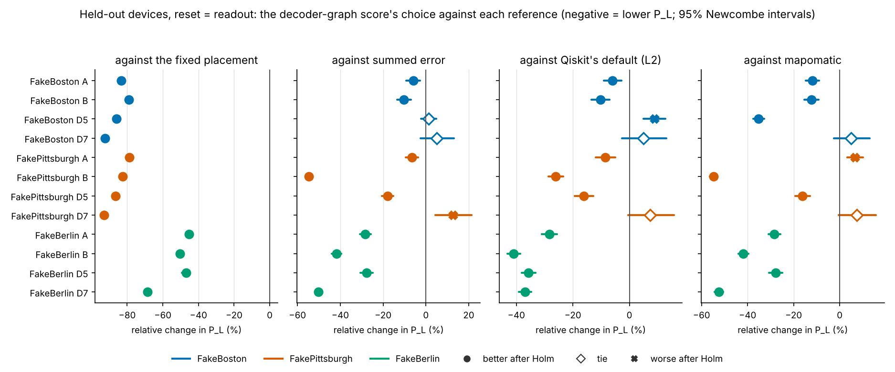

# Noise-Aware Placement for Nove: v3 Report

Generated by `python scripts/report_v3.py` from `results_v3/held_out/analysis.json` (sha256 `0fa7977c357e…`), which `python -m nac_bench.analysis_v3` builds from the 65 committed run files in `results_v3/held_out/runs/`. The runs and the analysis ran on patty at commit `b3f15e5`, a clean tree descending from the held-out config's freeze `fb3c7a2` (tag `v3-held-out-config-r6`). The plan is [SPEC_V3.md](SPEC_V3.md) (revision 6); choices made along the way are in [DECISIONS_V3.md](DECISIONS_V3.md). v1's and v2's reports are unchanged apart from their v3 banners.

**Every result holds under this noise model only:** the converted calibration snapshots of IBM's fake backends (`qiskit-ibm-runtime` 0.50.0), simulated by Nove as Pauli channels and decoded by PyMatching. None is a measurement on hardware, and each device is one day's calibration. **Held-out** means the device's calibration was converted only after the config, the code and every seed were frozen. FakeBoston and FakePittsburgh (heavy-hex) and FakeBerlin (square lattice) decide the claims. FakeBerlin's device-level calibration aggregates (medians, counts and ranges) were seen before the held-out config was frozen; no decision used them, and the square lattice has no unseen device to use instead. FakeKingston and FakeAachen were seen before the freeze and are exploratory. FakeNighthawk's calibration is synthetic (the file names itself `fake_nighthawk`), it was seen, and it is exploratory everywhere. Unless a table says otherwise, the reset setting is **reset error = readout error**.

## Summary

v3 asked whether the decoder-graph score, developed on heavy-hex CX devices, still picks better qubit placements than the methods people use on new devices with CZ gates, on the heavy-hex layout and on the square lattice where it was never developed. The answer depends on the layout.

- **Square lattice (FakeBerlin):** its choice was better after Holm in all 16 comparisons: by 45% to 68% lower P_L than the fixed placement and by 28% to 53% than summed error, Qiskit's default and mapomatic. This held under every sensitivity run and grading variant but one comparison in one draw.
- **Heavy-hex (FakeBoston, FakePittsburgh):** it beat the fixed placement in all 8 cases (79% to 93% lower P_L). Against each of the three methods it was better in 5 cases and worse in 1, a *mixed* result. Its wins are at d=3 and d=5; at d=7 it ties or loses. These mixed results are fragile: with the same placements graded under direction-aware readout it is worse than summed error in 5 of 6 cases and than Qiskit's default in 5 of 6.
- **Surface code:** FakeBerlin has no d=5 surface-code embedding that avoids its removed couplers, a pre-registered possible outcome. The family therefore has 48 members, not 52, and v3 makes no confirmatory surface-code claim. On FakeNighthawk (synthetic, exploratory) the scaled score's d=5 choice beat the fixed placement and tied the other methods.
- **Drift** (development devices, exploratory): the decoder-graph score's gain mostly survives a month of real recalibration, but it keeps less of it than summed error, and one 14-day change made its d=7 choice worse than the fixed placement. Choosing again restores the gain.

**Table 1. Claims.** Held-out devices, reset = readout; *t* is the number of better cases a *beats* needs.

| Devices | Against | Result after Holm | Per device | Same wording under the 15 sensitivity runs |
| --- | --- | --- | --- | --- |
| FakeBoston, FakePittsburgh (heavy-hex) | fixed placement | **beats**: 8 better, 0 worse of 8 (*t* = 5) | FakeBoston 4–0; FakePittsburgh 4–0 | 15 of 15 |
| FakeBoston, FakePittsburgh (heavy-hex) | lowest summed error | **mixed**: 5 better, 1 worse of 8 (*t* = 5) | FakeBoston 2–0; FakePittsburgh 3–1 | 1 of 15 |
| FakeBoston, FakePittsburgh (heavy-hex) | Qiskit's default (level 2) | **mixed**: 5 better, 1 worse of 8 (*t* = 5) | FakeBoston 2–1; FakePittsburgh 3–0 | 2 of 15 |
| FakeBoston, FakePittsburgh (heavy-hex) | mapomatic | **mixed**: 5 better, 1 worse of 8 (*t* = 5) | FakeBoston 3–0; FakePittsburgh 2–1 | 1 of 15 |
| FakeBerlin (square)† | fixed placement | **beats**: 4 better, 0 worse of 4 (*t* = 3) | FakeBerlin 4–0 | 15 of 15 |
| FakeBerlin (square)† | lowest summed error | **beats**: 4 better, 0 worse of 4 (*t* = 3) | FakeBerlin 4–0 | 15 of 15 |
| FakeBerlin (square)† | Qiskit's default (level 2) | **beats**: 4 better, 0 worse of 4 (*t* = 3) | FakeBerlin 4–0 | 14 of 15 |
| FakeBerlin (square)† | mapomatic | **beats**: 4 better, 0 worse of 4 (*t* = 3) | FakeBerlin 4–0 | 15 of 15 |

† FakeBerlin's device-level calibration aggregates (medians, counts and ranges) were seen before the held-out config was frozen; no decision used them, and the square lattice has no unseen device to use instead. Per device gives better–worse after Holm. A sensitivity run keeps a claim's wording when its verdict and its counts are unchanged; section 2 says what changes.

**Figure 1.** The 48 comparisons of the headline family, held-out devices, reset = readout. Each row is one case; each panel one reference. Filled markers are better or worse after Holm, hollow diamonds ties.

## 1. Does the score still choose better placements on new layouts with CZ? (layout)

**On the square lattice, yes, in every comparison. On heavy-hex it beats the fixed placement every time but is only mixed against the three methods people use, and it loses ground as the code grows.**

**Heavy-hex.** After Holm the decoder-graph's choice was 5 better, 1 worse of 8 against lowest summed error, 5 better, 1 worse of 8 against Qiskit's default and 5 better, 1 worse of 8 against mapomatic. Every one of the 3-round d=3 circuits is a win against all three methods except FakePittsburgh A against mapomatic (worse). At d=5 it beats all three on FakePittsburgh; on FakeBoston it ties summed error, loses to Qiskit's default and beats mapomatic. At d=7 it is never better: it ties all three on FakeBoston, and on FakePittsburgh it loses to summed error and ties the other two.

**Square lattice.** All 16 comparisons on FakeBerlin are better after Holm, and the margins are large (28% to 53% against the three methods). On FakeBerlin summed error, Qiskit's default and mapomatic often choose the same placement, and the decoder-graph score finds one the others miss.

**The fixed placement in context.** The fixed placement is the first valid placement in lexicographic order, so where it lands is luck. On the heavy-hex devices it lies between the 81st and 92nd percentile of P_L, a poor draw; on FakeBerlin between the 1st and 7th, a good one. The decoder-graph's choice is at or below the 1st percentile in every confirmatory case (Table 2), so the large gains over the fixed placement on heavy-hex partly reflect a bad fixed placement, and FakeBerlin's gains come despite a good one.

**Table 2. Every confirmatory repetition-code case**, held-out devices, reset = readout, 3 rounds. Percentile = share of simulated placements with lower pooled P_L (for FakeBerlin D7, among its 1,000 uniform placements). Regret is the decoder-graph's cross-fitted regret relative to the best placement; *tie* means no placement was shown to beat its choice.

| Case | Placements simulated | Mean P_L, all placements | Fixed P_L (percentile) | Decoder-graph P_L (percentile) | Per round | Regret |
| --- | --- | --- | --- | --- | --- | --- |
| FakeBoston A | 812 | 4.53e−3 | 8.16e−3 (92.4) | 1.35e−3 (0.12) | 4.51e−4 | −8.4%, better |
| FakeBoston B | 812 | 3.84e−3 | 4.20e−3 (84.7) | 8.85e−4 (0.00) | 2.95e−4 | +0.0%, tie |
| FakeBoston D5 | 2,394 | 3.89e−4 | 5.83e−4 (85.1) | 8.12e−5 (0.58) | 2.71e−5 | +13.8%, worse |
| FakeBoston D7 | 6,662 | 3.46e−5 | 6.17e−5 (87.5) | 4.61e−6 (0.93) | 1.54e−6 | +20.1%, worse |
| FakePittsburgh A | 738 | 4.75e−3 | 7.53e−3 (86.7) | 1.60e−3 (0.41) | 5.34e−4 | +3.8%, tie |
| FakePittsburgh B | 738 | 4.47e−3 | 6.28e−3 (81.3) | 1.10e−3 (0.14) | 3.66e−4 | +4.7%, tie |
| FakePittsburgh D5 | 1,996 | 3.97e−4 | 6.38e−4 (86.5) | 8.66e−5 (0.20) | 2.89e−5 | +2.9%, tie |
| FakePittsburgh D7 | 5,154 | 3.35e−5 | 6.59e−5 (88.5) | 4.63e−6 (0.17) | 1.54e−6 | −2.4%, tie |
| FakeBerlin A | 7,588 | 1.66e−2 | 5.26e−3 (6.8) | 2.87e−3 (0.07) | 9.59e−4 | +3.3%, tie |
| FakeBerlin B | 7,588 | 2.13e−2 | 4.89e−3 (3.3) | 2.43e−3 (0.03) | 8.11e−4 | −0.8%, tie |
| FakeBerlin D5 | 286,976 | 3.14e−3 | 4.16e−4 (0.9) | 2.21e−4 (0.00) | 7.35e−5 | +3.7%, tie |
| FakeBerlin D7 | 1,092 (best found; sample best 3.67e−5 [3.32e−5, 4.02e−5]) | 5.83e−4 (uniform sample) | 5.42e−5 (0.8) | 1.71e−5 (0.00) | 5.70e−6 | +0.9%, tie |

FakeBerlin D5 was simulated on all 286,976 placements within its runtime guard, so its regret is exact. FakeBerlin D7 was simulated on a best-found set (every method's choice, the top 30 by six scores and 1,000 uniform placements), so its regret can only understate the true one. The decoder-graph score has non-zero regret on FakeBoston D5 and D7: there a better placement exists that it did not pick.

**Does the decoder graph itself help?** A second family compares the score with two rivals that see the same idle noise but use no decoder graph: an idle-aware summed error and the v1 score. On FakeBerlin the decoder graph helps beyond the idle-aware summed error (4 better, 0 worse of 4) and is mixed against the v1 score (2 better, 1 worse of 4). On heavy-hex both are mixed: 4 better, 1 worse of 8 against the idle-aware summed error, 3 better, 2 worse of 8 against the v1 score.

**Other competitors (exploratory, unadjusted 95% intervals, the 12 confirmatory cases).** *Simulate briefly and keep the best* (100,000 pilot shots per placement) was better than the decoder-graph's choice in 2, tied in 5 and worse in 5; it is far worse at d=7 on heavy-hex, where 100,000 shots see only a few failures. Against Kan et al.'s detection-rate proxy the decoder-graph score was better in 7, tied in 3 and worse in 2. Against Qiskit at level 3 it was better in 9 and tied in 3. The fast search found the exhaustive choice's P_L in 11 of 12 and was worse in 1. Qiskit's level-2 choice did not change with the transpiler seed: ten seeds gave the main choice in all 63 cases that ran the sweep.

**Seen and synthetic devices (exploratory).** These decide no claim. Table 3 counts the decoder-graph's verdicts by unadjusted 95% interval, reset = readout, repetition codes A, B, D5 and D7.

**Table 3. Exploratory devices**, held-out conversion, reset = readout: decoder-graph's choice, better–tie–worse of 4.

| Device | Role | Fixed | Summed error | Qiskit L2 | mapomatic | Idle-aware SE | v1 score |
| --- | --- | --- | --- | --- | --- | --- | --- |
| FakeKingston | seen | 4–0–0 | 4–0–0 | 4–0–0 | 4–0–0 | 4–0–0 | 4–0–0 |
| FakeAachen | seen | 4–0–0 | 4–0–0 | 4–0–0 | 4–0–0 | 3–1–0 | 3–1–0 |
| FakeNighthawk | synthetic, seen | 4–0–0 | 3–1–0 | 3–1–0 | 3–1–0 | 2–2–0 | 1–3–0 |

On FakeKingston and FakeAachen, heavy-hex devices with more removed couplers than the claim devices, the score beats the three methods in every case, more clearly than on FakeBoston and FakePittsburgh. On FakeNighthawk it ties every method except the fixed placement at d=3 bit-flip, beats the three methods in the other circuits, and ties the idle-aware summed error and the v1 score at d=7.

## 2. What qualifies the claims

**The fixed-placement claims and FakeBerlin's claims survive every check. The heavy-hex mixed claims do not: under most changed models fewer than 5 of 8 cases stay better, and under direction-aware readout the score's heavy-hex choices are mostly worse than the methods'.**

Each check keeps the placements and changes one thing, then recomputes the family. The *d*-round runs and correlated matching use the family's shots (about 4,000 failures per placement). The grading variants use the other placements' shots (about 400 failures, a 10% half-width), so a change from *better* to *tie* there can be lost power rather than a lost effect; a change to *worse* cannot. Table 4 counts, on the heavy-hex devices, the comparisons against summed error, Qiskit's default and mapomatic (24 in all).

**Table 4. Sensitivity runs and grading variants**, held-out confirmatory devices, reset = readout (exploratory).

| Check | Heavy-hex better–worse vs summed error / Qiskit L2 / mapomatic (of 8 each) | Heavy-hex comparisons turned worse | FakeBerlin comparisons changed |
| --- | --- | --- | --- |
| Headline | 5–1 / 5–1 / 5–1 | – | – |
| Correlated matching (same samples re-decoded) | 5–1 / 5–1 / 5–1 | 0 | 0 |
| D5 and D7 in a memory of *d* rounds | 6–2 / 5–2 / 5–3 | 5 | 0 |
| Every CZ at the shortest CZ length | 1–0 / 1–0 / 2–0 | 0 | 0 |
| Every CZ at the longest CZ length | 2–0 / 1–0 / 2–0 | 0 | 0 |
| Idle Z rate doubled | 2–0 / 2–0 / 2–0 | 0 | 0 |
| CZ error less its single-qubit layer | 2–0 / 2–0 / 4–0 | 0 | 0 |
| Readout and reset at P(1\|0) | 2–3 / 2–3 / 2–3 | 6 | 0 |
| Log-normal noise, δ = 0.1, draw 0 | 3–0 / 3–0 / 3–0 | 0 | 0 |
| Log-normal noise, δ = 0.1, draw 1 | 4–1 / 3–1 / 4–2 | 3 | 0 |
| Log-normal noise, δ = 0.1, draw 2 | 2–0 / 2–0 / 3–0 | 0 | 0 |
| Log-normal noise, δ = 0.1, draw 3 | 2–1 / 2–0 / 3–0 | 1 | 0 |
| Log-normal noise, δ = 0.25, draw 0 | 2–2 / 1–2 / 2–2 | 5 | 0 |
| Log-normal noise, δ = 0.25, draw 1 | 4–0 / 5–1 / 5–0 | 0 | 0 |
| Log-normal noise, δ = 0.25, draw 2 | 5–2 / 4–3 / 3–3 | 6 | 1 |
| Log-normal noise, δ = 0.25, draw 3 | 3–3 / 2–2 / 3–1 | 5 | 0 |
| Directional setting, every method chooses again (family shots) | 4–2 of 6 / 2–3 of 6 / 4–2 of 6 | – | all 12 better |
| Directional setting, headline choices graded (family shots) | 0–5 of 6 / 0–5 of 6 / 2–4 of 6 | – | all 12 better |
| Reset error 0, every method chooses again (family shots) | 3–1 / 4–1 / 4–1 | – | 2 of 16 not better |

Four things stand out. First, nothing touches the fixed-placement claims: every confirmatory case stays better under every check. Second, FakeBerlin changes in 1 comparison across all checks (Log-normal noise, δ = 0.25, draw 2: FakeBerlin D5 against Qiskit's default (level 2), better → worse), and at reset 0, 2 of its 16 comparisons are not better; its claims are robust. Third, on heavy-hex the *d*-round run, at full power, turns the d=7 ties into losses: at 7 rounds the score's d=7 choice is worse than all three methods on both devices. Fourth, readout direction matters most. A Z-basis repetition code meets only P(1|0), about half the published symmetric readout error. Grading the headline choices with that readout makes the score worse than summed error in 5 of the 6 heavy-hex cases and than Qiskit's default in 5; when every method chooses again with it, the score recovers to 4 better and 2 worse against summed error. The score is model-based, so its edge on heavy-hex depends on the readout model being right (*inferred, not tested*).

Correlated matching changes no verdict. Qiskit's transpiler seed changes no choice. No case failed or fell back to a best-found set. Two cases have no valid placement and leave their families: FakeBerlin's d=5 surface code at reset = readout and at reset 0. Appendix C lists every comparison each check changes.

## 3. Can the scaled score rank surface-code placements? (scale)

**v3 cannot answer this confirmatorily.** FakeBerlin has no SWAP-free d=5 surface-code embedding: every one of its embeddings crosses a removed coupler. The spec named this outcome before any held-out data was read. The family therefore had 48 members, the claims table has no surface-code row, and the question is answered only by exploratory results: FakeNighthawk's (synthetic calibration, seen) and FakeMiami's development checks.

**Table 5. Surface codes**, exploratory, reset = readout: the scaled score's choice (*k* = 640) against each method, unadjusted 95% intervals.

| Case | Embeddings | Fixed | Summed error | Qiskit L2 | mapomatic | Idle-aware SE | Exact score's choice |
| --- | --- | --- | --- | --- | --- | --- | --- |
| FakeNighthawk S5 (synthetic) | 8 | −8.6%, better | −0.8%, tie | +0.1%, tie | +0.1%, tie | −0.8%, tie | same |
| FakeNighthawk S3 (synthetic) | 528 | −61.8%, better | −21.3%, better | −10.9%, better | −19.9%, better | −21.3%, better | different; exact −16.9% vs summed error |
| FakeBerlin S3 (seen aggregates) | 464 | −17.3%, better | +3.5%, worse | −10.9%, better | +3.5%, worse | +6.4%, worse | different; exact −2.0% vs summed error |

FakeNighthawk has only 8 d=5 embeddings, so ranking them is easy and the scaled score agrees with the exact score; *k* = 10 and 80 choose the same embedding. Its choice beats the fixed placement and ties the rest. The device left room to differ: the fixed placement is worse than the cross-fitted best by its interval. Going from d=3 to d=5 barely helps on FakeNighthawk: the best per-round P_L falls from 0.56% to 0.54% (Λ = 1.04; 1.05 at reset 0), so this model sits close to threshold. At d=3 the scaled score loses to summed error on FakeBerlin while the exact score wins, so the approximation costs something there. The speed target (the whole d=5 selection within 60 seconds on one core) is missed on the development device: about 1.2 s per candidate at *k* = 640, about 150 s for FakeMiami's 128 candidates, against 0.06 s per candidate for the exact score. At d=5 the scaled score is not needed, and v3 cannot show where it would be.

## 4. How much of the gain survives real recalibration? (drift)

**Most of it after a month, less of it than summed error keeps, and sometimes none.** These are exploratory runs on development devices with dated snapshots ([DRIFT.md](results_v3/drift/DRIFT.md)); each method chooses on the older calibration and is graded and decoded as someone who had not recalibrated would run it.

- After a month on FakeFez every old choice still beats the fixed placement. The decoder-graph's old choice has 17% to 46% lower P_L than the fixed placement, but summed error's and mapomatic's kept more of their gains in three of four circuits.
- On FakeHanoi d=7 the decoder-graph's old choice became worse than the fixed placement: 127% worse after 14 days and 76% after 9 months, and still worse when decoded with new weights, so the placement itself degraded.
- After 12 months on FakeTorino three of its four old choices use two couplers that became uncalibrated. Graded with those couplers at the converter's limit they fail badly; at their older value they are 31% to 81% better than the fixed placement ([UNCALIBRATED.md](results_v3/drift/uncalibrated/UNCALIBRATED.md)). Which is real is unknown.
- Choosing again is what matters: the fresh choice beats the fixed placement by 27% to 96% outside FakeHanoi's d=3 circuits. Re-grading v2's synthetic drift with stale decoder weights leaves the score's result standing and lowers summed error's and Qiskit's on FakeJakarta A.

## 5. Can someone outside the project run it? (use)

**Yes, for the worked example.** The README's example installs the package, converts a device, places a circuit and prints the mapping. `scripts/check_readme_example.sh` ran it as written in a fresh virtual environment without Qiskit on Nov 14, 2026, and it passed. v3 adds no new interface; the converted held-out devices are in `src/noise_aware_compilation/device_data/`.

## 6. The reset result

IBM publishes no reset error, and v1's headline assumed reset error 0. With reset error equal to readout error, the v1 score lost to the fixed placement on v1's seeds in three FakeHanoi d=3 circuits (3 rounds, 5 rounds and the X basis); the 5-round case had been v1's −15.2% gain at reset 0. On fresh seeds the loss replicates by its Newcombe interval in one of the three (3 rounds, +10.5%), and the other two are ties. The decoder-graph score is better than the fixed placement by its Newcombe interval in the 3- and 5-round circuits at both settings, though the 3-round result at reset = readout does not hold after Holm (adjusted p = 0.41), and its reset-0 figure is v2's committed run ([RESET.md](results_v3/reset/RESET.md) section 2). Every v3 case therefore runs at both settings; the headline uses reset = readout, and Table 4 gives reset 0.

## 7. Limitations and deviations

**Deviations after the freeze.** Converting the held-out devices hit two cases the converter had never met. Several devices have qubits whose single-qubit gate error is published as 1.0 (uncalibrated): FakeBoston 146, FakePittsburgh 117, FakeKingston 96, 112, 113, 131 and 146, FakeAachen 19 and 35, and FakeNighthawk 85; FakeBerlin has none. A 1.0 error cannot be a Pauli channel, and FakeKingston 146 also has no T1 or T2. Such a qubit now loses all its couplers, as an uncalibrated coupler already did, and is recorded in the device's metadata. The first run then found a removed qubit's CZ channel still in the noise model and stopped; the converter now drops those too, and the Qiskit and mapomatic Target gives such qubits their published error. No result had been read when either fix was made, and the stopped run's output is set aside. Both fixes are listed with their reasons in the freeze record (`configs_v3/freeze_f4.json`) and in DECISIONS_V3.md (P2-56, P2-57).

**Cost.** The 65 cases ran one after another on patty with 48 workers; their run files' clocks sum to 60.7 wall hours. The run used about 2,711 core-hours (user plus system time from the run's time log on patty), against 3,116 projected. No case hit a runtime guard.

**What the results cannot show.**

- *One snapshot per device.* The intervals cover simulation noise only; another day's calibration could change which placement wins. No second snapshot of these devices exists in any `qiskit-ibm-runtime` release.
- *Graded under the model that chose.* A model-based score gains if the model is right. Section 2's variants show the heavy-hex claims are sensitive to that; only hardware can settle it.
- *Pauli noise only.* No coherent errors, leakage, time-correlated noise or crosstalk between simultaneous CZs; the fake backends publish none of these.
- *Resets.* How a real reset fails is unknown; results are given at both ends of the assumption.
- *Best-found regret.* Where not every placement was simulated (FakeBerlin D7, FakeNighthawk D5 and D7), regret is a lower bound.
- *Seen devices.* FakeBerlin's aggregates were seen, and the square-lattice claim rests on that one device.
- *Pinned software.* Qiskit 2.5.2 chose the Qiskit baselines; a later release might choose differently.
- *Independence.* The spec, code and both pre-run reviews came from the thread that built v3. No person outside the project has reviewed them.

## Appendix A. Traceability

| Requirement | Where |
| --- | --- |
| R3-R1 device kind and reset setting on every table and figure | Table and figure captions |
| R3-R2 FakeNighthawk labels; FakeBerlin note | Header, Table 1, Tables 3 and 5 |
| R3-R3 the reset result in the main body | Section 6 |
| R3-R4 best-found set size and sample interval | Table 2 (FakeBerlin D7), Appendix B |
| R3-R5 no SWAP-free FakeBerlin d=5 embedding | Summary, section 3 |
| R3-R6 headroom and suppression | Section 3 |
| R3-R7 the fixed placement in context | Section 1, Table 2, Appendix B |
| R3-R8 3-round wording and *d*-round results | Section 1, Table 4 |
| R3-R9 what qualifies each claim | Table 1, section 2, Table 4, Appendix C |
| Section 7 claim rules, families of 48 and 24 | Table 1, Appendix B |
| Secondary endpoints (regret, ρ, percentiles, per round) | Table 2, Appendix B |
| P2-56, P2-57 deviations after F4 | Section 7 |

## Appendix B. Every family comparison and every case

**Headline family** (48), held-out confirmatory devices, reset = readout. Relative = (choice − reference) / reference.

| Case | Against | Relative change [95%] | Holm p | After Holm |
| --- | --- | --- | --- | --- |
| FakeBoston A | fixed placement | −83.4% [−84.0%, −82.8%] | 0 | better |
| FakeBoston A | lowest summed error | −6.0% [−9.1%, −2.7%] | 0.00333 | better |
| FakeBoston A | Qiskit's default (level 2) | −6.0% [−9.1%, −2.7%] | 0.00333 | better |
| FakeBoston A | mapomatic | −11.9% [−14.8%, −8.9%] | 1.67e-12 | better |
| FakeBoston B | fixed placement | −78.9% [−79.7%, −78.2%] | 0 | better |
| FakeBoston B | lowest summed error | −10.2% [−13.3%, −7.0%] | 4.1e-08 | better |
| FakeBoston B | Qiskit's default (level 2) | −10.2% [−13.3%, −7.0%] | 4.1e-08 | better |
| FakeBoston B | mapomatic | −12.3% [−15.3%, −9.1%] | 5.27e-12 | better |
| FakeBoston D5 | fixed placement | −86.1% [−86.6%, −85.6%] | 0 | better |
| FakeBoston D5 | lowest summed error | +1.3% [−2.2%, +4.9%] | 0.811 | tie |
| FakeBoston D5 | Qiskit's default (level 2) | +8.8% [+5.0%, +12.8%] | 4.48e-05 | worse |
| FakeBoston D5 | mapomatic | −35.2% [−37.6%, −32.7%] | 1.01e-113 | better |
| FakeBoston D7 | fixed placement | −92.5% [−92.9%, −92.1%] | 0 | better |
| FakeBoston D7 | lowest summed error | +5.0% [−2.6%, +13.1%] | 0.811 | tie |
| FakeBoston D7 | Qiskit's default (level 2) | +5.0% [−2.6%, +13.1%] | 0.811 | tie |
| FakeBoston D7 | mapomatic | +5.0% [−2.6%, +13.1%] | 0.811 | tie |
| FakePittsburgh A | fixed placement | −78.7% [−79.5%, −77.9%] | 0 | better |
| FakePittsburgh A | lowest summed error | −6.6% [−9.4%, −3.6%] | 0.000189 | better |
| FakePittsburgh A | Qiskit's default (level 2) | −8.6% [−11.9%, −5.1%] | 4e-05 | better |
| FakePittsburgh A | mapomatic | +6.6% [+3.3%, +10.1%] | 0.000859 | worse |
| FakePittsburgh B | fixed placement | −82.5% [−83.1%, −81.9%] | 0 | better |
| FakePittsburgh B | lowest summed error | −54.6% [−56.3%, −52.9%] | 0 | better |
| FakePittsburgh B | Qiskit's default (level 2) | −26.1% [−28.6%, −23.4%] | 3.22e-61 | better |
| FakePittsburgh B | mapomatic | −54.8% [−56.5%, −53.1%] | 0 | better |
| FakePittsburgh D5 | fixed placement | −86.4% [−86.9%, −85.9%] | 0 | better |
| FakePittsburgh D5 | lowest summed error | −17.9% [−20.5%, −15.1%] | 2.35e-31 | better |
| FakePittsburgh D5 | Qiskit's default (level 2) | −16.1% [−19.4%, −12.8%] | 2.96e-17 | better |
| FakePittsburgh D5 | mapomatic | −16.1% [−19.4%, −12.8%] | 2.96e-17 | better |
| FakePittsburgh D7 | fixed placement | −93.0% [−93.4%, −92.5%] | 0 | better |
| FakePittsburgh D7 | lowest summed error | +12.6% [+4.4%, +21.4%] | 0.0151 | worse |
| FakePittsburgh D7 | Qiskit's default (level 2) | +7.4% [−0.3%, +15.7%] | 0.369 | tie |
| FakePittsburgh D7 | mapomatic | +7.4% [−0.3%, +15.7%] | 0.369 | tie |
| FakeBerlin A | fixed placement | −45.4% [−47.2%, −43.5%] | 1.93e-272 | better |
| FakeBerlin A | lowest summed error | −28.3% [−30.9%, −25.7%] | 7.63e-70 | better |
| FakeBerlin A | Qiskit's default (level 2) | −28.3% [−30.9%, −25.7%] | 7.63e-70 | better |
| FakeBerlin A | mapomatic | −28.3% [−30.9%, −25.7%] | 7.63e-70 | better |
| FakeBerlin B | fixed placement | −50.3% [−52.1%, −48.5%] | 0 | better |
| FakeBerlin B | lowest summed error | −41.9% [−44.0%, −39.6%] | 1.17e-177 | better |
| FakeBerlin B | Qiskit's default (level 2) | −40.9% [−43.1%, −38.6%] | 8.41e-166 | better |
| FakeBerlin B | mapomatic | −41.9% [−44.0%, −39.6%] | 1.17e-177 | better |
| FakeBerlin D5 | fixed placement | −47.0% [−49.2%, −44.6%] | 1.02e-186 | better |
| FakeBerlin D5 | lowest summed error | −27.8% [−30.6%, −24.9%] | 5.98e-58 | better |
| FakeBerlin D5 | Qiskit's default (level 2) | −35.7% [−38.1%, −33.2%] | 1.13e-111 | better |
| FakeBerlin D5 | mapomatic | −27.8% [−30.6%, −24.9%] | 5.98e-58 | better |
| FakeBerlin D7 | fixed placement | −68.5% [−69.7%, −67.2%] | 0 | better |
| FakeBerlin D7 | lowest summed error | −50.3% [−51.9%, −48.6%] | 0 | better |
| FakeBerlin D7 | Qiskit's default (level 2) | −36.9% [−39.1%, −34.7%] | 6.89e-152 | better |
| FakeBerlin D7 | mapomatic | −52.5% [−54.3%, −50.7%] | 0 | better |

**Isolation family** (24), same devices and setting.

| Case | Against | Relative change [95%] | Holm p | After Holm |
| --- | --- | --- | --- | --- |
| FakeBoston A | idle-aware summed error | −6.0% [−9.1%, −2.7%] | 0.00444 | better |
| FakeBoston A | the v1 score | −6.0% [−9.1%, −2.7%] | 0.00444 | better |
| FakeBoston B | idle-aware summed error | −10.2% [−13.3%, −7.0%] | 4.37e-08 | better |
| FakeBoston B | the v1 score | −10.2% [−13.3%, −7.0%] | 4.37e-08 | better |
| FakeBoston D5 | idle-aware summed error | +1.3% [−2.2%, +4.9%] | 1 | tie |
| FakeBoston D5 | the v1 score | +1.3% [−2.2%, +4.9%] | 1 | tie |
| FakeBoston D7 | idle-aware summed error | +19.0% [+10.2%, +28.5%] | 0.000135 | worse |
| FakeBoston D7 | the v1 score | +0.4% [−6.8%, +8.0%] | 1 | tie |
| FakePittsburgh A | idle-aware summed error | −6.4% [−9.8%, −2.8%] | 0.00655 | better |
| FakePittsburgh A | the v1 score | +6.6% [+3.3%, +10.1%] | 0.00112 | worse |
| FakePittsburgh B | idle-aware summed error | +0.0% [+0.0%, +0.0%] | 1 | tie |
| FakePittsburgh B | the v1 score | +0.0% [+0.0%, +0.0%] | 1 | tie |
| FakePittsburgh D5 | idle-aware summed error | −17.9% [−20.5%, −15.1%] | 2.12e-31 | better |
| FakePittsburgh D5 | the v1 score | −16.0% [−19.2%, −12.6%] | 7.65e-17 | better |
| FakePittsburgh D7 | idle-aware summed error | +2.2% [−5.1%, +10.1%] | 1 | tie |
| FakePittsburgh D7 | the v1 score | +12.6% [+4.4%, +21.4%] | 0.0194 | worse |
| FakeBerlin A | idle-aware summed error | −28.3% [−30.9%, −25.7%] | 5.58e-70 | better |
| FakeBerlin A | the v1 score | +4.9% [+1.4%, +8.5%] | 0.0449 | worse |
| FakeBerlin B | idle-aware summed error | −41.9% [−44.0%, −39.6%] | 8.8e-178 | better |
| FakeBerlin B | the v1 score | −41.9% [−44.0%, −39.6%] | 8.8e-178 | better |
| FakeBerlin D5 | idle-aware summed error | −35.7% [−38.1%, −33.2%] | 9.19e-112 | better |
| FakeBerlin D5 | the v1 score | −4.9% [−8.8%, −0.8%] | 0.143 | tie |
| FakeBerlin D7 | idle-aware summed error | −31.1% [−33.5%, −28.7%] | 6.68e-96 | better |
| FakeBerlin D7 | the v1 score | −32.9% [−35.6%, −30.1%] | 2.17e-79 | better |

**Every case at reset = readout**, all six held-out devices. P_L of each choice over all rounds, with its percentile among the simulated placements (among the uniform sample where the set is best-found). Spearman's ρ is between the decoder-graph score (the scaled score on surface codes) and simulated P_L.

| Case | Role | Rounds | Simulated | Mean P_L | Fixed | Decoder-graph or scaled | Summed error | Qiskit L2 | mapomatic | ρ |
| --- | --- | --- | --- | --- | --- | --- | --- | --- | --- | --- |
| FakeBoston A | confirmatory | 3 | 812 | 4.53e−3 | 8.16e−3 (92.4) | 1.35e−3 (0.1) | 1.44e−3 (0.6) | 1.44e−3 (0.6) | 1.54e−3 (2.1) | 0.98 |
| FakeBoston B | confirmatory | 3 | 812 | 3.84e−3 | 4.20e−3 (84.7) | 8.85e−4 (0.0) | 9.86e−4 (0.6) | 9.86e−4 (0.6) | 1.01e−3 (0.9) | 0.98 |
| FakeBoston D5 | confirmatory | 3 | 2,394 | 3.89e−4 | 5.83e−4 (85.1) | 8.12e−5 (0.6) | 8.02e−5 (0.4) | 7.46e−5 (0.2) | 1.25e−4 (22.3) | 0.98 |
| FakeBoston D7 | confirmatory | 3 | 6,662 | 3.46e−5 | 6.17e−5 (87.5) | 4.61e−6 (0.9) | 4.39e−6 (0.4) | 4.39e−6 (0.4) | 4.39e−6 (0.4) | 0.99 |
| FakePittsburgh A | confirmatory | 3 | 738 | 4.75e−3 | 7.53e−3 (86.7) | 1.60e−3 (0.4) | 1.71e−3 (2.7) | 1.75e−3 (3.1) | 1.50e−3 (0.0) | 0.98 |
| FakePittsburgh B | confirmatory | 3 | 738 | 4.47e−3 | 6.28e−3 (81.3) | 1.10e−3 (0.1) | 2.42e−3 (28.5) | 1.49e−3 (1.2) | 2.43e−3 (29.4) | 0.98 |
| FakePittsburgh D5 | confirmatory | 3 | 1,996 | 3.97e−4 | 6.38e−4 (86.5) | 8.66e−5 (0.2) | 1.05e−4 (3.5) | 1.03e−4 (2.7) | 1.03e−4 (2.7) | 0.98 |
| FakePittsburgh D7 | confirmatory | 3 | 5,154 | 3.35e−5 | 6.59e−5 (88.5) | 4.63e−6 (0.2) | 4.11e−6 (0.0) | 4.31e−6 (0.1) | 4.31e−6 (0.1) | 0.98 |
| FakeBerlin A | confirmatory | 3 | 7,588 | 1.66e−2 | 5.26e−3 (6.8) | 2.87e−3 (0.1) | 4.01e−3 (1.8) | 4.01e−3 (1.8) | 4.01e−3 (1.8) | 0.98 |
| FakeBerlin B | confirmatory | 3 | 7,588 | 2.13e−2 | 4.89e−3 (3.3) | 2.43e−3 (0.0) | 4.18e−3 (1.1) | 4.11e−3 (1.0) | 4.18e−3 (1.1) | 0.99 |
| FakeBerlin D5 | confirmatory | 3 | 286,976 | 3.14e−3 | 4.16e−4 (0.9) | 2.21e−4 (0.0) | 3.06e−4 (0.1) | 3.43e−4 (0.3) | 3.06e−4 (0.1) | 0.96 |
| FakeBerlin D7 | confirmatory | 3 | 1,092§ | 5.83e−4§ | 5.42e−5 (0.8) | 1.71e−5 (0.0) | 3.44e−5 (0.0) | 2.71e−5 (0.0) | 3.60e−5 (0.2) | 0.94 |
| FakeBerlin S3 | confirmatory | 3 | 464 | 1.11e−1 | 5.46e−2 (4.5) | 4.51e−2 (1.9) | 4.36e−2 (1.5) | 5.07e−2 (3.9) | 4.36e−2 (1.5) | 0.87 |
| FakeKingston A | seen | 3 | 712 | 7.85e−3 | 4.26e−3 (20.4) | 2.00e−3 (0.0) | 2.31e−3 (0.7) | 4.84e−3 (33.3) | 2.31e−3 (0.7) | 0.95 |
| FakeKingston B | seen | 3 | 712 | 1.71e−2 | 9.21e−3 (28.1) | 3.48e−3 (1.0) | 4.61e−3 (2.7) | 1.02e−2 (33.1) | 4.66e−3 (2.8) | 0.96 |
| FakeKingston D5 | seen | 3 | 2,016 | 8.56e−4 | 4.91e−4 (25.9) | 1.92e−4 (0.1) | 3.70e−4 (8.5) | 3.70e−4 (8.5) | 3.70e−4 (8.5) | 0.86 |
| FakeKingston D7 | seen | 3 | 5,416 | 9.11e−5 | 7.15e−5 (52.0) | 1.45e−5 (0.0) | 2.11e−5 (0.5) | 3.37e−5 (4.9) | 2.24e−5 (0.8) | 0.82 |
| FakeAachen A | seen | 3 | 826 | 6.47e−3 | 7.05e−3 (77.5) | 2.42e−3 (0.1) | 3.23e−3 (2.9) | 3.23e−3 (2.9) | 3.23e−3 (2.9) | 0.95 |
| FakeAachen B | seen | 3 | 826 | 6.14e−3 | 6.00e−3 (69.5) | 1.97e−3 (0.0) | 2.16e−3 (0.2) | 2.26e−3 (0.4) | 2.26e−3 (0.4) | 0.95 |
| FakeAachen D5 | seen | 3 | 2,518 | 6.67e−4 | 6.58e−4 (68.8) | 2.05e−4 (0.2) | 2.78e−4 (3.4) | 2.57e−4 (1.7) | 2.78e−4 (3.4) | 0.94 |
| FakeAachen D7 | seen | 3 | 7,256 | 6.63e−5 | 5.72e−5 (59.0) | 1.43e−5 (0.0) | 2.47e−5 (3.2) | 2.47e−5 (3.2) | 2.47e−5 (3.2) | 0.95 |
| FakeNighthawk A | synthetic | 3 | 7,814 | 3.73e−3 | 8.86e−3 (96.1) | 1.36e−3 (0.0) | 1.41e−3 (0.1) | 1.38e−3 (0.0) | 1.41e−3 (0.1) | 0.96 |
| FakeNighthawk B | synthetic | 3 | 7,814 | 3.36e−3 | 4.46e−3 (85.6) | 9.82e−4 (0.0) | 1.24e−3 (0.3) | 1.21e−3 (0.2) | 1.24e−3 (0.3) | 0.96 |
| FakeNighthawk D5 | synthetic | 3 | 1,107§ | 2.93e−4§ | 8.04e−4 (97.7) | 7.99e−5 (0.0) | 1.48e−4 (11.0) | 1.13e−4 (1.3) | 1.46e−4 (10.2) | 0.95 |
| FakeNighthawk D7 | synthetic | 3 | 1,113§ | 2.19e−5§ | 6.71e−5 (99.0) | 4.52e−6 (0.0) | 6.54e−6 (0.3) | 6.86e−6 (0.6) | 6.35e−6 (0.3) | 0.93 |
| FakeNighthawk S3 | synthetic | 3 | 528 | 2.94e−2 | 4.55e−2 (92.4) | 1.74e−2 (0.9) | 2.21e−2 (30.9) | 1.95e−2 (11.7) | 2.17e−2 (28.4) | 0.95 |
| FakeNighthawk S5 | synthetic | 5 | 8 | 2.78e−2 | 2.91e−2 (75.0) | 2.66e−2 (12.5) | 2.68e−2 (37.5) | 2.65e−2 (0.0) | 2.65e−2 (0.0) | 0.76 |

§ Best-found set (every method's choice, top 30 by six scores, 1,000 uniform placements); the mean is the uniform sample's.

## Appendix C. Comparisons each check changes

Held-out confirmatory devices, reset = readout, exploratory. *Headline → check* gives the verdict after Holm before and after.

- **Correlated matching (same samples re-decoded):** none.
- **D5 and D7 in a memory of *d* rounds:** FakeBoston D5 vs Summed error tie → better; FakeBoston D5 vs Qiskit L2 worse → tie; FakeBoston D7 vs Summed error tie → worse; FakeBoston D7 vs mapomatic tie → worse; FakeBoston D7 vs Qiskit L2 tie → worse; FakePittsburgh D7 vs mapomatic tie → worse; FakePittsburgh D7 vs Qiskit L2 tie → worse.
- **Every CZ at the shortest CZ length:** FakeBoston A vs Summed error better → tie; FakeBoston A vs mapomatic better → tie; FakeBoston A vs Qiskit L2 better → tie; FakeBoston B vs Summed error better → tie; FakeBoston B vs mapomatic better → tie; FakeBoston B vs Qiskit L2 better → tie; FakeBoston D5 vs Qiskit L2 worse → tie; FakePittsburgh A vs Summed error better → tie; FakePittsburgh A vs mapomatic worse → tie; FakePittsburgh A vs Qiskit L2 better → tie; FakePittsburgh D5 vs Summed error better → tie; FakePittsburgh D5 vs mapomatic better → tie; FakePittsburgh D5 vs Qiskit L2 better → tie; FakePittsburgh D7 vs Summed error worse → tie.
- **Every CZ at the longest CZ length:** FakeBoston A vs Summed error better → tie; FakeBoston A vs mapomatic better → tie; FakeBoston A vs Qiskit L2 better → tie; FakeBoston B vs Summed error better → tie; FakeBoston B vs mapomatic better → tie; FakeBoston B vs Qiskit L2 better → tie; FakeBoston D5 vs Qiskit L2 worse → tie; FakePittsburgh A vs Summed error better → tie; FakePittsburgh A vs mapomatic worse → tie; FakePittsburgh A vs Qiskit L2 better → tie; FakePittsburgh D5 vs mapomatic better → tie; FakePittsburgh D5 vs Qiskit L2 better → tie; FakePittsburgh D7 vs Summed error worse → tie.
- **Idle Z rate doubled:** FakeBoston A vs mapomatic better → tie; FakeBoston B vs Summed error better → tie; FakeBoston B vs mapomatic better → tie; FakeBoston B vs Qiskit L2 better → tie; FakeBoston D5 vs Qiskit L2 worse → tie; FakePittsburgh A vs Summed error better → tie; FakePittsburgh A vs mapomatic worse → tie; FakePittsburgh A vs Qiskit L2 better → tie; FakePittsburgh D5 vs Summed error better → tie; FakePittsburgh D5 vs mapomatic better → tie; FakePittsburgh D5 vs Qiskit L2 better → tie; FakePittsburgh D7 vs Summed error worse → tie.
- **CZ error less its single-qubit layer:** FakeBoston A vs Summed error better → tie; FakeBoston A vs Qiskit L2 better → tie; FakeBoston B vs Summed error better → tie; FakeBoston B vs mapomatic better → tie; FakeBoston B vs Qiskit L2 better → tie; FakeBoston D5 vs Qiskit L2 worse → tie; FakePittsburgh A vs Summed error better → tie; FakePittsburgh A vs mapomatic worse → tie; FakePittsburgh A vs Qiskit L2 better → tie; FakePittsburgh D7 vs Summed error worse → tie.
- **Readout and reset at P(1\|0):** FakeBoston A vs Summed error better → tie; FakeBoston A vs mapomatic better → tie; FakeBoston A vs Qiskit L2 better → tie; FakeBoston D5 vs Summed error tie → worse; FakeBoston D5 vs mapomatic better → tie; FakeBoston D7 vs Summed error tie → worse; FakeBoston D7 vs mapomatic tie → worse; FakeBoston D7 vs Qiskit L2 tie → worse; FakePittsburgh A vs Summed error better → tie; FakePittsburgh A vs Qiskit L2 better → tie; FakePittsburgh D5 vs Summed error better → tie; FakePittsburgh D5 vs mapomatic better → tie; FakePittsburgh D5 vs Qiskit L2 better → tie; FakePittsburgh D7 vs mapomatic tie → worse; FakePittsburgh D7 vs Qiskit L2 tie → worse.
- **Log-normal noise, δ = 0.1, draw 0:** FakeBoston B vs Summed error better → tie; FakeBoston B vs mapomatic better → tie; FakeBoston B vs Qiskit L2 better → tie; FakeBoston D5 vs Qiskit L2 worse → tie; FakePittsburgh A vs mapomatic worse → tie; FakePittsburgh D5 vs Summed error better → tie; FakePittsburgh D5 vs mapomatic better → tie; FakePittsburgh D5 vs Qiskit L2 better → tie; FakePittsburgh D7 vs Summed error worse → tie.
- **Log-normal noise, δ = 0.1, draw 1:** FakeBoston A vs Summed error better → worse; FakeBoston A vs mapomatic better → worse; FakeBoston A vs Qiskit L2 better → worse; FakeBoston D5 vs Summed error tie → better; FakeBoston D5 vs Qiskit L2 worse → tie; FakePittsburgh A vs Summed error better → tie; FakePittsburgh A vs Qiskit L2 better → tie; FakePittsburgh D7 vs Summed error worse → tie.
- **Log-normal noise, δ = 0.1, draw 2:** FakeBoston B vs Summed error better → tie; FakeBoston B vs mapomatic better → tie; FakeBoston B vs Qiskit L2 better → tie; FakeBoston D5 vs Qiskit L2 worse → tie; FakePittsburgh A vs Summed error better → tie; FakePittsburgh A vs mapomatic worse → tie; FakePittsburgh A vs Qiskit L2 better → tie; FakePittsburgh D5 vs Summed error better → tie; FakePittsburgh D5 vs mapomatic better → tie; FakePittsburgh D5 vs Qiskit L2 better → tie; FakePittsburgh D7 vs Summed error worse → tie.
- **Log-normal noise, δ = 0.1, draw 3:** FakeBoston A vs Summed error better → tie; FakeBoston A vs mapomatic better → tie; FakeBoston A vs Qiskit L2 better → tie; FakeBoston B vs Summed error better → tie; FakeBoston B vs mapomatic better → tie; FakeBoston B vs Qiskit L2 better → tie; FakeBoston D5 vs Summed error tie → worse; FakeBoston D5 vs Qiskit L2 worse → tie; FakeBoston D7 vs Summed error tie → better; FakeBoston D7 vs mapomatic tie → better; FakeBoston D7 vs Qiskit L2 tie → better; FakePittsburgh A vs Summed error better → tie; FakePittsburgh A vs mapomatic worse → tie; FakePittsburgh A vs Qiskit L2 better → tie; FakePittsburgh D5 vs Summed error better → tie; FakePittsburgh D5 vs mapomatic better → tie; FakePittsburgh D5 vs Qiskit L2 better → tie; FakePittsburgh D7 vs Summed error worse → tie.
- **Log-normal noise, δ = 0.25, draw 0:** FakeBoston A vs Summed error better → worse; FakeBoston A vs mapomatic better → worse; FakeBoston A vs Qiskit L2 better → worse; FakeBoston B vs Summed error better → tie; FakeBoston B vs mapomatic better → tie; FakeBoston B vs Qiskit L2 better → tie; FakeBoston D5 vs Summed error tie → better; FakeBoston D5 vs Qiskit L2 worse → tie; FakePittsburgh A vs Summed error better → worse; FakePittsburgh A vs Qiskit L2 better → worse; FakePittsburgh D5 vs Summed error better → tie; FakePittsburgh D5 vs mapomatic better → tie; FakePittsburgh D5 vs Qiskit L2 better → tie; FakePittsburgh D7 vs Summed error worse → tie.
- **Log-normal noise, δ = 0.25, draw 1:** FakePittsburgh A vs Summed error better → tie; FakePittsburgh A vs mapomatic worse → tie; FakePittsburgh D7 vs Summed error worse → tie.
- **Log-normal noise, δ = 0.25, draw 2:** FakeBoston A vs Summed error better → worse; FakeBoston A vs mapomatic better → worse; FakeBoston A vs Qiskit L2 better → worse; FakeBoston B vs Summed error better → tie; FakeBoston B vs mapomatic better → tie; FakeBoston B vs Qiskit L2 better → tie; FakeBoston D5 vs Summed error tie → better; FakeBoston D5 vs mapomatic better → tie; FakeBoston D7 vs Summed error tie → worse; FakeBoston D7 vs mapomatic tie → worse; FakeBoston D7 vs Qiskit L2 tie → worse; FakePittsburgh D7 vs Summed error worse → better; FakePittsburgh D7 vs mapomatic tie → better; FakePittsburgh D7 vs Qiskit L2 tie → better; FakeBerlin D5 vs Qiskit L2 better → worse.
- **Log-normal noise, δ = 0.25, draw 3:** FakeBoston B vs Summed error better → tie; FakeBoston B vs mapomatic better → tie; FakeBoston B vs Qiskit L2 better → tie; FakeBoston D5 vs Summed error tie → worse; FakeBoston D5 vs mapomatic better → tie; FakeBoston D5 vs Qiskit L2 worse → tie; FakeBoston D7 vs Summed error tie → better; FakeBoston D7 vs mapomatic tie → better; FakeBoston D7 vs Qiskit L2 tie → better; FakePittsburgh A vs Summed error better → worse; FakePittsburgh A vs mapomatic worse → tie; FakePittsburgh A vs Qiskit L2 better → worse; FakePittsburgh B vs Qiskit L2 better → tie; FakePittsburgh D5 vs Summed error better → tie; FakePittsburgh D5 vs mapomatic better → tie; FakePittsburgh D5 vs Qiskit L2 better → tie; FakePittsburgh D7 vs mapomatic tie → worse; FakePittsburgh D7 vs Qiskit L2 tie → worse.

**Cases that left a family:** FakeBerlin S5 (readout): no valid placement; FakeBerlin S5 (zero): no valid placement. **Failed runs:** none. **Fallbacks to a best-found set:** none.

## Appendix D. Provenance and reproduction

The analysis checked 65 run files and 57 score files against the freeze record. Each device ran on one machine (patty). Analysis commit `b3f15e5924b71e188407b34515b10a7ae22c3ada`, uncommitted changes: none. To rebuild, run `python -m nac_bench.analysis_v3 configs_v3/held_out.json` and then `python scripts/report_v3.py`. The analysis also reads the score files (2.3 GB), which stay on patty; the run files record their hashes.

