# v1 report: does placement matter at all?

In v1 we asked whether choosing where a repetition code sits on a chip, using only the published calibration, lowers its logical error rate. We built the converter from IBM calibration files to a Nove noise model, listed every placement that needs no SWAP gates, and picked one with a simple score: the expected number of faults per shot that the detectors can see. We tested it on two IBM devices, FakeJakartaV2 (7 qubits) and FakeHanoiV2 (27 qubits).

Every result here holds under this noise model only: the Pauli-channel model converted from the `qiskit-ibm-runtime` 0.50.0 snapshot files of the two devices, simulated with Nove's Stim backend. Nothing here is a hardware measurement or a claim about a real device.

This page is a rewrite, for readability, of the report our script generated at the time. The original is kept unchanged at tag [`v3.0-results`](https://github.com/KUQCI/noise-aware-compilation/blob/v3.0-results/REPORT.md), and every number here comes from it. We have dropped its appendix listing every placement under every condition (about 43,000 words of tables); those numbers are in the original and in the run files under `benchmarks/results/runs/`.

> **What we know now.** Later work qualifies these results.
>
> 1. **Reset error.** The main results assume a perfect reset, because IBM publishes no reset error. With reset error equal to readout error, the v1 score lost to the fixed placement in three FakeHanoiV2 distance-3 circuits on this report's seeds, judged with an interval for the difference: 3 rounds +11.4% [+6.3%, +16.6%], 5 rounds +6.0% [+2.2%, +9.8%] and phase-flip +6.1% [+0.3%, +12.3%]. The 5-round case is the −15.2% gain in section 1. On fresh seeds the loss replicates in one of the three (3 rounds, +10.5%), and the other two are ties ([reset study](RESET.md), section 2).
> 2. **Statistics.** The overlap rule used below is too strict. With an interval for the difference, 7 of this report's comparisons change, and with Holm's correction 7 of the 11 main comparisons hold ([re-analysis](REANALYSIS.md)).
> 3. **The score.** v2 replaced this score with the decoder-graph score ([v2 report](REPORT_V2.md)).

## Summary

On both devices, under the converted noise model, the chosen placement had fewer logical errors than the fixed placement (the first valid placement in index order) in most cases:

- **FakeJakartaV2:** 33.1%, 25.0% and 23.3% fewer logical errors with circuit A at 1, 3 and 5 rounds, and 7.7% fewer detection events with the distance-2 circuit C. With the phase-flip circuit B, the score chose the fixed placement itself, so the two tie.
- **FakeHanoiV2:** 35.8% fewer at distance 5 and 18.7% fewer at distance 7 (weak evidence: 2 of 3 seeds), and 15.2% fewer with circuit A at 5 rounds. At distance 3 with 1 or 3 rounds, and in the phase-flip circuit, the chosen placement was indistinguishable from the fixed one.
- Against the average over all placements, the chosen placement was better in every case.

The checks behaved as planned. Under uniform noise no placement differed from the others. The score avoided every planted fault. No seed contradicted another. Every placement met the precision target. Making CX durations the device minimum or maximum changed no verdict, but setting reset error equal to readout error changed two FakeHanoiV2 verdicts (section 10).

## 1. Main results (converted noise)

*Chosen* is the noise-aware placement. *Fixed* is the first valid placement in index order. *Average* is the mean P_L over every valid placement. A verdict is *better* or *worse* only when the two 95% intervals do not overlap; overlapping intervals are *indistinguishable*. The verdict that counts is the *pooled* one, from all three seeds' shots combined, and beside it is how many seeds give that verdict on their own shots. We claim a gain only when the pooled verdict is *better*, and label it *weak evidence* when not every seed shows it on its own; *seeds mixed* marks a pooled *indistinguishable* that a single seed resolves. Δ (pooled) is chosen minus reference (negative means the chosen placement has the lower P_L), with its 95% interval; *rel* is Δ relative to the reference.

Circuits: A is the distance-3 bit-flip code at 1, 3 or 5 rounds (A1, A3, A5); B is the distance-3 phase-flip code; C is a distance-2 code, which detects but cannot correct errors, so its rows compare the detection-event rate M3 instead of P_L (lower is better); D5 and D7 are the distance-5 and 7 bit-flip codes. B, C, D5 and D7 run for 3 rounds.

| Device | Circuit | Chosen P_L | Fixed P_L | Average P_L | vs fixed | vs average |
|---|---|---|---|---|---|---|
| FakeJakartaV2 | A (d=3 bit-flip, 1 round) | 8.01e-03 [7.79e-03, 8.24e-03] | 0.0120 [0.0117, 0.0123] | 0.0100 [9.93e-03, 0.0101] | better (3/3 seeds), pooled: **better**; *gain*; Δ -3.97e-03 [-4.32e-03, -3.61e-03]; rel -33.1% [-35.5%, -30.6%] | better (3/3 seeds), pooled: **better**; *gain*; Δ -2.01e-03 [-2.23e-03, -1.80e-03]; rel -20.1% [-22.2%, -17.9%] |
| FakeJakartaV2 | A (d=3 bit-flip, 3 rounds) | 0.0470 [0.0465, 0.0475] | 0.0626 [0.0620, 0.0632] | 0.0532 [0.0530, 0.0534] | better (3/3 seeds), pooled: **better**; *gain*; Δ -0.0156 [-0.0165, -0.0148]; rel -25.0% [-26.1%, -23.8%] | better (3/3 seeds), pooled: **better**; *gain*; Δ -6.21e-03 [-6.71e-03, -5.70e-03]; rel -11.7% [-12.6%, -10.7%] |
| FakeJakartaV2 | A (d=3 bit-flip, 5 rounds) | 0.0813 [0.0806, 0.0820] | 0.1061 [0.1053, 0.1069] | 0.0940 [0.0937, 0.0943] | better (3/3 seeds), pooled: **better**; *gain*; Δ -0.0248 [-0.0258, -0.0237]; rel -23.3% [-24.2%, -22.5%] | better (3/3 seeds), pooled: **better**; *gain*; Δ -0.0127 [-0.0133, -0.0120]; rel -13.5% [-14.2%, -12.8%] |
| FakeJakartaV2 | B (d=3 phase-flip, 3 rounds) | 0.1430 [0.1421, 0.1439] | 0.1430 [0.1421, 0.1439] | 0.1940 [0.1937, 0.1944] | indistinguishable (3/3 seeds), pooled: **indistinguishable**; *no gain shown*; Δ 0 [-1.25e-03, 1.25e-03]; rel +0.0% [-0.9%, +0.9%] | better (3/3 seeds), pooled: **better**; *gain*; Δ -0.0511 [-0.0519, -0.0502]; rel -26.3% [-26.8%, -25.9%] |
| FakeJakartaV2 | C (d=2, 3 rounds; M3 only) | 0.1033 [0.1028, 0.1037] | 0.1119 [0.1114, 0.1123] | 0.1294 [0.1293, 0.1296] | better (3/3 seeds), pooled: **better**; *gain*; Δ -8.61e-03 [-9.22e-03, -7.99e-03]; rel -7.7% [-8.2%, -7.1%] | better (3/3 seeds), pooled: **better**; *gain*; Δ -0.0261 [-0.0266, -0.0257]; rel -20.2% [-20.5%, -19.9%] |
| FakeHanoiV2 | A (d=3 bit-flip, 1 round) | 8.32e-04 [7.62e-04, 9.08e-04] | 9.48e-04 [8.74e-04, 1.03e-03] | 3.64e-03 [3.63e-03, 3.66e-03] | indistinguishable (3/3 seeds), pooled: **indistinguishable**; *no gain shown*; Δ -1.17e-04 [-2.24e-04, -9.92e-06]; rel -12.3% [-22.2%, -1.1%] | better (3/3 seeds), pooled: **better**; *gain*; Δ -2.81e-03 [-2.89e-03, -2.74e-03]; rel -77.2% [-79.2%, -75.2%] |
| FakeHanoiV2 | A (d=3 bit-flip, 3 rounds) | 4.40e-03 [4.23e-03, 4.57e-03] | 4.52e-03 [4.36e-03, 4.70e-03] | 8.46e-03 [8.43e-03, 8.48e-03] | indistinguishable (3/3 seeds), pooled: **indistinguishable**; *no gain shown*; Δ -1.25e-04 [-3.64e-04, 1.14e-04]; rel -2.8% [-7.8%, +2.6%] | better (3/3 seeds), pooled: **better**; *gain*; Δ -4.06e-03 [-4.22e-03, -3.89e-03]; rel -48.0% [-50.0%, -46.0%] |
| FakeHanoiV2 | A (d=3 bit-flip, 5 rounds) | 6.86e-03 [6.65e-03, 7.07e-03] | 8.09e-03 [7.87e-03, 8.32e-03] | 0.0130 [0.0130, 0.0131] | better (3/3 seeds), pooled: **better**; *gain*; Δ -1.23e-03 [-1.54e-03, -9.24e-04]; rel -15.2% [-18.7%, -11.6%] | better (3/3 seeds), pooled: **better**; *gain*; Δ -6.17e-03 [-6.38e-03, -5.96e-03]; rel -47.3% [-48.9%, -45.7%] |
| FakeHanoiV2 | B (d=3 phase-flip, 3 rounds) | 3.21e-03 [3.07e-03, 3.35e-03] | 3.11e-03 [2.97e-03, 3.26e-03] | 0.0114 [0.0113, 0.0114] | indistinguishable (3/3 seeds), pooled: **indistinguishable**; *no gain shown*; Δ 9.50e-05 [-1.06e-04, 2.96e-04]; rel +3.1% [-3.3%, +9.8%] | better (3/3 seeds), pooled: **better**; *gain*; Δ -8.15e-03 [-8.30e-03, -8.01e-03]; rel -71.8% [-73.0%, -70.5%] |
| FakeHanoiV2 | D (d=5 bit-flip, 3 rounds) | 6.25e-04 [5.82e-04, 6.71e-04] | 9.74e-04 [9.20e-04, 1.03e-03] | 1.11e-03 [1.10e-03, 1.12e-03] | better (3/3 seeds), pooled: **better**; *gain*; Δ -3.49e-04 [-4.21e-04, -2.78e-04]; rel -35.8% [-41.5%, -29.7%] | better (3/3 seeds), pooled: **better**; *gain*; Δ -4.85e-04 [-5.29e-04, -4.40e-04]; rel -43.7% [-47.7%, -39.6%] |
| FakeHanoiV2 | D (d=7 bit-flip, 3 rounds) | 5.74e-05 [5.42e-05, 6.09e-05] | 7.06e-05 [6.70e-05, 7.45e-05] | 1.35e-04 [1.34e-04, 1.35e-04] | better (2/3 seeds), pooled: **better**; *gain, weak evidence*; Δ -1.32e-05 [-1.83e-05, -8.12e-06]; rel -18.7% [-24.9%, -11.9%] | better (3/3 seeds), pooled: **better**; *gain*; Δ -7.71e-05 [-8.05e-05, -7.37e-05]; rel -57.3% [-59.8%, -54.8%] |

**Every claim** (pooled *better* or *worse*; every other comparison is indistinguishable and claims nothing):

| Device | Circuit | Against | Result | Relative change [95%] | Seeds showing it |
| --- | --- | --- | --- | --- | --- |
| FakeJakartaV2 | A1 | fixed | gain | -33.1% [-35.5%, -30.6%] | 3 of 3 |
| FakeJakartaV2 | A1 | average | gain | -20.1% [-22.2%, -17.9%] | 3 of 3 |
| FakeJakartaV2 | A3 | fixed | gain | -25.0% [-26.1%, -23.8%] | 3 of 3 |
| FakeJakartaV2 | A3 | average | gain | -11.7% [-12.6%, -10.7%] | 3 of 3 |
| FakeJakartaV2 | A5 | fixed | gain | -23.3% [-24.2%, -22.5%] | 3 of 3 |
| FakeJakartaV2 | A5 | average | gain | -13.5% [-14.2%, -12.8%] | 3 of 3 |
| FakeJakartaV2 | B | average | gain | -26.3% [-26.8%, -25.9%] | 3 of 3 |
| FakeJakartaV2 | C | fixed | gain | -7.7% [-8.2%, -7.1%] | 3 of 3 |
| FakeJakartaV2 | C | average | gain | -20.2% [-20.5%, -19.9%] | 3 of 3 |
| FakeHanoiV2 | A1 | average | gain | -77.2% [-79.2%, -75.2%] | 3 of 3 |
| FakeHanoiV2 | A3 | average | gain | -48.0% [-50.0%, -46.0%] | 3 of 3 |
| FakeHanoiV2 | A5 | fixed | gain | -15.2% [-18.7%, -11.6%] | 3 of 3 |
| FakeHanoiV2 | A5 | average | gain | -47.3% [-48.9%, -45.7%] | 3 of 3 |
| FakeHanoiV2 | B | average | gain | -71.8% [-73.0%, -70.5%] | 3 of 3 |
| FakeHanoiV2 | D5 | fixed | gain | -35.8% [-41.5%, -29.7%] | 3 of 3 |
| FakeHanoiV2 | D5 | average | gain | -43.7% [-47.7%, -39.6%] | 3 of 3 |
| FakeHanoiV2 | D7 | fixed | gain (weak) | -18.7% [-24.9%, -11.9%] | 2 of 3 |
| FakeHanoiV2 | D7 | average | gain | -57.3% [-59.8%, -54.8%] | 3 of 3 |

## 2. Method

**Selection score.** The total probability of the fault mechanisms in Stim's approximate detector error model (`approximate_disjoint_errors=True`) of the relabelled circuit, lowered with the Nove hardware noise model. This is the expected number of faults per shot that the detectors can see; lower is better. It is computed from the circuit, the device and the noise model only: no sampler is built, and no candidate's logical error rate is estimated.

**Tie-break.** Scores are rounded to 12 significant digits. The lowest rounded score wins, and ties go to the mapping that comes first in index order (in circuit-qubit order).

**Decoder.** PyMatching 2.4.0, built separately for every placement from that placement's own Stim detector error model, with `pymatching.Matching.from_detector_error_model` (`approximate_disjoint_errors=True`, `decompose_errors=True`, `ignore_decomposition_failures=True`) and `decode_batch` on the detection events, with PyMatching's default settings otherwise. The decoder's model is approximate (K1): Nove's `Experiment.to_detector_model()` raises an error for calibrated two-qubit Pauli channels with more than one non-zero term, so no exact detector error model is available, and we use Stim's approximate one. Every results file records `decoder.decoder_model = "approximate"`.

**Simulation.** Each placement's noiseless circuit is relabelled onto physical qubits, lowered with Nove's calibrated `HardwareNoiseModel` against the converted `DeviceModel`, and sampled with Nove 0.1.0 (commit `485b413dfc0a61683b835c7874507a40cbb687cf`) using `backend="stim"` (Stim 1.16.0). P_L is the fraction of shots in which the decoder's observable prediction is wrong, with Wilson 95% intervals. The per-round error ε (M2) is ½[1 − (1 − 2P_L)^(1/r)], applied to the interval ends. M3 is the fraction of detectors that fire, with a normal 95% interval clustered by shot.

**Shots and seeds.** Three base seeds per case (20261011, 20261012, 20261013). Every placement of a case gets the same number of shots per seed, starting at 200,000. Under the converted and planted-fault conditions (and their sensitivity reruns), a case's shots per seed are doubled for all placements together until every placement's Wilson half-width is at most 10% of its P_L, or 25.6 million shots per seed is reached. Evaluation chunk seeds are `sha256('eval|<base_seed>|<case_id>|<mapping>|<chunk>')[:8] & (2**63-1)`, with chunks of 100,000 shots. Selection uses no seeds at all, so evaluation and selection seeds never overlap.

**Comparisons.** Chosen against fixed: a Newcombe hybrid-score interval for the difference and a Katz log interval for the ratio. Chosen against average: the exact variance of p_chosen − mean(p) under independent binomials, with a normal interval, and the relative difference by the delta method. Headroom: the best and worst placements' P_L with Wilson intervals (the best placement is used only here, never for selection). M4: the Spearman rank correlation between score and simulated P_L (positive means the score orders placements correctly, since both are lower-is-better). M5: the chosen placement's rank by simulated P_L (1 is best; ties share the average rank) and its regret, P_L(chosen) − P_L(best), with a Newcombe interval.

**Noise conditions.** N0 has no noise at all. N1 gives every qubit and coupler the device's median values (uniform noise). N2 is the converted calibration, the main condition. N3 plants a fault in a known place.

## 3. All cases: comparisons, headroom, score quality and regret

The headroom column gives the best and worst placements with 95% intervals; when they overlap, the table says placement does not matter. Negative M4 values are flagged ⚠. N0 has no errors, so M4 is undefined there.

<details>
<summary>FakeJakartaV2</summary>

| Circuit | Condition | Placements | Shots/seed | Chosen | vs fixed | vs average | Headroom: best / worst | M4 Spearman | M5 rank; regret |
|---|---|---|---|---|---|---|---|---|---|
| A1 | N0 zero noise | 8 | 200,000 | (0,1,3,5,4) | indistinguishable (3/3 seeds), pooled: **indistinguishable**; *no gain shown*; Δ 0 [-6.40e-06, 6.40e-06]; rel n/a | indistinguishable (3/3 seeds), pooled: **indistinguishable**; *no gain shown*; Δ 0 [0, 0]; rel n/a | 0 [0, 6.40e-06] / 0 [0, 6.40e-06]; *placement does not matter for this case* | undefined | 4.5 of 8; 0 [-6.40e-06, 6.40e-06] |
| A1 | N1 uniform (device medians) | 8 | 200,000 | (0,1,3,5,4) | indistinguishable (3/3 seeds), pooled: **indistinguishable**; *no gain shown*; Δ 0 [-3.32e-04, 3.32e-04]; rel +0.0% [-3.7%, +3.9%] | indistinguishable (3/3 seeds), pooled: **indistinguishable**; *no gain shown*; Δ 2.67e-05 [-1.93e-04, 2.46e-04]; rel +0.3% [-2.2%, +2.8%] | 8.49e-03 [8.26e-03, 8.72e-03] / 8.88e-03 [8.64e-03, 9.12e-03]; *placement does not matter for this case* | undefined | 7 of 8; 2.02e-04 [-1.29e-04, 5.32e-04] |
| A1 | N2 real (converted snapshot) | 8 | 200,000 | (6,5,3,1,2) | better (3/3 seeds), pooled: **better**; *gain*; Δ -3.97e-03 [-4.32e-03, -3.61e-03]; rel -33.1% [-35.5%, -30.6%] | better (3/3 seeds), pooled: **better**; *gain*; Δ -2.01e-03 [-2.23e-03, -1.80e-03]; rel -20.1% [-22.2%, -17.9%] | 8.01e-03 [7.79e-03, 8.24e-03] / 0.0121 [0.0118, 0.0124] | +0.786 | 1 of 8; 0 [-3.19e-04, 3.19e-04] |
| A1 | N3 planted readout fault | 8 | 200,000 | (2,1,3,5,4) | better (3/3 seeds), pooled: **better**; *gain*; Δ -9.67e-03 [-0.0101, -9.26e-03]; rel -52.9% [-54.4%, -51.3%] | better (3/3 seeds), pooled: **better**; *gain*; Δ -4.80e-03 [-5.03e-03, -4.57e-03]; rel -35.8% [-37.4%, -34.1%] | 8.50e-03 [8.27e-03, 8.74e-03] / 0.0184 [0.0180, 0.0187] | +0.720 | 3 of 8; 1.23e-04 [-2.06e-04, 4.53e-04] |
| A1 | N3 planted CX fault | 8 | 200,000 | (2,1,3,5,4) | better (3/3 seeds), pooled: **better**; *gain*; Δ -2.38e-03 [-2.74e-03, -2.03e-03]; rel -21.6% [-24.4%, -18.8%] | better (3/3 seeds), pooled: **better**; *gain*; Δ -1.68e-03 [-1.90e-03, -1.46e-03]; rel -16.3% [-18.4%, -14.1%] | 8.42e-03 [8.20e-03, 8.66e-03] / 0.0132 [0.0129, 0.0135] | +0.720 | 3 of 8; 2.08e-04 [-1.21e-04, 5.37e-04] |
| A3 | N0 zero noise | 8 | 200,000 | (0,1,3,5,4) | indistinguishable (3/3 seeds), pooled: **indistinguishable**; *no gain shown*; Δ 0 [-6.40e-06, 6.40e-06]; rel n/a | indistinguishable (3/3 seeds), pooled: **indistinguishable**; *no gain shown*; Δ 0 [0, 0]; rel n/a | 0 [0, 6.40e-06] / 0 [0, 6.40e-06]; *placement does not matter for this case* | undefined | 4.5 of 8; 0 [-6.40e-06, 6.40e-06] |
| A3 | N1 uniform (device medians) | 8 | 200,000 | (0,1,3,5,4) | indistinguishable (3/3 seeds), pooled: **indistinguishable**; *no gain shown*; Δ 0 [-7.14e-04, 7.14e-04]; rel +0.0% [-1.7%, +1.7%] | indistinguishable (3/3 seeds), pooled: **indistinguishable**; *no gain shown*; Δ 1.20e-04 [-3.53e-04, 5.92e-04]; rel +0.3% [-0.9%, +1.4%] | 0.0410 [0.0405, 0.0416] / 0.0416 [0.0411, 0.0421]; *placement does not matter for this case* | undefined | 8 of 8; 5.25e-04 [-1.87e-04, 1.24e-03] |
| A3 | N2 real (converted snapshot) | 8 | 200,000 | (6,5,3,1,2) | better (3/3 seeds), pooled: **better**; *gain*; Δ -0.0156 [-0.0165, -0.0148]; rel -25.0% [-26.1%, -23.8%] | better (3/3 seeds), pooled: **better**; *gain*; Δ -6.21e-03 [-6.71e-03, -5.70e-03]; rel -11.7% [-12.6%, -10.7%] | 0.0461 [0.0456, 0.0466] / 0.0626 [0.0620, 0.0632] | +0.667 | 4 of 8; 8.70e-04 [1.16e-04, 1.62e-03] |
| A3 | N3 planted readout fault | 8 | 200,000 | (2,1,3,5,4) | better (3/3 seeds), pooled: **better**; *gain*; Δ -8.57e-03 [-9.31e-03, -7.82e-03]; rel -17.2% [-18.6%, -15.8%] | better (3/3 seeds), pooled: **better**; *gain*; Δ -5.52e-03 [-6.00e-03, -5.05e-03]; rel -11.8% [-12.8%, -10.8%] | 0.0412 [0.0407, 0.0417] / 0.0544 [0.0538, 0.0549] | +0.873 | 1 of 8; 0 [-7.11e-04, 7.11e-04] |
| A3 | N3 planted CX fault | 8 | 200,000 | (2,1,3,5,4) | better (3/3 seeds), pooled: **better**; *gain*; Δ -0.0156 [-0.0163, -0.0148]; rel -27.3% [-28.5%, -26.1%] | better (3/3 seeds), pooled: **better**; *gain*; Δ -7.66e-03 [-8.14e-03, -7.19e-03]; rel -15.6% [-16.6%, -14.6%] | 0.0414 [0.0409, 0.0419] / 0.0569 [0.0564, 0.0575] | +0.926 | 1 of 8; 0 [-7.13e-04, 7.13e-04] |
| A5 | N0 zero noise | 8 | 200,000 | (0,1,3,5,4) | indistinguishable (3/3 seeds), pooled: **indistinguishable**; *no gain shown*; Δ 0 [-6.40e-06, 6.40e-06]; rel n/a | indistinguishable (3/3 seeds), pooled: **indistinguishable**; *no gain shown*; Δ 0 [0, 0]; rel n/a | 0 [0, 6.40e-06] / 0 [0, 6.40e-06]; *placement does not matter for this case* | undefined | 4.5 of 8; 0 [-6.40e-06, 6.40e-06] |
| A5 | N1 uniform (device medians) | 8 | 200,000 | (0,1,3,5,4) | indistinguishable (3/3 seeds), pooled: **indistinguishable**; *no gain shown*; Δ 0 [-9.34e-04, 9.34e-04]; rel +0.0% [-1.3%, +1.3%] | worse (0/3 seeds), pooled: **worse**; *loss, weak evidence*; Δ 9.48e-04 [3.31e-04, 1.57e-03]; rel +1.3% [+0.5%, +2.2%] | 0.0721 [0.0715, 0.0728] / 0.0735 [0.0729, 0.0742] | undefined | 8 of 8; 1.39e-03 [4.60e-04, 2.32e-03] |
| A5 | N2 real (converted snapshot) | 8 | 200,000 | (2,1,3,5,4) | better (3/3 seeds), pooled: **better**; *gain*; Δ -0.0248 [-0.0258, -0.0237]; rel -23.3% [-24.2%, -22.5%] | better (3/3 seeds), pooled: **better**; *gain*; Δ -0.0127 [-0.0133, -0.0120]; rel -13.5% [-14.2%, -12.8%] | 0.0813 [0.0806, 0.0820] / 0.1069 [0.1061, 0.1077] | +0.952 | 1 of 8; 0 [-9.78e-04, 9.78e-04] |
| A5 | N3 planted readout fault | 8 | 200,000 | (2,1,3,5,4) | better (3/3 seeds), pooled: **better**; *gain*; Δ -7.31e-03 [-8.26e-03, -6.36e-03]; rel -9.1% [-10.3%, -8.0%] | better (3/3 seeds), pooled: **better**; *gain*; Δ -4.80e-03 [-5.41e-03, -4.18e-03]; rel -6.2% [-7.0%, -5.4%] | 0.0724 [0.0717, 0.0730] / 0.0854 [0.0847, 0.0861] | +0.873 | 3 of 8; 4.08e-04 [-5.20e-04, 1.34e-03] |
| A5 | N3 planted CX fault | 8 | 200,000 | (2,1,3,5,4) | better (3/3 seeds), pooled: **better**; *gain*; Δ -0.0268 [-0.0278, -0.0258]; rel -27.0% [-27.8%, -26.1%] | better (3/3 seeds), pooled: **better**; *gain*; Δ -0.0135 [-0.0141, -0.0129]; rel -15.6% [-16.4%, -14.9%] | 0.0722 [0.0715, 0.0728] / 0.1000 [0.0992, 0.1007] | +0.720 | 2 of 8; 4.83e-04 [-4.44e-04, 1.41e-03] |
| B | N0 zero noise | 8 | 200,000 | (0,1,3,5,4) | indistinguishable (3/3 seeds), pooled: **indistinguishable**; *no gain shown*; Δ 0 [-6.40e-06, 6.40e-06]; rel n/a | indistinguishable (3/3 seeds), pooled: **indistinguishable**; *no gain shown*; Δ 0 [0, 0]; rel n/a | 0 [0, 6.40e-06] / 0 [0, 6.40e-06]; *placement does not matter for this case* | undefined | 4.5 of 8; 0 [-6.40e-06, 6.40e-06] |
| B | N1 uniform (device medians) | 8 | 200,000 | (0,1,3,5,4) | indistinguishable (3/3 seeds), pooled: **indistinguishable**; *no gain shown*; Δ 0 [-1.35e-03, 1.35e-03]; rel +0.0% [-0.8%, +0.8%] | indistinguishable (3/3 seeds), pooled: **indistinguishable**; *no gain shown*; Δ -7.68e-04 [-1.66e-03, 1.22e-04]; rel -0.4% [-1.0%, +0.1%] | 0.1704 [0.1694, 0.1713] / 0.1719 [0.1709, 0.1728]; *placement does not matter for this case* | undefined | 1 of 8; 0 [-1.35e-03, 1.35e-03] |
| B | N2 real (converted snapshot) | 8 | 200,000 | (0,1,3,5,4) | indistinguishable (3/3 seeds), pooled: **indistinguishable**; *no gain shown*; Δ 0 [-1.25e-03, 1.25e-03]; rel +0.0% [-0.9%, +0.9%] | better (3/3 seeds), pooled: **better**; *gain*; Δ -0.0511 [-0.0519, -0.0502]; rel -26.3% [-26.8%, -25.9%] | 0.1419 [0.1411, 0.1428] / 0.2578 [0.2567, 0.2589] | +0.929 | 2 of 8; 1.03e-03 [-2.24e-04, 2.28e-03] |
| B | N3 planted readout fault | 8 | 200,000 | (2,1,3,5,4) | better (3/3 seeds), pooled: **better**; *gain*; Δ -0.0106 [-0.0120, -9.26e-03]; rel -5.8% [-6.5%, -5.1%] | better (3/3 seeds), pooled: **better**; *gain*; Δ -5.11e-03 [-6.01e-03, -4.22e-03]; rel -2.9% [-3.4%, -2.4%] | 0.1703 [0.1694, 0.1713] / 0.1831 [0.1821, 0.1841] | +0.873 | 4 of 8; 1.68e-03 [3.34e-04, 3.03e-03] |
| B | N3 planted CX fault | 8 | 200,000 | (2,1,3,5,4) | better (3/3 seeds), pooled: **better**; *gain*; Δ -0.0146 [-0.0160, -0.0133]; rel -7.9% [-8.6%, -7.2%] | better (3/3 seeds), pooled: **better**; *gain*; Δ -7.98e-03 [-8.87e-03, -7.08e-03]; rel -4.5% [-5.0%, -4.0%] | 0.1705 [0.1695, 0.1714] / 0.1883 [0.1873, 0.1893] | +0.720 | 3 of 8; 3.25e-04 [-1.02e-03, 1.67e-03] |
| C (M3) | N0 zero noise | 14 | 200,000 | (0,1,2) | indistinguishable (3/3 seeds), pooled: **indistinguishable**; *no gain shown*; Δ 0 [0, 0]; rel n/a | indistinguishable (3/3 seeds), pooled: **indistinguishable**; *no gain shown*; Δ 0 [0, 0]; rel n/a | 0 [0, 0] / 0 [0, 0]; *placement does not matter for this case* | undefined | 7.5 of 14; 0 [0, 0] |
| C (M3) | N1 uniform (device medians) | 14 | 200,000 | (0,1,2) | indistinguishable (3/3 seeds), pooled: **indistinguishable**; *no gain shown*; Δ 0 [-6.36e-04, 6.36e-04]; rel +0.0% [-0.6%, +0.6%] | better (1/3 seeds), pooled: **indistinguishable**; *no gain shown, seeds mixed*; Δ -1.46e-04 [-5.79e-04, 2.87e-04]; rel -0.1% [-0.5%, +0.3%] | 0.1115 [0.1111, 0.1120] / 0.1123 [0.1119, 0.1128]; *placement does not matter for this case* | undefined | 4 of 14; 3.00e-04 [-3.35e-04, 9.35e-04] |
| C (M3) | N2 real (converted snapshot) | 14 | 200,000 | (3,1,2) | better (3/3 seeds), pooled: **better**; *gain*; Δ -8.61e-03 [-9.22e-03, -7.99e-03]; rel -7.7% [-8.2%, -7.1%] | better (3/3 seeds), pooled: **better**; *gain*; Δ -0.0261 [-0.0266, -0.0257]; rel -20.2% [-20.5%, -19.9%] | 0.1033 [0.1028, 0.1037] / 0.1601 [0.1596, 0.1607] | +0.991 | 1 of 14; 0 [-6.11e-04, 6.11e-04] |
| C (M3) | N3 planted readout fault | 14 | 200,000 | (1,3,5) | better (3/3 seeds), pooled: **better**; *gain*; Δ -0.0197 [-0.0204, -0.0191]; rel -15.0% [-15.5%, -14.5%] | better (3/3 seeds), pooled: **better**; *gain*; Δ -5.91e-03 [-6.35e-03, -5.48e-03]; rel -5.0% [-5.4%, -4.7%] | 0.1116 [0.1112, 0.1121] / 0.1324 [0.1319, 0.1329] | +0.784 | 3 of 14; 2.13e-04 [-4.23e-04, 8.49e-04] |
| C (M3) | N3 planted CX fault | 14 | 200,000 | (1,3,5) | better (3/3 seeds), pooled: **better**; *gain*; Δ -0.0267 [-0.0274, -0.0260]; rel -19.2% [-19.7%, -18.8%] | better (3/3 seeds), pooled: **better**; *gain*; Δ -7.78e-03 [-8.22e-03, -7.35e-03]; rel -6.5% [-6.9%, -6.1%] | 0.1118 [0.1113, 0.1122] / 0.1398 [0.1393, 0.1403] | +0.751 | 5 of 14; 2.15e-04 [-4.20e-04, 8.51e-04] |

</details>

<details>
<summary>FakeHanoiV2</summary>

| Circuit | Condition | Placements | Shots/seed | Chosen | vs fixed | vs average | Headroom: best / worst | M4 Spearman | M5 rank; regret |
|---|---|---|---|---|---|---|---|---|---|
| A1 | N1 uniform (device medians) | 80 | 200,000 | (0,1,2,3,5) | indistinguishable (3/3 seeds), pooled: **indistinguishable**; *no gain shown*; Δ 0 [-1.18e-04, 1.18e-04]; rel +0.0% [-10.3%, +11.5%] | indistinguishable (3/3 seeds), pooled: **indistinguishable**; *no gain shown*; Δ -3.22e-05 [-1.15e-04, 5.06e-05]; rel -2.9% [-10.3%, +4.5%] | 1.01e-03 [9.28e-04, 1.09e-03] / 1.21e-03 [1.12e-03, 1.30e-03] | undefined | 16.5 of 80; 8.00e-05 [-3.57e-05, 1.96e-04] |
| A1 | N2 real (converted snapshot) | 80 | 200,000 | (5,3,2,1,4) | indistinguishable (3/3 seeds), pooled: **indistinguishable**; *no gain shown*; Δ -1.17e-04 [-2.24e-04, -9.92e-06]; rel -12.3% [-22.2%, -1.1%] | better (3/3 seeds), pooled: **better**; *gain*; Δ -2.81e-03 [-2.89e-03, -2.74e-03]; rel -77.2% [-79.2%, -75.2%] | 7.67e-04 [7.00e-04, 8.40e-04] / 0.0147 [0.0144, 0.0150] | +0.841 | 2 of 80; 6.50e-05 [-3.62e-05, 1.66e-04] |
| A1 | N3 planted readout fault | 80 | 200,000 | (4,7,10,12,13) | indistinguishable (3/3 seeds), pooled: **indistinguishable**; *no gain shown*; Δ -3.83e-05 [-1.58e-04, 8.13e-05]; rel -3.4% [-13.2%, +7.5%] | indistinguishable (3/3 seeds), pooled: **indistinguishable**; *no gain shown*; Δ -8.99e-05 [-1.73e-04, -6.59e-06]; rel -7.6% [-14.6%, -0.6%] | 1.03e-03 [9.49e-04, 1.11e-03] / 2.73e-03 [2.60e-03, 2.87e-03] | +0.050 | 31.5 of 80; 7.00e-05 [-4.66e-05, 1.87e-04] |
| A1 | N3 planted CX fault | 80 | 200,000 | (0,1,4,7,6) | better (3/3 seeds), pooled: **better**; *gain*; Δ -6.22e-04 [-7.54e-04, -4.90e-04]; rel -37.2% [-43.2%, -30.6%] | better (1/3 seeds), pooled: **better**; *gain, weak evidence*; Δ -1.45e-04 [-2.26e-04, -6.35e-05]; rel -12.1% [-19.0%, -5.3%] | 1.02e-03 [9.39e-04, 1.10e-03] / 2.06e-03 [1.95e-03, 2.18e-03] | +0.570 | 4 of 80; 3.17e-05 [-8.34e-05, 1.47e-04] |
| A3 | N1 uniform (device medians) | 80 | 200,000 | (0,1,2,3,5) | indistinguishable (3/3 seeds), pooled: **indistinguishable**; *no gain shown*; Δ 0 [-2.38e-04, 2.38e-04]; rel +0.0% [-5.2%, +5.5%] | indistinguishable (3/3 seeds), pooled: **indistinguishable**; *no gain shown*; Δ 2.88e-05 [-1.39e-04, 1.96e-04]; rel +0.6% [-3.1%, +4.4%] | 4.19e-03 [4.03e-03, 4.35e-03] / 4.66e-03 [4.49e-03, 4.84e-03] | undefined | 49 of 80; 2.70e-04 [3.52e-05, 5.05e-04] |
| A3 | N2 real (converted snapshot) | 80 | 200,000 | (16,19,22,25,26) | indistinguishable (3/3 seeds), pooled: **indistinguishable**; *no gain shown*; Δ -1.25e-04 [-3.64e-04, 1.14e-04]; rel -2.8% [-7.8%, +2.6%] | better (3/3 seeds), pooled: **better**; *gain*; Δ -4.06e-03 [-4.22e-03, -3.89e-03]; rel -48.0% [-50.0%, -46.0%] | 4.01e-03 [3.86e-03, 4.18e-03] / 0.0232 [0.0228, 0.0235] | +0.615 | 10 of 80; 3.85e-04 [1.53e-04, 6.17e-04] |
| A3 | N3 planted readout fault | 80 | 200,000 | (4,7,10,12,13) | indistinguishable (3/3 seeds), pooled: **indistinguishable**; *no gain shown*; Δ 2.40e-04 [2.02e-06, 4.78e-04]; rel +5.6% [+0.0%, +11.4%] | indistinguishable (3/3 seeds), pooled: **indistinguishable**; *no gain shown*; Δ 6.90e-05 [-1.00e-04, 2.38e-04]; rel +1.5% [-2.2%, +5.3%] | 4.25e-03 [4.09e-03, 4.42e-03] / 6.05e-03 [5.86e-03, 6.25e-03] | +0.160 | 69 of 80; 3.10e-04 [7.30e-05, 5.47e-04] |
| A3 | N3 planted CX fault | 80 | 200,000 | (0,1,4,7,6) | better (3/3 seeds), pooled: **better**; *gain*; Δ -1.91e-03 [-2.17e-03, -1.65e-03]; rel -30.4% [-33.8%, -26.9%] | better (2/3 seeds), pooled: **better**; *gain, weak evidence*; Δ -3.10e-04 [-4.76e-04, -1.44e-04]; rel -6.6% [-10.2%, -3.1%] | 4.23e-03 [4.07e-03, 4.40e-03] / 7.15e-03 [6.94e-03, 7.36e-03] | +0.568 | 15 of 80; 1.38e-04 [-9.59e-05, 3.73e-04] |
| A5 | N1 uniform (device medians) | 80 | 200,000 | (0,1,2,3,5) | indistinguishable (3/3 seeds), pooled: **indistinguishable**; *no gain shown*; Δ 0 [-3.09e-04, 3.09e-04]; rel +0.0% [-4.0%, +4.2%] | indistinguishable (3/3 seeds), pooled: **indistinguishable**; *no gain shown*; Δ 3.19e-05 [-1.85e-04, 2.49e-04]; rel +0.4% [-2.5%, +3.3%] | 7.28e-03 [7.07e-03, 7.50e-03] / 7.81e-03 [7.59e-03, 8.03e-03] | undefined | 50 of 80; 2.42e-04 [-6.50e-05, 5.48e-04] |
| A5 | N2 real (converted snapshot) | 80 | 200,000 | (10,7,4,1,0) | better (3/3 seeds), pooled: **better**; *gain*; Δ -1.23e-03 [-1.54e-03, -9.24e-04]; rel -15.2% [-18.7%, -11.6%] | better (3/3 seeds), pooled: **better**; *gain*; Δ -6.17e-03 [-6.38e-03, -5.96e-03]; rel -47.3% [-48.9%, -45.7%] | 6.32e-03 [6.12e-03, 6.52e-03] / 0.0294 [0.0290, 0.0299] | +0.626 | 3 of 80; 5.45e-04 [2.56e-04, 8.35e-04] |
| A5 | N3 planted readout fault | 80 | 200,000 | (4,7,10,12,13) | indistinguishable (3/3 seeds), pooled: **indistinguishable**; *no gain shown*; Δ -2.33e-04 [-5.48e-04, 8.12e-05]; rel -3.0% [-6.8%, +1.0%] | indistinguishable (3/3 seeds), pooled: **indistinguishable**; *no gain shown*; Δ 2.29e-05 [-1.96e-04, 2.42e-04]; rel +0.3% [-2.6%, +3.2%] | 7.26e-03 [7.05e-03, 7.48e-03] / 9.23e-03 [8.99e-03, 9.47e-03] | +0.683 | 60 of 80; 4.10e-04 [1.02e-04, 7.18e-04] |
| A5 | N3 planted CX fault | 80 | 200,000 | (0,1,4,7,6) | better (3/3 seeds), pooled: **better**; *gain*; Δ -3.10e-03 [-3.44e-03, -2.76e-03]; rel -29.3% [-32.0%, -26.6%] | better (2/3 seeds), pooled: **better**; *gain, weak evidence*; Δ -4.96e-04 [-7.12e-04, -2.79e-04]; rel -6.2% [-8.9%, -3.5%] | 7.31e-03 [7.10e-03, 7.53e-03] / 0.0121 [0.0119, 0.0124] | +0.569 | 26 of 80; 1.58e-04 [-1.48e-04, 4.65e-04] |
| B | N1 uniform (device medians) | 80 | 200,000 | (0,1,2,3,5) | indistinguishable (3/3 seeds), pooled: **indistinguishable**; *no gain shown*; Δ 0 [-2.40e-04, 2.40e-04]; rel +0.0% [-5.2%, +5.5%] | indistinguishable (3/3 seeds), pooled: **indistinguishable**; *no gain shown*; Δ -8.10e-05 [-2.50e-04, 8.74e-05]; rel -1.8% [-5.4%, +1.9%] | 4.43e-03 [4.27e-03, 4.60e-03] / 4.84e-03 [4.67e-03, 5.02e-03] | undefined | 15 of 80; 7.67e-05 [-1.62e-04, 3.15e-04] |
| B | N2 real (converted snapshot) | 80 | 200,000 | (5,3,2,1,0) | indistinguishable (3/3 seeds), pooled: **indistinguishable**; *no gain shown*; Δ 9.50e-05 [-1.06e-04, 2.96e-04]; rel +3.1% [-3.3%, +9.8%] | better (3/3 seeds), pooled: **better**; *gain*; Δ -8.15e-03 [-8.30e-03, -8.01e-03]; rel -71.8% [-73.0%, -70.5%] | 3.11e-03 [2.97e-03, 3.26e-03] / 0.0325 [0.0321, 0.0330] | +0.773 | 2 of 80; 9.50e-05 [-1.06e-04, 2.96e-04] |
| B | N3 planted readout fault | 80 | 200,000 | (4,7,10,12,13) | indistinguishable (3/3 seeds), pooled: **indistinguishable**; *no gain shown*; Δ -2.73e-04 [-5.16e-04, -3.07e-05]; rel -5.8% [-10.6%, -0.7%] | indistinguishable (3/3 seeds), pooled: **indistinguishable**; *no gain shown*; Δ -1.83e-04 [-3.51e-04, -1.52e-05]; rel -3.9% [-7.5%, -0.3%] | 4.40e-03 [4.24e-03, 4.57e-03] / 6.39e-03 [6.19e-03, 6.60e-03] | +0.129 | 4 of 80; 7.83e-05 [-1.60e-04, 3.16e-04] |
| B | N3 planted CX fault | 80 | 200,000 | (0,1,4,7,6) | better (3/3 seeds), pooled: **better**; *gain*; Δ -2.01e-03 [-2.28e-03, -1.75e-03]; rel -30.6% [-33.9%, -27.2%] | better (1/3 seeds), pooled: **better**; *gain, weak evidence*; Δ -3.04e-04 [-4.74e-04, -1.35e-04]; rel -6.3% [-9.7%, -2.8%] | 4.36e-03 [4.19e-03, 4.53e-03] / 7.28e-03 [7.06e-03, 7.49e-03] | +0.568 | 26.5 of 80; 2.03e-04 [-3.51e-05, 4.42e-04] |
| D5 | N1 uniform (device medians) | 102 | 200,000 | (0,1,4,7,10,12,13,14,11) | indistinguishable (3/3 seeds), pooled: **indistinguishable**; *no gain shown*; Δ 0 [-7.24e-05, 7.24e-05]; rel +0.0% [-16.3%, +19.4%] | indistinguishable (3/3 seeds), pooled: **indistinguishable**; *no gain shown*; Δ 2.37e-05 [-2.71e-05, 7.44e-05]; rel +6.2% [-7.1%, +19.4%] | 3.23e-04 [2.81e-04, 3.72e-04] / 4.42e-04 [3.92e-04, 4.98e-04] | undefined | 79 of 102; 8.33e-05 [1.49e-05, 1.52e-04] |
| D5 | N2 real (converted snapshot) | 102 | 400,000 | (9,8,11,14,16,19,22,25,26) | better (3/3 seeds), pooled: **better**; *gain*; Δ -3.49e-04 [-4.21e-04, -2.78e-04]; rel -35.8% [-41.5%, -29.7%] | better (3/3 seeds), pooled: **better**; *gain*; Δ -4.85e-04 [-5.29e-04, -4.40e-04]; rel -43.7% [-47.7%, -39.6%] | 3.98e-04 [3.64e-04, 4.36e-04] / 2.66e-03 [2.57e-03, 2.76e-03] | +0.530 | 10 of 102; 2.27e-04 [1.70e-04, 2.84e-04] |
| D5 | N3 planted readout fault | 102 | 800,000 | (4,7,10,12,13,14,11,8,9) | indistinguishable (3/3 seeds), pooled: **indistinguishable**; *no gain shown*; Δ -3.25e-05 [-6.81e-05, 3.08e-06]; rel -7.9% [-15.8%, +0.8%] | better (1/3 seeds), pooled: **indistinguishable**; *no gain shown, seeds mixed*; Δ -2.03e-05 [-4.48e-05, 4.22e-06]; rel -5.1% [-11.2%, +1.1%] | 3.45e-04 [3.22e-04, 3.69e-04] / 5.89e-04 [5.59e-04, 6.20e-04] | +0.737 | 29 of 102; 3.42e-05 [1.16e-07, 6.83e-05] |
| D5 | N3 planted CX fault | 102 | 800,000 | (0,1,4,7,10,12,13,14,11) | indistinguishable (3/3 seeds), pooled: **indistinguishable**; *no gain shown*; Δ 0 [-3.58e-05, 3.58e-05]; rel +0.0% [-8.6%, +9.4%] | indistinguishable (3/3 seeds), pooled: **indistinguishable**; *no gain shown*; Δ -1.09e-05 [-3.60e-05, 1.43e-05]; rel -2.7% [-8.8%, +3.5%] | 3.43e-04 [3.20e-04, 3.67e-04] / 5.98e-04 [5.68e-04, 6.30e-04] | +0.625 | 80 of 102; 5.58e-05 [2.14e-05, 9.04e-05] |
| D7 | N1 uniform (device medians) | 74 | 200,000 | (0,1,4,7,10,12,13,14,16,19,22,25,24) | indistinguishable (3/3 seeds), pooled: **indistinguishable**; *no gain shown*; Δ 0 [-2.48e-05, 2.48e-05]; rel +0.0% [-41.3%, +70.5%] | indistinguishable (3/3 seeds), pooled: **indistinguishable**; *no gain shown*; Δ 1.24e-05 [-4.46e-06, 2.92e-05]; rel +37.9% [-13.6%, +89.4%] | 1.83e-05 [1.02e-05, 3.28e-05] / 5.67e-05 [4.06e-05, 7.92e-05] | undefined | 68.5 of 74; 2.67e-05 [6.46e-06, 4.87e-05] |
| D7 | N2 real (converted snapshot) | 74 | 6,400,000 | (0,1,4,7,10,12,13,14,16,19,22,25,26) | better (2/3 seeds), pooled: **better**; *gain, weak evidence*; Δ -1.32e-05 [-1.83e-05, -8.12e-06]; rel -18.7% [-24.9%, -11.9%] | better (3/3 seeds), pooled: **better**; *gain*; Δ -7.71e-05 [-8.05e-05, -7.37e-05]; rel -57.3% [-59.8%, -54.8%] | 4.47e-05 [4.18e-05, 4.78e-05] / 3.47e-04 [3.39e-04, 3.56e-04] | +0.578 | 3 of 74; 1.28e-05 [8.24e-06, 1.73e-05] |
| D7 | N3 planted readout fault | 74 | 6,400,000 | (4,7,10,12,13,14,16,19,22,25,24,23,21) | indistinguishable (3/3 seeds), pooled: **indistinguishable**; *no gain shown*; Δ -1.61e-06 [-5.31e-06, 2.07e-06]; rel -4.6% [-14.5%, +6.3%] | indistinguishable (3/3 seeds), pooled: **indistinguishable**; *no gain shown*; Δ -1.68e-06 [-4.23e-06, 8.81e-07]; rel -4.8% [-12.2%, +2.5%] | 2.99e-05 [2.75e-05, 3.24e-05] / 4.87e-05 [4.57e-05, 5.20e-05] | +0.683 | 27 of 74; 3.23e-06 [-3.24e-07, 6.79e-06] |
| D7 | N3 planted CX fault | 74 | 6,400,000 | (0,1,4,7,10,12,13,14,16,19,22,25,24) | indistinguishable (3/3 seeds), pooled: **indistinguishable**; *no gain shown*; Δ 0 [-3.80e-06, 3.80e-06]; rel +0.0% [-10.0%, +11.1%] | indistinguishable (3/3 seeds), pooled: **indistinguishable**; *no gain shown*; Δ -3.32e-07 [-3.00e-06, 2.34e-06]; rel -0.9% [-8.2%, +6.4%] | 2.99e-05 [2.76e-05, 3.25e-05] / 5.06e-05 [4.75e-05, 5.39e-05] | +0.730 | 56 of 74; 6.09e-06 [2.46e-06, 9.74e-06] |

</details>

## 4. Every placement under converted noise, sorted by P_L

<details>
<summary>Show the 11 figures</summary>

**FakeJakartaV2, circuit A (d=3 bit-flip, 1 round).**

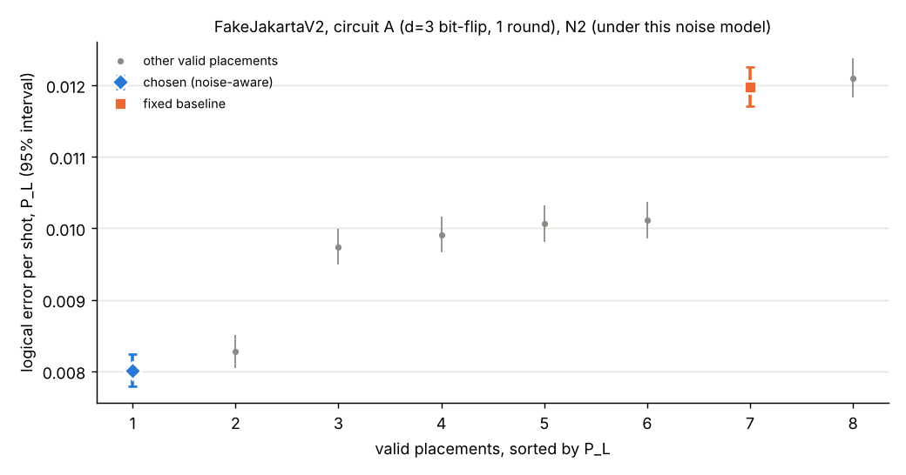

**FakeJakartaV2, circuit A (d=3 bit-flip, 3 rounds).**

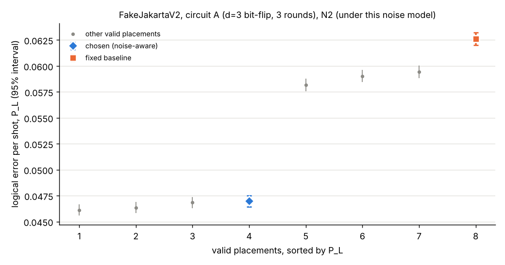

**FakeJakartaV2, circuit A (d=3 bit-flip, 5 rounds).**

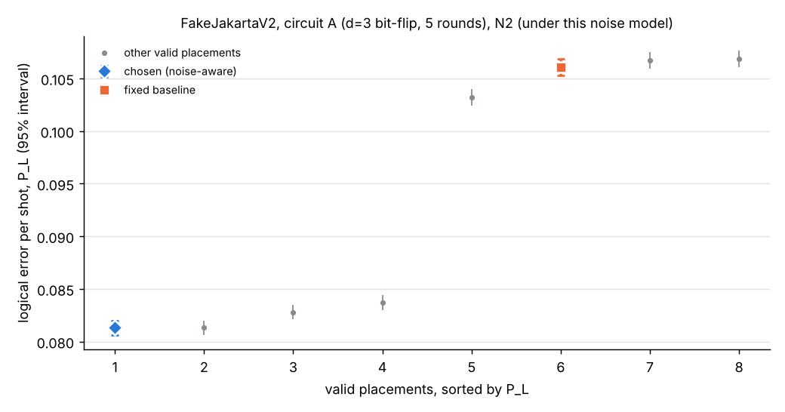

**FakeJakartaV2, circuit B (d=3 phase-flip, 3 rounds).**

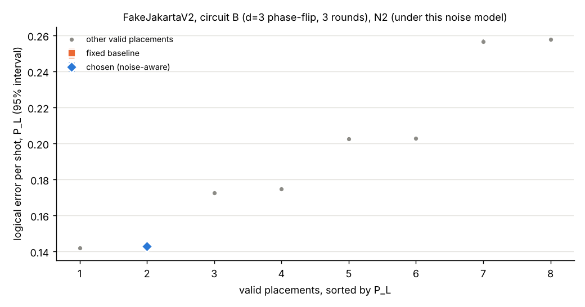

**FakeJakartaV2, circuit C (d=2, 3 rounds; M3 only).**

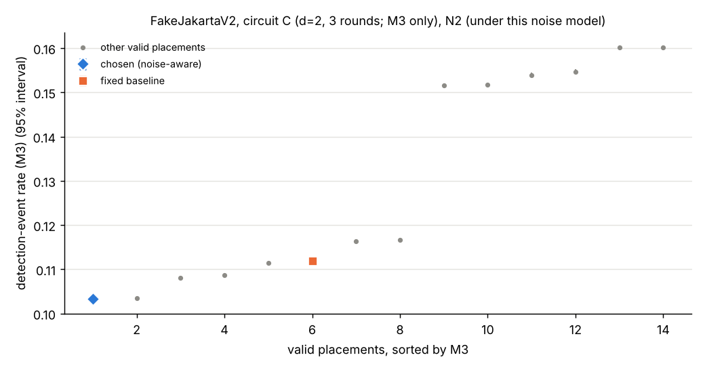

**FakeHanoiV2, circuit A (d=3 bit-flip, 1 round).**

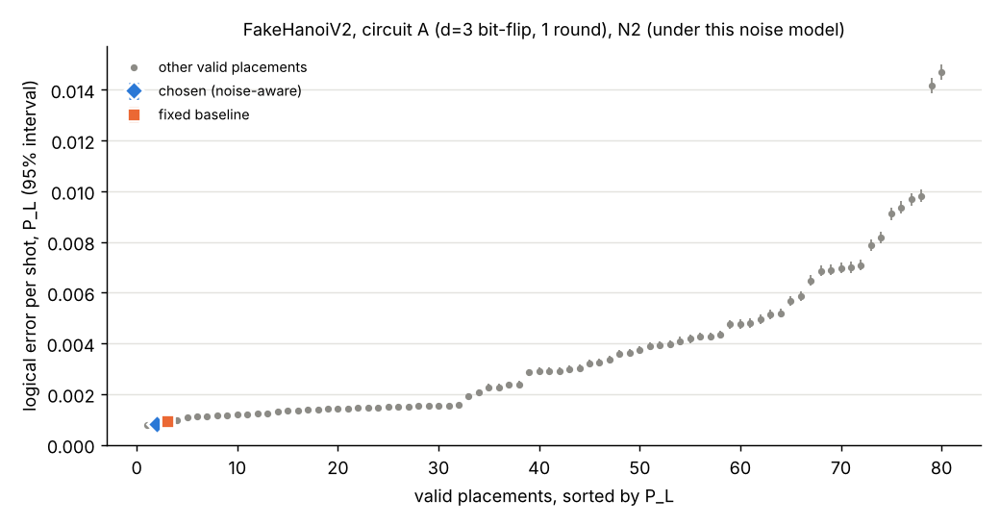

**FakeHanoiV2, circuit A (d=3 bit-flip, 3 rounds).**

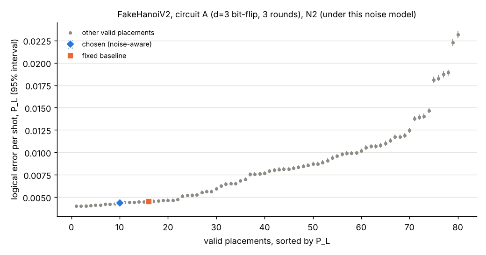

**FakeHanoiV2, circuit A (d=3 bit-flip, 5 rounds).**

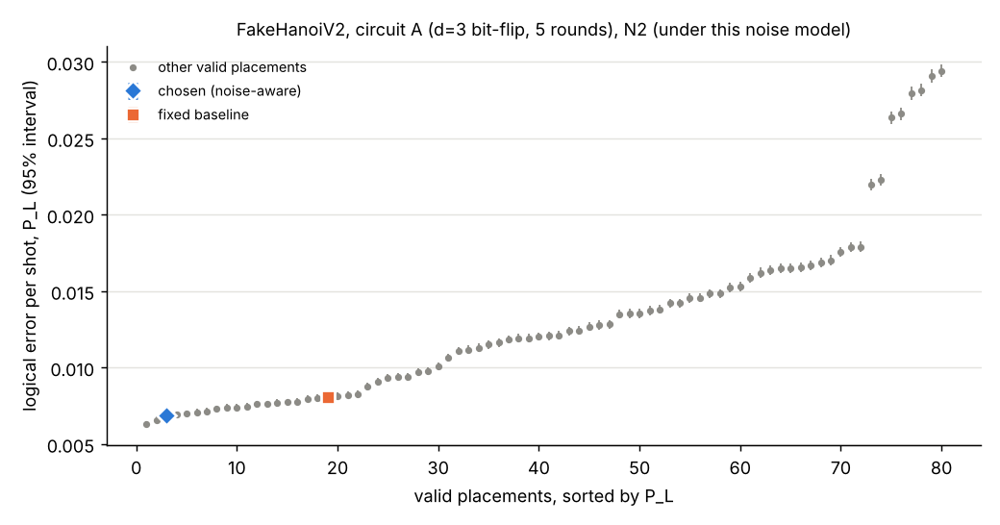

**FakeHanoiV2, circuit B (d=3 phase-flip, 3 rounds).**

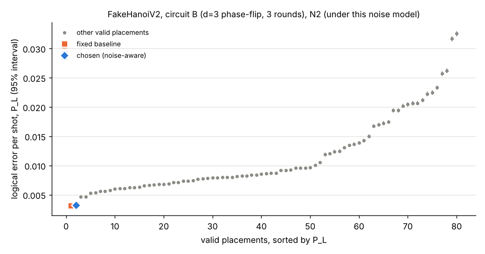

**FakeHanoiV2, circuit D (d=5 bit-flip, 3 rounds).**

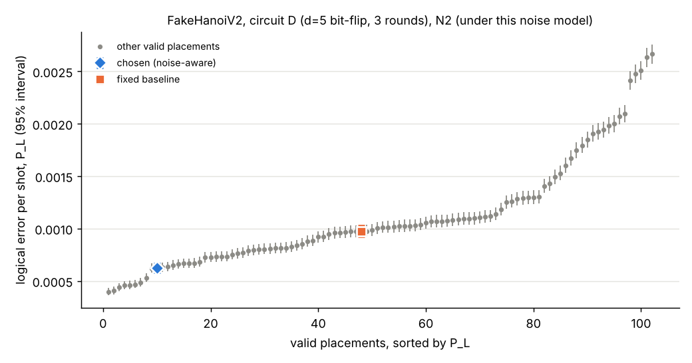

**FakeHanoiV2, circuit D (d=7 bit-flip, 3 rounds).**

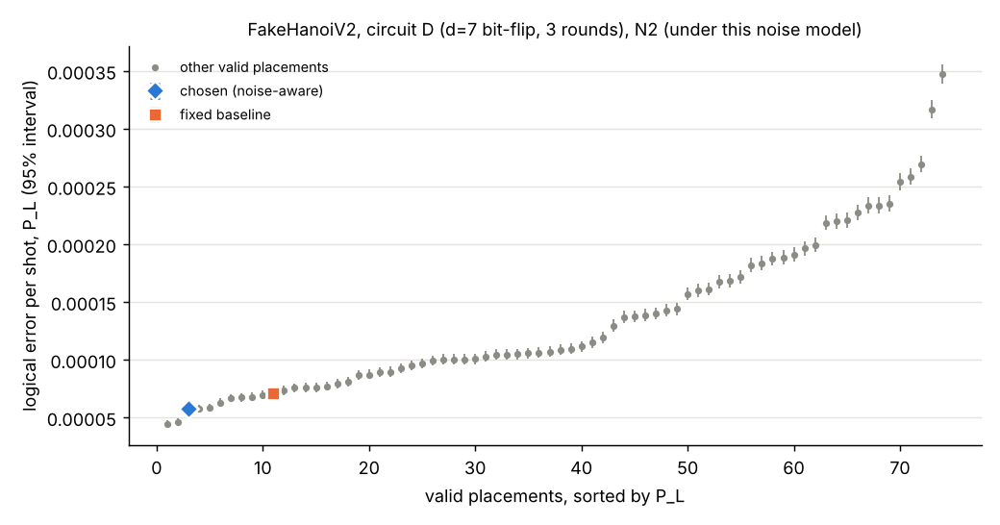

</details>

## 5. Per-round error for circuit A at 1, 3 and 5 rounds

| Device | Rounds | ε chosen | ε fixed | ε average | vs fixed | vs average |
|---|---|---|---|---|---|---|
| FakeJakartaV2 | 1 | 8.01e-03 [7.79e-03, 8.24e-03] | 0.0120 [0.0117, 0.0123] | 0.0100 [9.93e-03, 0.0101] | better (3/3 seeds), pooled: better | better (3/3 seeds), pooled: better |
| FakeJakartaV2 | 3 | 0.0162 [0.0160, 0.0164] | 0.0218 [0.0216, 0.0220] | 0.0184 [0.0183, 0.0185] | better (3/3 seeds), pooled: better | better (3/3 seeds), pooled: better |
| FakeJakartaV2 | 5 | 0.0174 [0.0173, 0.0176] | 0.0233 [0.0231, 0.0235] | 0.0204 [0.0203, 0.0205] | better (3/3 seeds), pooled: better | better (3/3 seeds), pooled: better |
| FakeHanoiV2 | 1 | 8.32e-04 [7.62e-04, 9.08e-04] | 9.48e-04 [8.74e-04, 1.03e-03] | 3.64e-03 [3.63e-03, 3.66e-03] | indistinguishable (3/3 seeds), pooled: indistinguishable | better (3/3 seeds), pooled: better |
| FakeHanoiV2 | 3 | 1.47e-03 [1.42e-03, 1.53e-03] | 1.51e-03 [1.46e-03, 1.57e-03] | 2.83e-03 [2.83e-03, 2.84e-03] | indistinguishable (3/3 seeds), pooled: indistinguishable | better (3/3 seeds), pooled: better |
| FakeHanoiV2 | 5 | 1.38e-03 [1.34e-03, 1.42e-03] | 1.63e-03 [1.58e-03, 1.68e-03] | 2.63e-03 [2.63e-03, 2.64e-03] | better (3/3 seeds), pooled: better | better (3/3 seeds), pooled: better |

This check uses the pooled verdicts. It passes when no two round counts give opposite verdicts for the same comparison; *indistinguishable* next to *better* or *worse* counts as consistent. Whether the verdicts are also identical is shown too.

- FakeJakartaV2: the verdicts (vs fixed / vs average) at 1, 3 and 5 rounds are better/better, better/better and better/better. None are opposite, and all are identical.
- FakeHanoiV2: the verdicts at 1, 3 and 5 rounds are indistinguishable/better, indistinguishable/better and better/better. None are opposite, but they are not identical.

## 6. Gain against code distance on FakeHanoiV2

| Distance | Circuit | Chosen − average Δ P_L [95%] | Relative | Verdict |
|---|---|---|---|---|
| 3 | A3 | -4.06e-03 [-4.22e-03, -3.89e-03] | -48.0% [-50.0%, -46.0%] | better (3/3 seeds), pooled: better |
| 5 | D5 | -4.85e-04 [-5.29e-04, -4.40e-04] | -43.7% [-47.7%, -39.6%] | better (3/3 seeds), pooled: better |
| 7 | D7 | -7.71e-05 [-8.05e-05, -7.37e-05] | -57.3% [-59.8%, -54.8%] | better (3/3 seeds), pooled: better |

The chosen-versus-average difference **shrinks** from distance 3 to 7 in absolute terms. Our rule (decision D10) calls a trend *flat* when all three intervals overlap each other, and otherwise *grows* or *shrinks* by the size of the difference at d=7 relative to d=3.

## 7. Uniform noise (a check that the method finds nothing when there is nothing to find)

Under uniform noise (N1), every placement gets identical noise. We test whether P_L differs across placements with a Pearson chi-square test of homogeneity (a k × 2 table of failures and successes, pooled over seeds), and the check passes when p > 0.01. It passes in all 11 cases.

| Device | Circuit | χ² | dof | p | vs fixed | vs average | Statement |
|---|---|---|---|---|---|---|---|
| FakeJakartaV2 | A1 | 5.56 | 7 | 0.592 | indistinguishable | indistinguishable | **no gain** under N1 |
| FakeJakartaV2 | A3 | 3.13 | 7 | 0.873 | indistinguishable | indistinguishable | **no gain** under N1 |
| FakeJakartaV2 | A5 | 12.74 | 7 | 0.079 | indistinguishable | worse | **no gain** under N1 |
| FakeJakartaV2 | B | 8.75 | 7 | 0.271 | indistinguishable | indistinguishable | **no gain** under N1 |
| FakeJakartaV2 | C | 4.31 | 13 | 0.987 | indistinguishable | indistinguishable | **no gain** under N1 |
| FakeHanoiV2 | A1 | 75.52 | 79 | 0.590 | indistinguishable | indistinguishable | **no gain** under N1 |
| FakeHanoiV2 | A3 | 69.16 | 79 | 0.778 | indistinguishable | indistinguishable | **no gain** under N1 |
| FakeHanoiV2 | A5 | 61.80 | 79 | 0.923 | indistinguishable | indistinguishable | **no gain** under N1 |
| FakeHanoiV2 | B | 76.20 | 79 | 0.568 | indistinguishable | indistinguishable | **no gain** under N1 |
| FakeHanoiV2 | D5 | 111.58 | 101 | 0.222 | indistinguishable | indistinguishable | **no gain** under N1 |
| FakeHanoiV2 | D7 | 88.66 | 73 | 0.102 | indistinguishable | indistinguishable | **no gain** under N1 |

All selection scores are equal under uniform noise, so the tie-break picks the first placement in index order, which is the fixed placement. The chosen placement therefore has no information advantage, and where the homogeneity test finds no difference between placements, we state **no gain** under uniform noise. Any pairwise verdict other than *indistinguishable* in this table would be a chance fluctuation of that single placement: at 95% confidence, about one comparison in twenty separates by chance, and the placement compared was fixed by the tie-break, not selected for its outcome. Such verdicts are reported as computed and not claimed as gains or losses.

## 8. Planted faults

A faulty placement uses the planted qubit (readout error × 5) or runs a CX on the planted connection (CX error × 5, both directions). We recorded the faults in `configs/benchmark.json` before running. The check passes when the chosen placement avoids the fault and its P_L interval is not entirely above any faulty placement's interval. It passes in every case.

| Device | Circuit | Fault | Faulty placements | Chosen avoids | Chosen P_L | Best faulty P_L | Not higher than any faulty |
|---|---|---|---|---|---|---|---|
| FakeJakartaV2 | A1 | qubit 0 | 4 of 8 | yes | 8.63e-03 [8.39e-03, 8.86e-03] | 0.0181 [0.0177, 0.0184] | yes |
| FakeJakartaV2 | A1 | connection (0, 1) | 4 of 8 | yes | 8.63e-03 [8.40e-03, 8.87e-03] | 0.0110 [0.0108, 0.0113] | yes |
| FakeJakartaV2 | A3 | qubit 0 | 4 of 8 | yes | 0.0412 [0.0407, 0.0417] | 0.0497 [0.0492, 0.0503] | yes |
| FakeJakartaV2 | A3 | connection (0, 1) | 4 of 8 | yes | 0.0414 [0.0409, 0.0419] | 0.0563 [0.0557, 0.0569] | yes |
| FakeJakartaV2 | A5 | qubit 0 | 4 of 8 | yes | 0.0728 [0.0721, 0.0735] | 0.0801 [0.0794, 0.0808] | yes |
| FakeJakartaV2 | A5 | connection (0, 1) | 4 of 8 | yes | 0.0727 [0.0720, 0.0733] | 0.0993 [0.0985, 0.1000] | yes |
| FakeJakartaV2 | B | qubit 0 | 4 of 8 | yes | 0.1720 [0.1710, 0.1730] | 0.1825 [0.1815, 0.1834] | yes |
| FakeJakartaV2 | B | connection (0, 1) | 4 of 8 | yes | 0.1708 [0.1698, 0.1718] | 0.1854 [0.1844, 0.1864] | yes |
| FakeJakartaV2 | C | qubit 0 | 4 of 14 | yes | M3 0.1119 [0.1114, 0.1123] | M3 0.1316 [0.1311, 0.1321] | yes (M3) |
| FakeJakartaV2 | C | connection (0, 1) | 4 of 14 | yes | M3 0.1120 [0.1115, 0.1124] | M3 0.1387 [0.1382, 0.1392] | yes (M3) |
| FakeHanoiV2 | A1 | qubit 1 | 16 of 80 | yes | 1.10e-03 [1.02e-03, 1.18e-03] | 1.05e-03 [9.73e-04, 1.14e-03] | yes |
| FakeHanoiV2 | A1 | connection (1, 2) | 10 of 80 | yes | 1.05e-03 [9.70e-04, 1.13e-03] | 1.40e-03 [1.31e-03, 1.50e-03] | yes |
| FakeHanoiV2 | A3 | qubit 1 | 16 of 80 | yes | 4.56e-03 [4.39e-03, 4.74e-03] | 4.32e-03 [4.16e-03, 4.49e-03] | yes |
| FakeHanoiV2 | A3 | connection (1, 2) | 10 of 80 | yes | 4.37e-03 [4.21e-03, 4.54e-03] | 5.93e-03 [5.74e-03, 6.13e-03] | yes |
| FakeHanoiV2 | A5 | qubit 1 | 16 of 80 | yes | 7.67e-03 [7.45e-03, 7.89e-03] | 7.84e-03 [7.62e-03, 8.07e-03] | yes |
| FakeHanoiV2 | A5 | connection (1, 2) | 10 of 80 | yes | 7.47e-03 [7.25e-03, 7.69e-03] | 0.0106 [0.0103, 0.0108] | yes |
| FakeHanoiV2 | B | qubit 1 | 16 of 80 | yes | 4.48e-03 [4.31e-03, 4.65e-03] | 4.45e-03 [4.28e-03, 4.62e-03] | yes |
| FakeHanoiV2 | B | connection (1, 2) | 10 of 80 | yes | 4.56e-03 [4.39e-03, 4.73e-03] | 6.21e-03 [6.01e-03, 6.41e-03] | yes |
| FakeHanoiV2 | D5 | qubit 1 | 30 of 102 | yes | 3.79e-04 [3.55e-04, 4.05e-04] | 3.95e-04 [3.71e-04, 4.21e-04] | yes |
| FakeHanoiV2 | D5 | connection (1, 2) | 16 of 102 | yes | 3.99e-04 [3.74e-04, 4.25e-04] | 4.87e-04 [4.60e-04, 5.16e-04] | yes |
| FakeHanoiV2 | D7 | qubit 1 | 30 of 74 | yes | 3.31e-05 [3.06e-05, 3.58e-05] | 3.28e-05 [3.03e-05, 3.54e-05] | yes |
| FakeHanoiV2 | D7 | connection (1, 2) | 18 of 74 | yes | 3.60e-05 [3.35e-05, 3.88e-05] | 4.37e-05 [4.09e-05, 4.68e-05] | yes |

## 9. Seed consistency and precision

Verdicts recomputed from each base seed's shots alone (vs fixed / vs average). The check passes when no two seeds give opposite verdicts for the same comparison; *indistinguishable* next to *better* or *worse* counts as consistent. *Pooled* is the verdict from all three seeds combined, which the claims rest on. No case has opposite verdicts, and 10 of 11 are identical across seeds.

| Case | Seed 1 | Seed 2 | Seed 3 | Pooled | No opposite verdicts | Identical |
|---|---|---|---|---|---|---|
| jakarta-A1-N2 | better / better | better / better | better / better | better / better | yes | yes |
| jakarta-A3-N2 | better / better | better / better | better / better | better / better | yes | yes |
| jakarta-A5-N2 | better / better | better / better | better / better | better / better | yes | yes |
| jakarta-B-N2 | indistinguishable / better | indistinguishable / better | indistinguishable / better | indistinguishable / better | yes | yes |
| jakarta-C-N2 | better / better | better / better | better / better | better / better | yes | yes |
| hanoi-A1-N2 | indistinguishable / better | indistinguishable / better | indistinguishable / better | indistinguishable / better | yes | yes |
| hanoi-A3-N2 | indistinguishable / better | indistinguishable / better | indistinguishable / better | indistinguishable / better | yes | yes |
| hanoi-A5-N2 | better / better | better / better | better / better | better / better | yes | yes |
| hanoi-B-N2 | indistinguishable / better | indistinguishable / better | indistinguishable / better | indistinguishable / better | yes | yes |
| hanoi-D5-N2 | better / better | better / better | better / better | better / better | yes | yes |
| hanoi-D7-N2 | better / better | indistinguishable / better | better / better | better / better | yes | no |

Precision: under the converted and planted-fault conditions, every placement's Wilson half-width must be at most 10% of its P_L. Every placement meets it.

| Case | Shots per seed | Placements meeting the target |
|---|---|---|
| jakarta-A1-N2 | 200,000 | 8 of 8 |
| jakarta-A1-N3-qubit | 200,000 | 8 of 8 |
| jakarta-A1-N3-connection | 200,000 | 8 of 8 |
| jakarta-A3-N2 | 200,000 | 8 of 8 |
| jakarta-A3-N3-qubit | 200,000 | 8 of 8 |
| jakarta-A3-N3-connection | 200,000 | 8 of 8 |
| jakarta-A5-N2 | 200,000 | 8 of 8 |
| jakarta-A5-N3-qubit | 200,000 | 8 of 8 |
| jakarta-A5-N3-connection | 200,000 | 8 of 8 |
| jakarta-B-N2 | 200,000 | 8 of 8 |
| jakarta-B-N3-qubit | 200,000 | 8 of 8 |
| jakarta-B-N3-connection | 200,000 | 8 of 8 |
| jakarta-C-N2 | 200,000 | 14 of 14 |
| jakarta-C-N3-qubit | 200,000 | 14 of 14 |
| jakarta-C-N3-connection | 200,000 | 14 of 14 |
| hanoi-A1-N2 | 200,000 | 80 of 80 |
| hanoi-A1-N3-qubit | 200,000 | 80 of 80 |
| hanoi-A1-N3-connection | 200,000 | 80 of 80 |
| hanoi-A3-N2 | 200,000 | 80 of 80 |
| hanoi-A3-N3-qubit | 200,000 | 80 of 80 |
| hanoi-A3-N3-connection | 200,000 | 80 of 80 |
| hanoi-A5-N2 | 200,000 | 80 of 80 |
| hanoi-A5-N3-qubit | 200,000 | 80 of 80 |
| hanoi-A5-N3-connection | 200,000 | 80 of 80 |
| hanoi-B-N2 | 200,000 | 80 of 80 |
| hanoi-B-N3-qubit | 200,000 | 80 of 80 |
| hanoi-B-N3-connection | 200,000 | 80 of 80 |
| hanoi-D5-N2 | 400,000 | 102 of 102 |
| hanoi-D5-N3-qubit | 800,000 | 102 of 102 |
| hanoi-D5-N3-connection | 800,000 | 102 of 102 |
| hanoi-D7-N2 | 6,400,000 | 74 of 74 |
| hanoi-D7-N3-qubit | 6,400,000 | 74 of 74 |
| hanoi-D7-N3-connection | 6,400,000 | 74 of 74 |

## 10. Sensitivity to our modelling assumptions

We reran each main case end to end (selection and evaluation) four ways: with every CX duration set to the device minimum; set to the device maximum; with reset error equal to each qubit's readout error; and with every coupler the converter removed put back, in both directions, at the CX rule applied to its better direction's error. The last variant changes the set of valid placements, so its fixed placement and average come from that larger set; on a device with no removed coupler it equals the main run. *Holds* means the verdict equals the main one.

The CX-duration variants change no verdict. Reset = readout changes FakeHanoiV2 A3 and A5, and restoring the removed couplers changes FakeHanoiV2 A3.

| Device | Circuit | Variant | Chosen | vs fixed | vs average | Verdicts hold |
|---|---|---|---|---|---|---|
| FakeJakartaV2 | A1 | CX duration = device minimum | (6,5,3,1,2) | better (3/3 seeds), pooled: **better**; *gain*; Δ -3.91e-03 [-4.27e-03, -3.55e-03]; rel -32.4% [-34.8%, -29.9%] | better (3/3 seeds), pooled: **better**; *gain*; Δ -1.76e-03 [-1.98e-03, -1.54e-03]; rel -17.8% [-19.9%, -15.6%] | yes |
| FakeJakartaV2 | A1 | CX duration = device maximum | (6,5,3,1,2) | better (3/3 seeds), pooled: **better**; *gain*; Δ -3.66e-03 [-4.02e-03, -3.30e-03]; rel -30.3% [-32.7%, -27.8%] | better (3/3 seeds), pooled: **better**; *gain*; Δ -1.77e-03 [-1.99e-03, -1.55e-03]; rel -17.4% [-19.5%, -15.2%] | yes |
| FakeJakartaV2 | A1 | reset error = readout error | (6,5,3,1,2) | better (3/3 seeds), pooled: **better**; *gain*; Δ -7.91e-03 [-8.41e-03, -7.42e-03]; rel -33.6% [-35.3%, -31.9%] | better (3/3 seeds), pooled: **better**; *gain*; Δ -3.74e-03 [-4.04e-03, -3.44e-03]; rel -19.3% [-20.8%, -17.8%] | yes |
| FakeJakartaV2 | A1 | removed couplers restored at their better direction's error | (6,5,3,1,2) | better (3/3 seeds), pooled: **better**; *gain*; Δ -3.83e-03 [-4.19e-03, -3.47e-03]; rel -31.6% [-34.0%, -29.1%] | better (3/3 seeds), pooled: **better**; *gain*; Δ -1.73e-03 [-1.95e-03, -1.52e-03]; rel -17.3% [-19.4%, -15.1%] | yes |
| FakeJakartaV2 | A3 | CX duration = device minimum | (6,5,3,1,2) | better (3/3 seeds), pooled: **better**; *gain*; Δ -0.0157 [-0.0165, -0.0149]; rel -25.3% [-26.4%, -24.1%] | better (3/3 seeds), pooled: **better**; *gain*; Δ -6.34e-03 [-6.85e-03, -5.84e-03]; rel -12.0% [-13.0%, -11.1%] | yes |
| FakeJakartaV2 | A3 | CX duration = device maximum | (6,5,3,1,2) | better (3/3 seeds), pooled: **better**; *gain*; Δ -0.0151 [-0.0159, -0.0143]; rel -24.0% [-25.1%, -22.8%] | better (3/3 seeds), pooled: **better**; *gain*; Δ -6.19e-03 [-6.70e-03, -5.68e-03]; rel -11.5% [-12.4%, -10.5%] | yes |
| FakeJakartaV2 | A3 | reset error = readout error | (6,5,3,1,2) | better (3/3 seeds), pooled: **better**; *gain*; Δ -0.0183 [-0.0192, -0.0174]; rel -23.8% [-24.9%, -22.8%] | better (3/3 seeds), pooled: **better**; *gain*; Δ -7.89e-03 [-8.45e-03, -7.33e-03]; rel -11.9% [-12.7%, -11.0%] | yes |
| FakeJakartaV2 | A3 | removed couplers restored at their better direction's error | (6,5,3,1,2) | better (3/3 seeds), pooled: **better**; *gain*; Δ -0.0155 [-0.0163, -0.0147]; rel -24.8% [-25.9%, -23.7%] | better (3/3 seeds), pooled: **better**; *gain*; Δ -6.49e-03 [-6.99e-03, -5.98e-03]; rel -12.2% [-13.1%, -11.2%] | yes |
| FakeJakartaV2 | A5 | CX duration = device minimum | (2,1,3,5,4) | better (3/3 seeds), pooled: **better**; *gain*; Δ -0.0254 [-0.0264, -0.0244]; rel -24.1% [-24.9%, -23.2%] | better (3/3 seeds), pooled: **better**; *gain*; Δ -0.0133 [-0.0140, -0.0127]; rel -14.3% [-15.0%, -13.6%] | yes |
| FakeJakartaV2 | A5 | CX duration = device maximum | (2,1,3,5,4) | better (3/3 seeds), pooled: **better**; *gain*; Δ -0.0238 [-0.0249, -0.0228]; rel -22.3% [-23.2%, -21.5%] | better (3/3 seeds), pooled: **better**; *gain*; Δ -0.0122 [-0.0128, -0.0115]; rel -12.8% [-13.5%, -12.1%] | yes |
| FakeJakartaV2 | A5 | reset error = readout error | (6,5,3,1,2) | better (3/3 seeds), pooled: **better**; *gain*; Δ -0.0231 [-0.0242, -0.0220]; rel -18.9% [-19.7%, -18.0%] | better (3/3 seeds), pooled: **better**; *gain*; Δ -0.0105 [-0.0112, -9.78e-03]; rel -9.6% [-10.2%, -8.9%] | yes |
| FakeJakartaV2 | A5 | removed couplers restored at their better direction's error | (2,1,3,5,4) | better (3/3 seeds), pooled: **better**; *gain*; Δ -0.0255 [-0.0266, -0.0245]; rel -24.0% [-24.8%, -23.1%] | better (3/3 seeds), pooled: **better**; *gain*; Δ -0.0130 [-0.0136, -0.0123]; rel -13.8% [-14.5%, -13.1%] | yes |
| FakeJakartaV2 | B | CX duration = device minimum | (0,1,3,5,4) | indistinguishable (3/3 seeds), pooled: **indistinguishable**; *no gain shown*; Δ 0 [-1.25e-03, 1.25e-03]; rel +0.0% [-0.9%, +0.9%] | better (3/3 seeds), pooled: **better**; *gain*; Δ -0.0510 [-0.0518, -0.0501]; rel -26.4% [-26.8%, -26.0%] | yes |
| FakeJakartaV2 | B | CX duration = device maximum | (0,1,3,5,4) | indistinguishable (3/3 seeds), pooled: **indistinguishable**; *no gain shown*; Δ 0 [-1.26e-03, 1.26e-03]; rel +0.0% [-0.9%, +0.9%] | better (3/3 seeds), pooled: **better**; *gain*; Δ -0.0521 [-0.0530, -0.0513]; rel -26.6% [-27.0%, -26.2%] | yes |
| FakeJakartaV2 | B | reset error = readout error | (0,1,3,5,4) | indistinguishable (3/3 seeds), pooled: **indistinguishable**; *no gain shown*; Δ 0 [-1.30e-03, 1.30e-03]; rel +0.0% [-0.8%, +0.8%] | better (3/3 seeds), pooled: **better**; *gain*; Δ -0.0621 [-0.0630, -0.0612]; rel -28.6% [-29.0%, -28.2%] | yes |
| FakeJakartaV2 | B | removed couplers restored at their better direction's error | (0,1,3,5,4) | indistinguishable (3/3 seeds), pooled: **indistinguishable**; *no gain shown*; Δ 0 [-1.25e-03, 1.25e-03]; rel +0.0% [-0.9%, +0.9%] | better (3/3 seeds), pooled: **better**; *gain*; Δ -0.0516 [-0.0525, -0.0508]; rel -26.6% [-27.1%, -26.2%] | yes |
| FakeJakartaV2 | C | CX duration = device minimum | (3,1,2) | better (3/3 seeds), pooled: **better**; *gain*; Δ -7.74e-03 [-8.36e-03, -7.12e-03]; rel -7.0% [-7.5%, -6.4%] | better (3/3 seeds), pooled: **better**; *gain*; Δ -0.0257 [-0.0261, -0.0253]; rel -20.0% [-20.3%, -19.6%] | yes |
| FakeJakartaV2 | C | CX duration = device maximum | (3,1,2) | better (3/3 seeds), pooled: **better**; *gain*; Δ -8.00e-03 [-8.62e-03, -7.38e-03]; rel -7.1% [-7.7%, -6.6%] | better (3/3 seeds), pooled: **better**; *gain*; Δ -0.0256 [-0.0261, -0.0252]; rel -19.7% [-20.0%, -19.4%] | yes |
| FakeJakartaV2 | C | reset error = readout error | (3,1,2) | better (3/3 seeds), pooled: **better**; *gain*; Δ -5.76e-03 [-6.47e-03, -5.05e-03]; rel -4.1% [-4.6%, -3.6%] | better (3/3 seeds), pooled: **better**; *gain*; Δ -0.0414 [-0.0419, -0.0409]; rel -23.3% [-23.6%, -23.0%] | yes |
| FakeJakartaV2 | C | removed couplers restored at their better direction's error | (3,1,2) | better (3/3 seeds), pooled: **better**; *gain*; Δ -8.25e-03 [-8.87e-03, -7.63e-03]; rel -7.4% [-7.9%, -6.8%] | better (3/3 seeds), pooled: **better**; *gain*; Δ -0.0260 [-0.0264, -0.0256]; rel -20.1% [-20.4%, -19.8%] | yes |
| FakeHanoiV2 | A1 | CX duration = device minimum | (5,3,2,1,4) | indistinguishable (3/3 seeds), pooled: **indistinguishable**; *no gain shown*; Δ -5.17e-05 [-1.59e-04, 5.56e-05]; rel -5.6% [-16.2%, +6.4%] | better (3/3 seeds), pooled: **better**; *gain*; Δ -2.69e-03 [-2.76e-03, -2.61e-03]; rel -75.5% [-77.6%, -73.4%] | yes |
| FakeHanoiV2 | A1 | CX duration = device maximum | (5,3,2,1,4) | indistinguishable (3/3 seeds), pooled: **indistinguishable**; *no gain shown*; Δ -5.50e-05 [-1.66e-04, 5.59e-05]; rel -5.6% [-15.9%, +6.0%] | better (3/3 seeds), pooled: **better**; *gain*; Δ -2.91e-03 [-2.98e-03, -2.83e-03]; rel -75.7% [-77.7%, -73.7%] | yes |
| FakeHanoiV2 | A1 | reset error = readout error | (5,3,2,1,4) | indistinguishable (3/3 seeds), pooled: **indistinguishable**; *no gain shown*; Δ 5.83e-05 [-9.01e-05, 2.07e-04]; rel +3.4% [-5.1%, +12.8%] | better (3/3 seeds), pooled: **better**; *gain*; Δ -6.62e-03 [-6.73e-03, -6.51e-03]; rel -79.1% [-80.4%, -77.8%] | yes |
| FakeHanoiV2 | A1 | removed couplers restored at their better direction's error | (5,3,2,1,4) | indistinguishable (3/3 seeds), pooled: **indistinguishable**; *no gain shown*; Δ -2.50e-05 [-1.33e-04, 8.34e-05]; rel -2.7% [-13.5%, +9.5%] | better (3/3 seeds), pooled: **better**; *gain*; Δ -2.45e-03 [-2.53e-03, -2.38e-03]; rel -73.1% [-75.4%, -70.8%] | yes |
| FakeHanoiV2 | A3 | CX duration = device minimum | (16,19,22,25,26) | indistinguishable (3/3 seeds), pooled: **indistinguishable**; *no gain shown*; Δ -2.45e-04 [-4.79e-04, -1.15e-05]; rel -5.6% [-10.6%, -0.3%] | better (3/3 seeds), pooled: **better**; *gain*; Δ -3.91e-03 [-4.08e-03, -3.75e-03]; rel -48.5% [-50.5%, -46.5%] | yes |
| FakeHanoiV2 | A3 | CX duration = device maximum | (16,19,22,25,26) | indistinguishable (3/3 seeds), pooled: **indistinguishable**; *no gain shown*; Δ 1.28e-04 [-1.23e-04, 3.79e-04]; rel +2.6% [-2.5%, +8.0%] | better (3/3 seeds), pooled: **better**; *gain*; Δ -4.11e-03 [-4.29e-03, -3.93e-03]; rel -45.1% [-47.1%, -43.2%] | yes |
| FakeHanoiV2 | A3 | reset error = readout error | (16,19,22,25,26) | worse (1/3 seeds), pooled: **worse**; *loss, weak evidence*; Δ 6.43e-04 [3.67e-04, 9.20e-04]; rel +11.4% [+6.3%, +16.6%] | better (3/3 seeds), pooled: **better**; *gain*; Δ -7.22e-03 [-7.42e-03, -7.02e-03]; rel -53.4% [-54.8%, -51.9%] | **no** |
| FakeHanoiV2 | A3 | removed couplers restored at their better direction's error | (20,19,22,25,26) | better (3/3 seeds), pooled: **better**; *gain*; Δ -9.57e-04 [-1.18e-03, -7.31e-04]; rel -21.3% [-25.7%, -16.7%] | better (3/3 seeds), pooled: **better**; *gain*; Δ -4.60e-03 [-4.75e-03, -4.45e-03]; rel -56.6% [-58.4%, -54.7%] | **no** |
| FakeHanoiV2 | A5 | CX duration = device minimum | (16,19,22,25,26) | better (1/3 seeds), pooled: **better**; *gain, weak evidence*; Δ -5.73e-04 [-8.82e-04, -2.65e-04]; rel -7.4% [-11.1%, -3.5%] | better (3/3 seeds), pooled: **better**; *gain*; Δ -5.12e-03 [-5.34e-03, -4.91e-03]; rel -41.6% [-43.3%, -39.8%] | yes |
| FakeHanoiV2 | A5 | CX duration = device maximum | (10,7,4,1,0) | better (3/3 seeds), pooled: **better**; *gain*; Δ -1.59e-03 [-1.91e-03, -1.27e-03]; rel -17.9% [-21.1%, -14.6%] | better (3/3 seeds), pooled: **better**; *gain*; Δ -6.83e-03 [-7.05e-03, -6.62e-03]; rel -48.4% [-49.9%, -46.9%] | yes |
| FakeHanoiV2 | A5 | reset error = readout error | (16,19,22,25,26) | worse (0/3 seeds), pooled: **worse**; *loss, weak evidence*; Δ 5.70e-04 [2.16e-04, 9.24e-04]; rel +6.0% [+2.2%, +9.8%] | better (3/3 seeds), pooled: **better**; *gain*; Δ -8.53e-03 [-8.78e-03, -8.28e-03]; rel -45.7% [-47.0%, -44.3%] | **no** |
| FakeHanoiV2 | A5 | removed couplers restored at their better direction's error | (20,19,22,25,26) | better (3/3 seeds), pooled: **better**; *gain*; Δ -1.37e-03 [-1.68e-03, -1.06e-03]; rel -16.6% [-20.0%, -13.1%] | better (3/3 seeds), pooled: **better**; *gain*; Δ -5.84e-03 [-6.05e-03, -5.63e-03]; rel -45.9% [-47.6%, -44.3%] | yes |
| FakeHanoiV2 | B | CX duration = device minimum | (5,3,2,1,0) | indistinguishable (3/3 seeds), pooled: **indistinguishable**; *no gain shown*; Δ -8.33e-05 [-2.83e-04, 1.16e-04]; rel -2.6% [-8.7%, +3.8%] | better (3/3 seeds), pooled: **better**; *gain*; Δ -7.72e-03 [-7.86e-03, -7.58e-03]; rel -71.5% [-72.8%, -70.2%] | yes |
| FakeHanoiV2 | B | CX duration = device maximum | (5,3,2,1,0) | indistinguishable (3/3 seeds), pooled: **indistinguishable**; *no gain shown*; Δ 1.78e-04 [-3.19e-05, 3.89e-04]; rel +5.3% [-0.9%, +11.9%] | better (3/3 seeds), pooled: **better**; *gain*; Δ -8.88e-03 [-9.03e-03, -8.73e-03]; rel -71.4% [-72.6%, -70.2%] | yes |
| FakeHanoiV2 | B | reset error = readout error | (5,3,2,1,0) | indistinguishable (3/3 seeds), pooled: **indistinguishable**; *no gain shown*; Δ 2.37e-04 [1.11e-05, 4.62e-04]; rel +6.1% [+0.3%, +12.3%] | better (3/3 seeds), pooled: **better**; *gain*; Δ -0.0131 [-0.0133, -0.0129]; rel -76.1% [-77.1%, -75.2%] | yes |
| FakeHanoiV2 | B | removed couplers restored at their better direction's error | (5,3,2,1,0) | indistinguishable (3/3 seeds), pooled: **indistinguishable**; *no gain shown*; Δ 1.37e-04 [-6.67e-05, 3.40e-04]; rel +4.3% [-2.0%, +11.1%] | better (3/3 seeds), pooled: **better**; *gain*; Δ -7.36e-03 [-7.51e-03, -7.22e-03]; rel -69.0% [-70.4%, -67.7%] | yes |
| FakeHanoiV2 | D5 | CX duration = device minimum | (9,8,11,14,16,19,22,25,26) | better (3/3 seeds), pooled: **better**; *gain*; Δ -3.51e-04 [-4.21e-04, -2.81e-04]; rel -37.2% [-42.8%, -31.0%] | better (3/3 seeds), pooled: **better**; *gain*; Δ -4.71e-04 [-5.15e-04, -4.28e-04]; rel -44.3% [-48.4%, -40.3%] | yes |
| FakeHanoiV2 | D5 | CX duration = device maximum | (9,8,11,14,16,19,22,25,26) | better (3/3 seeds), pooled: **better**; *gain*; Δ -3.71e-04 [-4.45e-04, -2.97e-04]; rel -35.9% [-41.3%, -29.9%] | better (3/3 seeds), pooled: **better**; *gain*; Δ -5.15e-04 [-5.61e-04, -4.69e-04]; rel -43.7% [-47.6%, -39.8%] | yes |
| FakeHanoiV2 | D5 | reset error = readout error | (9,8,11,14,16,19,22,25,26) | better (3/3 seeds), pooled: **better**; *gain*; Δ -5.27e-04 [-6.62e-04, -3.92e-04]; rel -31.1% [-37.5%, -24.2%] | better (3/3 seeds), pooled: **better**; *gain*; Δ -8.96e-04 [-9.82e-04, -8.10e-04]; rel -43.5% [-47.6%, -39.3%] | yes |
| FakeHanoiV2 | D5 | removed couplers restored at their better direction's error | (9,8,5,3,2,1,4,7,10) | better (3/3 seeds), pooled: **better**; *gain*; Δ -5.27e-04 [-5.97e-04, -4.59e-04]; rel -52.1% [-56.6%, -47.1%] | better (3/3 seeds), pooled: **better**; *gain*; Δ -5.64e-04 [-6.03e-04, -5.24e-04]; rel -53.7% [-57.5%, -50.0%] | yes |
| FakeHanoiV2 | D7 | CX duration = device minimum | (0,1,4,7,10,12,13,14,16,19,22,25,26) | better (2/3 seeds), pooled: **better**; *gain, weak evidence*; Δ -1.84e-05 [-2.56e-05, -1.14e-05]; rel -25.6% [-33.6%, -16.6%] | better (3/3 seeds), pooled: **better**; *gain*; Δ -7.74e-05 [-8.20e-05, -7.28e-05]; rel -59.1% [-62.6%, -55.5%] | yes |
| FakeHanoiV2 | D7 | CX duration = device maximum | (26,25,22,19,16,14,13,12,10,7,4,1,0) | better (1/3 seeds), pooled: **better**; *gain, weak evidence*; Δ -1.15e-05 [-1.88e-05, -4.13e-06]; rel -15.7% [-24.5%, -6.0%] | better (3/3 seeds), pooled: **better**; *gain*; Δ -8.21e-05 [-8.71e-05, -7.71e-05]; rel -57.2% [-60.6%, -53.7%] | yes |
| FakeHanoiV2 | D7 | reset error = readout error | (0,1,4,7,10,12,13,14,16,19,22,25,26) | better (0/3 seeds), pooled: **better**; *gain, weak evidence*; Δ -2.83e-05 [-4.28e-05, -1.39e-05]; rel -19.6% [-28.1%, -10.1%] | better (3/3 seeds), pooled: **better**; *gain*; Δ -1.85e-04 [-1.95e-04, -1.76e-04]; rel -61.5% [-64.7%, -58.3%] | yes |
| FakeHanoiV2 | D7 | removed couplers restored at their better direction's error | (26,25,22,19,16,14,11,8,5,3,2,1,4) | better (3/3 seeds), pooled: **better**; *gain*; Δ -4.07e-05 [-4.62e-05, -3.52e-05]; rel -42.3% [-46.5%, -37.8%] | better (3/3 seeds), pooled: **better**; *gain*; Δ -6.84e-05 [-7.18e-05, -6.51e-05]; rel -55.2% [-57.9%, -52.5%] | yes |

## 11. Limitations

- **This noise model only.** Both devices are `qiskit-ibm-runtime` 0.50.0 fake-backend snapshots, converted by fixed rules into a Pauli model. We ran no hardware, and nothing here is a claim about hardware.
- **K1, approximate decoder model.** Nove's `Experiment.to_detector_model()` raises a raw Stim `ValueError` when calibrated two-qubit noise has more than one non-zero Pauli term, so no exact detector error model exists for these experiments. The decoder and the selection score use Stim's `approximate_disjoint_errors` model, so decoding is not matched exactly to the simulated noise.
- **K2, CX timing per gate name.** Nove sets durations per gate name, not per qubit pair, so the per-pair CX duration differences (235 to 540 ns on FakeJakartaV2, 181 to 729 ns on FakeHanoiV2) are replaced by the device mean. Section 10 brackets this with the device minimum and maximum.
- **K3, symmetric readout.** Nove's readout error is symmetric, so the snapshots' two readout directions (`prob_meas0_prep1` and `prob_meas1_prep0`) are represented by their average, `readout_error`.
- **K4, directional gate noise.** CX(a,b) and CX(b,a) are separate entries with their own calibrated error. Circuit B uses CX from ancilla to data (the reverse of circuit A), so it meets the opposite-direction entries.
- **K5, idle noise up to the highest index.** Nove applies idle noise to every qubit index up to the highest one used, including unused qubits. This does not change P_L (unused qubits are never measured), but the lowered circuits differ in size between placements.
- **K6, Pauli approximation.** The noise is a stochastic Pauli-channel approximation. Coherent errors, crosstalk, leakage and drift are not modelled.
- **K7, snapshot dates.** The FakeJakartaV2 snapshot is dated 2024-05-27, after ibmq_jakarta was retired on 2023-09-26; the FakeHanoiV2 snapshot is dated 2025-02-26. Both are realistic noise profiles, not live-device measurements.
- **K8, no surface code.** Neither device has a qubit with more than 3 neighbours, so no surface code fits without SWAPs, and v1 covers repetition codes only.
- **Removed couplers.** The CX rule (1.25·e/15 per term) is a Pauli channel only for e ≤ 0.8. On FakeHanoiV2, CX(19,20) and CX(5,8) report a gate error of 1 while their reverse directions report 0.0044 and 0.0090 (every other pair reports the same value in both directions), which reads as a failed calibration. We remove both pairs in both directions, so FakeHanoiV2 has 80, 102 and 74 valid placements at distance 3, 5 and 7 instead of 100, 164 and 178, and its mean CX duration comes from the remaining pairs. Our first version capped these entries at 1/15 per term instead, which left one perfect and one always-failing direction per pair and inflated our FakeHanoiV2 gains. Section 10 reruns the main cases with the pairs restored at their better direction's error.
- **Negative idle Z rate.** Five FakeHanoiV2 qubits (2, 5, 10, 11 and 13) have T2 > 2·T1, for which the rule gives a negative Z idle rate that Nove rejects, so we clamp it to 0. This is a reported departure from the conversion rules, not a silent change.
- **Reset error is 0 in the main runs,** because the snapshots carry no reset error. Section 10 reruns the main cases with reset error equal to readout error.
- **The selection score is a heuristic.** It is the expected number of detector-visible faults per shot, which ignores how faults combine into logical errors; M4 measures how well it orders placements.

## 12. Provenance and compute

- Nove 0.1.0, commit `485b413dfc0a61683b835c7874507a40cbb687cf`; Stim 1.16.0; PyMatching 2.4.0; device files from qiskit-ibm-runtime 0.50.0 (not installed at runtime).
- FakeJakartaV2: source files `conf_jakarta.json` 15b25bc0c7fdf72a…, `props_jakarta.json` 29a90998e66c9558…; calibration snapshot `4345667cf8c9281d…`. Full hashes are in every results file.
- FakeHanoiV2: source files `conf_hanoi.json` 9345ac086f406de1…, `props_hanoi.json` 17db2080056d895f…; calibration snapshot `d77b31ce6f3f9111…`.
- 93 results files in `benchmarks/results/runs/`, one per run.
- Total compute (the sum of per-run wall-clock times): 0.48 hours (1,734 s) on 4 worker processes.
- Total simulated shots: 12,508,800,000.
- The benchmark config and fixed baseline were first committed in `ebe12aec3a390a29a4fe26a71248822f99ed8437` at 2026-10-10T20:15:23+00:00.

To reproduce, run from `benchmarks/`:

```bash
python -m noise_aware_compilation.benchmark configs/benchmark.json
python -m noise_aware_compilation.report
```
