# v2 report: a better score and real competitors

In v2 we asked three questions. Does noise-aware placement still help when it chooses with stale calibration data? Does it beat the placement methods people already use? And does our new decoder-graph score choose better than the v1 score on a device it was never developed on?

Everything here is simulation: IBM's converted calibration snapshots, simulated with Nove's Pauli-channel noise and decoded with PyMatching. None of it is a claim about hardware. We developed the decoder-graph score on FakeJakartaV2 and FakeHanoiV2, so their results are development results, and fresh seeds do not make them an independent test. FakeAlgiers was the held-out test.

This page is a rewrite, for readability, of the report our script generated at the time. The original is kept unchanged at tag [`v3.0-results`](https://github.com/KUQCI/noise-aware-compilation/blob/v3.0-results/REPORT_V2.md), and every number here comes from it. We have dropped its appendix listing every placement; those numbers are in the original and in the run files under `benchmarks/results_v2/runs/`.

> **What we know now.** Later work qualifies four findings in this report.
>
> 1. On FakeAlgiers with reset error equal to readout error, the decoder-graph score beats the fixed placement in 4 of 4 cases, but beats lowest summed error, Qiskit and mapomatic in only 1 of 4 after Holm's correction. Of the other three, d=5 is better by its interval but not after Holm (p = 0.16), and two are ties ([reset study](RESET.md), section 1).
> 2. The largest held-out gain, −40.5% [−46.3%, −34.2%] against the fixed placement on FakeAlgiers d=7, is a single case, and Qiskit (levels 1 and 2) and mapomatic pick the same placement there ([re-analysis](REANALYSIS.md)). There the decoder-graph score and summed error chose the same qubits in mirror order, and our mirror check on FakeHanoi d=7 showed that such gaps follow the gate order, not the qubits (re-analysis, section 8).
> 3. The "Qiskit VF2Layout" baseline picks lowest summed error's placement in 9 of 10 cases, so it is close to a second copy of that baseline, not an independent Qiskit comparison.
> 4. Making the decoder-graph score the default (section 4) rests on the d=7 case: the R-G7 difference is −0.059 [−0.105, −0.013] with it and −0.016 [−0.060, +0.027] without it.
>
> The v1 overlap rule used below is also too strict: with an interval for the difference, 3 of v2's comparisons change from indistinguishable to better (re-analysis, section 1). v3 tested the score again on unseen devices ([REPORT_V3.md](REPORT_V3.md)).

**How verdicts work here.** We followed v1's rules. A result is *better* or *worse* only when the 95% intervals do not overlap, computed from all three seeds' shots pooled, with the per-seed tally beside it. We claim a gain only for a pooled *better*, and label it *weak evidence* when not every seed shows it.

## Summary

**1. Does placement still help with stale calibration?** (Section 3, development devices.) Mostly, at mild drift. We perturbed every calibration value with random noise of strength δ and let each method choose on the perturbed model, then graded the choice under the true one. M6 is the share of the original gain kept, and M7 counts the draws (out of 20) whose choice is worse than the fixed placement.

| Method | Cases where its δ = 0 choice beat fixed | Mean kept gain M6 at δ = 0.5 [95%] | Draws worse than fixed (M7) at δ = 0.5 (δ = 0) |
| --- | --- | --- | --- |
| v1 score | 2 of 6 | FakeJakartaV2 A 0.9574 [0.8237, 1.06]<br>FakeHanoiV2 D5 0.8587 [0.6801, 1.04] | FakeJakartaV2 A 0/20 (0/20)<br>FakeJakartaV2 B 6/20 (0/20)<br>FakeHanoiV2 A 5/20 (0/20)<br>FakeHanoiV2 B 10/20 (0/20)<br>FakeHanoiV2 D5 0/20 (0/20)<br>FakeHanoiV2 D7 4/20 (0/20) |
| decoder-graph score | 4 of 6 | FakeJakartaV2 A 0.9322 [0.8014, 1.03]<br>FakeHanoiV2 A 0.3514 [-6.75e-03, 0.6454]<br>FakeHanoiV2 D5 0.7491 [0.5523, 0.9083]<br>FakeHanoiV2 D7 0.1659 [-0.4645, 0.5719] | FakeJakartaV2 A 0/20 (0/20)<br>FakeJakartaV2 B 6/20 (0/20)<br>FakeHanoiV2 A 1/20 (0/20)<br>FakeHanoiV2 B 8/20 (0/20)<br>FakeHanoiV2 D5 2/20 (0/20)<br>FakeHanoiV2 D7 3/20 (0/20) |
| lowest summed error | 3 of 6 | FakeJakartaV2 A 3.05 [1.91, 4.85]<br>FakeHanoiV2 A 0.0739 [-0.4426, 0.4219]<br>FakeHanoiV2 D5 1.63 [0.7956, 3.61] | FakeJakartaV2 A 0/20 (0/20)<br>FakeJakartaV2 B 20/20 (20/20)<br>FakeHanoiV2 A 3/20 (0/20)<br>FakeHanoiV2 B 19/20 (20/20)<br>FakeHanoiV2 D5 2/20 (0/20)<br>FakeHanoiV2 D7 8/20 (0/20) |
| Qiskit VF2Layout | 3 of 6 | FakeJakartaV2 A 2.76 [1.74, 4.39]<br>FakeHanoiV2 A 0.1126 [-0.3977, 0.4715]<br>FakeHanoiV2 D5 0.6892 [0.2411, 1.15] | FakeJakartaV2 A 0/20 (0/20)<br>FakeJakartaV2 B 20/20 (20/20)<br>FakeHanoiV2 A 4/20 (0/20)<br>FakeHanoiV2 B 19/20 (20/20)<br>FakeHanoiV2 D5 4/20 (0/20)<br>FakeHanoiV2 D7 9/20 (0/20) |

M6 above 1 means the choices made on the perturbed models were on average better than the method's own choice on the true model, which happens when that choice is far from the best placement.

**2. Does it beat the methods people use?** (Section 2.) Pooled verdicts of each score's choice, as better–indistinguishable–worse counts:

| Score | Devices | vs fixed | vs all-placement average | vs lowest summed error | vs Qiskit VF2Layout |
| --- | --- | --- | --- | --- | --- |
| v1 score | development devices (6 cases) | 2–4–0 | 6–0–0 | 4–1–1 | 3–2–1 |
| v1 score | FakeAlgiers (4 cases) | 4–0–0 | 4–0–0 | 0–4–0 | 0–4–0 |
| decoder-graph score | development devices (6 cases) | 4–2–0 | 6–0–0 | 5–1–0 | 5–1–0 |
| decoder-graph score | FakeAlgiers (4 cases) | 4–0–0 | 4–0–0 | 2–2–0 | 2–2–0 |

**3. Does the decoder-graph score choose better than the v1 score on an unseen device?** (Section 4.) On FakeAlgiers, yes. Its mean relative regret is lower, and the 95% interval of the difference excludes zero (decoder-graph minus v1 = −0.0594 [−0.1054, −0.0133]). By our pre-set rule R-G7, we made the decoder-graph score the default. This verdict covers only these four cases (A, B, D5 and D7 on FakeAlgiers).

## 1. Each score's choice against every baseline

Δ is the chosen placement's P_L minus the reference's (negative means the score's choice has the lower P_L), with its 95% interval; *rel* is Δ relative to the reference. *Same placement* means both picked the same mapping.

### FakeJakartaV2 A (d=3 bit-flip, 3 rounds), development device

| Score | Reference | Verdict | Claim; difference |
| --- | --- | --- | --- |
| v1 score | fixed | better (3/3 seeds), pooled: better | *gain*; Δ -0.0146 [-0.0154, -0.0138]; rel -23.7% [-24.8%, -22.5%] |
| v1 score | all-placement average | better (3/3 seeds), pooled: better | *gain*; Δ -5.96e-03 [-6.46e-03, -5.45e-03]; rel -11.2% [-12.2%, -10.3%] |
| v1 score | lowest summed error | better (3/3 seeds), pooled: better | *gain*; Δ -0.0120 [-0.0128, -0.0112]; rel -20.3% [-21.5%, -19.1%] |
| v1 score | Qiskit VF2Layout | better (3/3 seeds), pooled: better | *gain*; Δ -0.0120 [-0.0128, -0.0112]; rel -20.3% [-21.5%, -19.1%] |
| decoder-graph score (default) | fixed | better (3/3 seeds), pooled: better | *gain*; Δ -0.0146 [-0.0154, -0.0138]; rel -23.7% [-24.8%, -22.5%] |
| decoder-graph score (default) | all-placement average | better (3/3 seeds), pooled: better | *gain*; Δ -5.96e-03 [-6.46e-03, -5.45e-03]; rel -11.2% [-12.2%, -10.3%] |
| decoder-graph score (default) | lowest summed error | better (3/3 seeds), pooled: better | *gain*; Δ -0.0120 [-0.0128, -0.0112]; rel -20.3% [-21.5%, -19.1%] |
| decoder-graph score (default) | Qiskit VF2Layout | better (3/3 seeds), pooled: better | *gain*; Δ -0.0120 [-0.0128, -0.0112]; rel -20.3% [-21.5%, -19.1%] |

### FakeJakartaV2 B (d=3 phase-flip, 3 rounds), development device

| Score | Reference | Verdict | Claim; difference |
| --- | --- | --- | --- |
| v1 score | fixed (same placement) | indistinguishable (3/3 seeds), pooled: indistinguishable | *no gain shown*; Δ 0 [0, 0]; rel +0.0% [+0.0%, +0.0%] |
| v1 score | all-placement average | better (3/3 seeds), pooled: better | *gain*; Δ -0.0513 [-0.0522, -0.0505]; rel -26.5% [-26.9%, -26.0%] |
| v1 score | lowest summed error | better (3/3 seeds), pooled: better | *gain*; Δ -0.0594 [-0.0607, -0.0580]; rel -29.4% [-29.9%, -28.8%] |
| v1 score | Qiskit VF2Layout | better (3/3 seeds), pooled: better | *gain*; Δ -0.0594 [-0.0607, -0.0580]; rel -29.4% [-29.9%, -28.8%] |
| decoder-graph score (default) | fixed (same placement) | indistinguishable (3/3 seeds), pooled: indistinguishable | *no gain shown*; Δ 0 [0, 0]; rel +0.0% [+0.0%, +0.0%] |
| decoder-graph score (default) | all-placement average | better (3/3 seeds), pooled: better | *gain*; Δ -0.0513 [-0.0522, -0.0505]; rel -26.5% [-26.9%, -26.0%] |
| decoder-graph score (default) | lowest summed error | better (3/3 seeds), pooled: better | *gain*; Δ -0.0594 [-0.0607, -0.0580]; rel -29.4% [-29.9%, -28.8%] |
| decoder-graph score (default) | Qiskit VF2Layout | better (3/3 seeds), pooled: better | *gain*; Δ -0.0594 [-0.0607, -0.0580]; rel -29.4% [-29.9%, -28.8%] |

### FakeHanoiV2 A (d=3 bit-flip, 3 rounds), development device

| Score | Reference | Verdict | Claim; difference |
| --- | --- | --- | --- |
| v1 score | fixed | indistinguishable (3/3 seeds), pooled: indistinguishable | *no gain shown*; Δ 4.50e-05 [-1.98e-04, 2.88e-04]; rel +1.0% [-4.2%, +6.4%] |
| v1 score | all-placement average | better (3/3 seeds), pooled: better | *gain*; Δ -3.84e-03 [-4.01e-03, -3.67e-03]; rel -45.3% [-47.3%, -43.2%] |
| v1 score | lowest summed error | worse (2/3 seeds), pooled: worse | *loss, weak evidence*; Δ 7.38e-04 [5.05e-04, 9.72e-04]; rel +18.9% [+12.6%, +25.6%] |
| v1 score | Qiskit VF2Layout | worse (2/3 seeds), pooled: worse | *loss, weak evidence*; Δ 7.38e-04 [5.05e-04, 9.72e-04]; rel +18.9% [+12.6%, +25.6%] |
| decoder-graph score (default) | fixed | better (1/3 seeds), pooled: better | *gain, weak evidence*; Δ -6.93e-04 [-9.26e-04, -4.61e-04]; rel -15.1% [-19.6%, -10.3%] |
| decoder-graph score (default) | all-placement average | better (3/3 seeds), pooled: better | *gain*; Δ -4.58e-03 [-4.73e-03, -4.42e-03]; rel -54.0% [-55.8%, -52.1%] |
| decoder-graph score (default) | lowest summed error (same placement) | indistinguishable (3/3 seeds), pooled: indistinguishable | *no gain shown*; Δ 0 [0, 0]; rel +0.0% [+0.0%, +0.0%] |
| decoder-graph score (default) | Qiskit VF2Layout (same placement) | indistinguishable (3/3 seeds), pooled: indistinguishable | *no gain shown*; Δ 0 [0, 0]; rel +0.0% [+0.0%, +0.0%] |

### FakeHanoiV2 B (d=3 phase-flip, 3 rounds), development device

| Score | Reference | Verdict | Claim; difference |
| --- | --- | --- | --- |
| v1 score | fixed | indistinguishable (3/3 seeds), pooled: indistinguishable | *no gain shown*; Δ -3.67e-05 [-2.41e-04, 1.67e-04]; rel -1.1% [-7.1%, +5.3%] |
| v1 score | all-placement average | better (3/3 seeds), pooled: better | *gain*; Δ -8.15e-03 [-8.30e-03, -8.01e-03]; rel -71.6% [-72.8%, -70.3%] |
| v1 score | lowest summed error | better (3/3 seeds), pooled: better | *gain*; Δ -3.50e-03 [-3.75e-03, -3.25e-03]; rel -51.9% [-54.4%, -49.2%] |
| v1 score | Qiskit VF2Layout | better (3/3 seeds), pooled: better | *gain*; Δ -3.50e-03 [-3.75e-03, -3.25e-03]; rel -51.9% [-54.4%, -49.2%] |
| decoder-graph score (default) | fixed (same placement) | indistinguishable (3/3 seeds), pooled: indistinguishable | *no gain shown*; Δ 0 [0, 0]; rel +0.0% [+0.0%, +0.0%] |
| decoder-graph score (default) | all-placement average | better (3/3 seeds), pooled: better | *gain*; Δ -8.11e-03 [-8.26e-03, -7.97e-03]; rel -71.2% [-72.5%, -70.0%] |
| decoder-graph score (default) | lowest summed error | better (3/3 seeds), pooled: better | *gain*; Δ -3.46e-03 [-3.71e-03, -3.21e-03]; rel -51.4% [-53.9%, -48.7%] |
| decoder-graph score (default) | Qiskit VF2Layout | better (3/3 seeds), pooled: better | *gain*; Δ -3.46e-03 [-3.71e-03, -3.21e-03]; rel -51.4% [-53.9%, -48.7%] |

### FakeHanoiV2 D5 (d=5 bit-flip, 3 rounds), development device

| Score | Reference | Verdict | Claim; difference |
| --- | --- | --- | --- |
| v1 score | fixed | better (3/3 seeds), pooled: better | *gain*; Δ -3.03e-04 [-3.73e-04, -2.32e-04]; rel -32.6% [-38.5%, -26.0%] |
| v1 score | all-placement average | better (3/3 seeds), pooled: better | *gain*; Δ -4.83e-04 [-5.28e-04, -4.38e-04]; rel -43.5% [-47.5%, -39.5%] |
| v1 score | lowest summed error | better (2/3 seeds), pooled: better | *gain, weak evidence*; Δ -1.81e-04 [-2.49e-04, -1.13e-04]; rel -22.4% [-29.4%, -14.6%] |
| v1 score | Qiskit VF2Layout | indistinguishable (3/3 seeds), pooled: indistinguishable | *no gain shown*; Δ -5.50e-05 [-1.20e-04, 9.73e-06]; rel -8.1% [-16.7%, +1.5%] |
| decoder-graph score (default) | fixed | better (3/3 seeds), pooled: better | *gain*; Δ -5.01e-04 [-5.67e-04, -4.35e-04]; rel -53.9% [-58.5%, -48.8%] |
| decoder-graph score (default) | all-placement average | better (3/3 seeds), pooled: better | *gain*; Δ -6.81e-04 [-7.18e-04, -6.44e-04]; rel -61.4% [-64.7%, -58.1%] |
| decoder-graph score (default) | lowest summed error | better (3/3 seeds), pooled: better | *gain*; Δ -3.79e-04 [-4.42e-04, -3.17e-04]; rel -47.0% [-52.3%, -41.0%] |
| decoder-graph score (default) | Qiskit VF2Layout | better (3/3 seeds), pooled: better | *gain*; Δ -2.53e-04 [-3.13e-04, -1.94e-04]; rel -37.2% [-43.7%, -29.8%] |

### FakeHanoiV2 D7 (d=7 bit-flip, 3 rounds), development device

| Score | Reference | Verdict | Claim; difference |
| --- | --- | --- | --- |
| v1 score | fixed | indistinguishable (3/3 seeds), pooled: indistinguishable | *no gain shown*; Δ -9.17e-06 [-1.64e-05, -1.98e-06]; rel -13.3% [-22.4%, -3.0%] |
| v1 score | all-placement average | better (3/3 seeds), pooled: better | *gain*; Δ -7.57e-05 [-8.06e-05, -7.07e-05]; rel -55.8% [-59.4%, -52.2%] |
| v1 score | lowest summed error | indistinguishable (3/3 seeds), pooled: indistinguishable | *no gain shown*; Δ -3.96e-06 [-1.10e-05, 3.09e-06]; rel -6.2% [-16.3%, +5.1%] |
| v1 score | Qiskit VF2Layout | indistinguishable (3/3 seeds), pooled: indistinguishable | *no gain shown*; Δ -3.96e-06 [-1.10e-05, 3.09e-06]; rel -6.2% [-16.3%, +5.1%] |
| decoder-graph score (default) | fixed | better (2/3 seeds), pooled: better | *gain, weak evidence*; Δ -1.90e-05 [-2.59e-05, -1.21e-05]; rel -27.5% [-35.5%, -18.4%] |
| decoder-graph score (default) | all-placement average | better (3/3 seeds), pooled: better | *gain*; Δ -8.54e-05 [-8.99e-05, -8.09e-05]; rel -63.0% [-66.3%, -59.7%] |
| decoder-graph score (default) | lowest summed error | better (1/3 seeds), pooled: better | *gain, weak evidence*; Δ -1.37e-05 [-2.05e-05, -7.00e-06]; rel -21.5% [-30.4%, -11.6%] |
| decoder-graph score (default) | Qiskit VF2Layout | better (1/3 seeds), pooled: better | *gain, weak evidence*; Δ -1.37e-05 [-2.05e-05, -7.00e-06]; rel -21.5% [-30.4%, -11.6%] |

### FakeAlgiers A (d=3 bit-flip, 3 rounds), held-out device

| Score | Reference | Verdict | Claim; difference |
| --- | --- | --- | --- |
| v1 score | fixed | better (3/3 seeds), pooled: better | *gain*; Δ -1.06e-03 [-1.30e-03, -8.22e-04]; rel -21.5% [-25.6%, -17.1%] |
| v1 score | all-placement average | better (3/3 seeds), pooled: better | *gain*; Δ -5.71e-03 [-5.86e-03, -5.55e-03]; rel -59.6% [-61.2%, -57.9%] |
| v1 score | lowest summed error | better (1/3 seeds), pooled: indistinguishable | *no gain shown, seeds mixed*; Δ -3.15e-04 [-5.42e-04, -8.82e-05]; rel -7.5% [-12.6%, -2.2%] |
| v1 score | Qiskit VF2Layout | better (1/3 seeds), pooled: indistinguishable | *no gain shown, seeds mixed*; Δ -3.15e-04 [-5.42e-04, -8.82e-05]; rel -7.5% [-12.6%, -2.2%] |
| decoder-graph score (default) | fixed | better (3/3 seeds), pooled: better | *gain*; Δ -1.23e-03 [-1.47e-03, -9.97e-04]; rel -25.0% [-29.0%, -20.7%] |
| decoder-graph score (default) | all-placement average | better (3/3 seeds), pooled: better | *gain*; Δ -5.88e-03 [-6.03e-03, -5.72e-03]; rel -61.4% [-63.0%, -59.8%] |
| decoder-graph score (default) | lowest summed error | better (1/3 seeds), pooled: better | *gain, weak evidence*; Δ -4.88e-04 [-7.13e-04, -2.64e-04]; rel -11.7% [-16.5%, -6.5%] |
| decoder-graph score (default) | Qiskit VF2Layout | better (1/3 seeds), pooled: better | *gain, weak evidence*; Δ -4.88e-04 [-7.13e-04, -2.64e-04]; rel -11.7% [-16.5%, -6.5%] |

### FakeAlgiers B (d=3 phase-flip, 3 rounds), held-out device

| Score | Reference | Verdict | Claim; difference |
| --- | --- | --- | --- |
| v1 score | fixed | better (0/3 seeds), pooled: better | *gain, weak evidence*; Δ -5.07e-04 [-7.29e-04, -2.85e-04]; rel -12.3% [-17.2%, -7.1%] |
| v1 score | all-placement average | better (3/3 seeds), pooled: better | *gain*; Δ -0.0159 [-0.0161, -0.0158]; rel -81.5% [-82.3%, -80.7%] |
| v1 score | lowest summed error | indistinguishable (3/3 seeds), pooled: indistinguishable | *no gain shown*; Δ 7.00e-05 [-1.44e-04, 2.84e-04]; rel +2.0% [-3.9%, +8.2%] |
| v1 score | Qiskit VF2Layout | indistinguishable (3/3 seeds), pooled: indistinguishable | *no gain shown*; Δ 7.00e-05 [-1.44e-04, 2.84e-04]; rel +2.0% [-3.9%, +8.2%] |
| decoder-graph score (default) | fixed | better (0/3 seeds), pooled: better | *gain, weak evidence*; Δ -5.07e-04 [-7.29e-04, -2.85e-04]; rel -12.3% [-17.2%, -7.1%] |
| decoder-graph score (default) | all-placement average | better (3/3 seeds), pooled: better | *gain*; Δ -0.0159 [-0.0161, -0.0158]; rel -81.5% [-82.3%, -80.7%] |
| decoder-graph score (default) | lowest summed error | indistinguishable (3/3 seeds), pooled: indistinguishable | *no gain shown*; Δ 7.00e-05 [-1.44e-04, 2.84e-04]; rel +2.0% [-3.9%, +8.2%] |
| decoder-graph score (default) | Qiskit VF2Layout | indistinguishable (3/3 seeds), pooled: indistinguishable | *no gain shown*; Δ 7.00e-05 [-1.44e-04, 2.84e-04]; rel +2.0% [-3.9%, +8.2%] |

### FakeAlgiers D5 (d=5 bit-flip, 3 rounds), held-out device

| Score | Reference | Verdict | Claim; difference |
| --- | --- | --- | --- |
| v1 score | fixed | better (0/3 seeds), pooled: better | *gain, weak evidence*; Δ -9.42e-05 [-1.53e-04, -3.58e-05]; rel -16.3% [-25.0%, -6.5%] |
| v1 score | all-placement average | better (3/3 seeds), pooled: better | *gain*; Δ -8.07e-04 [-8.46e-04, -7.67e-04]; rel -62.5% [-65.5%, -59.4%] |
| v1 score | lowest summed error | indistinguishable (3/3 seeds), pooled: indistinguishable | *no gain shown*; Δ 3.33e-06 [-5.24e-05, 5.90e-05]; rel +0.7% [-10.3%, +13.0%] |
| v1 score | Qiskit VF2Layout | indistinguishable (3/3 seeds), pooled: indistinguishable | *no gain shown*; Δ 3.33e-06 [-5.24e-05, 5.90e-05]; rel +0.7% [-10.3%, +13.0%] |
| decoder-graph score (default) | fixed | better (0/3 seeds), pooled: better | *gain, weak evidence*; Δ -9.50e-05 [-1.54e-04, -3.67e-05]; rel -16.4% [-25.1%, -6.7%] |
| decoder-graph score (default) | all-placement average | better (3/3 seeds), pooled: better | *gain*; Δ -8.08e-04 [-8.47e-04, -7.68e-04]; rel -62.5% [-65.6%, -59.5%] |
| decoder-graph score (default) | lowest summed error | indistinguishable (3/3 seeds), pooled: indistinguishable | *no gain shown*; Δ 2.50e-06 [-5.32e-05, 5.82e-05]; rel +0.5% [-10.4%, +12.8%] |
| decoder-graph score (default) | Qiskit VF2Layout | indistinguishable (3/3 seeds), pooled: indistinguishable | *no gain shown*; Δ 2.50e-06 [-5.32e-05, 5.82e-05]; rel +0.5% [-10.4%, +12.8%] |

### FakeAlgiers D7 (d=7 bit-flip, 3 rounds), held-out device

| Score | Reference | Verdict | Claim; difference |
| --- | --- | --- | --- |
| v1 score | fixed | better (3/3 seeds), pooled: better | *gain*; Δ -3.04e-05 [-3.89e-05, -2.20e-05]; rel -29.3% [-35.8%, -22.1%] |
| v1 score | all-placement average | better (3/3 seeds), pooled: better | *gain*; Δ -9.16e-05 [-9.70e-05, -8.61e-05]; rel -55.5% [-58.8%, -52.2%] |
| v1 score | lowest summed error (same placement) | indistinguishable (3/3 seeds), pooled: indistinguishable | *no gain shown*; Δ 0 [0, 0]; rel +0.0% [+0.0%, +0.0%] |
| v1 score | Qiskit VF2Layout (same placement) | indistinguishable (3/3 seeds), pooled: indistinguishable | *no gain shown*; Δ 0 [0, 0]; rel +0.0% [+0.0%, +0.0%] |
| decoder-graph score (default) | fixed | better (3/3 seeds), pooled: better | *gain*; Δ -4.21e-05 [-5.03e-05, -3.40e-05]; rel -40.5% [-46.3%, -34.2%] |
| decoder-graph score (default) | all-placement average | better (3/3 seeds), pooled: better | *gain*; Δ -1.03e-04 [-1.08e-04, -9.82e-05]; rel -62.6% [-65.6%, -59.6%] |
| decoder-graph score (default) | lowest summed error | better (0/3 seeds), pooled: better | *gain, weak evidence*; Δ -1.17e-05 [-1.90e-05, -4.31e-06]; rel -15.9% [-24.6%, -6.2%] |
| decoder-graph score (default) | Qiskit VF2Layout | better (0/3 seeds), pooled: better | *gain, weak evidence*; Δ -1.17e-05 [-1.90e-05, -4.31e-06]; rel -15.9% [-24.6%, -6.2%] |

### Every claim

Every pooled *better* or *worse*, with how many of the three seeds show it on their own. *Weak* marks a claim that not every seed shows.

| Case | Score | Against | Result | Relative change [95%] | Seeds showing it |
| --- | --- | --- | --- | --- | --- |
| FakeJakartaV2 A (d=3 bit-flip) | v1 score | fixed | gain | -23.7% [-24.8%, -22.5%] | 3 of 3 |
| FakeJakartaV2 A (d=3 bit-flip) | v1 score | all-placement average | gain | -11.2% [-12.2%, -10.3%] | 3 of 3 |
| FakeJakartaV2 A (d=3 bit-flip) | v1 score | lowest summed error | gain | -20.3% [-21.5%, -19.1%] | 3 of 3 |
| FakeJakartaV2 A (d=3 bit-flip) | v1 score | Qiskit VF2Layout | gain | -20.3% [-21.5%, -19.1%] | 3 of 3 |
| FakeJakartaV2 A (d=3 bit-flip) | decoder-graph score | fixed | gain | -23.7% [-24.8%, -22.5%] | 3 of 3 |
| FakeJakartaV2 A (d=3 bit-flip) | decoder-graph score | all-placement average | gain | -11.2% [-12.2%, -10.3%] | 3 of 3 |
| FakeJakartaV2 A (d=3 bit-flip) | decoder-graph score | lowest summed error | gain | -20.3% [-21.5%, -19.1%] | 3 of 3 |
| FakeJakartaV2 A (d=3 bit-flip) | decoder-graph score | Qiskit VF2Layout | gain | -20.3% [-21.5%, -19.1%] | 3 of 3 |
| FakeJakartaV2 B (d=3 phase-flip) | v1 score | all-placement average | gain | -26.5% [-26.9%, -26.0%] | 3 of 3 |
| FakeJakartaV2 B (d=3 phase-flip) | v1 score | lowest summed error | gain | -29.4% [-29.9%, -28.8%] | 3 of 3 |
| FakeJakartaV2 B (d=3 phase-flip) | v1 score | Qiskit VF2Layout | gain | -29.4% [-29.9%, -28.8%] | 3 of 3 |
| FakeJakartaV2 B (d=3 phase-flip) | decoder-graph score | all-placement average | gain | -26.5% [-26.9%, -26.0%] | 3 of 3 |
| FakeJakartaV2 B (d=3 phase-flip) | decoder-graph score | lowest summed error | gain | -29.4% [-29.9%, -28.8%] | 3 of 3 |
| FakeJakartaV2 B (d=3 phase-flip) | decoder-graph score | Qiskit VF2Layout | gain | -29.4% [-29.9%, -28.8%] | 3 of 3 |
| FakeHanoiV2 A (d=3 bit-flip) | v1 score | all-placement average | gain | -45.3% [-47.3%, -43.2%] | 3 of 3 |
| FakeHanoiV2 A (d=3 bit-flip) | v1 score | lowest summed error | loss (weak) | +18.9% [+12.6%, +25.6%] | 2 of 3 |
| FakeHanoiV2 A (d=3 bit-flip) | v1 score | Qiskit VF2Layout | loss (weak) | +18.9% [+12.6%, +25.6%] | 2 of 3 |
| FakeHanoiV2 A (d=3 bit-flip) | decoder-graph score | fixed | gain (weak) | -15.1% [-19.6%, -10.3%] | 1 of 3 |
| FakeHanoiV2 A (d=3 bit-flip) | decoder-graph score | all-placement average | gain | -54.0% [-55.8%, -52.1%] | 3 of 3 |
| FakeHanoiV2 B (d=3 phase-flip) | v1 score | all-placement average | gain | -71.6% [-72.8%, -70.3%] | 3 of 3 |
| FakeHanoiV2 B (d=3 phase-flip) | v1 score | lowest summed error | gain | -51.9% [-54.4%, -49.2%] | 3 of 3 |
| FakeHanoiV2 B (d=3 phase-flip) | v1 score | Qiskit VF2Layout | gain | -51.9% [-54.4%, -49.2%] | 3 of 3 |
| FakeHanoiV2 B (d=3 phase-flip) | decoder-graph score | all-placement average | gain | -71.2% [-72.5%, -70.0%] | 3 of 3 |
| FakeHanoiV2 B (d=3 phase-flip) | decoder-graph score | lowest summed error | gain | -51.4% [-53.9%, -48.7%] | 3 of 3 |
| FakeHanoiV2 B (d=3 phase-flip) | decoder-graph score | Qiskit VF2Layout | gain | -51.4% [-53.9%, -48.7%] | 3 of 3 |
| FakeHanoiV2 D (d=5 bit-flip) | v1 score | fixed | gain | -32.6% [-38.5%, -26.0%] | 3 of 3 |
| FakeHanoiV2 D (d=5 bit-flip) | v1 score | all-placement average | gain | -43.5% [-47.5%, -39.5%] | 3 of 3 |
| FakeHanoiV2 D (d=5 bit-flip) | v1 score | lowest summed error | gain (weak) | -22.4% [-29.4%, -14.6%] | 2 of 3 |
| FakeHanoiV2 D (d=5 bit-flip) | decoder-graph score | fixed | gain | -53.9% [-58.5%, -48.8%] | 3 of 3 |
| FakeHanoiV2 D (d=5 bit-flip) | decoder-graph score | all-placement average | gain | -61.4% [-64.7%, -58.1%] | 3 of 3 |
| FakeHanoiV2 D (d=5 bit-flip) | decoder-graph score | lowest summed error | gain | -47.0% [-52.3%, -41.0%] | 3 of 3 |
| FakeHanoiV2 D (d=5 bit-flip) | decoder-graph score | Qiskit VF2Layout | gain | -37.2% [-43.7%, -29.8%] | 3 of 3 |
| FakeHanoiV2 D (d=7 bit-flip) | v1 score | all-placement average | gain | -55.8% [-59.4%, -52.2%] | 3 of 3 |
| FakeHanoiV2 D (d=7 bit-flip) | decoder-graph score | fixed | gain (weak) | -27.5% [-35.5%, -18.4%] | 2 of 3 |
| FakeHanoiV2 D (d=7 bit-flip) | decoder-graph score | all-placement average | gain | -63.0% [-66.3%, -59.7%] | 3 of 3 |
| FakeHanoiV2 D (d=7 bit-flip) | decoder-graph score | lowest summed error | gain (weak) | -21.5% [-30.4%, -11.6%] | 1 of 3 |
| FakeHanoiV2 D (d=7 bit-flip) | decoder-graph score | Qiskit VF2Layout | gain (weak) | -21.5% [-30.4%, -11.6%] | 1 of 3 |
| FakeAlgiers A (d=3 bit-flip) | v1 score | fixed | gain | -21.5% [-25.6%, -17.1%] | 3 of 3 |
| FakeAlgiers A (d=3 bit-flip) | v1 score | all-placement average | gain | -59.6% [-61.2%, -57.9%] | 3 of 3 |
| FakeAlgiers A (d=3 bit-flip) | decoder-graph score | fixed | gain | -25.0% [-29.0%, -20.7%] | 3 of 3 |
| FakeAlgiers A (d=3 bit-flip) | decoder-graph score | all-placement average | gain | -61.4% [-63.0%, -59.8%] | 3 of 3 |
| FakeAlgiers A (d=3 bit-flip) | decoder-graph score | lowest summed error | gain (weak) | -11.7% [-16.5%, -6.5%] | 1 of 3 |
| FakeAlgiers A (d=3 bit-flip) | decoder-graph score | Qiskit VF2Layout | gain (weak) | -11.7% [-16.5%, -6.5%] | 1 of 3 |
| FakeAlgiers B (d=3 phase-flip) | v1 score | fixed | gain (weak) | -12.3% [-17.2%, -7.1%] | 0 of 3 |
| FakeAlgiers B (d=3 phase-flip) | v1 score | all-placement average | gain | -81.5% [-82.3%, -80.7%] | 3 of 3 |
| FakeAlgiers B (d=3 phase-flip) | decoder-graph score | fixed | gain (weak) | -12.3% [-17.2%, -7.1%] | 0 of 3 |
| FakeAlgiers B (d=3 phase-flip) | decoder-graph score | all-placement average | gain | -81.5% [-82.3%, -80.7%] | 3 of 3 |
| FakeAlgiers D (d=5 bit-flip) | v1 score | fixed | gain (weak) | -16.3% [-25.0%, -6.5%] | 0 of 3 |
| FakeAlgiers D (d=5 bit-flip) | v1 score | all-placement average | gain | -62.5% [-65.5%, -59.4%] | 3 of 3 |
| FakeAlgiers D (d=5 bit-flip) | decoder-graph score | fixed | gain (weak) | -16.4% [-25.1%, -6.7%] | 0 of 3 |
| FakeAlgiers D (d=5 bit-flip) | decoder-graph score | all-placement average | gain | -62.5% [-65.6%, -59.5%] | 3 of 3 |
| FakeAlgiers D (d=7 bit-flip) | v1 score | fixed | gain | -29.3% [-35.8%, -22.1%] | 3 of 3 |
| FakeAlgiers D (d=7 bit-flip) | v1 score | all-placement average | gain | -55.5% [-58.8%, -52.2%] | 3 of 3 |
| FakeAlgiers D (d=7 bit-flip) | decoder-graph score | fixed | gain | -40.5% [-46.3%, -34.2%] | 3 of 3 |
| FakeAlgiers D (d=7 bit-flip) | decoder-graph score | all-placement average | gain | -62.6% [-65.6%, -59.6%] | 3 of 3 |
| FakeAlgiers D (d=7 bit-flip) | decoder-graph score | lowest summed error | gain (weak) | -15.9% [-24.6%, -6.2%] | 0 of 3 |
| FakeAlgiers D (d=7 bit-flip) | decoder-graph score | Qiskit VF2Layout | gain (weak) | -15.9% [-24.6%, -6.2%] | 0 of 3 |

No comparison has opposite verdicts on different seeds.

## 2. Robustness to stale calibration (development devices)

We used drift strengths δ of 0, 0.1, 0.25 and 0.5, with 20 perturbed models per strength, and gave every method the identical perturbed model in each draw. Every choice is graded with the true model's measurements. M6 = (P_L fixed − P_L of the perturbed-model choice) ÷ (P_L fixed − P_L of the true-model choice), averaged over draws, with a 95% bootstrap interval over draws and shot noise (4,000 replicates). It is reported only where that method's δ = 0 choice is pooled *better* than fixed. M7 counts the draws whose choice is pooled *worse* than fixed, with a Wilson 95% interval over draws.

### FakeJakartaV2 A (d=3 bit-flip, 3 rounds)

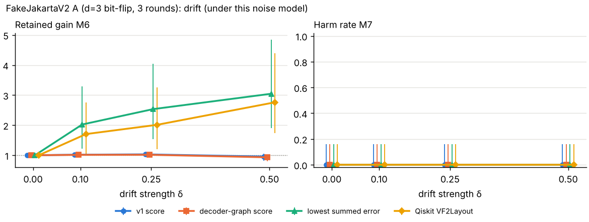

| Method | δ | M6 retained gain | M7 harm (draws) | distinct choices | failures |
| --- | --- | --- | --- | --- | --- |
| v1 score | 0 | 1 [1, 1] | 0/20 = 0 [0, 0.1611] | 1 | 0 |
| v1 score | 0.1 | 1.02 [1, 1.04] | 0/20 = 0 [0, 0.1611] | 4 | 0 |
| v1 score | 0.25 | 1.03 [1.01, 1.06] | 0/20 = 0 [0, 0.1611] | 4 | 0 |
| v1 score | 0.5 | 0.9574 [0.8237, 1.06] | 0/20 = 0 [0, 0.1611] | 6 | 0 |
| decoder-graph score | 0 | 1 [1, 1] | 0/20 = 0 [0, 0.1611] | 1 | 0 |
| decoder-graph score | 0.1 | 1.01 [0.9989, 1.04] | 0/20 = 0 [0, 0.1611] | 2 | 0 |
| decoder-graph score | 0.25 | 1.02 [0.9990, 1.04] | 0/20 = 0 [0, 0.1611] | 2 | 0 |
| decoder-graph score | 0.5 | 0.9322 [0.8014, 1.03] | 0/20 = 0 [0, 0.1611] | 4 | 0 |
| lowest summed error | 0 | 1 [1, 1] | 0/20 = 0 [0, 0.1611] | 1 | 0 |
| lowest summed error | 0.1 | 2.02 [1.23, 3.3] | 0/20 = 0 [0, 0.1611] | 2 | 0 |
| lowest summed error | 0.25 | 2.53 [1.53, 4.04] | 0/20 = 0 [0, 0.1611] | 2 | 0 |
| lowest summed error | 0.5 | 3.05 [1.91, 4.85] | 0/20 = 0 [0, 0.1611] | 2 | 0 |
| Qiskit VF2Layout | 0 | 1 [1, 1] | 0/20 = 0 [0, 0.1611] | 1 | 0 |
| Qiskit VF2Layout | 0.1 | 1.7 [0.9868, 2.76] | 0/20 = 0 [0, 0.1611] | 4 | 0 |
| Qiskit VF2Layout | 0.25 | 2.01 [1.21, 3.26] | 0/20 = 0 [0, 0.1611] | 3 | 0 |
| Qiskit VF2Layout | 0.5 | 2.76 [1.74, 4.39] | 0/20 = 0 [0, 0.1611] | 4 | 0 |

### FakeJakartaV2 B (d=3 phase-flip, 3 rounds)

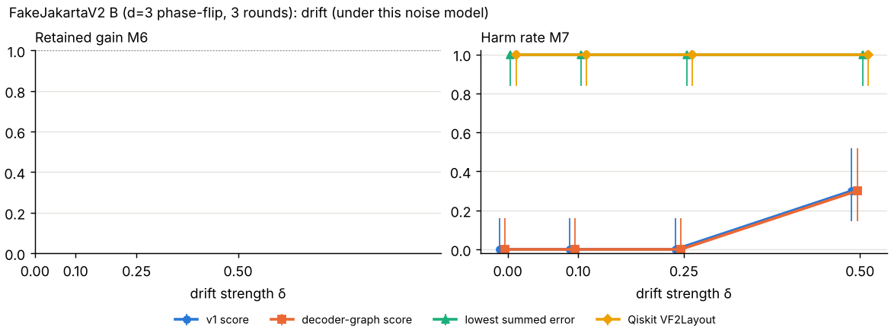

| Method | δ | M6 retained gain | M7 harm (draws) | distinct choices | failures |
| --- | --- | --- | --- | --- | --- |
| v1 score | 0 | no gain to retain | 0/20 = 0 [0, 0.1611] | 1 | 0 |
| v1 score | 0.1 | no gain to retain | 0/20 = 0 [0, 0.1611] | 1 | 0 |
| v1 score | 0.25 | no gain to retain | 0/20 = 0 [0, 0.1611] | 2 | 0 |
| v1 score | 0.5 | no gain to retain | 6/20 = 0.3000 [0.1455, 0.5190] | 3 | 0 |
| decoder-graph score | 0 | no gain to retain | 0/20 = 0 [0, 0.1611] | 1 | 0 |
| decoder-graph score | 0.1 | no gain to retain | 0/20 = 0 [0, 0.1611] | 1 | 0 |
| decoder-graph score | 0.25 | no gain to retain | 0/20 = 0 [0, 0.1611] | 2 | 0 |
| decoder-graph score | 0.5 | no gain to retain | 6/20 = 0.3000 [0.1455, 0.5190] | 4 | 0 |
| lowest summed error | 0 | no gain to retain | 20/20 = 1 [0.8389, 1] | 1 | 0 |
| lowest summed error | 0.1 | no gain to retain | 20/20 = 1 [0.8389, 1] | 2 | 0 |
| lowest summed error | 0.25 | no gain to retain | 20/20 = 1 [0.8389, 1] | 2 | 0 |
| lowest summed error | 0.5 | no gain to retain | 20/20 = 1 [0.8389, 1] | 2 | 0 |
| Qiskit VF2Layout | 0 | no gain to retain | 20/20 = 1 [0.8389, 1] | 1 | 0 |
| Qiskit VF2Layout | 0.1 | no gain to retain | 20/20 = 1 [0.8389, 1] | 4 | 0 |
| Qiskit VF2Layout | 0.25 | no gain to retain | 20/20 = 1 [0.8389, 1] | 4 | 0 |
| Qiskit VF2Layout | 0.5 | no gain to retain | 20/20 = 1 [0.8389, 1] | 4 | 0 |

### FakeHanoiV2 A (d=3 bit-flip, 3 rounds)

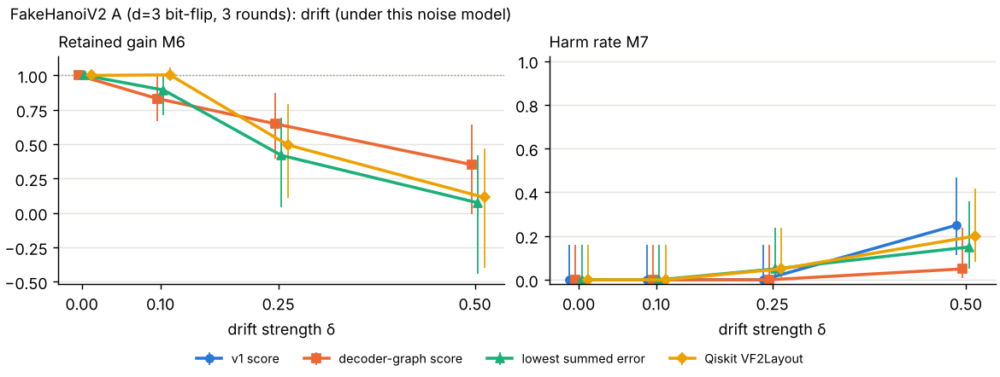

| Method | δ | M6 retained gain | M7 harm (draws) | distinct choices | failures |
| --- | --- | --- | --- | --- | --- |
| v1 score | 0 | no gain to retain | 0/20 = 0 [0, 0.1611] | 1 | 0 |
| v1 score | 0.1 | no gain to retain | 0/20 = 0 [0, 0.1611] | 3 | 0 |
| v1 score | 0.25 | no gain to retain | 0/20 = 0 [0, 0.1611] | 6 | 0 |
| v1 score | 0.5 | no gain to retain | 5/20 = 0.2500 [0.1119, 0.4687] | 13 | 0 |
| decoder-graph score | 0 | 1 [1, 1] | 0/20 = 0 [0, 0.1611] | 1 | 0 |
| decoder-graph score | 0.1 | 0.8315 [0.6668, 1] | 0/20 = 0 [0, 0.1611] | 6 | 0 |
| decoder-graph score | 0.25 | 0.6482 [0.3933, 0.8714] | 0/20 = 0 [0, 0.1611] | 9 | 0 |
| decoder-graph score | 0.5 | 0.3514 [-6.75e-03, 0.6454] | 1/20 = 0.0500 [8.88e-03, 0.2361] | 14 | 0 |
| lowest summed error | 0 | 1 [1, 1] | 0/20 = 0 [0, 0.1611] | 1 | 0 |
| lowest summed error | 0.1 | 0.8935 [0.7121, 1] | 0/20 = 0 [0, 0.1611] | 2 | 0 |
| lowest summed error | 0.25 | 0.4183 [0.0406, 0.6949] | 1/20 = 0.0500 [8.88e-03, 0.2361] | 5 | 0 |
| lowest summed error | 0.5 | 0.0739 [-0.4426, 0.4219] | 3/20 = 0.1500 [0.0524, 0.3604] | 8 | 0 |
| Qiskit VF2Layout | 0 | 1 [1, 1] | 0/20 = 0 [0, 0.1611] | 1 | 0 |
| Qiskit VF2Layout | 0.1 | 1 [0.9671, 1.06] | 0/20 = 0 [0, 0.1611] | 2 | 0 |
| Qiskit VF2Layout | 0.25 | 0.4947 [0.1089, 0.7925] | 1/20 = 0.0500 [8.88e-03, 0.2361] | 7 | 0 |
| Qiskit VF2Layout | 0.5 | 0.1126 [-0.3977, 0.4715] | 4/20 = 0.2000 [0.0807, 0.4160] | 13 | 0 |

### FakeHanoiV2 B (d=3 phase-flip, 3 rounds)

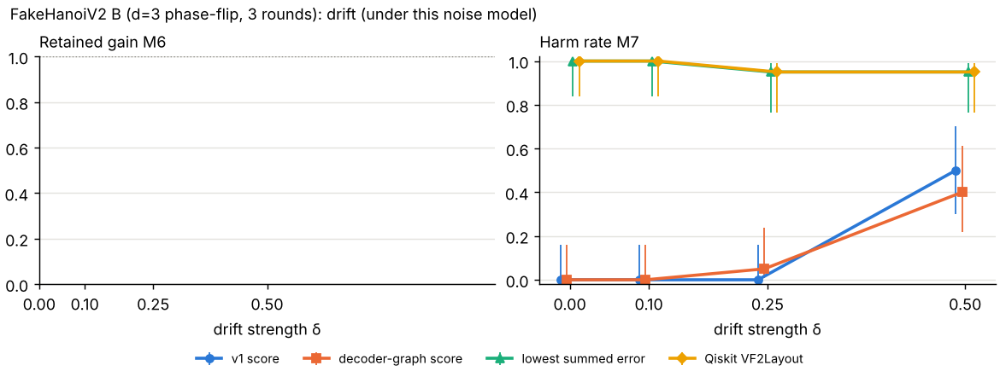

| Method | δ | M6 retained gain | M7 harm (draws) | distinct choices | failures |
| --- | --- | --- | --- | --- | --- |
| v1 score | 0 | no gain to retain | 0/20 = 0 [0, 0.1611] | 1 | 0 |
| v1 score | 0.1 | no gain to retain | 0/20 = 0 [0, 0.1611] | 1 | 0 |
| v1 score | 0.25 | no gain to retain | 0/20 = 0 [0, 0.1611] | 1 | 0 |
| v1 score | 0.5 | no gain to retain | 10/20 = 0.5000 [0.2993, 0.7007] | 9 | 0 |
| decoder-graph score | 0 | no gain to retain | 0/20 = 0 [0, 0.1611] | 1 | 0 |
| decoder-graph score | 0.1 | no gain to retain | 0/20 = 0 [0, 0.1611] | 1 | 0 |
| decoder-graph score | 0.25 | no gain to retain | 1/20 = 0.0500 [8.88e-03, 0.2361] | 3 | 0 |
| decoder-graph score | 0.5 | no gain to retain | 8/20 = 0.4000 [0.2188, 0.6134] | 9 | 0 |
| lowest summed error | 0 | no gain to retain | 20/20 = 1 [0.8389, 1] | 1 | 0 |
| lowest summed error | 0.1 | no gain to retain | 20/20 = 1 [0.8389, 1] | 2 | 0 |
| lowest summed error | 0.25 | no gain to retain | 19/20 = 0.9500 [0.7639, 0.9911] | 7 | 0 |
| lowest summed error | 0.5 | no gain to retain | 19/20 = 0.9500 [0.7639, 0.9911] | 9 | 0 |
| Qiskit VF2Layout | 0 | no gain to retain | 20/20 = 1 [0.8389, 1] | 1 | 0 |
| Qiskit VF2Layout | 0.1 | no gain to retain | 20/20 = 1 [0.8389, 1] | 3 | 0 |
| Qiskit VF2Layout | 0.25 | no gain to retain | 19/20 = 0.9500 [0.7639, 0.9911] | 9 | 0 |
| Qiskit VF2Layout | 0.5 | no gain to retain | 19/20 = 0.9500 [0.7639, 0.9911] | 11 | 0 |

### FakeHanoiV2 D5 (d=5 bit-flip, 3 rounds)

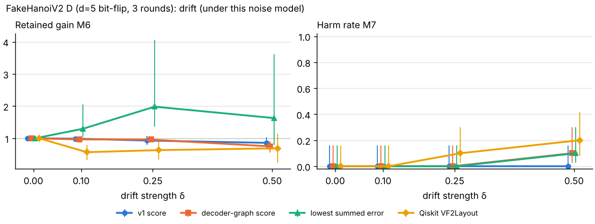

| Method | δ | M6 retained gain | M7 harm (draws) | distinct choices | failures |
| --- | --- | --- | --- | --- | --- |
| v1 score | 0 | 1 [1, 1] | 0/20 = 0 [0, 0.1611] | 1 | 0 |
| v1 score | 0.1 | 0.9883 [0.9291, 1.05] | 0/20 = 0 [0, 0.1611] | 3 | 0 |
| v1 score | 0.25 | 0.9299 [0.7981, 1.07] | 0/20 = 0 [0, 0.1611] | 3 | 0 |
| v1 score | 0.5 | 0.8587 [0.6801, 1.04] | 0/20 = 0 [0, 0.1611] | 7 | 0 |
| decoder-graph score | 0 | 1 [1, 1] | 0/20 = 0 [0, 0.1611] | 1 | 0 |
| decoder-graph score | 0.1 | 0.9655 [0.9099, 1.02] | 0/20 = 0 [0, 0.1611] | 4 | 0 |
| decoder-graph score | 0.25 | 0.9599 [0.9005, 1.02] | 0/20 = 0 [0, 0.1611] | 4 | 0 |
| decoder-graph score | 0.5 | 0.7491 [0.5523, 0.9083] | 2/20 = 0.1000 [0.0279, 0.3010] | 8 | 0 |
| lowest summed error | 0 | 1 [1, 1] | 0/20 = 0 [0, 0.1611] | 1 | 0 |
| lowest summed error | 0.1 | 1.3 [1.05, 2.06] | 0/20 = 0 [0, 0.1611] | 2 | 0 |
| lowest summed error | 0.25 | 1.98 [1.35, 4.06] | 0/20 = 0 [0, 0.1611] | 4 | 0 |
| lowest summed error | 0.5 | 1.63 [0.7956, 3.61] | 2/20 = 0.1000 [0.0279, 0.3010] | 9 | 0 |
| Qiskit VF2Layout | 0 | 1 [1, 1] | 0/20 = 0 [0, 0.1611] | 1 | 0 |
| Qiskit VF2Layout | 0.1 | 0.5678 [0.3141, 0.7946] | 0/20 = 0 [0, 0.1611] | 2 | 0 |
| Qiskit VF2Layout | 0.25 | 0.6322 [0.3353, 0.9082] | 2/20 = 0.1000 [0.0279, 0.3010] | 10 | 0 |
| Qiskit VF2Layout | 0.5 | 0.6892 [0.2411, 1.15] | 4/20 = 0.2000 [0.0807, 0.4160] | 16 | 0 |

### FakeHanoiV2 D7 (d=7 bit-flip, 3 rounds)

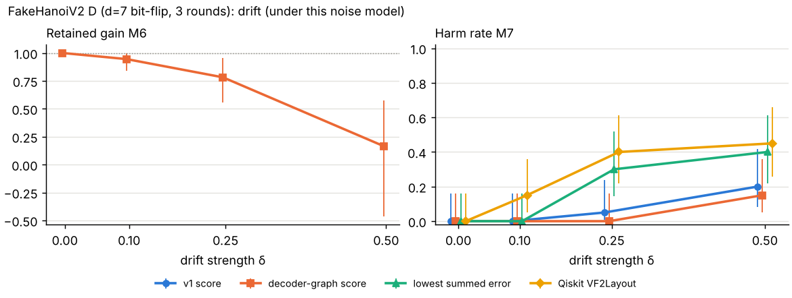

| Method | δ | M6 retained gain | M7 harm (draws) | distinct choices | failures |
| --- | --- | --- | --- | --- | --- |
| v1 score | 0 | no gain to retain | 0/20 = 0 [0, 0.1611] | 1 | 0 |
| v1 score | 0.1 | no gain to retain | 0/20 = 0 [0, 0.1611] | 2 | 0 |
| v1 score | 0.25 | no gain to retain | 1/20 = 0.0500 [8.88e-03, 0.2361] | 4 | 0 |
| v1 score | 0.5 | no gain to retain | 4/20 = 0.2000 [0.0807, 0.4160] | 10 | 0 |
| decoder-graph score | 0 | 1 [1, 1] | 0/20 = 0 [0, 0.1611] | 1 | 0 |
| decoder-graph score | 0.1 | 0.9451 [0.8411, 1] | 0/20 = 0 [0, 0.1611] | 2 | 0 |
| decoder-graph score | 0.25 | 0.7819 [0.5546, 0.9530] | 0/20 = 0 [0, 0.1611] | 5 | 0 |
| decoder-graph score | 0.5 | 0.1659 [-0.4645, 0.5719] | 3/20 = 0.1500 [0.0524, 0.3604] | 11 | 0 |
| lowest summed error | 0 | no gain to retain | 0/20 = 0 [0, 0.1611] | 1 | 0 |
| lowest summed error | 0.1 | no gain to retain | 0/20 = 0 [0, 0.1611] | 1 | 0 |
| lowest summed error | 0.25 | no gain to retain | 6/20 = 0.3000 [0.1455, 0.5190] | 3 | 0 |
| lowest summed error | 0.5 | no gain to retain | 8/20 = 0.4000 [0.2188, 0.6134] | 8 | 0 |
| Qiskit VF2Layout | 0 | no gain to retain | 0/20 = 0 [0, 0.1611] | 1 | 0 |
| Qiskit VF2Layout | 0.1 | no gain to retain | 3/20 = 0.1500 [0.0524, 0.3604] | 4 | 0 |
| Qiskit VF2Layout | 0.25 | no gain to retain | 8/20 = 0.4000 [0.2188, 0.6134] | 6 | 0 |
| Qiskit VF2Layout | 0.5 | no gain to retain | 9/20 = 0.4500 [0.2582, 0.6579] | 11 | 0 |

## 3. The held-out test on FakeAlgiers

We froze the decoder-graph score (the commit is recorded in `configs_v2/freeze.json`) before converting FakeAlgiers or producing any FakeAlgiers result. Relative regret = (P_L of the choice − best P_L) ÷ best P_L, where the best is the placement with the lowest measured P_L.

| Case | Score | Choice | P_L | M4 | Rank (1 = best) | Regret (M5) | Relative regret |
| --- | --- | --- | --- | --- | --- | --- | --- |
| A (d=3 bit-flip, 3 rounds) | v1 score | (8,5,3,2,1) | 3.87e-03 [3.72e-03, 4.04e-03] | 0.9279 | 2 of 84 | 1.73e-04 [-4.65e-05, 3.93e-04] | 0.0468 |
| A (d=3 bit-flip, 3 rounds) | decoder-graph score | (1,2,3,5,8) | 3.70e-03 [3.55e-03, 3.86e-03] | 0.9651 | 1 of 84 | 0 [-2.17e-04, 2.17e-04] | 0 |
| B (d=3 phase-flip, 3 rounds) | v1 score | (5,3,2,1,4) | 3.62e-03 [3.47e-03, 3.77e-03] | 0.9661 | 2 of 84 | 7.00e-05 [-1.44e-04, 2.84e-04] | 0.0197 |
| B (d=3 phase-flip, 3 rounds) | decoder-graph score | (5,3,2,1,4) | 3.62e-03 [3.47e-03, 3.77e-03] | 0.9834 | 2 of 84 | 7.00e-05 [-1.44e-04, 2.84e-04] | 0.0197 |
| D (d=5 bit-flip, 3 rounds) | v1 score | (13,14,11,8,5,3,2,1,4) | 4.85e-04 [4.47e-04, 5.26e-04] | 0.8900 | 4 of 102 | 3.33e-06 [-5.24e-05, 5.90e-05] | 6.92e-03 |
| D (d=5 bit-flip, 3 rounds) | decoder-graph score | (12,13,14,11,8,5,3,2,1) | 4.84e-04 [4.46e-04, 5.25e-04] | 0.9526 | 3 of 102 | 2.50e-06 [-5.32e-05, 5.82e-05] | 5.19e-03 |
| D (d=7 bit-flip, 3 rounds) | v1 score | (6,7,4,1,2,3,5,8,11,14,13,12,15) | 7.34e-05 [6.82e-05, 7.91e-05] | 0.9173 | 3 of 86 | 1.17e-05 [4.31e-06, 1.90e-05] | 0.1889 |
| D (d=7 bit-flip, 3 rounds) | decoder-graph score | (15,12,13,14,11,8,5,3,2,1,4,7,6) | 6.18e-05 [5.70e-05, 6.69e-05] | 0.9159 | 1 of 86 | 0 [-7.04e-06, 7.04e-06] | 0 |

**The R-G7 rule.** Per case, the difference in relative regret (decoder-graph − v1) = (P_L of the decoder-graph choice − P_L of the v1 choice) ÷ best P_L:

| Case | Relative regret, v1 | Relative regret, decoder-graph | Difference |
| --- | --- | --- | --- |
| v2-algiers-A | 0.0468 | 0 | -0.0468 |
| v2-algiers-B | 0.0197 | 0.0197 | 0 |
| v2-algiers-D5 | 6.92e-03 | 5.19e-03 | -1.73e-03 |
| v2-algiers-D7 | 0.1889 | 0 | -0.1889 |

The mean difference over the four cases is −0.0594 [−0.1054, −0.0133] (a 95% delta-method interval from shot noise only; the cases are fixed). We had decided in advance that the decoder-graph score becomes the default only if this interval lies wholly below zero. It does, so the decoder-graph score is the package's default. This verdict covers only these four cases.

The best placement is the one with the lowest measured P_L, so a score that picks it gets a relative regret of exactly 0, while a score one rank away is charged for any shot-noise gap. The interval accounts for the noise in that gap, but not for which placement came out best. In FakeAlgiers A and D5 the two scores chose different placements whose own P_L intervals overlap, so there the per-case difference is within the noise of the ranking.

## 4. Every case: headroom, choices and score validity

| Case | Valid placements | Shots per seed | Best P_L | Worst P_L | Headroom | Fixed P_L | Average P_L | M4 v1 / graph / summed |
| --- | --- | --- | --- | --- | --- | --- | --- | --- |
| FakeJakartaV2 A (d=3 bit-flip, 3 rounds) | 8 | 200,000 | 0.0459 [0.0454, 0.0465] | 0.0617 [0.0611, 0.0623] | placement matters | 0.0617 [0.0611, 0.0623] | 0.0530 [0.0528, 0.0532] | 0.6905 / 0.7619 / -0.3904 |
| FakeJakartaV2 B (d=3 phase-flip, 3 rounds) | 8 | 200,000 | 0.1427 [0.1418, 0.1436] | 0.2579 [0.2568, 0.2590] | placement matters | 0.1427 [0.1419, 0.1436] | 0.1941 [0.1937, 0.1944] | 0.9524 / 0.9524 / -0.5855 |
| FakeHanoiV2 A (d=3 bit-flip, 3 rounds) | 80 | 200,000 | 3.87e-03 [3.72e-03, 4.03e-03] | 0.0233 [0.0229, 0.0236] | placement matters | 4.60e-03 [4.43e-03, 4.77e-03] | 8.48e-03 [8.45e-03, 8.50e-03] | 0.6153 / 0.9808 / 0.5039 |
| FakeHanoiV2 B (d=3 phase-flip, 3 rounds) | 80 | 200,000 | 3.24e-03 [3.10e-03, 3.39e-03] | 0.0329 [0.0324, 0.0333] | placement matters | 3.28e-03 [3.14e-03, 3.42e-03] | 0.0114 [0.0114, 0.0114] | 0.7724 / 0.9584 / 0.5571 |
| FakeHanoiV2 D (d=5 bit-flip, 3 rounds) | 102 | 400,000 | 3.97e-04 [3.63e-04, 4.34e-04] | 2.76e-03 [2.67e-03, 2.85e-03] | placement matters | 9.29e-04 [8.76e-04, 9.85e-04] | 1.11e-03 [1.10e-03, 1.12e-03] | 0.5493 / 0.8911 / 0.4389 |
| FakeHanoiV2 D (d=7 bit-flip, 3 rounds) | 74 | 3,200,000 | 4.47e-05 [4.07e-05, 4.91e-05] | 3.60e-04 [3.48e-04, 3.72e-04] | placement matters | 6.91e-05 [6.40e-05, 7.45e-05] | 1.36e-04 [1.35e-04, 1.36e-04] | 0.5916 / 0.9015 / 0.5509 |
| FakeAlgiers A (d=3 bit-flip, 3 rounds) | 84 | 200,000 | 3.70e-03 [3.55e-03, 3.86e-03] | 0.0221 [0.0217, 0.0224] | placement matters | 4.93e-03 [4.76e-03, 5.11e-03] | 9.58e-03 [9.55e-03, 9.61e-03] | 0.9279 / 0.9651 / 0.8743 |
| FakeAlgiers B (d=3 phase-flip, 3 rounds) | 84 | 200,000 | 3.55e-03 [3.40e-03, 3.70e-03] | 0.0577 [0.0571, 0.0583] | placement matters | 4.12e-03 [3.96e-03, 4.29e-03] | 0.0196 [0.0195, 0.0196] | 0.9661 / 0.9834 / 0.7530 |
| FakeAlgiers D (d=5 bit-flip, 3 rounds) | 102 | 400,000 | 4.82e-04 [4.44e-04, 5.23e-04] | 2.81e-03 [2.72e-03, 2.91e-03] | placement matters | 5.79e-04 [5.38e-04, 6.24e-04] | 1.29e-03 [1.29e-03, 1.30e-03] | 0.8900 / 0.9526 / 0.8756 |
| FakeAlgiers D (d=7 bit-flip, 3 rounds) | 86 | 3,200,000 | 6.18e-05 [5.70e-05, 6.69e-05] | 4.26e-04 [4.13e-04, 4.39e-04] | placement matters | 1.04e-04 [9.76e-05, 1.11e-04] | 1.65e-04 [1.64e-04, 1.66e-04] | 0.9173 / 0.9159 / 0.8955 |

M4 is the Spearman rank correlation between a score and simulated P_L (positive means the score orders placements correctly). A negative M4 would mean the score ranks placements backwards, and is flagged as **negative** below.

| Case | Method | Choice | P_L | Rank | Regret (M5) |
| --- | --- | --- | --- | --- | --- |
| FakeJakartaV2 A (d=3 bit-flip, 3 rounds) | v1 score | (6,5,3,1,2) | 0.0471 [0.0466, 0.0476] | 4 | 1.17e-03 [4.15e-04, 1.92e-03] |
| FakeJakartaV2 A (d=3 bit-flip, 3 rounds) | decoder-graph score | (6,5,3,1,2) | 0.0471 [0.0466, 0.0476] | 4 | 1.17e-03 [4.15e-04, 1.92e-03] |
| FakeJakartaV2 A (d=3 bit-flip, 3 rounds) | lowest summed error **negative M4** | (0,1,3,5,6) | 0.0591 [0.0585, 0.0597] | 6 | 0.0132 [0.0124, 0.0140] |
| FakeJakartaV2 A (d=3 bit-flip, 3 rounds) | Qiskit VF2Layout | (0,1,3,5,6) | 0.0591 [0.0585, 0.0597] | 6 | 0.0132 [0.0124, 0.0140] |
| FakeJakartaV2 B (d=3 phase-flip, 3 rounds) | v1 score | (0,1,3,5,4) | 0.1427 [0.1419, 0.1436] | 2 | 3.50e-05 [-1.22e-03, 1.29e-03] |
| FakeJakartaV2 B (d=3 phase-flip, 3 rounds) | decoder-graph score | (0,1,3,5,4) | 0.1427 [0.1419, 0.1436] | 2 | 3.50e-05 [-1.22e-03, 1.29e-03] |
| FakeJakartaV2 B (d=3 phase-flip, 3 rounds) | lowest summed error **negative M4** | (0,1,3,5,6) | 0.2021 [0.2011, 0.2031] | 5 | 0.0594 [0.0581, 0.0608] |
| FakeJakartaV2 B (d=3 phase-flip, 3 rounds) | Qiskit VF2Layout | (0,1,3,5,6) | 0.2021 [0.2011, 0.2031] | 5 | 0.0594 [0.0581, 0.0608] |
| FakeHanoiV2 A (d=3 bit-flip, 3 rounds) | v1 score | (16,19,22,25,26) | 4.64e-03 [4.47e-03, 4.82e-03] | 18 | 7.67e-04 [5.34e-04, 1.00e-03] |
| FakeHanoiV2 A (d=3 bit-flip, 3 rounds) | decoder-graph score | (4,1,2,3,5) | 3.90e-03 [3.75e-03, 4.06e-03] | 2 | 2.83e-05 [-1.94e-04, 2.51e-04] |
| FakeHanoiV2 A (d=3 bit-flip, 3 rounds) | lowest summed error | (4,1,2,3,5) | 3.90e-03 [3.75e-03, 4.06e-03] | 2 | 2.83e-05 [-1.94e-04, 2.51e-04] |
| FakeHanoiV2 A (d=3 bit-flip, 3 rounds) | Qiskit VF2Layout | (4,1,2,3,5) | 3.90e-03 [3.75e-03, 4.06e-03] | 2 | 2.83e-05 [-1.94e-04, 2.51e-04] |
| FakeHanoiV2 B (d=3 phase-flip, 3 rounds) | v1 score | (5,3,2,1,0) | 3.24e-03 [3.10e-03, 3.39e-03] | 1 | 0 [-2.03e-04, 2.03e-04] |
| FakeHanoiV2 B (d=3 phase-flip, 3 rounds) | decoder-graph score | (0,1,2,3,5) | 3.28e-03 [3.14e-03, 3.42e-03] | 2 | 3.67e-05 [-1.67e-04, 2.41e-04] |
| FakeHanoiV2 B (d=3 phase-flip, 3 rounds) | lowest summed error | (4,1,2,3,5) | 6.74e-03 [6.53e-03, 6.95e-03] | 19 | 3.50e-03 [3.25e-03, 3.75e-03] |
| FakeHanoiV2 B (d=3 phase-flip, 3 rounds) | Qiskit VF2Layout | (4,1,2,3,5) | 6.74e-03 [6.53e-03, 6.95e-03] | 19 | 3.50e-03 [3.25e-03, 3.75e-03] |
| FakeHanoiV2 D (d=5 bit-flip, 3 rounds) | v1 score | (9,8,11,14,16,19,22,25,26) | 6.27e-04 [5.83e-04, 6.73e-04] | 12 | 2.30e-04 [1.73e-04, 2.88e-04] |
| FakeHanoiV2 D (d=5 bit-flip, 3 rounds) | decoder-graph score | (1,4,7,10,12,13,14,16,19) | 4.28e-04 [3.93e-04, 4.67e-04] | 3 | 3.17e-05 [-1.98e-05, 8.32e-05] |
| FakeHanoiV2 D (d=5 bit-flip, 3 rounds) | lowest summed error | (5,3,2,1,4,7,10,12,13) | 8.07e-04 [7.58e-04, 8.60e-04] | 30 | 4.11e-04 [3.49e-04, 4.73e-04] |
| FakeHanoiV2 D (d=5 bit-flip, 3 rounds) | Qiskit VF2Layout | (13,12,10,7,4,1,2,3,5) | 6.82e-04 [6.37e-04, 7.30e-04] | 17 | 2.85e-04 [2.26e-04, 3.44e-04] |
| FakeHanoiV2 D (d=7 bit-flip, 3 rounds) | v1 score | (0,1,4,7,10,12,13,14,16,19,22,25,26) | 5.99e-05 [5.52e-05, 6.50e-05] | 4 | 1.52e-05 [8.75e-06, 2.17e-05] |
| FakeHanoiV2 D (d=7 bit-flip, 3 rounds) | decoder-graph score | (3,2,1,4,7,10,12,13,14,16,19,22,25) | 5.01e-05 [4.58e-05, 5.48e-05] | 2 | 5.42e-06 [-7.47e-07, 1.16e-05] |
| FakeHanoiV2 D (d=7 bit-flip, 3 rounds) | lowest summed error | (2,1,4,7,10,12,13,14,16,19,22,25,26) | 6.39e-05 [5.90e-05, 6.91e-05] | 7 | 1.92e-05 [1.26e-05, 2.58e-05] |
| FakeHanoiV2 D (d=7 bit-flip, 3 rounds) | Qiskit VF2Layout | (2,1,4,7,10,12,13,14,16,19,22,25,26) | 6.39e-05 [5.90e-05, 6.91e-05] | 7 | 1.92e-05 [1.26e-05, 2.58e-05] |
| FakeAlgiers A (d=3 bit-flip, 3 rounds) | v1 score | (8,5,3,2,1) | 3.87e-03 [3.72e-03, 4.04e-03] | 2 | 1.73e-04 [-4.65e-05, 3.93e-04] |
| FakeAlgiers A (d=3 bit-flip, 3 rounds) | decoder-graph score | (1,2,3,5,8) | 3.70e-03 [3.55e-03, 3.86e-03] | 1 | 0 [-2.17e-04, 2.17e-04] |
| FakeAlgiers A (d=3 bit-flip, 3 rounds) | lowest summed error | (4,1,2,3,5) | 4.19e-03 [4.03e-03, 4.36e-03] | 3 | 4.88e-04 [2.64e-04, 7.13e-04] |
| FakeAlgiers A (d=3 bit-flip, 3 rounds) | Qiskit VF2Layout | (4,1,2,3,5) | 4.19e-03 [4.03e-03, 4.36e-03] | 3 | 4.88e-04 [2.64e-04, 7.13e-04] |
| FakeAlgiers B (d=3 phase-flip, 3 rounds) | v1 score | (5,3,2,1,4) | 3.62e-03 [3.47e-03, 3.77e-03] | 2 | 7.00e-05 [-1.44e-04, 2.84e-04] |
| FakeAlgiers B (d=3 phase-flip, 3 rounds) | decoder-graph score | (5,3,2,1,4) | 3.62e-03 [3.47e-03, 3.77e-03] | 2 | 7.00e-05 [-1.44e-04, 2.84e-04] |
| FakeAlgiers B (d=3 phase-flip, 3 rounds) | lowest summed error | (4,1,2,3,5) | 3.55e-03 [3.40e-03, 3.70e-03] | 1 | 0 [-2.13e-04, 2.13e-04] |
| FakeAlgiers B (d=3 phase-flip, 3 rounds) | Qiskit VF2Layout | (4,1,2,3,5) | 3.55e-03 [3.40e-03, 3.70e-03] | 1 | 0 [-2.13e-04, 2.13e-04] |
| FakeAlgiers D (d=5 bit-flip, 3 rounds) | v1 score | (13,14,11,8,5,3,2,1,4) | 4.85e-04 [4.47e-04, 5.26e-04] | 4 | 3.33e-06 [-5.24e-05, 5.90e-05] |
| FakeAlgiers D (d=5 bit-flip, 3 rounds) | decoder-graph score | (12,13,14,11,8,5,3,2,1) | 4.84e-04 [4.46e-04, 5.25e-04] | 3 | 2.50e-06 [-5.32e-05, 5.82e-05] |
| FakeAlgiers D (d=5 bit-flip, 3 rounds) | lowest summed error | (4,1,2,3,5,8,11,14,13) | 4.82e-04 [4.44e-04, 5.23e-04] | 1 | 0 [-5.56e-05, 5.56e-05] |
| FakeAlgiers D (d=5 bit-flip, 3 rounds) | Qiskit VF2Layout | (4,1,2,3,5,8,11,14,13) | 4.82e-04 [4.44e-04, 5.23e-04] | 1 | 0 [-5.56e-05, 5.56e-05] |
| FakeAlgiers D (d=7 bit-flip, 3 rounds) | v1 score | (6,7,4,1,2,3,5,8,11,14,13,12,15) | 7.34e-05 [6.82e-05, 7.91e-05] | 3 | 1.17e-05 [4.31e-06, 1.90e-05] |
| FakeAlgiers D (d=7 bit-flip, 3 rounds) | decoder-graph score | (15,12,13,14,11,8,5,3,2,1,4,7,6) | 6.18e-05 [5.70e-05, 6.69e-05] | 1 | 0 [-7.04e-06, 7.04e-06] |
| FakeAlgiers D (d=7 bit-flip, 3 rounds) | lowest summed error | (6,7,4,1,2,3,5,8,11,14,13,12,15) | 7.34e-05 [6.82e-05, 7.91e-05] | 3 | 1.17e-05 [4.31e-06, 1.90e-05] |
| FakeAlgiers D (d=7 bit-flip, 3 rounds) | Qiskit VF2Layout | (6,7,4,1,2,3,5,8,11,14,13,12,15) | 7.34e-05 [6.82e-05, 7.91e-05] | 3 | 1.17e-05 [4.31e-06, 1.90e-05] |

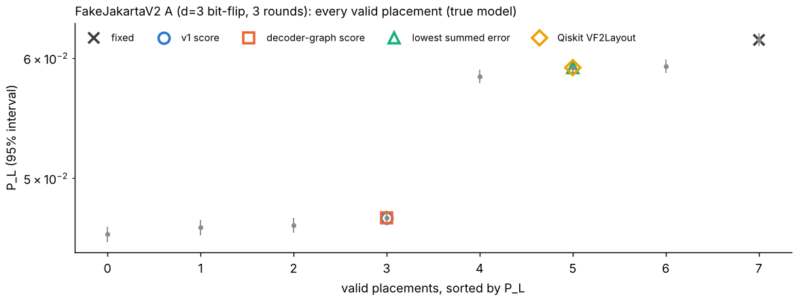

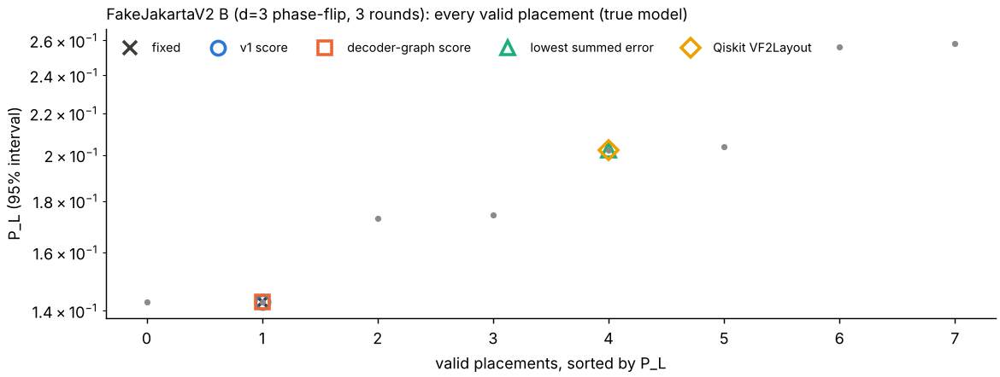

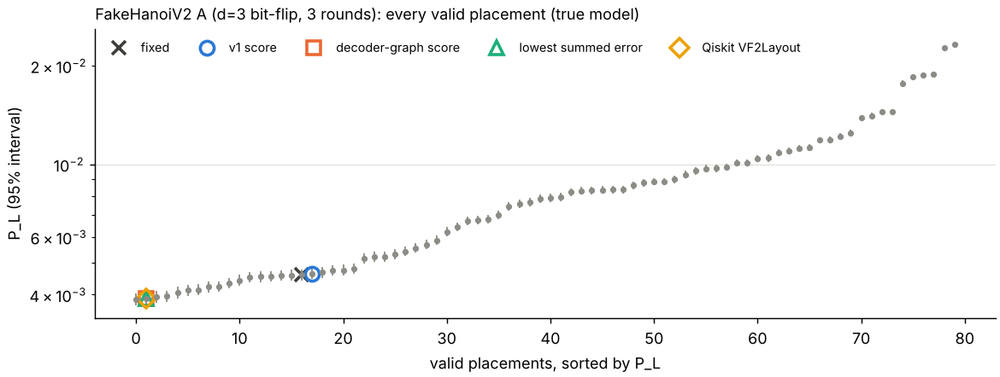

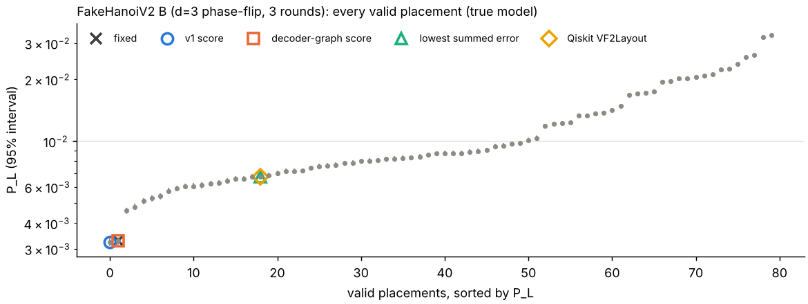

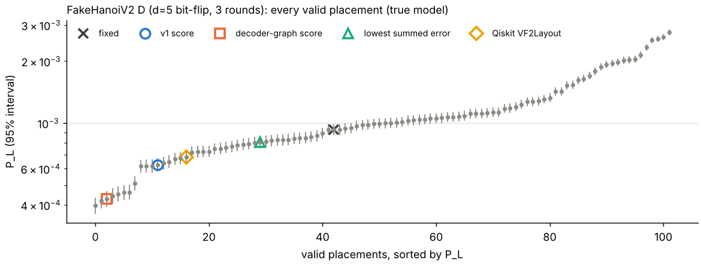

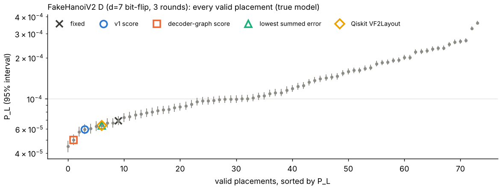

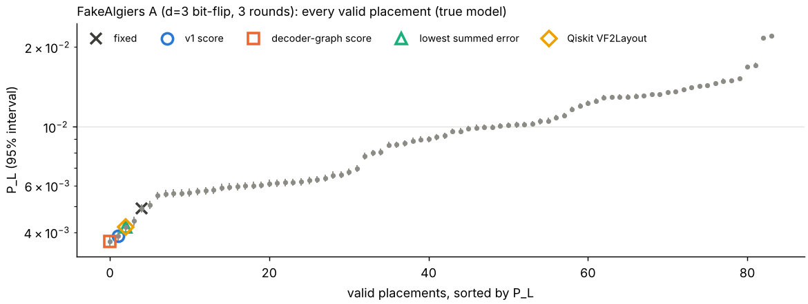

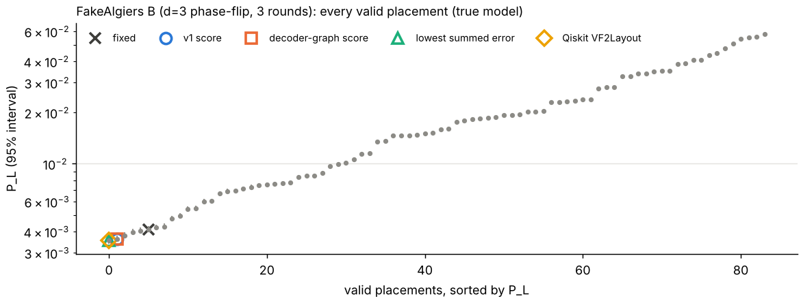

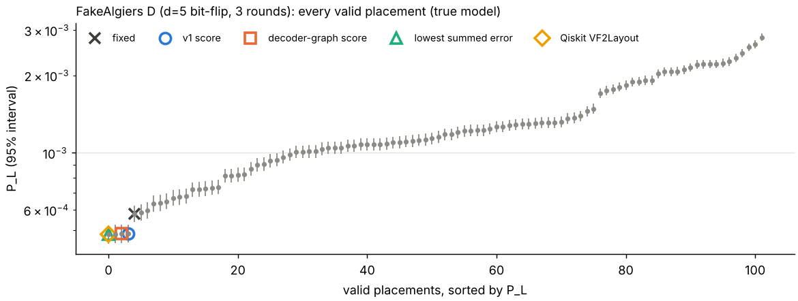

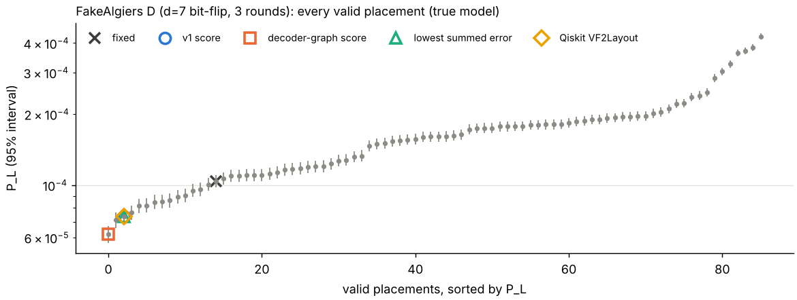

## 5. Decoder

PyMatching, built separately for each placement from that placement's own Stim detector error model (`approximate_disjoint_errors=True`, `decompose_errors=True`) under the true model. The decoder model is approximate (K1), and every results file records this.

## 6. Sensitivity

The sensitivity reruns are v1's, reported in the v1 report, section 10. The v2 plan added no sensitivity variants, so we ran none for v2.

## 7. Limitations

- **K1.** Nove's `to_detector_model()` raises an error for calibrated two-qubit noise with more than one non-zero Pauli term, so the decoder and both scores use Stim's approximate detector error model.
- **K2.** CX durations are set per gate name, not per pair.
- **K3.** Readout error is symmetric: the two directions are averaged.
- **K4.** Gate noise is directional: CX(a,b) and CX(b,a) are separate channels.
- **K5.** Nove applies idle noise to every qubit index up to the highest one used.
- **K6.** The noise is a Pauli-channel approximation. Coherent errors, crosstalk, leakage and real drift are not modelled.
- **K7.** The snapshots are realistic noise profiles, not live-device measurements (FakeJakartaV2 is dated after ibmq_jakarta's retirement).
- **K8.** No qubit has more than 3 neighbours, so no surface code fits without SWAPs.
- **K9.** The random drift is synthetic. Real drift is correlated across qubits and over time, so section 2 measures sensitivity to calibration error, not any device's drift. Every choice is also decoded with the true model's weights, whereas a real decoder would use the stale calibration too.
- **K10.** The Qiskit baseline depends on the Qiskit version, and its results apply to the pinned version only.
- **K11.** FakeAlgiers has FakeHanoiV2's raw coupling map, so it is held out mainly for its noise values, not its layout. After conversion the two layouts differ only in which uncalibrated couplers (error 1.0 in at least one direction) were removed: (15,18) on FakeAlgiers; (5,8) and (19,20) on FakeHanoiV2.
- **Development devices.** FakeJakartaV2 and FakeHanoiV2 results are not an independent test of the decoder-graph score.
- **R-G7 scope.** The held-out verdict rests on four cases on one device.

We revised the v2 plan once (revision 1, Oct 11, 2026), before any v2 result existed, after a review before implementation. We made no change after seeing results.

## Provenance and reproduction

Nove `485b413dfc0a61683b835c7874507a40cbb687cf`, Stim 1.16.0, PyMatching 2.4.0, Qiskit 2.5.2, qiskit-ibm-runtime 0.50.0 (device files). Base seeds 20261021, 20261022 and 20261023 (v1 used 20261011 to 20261013). The runs used code commit `97429d9`. Every results file records its code commit, config hash, true- and perturbed-model hashes, drift seeds and every chunk seed.

Run from `benchmarks/`:

```bash
python -m nac_bench.run_v2 configs_v2/benchmark_v2.json
python -m nac_bench.report_v2
```
