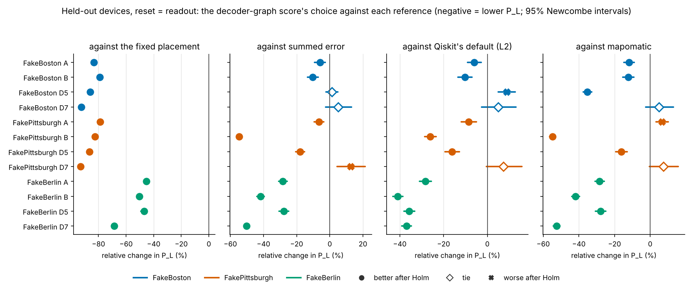

# v3 report: the held-out test

This report gives the results of our final test. We froze the score, the code, the run configuration and every random seed first. Only then did we convert three IBM devices whose calibration had never been used to develop the method, and run every comparison. The plan we froze is [SPEC_V3.md](../SPEC_V3.md).

Everything here is simulation. We converted IBM's published calibration snapshots (the fake backends in `qiskit-ibm-runtime` 0.50.0) into Pauli noise models, simulated them with Nove and decoded with PyMatching. No result is a measurement on hardware, and each device is one day's calibration. Unless a table says otherwise, each qubit's reset error is set equal to its readout error.

The report is a rewrite, for readability, of the version our analysis script generated. That version is kept unchanged at tag [`v3.0-results`](https://github.com/KUQCI/noise-aware-compilation/blob/v3.0-results/REPORT_V3.md), and every number below comes from it.

## Summary

We asked whether the decoder-graph score, which we developed on heavy-hex devices with CX gates, still picks better qubit placements than the methods people use today. The test devices use CZ gates, and one of them has a layout we never developed on, the square lattice. The answer depends on the layout.

- **Square lattice (FakeBerlin).** The score's choice was better in all 16 comparisons after correcting for multiple comparisons: 45% to 68% fewer logical errors than the fixed placement, and 28% to 53% fewer than lowest summed error, Qiskit's default layout and mapomatic. This held in every robustness check except one comparison in one random draw.
- **Heavy-hex (FakeBoston, FakePittsburgh).** It beat the fixed placement in all 8 cases, with 79% to 93% fewer logical errors. Against each of the three tools it was better in 5 cases and worse in 1, which we call *mixed*. The wins are at distance 3 and 5; at distance 7 it ties or loses. The mixed result is also fragile. When we grade the same placements with readout errors modelled by direction, the score is worse than summed error in 5 of 6 cases and worse than Qiskit's default in 5 of 6.
- **Surface code.** FakeBerlin has no distance-5 surface-code placement that avoids its broken couplers. We had named this as a possible outcome in advance, so the main comparison family has 48 members instead of 52 and we make no confirmatory surface-code claim. On FakeNighthawk, whose calibration is synthetic, the scaled score's distance-5 choice beat the fixed placement and tied the other tools.
- **Calibration drift** (development devices, exploratory). After a month of real recalibration the score keeps half or more of its gain (M6 from 0.53 to 1.27), but less than summed error and mapomatic keep in three of the four circuits, and one 14-day change made its distance-7 choice worse than the fixed placement. Choosing again on the new calibration restores the gain.

### What we tested

**Devices.** Three devices decide the claims: FakeBoston and FakePittsburgh (156-qubit heavy-hex, IBM Heron r3) and FakeBerlin (square lattice). We had seen FakeBerlin's device-level summary figures (medians, counts and ranges) before freezing the configuration. No decision used them, and there is no unseen square-lattice device to use instead. Three more devices run every case but decide nothing: FakeKingston and FakeAachen, whose calibration we had partly seen before the freeze, and FakeNighthawk, whose calibration is synthetic (its file calls itself `fake_nighthawk`).

**Circuits.** Repetition codes built natively from CZ and H, all with 3 rounds: A is distance 3 bit-flip, B is distance 3 phase-flip, D5 and D7 are distance 5 and 7 bit-flip. S3 and S5 are the rotated surface code at distance 3 and 5.

**What the score is compared with.** The *fixed placement* is the first valid placement in index order, which uses no noise information. *Lowest summed error* adds up the gate, readout and reset errors a placement touches. *Qiskit's default* is Qiskit 2.5.2's transpiler at its default optimization level 2. *mapomatic* is the layout tool of that name, version 0.14.0.

**How we grade.** Each simulated placement gets between 600,000 and about 300 million shots, enough for about 4,000 failures on the placements the claims compare. Each is decoded with a PyMatching decoder built from its own noise model. P_L is the logical error rate per shot over all rounds. A comparison is *better* or *worse* when a two-proportion z-test rejects equality after Holm's correction across its family of comparisons, and *tie* otherwise. A claim against a tool needs more than half the cases of a layout to be better (*t* = 5 of 8 on heavy-hex, 3 of 4 on FakeBerlin) and none worse.

**Table 1. Claims.** Held-out devices, reset = readout.

| Devices | Against | Result after Holm | Per device (better–worse) | Same result under the 15 robustness checks |
| --- | --- | --- | --- | --- |
| FakeBoston, FakePittsburgh (heavy-hex) | fixed placement | **beats**: 8 better, 0 worse of 8 (*t* = 5) | FakeBoston 4–0; FakePittsburgh 4–0 | 15 of 15 |
| FakeBoston, FakePittsburgh (heavy-hex) | lowest summed error | **mixed**: 5 better, 1 worse of 8 (*t* = 5) | FakeBoston 2–0; FakePittsburgh 3–1 | 1 of 15 |
| FakeBoston, FakePittsburgh (heavy-hex) | Qiskit's default (level 2) | **mixed**: 5 better, 1 worse of 8 (*t* = 5) | FakeBoston 2–1; FakePittsburgh 3–0 | 2 of 15 |
| FakeBoston, FakePittsburgh (heavy-hex) | mapomatic | **mixed**: 5 better, 1 worse of 8 (*t* = 5) | FakeBoston 3–0; FakePittsburgh 2–1 | 1 of 15 |
| FakeBerlin (square)† | fixed placement | **beats**: 4 better, 0 worse of 4 (*t* = 3) | FakeBerlin 4–0 | 15 of 15 |
| FakeBerlin (square)† | lowest summed error | **beats**: 4 better, 0 worse of 4 (*t* = 3) | FakeBerlin 4–0 | 15 of 15 |
| FakeBerlin (square)† | Qiskit's default (level 2) | **beats**: 4 better, 0 worse of 4 (*t* = 3) | FakeBerlin 4–0 | 14 of 15 |
| FakeBerlin (square)† | mapomatic | **beats**: 4 better, 0 worse of 4 (*t* = 3) | FakeBerlin 4–0 | 15 of 15 |

† We had seen FakeBerlin's device-level summary figures before the freeze (see above). A robustness check keeps a claim's result when both its verdict and its counts are unchanged; section 2 shows what changes.



**Figure 1.** The 48 comparisons of the main family, held-out devices, reset = readout. Each row is one case and each panel one reference. Filled markers are better or worse after Holm; hollow diamonds are ties.

## 1. Does the score still choose better placements on new layouts with CZ?

On the square lattice, yes, in every comparison. On heavy-hex it beats the fixed placement every time, but it is only mixed against the three tools, and it loses ground as the code grows.

**Heavy-hex.** After Holm, the score's choice was better in 5 and worse in 1 of 8 cases against each of lowest summed error, Qiskit's default and mapomatic. At distance 3 it wins against all three tools in every case except FakePittsburgh A against mapomatic, which it loses. At distance 5 it beats all three on FakePittsburgh; on FakeBoston it ties summed error, loses to Qiskit's default and beats mapomatic. At distance 7 it is never better: it ties all three on FakeBoston, and on FakePittsburgh it loses to summed error and ties the other two.

**Square lattice.** All 16 comparisons on FakeBerlin are better after Holm, by large margins (28% to 53% against the three tools). Summed error, Qiskit's default and mapomatic often pick the same placement on FakeBerlin, and the decoder-graph score finds one they all miss.

**How good was the fixed placement?** The fixed placement is simply the first valid one in index order, so its quality is luck. On the heavy-hex devices it sits between the 81st and 92nd percentile of P_L (a poor draw), and on FakeBerlin between the 1st and 7th (a good one). The score's choice is at or below the 1st percentile in every confirmatory case (Table 2). So the large heavy-hex gains over the fixed placement partly reflect a bad fixed placement, and FakeBerlin's gains come despite a good one.

**Table 2. Every confirmatory repetition-code case**, held-out devices, reset = readout, 3 rounds. Percentile is the share of simulated placements with a lower pooled P_L (for FakeBerlin D7, among its 1,000 uniformly sampled placements). Regret is how much worse the score's choice is than the best placement, estimated by cross-fitting; *tie* means no placement was shown to beat it.

| Case | Placements simulated | Mean P_L, all placements | Fixed P_L (percentile) | Decoder-graph P_L (percentile) | Per round | Regret |
| --- | --- | --- | --- | --- | --- | --- |
| FakeBoston A | 812 | 4.53e−3 | 8.16e−3 (92.4) | 1.35e−3 (0.12) | 4.51e−4 | −8.4%, better |
| FakeBoston B | 812 | 3.84e−3 | 4.20e−3 (84.7) | 8.85e−4 (0.00) | 2.95e−4 | +0.0%, tie |
| FakeBoston D5 | 2,394 | 3.89e−4 | 5.83e−4 (85.1) | 8.12e−5 (0.58) | 2.71e−5 | +13.8%, worse |
| FakeBoston D7 | 6,662 | 3.46e−5 | 6.17e−5 (87.5) | 4.61e−6 (0.93) | 1.54e−6 | +20.1%, worse |
| FakePittsburgh A | 738 | 4.75e−3 | 7.53e−3 (86.7) | 1.60e−3 (0.41) | 5.34e−4 | +3.8%, tie |
| FakePittsburgh B | 738 | 4.47e−3 | 6.28e−3 (81.3) | 1.10e−3 (0.14) | 3.66e−4 | +4.7%, tie |
| FakePittsburgh D5 | 1,996 | 3.97e−4 | 6.38e−4 (86.5) | 8.66e−5 (0.20) | 2.89e−5 | +2.9%, tie |
| FakePittsburgh D7 | 5,154 | 3.35e−5 | 6.59e−5 (88.5) | 4.63e−6 (0.17) | 1.54e−6 | −2.4%, tie |
| FakeBerlin A | 7,588 | 1.66e−2 | 5.26e−3 (6.8) | 2.87e−3 (0.07) | 9.59e−4 | +3.3%, tie |
| FakeBerlin B | 7,588 | 2.13e−2 | 4.89e−3 (3.3) | 2.43e−3 (0.03) | 8.11e−4 | −0.8%, tie |
| FakeBerlin D5 | 286,976 | 3.14e−3 | 4.16e−4 (0.9) | 2.21e−4 (0.00) | 7.35e−5 | +3.7%, tie |
| FakeBerlin D7 | 1,092 (best found; sample best 3.67e−5 [3.32e−5, 4.02e−5]) | 5.83e−4 (uniform sample) | 5.42e−5 (0.8) | 1.71e−5 (0.00) | 5.70e−6 | +0.9%, tie |

We simulated all 286,976 placements of FakeBerlin D5 within its runtime limit, so its regret is exact. FakeBerlin D7 has too many placements, so we simulated a "best-found" set: every method's choice, the top 30 by each of six scores, and 1,000 uniformly sampled placements. Its regret can only understate the true one. On FakeBoston D5 and D7 the score's regret is above zero: a better placement exists there that it did not pick.

**Does the decoder graph itself help?** A second family of comparisons pits the score against two rivals that see the same idle noise but use no decoder graph: an idle-aware summed error and our earlier v1 score. On FakeBerlin the decoder graph helps beyond the idle-aware summed error (4 better, 0 worse of 4) and is mixed against the v1 score (2 better, 1 worse of 4). On heavy-hex both are mixed: 4 better and 1 worse of 8 against the idle-aware summed error, 3 better and 2 worse of 8 against the v1 score.

**Other competitors** (exploratory, unadjusted 95% intervals, the 12 confirmatory cases):

- *Simulate briefly and keep the best*, with 100,000 pilot shots per placement, beat the score's choice in 2 cases, tied in 5 and lost in 5. It does far worse at distance 7 on heavy-hex, where 100,000 shots see only a few failures.
- Against Kan et al.'s detection-rate proxy, the score was better in 7, tied in 3 and worse in 2.
- Against Qiskit at optimization level 3, the score was better in 9 and tied in 3.
- Our fast search found a placement as good as the exhaustive choice in 11 of 12 cases and a worse one in 1.
- Qiskit's level-2 choice did not depend on the transpiler seed: ten other seeds gave the same choice in all 63 cases where we ran the sweep.

**Devices we had seen, and the synthetic one** (exploratory). These decide no claim. Table 3 counts the score's verdicts by unadjusted 95% interval.

**Table 3. Exploratory devices**, reset = readout, repetition codes A, B, D5 and D7: the score's choice against each method, as better, tie and worse counts out of 4.

| Device | Status | Fixed | Summed error | Qiskit L2 | mapomatic | Idle-aware SE | v1 score |
| --- | --- | --- | --- | --- | --- | --- | --- |
| FakeKingston | seen | 4–0–0 | 4–0–0 | 4–0–0 | 4–0–0 | 4–0–0 | 4–0–0 |
| FakeAachen | seen | 4–0–0 | 4–0–0 | 4–0–0 | 4–0–0 | 3–1–0 | 3–1–0 |
| FakeNighthawk | synthetic, seen | 4–0–0 | 3–1–0 | 3–1–0 | 3–1–0 | 2–2–0 | 1–3–0 |

FakeKingston and FakeAachen are heavy-hex devices with more broken couplers than the claim devices. There the score beats the three tools in every case, more clearly than on FakeBoston and FakePittsburgh. On FakeNighthawk it ties every method except the fixed placement at distance 3 bit-flip, beats the three tools in the other circuits, and ties the idle-aware summed error and the v1 score at distance 7.

## 2. How robust are the claims?

The claims against the fixed placement and all of FakeBerlin's claims survive every check. The mixed heavy-hex claims do not. Under most changed models, fewer than 5 of 8 heavy-hex cases stay better, and with readout errors modelled by direction the score's heavy-hex choices are mostly worse than the tools'.

Each check keeps the chosen placements, changes one thing, and recomputes the family. Two of them (running *d* rounds, and correlated matching) use the family's full shots, about 4,000 failures per placement. The other grading variants use fewer shots (about 400 failures, a 10% margin of error), so a change from *better* to *tie* there can mean lost statistical power rather than a lost effect. A change to *worse* cannot. Table 4 counts the 24 heavy-hex comparisons against summed error, Qiskit's default and mapomatic.

**Table 4. Robustness checks**, held-out confirmatory devices, reset = readout (exploratory).

| Check | Heavy-hex better–worse vs summed error / Qiskit L2 / mapomatic (of 8 each) | Heavy-hex comparisons turned worse | FakeBerlin comparisons changed |
| --- | --- | --- | --- |
| Main result | 5–1 / 5–1 / 5–1 | – | – |
| Correlated matching (same samples decoded again) | 5–1 / 5–1 / 5–1 | 0 | 0 |
| D5 and D7 run for *d* rounds | 6–2 / 5–2 / 5–3 | 5 | 0 |
| Every CZ at the shortest CZ length | 1–0 / 1–0 / 2–0 | 0 | 0 |
| Every CZ at the longest CZ length | 2–0 / 1–0 / 2–0 | 0 | 0 |
| Idle Z rate doubled | 2–0 / 2–0 / 2–0 | 0 | 0 |
| CZ error minus its single-qubit layer | 2–0 / 2–0 / 4–0 | 0 | 0 |
| Readout and reset at P(1\|0) | 2–3 / 2–3 / 2–3 | 6 | 0 |
| Log-normal noise, δ = 0.1, draw 0 | 3–0 / 3–0 / 3–0 | 0 | 0 |
| Log-normal noise, δ = 0.1, draw 1 | 4–1 / 3–1 / 4–2 | 3 | 0 |
| Log-normal noise, δ = 0.1, draw 2 | 2–0 / 2–0 / 3–0 | 0 | 0 |
| Log-normal noise, δ = 0.1, draw 3 | 2–1 / 2–0 / 3–0 | 1 | 0 |
| Log-normal noise, δ = 0.25, draw 0 | 2–2 / 1–2 / 2–2 | 5 | 0 |
| Log-normal noise, δ = 0.25, draw 1 | 4–0 / 5–1 / 5–0 | 0 | 0 |
| Log-normal noise, δ = 0.25, draw 2 | 5–2 / 4–3 / 3–3 | 6 | 1 |
| Log-normal noise, δ = 0.25, draw 3 | 3–3 / 2–2 / 3–1 | 5 | 0 |
| Readout by direction, every method chooses again (family shots) | 4–2 of 6 / 2–3 of 6 / 4–2 of 6 | – | all 12 better |
| Readout by direction, main choices graded (family shots) | 0–5 of 6 / 0–5 of 6 / 2–4 of 6 | – | all 12 better |
| Reset error 0, every method chooses again (family shots) | 3–1 / 4–1 / 4–1 | – | 2 of 16 not better |

Four things stand out.

1. Nothing touches the claims against the fixed placement. Every confirmatory case stays better under every check.
2. FakeBerlin changes in a single comparison across all checks: in log-normal draw 2 at δ = 0.25, FakeBerlin D5 against Qiskit's default goes from better to worse. At reset 0, 2 of its 16 comparisons are not better. Its claims are robust.
3. On heavy-hex, running *d* rounds at full statistical power turns the distance-7 ties into losses. With 7 rounds, the score's distance-7 choice is worse than all three tools on both devices.
4. Readout direction matters most. A Z-basis repetition code only ever meets the 0→1 readout error, P(1|0), which is about half the published average. Grading the main choices with that readout makes the score worse than summed error in 5 of the 6 heavy-hex cases, and worse than Qiskit's default in 5. When every method chooses again with the directional readout, the score recovers to 4 better and 2 worse against summed error. We infer, but have not tested, that the score's heavy-hex edge depends on the readout model being right, because the score relies on the model.

Correlated matching changed no verdict, and no case failed or had to fall back to a best-found set. Two cases have no valid placement and leave their families: FakeBerlin's distance-5 surface code at reset = readout and at reset 0. Appendix C lists every comparison each check changes.

## 3. Can the scaled score rank surface-code placements?

We cannot answer this confirmatorily. FakeBerlin has no SWAP-free distance-5 surface-code placement: every one crosses a coupler we removed as broken. The plan named this outcome before any held-out data was read. So the family had 48 members, the claims table has no surface-code row, and the question rests on exploratory results only, from FakeNighthawk (synthetic calibration) and from our FakeMiami development checks.

**Table 5. Surface codes** (exploratory, reset = readout): the scaled score's choice (*k* = 640) against each method, unadjusted 95% intervals.

| Case | Placements | Fixed | Summed error | Qiskit L2 | mapomatic | Idle-aware SE | Exact score's choice |
| --- | --- | --- | --- | --- | --- | --- | --- |
| FakeNighthawk S5 (synthetic) | 8 | −8.6%, better | −0.8%, tie | +0.1%, tie | +0.1%, tie | −0.8%, tie | same |
| FakeNighthawk S3 (synthetic) | 528 | −61.8%, better | −21.3%, better | −10.9%, better | −19.9%, better | −21.3%, better | different; exact −16.9% vs summed error |
| FakeBerlin S3 (summary figures seen) | 464 | −17.3%, better | +3.5%, worse | −10.9%, better | +3.5%, worse | +6.4%, worse | different; exact −2.0% vs summed error |

FakeNighthawk has only 8 distance-5 placements, so ranking them is easy, and the scaled score picks the same one as the exact score (so do *k* = 10 and 80). Its choice beats the fixed placement and ties the rest. There was room for the methods to differ, since the fixed placement is worse than the best one by more than its interval.

Going from distance 3 to 5 barely helps on FakeNighthawk: the best per-round P_L falls from 0.56% to 0.54% (Λ = 1.04, and 1.05 at reset 0), so this noise model sits close to the code's threshold. At distance 3 on FakeBerlin, the scaled score loses to summed error while the exact score wins, so the approximation costs something there.

We missed our speed target, which was the whole distance-5 selection within 60 seconds on one core. On the development device the scaled score takes about 1.2 s per candidate at *k* = 640, about 150 s for FakeMiami's 128 candidates, against 0.06 s per candidate for the exact score. At distance 5 the scaled score is not needed, and v3 cannot show where it would be.

## 4. How much of the gain survives real recalibration?

Most of it after a month, though less than summed error keeps, and sometimes none. These are exploratory runs on development devices with dated calibration snapshots ([DRIFT.md](DRIFT.md)). Each method chooses on the older calibration, and we grade and decode the choice as someone who had not recalibrated would.

- After a month on FakeFez, every old choice still beats the fixed placement. The score's old choice has 17% to 46% fewer logical errors than the fixed placement, but summed error's and mapomatic's old choices kept more of their gains in three of four circuits.
- On FakeHanoi distance 7, the score's old choice became worse than the fixed placement: 127% worse after 14 days and 76% worse after 9 months. It stays worse when decoded with the new calibration, so the placement itself degraded.
- After 12 months on FakeTorino, three of the score's four old choices use two couplers that have since become uncalibrated. Graded with those couplers at the converter's limit, they fail badly; at their older values, they are 31% to 81% better than the fixed placement ([UNCALIBRATED.md](DRIFT.md#2-faketorinos-uncalibrated-couplers-at-their-older-value)). We cannot tell which is real.
- Choosing again is what matters. A fresh choice beats the fixed placement by 27% to 96%, except in FakeHanoi's distance-3 circuits. Re-grading v2's synthetic drift with stale decoder weights leaves the score's result standing and lowers summed error's and Qiskit's on FakeJakarta A.

## 5. The reset result

IBM publishes no reset error, and v1's main results assumed it was 0. With reset error equal to readout error instead, the v1 score lost to the fixed placement on v1's seeds in three FakeHanoi distance-3 circuits: 3 rounds, 5 rounds and the X basis. The 5-round case had been v1's −15.2% gain at reset 0. On fresh seeds, the loss replicates (by its Newcombe interval) in one of the three, the 3-round circuit at +10.5%, and the other two are ties.

The decoder-graph score is better than the fixed placement by its Newcombe interval in the 3- and 5-round circuits at both settings. The 3-round result at reset = readout does not hold after Holm (adjusted p = 0.41), and its reset-0 figure is v2's committed run ([RESET.md](RESET.md), section 2). Because of this, every v3 case runs at both settings. The main results use reset = readout, and Table 4 gives reset 0.

## 6. Can someone outside the project run it?

Yes, for the worked example. The README's example installs the package, converts a device, places a circuit and prints the mapping. On Nov 14, 2026 we ran it as written, in a fresh virtual environment without Qiskit, using `benchmarks/scripts/check_readme_example.sh`, and it passed. v3 adds no new interface, and the converted held-out devices ship in `src/noise_aware_compilation/device_data/`.

## 7. Limitations and deviations

**What changed after the freeze.** Converting the held-out devices hit two situations the converter had never met.

1. Several devices have qubits whose single-qubit gate error is published as 1.0, IBM's mark for an uncalibrated qubit: FakeBoston 146; FakePittsburgh 117; FakeKingston 96, 112, 113, 131 and 146; FakeAachen 19 and 35; and FakeNighthawk 85. FakeBerlin has none. An error of 1.0 cannot be a Pauli channel, and FakeKingston 146 also has no T1 or T2. Such a qubit now loses all its couplers, just as an uncalibrated coupler already did, and the device's metadata records it.
2. The first run then found that a removed qubit's CZ channel was still in the noise model, and stopped. The converter now drops those channels too. The Qiskit and mapomatic baselines still see such qubits with their published error.

We had read no result when we made either fix, and we set aside the stopped run's output. Both fixes are recorded with their reasons in the freeze record (`benchmarks/configs_v3/freeze_f4.json`) and in the v3 decision log (P2-56 and P2-57, at tag `v3.0-results`).

**Cost.** The 65 cases ran one after another on one machine (patty) with 48 workers. Their run files' clocks sum to 60.7 wall hours. The run used about 2,711 core-hours (user plus system time from the run's time log), against 3,116 projected. No case hit a runtime limit.

**What the results cannot show.**

- *One snapshot per device.* Our intervals cover simulation noise only. Another day's calibration could change which placement wins, and no second snapshot of these devices exists in any `qiskit-ibm-runtime` release.
- *Graded under the model that chose.* A score built on the noise model gains when the model is right. Section 2 shows the heavy-hex claims are sensitive to that, and only hardware can settle it.
- *Pauli noise only.* The model has no coherent errors, leakage, time-correlated noise or crosstalk between simultaneous CZs, because the fake backends publish none of these.
- *Resets.* We do not know how a real reset fails, so we give results at both ends of the assumption.
- *Best-found regret.* Where we did not simulate every placement (FakeBerlin D7, FakeNighthawk D5 and D7), regret is a lower bound.
- *Seen devices.* We had seen FakeBerlin's summary figures, and the square-lattice claim rests on that single device.
- *Pinned software.* Qiskit 2.5.2 made the Qiskit choices; a later release might choose differently.
- *Independence.* No one outside the project has reviewed the plan, the code or the reviews we ran before the test.

## Appendix A. Every family comparison

**Main family** (48 comparisons), held-out confirmatory devices, reset = readout. Relative change = (choice − reference) / reference.

| Case | Against | Relative change [95%] | Holm p | After Holm |
| --- | --- | --- | --- | --- |
| FakeBoston A | fixed placement | −83.4% [−84.0%, −82.8%] | 0 | better |
| FakeBoston A | lowest summed error | −6.0% [−9.1%, −2.7%] | 0.00333 | better |
| FakeBoston A | Qiskit's default (level 2) | −6.0% [−9.1%, −2.7%] | 0.00333 | better |
| FakeBoston A | mapomatic | −11.9% [−14.8%, −8.9%] | 1.67e-12 | better |
| FakeBoston B | fixed placement | −78.9% [−79.7%, −78.2%] | 0 | better |
| FakeBoston B | lowest summed error | −10.2% [−13.3%, −7.0%] | 4.1e-08 | better |
| FakeBoston B | Qiskit's default (level 2) | −10.2% [−13.3%, −7.0%] | 4.1e-08 | better |
| FakeBoston B | mapomatic | −12.3% [−15.3%, −9.1%] | 5.27e-12 | better |
| FakeBoston D5 | fixed placement | −86.1% [−86.6%, −85.6%] | 0 | better |
| FakeBoston D5 | lowest summed error | +1.3% [−2.2%, +4.9%] | 0.811 | tie |
| FakeBoston D5 | Qiskit's default (level 2) | +8.8% [+5.0%, +12.8%] | 4.48e-05 | worse |
| FakeBoston D5 | mapomatic | −35.2% [−37.6%, −32.7%] | 1.01e-113 | better |
| FakeBoston D7 | fixed placement | −92.5% [−92.9%, −92.1%] | 0 | better |
| FakeBoston D7 | lowest summed error | +5.0% [−2.6%, +13.1%] | 0.811 | tie |
| FakeBoston D7 | Qiskit's default (level 2) | +5.0% [−2.6%, +13.1%] | 0.811 | tie |
| FakeBoston D7 | mapomatic | +5.0% [−2.6%, +13.1%] | 0.811 | tie |
| FakePittsburgh A | fixed placement | −78.7% [−79.5%, −77.9%] | 0 | better |
| FakePittsburgh A | lowest summed error | −6.6% [−9.4%, −3.6%] | 0.000189 | better |
| FakePittsburgh A | Qiskit's default (level 2) | −8.6% [−11.9%, −5.1%] | 4e-05 | better |
| FakePittsburgh A | mapomatic | +6.6% [+3.3%, +10.1%] | 0.000859 | worse |
| FakePittsburgh B | fixed placement | −82.5% [−83.1%, −81.9%] | 0 | better |
| FakePittsburgh B | lowest summed error | −54.6% [−56.3%, −52.9%] | 0 | better |
| FakePittsburgh B | Qiskit's default (level 2) | −26.1% [−28.6%, −23.4%] | 3.22e-61 | better |
| FakePittsburgh B | mapomatic | −54.8% [−56.5%, −53.1%] | 0 | better |
| FakePittsburgh D5 | fixed placement | −86.4% [−86.9%, −85.9%] | 0 | better |
| FakePittsburgh D5 | lowest summed error | −17.9% [−20.5%, −15.1%] | 2.35e-31 | better |
| FakePittsburgh D5 | Qiskit's default (level 2) | −16.1% [−19.4%, −12.8%] | 2.96e-17 | better |
| FakePittsburgh D5 | mapomatic | −16.1% [−19.4%, −12.8%] | 2.96e-17 | better |
| FakePittsburgh D7 | fixed placement | −93.0% [−93.4%, −92.5%] | 0 | better |
| FakePittsburgh D7 | lowest summed error | +12.6% [+4.4%, +21.4%] | 0.0151 | worse |
| FakePittsburgh D7 | Qiskit's default (level 2) | +7.4% [−0.3%, +15.7%] | 0.369 | tie |
| FakePittsburgh D7 | mapomatic | +7.4% [−0.3%, +15.7%] | 0.369 | tie |
| FakeBerlin A | fixed placement | −45.4% [−47.2%, −43.5%] | 1.93e-272 | better |
| FakeBerlin A | lowest summed error | −28.3% [−30.9%, −25.7%] | 7.63e-70 | better |
| FakeBerlin A | Qiskit's default (level 2) | −28.3% [−30.9%, −25.7%] | 7.63e-70 | better |
| FakeBerlin A | mapomatic | −28.3% [−30.9%, −25.7%] | 7.63e-70 | better |
| FakeBerlin B | fixed placement | −50.3% [−52.1%, −48.5%] | 0 | better |
| FakeBerlin B | lowest summed error | −41.9% [−44.0%, −39.6%] | 1.17e-177 | better |
| FakeBerlin B | Qiskit's default (level 2) | −40.9% [−43.1%, −38.6%] | 8.41e-166 | better |
| FakeBerlin B | mapomatic | −41.9% [−44.0%, −39.6%] | 1.17e-177 | better |
| FakeBerlin D5 | fixed placement | −47.0% [−49.2%, −44.6%] | 1.02e-186 | better |
| FakeBerlin D5 | lowest summed error | −27.8% [−30.6%, −24.9%] | 5.98e-58 | better |
| FakeBerlin D5 | Qiskit's default (level 2) | −35.7% [−38.1%, −33.2%] | 1.13e-111 | better |
| FakeBerlin D5 | mapomatic | −27.8% [−30.6%, −24.9%] | 5.98e-58 | better |
| FakeBerlin D7 | fixed placement | −68.5% [−69.7%, −67.2%] | 0 | better |
| FakeBerlin D7 | lowest summed error | −50.3% [−51.9%, −48.6%] | 0 | better |
| FakeBerlin D7 | Qiskit's default (level 2) | −36.9% [−39.1%, −34.7%] | 6.89e-152 | better |
| FakeBerlin D7 | mapomatic | −52.5% [−54.3%, −50.7%] | 0 | better |

**Decoder-graph family** (24 comparisons), same devices and setting. It asks whether the decoder graph helps beyond rivals that see the same noise without one.

| Case | Against | Relative change [95%] | Holm p | After Holm |
| --- | --- | --- | --- | --- |
| FakeBoston A | idle-aware summed error | −6.0% [−9.1%, −2.7%] | 0.00444 | better |
| FakeBoston A | the v1 score | −6.0% [−9.1%, −2.7%] | 0.00444 | better |
| FakeBoston B | idle-aware summed error | −10.2% [−13.3%, −7.0%] | 4.37e-08 | better |
| FakeBoston B | the v1 score | −10.2% [−13.3%, −7.0%] | 4.37e-08 | better |
| FakeBoston D5 | idle-aware summed error | +1.3% [−2.2%, +4.9%] | 1 | tie |
| FakeBoston D5 | the v1 score | +1.3% [−2.2%, +4.9%] | 1 | tie |
| FakeBoston D7 | idle-aware summed error | +19.0% [+10.2%, +28.5%] | 0.000135 | worse |
| FakeBoston D7 | the v1 score | +0.4% [−6.8%, +8.0%] | 1 | tie |
| FakePittsburgh A | idle-aware summed error | −6.4% [−9.8%, −2.8%] | 0.00655 | better |
| FakePittsburgh A | the v1 score | +6.6% [+3.3%, +10.1%] | 0.00112 | worse |
| FakePittsburgh B | idle-aware summed error | +0.0% [+0.0%, +0.0%] | 1 | tie |
| FakePittsburgh B | the v1 score | +0.0% [+0.0%, +0.0%] | 1 | tie |
| FakePittsburgh D5 | idle-aware summed error | −17.9% [−20.5%, −15.1%] | 2.12e-31 | better |
| FakePittsburgh D5 | the v1 score | −16.0% [−19.2%, −12.6%] | 7.65e-17 | better |
| FakePittsburgh D7 | idle-aware summed error | +2.2% [−5.1%, +10.1%] | 1 | tie |
| FakePittsburgh D7 | the v1 score | +12.6% [+4.4%, +21.4%] | 0.0194 | worse |
| FakeBerlin A | idle-aware summed error | −28.3% [−30.9%, −25.7%] | 5.58e-70 | better |
| FakeBerlin A | the v1 score | +4.9% [+1.4%, +8.5%] | 0.0449 | worse |
| FakeBerlin B | idle-aware summed error | −41.9% [−44.0%, −39.6%] | 8.8e-178 | better |
| FakeBerlin B | the v1 score | −41.9% [−44.0%, −39.6%] | 8.8e-178 | better |
| FakeBerlin D5 | idle-aware summed error | −35.7% [−38.1%, −33.2%] | 9.19e-112 | better |
| FakeBerlin D5 | the v1 score | −4.9% [−8.8%, −0.8%] | 0.143 | tie |
| FakeBerlin D7 | idle-aware summed error | −31.1% [−33.5%, −28.7%] | 6.68e-96 | better |
| FakeBerlin D7 | the v1 score | −32.9% [−35.6%, −30.1%] | 2.17e-79 | better |

## Appendix B. Every case

Reset = readout, all six held-out devices. P_L of each method's choice over all rounds, with its percentile among the simulated placements (among the uniform sample where the set is best-found). ρ is Spearman's rank correlation between the decoder-graph score (the scaled score on surface codes) and simulated P_L.

| Case | Role | Rounds | Simulated | Mean P_L | Fixed | Decoder-graph or scaled | Summed error | Qiskit L2 | mapomatic | ρ |
| --- | --- | --- | --- | --- | --- | --- | --- | --- | --- | --- |
| FakeBoston A | confirmatory | 3 | 812 | 4.53e−3 | 8.16e−3 (92.4) | 1.35e−3 (0.1) | 1.44e−3 (0.6) | 1.44e−3 (0.6) | 1.54e−3 (2.1) | 0.98 |
| FakeBoston B | confirmatory | 3 | 812 | 3.84e−3 | 4.20e−3 (84.7) | 8.85e−4 (0.0) | 9.86e−4 (0.6) | 9.86e−4 (0.6) | 1.01e−3 (0.9) | 0.98 |
| FakeBoston D5 | confirmatory | 3 | 2,394 | 3.89e−4 | 5.83e−4 (85.1) | 8.12e−5 (0.6) | 8.02e−5 (0.4) | 7.46e−5 (0.2) | 1.25e−4 (22.3) | 0.98 |
| FakeBoston D7 | confirmatory | 3 | 6,662 | 3.46e−5 | 6.17e−5 (87.5) | 4.61e−6 (0.9) | 4.39e−6 (0.4) | 4.39e−6 (0.4) | 4.39e−6 (0.4) | 0.99 |
| FakePittsburgh A | confirmatory | 3 | 738 | 4.75e−3 | 7.53e−3 (86.7) | 1.60e−3 (0.4) | 1.71e−3 (2.7) | 1.75e−3 (3.1) | 1.50e−3 (0.0) | 0.98 |
| FakePittsburgh B | confirmatory | 3 | 738 | 4.47e−3 | 6.28e−3 (81.3) | 1.10e−3 (0.1) | 2.42e−3 (28.5) | 1.49e−3 (1.2) | 2.43e−3 (29.4) | 0.98 |
| FakePittsburgh D5 | confirmatory | 3 | 1,996 | 3.97e−4 | 6.38e−4 (86.5) | 8.66e−5 (0.2) | 1.05e−4 (3.5) | 1.03e−4 (2.7) | 1.03e−4 (2.7) | 0.98 |
| FakePittsburgh D7 | confirmatory | 3 | 5,154 | 3.35e−5 | 6.59e−5 (88.5) | 4.63e−6 (0.2) | 4.11e−6 (0.0) | 4.31e−6 (0.1) | 4.31e−6 (0.1) | 0.98 |
| FakeBerlin A | confirmatory | 3 | 7,588 | 1.66e−2 | 5.26e−3 (6.8) | 2.87e−3 (0.1) | 4.01e−3 (1.8) | 4.01e−3 (1.8) | 4.01e−3 (1.8) | 0.98 |
| FakeBerlin B | confirmatory | 3 | 7,588 | 2.13e−2 | 4.89e−3 (3.3) | 2.43e−3 (0.0) | 4.18e−3 (1.1) | 4.11e−3 (1.0) | 4.18e−3 (1.1) | 0.99 |
| FakeBerlin D5 | confirmatory | 3 | 286,976 | 3.14e−3 | 4.16e−4 (0.9) | 2.21e−4 (0.0) | 3.06e−4 (0.1) | 3.43e−4 (0.3) | 3.06e−4 (0.1) | 0.96 |
| FakeBerlin D7 | confirmatory | 3 | 1,092§ | 5.83e−4§ | 5.42e−5 (0.8) | 1.71e−5 (0.0) | 3.44e−5 (0.0) | 2.71e−5 (0.0) | 3.60e−5 (0.2) | 0.94 |
| FakeBerlin S3 | confirmatory | 3 | 464 | 1.11e−1 | 5.46e−2 (4.5) | 4.51e−2 (1.9) | 4.36e−2 (1.5) | 5.07e−2 (3.9) | 4.36e−2 (1.5) | 0.87 |
| FakeKingston A | seen | 3 | 712 | 7.85e−3 | 4.26e−3 (20.4) | 2.00e−3 (0.0) | 2.31e−3 (0.7) | 4.84e−3 (33.3) | 2.31e−3 (0.7) | 0.95 |
| FakeKingston B | seen | 3 | 712 | 1.71e−2 | 9.21e−3 (28.1) | 3.48e−3 (1.0) | 4.61e−3 (2.7) | 1.02e−2 (33.1) | 4.66e−3 (2.8) | 0.96 |
| FakeKingston D5 | seen | 3 | 2,016 | 8.56e−4 | 4.91e−4 (25.9) | 1.92e−4 (0.1) | 3.70e−4 (8.5) | 3.70e−4 (8.5) | 3.70e−4 (8.5) | 0.86 |
| FakeKingston D7 | seen | 3 | 5,416 | 9.11e−5 | 7.15e−5 (52.0) | 1.45e−5 (0.0) | 2.11e−5 (0.5) | 3.37e−5 (4.9) | 2.24e−5 (0.8) | 0.82 |
| FakeAachen A | seen | 3 | 826 | 6.47e−3 | 7.05e−3 (77.5) | 2.42e−3 (0.1) | 3.23e−3 (2.9) | 3.23e−3 (2.9) | 3.23e−3 (2.9) | 0.95 |
| FakeAachen B | seen | 3 | 826 | 6.14e−3 | 6.00e−3 (69.5) | 1.97e−3 (0.0) | 2.16e−3 (0.2) | 2.26e−3 (0.4) | 2.26e−3 (0.4) | 0.95 |
| FakeAachen D5 | seen | 3 | 2,518 | 6.67e−4 | 6.58e−4 (68.8) | 2.05e−4 (0.2) | 2.78e−4 (3.4) | 2.57e−4 (1.7) | 2.78e−4 (3.4) | 0.94 |
| FakeAachen D7 | seen | 3 | 7,256 | 6.63e−5 | 5.72e−5 (59.0) | 1.43e−5 (0.0) | 2.47e−5 (3.2) | 2.47e−5 (3.2) | 2.47e−5 (3.2) | 0.95 |
| FakeNighthawk A | synthetic | 3 | 7,814 | 3.73e−3 | 8.86e−3 (96.1) | 1.36e−3 (0.0) | 1.41e−3 (0.1) | 1.38e−3 (0.0) | 1.41e−3 (0.1) | 0.96 |
| FakeNighthawk B | synthetic | 3 | 7,814 | 3.36e−3 | 4.46e−3 (85.6) | 9.82e−4 (0.0) | 1.24e−3 (0.3) | 1.21e−3 (0.2) | 1.24e−3 (0.3) | 0.96 |
| FakeNighthawk D5 | synthetic | 3 | 1,107§ | 2.93e−4§ | 8.04e−4 (97.7) | 7.99e−5 (0.0) | 1.48e−4 (11.0) | 1.13e−4 (1.3) | 1.46e−4 (10.2) | 0.95 |
| FakeNighthawk D7 | synthetic | 3 | 1,113§ | 2.19e−5§ | 6.71e−5 (99.0) | 4.52e−6 (0.0) | 6.54e−6 (0.3) | 6.86e−6 (0.6) | 6.35e−6 (0.3) | 0.93 |
| FakeNighthawk S3 | synthetic | 3 | 528 | 2.94e−2 | 4.55e−2 (92.4) | 1.74e−2 (0.9) | 2.21e−2 (30.9) | 1.95e−2 (11.7) | 2.17e−2 (28.4) | 0.95 |
| FakeNighthawk S5 | synthetic | 5 | 8 | 2.78e−2 | 2.91e−2 (75.0) | 2.66e−2 (12.5) | 2.68e−2 (37.5) | 2.65e−2 (0.0) | 2.65e−2 (0.0) | 0.76 |

§ Best-found set (every method's choice, top 30 by six scores, 1,000 uniform placements); the mean is the uniform sample's.

## Appendix C. Comparisons each robustness check changes

Held-out confirmatory devices, reset = readout, exploratory. Each entry gives the verdict after Holm in the main result, then under the check.

<details>
<summary>Show every change</summary>

- **Correlated matching (same samples re-decoded):** none.
- **D5 and D7 in a memory of *d* rounds:** FakeBoston D5 vs summed error tie → better; FakeBoston D5 vs Qiskit L2 worse → tie; FakeBoston D7 vs summed error tie → worse; FakeBoston D7 vs mapomatic tie → worse; FakeBoston D7 vs Qiskit L2 tie → worse; FakePittsburgh D7 vs mapomatic tie → worse; FakePittsburgh D7 vs Qiskit L2 tie → worse.
- **Every CZ at the shortest CZ length:** FakeBoston A vs summed error better → tie; FakeBoston A vs mapomatic better → tie; FakeBoston A vs Qiskit L2 better → tie; FakeBoston B vs summed error better → tie; FakeBoston B vs mapomatic better → tie; FakeBoston B vs Qiskit L2 better → tie; FakeBoston D5 vs Qiskit L2 worse → tie; FakePittsburgh A vs summed error better → tie; FakePittsburgh A vs mapomatic worse → tie; FakePittsburgh A vs Qiskit L2 better → tie; FakePittsburgh D5 vs summed error better → tie; FakePittsburgh D5 vs mapomatic better → tie; FakePittsburgh D5 vs Qiskit L2 better → tie; FakePittsburgh D7 vs summed error worse → tie.
- **Every CZ at the longest CZ length:** FakeBoston A vs summed error better → tie; FakeBoston A vs mapomatic better → tie; FakeBoston A vs Qiskit L2 better → tie; FakeBoston B vs summed error better → tie; FakeBoston B vs mapomatic better → tie; FakeBoston B vs Qiskit L2 better → tie; FakeBoston D5 vs Qiskit L2 worse → tie; FakePittsburgh A vs summed error better → tie; FakePittsburgh A vs mapomatic worse → tie; FakePittsburgh A vs Qiskit L2 better → tie; FakePittsburgh D5 vs mapomatic better → tie; FakePittsburgh D5 vs Qiskit L2 better → tie; FakePittsburgh D7 vs summed error worse → tie.
- **Idle Z rate doubled:** FakeBoston A vs mapomatic better → tie; FakeBoston B vs summed error better → tie; FakeBoston B vs mapomatic better → tie; FakeBoston B vs Qiskit L2 better → tie; FakeBoston D5 vs Qiskit L2 worse → tie; FakePittsburgh A vs summed error better → tie; FakePittsburgh A vs mapomatic worse → tie; FakePittsburgh A vs Qiskit L2 better → tie; FakePittsburgh D5 vs summed error better → tie; FakePittsburgh D5 vs mapomatic better → tie; FakePittsburgh D5 vs Qiskit L2 better → tie; FakePittsburgh D7 vs summed error worse → tie.
- **CZ error less its single-qubit layer:** FakeBoston A vs summed error better → tie; FakeBoston A vs Qiskit L2 better → tie; FakeBoston B vs summed error better → tie; FakeBoston B vs mapomatic better → tie; FakeBoston B vs Qiskit L2 better → tie; FakeBoston D5 vs Qiskit L2 worse → tie; FakePittsburgh A vs summed error better → tie; FakePittsburgh A vs mapomatic worse → tie; FakePittsburgh A vs Qiskit L2 better → tie; FakePittsburgh D7 vs summed error worse → tie.
- **Readout and reset at P(1\|0):** FakeBoston A vs summed error better → tie; FakeBoston A vs mapomatic better → tie; FakeBoston A vs Qiskit L2 better → tie; FakeBoston D5 vs summed error tie → worse; FakeBoston D5 vs mapomatic better → tie; FakeBoston D7 vs summed error tie → worse; FakeBoston D7 vs mapomatic tie → worse; FakeBoston D7 vs Qiskit L2 tie → worse; FakePittsburgh A vs summed error better → tie; FakePittsburgh A vs Qiskit L2 better → tie; FakePittsburgh D5 vs summed error better → tie; FakePittsburgh D5 vs mapomatic better → tie; FakePittsburgh D5 vs Qiskit L2 better → tie; FakePittsburgh D7 vs mapomatic tie → worse; FakePittsburgh D7 vs Qiskit L2 tie → worse.
- **Log-normal noise, δ = 0.1, draw 0:** FakeBoston B vs summed error better → tie; FakeBoston B vs mapomatic better → tie; FakeBoston B vs Qiskit L2 better → tie; FakeBoston D5 vs Qiskit L2 worse → tie; FakePittsburgh A vs mapomatic worse → tie; FakePittsburgh D5 vs summed error better → tie; FakePittsburgh D5 vs mapomatic better → tie; FakePittsburgh D5 vs Qiskit L2 better → tie; FakePittsburgh D7 vs summed error worse → tie.
- **Log-normal noise, δ = 0.1, draw 1:** FakeBoston A vs summed error better → worse; FakeBoston A vs mapomatic better → worse; FakeBoston A vs Qiskit L2 better → worse; FakeBoston D5 vs summed error tie → better; FakeBoston D5 vs Qiskit L2 worse → tie; FakePittsburgh A vs summed error better → tie; FakePittsburgh A vs Qiskit L2 better → tie; FakePittsburgh D7 vs summed error worse → tie.
- **Log-normal noise, δ = 0.1, draw 2:** FakeBoston B vs summed error better → tie; FakeBoston B vs mapomatic better → tie; FakeBoston B vs Qiskit L2 better → tie; FakeBoston D5 vs Qiskit L2 worse → tie; FakePittsburgh A vs summed error better → tie; FakePittsburgh A vs mapomatic worse → tie; FakePittsburgh A vs Qiskit L2 better → tie; FakePittsburgh D5 vs summed error better → tie; FakePittsburgh D5 vs mapomatic better → tie; FakePittsburgh D5 vs Qiskit L2 better → tie; FakePittsburgh D7 vs summed error worse → tie.
- **Log-normal noise, δ = 0.1, draw 3:** FakeBoston A vs summed error better → tie; FakeBoston A vs mapomatic better → tie; FakeBoston A vs Qiskit L2 better → tie; FakeBoston B vs summed error better → tie; FakeBoston B vs mapomatic better → tie; FakeBoston B vs Qiskit L2 better → tie; FakeBoston D5 vs summed error tie → worse; FakeBoston D5 vs Qiskit L2 worse → tie; FakeBoston D7 vs summed error tie → better; FakeBoston D7 vs mapomatic tie → better; FakeBoston D7 vs Qiskit L2 tie → better; FakePittsburgh A vs summed error better → tie; FakePittsburgh A vs mapomatic worse → tie; FakePittsburgh A vs Qiskit L2 better → tie; FakePittsburgh D5 vs summed error better → tie; FakePittsburgh D5 vs mapomatic better → tie; FakePittsburgh D5 vs Qiskit L2 better → tie; FakePittsburgh D7 vs summed error worse → tie.
- **Log-normal noise, δ = 0.25, draw 0:** FakeBoston A vs summed error better → worse; FakeBoston A vs mapomatic better → worse; FakeBoston A vs Qiskit L2 better → worse; FakeBoston B vs summed error better → tie; FakeBoston B vs mapomatic better → tie; FakeBoston B vs Qiskit L2 better → tie; FakeBoston D5 vs summed error tie → better; FakeBoston D5 vs Qiskit L2 worse → tie; FakePittsburgh A vs summed error better → worse; FakePittsburgh A vs Qiskit L2 better → worse; FakePittsburgh D5 vs summed error better → tie; FakePittsburgh D5 vs mapomatic better → tie; FakePittsburgh D5 vs Qiskit L2 better → tie; FakePittsburgh D7 vs summed error worse → tie.
- **Log-normal noise, δ = 0.25, draw 1:** FakePittsburgh A vs summed error better → tie; FakePittsburgh A vs mapomatic worse → tie; FakePittsburgh D7 vs summed error worse → tie.
- **Log-normal noise, δ = 0.25, draw 2:** FakeBoston A vs summed error better → worse; FakeBoston A vs mapomatic better → worse; FakeBoston A vs Qiskit L2 better → worse; FakeBoston B vs summed error better → tie; FakeBoston B vs mapomatic better → tie; FakeBoston B vs Qiskit L2 better → tie; FakeBoston D5 vs summed error tie → better; FakeBoston D5 vs mapomatic better → tie; FakeBoston D7 vs summed error tie → worse; FakeBoston D7 vs mapomatic tie → worse; FakeBoston D7 vs Qiskit L2 tie → worse; FakePittsburgh D7 vs summed error worse → better; FakePittsburgh D7 vs mapomatic tie → better; FakePittsburgh D7 vs Qiskit L2 tie → better; FakeBerlin D5 vs Qiskit L2 better → worse.
- **Log-normal noise, δ = 0.25, draw 3:** FakeBoston B vs summed error better → tie; FakeBoston B vs mapomatic better → tie; FakeBoston B vs Qiskit L2 better → tie; FakeBoston D5 vs summed error tie → worse; FakeBoston D5 vs mapomatic better → tie; FakeBoston D5 vs Qiskit L2 worse → tie; FakeBoston D7 vs summed error tie → better; FakeBoston D7 vs mapomatic tie → better; FakeBoston D7 vs Qiskit L2 tie → better; FakePittsburgh A vs summed error better → worse; FakePittsburgh A vs mapomatic worse → tie; FakePittsburgh A vs Qiskit L2 better → worse; FakePittsburgh B vs Qiskit L2 better → tie; FakePittsburgh D5 vs summed error better → tie; FakePittsburgh D5 vs mapomatic better → tie; FakePittsburgh D5 vs Qiskit L2 better → tie; FakePittsburgh D7 vs mapomatic tie → worse; FakePittsburgh D7 vs Qiskit L2 tie → worse.

</details>

No case failed or fell back to a best-found set. Two cases left a family because they have no valid placement: FakeBerlin S5 at reset = readout and at reset 0.

## Appendix D. Provenance and reproduction

The analysis checked all 65 run files and 57 score files against the freeze record, and each device ran on one machine (patty). It ran at commit `b3f15e5924b71e188407b34515b10a7ae22c3ada` with no uncommitted changes, a clean descendant of the frozen configuration `fb3c7a2` (tag `v3-held-out-config-r6`). The analysis output is `benchmarks/results_v3/held_out/analysis.json` (sha256 `0fa7977c357e…`).

To rebuild it, run from `benchmarks/`:

```bash
python -m nac_bench.analysis_v3 configs_v3/held_out.json
python scripts/report_v3.py
```

The second command writes the generated report to `benchmarks/results_v3/held_out/REPORT_V3_generated.md`, not over this file. The analysis also reads the per-placement score files (2.3 GB), which are not committed; the run files record their hashes.
